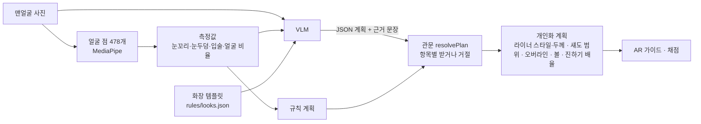
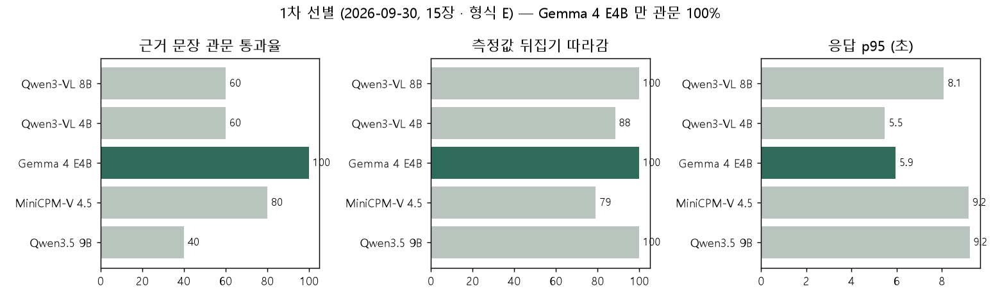
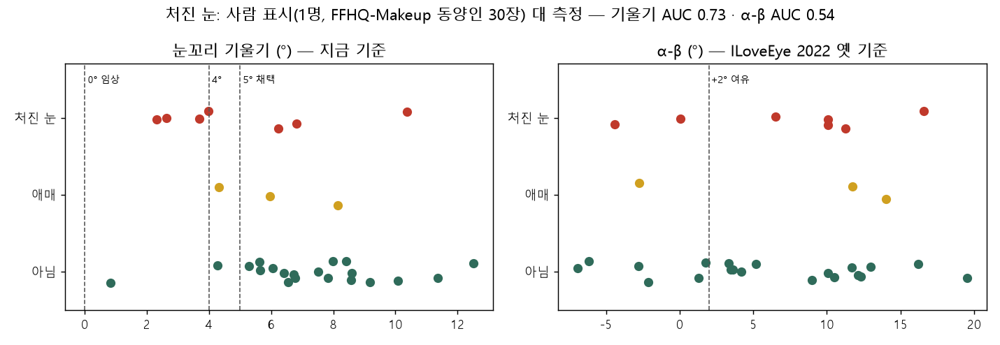
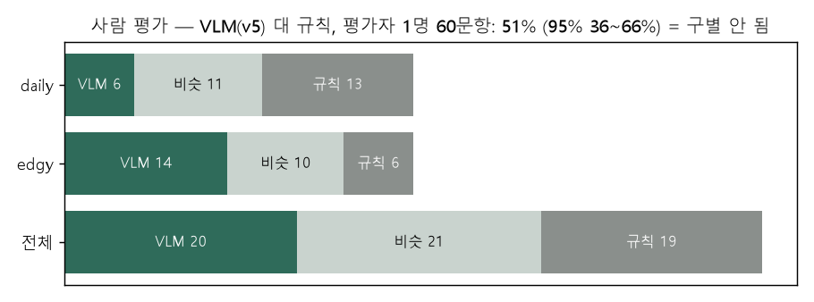
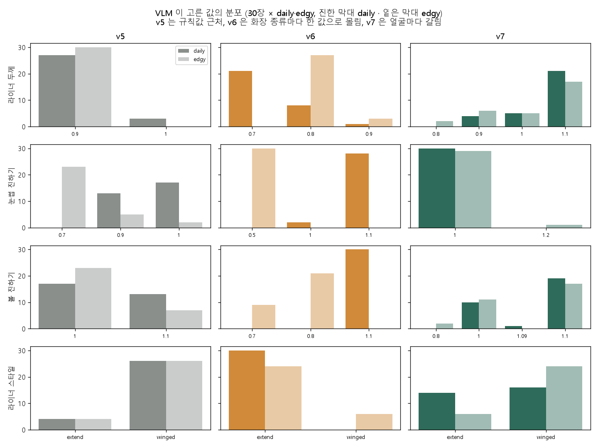
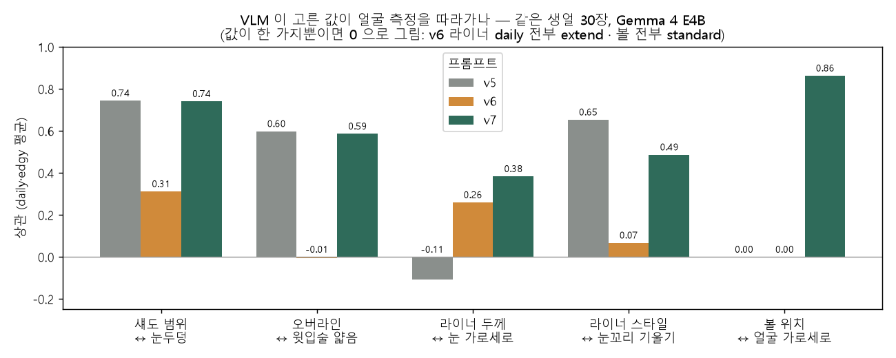

# VLM 개인화 — 한 것과 결과 (2026-09-29 ~ 10-02)

> **상태: 폐기 검토 중.** 이 문서는 VLM 으로 "화장을 이 사람 얼굴에 맞게 조정"하려던 시도를 처음부터 끝까지 남긴다.
> 다시 시작하거나 다른 방식(측정값 + 텍스트 LLM 등)으로 갈 때 같은 실험을 되풀이하지 않게 하려는 기록이다.

## 한 줄 결론

**작은 VLM(Gemma 4 E4B, 12GB GPU)은 사진을 보고 얼굴마다 다르게 판단하지 못했다.** 우리가 글로 준 측정값을 따르면 규칙과 같아지고(v5),
규칙값을 빼면 화장 종류마다 한 값으로 몰렸고(v6), 측정값에 "보통 얼굴과 비교한 말"을 붙이면 그 말을 따라 얼굴마다 달라졌다(v7) —
어느 경우에도 **사진 자체는 거의 쓰지 않았다** (다른 사람 사진을 넣어도 결정이 비슷했다). 사람 평가 1회(평가자 1명)에서 VLM 계획과 규칙 계획은 구별되지 않았다(51%).

---

## 1. 무엇을 만들려 했나

- 템플릿(10종)의 **색은 그대로**, 모양·범위·진하기 **배율**만 바꾼다. 항목과 범위는 [§7](#7-화장-수치는-어떻게-되어-있나)
- VLM 제안은 믿지 않는 JSON — 관문이 항목별로 측정·범위와 대조해 받거나 거절하고, 거절된 항목은 규칙값
- 서버: llama.cpp `llama-server`, 제약 디코딩(JSON 스키마), 온도 0 · seed 42 (`docs/vlm-server-handoff.md`)

## 2. 실험 환경

| 무엇 | 값 |
|---|---|
| PC | 학원 PC, RTX 3060 12GB · llama.cpp b11243 (CUDA 12.4) |
| 후보 모델 | Qwen3-VL 8B · Qwen3-VL 4B · **Gemma 4 E4B** · MiniCPM-V 4.5 · Qwen3.5 9B (GGUF Q4 + mmproj) |
| 사진 | FFHQ-Makeup 맨얼굴 중 동양인 240장(FairFace 분류) → 평가 30장. **CC BY-NC-SA 4.0 — 평가 전용, 학습 금지, 저장소에 사진 안 넣음** (`eval/samples/`) |
| 코드 | `eval/vlm/` — 측정·프롬프트·관문·템플릿·렌더러는 앱 코드를 그대로 불러 쓴다 (`entry.ts`) |
| 결과 | 숫자 `eval/results/2026-09-*_vlm_*.csv`, `2026-10-01_vlm_*.csv` · 원본 응답·평가지 `$DHE_DATA_DIR/vlm-eval/` |

## 3. 진행 순서와 결과

### 3.1 프롬프트 형식 — 예시를 베끼는 문제 (형식 A → E)

- 앱 원래 프롬프트(A)는 **답 예시 JSON 을 얼굴과 상관없이 그대로 베꼈다** → 개인화가 아예 안 됐다
- 형식 E 로 고침: 예시 없음 · **관찰 → 근거 → 결정** 순서 · 숫자는 0.1 단위 **선택지(enum)** · 근거 지시는 금지어 대신 긍정형
- llama.cpp 는 JSON 스키마의 소수 `minimum/maximum` 을 강제하지 않는다(0.45 가 나옴) → 숫자도 enum 으로
- 생각 모드가 있는 모델(Gemma 4 · MiniCPM · Qwen3.5)은 `enable_thinking:false` 를 안 주면 답이 전부 생각 칸으로 가서 본문이 빈다

### 3.2 모델 선정 — Gemma 4 E4B (2026-09-30)

| 단계 | 결과 |
|---|---|
| 1차 (5개, 15장) | Gemma 4 E4B 만 관문 100%. Qwen 계열은 근거 문장이 40~60% 거절 (숫자·길이) |
| 2차 (Gemma · Qwen3.5, 30장) | Gemma: 관문 100%, 측정값 뒤집기 따라감 100%, p95 5.8초. Qwen3.5: 관문 52%, p95 9.3초 |
| 새 템플릿 재확인 (look-v0.2) | Gemma: 관문 100%, 따라감 98.9%, p95 5.5초 → 선정 그대로 |
| **사진 근거** (모든 모델) | 같은 글에 **다른 사람 사진**을 넣었을 때 결정이 바뀐 정도 − 밝기만 바꿨을 때 바뀐 정도 = **+5~16%p** — 모두 사진을 거의 안 봄 |

→ E 형식 · Gemma 4 E4B 를 앱으로 옮김 (PR #258, `vlm-prompt-v2`). 서버 인수인계 `docs/vlm-server-handoff.md` (VRAM 약 8.3GB).

### 3.3 처진 눈 판정 — 논문 규칙이 틀렸다 (ILoveEye → 눈꼬리 기울기 5°)

- 처음 규칙: ILoveEye 2022 의 **α > β (+2°)** → 30장 중 21장이 처진 눈. α > β 는 눈꼬리 방향이 아니라 **윗꺼풀이 아랫꺼풀보다 높게 굽은 정도**(평균 약 2.6배)를 잰다. 윗꺼풀 꼭대기 점(159 · 158)에 따라 α−β 가 약 12° 뒤집혔다
- 사람이 30장을 표시(처진 눈 7 · 아님 20 · 애매 3, `eval/vlm/droop_label.py`) → **눈꼬리 기울기 AUC 0.73**, α−β 0.54(무작위 수준)
- 임상 0° 경계는 사람 표시 7장 중 0장을 잡음 — 처진 눈은 "아래로 기운 눈"이 아니라 "평균보다 덜 올라간 눈"
- **5° 채택** (Lee 2020 JKAOMS class I 경계, Jung 2020 한국 20대 여성 8.4~8.8° ± 3° 의 −1.2 SD) — 사람 표시와 27장 중 22장 일치 (4° 는 23장). PR #264 · #266 · #275
- 윗꺼풀 피부가 눈꼬리를 덮어 처져 보이는 눈은 얼굴 점으로 안 잡힌다 (7장 중 3장)

얼굴 예시 (저장소 밖 — 사진 라이선스): `$DHE_DATA_DIR/vlm-eval/out/docs/droop-examples.png` — 맞게 잡은 눈 · 덮인 눈꺼풀이라 못 잡은 눈 · 5° 라서 잘못 잡은 눈

### 3.4 사람 평가 1회 — 구별 안 됨

- 평가지: 같은 얼굴에 규칙 계획 · VLM 계획을 **앱 렌더러로 그려** A/B 로 보여 주고 A · 비슷함 · B (누가 VLM 인지 가림). `report.py --sheet`
- 평가자 1명 · 60문항 (FFHQ 30장 × daily · edgy, 5° · v5): **VLM 20 · 규칙 19 · 비슷 21 → 51% (95% 36~66%)**
- daily 는 규칙, edgy 는 VLM 쪽이 많았지만 평가자 1명이라 결론 못 냄
- **A 자리 쏠림**: A 26 대 B 13 — 평가자마다 순서·A/B 를 섞어야 한다 (안 넣음)
- 리포트의 "승률 > 50% → 통과"는 점추정 기준이라 이 결과에도 "통과"로 찍힌다 — 신뢰구간 하한으로 바꿔야 한다 (안 고침)

### 3.5 평가 사진을 생얼 · 정면 30장으로 교체

- FFHQ-Makeup 의 "bare" 사진에도 **실제 화장(립스틱 · 아이라이너 · 컬러렌즈)** 이 꽤 있었다
- Gemma 로 화장 여부를 판별해 봤지만 모든 부위에 같은 답(옅음/없음)을 내서 못 씀 → **사람이 사진을 보고 골랐다** (정면 순위 150위 안 110장 → 생얼 확실 27 + 애매 10 → 사용자가 30장 확정)
- 새 30장으로 v5(5°) 다시 확인: 관문 100%, 뒤집기 98.9%, p95 5.9초 (`2026-10-01_vlm_bare-gemma4_e4b.csv`)

### 3.6 VLM 에게 자유를 주면? (v6) · 얼굴을 보게 하면? (v7)

사람 평가에서 VLM 계획이 규칙과 거의 같았다 — 그래서 비교가 안 됐다. 같은 생얼 30장에서 세 프롬프트를 비교했다.

| | v5 (main) | v6 — 자유만 줌 | v7 — 얼굴을 보게 함 |
|---|---|---|---|
| 바꾼 것 | (E 형식 + 규칙 출발점 · 얼굴별로 좁힌 선택지) | 선택지 0.6~1.4 · 진하기 0.5~1.5 · 오버라인 ~0.5, 얼굴별 좁힘 해제, **규칙 출발점 뺌** | v6 + 측정값마다 **보통 얼굴과 비교한 말**("좁은 눈두덩"), 관찰은 "보통과 다른 점", 근거는 "얼굴 특징 먼저", 이유 없으면 1 |
| 규칙값과 크게 다른 항목 (계획당, 배율 ±0.2 이상 · 종류 다름, 진하기 포함) | 1.2 | 3.3 | 1.6 — 덜 바꾸지만 얼굴 따라 바꿈 |
| 관문 (결정 / 근거) | 100 / 100% | 100 / 100% | 100 / **95%** (40자 넘침) |
| p95 | 5.9초 | 6.4초 | 6.4초 |
| 무엇을 따랐나 | 규칙 (글로 준 출발점) | **화장 종류** — daily 30장 전부 진하기 1.1 · `extend`, edgy 눈썹 전부 0.5 | **글로 준 비교 말** — 얼굴마다 갈림 |

- v5 의 높은 상관은 VLM 이 아니라 **규칙**이 만든 것 (프롬프트에 규칙값을 줬고 그대로 따랐다)
- v6 은 규칙과 달라졌지만 얼굴과 무관 — 근거 문장도 얼굴마다 거의 같았다 ("눈두덩이에 은은한 음영을 주어 눈매를 자연스럽게 강조했어요")
- v7 은 근거에 얼굴 특징이 들어감 ("눈두덩이가 좁아 보이므로 섀도우의 높이를 낮춰…"), 볼 위치 ↔ 얼굴 비율 0.86
- **그러나 v7 도 사진은 안 봤다** — 다른 사람 사진을 넣어도 결정이 비슷 (같은 비교 말을 받으니까). v7 은 사실상 "측정 → 값" 을 LLM 이 하는 셈

렌더 예시 (저장소 밖 — 사진 라이선스): `$DHE_DATA_DIR/vlm-eval/out/docs/examples-v5v6v7.png` — 같은 얼굴에 규칙 · v6 · v7 계획을 앱 렌더러로 그린 것 (daily, v7 이 규칙과 가장 많이 다른 3장). **화면 크기에서는 차이가 작아 보인다** — 배율 0.1~0.2 차이는 얼굴 전체 사진에서 잘 안 보인다

v6 · v7 코드는 **`vlm-freedom` 브랜치에만** 있다 (병합 안 함, 커밋 51f4898). main 은 v5.

## 4. 된 것 · 안 된 것

| 된 것 | 안 된 것 |
|---|---|
| 예시를 베끼는 문제 해결 (형식 E), 관문 100% 인 모델 · 프롬프트 | **사진을 보고 판단** — 모든 모델 · 모든 프롬프트에서 사진 근거 약함 |
| 처진 눈 판정을 사람 판단에 맞춤 (ILoveEye → 기울기 5°) | 사진으로만 알 수 있는 것: 쌍꺼풀 · 덮인 눈꺼풀 · 타고난 눈썹/입술 색 · 피부 번들거림 |
| 측정값에 맞춰 얼굴마다 다른 계획 (v7) | VLM 계획이 규칙보다 **보기 좋다는 증거** (사람 평가 51%, 1명) |
| 앱 렌더러로 그린 블라인드 평가지 · 처진 눈 표시지 · 집계 | 평가자별 순서 섞기, 신뢰구간 기준 |

## 5. 남는 것 (폐기해도 쓸 수 있는 것)

| 무엇 | 어디 | 비고 |
|---|---|---|
| 처진 눈 = 기울기 < 5° | `client/src/core/personalize.ts` (main) | **규칙 · 채점이 같이 쓴다 — VLM 을 버려도 남긴다** |
| 측정값 + 보통 얼굴 기준 | `face-measure.ts` · v7 의 `FACE_NORMS` (vlm-freedom) | 동양인 240장 사분위 |
| 블라인드 A/B 평가지 (앱 렌더러) | `eval/vlm/report.py --sheet`, `render_sheet.ts` | 규칙 변경 · 템플릿 비교에도 쓸 수 있다 |
| 사람 표시지 → 측정 방법별 AUC · 경계 | `eval/vlm/droop_label.py` | 다른 판정(쌍꺼풀 등)에도 같은 틀 |
| 동양인 사진 목록 · 추출 스크립트 | `eval/samples/` | 사진은 저장소 밖 |
| llama.cpp 서버 설정 · 계약 | `docs/vlm-server-handoff.md` | 텍스트 LLM 으로 바꿔도 대부분 같다 |

**폐기할 때 정리할 곳** (아직 손대지 않음): `client/src/core/vlm-flow.ts` · `vlm-client.ts` · `vlm-prompt.ts`, `main.ts` 의 `vlm.plan` 호출, 화면의 VLM 실패 처리(`looks.ts`), 서버. `resolvePlan` 은 VLM 제안 없이도 규칙 계획을 내므로 남겨도 된다.

## 6. 배운 것

1. **작은 VLM 은 글을 읽는다, 사진을 보지 않는다.** 측정값을 글로 주면 그걸 따르고, 안 주면 화장 종류의 "취향"으로 몰린다. 사진 근거를 재는 대조군(다른 사람 사진)을 처음부터 넣은 덕에 알 수 있었다
2. **예시를 주면 베낀다** (값도, 나쁜 예 문장도)
3. **논문 규칙도 사람 판단으로 확인해야 한다** — ILoveEye α>β 는 정의대로 구현해도 눈꼬리 방향을 재지 못했다
4. **"bare" 데이터셋도 화장이 있다** — 사진은 사람이 직접 봐야 한다 (VLM 판별 실패)
5. **배율 0.1~0.2 차이는 화면에서 잘 안 보인다** — 개인화 효과를 사람이 느끼려면 더 큰 차이가 필요할 수 있다
6. **평가 1명 · 60문항으로는 51% 와 60% 를 구별 못 한다** — 평가자 수를 먼저 정한다

## 7. 화장 수치는 어떻게 되어 있나

템플릿(`rules/looks.json`, look-v0.2, 10종)이 부위별 **색(RGB) · 진하기(alpha) · 두께(눈 폭 비율) · 섀도 그러데이션**을 고정하고, 개인화 계획이 그 위에 곱한다 (`personal-guide.ts`, `makeup-paint.ts`).

| 계획 항목 | 하는 일 | 규칙값 | VLM 범위 v5 → v6/v7 |
|---|---|---|---|
| `liner.style` | 꼬리 winged · extend · drop | 처진 눈 extend, 아니면 winged | drop 은 처진 눈만 → 모두 |
| `linerThick.scale` | 라이너 두께 × | 1 | 0.8~1.2 → 0.6~1.4 |
| `shadow.range` | 섀도 높이(0.55) × | 눈두덩으로 계산 0.8~1.2 | 측정 방향만 → 0.6~1.4 |
| `lip.overline` | 윗입술 가운데 올림 (윗입술 두께 비율) | 얇으면 최대 0.3 | 0~0.3 → 0~0.5 |
| `blush.position` / `size` | 볼 ±얼굴 폭 3% / 크기 × | 표준 / 1 | 0.8~1.2 → 0.6~1.4 |
| `highlight.tZone` | T존 하이라이트 | 켬 | 켬 · 끔 |
| `faceShape` | 쉐딩 · 하이라이트 자리 | ⑤ 판정 | 5종 |
| `intensity.<부위>` | 진하기 × (눈썹 · 라이너 · 섀도 · 입술 · 볼) | 1 | 0.7~1.3, 눈썹 ≤ 1 · 눈 ≤ 1.15 → 0.5~1.5, 평균 ≤ 1.15 |

**색은 개인화가 바꾸지 못한다** — 피부 톤 · 입술색에 맞춘 개인화는 계획 항목을 새로 만들어야 한다.

## 8. 다시 한다면

1. **사진 없이 측정값만 텍스트 LLM 에** — v7 이 사실상 그렇게 동작했다. 사진 업로드가 없어지고(개인정보), 빠르고, 같은 GPU 로 더 큰 모델을 쓸 수 있다. 먼저 v7 을 사진 없이 돌려 결정이 같은지 확인 (30분)
2. **색 측정 추가** — 입술색 · 눈썹 진하기(이마 대비) · 피부 톤 · 번들거림은 지금 파이프라인(`color.ts` · `sampling.ts`)으로 숫자를 뽑을 수 있다. 쌍꺼풀 · 덮인 눈꺼풀은 얼굴 점으로 어렵다 — 그것만 눈 부분을 잘라 VLM 에 객관식으로 묻는 방법이 남는다
3. **표시 세트를 먼저** — 사람이 30장에 정답을 표시하고 측정 · 모델의 정확도를 잰다 (처진 눈과 같은 방법)
4. **사람 평가는 평가자 여러 명 · 순서 섞기 · 신뢰구간 기준으로**

## 9. 어디에 무엇이 있나

| 무엇 | 어디 |
|---|---|
| 실험 코드 · 사용법 | `eval/vlm/` · `eval/vlm/README.md` |
| 숫자 결과 | `eval/results/2026-09-30_vlm_compare-{sel,fin,chk}.csv`, `2026-10-01_vlm_{tilt,tilt4,tilt5,bare,free,face}-gemma4_e4b.csv` |
| 그래프 (이 문서) | `docs/reports/img/vlm-0*.png` (얼굴 없음) — `eval/results` CSV 와 `$DHE_DATA_DIR/vlm-eval/runs` 응답으로 그림 |
| 얼굴 예시 · 평가지 · 원본 응답 | `$DHE_DATA_DIR/vlm-eval/` — `out/docs/` (예시), `out/sheet-*.html` (평가지), `runs/` (응답), `labels/` · `ratings/` (사람 표시 · 평가) |
| 평가 사진 | `$DHE_DATA_DIR/vlm-eval/photos` (생얼 30장), 옛 30장 `old30/`, 후보 풀 `$DHE_DATA_DIR/pool/vlm-eval` (240장) |
| v6 · v7 코드 | `vlm-freedom` 브랜치 |
| 처진 눈 논문 근거 | `docs/research/papers/개인화 근거/[JKAOMS 2020] …`, `[AAPS 2020] …` |
| 관련 PR | #254 (사진 목록) · #258 (E 확정 · 인수인계) · #264 · #266 · #275 (처진 눈) |
