# 가짜 정답을 생성하지 않는 비지도 화장 전이를 위한 내용–스타일 분리

> **원문** Zhaoyang Sun, Shengwu Xiong, Yaxiong Chen, Yi Rong. *Content-Style Decoupling for Unsupervised Makeup Transfer without Generating Pseudo Ground Truth.* arXiv:2405.17240v1 [cs.CV], 2024-05-27. https://arxiv.org/abs/2405.17240
>
> **라이선스** 원문은 [CC BY-NC-SA 4.0](http://creativecommons.org/licenses/by-nc-sa/4.0/)으로 배포됩니다. 이 한국어 번역본도 같은 라이선스를 따릅니다(비영리, 출처 표시, 동일 조건 변경 허락).
>
> **변경 사항** 영어 원문을 한국어로 번역했습니다. 그림은 원문에서 잘라 캡션 앞에 넣었고, 참고문헌 목록은 생략했습니다(본문의 [숫자]는 원문 참고문헌 번호). 수식은 원문 기호를 유지하고 풀어 썼습니다. 원저자가 검토한 번역이 아닙니다.

**용어 대응** — source: 원본 · reference: 참조 · pseudo ground truth(PGT): 가짜 정답 · low-frequency(LF): 저주파 · high-frequency(HF): 고주파 · content: 내용 · makeup style: 화장 스타일 · face parsing: 얼굴 분할

---

## 초록

실제 목표 이미지가 없어 모델 학습을 이끌 수 없다는 것은 화장 전이 과제의 주요 문제 중 하나다. 기존 방법 대부분은 가짜 정답(PGT)을 합성해 이 문제를 다룬다. 그러나 생성된 PGT는 흔히 최적이 아니며, 그 부정확함이 결국 성능 저하로 이어진다. 이 문제를 완화하기 위해, 본 논문에서는 완전히 비지도 방식으로 동작해 PGT 생성의 부정적 영향을 없애는 새로운 **내용–스타일 분리 화장 전이(Content-Style Decoupled Makeup Transfer, CSD-MT)** 방법을 제안한다. 구체적으로, 주파수 특성 분석에 근거해 얼굴 이미지의 저주파(LF) 성분은 화장 스타일 정보와 더 관련되고, 고주파(HF) 성분은 내용 세부와 더 관련된다고 가정한다. 이 가정 덕분에 CSD-MT는 주파수 분해를 통해 각 얼굴 이미지의 내용과 화장 스타일 정보를 분리할 수 있다. 그 뒤 CSD-MT는 전이 결과와 입력 이미지들 사이에서 이 두 종류의 정보의 일관성을 각각 최대화함으로써 화장 전이를 실현한다. 새로 설계한 손실 함수 두 개도 도입해 전이 성능을 더 높인다. 폭넓은 정량·정성 분석이 CSD-MT의 효과를 보여 준다. 코드는 https://github.com/Snowfallingplum/CSD-MT 에서 볼 수 있다.

## 1. 서론

원본 얼굴 이미지와 참조 얼굴 이미지 한 쌍이 주어졌을 때, 화장 전이의 주된 목표는 다음 조건을 동시에 만족하는 이미지를 생성하는 것이다. (1) 립스틱, 아이섀도, 파우더 블러셔처럼 참조 이미지에서 옮겨 온 화장 스타일을 담는다. (2) 정체성, 얼굴 구조, 배경을 포함한 원본 이미지의 내용 세부를 보존한다. 이 기술은 전자상거래, 엔터테인먼트, 뷰티 산업에서의 큰 경제적 잠재력 때문에 널리 연구되어 왔고 컴퓨터 비전과 인공지능 분야에서 점점 더 주목받고 있다. 하지만 화장 스타일의 다양성과 복잡성을 고려하면 화장 전이는 여전히 어려운 과제다.

화장 전이 과제의 주요 문제 중 하나는 그 비지도적 성격이다. 즉 모델 학습을 이끌 목표 정답으로 쓸 수 있는 실제 전이 이미지가 없다. 이 문제를 해결하기 위해 기존 방법 대부분[3, 7, 9, 15, 19, 23, 25, 29, 32, 35]은 입력된 원본–참조 이미지 쌍마다 **가짜 정답(PGT)** 이미지를 합성해 대체 감독 목표로 쓰자고 제안한다. 그 뒤 생성된 전이 결과와 그에 대응하는 PGT의 차이를 최소화하도록 모델 파라미터를 최적화한다(그림 1(a)).

그림 2에서 보듯, 사용된 PGT 생성 전략에 따라 기존 화장 전이 방법은 대략 두 범주로 나눌 수 있다. (1) **히스토그램 맞추기 기반** 방법[3, 9, 15, 17, 35]은 원본 이미지의 각 얼굴 영역(예: 입술, 눈, 얼굴 영역)의 색 분포를 참조 얼굴의 같은 영역과 맞추려 한다. 하지만 이 전략으로 만든 PGT는 화장 스타일의 공간 정보를 모두 버리며, 원본과 참조 이미지 사이의 큰 색 차이(예: 아이섀도와 파우더 블러셔)에 흔히 취약하다. (2) **기하 왜곡 기반** 방법[7, 23]은 참조 얼굴의 모양(보통 몇몇 얼굴 랜드마크로 표현)이 원본과 맞도록 참조 얼굴을 휘어서 PGT를 합성한다. 그러나 이 과정은 원치 않는 인공물을 자주 만들고 원본 내용 정보의 손실로도 이어진다. 결과적으로 이런 저품질 PGT는 위에서 말한 모든 방법의 전이 성능을 떨어뜨린다. 최근 연구[29]가 혼합 전략으로 더 효과적인 PGT를 만들려 했지만, 생성된 PGT는 여전히 최적이 아니며 그 부정확함이 최종 전이 결과에 심각한 영향을 준다.

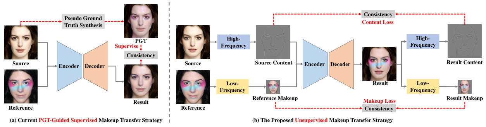

> **그림 1.** 학습 전략 비교. (a) 현재의 PGT 유도 지도 학습 화장 전이 전략: 원본·참조에서 가짜 정답을 합성하고, 인코더–디코더의 결과가 이를 따라가도록 감독한다. (b) 제안하는 비지도 화장 전이 전략: 원본의 고주파(내용)와 결과의 고주파를 일치시키는 내용 손실, 참조의 저주파(화장)와 결과의 저주파를 일치시키는 화장 손실을 쓴다.

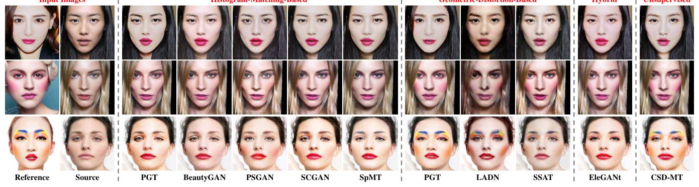

> **그림 2.** 여러 범주의 화장 전이 방법이 생성한 PGT와 전이 결과. 히스토그램 맞추기 기반(BeautyGAN, PSGAN, SCGAN, SpMT), 기하 왜곡 기반(LADN, SSAT), 혼합(EleGANt), 비지도(CSD-MT).

PGT의 이런 부정적 영향을 없애기 위해, 본 논문에서는 PGT를 전혀 생성하지 않고 완전히 비지도 방식으로 동작하는 새로운 CSD-MT 방법을 제안한다. 이를 위한 중요한 관찰 하나는, **같은 얼굴 이미지의 화장 전후 주된 차이가 저주파(LF) 성분에 집중되어 있고 고주파(HF) 성분은 거의 변하지 않는다**는 것이다. 따라서 얼굴 이미지의 LF 성분은 화장 스타일 정보와 더 관련되고 HF 성분은 내용 세부와 더 관련된다고 가정할 수 있다. 이 가정으로 CSD-MT는 먼저 각 입력·출력 이미지에 주파수 분해를 수행해 내용과 화장 스타일을 분리한다. 그리고 모델 학습에서 CSD-MT는 HF·LF 성분에 근거해 전이 결과가 원본 이미지와는 내용 일관성을, 참조 이미지와는 화장 일관성을 갖도록 각각 동시에 최대화한다(그림 1(b)). 또한 화장의 공간 정보와 색 정보의 전이를 강화하는 새로운 손실 함수 두 개를 도입한다. 제안한 CSD-MT의 효과는 다양한 화장 스타일과 여러 자세·표정 변화를 포함하는 공개 데이터셋 세 개에서 평가한다. 주요 기여는 다음과 같다.

- 완전히 비지도 방식으로 동작하는 새로운 내용–스타일 분리 화장 전이(CSD-MT) 방법을 제안한다. 주파수 분해에 기반해 CSD-MT는 처음으로 가짜 정답 생성의 필요를 없앤다.
- 화장의 공간·색 정보 전이를 돕기 위해 새로 설계한 손실 함수 두 개, 즉 **자기 증강 재구성 손실**과 **색 대조 손실**을 도입한다.
- 세 데이터셋에서의 폭넓은 정량·정성 비교는 CSD-MT가 최신 화장 전이 방법 일곱 개보다 뛰어남을 보여 준다. 또한 절제 연구는 제안한 비지도 학습 전략이 PGT 유도 학습보다 우수함을 검증한다.

## 2. 관련 연구

### 2.1 화장 전이

지난 10년간 화장 전이는 컴퓨터 비전 분야에서 점점 더 주목받아 왔다. PGT 생성 전략에 따라 기존 방법은 대략 두 범주로 나눌 수 있다. (1) 히스토그램 맞추기 기반 방법 중 BeautyGAN[15]은 히스토그램 맞추기 손실을 처음 도입하고, 화장 전이와 제거를 동시에 수행하는 이중 입력/출력 GAN을 설계했다. 어긋난 머리 자세와 얼굴 표정을 다루기 위해 SCGAN[3]은 부위별 화장 영역을 공간 불변 스타일 코드로 인코딩하고, PSGAN[9, 17]은 어텐션 메커니즘으로 원본 이미지에 따라 화장 특징 맵을 적응적으로 변형한다. CPM[19]은 이미지를 각 픽셀이 얼굴의 특정 의미점에 대응하는 UV[5] 공간으로 변환해 의미 정렬 문제를 우회한다. RamGAN[28]과 SpMT[35]는 서로 다른 화장 부위 사이의 잠재적 연관을 없애기 위해 국소 어텐션을 탐구한다. (2) 기하 왜곡 기반 방법 중 PairedCycleGAN[2]은 결과와 참조 이미지 사이의 화장 일관성을 재는 스타일 판별기를 학습한다. 극단적 화장 사례를 위해 LADN[7]은 서로 겹치는 여러 국소 화장 스타일 판별기를 쓴다. 색 충실도를 보장하기 위해 FAT[25]와 SSAT[23]는 교차 어텐션[24]으로 두 입력 이미지 사이의 의미 대응을 계산한다. 또한 최근의 EleGANt[29]는 두 PGT에 서로 다른 가중치를 동적으로 할당해 장점을 결합하는 혼합 전략으로 더 효과적인 PGT를 얻는다.

전이 성능이 PGT의 품질에 크게 좌우되는 위 방법들과 달리, CSD-MT의 목표는 PGT 생성의 부정적 영향을 없애는 **PGT 없는** 화장 전이 방법을 탐구하는 것이다.

### 2.2 주파수 분해

주파수 분해는 분류[6, 27], 이미지 합성[4, 13], 이미지 변환[14, 16, 30] 등 다양한 과제에서 효과를 보여 왔다. 예를 들어 LRR[6]은 라플라시안 피라미드[1]로 의미 분할의 경계 세부를 다듬는다. LapSRN[13]은 고해상도 이미지의 HF 잔차를 점진적으로 복원하는 여러 생성기로 이루어진다. WTC2[30]는 웨이블릿 변환으로 고해상도 이미지의 스타일화 과정을 가속한다. 화장 전이에 대해 우리는 같은 얼굴 이미지의 화장 전후 주된 차이가 LF 성분에 집중되고 HF 성분은 거의 변하지 않음을 관찰한다. 따라서 위 방법들과 달리 우리의 주파수 분해 목표는 얼굴 이미지에서 내용 정보와 화장 스타일을 분리하는 것이다.

## 3. 방법

### 3.1 문제 정의

X와 Y를 각각 화장하지 않은 원본 도메인과 화장한 참조 도메인이라 하자. 일반적으로 X와 Y의 이미지 표본은 짝이 없다. 즉 원본과 참조 이미지는 서로 다른 정체성을 가진 다른 사람들에게서 수집되며, 각 참조 얼굴은 고유한 화장 스타일을 보여 준다. 원본·참조 이미지 쌍 {(x, y) | x ∈ X, y ∈ Y}가 입력으로 주어졌을 때, 화장 전이의 주된 목표는 x의 내용 정보를 최대한 보존하면서 y와 같은 화장 스타일을 담은 전이 결과 x̂를 생성하는 것이다. 이 과제는 특정 조건이 붙은 도메인 간 이미지 변환 문제로 볼 수 있으며, 비지도적 성격이 이를 더욱 어렵게 만든다.

### 3.2 내용과 화장 스타일의 분리

PGT를 생성하지 않고 화장 전이 과제를 풀기 위해, 우리는 입력 이미지 (x, y) 자체에서 내용과 화장 스타일의 감독 신호를 찾아 x̂의 해당 정보를 정확히 제어하고자 한다. 이를 위해 이 두 종류 정보의 주파수 특성을 조사한다. MT 데이터셋[15]에서 테스트 이미지 500쌍을 무작위로 골라, 각 원본 이미지와 여러 방법이 생성한 해당 전이 결과에 주파수 분해를 수행한다. 더 구체적으로, 높이 H와 너비 W를 갖는 임의의 이미지 x ∈ ℝ^(H×W×3)가 주어지면 먼저 얼굴 분할 기법[31]으로 배경 영역 x_bg를 제거한다. 그 뒤 남은 전경 얼굴 이미지 x_fg에 고정된 가우시안 커널을 적용해 저역 통과 예측 x_l ∈ ℝ^((H/d)×(W/d)×3)을 계산한다. 여기서 d는 다운샘플링 계수다. 이를 바탕으로 고주파 잔차 x_h ∈ ℝ^(H×W×3)는 최종적으로 x_h = x_fg − up(x_l)로 얻는다. up(·)는 쌍선형 보간 업샘플링 연산이다.

그림 3에서 원본과 전이 이미지 사이에서 분해된 LF·HF 성분의 평균 제곱 오차(MSE)를 측정했다. LF 성분에서 계산된 MSE 값이 HF 성분에서 얻은 값보다 훨씬 크다는 것을 볼 수 있다. 이는 같은 얼굴 이미지의 화장 전후 주된 차이가 주로 LF 성분에 집중되고 HF 성분은 거의 변하지 않음을 시사한다. 그림 3의 시각적 비교도 이 주장을 뒷받침한다. 따라서 얼굴 이미지의 LF 성분은 화장 스타일 정보와 더 관련되고, HF 성분은 내용 세부와 더 관련된다고 가정할 수 있다. 이 가정으로 위에서 설명한 주파수 분해 과정을 통해 각 얼굴 이미지에 담긴 내용 정보와 화장 스타일을 적절히 분리할 수 있다.

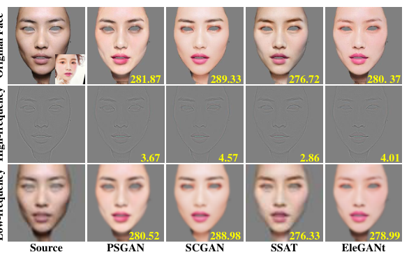

> **그림 3.** 원본 이미지와 전이 결과에서 분해한 주파수 성분의 시각화. 저주파 성분은 보기 좋게 크기를 조정했다. 원본과 전이 결과 사이 각 성분의 평균 제곱 오차를 왼쪽 아래에 표기했다.
>
> *(역자 주: 그림 속 수치는 PSGAN · SCGAN · SSAT · EleGANt 결과마다 표기되어 있으며, 저주파 쪽이 약 276~289, 고주파 쪽이 약 2.9~4.6이다. 그림에 적힌 값은 281.87 · 289.33 · 276.72 · 280.37 · 280.52 · 288.98 · 276.33 · 278.99와 3.67 · 4.57 · 2.86 · 4.01이다. PDF에서 텍스트로 뽑으면 배치가 흐트러져 어느 값이 어느 칸인지 정확히 대응시킬 수 없었다 — 위 그림에서 확인하십시오.)*

### 3.3 제안하는 CSD-MT 방법

전이 성능 향상이 주로 제안한 비지도 학습 전략에서 온다는 것을 부각하기 위해, CSD-MT는 비교적 간결한 구조로 설계했다. 그림 4에서 보듯 CSD-MT의 생성기 G는 **의미 대응 모듈**과 **화장 렌더링 모듈**을 포함하며, 다음 소절에서 자세히 설명한다.

**의미 대응 모듈.** 일반적으로 머리 자세와 얼굴 표정의 차이 때문에 입력 원본 이미지 x와 참조 이미지 y에서 같은 얼굴 부위가 서로 다른 공간 위치에 나타나는 경우가 많으며[9, 23, 29], 이런 의미 어긋남은 결국 성능 저하로 이어진다. 이를 완화하기 위해 의미 대응 모듈은 코사인 유사도를 계산해 픽셀 단위 상관 행렬 M을 구성한다.

$$M(i, j) = \frac{f_x(i)^\top f_y(j)}{\|f_x(i)\|_2 \, \|f_y(j)\|_2} \tag{1}$$

여기서 f_x = E_sc(x), f_y = E_sc(y)는 합성곱 인코더 E_sc(·)로 추출한 의미 특징이다. f_x와 f_y는 모두 입력 이미지의 LF 성분과 같은 공간 해상도, 즉 (H/d) × (W/d)를 갖는다. f(i)는 f의 i번째 픽셀의 특징 벡터이고, M(i, j)는 M의 (i, j) 위치 원소다. 우리는 상관 행렬 M을 변형 사상 함수로 보고, 화장 렌더링 모듈에서 원본과 참조 이미지 사이의 의미 정렬을 달성하는 데 사용한다.

**화장 렌더링 모듈.** 입력 이미지에 얼굴 분할과 주파수 분해를 수행하면, 원본 이미지 x의 내용 정보를 담은 배경 영역 x_bg와 HF 성분 x_h, 그리고 참조 이미지 y의 화장 스타일을 담은 LF 성분 y_l을 얻을 수 있다. 그 뒤 식 (1)의 상관 행렬 M으로 y_l을 다음과 같이 공간적으로 변형한다.

$$\hat{y}_l(i) = \sum_j \mathrm{Softmax}\big(M(i, j)/\tau\big) \cdot y_l(j) \tag{2}$$

여기서 Softmax(·)는 열 차원을 따라 계산되는 소프트맥스로 M의 각 행 원소 값을 정규화하며, τ > 0은 온도 파라미터다. M에 근거해 ŷ_l의 각 픽셀은 x와 y 사이의 의미 대응에 따라 y_l의 해당 픽셀들로부터 정보를 모은다. 따라서 변형된 ŷ_l은 원본 이미지와 의미적으로 정렬된다.

마지막으로 화장 렌더링 모듈은 x_bg, x_h, ŷ_l에 근거해 최종 전이 결과 x̂를 생성한다.

$$\hat{x} = G_{mr}([x_{bg}, x_h], \hat{y}_l) \tag{3}$$

여기서 [·, ·]는 채널 방향 연결 연산이다. G_mr(·, ·)는 U-Net 구조로 구현한 인코더–디코더 네트워크다. G_mr(·, ·)에서 조건 화장 정보는 SPADE 모듈[20]을 통해 들어가며, 그 변조 파라미터는 ŷ_l에서 생성된다.

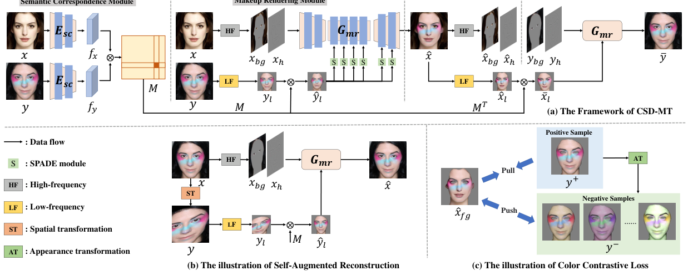

> **그림 4.** 제안하는 CSD-MT 프레임워크. (a) 원본 이미지 x와 참조 이미지 y가 주어지면, 의미 대응 모듈이 먼저 둘 사이의 픽셀 단위 상관 행렬 M을 구성한다. 다음으로 얼굴 분할과 주파수 분해를 수행해 화장 렌더링 모듈 G_mr은 x의 내용 정보를 담은 배경 영역 x_bg와 HF 성분 x_h, 그리고 y의 화장 스타일을 담은 LF 성분 y_l을 얻는다. 그 뒤 ŷ_l의 각 픽셀이 상관 행렬 M에 따라 y_l의 해당 픽셀들로부터 정보를 모은다. 마지막으로 x_bg, x_h, ŷ_l로 최종 전이 결과 x̂ = G_mr([x_bg, x_h], ŷ_l)를 생성한다. 또한 화장의 공간 정보와 색 정보 전이를 각각 강화하기 위해 (b) 자기 증강 재구성 손실과 (c) 색 대조 손실을 도입한다. (범례: 데이터 흐름, S = SPADE 모듈, HF = 고주파, LF = 저주파, ST = 공간 변환, AT = 외관 변환)

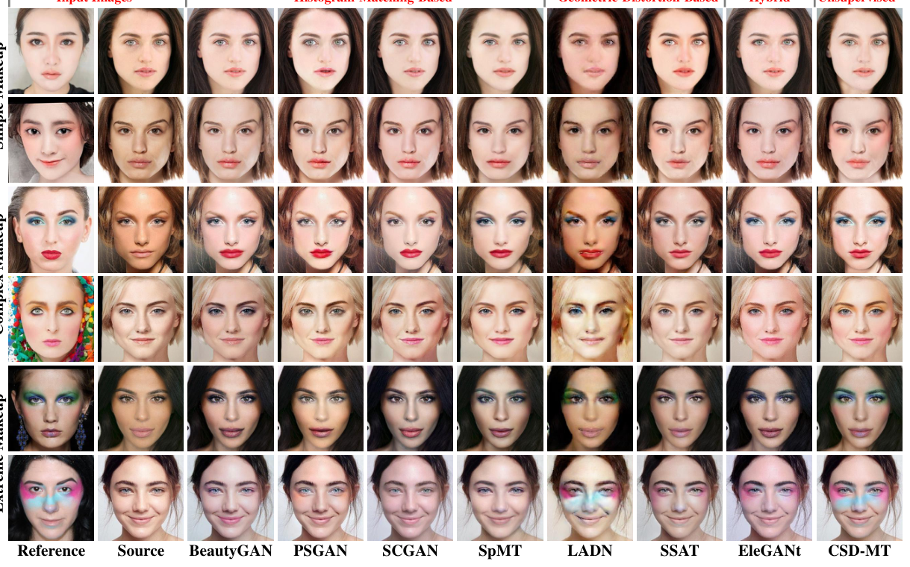

> **그림 5.** 여러 화장 스타일에서 최신 방법들과의 정성 비교(단순 화장 / 복잡한 화장 / 극단적 화장). 제안하는 CSD-MT가 원하는 화장 정보와 고품질 내용 세부를 갖춘 가장 정확한 전이 결과를 만든다. 확대해서 비교하기를 권한다.

### 3.4 학습 목표

**전이 손실.** 입력 이미지와 마찬가지로, 생성기 G가 만든 전이 결과 x̂도 LF 성분 x̂_l과 HF 성분 x̂_h로 분해할 수 있다. 식 (2)처럼 전치된 상관 행렬 M^⊤를 사용해 x̂_l을 x̄_l로 다시 변형하면 참조 이미지와 의미적으로 정렬된다. 우리의 가정에 따르면 화장 스타일이 충실히 전이되도록 x̄_l은 y_l과 일치해야 한다. 동시에 x̂_h는 원본 이미지의 내용 정보를 보존해야 하므로 x_h와 일치해야 한다. 따라서 화장 일관성과 내용 일관성을 동시에 촉진하는 다음 전이 손실을 정의한다.

$$\mathcal{L}_{trans} = \mathcal{L}_{makeup} + \alpha \mathcal{L}_{cont}, \quad \mathcal{L}_{makeup} = \|\bar{x}_l - y_l\|_1, \quad \mathcal{L}_{cont} = GP(\hat{x}_h, x_h) \tag{4}$$

여기서 α > 0은 두 항의 중요도를 조절한다. L_makeup은 x̄_l과 y_l 사이의 L1 거리로 정의된다. L_cont는 x̂_h와 x_h 사이의 기울기 프로파일 손실(Gradient Profile loss)[21] GP(·, ·)를 계산하며, 이는 이미지 기울기 공간에서 계산되므로 HF 세부를 추출하는 데 더 강력하다.

**순환 일관성 손실.** CycleGAN[34]에서 착안해, y_bg, y_h, x̄_l을 식 (3)의 화장 렌더링 네트워크에 다시 한 번 넣는다. 생성된 전이 결과 ȳ = G_mr([y_bg, y_h], x̄_l)가 원래 참조 이미지 y에 최대한 가깝기를 기대하며, 이는 다음과 같이 쓸 수 있다.

$$\mathcal{L}_{cycle} = \|\bar{y} - y\|_1 \tag{5}$$

**적대 손실.** 전이 결과를 더 사실적으로 만들기 위해, CSD-MT가 생성한 얼굴 이미지와 실제 화장 정보를 담은 참조 이미지를 구별하는 다중 스케일 판별기 D[26]를 구성한다. LSGAN[18]의 목적 함수에 기반해 적대 손실 L_adv를 다음과 같이 정의한다.

$$\mathcal{L}_{adv} = \mathbb{E}_y[(D(y) - 1)^2] + \mathbb{E}_{\hat{x}}[(D(\hat{x}))^2] \tag{6}$$

**자기 증강 재구성 손실.** 서로 다른 머리 자세와 얼굴 표정에 대한 강건성을 더 높이기 위해, 그림 4(b)처럼 화장의 공간 정보 전이를 돕는 자기 증강 재구성 과정을 개발했다. 구체적으로, 화장한 이미지 x가 주어지면 여기에 무작위 공간 변환 T_s(·)를 가해 변환된 이미지 y = T_s(x)를 얻는다. 이 이미지는 x와 같은 화장 스타일을 갖지만, 원래 x의 공간 정보(예: 얼굴 구조와 인물 정체성)는 완전히 파괴된다. x를 원본 이미지로, y를 참조 이미지로 보면 CSD-MT의 생성기 G는 (x, y)를 입력받아 전이 결과 x̂를 출력한다. 이 과정에서 x̂는 x와 같은 내용 및 (y에서 추출한) 화장 스타일 정보를 담으므로 x를 충실히 재구성해야 한다. 따라서 다음 자기 증강 재구성 손실을 정의한다.

$$\mathcal{L}_{aug} = \|\hat{x} - x\|_1 \tag{7}$$

**색 대조 손실.** 색 충실도를 높이기 위해 그림 4(c)처럼 다음과 같은 색 대조 손실을 제안한다.

$$\mathcal{L}_{cts} = -\log\left(1 - \frac{\ell(\hat{x}_{fg}, y^+)}{\sum_{i=1}^{N} \ell(\hat{x}_{fg}, y_i^-)}\right) \tag{8}$$

여기서 x̂_fg는 전이 결과 x̂에서 분리한 전경 얼굴 영역이다. 이 앵커에 대해 y⁺와 y⁻는 각각 양성·음성 표본이다. 구현에서는 입력 참조 이미지의 얼굴 영역 y_fg를 유일한 양성 표본으로 쓴다. 각 음성 표본 y_i⁻는 y_fg에 무작위 외관 변환 T_a(·)를 가해 얻는다. 즉 y_i⁻ = T_a(y_fg)이며, N은 음성 표본의 총수다. 지각 손실[10]에 기반해 거리 함수 ℓ(·, ·)를 다음과 같이 정의한다.

$$\ell(x, y) = \sum_l \|\mathrm{Gram}(\phi_l(x)) - \mathrm{Gram}(\phi_l(y))\|_1 \tag{9}$$

여기서 φ_l(·)는 사전학습된 VGG19[22] 모델의 l번째 층에서 추출한 특징 맵이다. Gram(·)은 특징 맵의 그램 행렬을 계산한다. 식 (8)의 색 대조 손실을 최소화하면, 색 분포가 비슷한 x̂_fg와 y_fg는 가까워지고 색 분포가 다른 x̂_fg와 y_i⁻는 멀어진다.

**전체 손실.** 요약하면, 제안하는 CSD-MT의 생성기 G와 판별기 D에 대한 전체 손실 함수는 다음과 같이 정의된다.

$$\min_G \max_D \mathcal{L} = \lambda_{trans}\mathcal{L}_{trans} + \lambda_{cycle}\mathcal{L}_{cycle} + \lambda_{adv}\mathcal{L}_{adv} + \lambda_{aug}\mathcal{L}_{aug} + \lambda_{cts}\mathcal{L}_{cts} \tag{10}$$

## 4. 실험

### 4.1 데이터셋

**MT 데이터셋**[15]은 화장하지 않은 이미지 1,115장과 화장한 이미지 2,719장을 담고 있으며, 대부분 잘 정렬되어 있고 화장 스타일이 풍부하다. 학습·테스트 세트는 [9, 15]의 전략을 따라 나눈다. **Wild-MT 데이터셋**[9]은 화장하지 않은 이미지 369장과 화장한 이미지 403장으로 이루어지며, 대부분 머리 자세와 얼굴 표정의 변화가 크다. **LADN 데이터셋**[7]은 화장하지 않은 이미지 333장과 화장한 이미지 302장을 담고 있으며, 화장 색·스타일·적용 범위의 편차가 큰 극단적 화장 이미지 155장을 포함한다.

### 4.2 비교 대상

제안하는 CSD-MT를 최신 화장 전이 방법 일곱 개와 비교한다. 히스토그램 맞추기 기반 방법 넷(BeautyGAN[15], PSGAN[9], SCGAN[3], SpMT[35]), 기하 왜곡 기반 방법 둘(LADN[7], SSAT[23]), 혼합 방법 하나(EleGANt[29])다.

이 방법들은 모두 MT 데이터셋의 학습 세트만으로 학습한다. 그리고 성능과 일반화 능력을 MT 데이터셋의 테스트 세트와 Wild-MT·LADN 데이터셋에서 평가한다. CSD-MT의 학습 세부는 부록을 참고하라.

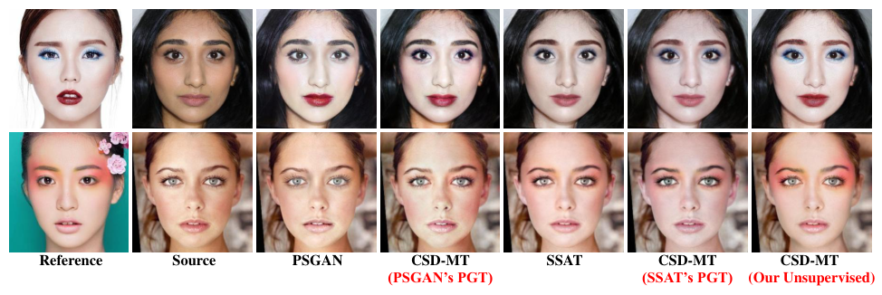

> **그림 6.** 서로 다른 학습 전략으로 학습한 CSD-MT 모델의 전이 결과. PSGAN, CSD-MT(PSGAN의 PGT로 학습), SSAT, CSD-MT(SSAT의 PGT로 학습), CSD-MT(우리의 비지도 학습).

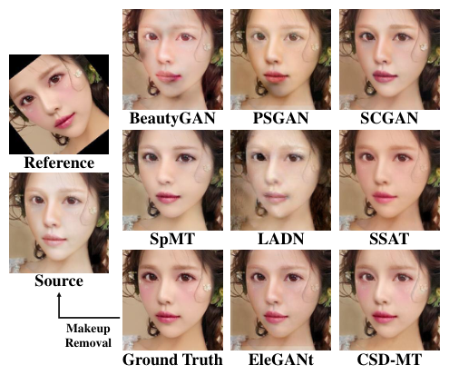

> **그림 7.** 화장을 지운 원본 이미지에, 무작위로 회전한 참조 이미지를 써서 화장을 다시 입힌 재구성 결과. 참조 / 원본(화장 제거) / 정답 / BeautyGAN · PSGAN · SCGAN · SpMT · LADN · SSAT · EleGANt · CSD-MT.

**표 1.** MT, Wild-MT, LADN 데이터셋에서의 FID와 자기 증강 PSNR/SSIM 정량 비교.

| 방법 | MT FID↓ | MT 자르기 PSNR/SSIM | MT 회전 PSNR/SSIM | Wild-MT FID↓ | Wild-MT 자르기 | Wild-MT 회전 | LADN FID↓ | LADN 자르기 | LADN 회전 |
|---|---|---|---|---|---|---|---|---|---|
| BeautyGAN [15] | 48.24 | 21.70/0.848 | 21.58/0.847 | 99.62 | 21.67/0.875 | 21.33/0.862 | 69.50 | 19.73/0.719 | 20.39/0.731 |
| PSGAN [9] | 45.02 | 23.46/0.886 | 22.68/0.875 | 89.92 | 22.56/0.879 | 21.89/0.870 | 57.80 | 22.97/0.824 | 22.16/0.815 |
| SCGAN [3] | 39.20 | 23.92/0.887 | 24.05/0.888 | 79.54 | 24.02/0.902 | 24.24/0.905 | 51.39 | 22.42/0.839 | 22.44/0.838 |
| SpMT [35] | 46.10 | 24.36/0.891 | 23.79/0.887 | 77.04 | 24.30/0.909 | 23.77/0.904 | 48.18 | 23.31/0.817 | 22.89/0.815 |
| LADN [7] | 73.91 | 19.27/0.759 | 19.02/0.755 | 104.91 | 19.22/0.790 | 19.09/0.786 | 65.87 | 18.61/0.727 | 18.39/0.723 |
| SSAT [23] | 38.01 | 24.01/0.894 | 23.93/0.893 | 70.53 | 23.57/0.905 | 23.80/0.907 | 53.84 | 22.81/0.848 | 22.95/0.846 |
| EleGANt [29] | 54.06 | 25.15/0.885 | 24.60/0.875 | 86.19 | 24.82/0.893 | 24.49/0.877 | 61.40 | 24.64/0.838 | 24.31/0.848 |
| **CSD-MT (우리)** | **37.56** | **27.28/0.920** | **26.68/0.915** | **60.82** | **27.83/0.934** | **26.70/0.923** | **40.87** | **25.19/0.868** | **25.23/0.868** |

**표 2.** 화장 스타일 유형별로 최고로 선택된 비율(%). "단순", "복잡", "극단" 화장은 우리의 주관적 경험에 따라 분류했다.

| 방법 | 단순 | 복잡 | 극단 |
|---|---|---|---|
| SCGAN [3] | 5.4% | 1.7% | 1.1% |
| SpMT [35] | 11.1% | 2.6% | 1.5% |
| SSAT [23] | 13.3% | 9.8% | 7.4% |
| EleGANt [29] | 14.3% | 15.4% | 13.2% |
| **CSD-MT (우리)** | **55.9%** | **70.4%** | **76.7%** |

**표 3.** MT 데이터셋에서의 절제 연구 정량 결과(자기 증강 PSNR/SSIM).

| 방법 | 자르기 | 회전 |
|---|---|---|
| PSGAN의 PGT로 학습한 CSD-MT | 22.22/0.881 | 22.37/0.883 |
| SSAT의 PGT로 학습한 CSD-MT | 23.23/0.893 | 23.37/0.891 |
| L_aug와 L_cts를 더한 PSGAN | 23.17/0.883 | 22.42/0.874 |
| L_aug와 L_cts를 더한 SSAT | 23.78/0.894 | 23.64/0.891 |
| (설정 A) L_adv + L_cont | 19.97/0.866 | 20.01/0.867 |
| (설정 B) A + L_makeup | 23.01/0.872 | 22.77/0.871 |
| (설정 C) B + L_cycle | 24.92/0.883 | 24.61/0.882 |
| (설정 D) C + L_aug | 26.45/0.914 | 25.61/0.907 |
| (설정 E) D + L_cts | **27.28/0.920** | **26.68/0.915** |

### 4.3 정성 비교

그림 5는 여러 화장 스타일에서 모든 경쟁 방법의 전이 결과를 보여 준다. 원본과 참조 이미지 사이 색 차이가 크면 히스토그램 맞추기 기반 방법은 모두 제대로 동작하지 않는다는 것을 볼 수 있다. 기하 왜곡 기반 방법 중 LADN은 원치 않는 인공물이 섞인 비사실적 결과를 만들고, SSAT는 아이섀도와 립스틱 같은 화장 세부를 효과적으로 옮기지 못한다. 혼합 방법 EleGANt는 다른 비교 대상보다 나은 결과를 얻지만, 얼굴 전체에 퍼진 극단적 화장 스타일의 전이에는 여전히 어려움을 겪는다. 반면 모든 유형의 화장 스타일에서, 우리의 비지도 CSD-MT 방법은 원하는 화장 정보와 고품질 내용 세부를 갖춘 가장 정확한 전이 결과를 만든다.

### 4.4 정량 비교

**프레셰 인셉션 거리(FID).** [17]을 따라, 참조 이미지와 여러 방법이 생성한 전이 결과 사이의 FID 점수[8](낮을수록 좋음)를 계산해 표 1에 보고한다. CSD-MT가 얻은 가장 낮은 FID 점수는 그 출력이 더 사실적임을 나타낸다.

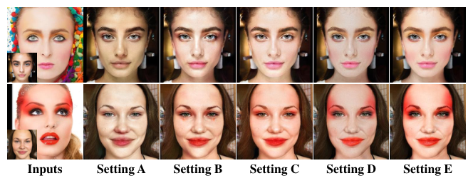

> **그림 8.** 서로 다른 손실 함수로 학습한 CSD-MT 모델의 전이 결과. 입력 / 설정 A / 설정 B / 설정 C / 설정 D / 설정 E.

**자기 증강 PSNR/SSIM.** 화장 전이 과제의 성능 평가에서 큰 어려움은 정답 이미지가 없다는 것이다. 이를 해결하기 위해 3.4절에서 설명한 것과 비슷한 자기 증강 재구성 과정을 활용한다. 그림 7처럼 화장 표본이 주어지면 무작위로 자르거나 회전해 내용 정보가 훼손된 가짜 참조 이미지를 얻는다. 또한 SSAT의 화장 제거 기능으로 화장을 지운 가짜 원본 이미지를 생성한다. 이 가짜 입력들을 가지고 원래 화장 이미지를 정답으로 보고 모델 평가를 위해 PSNR과 SSIM(높을수록 좋음)을 계산한다. 표 1과 그림 7의 정량·정성 결과 모두 CSD-MT가 다른 최신 방법들을 앞서며 고품질 결과 생성에 효과적임을 보여 준다.

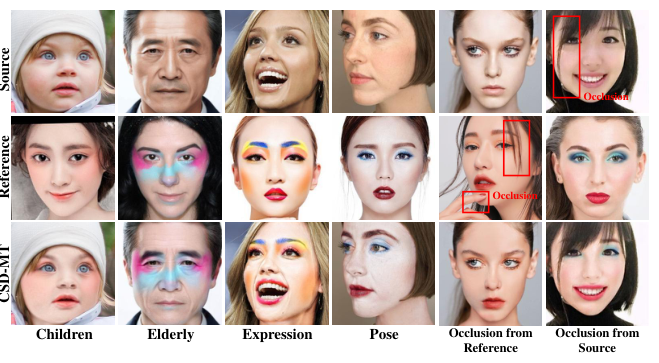

> **그림 9.** 여러 복잡한 상황에서의 CSD-MT의 강건성. 참조 가림 / 원본 가림 / 어린이 / 노인 / 표정 / 자세.

**사용자 평가.** 여러 모델의 성능을 정량적으로 평가하기 위해 사용자 평가도 진행했다. 서로 다른 유형의 화장 스타일을 가진 이미지 20쌍을 무작위로 고르고 여러 방법으로 전이 결과를 생성한다. 그 뒤 총 23명의 참가자에게 이미지 품질과 화장 유사도를 근거로 가장 만족스러운 결과를 고르도록 한다. 공정한 비교를 위해 전이 결과는 무작위 순서로 동시에 보여 준다. 사용자 평가 결과는 표 2에 있다.

### 4.5 절제 연구

**PGT 유도 학습 대 비지도 학습.** 두 전략을 직관적으로 비교하기 위해, CSD-MT의 네트워크 구조는 그대로 두고 각각 PSGAN과 SSAT에서처럼 PGT 유도 학습 과정으로 이 모델을 학습시킨다. 표 3과 그림 6에서, 그렇게 얻은 모델의 출력이 PSGAN·SSAT의 출력과 매우 비슷함을 볼 수 있다. 이는 **전이 성능이 네트워크 구조보다 합성된 PGT에 크게 좌우된다**는 것을 시사한다. 또한 원래의 CSD-MT가 이 두 모델보다 크게 앞서, 제안한 비지도 전략이 PGT 유도 학습보다 우수함을 보여 준다. 추가로 L_aug와 L_cts 손실을 PSGAN과 SSAT에 통합해 본다. 표 3에서 보듯 이전 방법들에 대한 L_aug와 L_cts의 영향은 미미한데, 이는 우리의 비지도 전략이 이 두 손실과 더 잘 맞음을 나타낸다.

**손실 함수.** 표 3처럼, 3.4절에서 정의한 여러 손실의 효과를 분석하기 위해 기본 설정(L_adv + L_cont)에 각 손실을 차례로 더해 서로 다른 손실 조합 5개(설정 A–E)를 만든다. 이 설정들로 학습한 CSD-MT 모델의 정량·정성 결과를 각각 표 3과 그림 8에 제시한다. L_adv + L_cont만으로 학습한 모델도 이미 내용 세부를 효과적으로 보존할 수 있음을 볼 수 있다. 이는 주로 내용–스타일 분리 연산과 내용 일관성 손실 L_cont 덕분이다. L_makeup과 L_cycle을 더하면 화장 스타일 정보가 전이되지만 일부 복잡한 세부는 여전히 빠진다. L_aug를 추가로 갖추면 공간 정보의 전이가 도움을 받아 화장이 얼굴의 올바른 위치에 나타날 수 있다. 마지막으로 L_cts가 색 충실도를 보장한다.

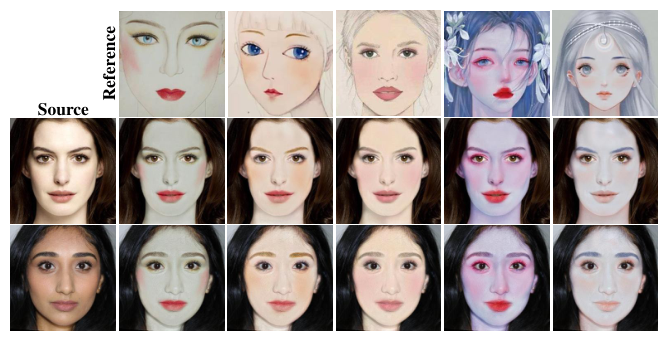

> **그림 10.** 본 적 없는 애니메이션 화장에서의 CSD-MT 일반화.

**강건성.** 그림 9에서 보듯 원본과 참조 이미지 사이의 의미 대응을 포착하기 때문에 CSD-MT 모델은 나이, 자세, 표정의 변화에 둔감하다. 또한 얼굴 분할로 전경과 배경 영역을 분리하므로 이미지 가림의 영향을 받지 않는다.

**일반화.** 방법의 일반화 능력을 평가하기 위해, MT 데이터셋의 학습 표본과 도메인 차이가 크고 모델이 이전에 한 번도 본 적 없는 애니메이션 화장 예시를 모았다. 결과는 그림 10에 있다.

**한계.** CSD-MT에서는 HF 성분이 얼굴 이미지의 내용 세부와 더 밀접하게 관련된다고 가정한다. 이 가정 때문에 CSD-MT는 **무늬(패턴)가 있는 경우를 다루지 못할 수** 있다.

## 5. 결론

본 논문에서는 PGT 생성의 부정적 영향을 없애기 위한 비지도 화장 전이 방법 CSD-MT를 제안한다. 관찰된 주파수 특성에서 착안해, CSD-MT는 주파수 분해를 통해 내용과 화장 스타일 정보를 분리하고, 전이 결과와 입력 이미지들 사이에서 이 두 종류 정보의 일관성을 각각 최대화함으로써 화장 전이를 실현한다. 실험은 CSD-MT가 정량·정성 분석에서 기존 최신 방법들을 크게 앞섬을 보여 준다.

**감사의 말.** 이 연구는 중국 국가 중점 연구개발 계획(과제 번호 2022ZD0160604), 싼야 야저우만 과학기술도시 사업(과제 번호 SCKJ-JYRC2022-76 및 SKJC-2022-PTDX-031), 중국 국가자연과학기금 청년과학자기금(과제 번호 62306219), CAAI-화웨이 MindSpore 오픈 펀드(과제 번호 CAAIXSILJJ-2022-004A)의 일부 지원을 받았다.

---

# 보충 자료

## 6. 네트워크 구조

CSD-MT 모델의 생성기 G를 구성하기 위해 기본 네트워크 블록 5개를 설계했다. 합성곱 블록, 다운샘플링 블록, 업샘플링 블록, 잔차 블록, SPADE이며 구조는 그림 11에 있다. 이 블록들을 바탕으로 그림 12는 의미 대응 모듈과 화장 렌더링 모듈의 구조를 보여 주며, 각 중간 특징 맵의 형태도 함께 표시한다. 입력 이미지를 의미 대응 모듈에 넣기 전에, 서로 다른 얼굴 부위의 국소 의미 정보를 강화하기 위해 이미지를 해당 얼굴 분할[31] 지도와 연결한다(구현에서는 의미 범주 10개의 얼굴 분할 지도를 사용한다). 목표 분포에 맞추기 위해 CSD-MT 모델은 [26]과 같은 다중 스케일 판별기 D를 채택하며, 이는 동일한 구조를 갖고 서로 다른 이미지 스케일 3개에서 학습되는 스케일별 판별기 3개로 이루어진다.

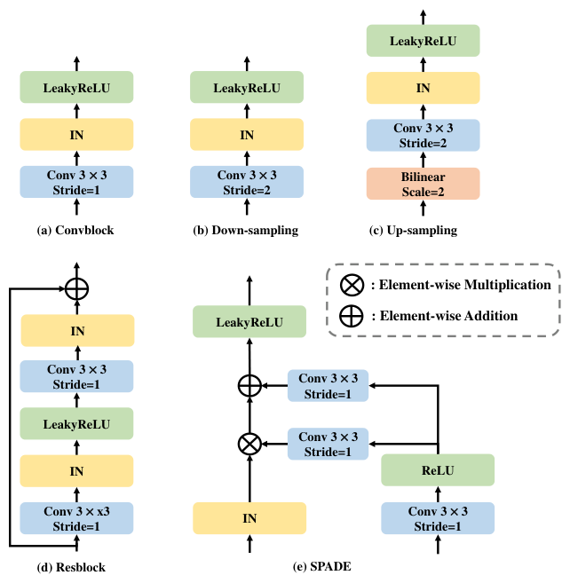

> **그림 11.** CSD-MT 모델에 쓰인 기본 네트워크 블록. "IN"은 인스턴스 정규화 층을 뜻한다. (a) 합성곱 블록 (b) 다운샘플링 블록 (c) 업샘플링 블록 (d) 잔차 블록 (e) SPADE.
>
> *(역자 주: 블록 내부 구성은 원문에서 그림으로만 제시된다. 그림의 글자로 확인되는 것은 Conv 3×3, IN, LeakyReLU, 다운샘플링의 보폭 2, 업샘플링의 쌍선형 2배 확대, SPADE 안의 ReLU·원소별 곱·원소별 덧셈이다. 정확한 연결 순서는 위 그림을 확인하십시오.)*

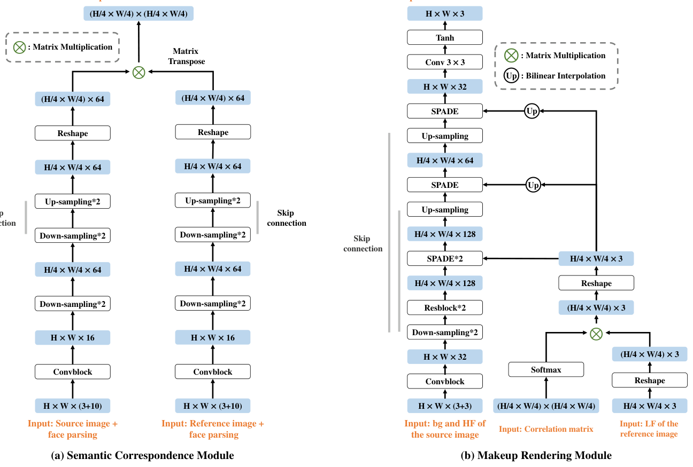

> **그림 12.** CSD-MT의 의미 대응 모듈과 화장 렌더링 모듈 구조. *n은 블록 n개를 쌓은 것.
>
> *(역자 주: 역시 그림으로만 제시된다 — 위 그림 참조. 그림의 글자로 확인되는 요점 — (a) 의미 대응 모듈: 입력은 이미지 + 얼굴 분할(H×W×(3+10)), 중간 특징 H/4×W/4×64, 원본 특징과 전치한 참조 특징의 행렬곱으로 (H/4·W/4)×(H/4·W/4) 상관 행렬을 출력. (b) 화장 렌더링 모듈: 입력은 원본의 배경·HF(H×W×(3+3)), 상관 행렬, 참조의 LF(H/4×W/4×3). 상관 행렬에 소프트맥스를 거쳐 참조 LF와 행렬곱. 잔차 블록×2, SPADE, 업샘플링, 스킵 연결을 거쳐 Conv 3×3 → Tanh로 H×W×3 결과를 출력.)*

## 7. 학습 세부

모델 학습 중 각 입력 이미지는 256 × 256 픽셀로 크기를 조정한다. 색 대조 손실에서는 전이 이미지마다 음성 표본 4개를 생성한다. 즉 식 (8)에서 N = 4다. 그리고 그램 행렬 계산(식 (9))에는 사전학습된 VGG19 모델의 relu1_2, relu2_2 층 특징 맵을 쓴다. 하이퍼파라미터는 식 (2)에서 τ = 100, 식 (4)에서 α = 0.1, 식 (10)에서 λ_trans = 1, λ_cycle = 10, λ_adv = 1, λ_aug = 10, λ_cts = 1로 둔다. 모델 학습에는 β1 = 0.5, β2 = 0.999인 Adam[12] 옵티마이저를 쓰며, 최대 학습 반복 횟수는 500,000, 학습률은 0.0002, 배치 크기는 1이다.

## 8. 파라미터 크기와 추론 속도

화장 전이 성능 외에도, CSD-MT의 파라미터 크기와 추론 시간을 경쟁 방법들과 비교한다. 공정한 비교를 위해 모든 실험은 6GB RAM을 가진 NVIDIA GTX 1660Ti GPU 한 대에서 수행한다. 표 4의 결과에서 CSD-MT 모델이 가장 적은 파라미터 수(6.94M)를 가지며 가장 빠른 추론 속도(해상도 256 × 256 픽셀의 입력 이미지 한 쌍 처리에 단 0.017초)를 달성해 다른 비교 방법들을 큰 차이로 앞섬을 볼 수 있다. 이는 CSD-MT 방법의 효율성을 보여 준다.

**표 4.** CSD-MT와 다른 방법들의 파라미터 크기와 추론 속도 비교. 파라미터 수(M)와 추론 시간(초)은 256 × 256 크기의 입력 이미지 한 쌍을 처리할 때 모델별로 계산했다.

| 방법 | 파라미터 (M) | 추론 시간 (초) |
|---|---|---|
| BeautyGAN [15] | 9.42 | 0.039 |
| PSGAN [9] | 12.62 | 0.218 |
| SCGAN [3] | 15.30 | 0.321 |
| SpMT [35] | 333.67 | 0.834 |
| LADN [7] | 27.00 | 0.032 |
| SSAT [23] | 10.48 | 0.110 |
| EleGANt [29] | 10.27 | 0.148 |
| **CSD-MT (우리)** | **6.94** | **0.017** |

## 9. 내용과 화장 사이의 절충

전이 손실 L_trans(본문 식 (4))를 최소화함으로써 CSD-MT는 원본 이미지의 내용 세부를 보존하는 것(L_cont)과 참조 얼굴의 화장 정보를 옮기는 것(L_makeup)을 동시에 수행한다. 이 두 목표 사이에는 절충이 있으며, 중요도 파라미터 α로 균형을 맞춘다. 이 파라미터의 효과를 조사하기 위해, α 값을 {0.0, 0.1, 0.5}로 바꿔 학습한 CSD-MT 모델들의 성능을 비교한다. 정량·정성 비교를 모두 수행한다. 표 5에서 보듯 제안한 CSD-MT 방법은 α = 0.1일 때 가장 좋은 자기 증강 PSNR/SSIM 결과를 얻는다("자르기"와 "회전" 상황에서 각각 27.28/0.920과 26.68/0.915). 이 현상은 그림 13에서도 볼 수 있다. α = 0.0이면 내용 목표 L_cont가 L_trans에서 빠지므로, 학습된 모델은 원본 이미지의 내용 정보를 유지하지 못하고 비사실적 결과를 만든다. α 값이 0.5로 커지면 L_cont가 전이 손실 L_trans를 지배해 L_makeup의 상대적 중요도가 줄어든다. 그 결과 참조 얼굴의 화장 스타일, 특히 립스틱과 파우더 블러셔가 충실히 전이되지 못한다.

**표 5.** MT 데이터셋에서 서로 다른 α로 학습한 CSD-MT 모델의 정량 비교(자기 증강 PSNR/SSIM).

| 파라미터 | 자르기 | 회전 |
|---|---|---|
| α = 0.0 | 23.77/0.830 | 22.12/0.791 |
| α = 0.1 | **27.28/0.920** | **26.68/0.915** |
| α = 0.5 | 24.91/0.908 | 24.62/0.906 |

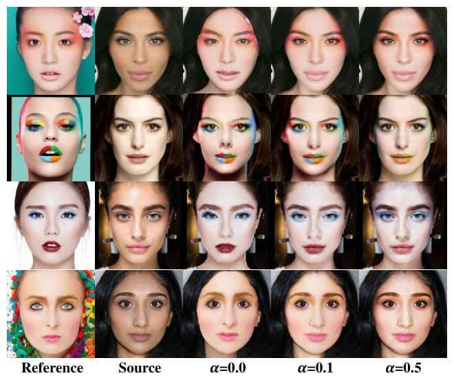

> **그림 13.** 서로 다른 α로 학습한 CSD-MT 모델의 정성 비교. α = 0.1이 가장 좋은 전이 결과로 이어진다.

## 10. 확산 모델과의 비교

최근 강력한 확산 모델이 널리 연구되며 다양한 이미지 생성 과제를 푸는 주류 접근이 되었다. 그래서 CSD-MT 방법을 확산 모델과도 비교하고자 한다. 현재 화장 전이 과제용으로 특별히 설계된 확산 모델이 없다는 점을 고려해, 글로 유도되는 생성 확산 모델 DiffusionCLIP[11]과 스타일 전이 확산 모델 InST[33]를 비교 대상으로 고른다. DiffusionCLIP의 경우 특정 화장 스타일을 글로 정확히 묘사하기 어렵기 때문에 [11]처럼 "people with makeup"이라는 프롬프트로 최종 전이 결과를 만든다. 그림 14에서 보듯 DiffusionCLIP은 생성 과정이 참조 이미지가 아니라 주로 글 프롬프트에 기반하므로 최종 출력에 잘못된 화장 정보를 흔히 끌어들인다. 스타일 전이 방법인 InST는 참조 이미지에서 화장 스타일을 추출하지 못할 뿐 아니라 원본 이미지의 내용 세부도 바꾼다. CSD-MT는 이 두 확산 모델 기반 방법을 앞서며, 다시 한번 그 효과와 우수성을 보여 준다.

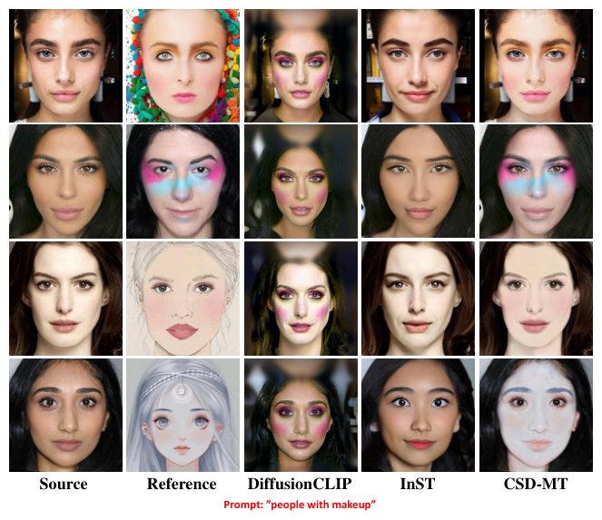

> **그림 14.** 확산 모델(DiffusionCLIP[11], InST[33])과의 정성 비교. 프롬프트: "people with makeup".

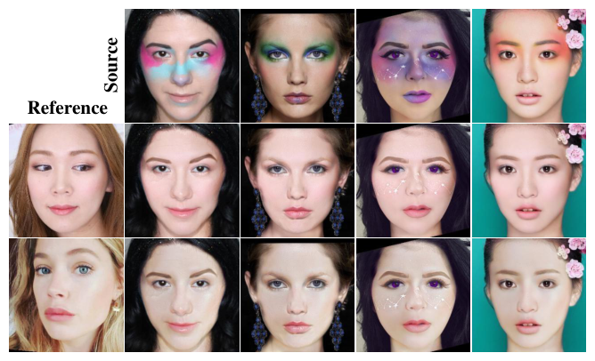

> **그림 15.** CSD-MT가 생성한 화장 제거 결과.

## 11. 화장 제어

### 11.1 화장 제거

[7, 23, 32]와 마찬가지로, 화장한 이미지를 원본 입력으로, 화장하지 않은 얼굴을 참조 이미지로 넣으면 CSD-MT도 그림 15처럼 여러 화장 제거 결과를 생성할 수 있다.

### 11.2 전역 화장 보간

제안하는 CSD-MT 방법에서는 화장 정보가 주파수 분해를 통해 입력 이미지에서 분리된다. 이 덕분에 두 참조 얼굴의 저주파(LF) 성분을 선형으로 섞어 화장 스타일을 보간할 수 있다.

$$\hat{y}^{g\_inter}_l = (1 - \beta)\hat{y}^1_l + \beta\hat{y}^2_l, \qquad \hat{x}^{g\_inter} = G_{mr}([x_{bg}, x_h], \hat{y}^{g\_inter}_l) \tag{11}$$

여기서 ŷ¹_l과 ŷ²_l은 서로 다른 두 참조 이미지의 변형된 LF 성분이다. β 값을 0에서 1까지 조절하면 CSD-MT는 일련의 전이 결과를 생성할 수 있다. 그 화장 스타일은 한 참조 이미지 y¹의 것에서 다른 참조 y²의 것으로 점차 바뀐다. 더 나아가 원본 이미지를 y¹로 지정하면, 참조 입력 y² 하나에 대해 **화장 전이의 정도를 제어**할 수 있다. 전역 화장 보간 결과는 그림 16에 있다.

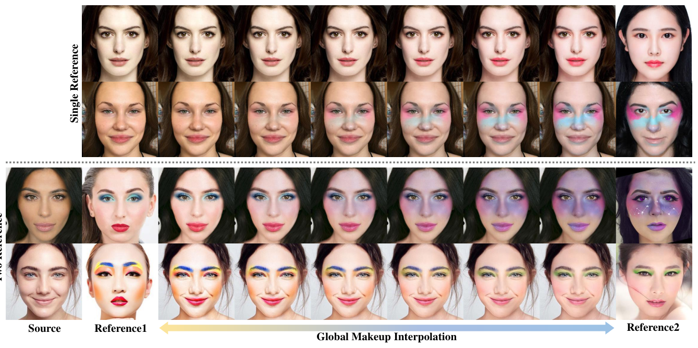

> **그림 16.** 전역 화장 보간. 위 두 행은 참조 이미지 하나의 결과, 아래 두 행은 참조 이미지 두 개의 결과다.

### 11.3 국소 화장 보간

CSD-MT에서 참조 이미지의 LF 성분은 상관 행렬 M을 통해 변형되어 원본 이미지와 의미적으로 정렬될 수 있다. 이런 공간 정렬 덕분에 CSD-MT는 서로 다른 국소 얼굴 영역 안에서 화장 보간을 구현할 수 있으며, 다음과 같이 쓸 수 있다.

$$\hat{y}^{l\_inter}_l = \big((1 - \beta)\hat{y}^1_l + \beta\hat{y}^2_l\big) \otimes Mask^{area}_x + \hat{x}_l \otimes (1 - Mask^{area}_x), \qquad \hat{x}^{l\_inter} = G_{mr}([x_{bg}, x_h], \hat{y}^{l\_inter}_l) \tag{12}$$

여기서 ⊗는 아다마르 곱이다. Mask^area_x는 화장할 국소 영역을 나타내는 원본 이미지 x의 이진 마스크로, 얼굴 분할로 얻을 수 있다. 그림 17은 입술과 눈 주변 영역 안에서의 국소 화장 보간 결과를 각각 보여 준다. 즉 Mask^area_x에서 area ∈ {lip, eye}다. 마찬가지로 다른 참조 입력을 원본 이미지로 바꾸면 참조 이미지 하나의 **국소 화장 전이 정도**도 제어할 수 있으며, 그림 17의 처음 두 행이 그 예다.

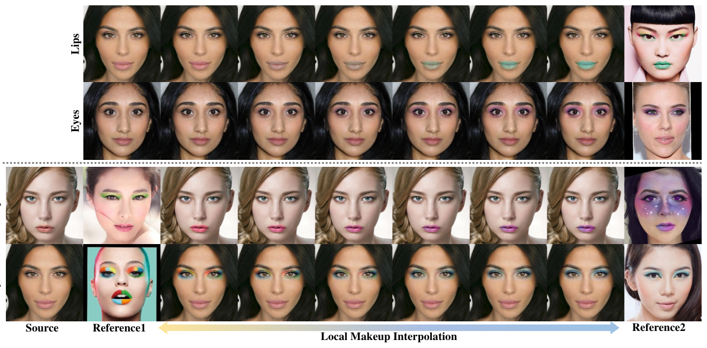

> **그림 17.** 국소 화장 보간. 홀수 행은 립스틱 제어, 짝수 행은 아이섀도 제어다.

**피부 톤 보존.** 이전 접근들[2, 3, 7, 9, 15, 23, 29, 35]과 마찬가지로, CSD-MT는 파운데이션과 다른 화장품이 이미 원래 피부 톤을 덮었다고 가정한다. 따라서 참조 얼굴의 피부색은 그 화장 스타일의 일부로 간주되어 최종 생성 결과에 충실히 전이되며, 이는 원본 이미지의 내용 정보를 훼손할 수 있다. 이 문제를 완화하기 위해, 원본 이미지의 얼굴 영역에서 위에서 말한 국소 화장 보간 연산을 수행해 피부 톤을 보존할 수 있다. 이 절차는 다음과 같이 쓸 수 있다.

$$\hat{y}^{l\_skin}_l = \big((1 - \beta)\hat{x}_l + \beta\hat{y}^2_l\big) \otimes Mask^{face}_x + \hat{y}^2_l \otimes (1 - Mask^{face}_x), \qquad \hat{x}^{l\_skin} = G_{mr}([x_{bg}, x_h], \hat{y}^{l\_skin}_l) \tag{13}$$

여기서 x̂^l_skin은 마스크 Mask^face_x가 가리키는 x의 얼굴 영역 안에서 원본 이미지 x와 참조 이미지 y² 사이의 국소 화장 보간을 실현한다. 보간 결과는 그림 18에 시각화했다. β = 0이면 x̂^l_skin은 x의 피부 톤을 바꾸지 않는다. 그리고 β = 1이면 식 (13)은 CSD-MT의 표준 화장 전이 과정으로 퇴화하여, y²의 화장 정보(피부 톤 포함)를 x로 추출해 옮긴다.

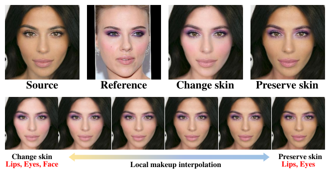

> **그림 18.** 기본 설정에서 CSD-MT는 화장을 옮기며 피부 톤도 바꾼다. 선택적으로, 국소 화장 전이 연산으로 원래 피부 톤을 보존할 수 있으며, 국소 화장 보간으로 중간 결과를 부드럽게 생성할 수 있다. (피부 변경: 입술·눈·얼굴 / 피부 보존: 입술·눈)

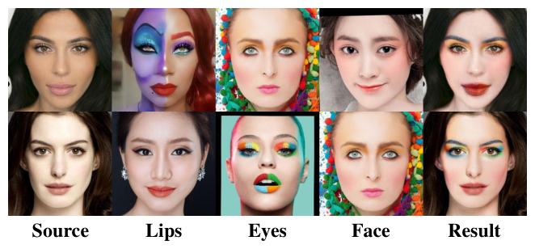

> **그림 19.** 부분 화장 전이 결과. 두 번째 열의 입술 스타일, 세 번째 열의 눈 스타일, 네 번째 열의 얼굴 스타일을 통합한 결과다.

### 11.4 부분 화장 전이

또한 CSD-MT는 여러 참조 이미지의 국소 화장 스타일을 통합해 부분 화장 전이를 할 수 있다.

$$\hat{y}^{part}_l = \hat{y}^1_l \otimes Mask^{lip}_x + \hat{y}^2_l \otimes Mask^{eye}_x + \hat{y}^3_l \otimes Mask^{face}_x, \qquad \hat{x}^{part} = G_{mr}([x_{bg}, x_h], \hat{y}^{part}_l) \tag{14}$$

여기서 Mask^lip_x, Mask^eye_x, Mask^face_x는 원본 이미지 x의 입술, 눈, 얼굴 마스크다. 부분 화장 전이 결과는 그림 19에 있다.

### 11.5 화장 편집

CSD-MT는 사용자가 참조 이미지를 편집해 자기만의 맞춤 화장을 만들 수 있게도 해 준다. 이 편집 과정은 간단하고 직관적이어서, 사용자는 참조 얼굴의 아무 국소 영역에나 원하는 색을 칠하기만 하면 된다. 그 뒤 CSD-MT 모델로 사용자가 편집한 화장 스타일을 원본 이미지에 옮긴다. 그림 20에서 보듯 CSD-MT는 다른 최신 방법들보다 나은 전이 결과를 생성한다.

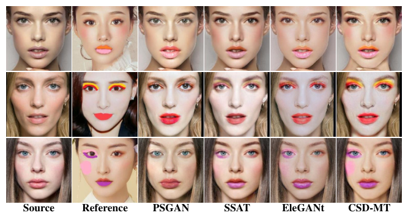

> **그림 20.** 여러 방법의 화장 편집 비교. 원본 / 참조 / PSGAN / SSAT / EleGANt / CSD-MT.

## 12. 추가 결과

그림 21, 22, 23은 각각 단순, 복잡, 극단적 화장 스타일에서 CSD-MT와 최신 방법들 사이의 추가 정성 비교를 보여 준다. CSD-MT의 추가 화장 전이 결과는 그림 24와 25에 있다. 또한 여러 복잡한 상황에서의 강건성은 그림 26에, 본 적 없는 화장 스타일에 대한 일반화 능력은 그림 27에, 화장 편집에 대한 제어 능력은 그림 28에 제시한다.

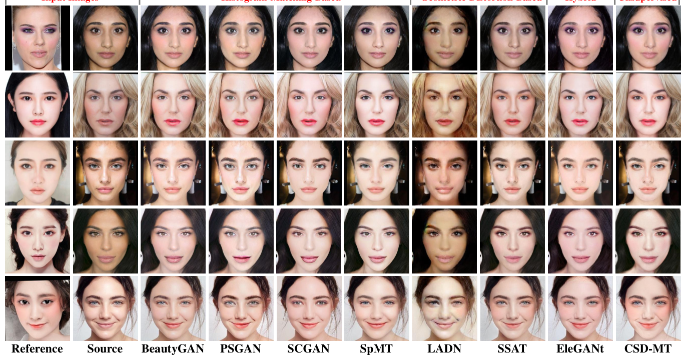

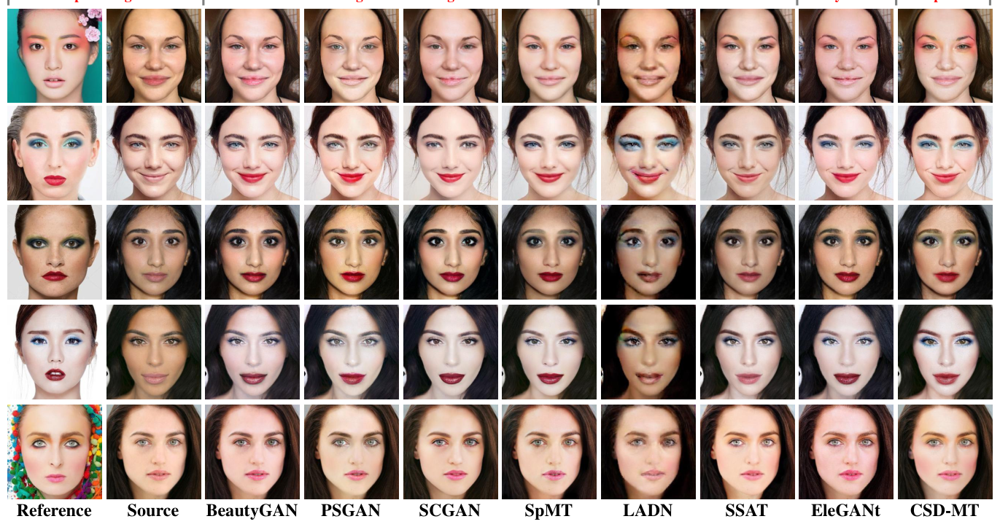

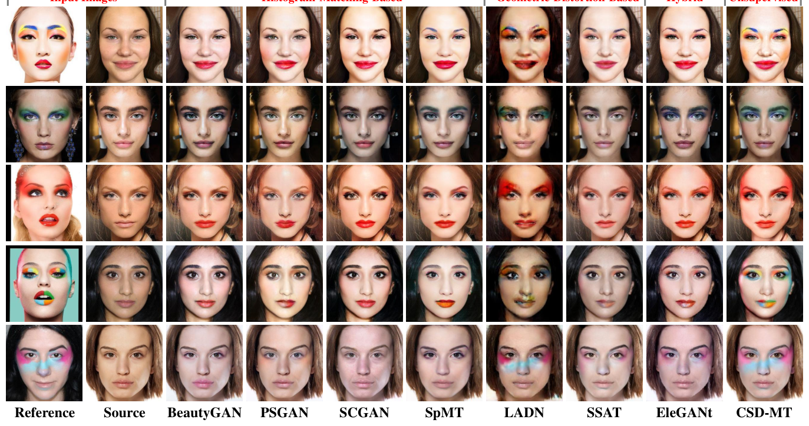

> **그림 21–23.** 단순 / 복잡 / 극단적 화장 스타일에서 CSD-MT와 최신 방법들의 추가 정성 비교.
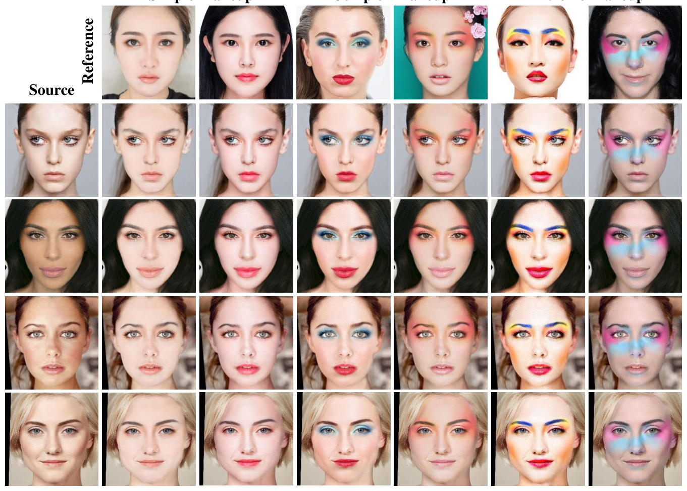

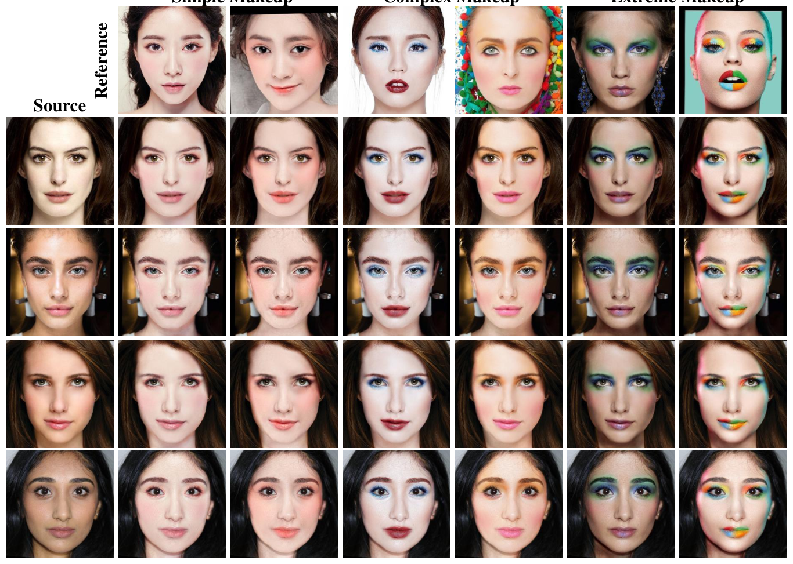

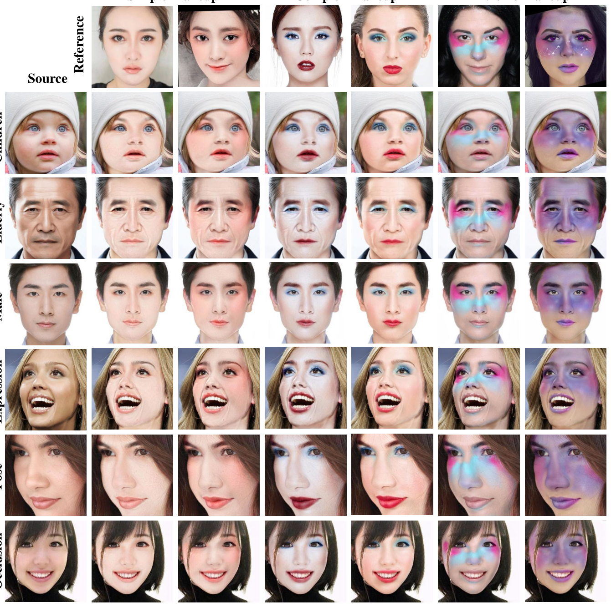

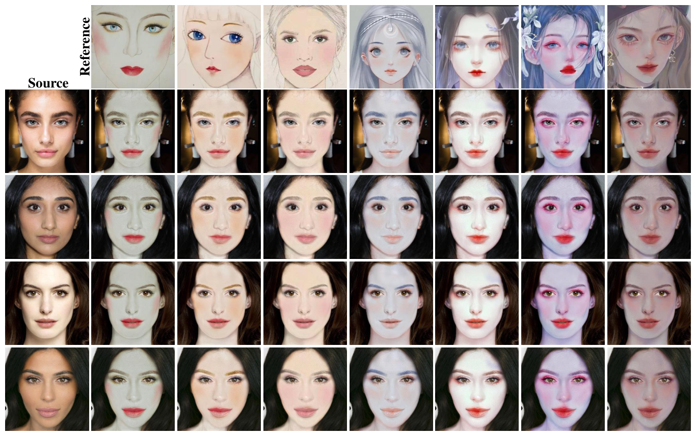

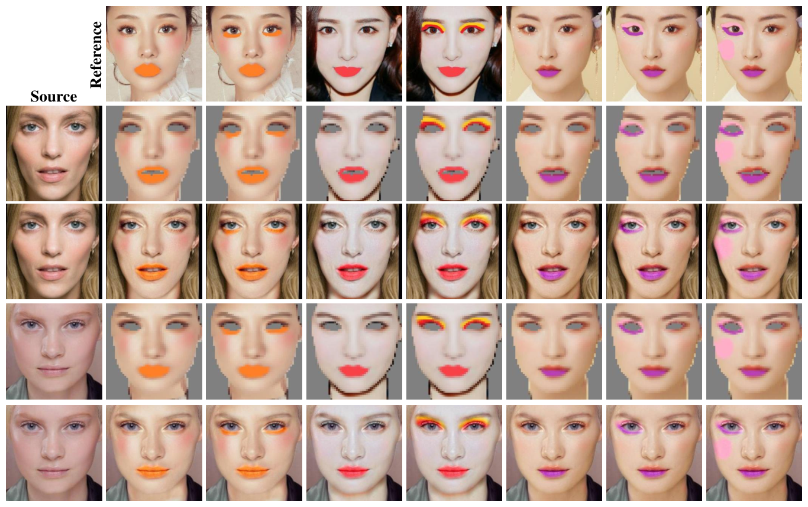

> **그림 24–28.** CSD-MT의 추가 전이 결과, 복잡한 상황에서의 강건성, 본 적 없는 스타일로의 일반화, 화장 편집 제어.

## 13. 한계

CSD-MT에서는 고주파(HF) 성분이 얼굴 이미지의 내용 세부와 더 밀접하게 관련된다고 가정한다. 이 가정으로 CSD-MT는 원본 이미지와 전이 결과 사이 고주파 정보의 일관성을 최대화해 내용 세부를 보존한다. 그 결과 일부 극단적 화장의 특정 경계(HF 정보)가 CSD-MT에서는 화장 스타일이 아니라 **내용 세부로 취급된다.** 그림 15 네 번째 열의 화장 제거 결과를 참고하라. 동시에 CSD-MT는 그림 29처럼 일부 극단적 화장 스타일의 경계를 정확히 렌더링하지 못한다. 앞으로 우리의 연구는 이 문제의 해법을 찾는 데 주로 초점을 맞출 것이다.

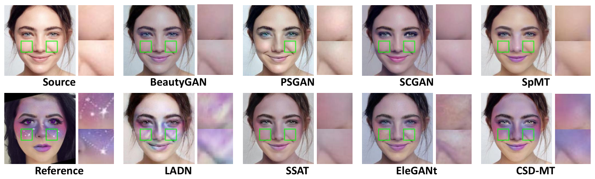

*(역자 주: 그림 29의 캡션은 텍스트 추출본에서 확인하지 못했다. 본문이 "일부 극단적 화장 스타일의 경계를 정확히 렌더링하지 못하는" 예로 가리키는 그림이다.)*

---

*참고문헌 목록은 원문(arXiv:2405.17240)을 참조하십시오.*
