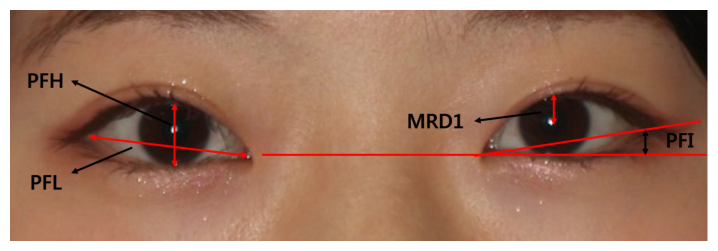
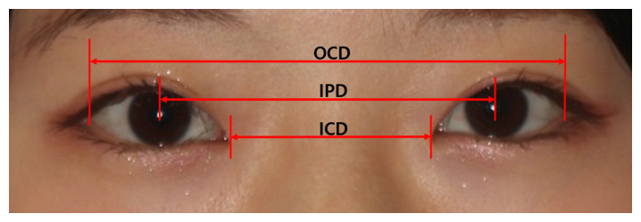
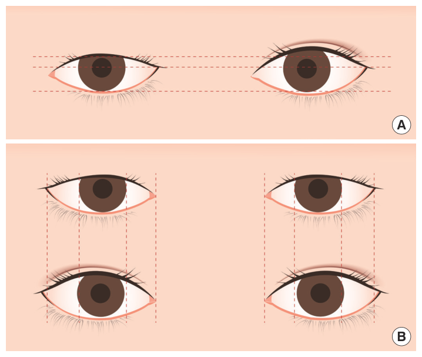

# 타고난 쌍꺼풀과 외꺼풀을 가진 젊은 한국 여성의 눈 측정값 비교

> **원문** Han Byul Jung, Dong Gil Han, Jeong Su Shim, Yong Jig Lee, Sung-Eun Kim. *Comparison of eye measurements between young Korean women with inborn double eyelids and those with single eyelids.* Archives of Aesthetic Plastic Surgery 2020;26(1):7–11. https://doi.org/10.14730/aaps.2019.01984
>
> **라이선스** 원문 Copyright © 2020 The Korean Society for Aesthetic Plastic Surgery. [CC BY-NC 4.0](https://creativecommons.org/licenses/by-nc/4.0/)으로 배포되며, 원 저작물을 올바르게 인용하는 조건으로 비영리 이용·배포·복제를 허용합니다. 이 번역본도 비영리 목적으로만 씁니다.
>
> **변경 사항** 영어 원문을 한국어로 번역했습니다. 그림은 원문에서 잘라 캡션 앞에 넣었고, 참고문헌 목록은 생략했습니다(본문의 [숫자]는 원문 참고문헌 번호). 원저자가 검토한 번역이 아닙니다.

**용어 대응** — PFL(palpebral fissure length): 눈 가로 길이 · PFH(palpebral fissure height): 눈 높이 · MRD1(margin reflex distance 1): 동공 중심에서 윗눈꺼풀 가장자리까지 · ICD(intercanthal distance): 안쪽 눈꼬리 사이 거리 · IPD(interpupillary distance): 동공 사이 거리 · OCD(outer canthal distance): 바깥 눈꼬리 사이 거리 · PFI(palpebral fissure inclination): 눈꼬리 기울기 · 내안각(medial canthus): 안쪽 눈꼬리 · 외안각(lateral canthus): 바깥 눈꼬리

---

## 초록

**배경** 한국인의 눈 측정값은 폭넓게 연구되어 왔지만, 연구자들은 같은 항목에 대해서도 크게 다른 값을 보고해 왔다. 이런 불일치는 연구마다 쌍꺼풀을 가진 대상자의 비율이 일관되지 않기 때문일 가능성이 크다. 우리는 쌍꺼풀 유무에 따른 눈 측정값을 후향적으로 연구하고, 그 결과를 기존 연구들과 비교했다.

**방법** 눈꺼풀에 선천 기형, 외상, 수술 이력이 없는 젊은(20–29세) 한국 여성의 눈을 인체 계측했다. 대상자를 쌍꺼풀 유무로 이분해 외꺼풀 116눈과 쌍꺼풀 124눈을 얻었다. 각 눈에서 눈 가로 길이(PFL), 눈 높이(PFH), MRD1, 안쪽 눈꼬리 사이 거리(ICD), 동공 사이 거리(IPD), 바깥 눈꼬리 사이 거리(OCD), 눈꼬리 기울기를 측정했다.

**결과** 평균 PFL은 외꺼풀군 24.1 mm, 쌍꺼풀군 25.5 mm였다. 두 군의 다른 평균값은 다음과 같다. PFH 8.0 mm와 9.9 mm, MRD1 2.8 mm와 4.1 mm, IPD 61.6 mm와 62.8 mm, OCD 85.3 mm와 87.9 mm.

**결론** 쌍꺼풀군에서 눈의 가로·세로 길이가 외꺼풀군보다 컸고, IPD, OCD, PFL, PFH, MRD1의 평균값이 통계적으로 유의하게 높았다.

**키워드** 인체 계측 / 눈꺼풀 / 한국

## 서론

눈의 인체 계측 연구는 인류학과 의학에서 수행되며 진단과 치료에 유용한 정보를 준다. 인체 계측 연구에는 실측, 사진 측정, 방사선 측정 등 여러 방법이 쓰인다. 그러나 눈에 대해서는 단순하고 반복성이 높다는 이유로 사진 측정이 가장 많이 쓰인다[1]. 한국인의 눈 측정 연구들은 연구자에 따라 일관되지 않은 값을 보고해 왔는데, 이 연구들은 쌍꺼풀을 가진 참가자의 비율이 31.7%에서 54.0%까지 서로 달랐다[1-7]. 몇몇 연구는 쌍꺼풀을 가진 대상자를 포함했는지조차 언급하지 않았다[8-11]. 이 기존 연구들에서는 같은 항목의 측정값조차 최대 20%까지 차이가 났다. 예를 들어 눈 높이(PFH)에 대해 Park 등[8]은 평균 8 mm를 보고했지만 Song 등[6]은 10 mm를 보고했다. 서양인과 달리 많은 한국인이 외꺼풀을 가지고 있지만, 여러 기존 연구는 쌍꺼풀 유무에 따른 대상자 분포를 밝히지 않았다. 우리는 기존 결과의 불일치가 연구에 포함된 쌍꺼풀 대상자의 비율 차이 때문일 수 있다고 의심했다. 그래서 이 연구에서는 쌍꺼풀이 있는 참가자와 없는 참가자의 눈을 측정하고, 그 값을 통계 분석을 통해 다른 연구들의 값과 비교했다.

## 방법

### 연구 참가자

의과대학과 간호대학에 다니는 20대 한국 여성을 대상으로 선별했다. 눈꺼풀에 선천 기형, 외상, 수술 이력이 있는 사람은 제외했다. 총 120명의 참가자에게서 240눈을 포함했으며, 쌍꺼풀 62명과 외꺼풀 58명이었다. 연구는 생명윤리위원회의 승인을 받았다(프로토콜: IRB CR-19-038). 이 연구는 헬싱키 선언이 제시한 의학 연구 윤리 원칙을 따랐다. 참가자들에게 연구 목적을 알렸고 서면 동의서를 받았다.

### 인체 계측과 사진 분석

모든 참가자의 정면 사진을 표준 렌즈를 단 Nikon D80 디지털카메라(Nikon Corporation, 일본 도쿄)로 촬영했다. 참가자는 표준 초점 거리인 카메라에서 1.0 m 떨어진 곳에 앉아 정면을 응시했다. 각 눈에서 눈 가로 길이(PFL), 눈 높이(PFH), MRD1, 안쪽 눈꼬리 사이 거리(ICD), 동공 사이 거리(IPD), 바깥 눈꼬리 사이 거리(OCD), 눈꼬리 기울기(PFI)를 측정했다. 이 값들은 Adobe Photoshop 7.0(Adobe Inc., 미국 새너제이)과 자바 기반 이미지 처리 프로그램(Image J 1.40, 미국 국립보건원, 베세즈다)으로 정량 평가했다[12]. 표준화된 사진으로 다음을 측정했다. (1) 눈 측정: PFL, PFH, PFI, MRD1(그림 1), (2) 눈꼬리와 동공 사이 거리 측정: OCD, IPD, ICD(그림 2). 사진 간 크기 차이로 생기는 오차를 줄이기 위해 참가자의 각막 지름을 측정해 젊은 한국 여성의 평균 각막 지름(11.3 mm)에 맞추도록 보정했다[1].

### 통계 분석

통계 분석은 SPSS 19.0(IBM Corp., 미국 아몽크)으로 수행했다. 외꺼풀군과 쌍꺼풀군의 값은 독립표본 t검정으로 비교했다. P값이 0.05 미만이면 통계적으로 유의하다고 보았다.

> **그림 1.** 눈 측정. PFH: 동공 위에서 윗눈꺼풀 아래 가장자리와 아랫눈꺼풀 위 가장자리 사이 거리(눈 높이). PFL: 안쪽 눈꼬리와 바깥 눈꼬리 사이 거리(눈 가로 길이). PFI: 수평 기준선과, 안쪽 눈꼬리에서 바깥 눈꼬리로 그은 선이 만나는 각도(도). MRD1: 동공 중심과 윗눈꺼풀 가장자리 사이 거리.

> **그림 2.** 눈꼬리 사이와 동공 사이 거리 측정. OCD: 바깥 눈꼬리 사이 거리. IPD: 동공 중심 사이 거리. ICD: 안쪽 눈꼬리 사이 거리.

**표 1.** 쌍꺼풀군과 외꺼풀군의 객관적 측정값 비교 (값은 평균 ± 표준편차)

| 측정 항목 | 쌍꺼풀 | 외꺼풀 | P값 |
|---|---|---|---|
| PFL (mm) | 25.5 ± 1.7 | 24.1 ± 1.5 | < 0.001 |
| PFH (mm) | 9.9 ± 1.0 | 8.0 ± 0.9 | < 0.001 |
| PFI (°) | 8.4 ± 2.9 | 8.8 ± 3.0 | 0.275 |
| MRD1 (mm) | 4.1 ± 0.7 | 2.8 ± 0.8 | < 0.001 |
| OCD (mm) | 87.9 ± 4.9 | 85.3 ± 3.8 | < 0.001 |
| IPD (mm) | 62.8 ± 3.6 | 61.6 ± 3.1 | 0.012 |
| ICD (mm) | 38.0 ± 3.1 | 38.2 ± 1.8 | 0.773 |

## 결과

평균 PFL은 외꺼풀군 24.1 ± 1.5 mm, 쌍꺼풀군 25.5 ± 1.7 mm였다. 두 군의 PFH는 각각 8.0 ± 0.9 mm와 9.9 ± 1.0 mm였고, MRD1은 각각 2.8 ± 0.8 mm와 4.1 ± 0.7 mm였다. ICD는 38.2 ± 1.8 mm와 38.0 ± 3.1 mm, IPD는 61.6 ± 3.1 mm와 62.8 ± 3.6 mm, OCD는 85.3 ± 3.8 mm와 87.9 ± 4.9 mm, PFI는 두 군에서 각각 8.8° ± 3.0°와 8.4° ± 2.9°였다(표 1).

## 고찰

눈꺼풀 측정 방법은 여러 가지가 있지만, 사진 측정은 시간이 적게 들고 측정을 반복할 수 있어 한국인 눈 측정의 많은 연구에서 쓰여 왔다. 그러나 일부 연구의 결과는 크게 달랐고, 우리는 그 연구들의 쌍꺼풀 유무에 따른 참가자 분포가 이런 차이를 낳았을 수 있다고 보았다. 쌍꺼풀 수술 뒤 눈꺼풀이 커지는 기전에는 조직 두께의 차이, 안와 격막의 더 낮은 위치, 도드라진 건막전 지방이 두툼한 외꺼풀을 만드는 것이 관여한다. 다시 말해 쌍꺼풀을 가진 사람은 눈꺼풀올림근 건막이 검판과 피부에 역동적으로 연결되어 윗눈꺼풀이 더 쉽게 올라간다[13]. 마찬가지로 우리는 타고난 쌍꺼풀을 가진 사람과 외꺼풀을 가진 사람 사이에 눈 크기 차이가 있을 수 있다고 가정했다.

서양 연구에는 대부분 쌍꺼풀을 가진 참가자가 포함되었지만, 많은 한국인은 외꺼풀을 가지고 있다. 일부 연구는 참가자의 쌍꺼풀 대 외꺼풀 비율을 고려했지만, 다른 연구들은 이 문제를 언급하지 않았다.

이 연구에서는 참가자를 외꺼풀과 쌍꺼풀로 이분하고 7개 항목(PFL, PFH, PFI, MRD1, ICD, IPD, OCD)을 측정해 두 군을 비교했다. 비례 측정 프로그램의 정확도는 실측값과 프로그램 측정값의 차이를 비교해 검증했다[14]. 기존 연구들은 각막 지름이 남녀 간에 조금 다르지만 나이에 따른 유의한 차이는 없다고 보였다[1]. 그래서 표준 각막 지름 11.3 mm를 써서 눈 측정값을 보정했다.

디지털 사진을 이용한 비례 측정은 Adobe Photoshop(Adobe Inc.)과 자바 기반 이미지 처리 프로그램(Image J 1.40)으로 했다. 많은 항목을 동시에 측정했고, 측정은 언제든 반복할 수 있었다[12]. 외꺼풀군의 PFL, PFH, MRD1, IPD, OCD 평균값은 쌍꺼풀군과 비교해 통계적으로 유의한 차이를 보였다(표 1). 두 군 사이에는 다음과 같은 차이가 관찰되었다. PFL 1.4 mm, IPD 1.2 mm, OCD 2.6 mm, 안쪽 눈꼬리에서 동공 중심까지 0.5 mm, 동공 중심에서 바깥 눈꼬리까지 0.7 mm(표 2).

**표 2.** 선택한 항목에서 쌍꺼풀군과 외꺼풀군의 차이

| | PFL | IPD | OCD | 안쪽 눈꼬리 → 동공 중심 | 동공 중심 → 바깥 눈꼬리 |
|---|---|---|---|---|---|
| 평균 차이 (mm) | 1.4 | 1.2 | 2.6 | 0.5 | 0.7 |

눈의 가로·세로 길이를 기존 연구 결과와 비교했다. PFL에 대해 Cho 등[9]은 평균 35.5 mm를, Song 등[6]은 24.6 mm를 보고했다. 이 연구에서 PFL 평균은 외꺼풀군 24.1 mm, 쌍꺼풀군 25.5 mm였다. IPD에 대해 Song 등[3]은 평균 64.3 mm를 보고했다. Hwang 등[10]은 IPD 평균이 66.6 mm라고 보고했다. 이 연구에서 IPD 평균은 외꺼풀군 61.6 mm, 쌍꺼풀군 62.8 mm였다. OCD에 대해 Bae 등[1]은 평균 87.4 mm를, Song 등[6]은 90 mm를 보고했다. 이 연구에서 OCD 평균은 외꺼풀군 85.3 mm, 쌍꺼풀군 87.9 mm였다.

**표 3.** 기존 연구의 눈 측정값 (평균, mm)

| 연구 (연도) | 쌍꺼풀 비율 (%) | PFL | PFH | MRD1 | IPD | OCD |
|---|---|---|---|---|---|---|
| Bae 등, 2007 [1] | 44.9 | 27.4 | 8.2 | – | – | 87.4 |
| Kim 등, 1985 [2] | 40.0 | – | 8.1 | – | – | – |
| Song 등, 1999 [3] | 35.1 | 27.9 | 8.5 | – | 64.3 | – |
| Park 등, 2000 [4] | 54.0 | 28.0 | 9.1 | – | – | – |
| Song 등, 2001 [5] | 31.7 | 27.8 | 9.1 | 2.7 | – | – |
| Song 등, 2002 [6] | 47.2 | 24.6 | 10.0 | – | – | 90.0 |
| Park 등, 2008 [7] | 41.3 | 26.8 | 8.2 | – | – | – |
| Park 등, 1990 [8] | – | 28.4 | 8 | 2.7 | 65.1 | – |
| Cho 등, 1993 [9] | – | 35.5 | 8.5 | – | – | 99.7 |
| Hwang 등, 1996 [10] | – | – | – | – | 66.6 | 100 |
| Seo 등, 2009 [11] | – | – | 8.2 | 3.1 | – | – |
| 이 연구 (외꺼풀) | – | 24.1 | 8.0 | 2.8 | 61.6 | 85.3 |
| 이 연구 (쌍꺼풀) | – | 25.5 | 9.9 | 4.1 | 62.8 | 87.9 |

*(역자 주: 원문 표 3은 PDF에서 텍스트로 뽑으면 칸 배치가 흐트러진다. 위 표는 본문에서 인용된 값[1·3·5·6·8·9·10·11]과 맞는지 대조해 옮겼지만, 칸이 비어 있는 곳의 정확한 위치는 원문 표로 확인하십시오.)*

PFH에 대해 Park 등[8]은 평균 8 mm를 보고한 반면 Song 등[6]은 10 mm를 보고했다. 이 연구에서 PFH 평균은 외꺼풀군 8.0 mm, 쌍꺼풀군 9.9 mm였다. MRD1에 대해 Seo와 Ahn[11]은 평균 3.1 mm를, Song 등[5]은 2.7 mm를 보고했다. 이 연구에서 MRD1 평균은 외꺼풀군 2.8 mm, 쌍꺼풀군 4.1 mm였다.

위에서 말했듯 눈 측정 결과는 연구마다 달랐다. 이 연구에서는 쌍꺼풀 유무에 따라 통계적으로 유의한 차이를 보인 항목들을 기존 연구와 비교했다. 각 연구에서 쌍꺼풀을 가진 참가자의 비율도 함께 제시했다(표 3).

우리 결과에서 안쪽 눈꼬리 사이 거리(ICD)와 안쪽·바깥 눈꼬리 사이 기울기(PFI)는 두 군 사이에 통계적으로 유의한 차이를 보이지 않았지만, 측정값은 쌍꺼풀군이 외꺼풀군보다 높았다. 이 결과를 반영한 그림을 만들어, 쌍꺼풀군에서 눈의 치수가 더 크다는 것을 보였다(그림 3). 동공 중심 주위 네 방향의 길이가 모두 쌍꺼풀군에서 더 길었고, 그에 따라 IPD, OCD, PFL, PFH, MRD1의 평균값이 쌍꺼풀군에서 통계적으로 유의하게 컸다.

*(역자 주: 위 문단은 ICD와 PFI의 측정값이 "쌍꺼풀군이 더 높았다"고 쓰지만, 표 1의 수치는 두 항목 모두 외꺼풀군이 조금 더 높다(ICD 38.2 대 38.0, PFI 8.8 대 8.4). 원문 그대로 옮겼다. 두 항목 모두 유의한 차이는 아니다.)*

눈꺼풀 수술을 받는 환자의 수술 전후 측정값을 비교한 기존 연구는 여럿 있으며 유의한 결과를 보였다[12,15,16]. 그러나 수술을 받지 않은 쌍꺼풀인 사람과 외꺼풀인 사람의 측정값을 비교한 연구는 없었다. 이 연구에서는 한국인의 눈 측정값을 쌍꺼풀 유무에 따라 분석했다. 일부 항목에서 통계적으로 유의한 차이를 얻었으며, 이는 이후의 눈꺼풀 수술이나 한국인 인체 계측 연구에 의미 있는 자료가 될 수 있다.

더 나아가 우리 결과는 한국에서 쌍꺼풀이 없는 많은 사람이 눈을 키우기 위해 쌍꺼풀 수술(안쪽 및/또는 바깥 눈꼬리 성형 포함)을 받는 이유와 관련이 있을 수 있다.

그러나 이 연구에는 몇 가지 한계가 있다. 첫째, 참가자 수가 비교적 적어서 우리 측정값이 한국의 젊은 성인을 충분히 대표하지 못할 수 있다. 따라서 쌍꺼풀이 있는 참가자와 없는 참가자를 더 많이 포함한 추가 연구가 필요하다. 둘째, 다른 연구들에서 평균 각막 지름은 11–13 mm로 나타났다[1,3,8]. 이 결과에 근거해 우리는 비슷한 연령대(19–27세)의 큰 표본(827명)에서 얻은 평균값인 11.3 mm를 기준으로 측정값을 표준화했다. 그럼에도 추정한 각막 지름으로 표준화하면서 생길 수 있는 오차의 가능성을 고려해야 한다.

> **그림 3.** 타고난 쌍꺼풀이 없는 눈과 있는 눈의 측정값 차이. 결과를 반영한 그림이다. (A) 쌍꺼풀이 있는 눈은 세로 길이가 더 길다. 동공 중심에서 위아래 길이가 더 길어 보인다. (B) 쌍꺼풀이 있는 눈은 가로 길이도 더 길다. 동공 중심에서 안쪽과 바깥쪽 길이가 더 길어 보인다.

## 부기

**이해 상충** 이 논문과 관련한 이해 상충은 보고되지 않았다.

**윤리 승인** 이 연구는 대구가톨릭대학교의료원 기관생명윤리위원회의 승인을 받았고(IRB No. CR-19-038), 헬싱키 선언의 원칙에 따라 수행되었다. 참가자들은 자신의 사진의 게재와 사용에 대해 서면 동의했다.

---

*참고문헌 목록은 원문을 참조하십시오.*
