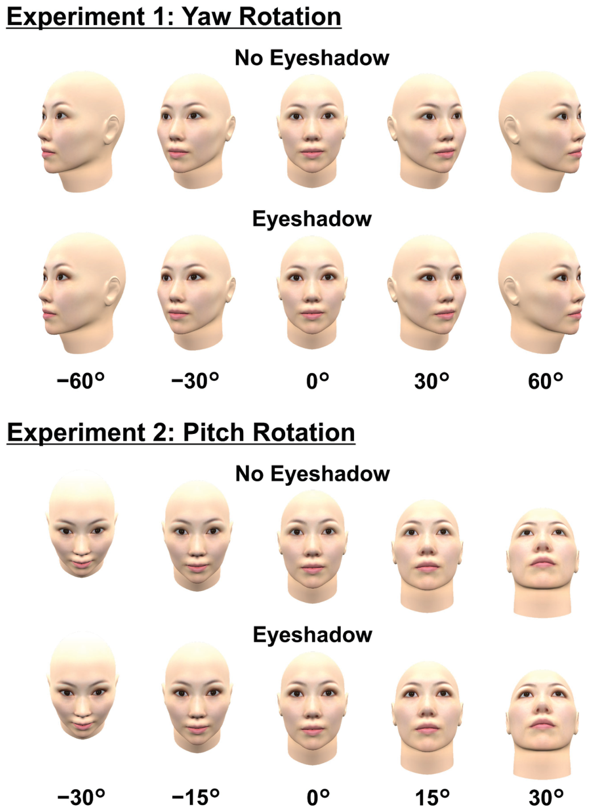
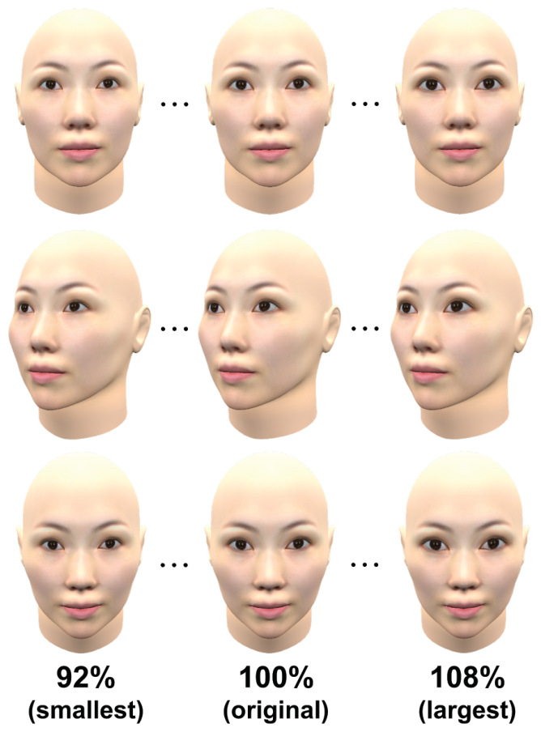
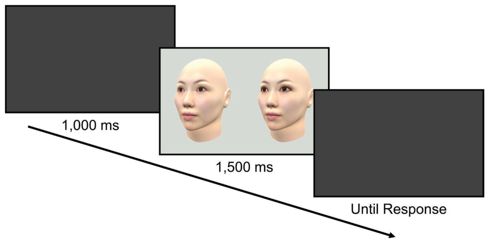
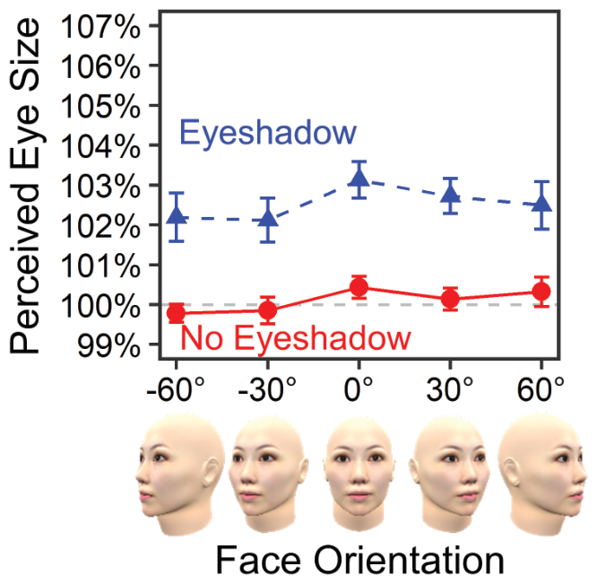
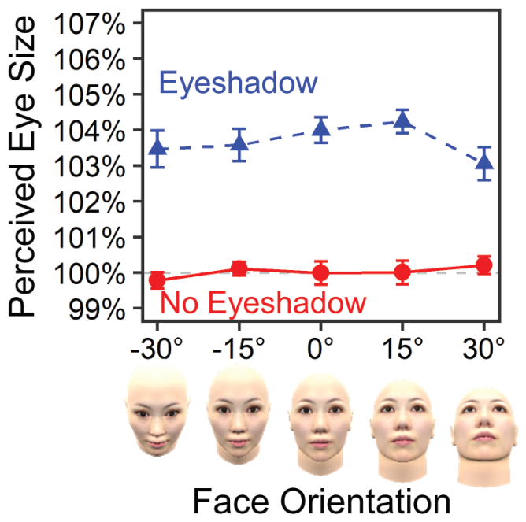

# 아이섀도가 일으키는 눈 크기 착시의 시점 불변성

> **원문** Muto H, Ide M, Tomita A and Morikawa K (2019). *Viewpoint Invariance of Eye Size Illusion Caused by Eyeshadow.* Frontiers in Psychology 10:1510. https://doi.org/10.3389/fpsyg.2019.01510
>
> **라이선스** 원문은 [Creative Commons Attribution License (CC BY 4.0)](https://creativecommons.org/licenses/by/4.0/)로 배포됩니다. 원저자와 출처를 밝히는 조건으로 이용·배포·복제·변경을 허용합니다.
>
> **변경 사항** 영어 원문을 한국어로 번역했습니다. 그림은 원문에서 잘라 캡션 앞에 넣었고, 참고문헌 목록은 생략했습니다. 원저자가 검토한 번역이 아닙니다.

**용어 대응** — 착시(illusion) · 동화(assimilation): 가까이 있는 것들이 비슷하게 보이도록 끌려가는 지각 현상 · 크기–거리 보정(size-distance scaling): 멀리 있다고 느끼는 것을 더 크게 보는 지각 · 계단법(staircase method): 비교 자극을 조금씩 바꿔 가며 "같아 보이는 지점"을 찾는 방법 · 주관적 등가점(PSE, point of subjective equality): 두 자극이 같아 보이는 값 · 베이즈 인자(BF, Bayes factor) · 요(yaw): 좌우 회전 · 피치(pitch): 위아래 회전

---

## 초록

기존 연구는 윗눈꺼풀에 아이섀도를 바르면 눈 크기를 실제보다 크게 지각한다는 것을 발견했다. 본 연구는 이 아이섀도 착시가 시점에 의존하는지 아닌지를 조사했다. 우리는 여성 얼굴의 3차원 모델을 만들고, 아이섀도의 유무와 얼굴 방향을 요(실험 1) 또는 피치(실험 2) 회전축을 중심으로 조작했다. 계단법을 사용해 각 얼굴 자극에 대해 지각된 눈 크기를 측정했다. 결과는 아이섀도 착시가 요와 피치 두 회전축 모두에서 얼굴 방향과 관계없이 일어남을 보였다. 결정적으로, 착시의 크기는 얼굴 방향에 따라 달라지지 않았다. 착시 크기와 얼굴 방향 사이에 상호작용이 없다는 것이 작은 베이즈 인자 값으로 확인되었다. 이 결과는 아이섀도가 깊이 단서로 작용해 크기–거리 보정 때문에 눈 크기를 과대평가하게 만든다는 가설을 배제했다. 대신 본 결과는 아이섀도 착시가 눈과 아이섀도 사이의 동화로 잘 설명될 수 있으며, 이 동화가 눈과 눈썹 사이의 동화도 촉진한다는 것을 시사한다. 실용적 함의와 본 결과의 일반화 가능성도 논의한다.

**키워드**: 시각 착시, 시점, 얼굴, 눈, 아이섀도, 동화

## 서론

시각 착시는 지각과 물리적 실재 사이의 불일치를 보여 준다. 전통적으로 시각 착시 연구는 기하학적 배치(예: 뮐러–라이어 착시, 델뵈프 착시) 같은 인위적이거나 단순화된 도형을 써 왔다. 그러나 시각 착시는 인체처럼 더 자연스럽고 친숙한 대상에서도 일어날 수 있다(예: Morikawa, 2003, 2012, 2017; van der Kamp and Masters, 2008). 특히 최근에는 사람 얼굴에서 일어나는 시각 착시에 대한 과학적 관심이 커졌다(예: Abe et al., 2009; Kitaoka, 2012; Xiao et al., 2014; Morikawa et al., 2015; Matsushita et al., 2015a,b; Kobayashi et al., 2017; Kiritani et al., 2017a,b). 시각 착시와 얼굴 지각을 결합한 이 새로운 분야는 이론적 함의뿐 아니라 실용적 응용도 기대되는데, 화장품으로 시각 착시를 의도적으로 일으켜 얼굴의 인상을 바꾸는 방법을 제시할 수 있기 때문이다.

그런 화장 착시의 한 예를 아이섀도를 바른 얼굴에서 찾을 수 있다. 아이섀도는 눈꺼풀이나 눈 주위 피부에 바르는 색조 화장품이다. Morikawa 등(2015)은 심리물리 절차를 사용해, 윗눈꺼풀에 아이섀도를 바른 평균 여성 얼굴이 아이섀도가 없는 얼굴보다 눈이 더 커 보인다는 것을 보였다. 이 아이섀도 착시는 얼굴이 서로 다른 여성 6명을 쓴 실험에서도 확인되었으며(Matsushita et al., 2015b), 이는 아이섀도 착시가 다양한 얼굴 특징에 걸쳐 일반화됨을 드러냈다.

본 연구는 아이섀도의 눈 확대 효과가 다양한 시점에서 본 얼굴에도 일반화될 수 있는지를 검증한다. 시점 변화는 얼굴 인식(예: Bruce, 1982; O'Toole et al., 1998; Favelle et al., 2007; 개관은 Hancock et al., 2000; Johnston and Edmonds, 2009)과 얼굴이 아닌 대상(예: Tarr and Pinker, 1989; Edelman and Bülthoff, 1992; Tarr, 1995)에 강한 영향을 준다는 것이 반복해서 보고되었다. 그럼에도 얼굴의 시각 착시 연구 대부분은 정면 모습만 사용해, 시점 변화가 착시 크기에 미칠 수 있는 영향을 무시해 왔다. 일상에서 우리는 다양한 모습의 얼굴을 마주친다. 다시 말해 우리 얼굴은 다른 사람들에게 여러 시점에서 보인다. 따라서 아이섀도 착시가 얼굴 방향에 의존하는지 아닌지를 아는 것은 화장 착시의 발견을 실제 상황에 적용할 때 도움이 된다. 예를 들어 아이섀도 착시가 정면 얼굴에서만 일어난다면, 눈을 크게 보이고 싶은 사람은 사진을 찍을 때 카메라를 정면으로 바라봐야 한다.

아이섀도 착시의 시점 의존성 또는 독립성을 확인하는 것은 이론적으로도 중요하다. 지금까지 아이섀도 착시의 기전을 설명하는 두 가설이 제안되었다. 첫째, 동화 가설(Morikawa et al., 2015; Matsushita et al., 2015b)에 따르면, 아이섀도는 더 큰 고리로 둘러싸인 원이 실제보다 커 보이는 델뵈프 착시와 같은 방식으로 눈과 아이섀도 사이의 동화를 일으킨다. 게다가 아이섀도는 눈과 눈썹 사이의 동화를 촉진한다(즉 눈과 눈썹의 지각적 묶음을 강화한다). Morikawa 등(2015)은 첫 실험에서 눈과 눈썹 사이의 거리, 아이섀도의 유무, 관찰자와 화면 사이의 관찰 거리가 미치는 효과를 조사했다. 그들은 눈에 더 가까운 눈썹과 아이섀도의 존재가 지각된 눈 크기를 키운다는 것을 발견했다. 더 중요하게, 5 m 관찰 거리에서 눈썹이 눈에서 멀리 있을 때 아이섀도의 효과가 강해진다는 것도 발견해, 아이섀도가 눈과 눈썹 사이의 동화를 조절하는 효과가 있음을 보였다. 더 나아가 그들의 두 번째 실험은 델뵈프 착시 도형을 이루는 동심원이 눈과 눈썹을 대신하고, 안쪽 원과 바깥 원 사이의 그라데이션이 아이섀도를 대신했을 때도 비슷한 결과를 얻었다. 이 결과들은 동화 설명의 증거로 간주되었다.

다른 가설인 크기–거리 보정 설명(Abe et al., 2009)은 아이섀도가 눈 주위가 움푹하다는 깊이 단서로 작용해 눈과 관찰자 사이의 주관적 거리를 늘리고, 이것이 크기–거리 보정 때문에 눈 크기의 과대평가로 이어진다고 말한다. Abe 등(2009)은 쌍비교법을 사용해 더 짙은 아이섀도가 눈의 주관적 깊이를 키우고 주관적 크기를 확대한다는 것을 보였다. Matsushita 등(2015b)과 Morikawa 등(2015)이 주장했듯, 크기–거리 보정만으로는 눈 크기 착시의 크기를 충분히 설명하지 못한다(예: 60 cm 관찰 거리에서 5% 과대평가가 일어나려면 눈이 3 cm 뒤에 있다고 지각되어야 하는데, 이는 해부학적으로 불가능하다). 그럼에도 크기–거리 보정이 적어도 부분적으로는 아이섀도 착시에 기여할 가능성이 있다.

본 실험은 크기–거리 보정이 아이섀도 착시를 일으키는지, 아니면 동화 설명만으로 충분히 설명되는지를 가리도록 설계되었다. 일반적으로 그림 단서에 기반한 착시적 깊이 지각은 시점 변화에 취약한데, 시점이 바뀌면 대상의 실제 깊이 정보가 드러나 착시적 깊이가 약해지기 때문이다. 예를 들어 에임스 방 착시는 이상적인 시점에서 방을 볼 때만 일어난다. 마찬가지로 눈 주위의 움푹한 곳을 포함한 얼굴의 실제 깊이는 정면보다 정면이 아닌 시점에서 볼 때 더 정확히 지각된다(예: Hill et al., 1997; Ansari and Abdel-Mottaleb, 2005). 따라서 크기–거리 보정이 아이섀도 착시에 기여한다면, 얼굴이 정면에서 돌아갈수록 착시의 크기가 줄어야 한다. 반대로 크기–거리 보정이 아이섀도 착시의 주된 원인이 아니라면, 착시의 크기는 얼굴 방향과 관계없이 일정하게 유지되어야 한다. 얼굴 방향을 조작하면 이 두 대안을 검증할 수 있다.

우리의 예측을 확인하려면 귀무가설에 대한 판단(즉 얼굴 방향이 아이섀도 착시를 조절하지 않는다는 증거)이 필요하다. 그러나 통상적인 유의성 검정의 틀은 귀무가설을 지지할 수 없게 되어 있다(예: Aczel et al., 2018; Dienes and McLatchie, 2018). 이 한계를 극복하기 위해 통상적인 통계 검정에 더해 베이즈 인자(BF) 분석을 수행했다(최근 개관은 Dienes and McLatchie, 2018). 이 맥락에서 BF는 얻은 자료가 귀무가설보다 대립가설을 얼마나 지지하는지를 나타낸다. BF 값은 0(귀무가설 지지)에서 1(판단 불가)을 거쳐 무한대(대립가설 지지)까지의 범위를 갖는다. 제프리스의 BF 기준(Jeffreys, 1961; Aczel et al., 2018; Dienes and McLatchie, 2018도 참조)에 따르면 1/3에서 1/10 사이의 값은 귀무가설에 대한 상당한 증거로, 1/10 미만은 강한 증거로 간주된다. 또한 3에서 10 사이의 값은 대립가설에 대한 상당한 증거로, 10을 넘으면 강한 증거로 간주된다. 이 기준에 따라 우리는 BF가 1/3 미만이면 얼굴 방향이 아이섀도 착시를 조절하지 않는다는 귀무가설의 증거로 보았다(얼굴 지각 연구에서 비슷하게 BF를 적용한 예는 Norman and Tokarev, 2014 참조).

요약하면, 본 연구는 얼굴 방향이 아이섀도로 인한 눈 확대 효과의 크기를 조절하는지를 조사했다. 엄밀한 조작을 위해, 모사한 아이섀도를 바른 여성 얼굴의 3차원(3D) 모델을 만들고 그 방향을 요(실험 1)와 피치(실험 2) 회전축을 중심으로 조작했다(그림 1 참조). 얼굴을 여러 각도에서 볼 때의 지각된 눈 크기를 심리물리 절차인 계단법(상하법이라고도 함)으로 측정했다.

## 실험 1

실험 1은 Morikawa 등(2015)의 실험 1과 비슷한 방법으로 아이섀도가 있는 얼굴과 없는 얼굴의 지각된 눈 크기를 측정했다. 본 실험의 새로운 점은 요 회전축을 중심으로 얼굴 방향을 조작한 것이다. 이 실험은 얼굴 방향이 아이섀도의 눈 확대 효과를 조절하는지를 조사한다.

> **그림 1.** 본 실험에 쓰인 모든 표준 자극.

### 방법

**참가자** 학부생과 대학원생 20명(평균 나이 22.3세, 19–30세, 남성 9명, 여성 11명)이 자발적으로 실험 1에 참가했다. 모두 정상 또는 교정 시력과 정상 삼색 색각을 가졌다.

**자극과 장비** 30대 일본 여성 8명의 평균 얼굴의 정면·측면 모습을 FaceGen Modeler 3.7에 불러와 얼굴의 3D 컴퓨터 그래픽을 생성했다. 평균 얼굴은 시세이도(Shiseido Co. Ltd.)가 제공했다. 갈색 아이섀도를 바른 모습은 디지털 사진 편집 소프트웨어 PaintShop Pro XI로 얼굴의 텍스처 이미지를 편집해 모사했다. Morikawa 등(2015)에서도 같은 방법을 사용했다. 얼굴의 3D 모델과 텍스처 이미지는 3D 컴퓨터 그래픽 소프트웨어 Blender 2.71로 통합했다. 서로 다른 각도에서 본 얼굴의 최종 자극 이미지는 두 눈의 중점을 지나는 수직축을 중심으로 얼굴을 0°, ±30°, ±60° 회전해 만들었다(마이너스와 플러스 부호는 각각 시계 방향과 반시계 방향을 나타낸다). 2D 자극 이미지에서 눈 크기의 변화를 최소화하기 위해 이 회전축을 선택했다. 머리 중심을 지나는 수직축을 중심으로 ±60° 회전했다면 두 눈이 관찰자에게서 멀어져, 두 눈의 2D 이미지가 정면 얼굴보다 훨씬 작아졌을 것이다. 이렇게 표준 자극 10개(아이섀도 유무와 얼굴 방향 다섯 가지의 조합, 그림 1)를 만들었다. 자극 크기는 일본 성인 여성의 평균 머리 크기에 맞춰, 정면 얼굴이 광대뼈 높이에서 폭 14.9 cm(552픽셀), 정수리에서 턱 끝까지 높이 22.0 cm(815픽셀)가 되도록 했다.

계단법의 비교 자극으로는 다섯 방향 모두에서 아이섀도가 없는 얼굴을 사용했다. 이 자극들의 눈 크기는 원래 눈 크기(100%)의 92%부터 108%까지 가로·세로 모두 1% 단위로 차례로 줄이거나 키웠다(그림 2). 이 비교 자극은 3D 모델이 아니라 2D 자극 이미지에서 PaintShop Pro XI로 눈 크기를 줄이거나 키워 만들었다.

모든 자극은 24.1인치 LCD 모니터(NEC MultiSync LCD-PA241W, 해상도 1,920 × 1,200픽셀)에 제시했다. 화면과 참가자 눈 사이의 관찰 거리는 약 100 cm였다.

> **그림 2.** 본 실험에 쓰인 비교 자극의 예.

### 절차

실험 1과 2는 오사카대학 인간과학부 연구윤리위원회의 권고에 따라, 모든 참가자의 서면 동의를 받아 수행했다. 모든 참가자는 헬싱키 선언에 따라 서면 동의했다. 프로토콜은 오사카대학 인간과학부 연구윤리위원회의 승인을 받았다.

실험은 얼굴 방향별로 다섯 블록으로 구성했다¹. 즉 각 블록은 특정 방향에서 아이섀도가 있는 얼굴과 없는 얼굴의 지각된 눈 크기를 측정하기 위해 수행했다. 블록 순서는 참가자마다 무작위로 정했다.

그림 3은 실험 절차를 보여 준다. 각 시행은 1,000 ms 동안의 빈 회색 화면으로 시작했다. 그다음 표준 자극과 비교 자극을 RGB 중앙값 214, 219, 213의 회색 배경 위에 나란히 제시했다. 두 얼굴은 항상 같은 방향이었다. 참가자에게 어느 얼굴의 눈이 더 커 보이는지 판단해, 왼쪽 얼굴이면 "z" 키를, 오른쪽 얼굴이면 "백슬래시" 키를 누르도록 했다. 참가자는 두 얼굴을 비교하려고 눈을 자유롭게 움직일 수 있었다. 자극의 특정 지점에 초점을 맞추지 말고 얼굴 전체에 주의를 기울이라고 지시했지만, 시선은 추적하지 않았다. 자극 쌍은 1,500 ms 동안 제시되었고, 이어서 빈 회색 화면이 나왔다. 응답 뒤 다음 시행이 시작되었다. 표준 자극과 같게 지각되는 비교 자극의 눈 크기를 측정하기 위해 계단법을 사용했다. 아이섀도 있음·없음 조건 각각에 대해 오름 계단과 내림 계단을 무작위로 섞어 진행했다. 각 계단의 비교 자극 눈 크기는 92%(오름 계단) 또는 108%(내림 계단)에서 시작했다. 따라서 각 블록은 동시에 진행되는 네 계단(오름 또는 내림, 아이섀도 있음 또는 없음)의 시행으로 이루어졌으며, 이들은 무작위로 섞였다. 각 계단은 방향이 여섯 번 바뀌면 끝났다. 표준 자극과 비교 자극의 좌우 위치(어느 쪽이 왼쪽에 제시되는지)는 시행마다 무작위로 정했다. 실험은 평균 약 20분 걸렸다.

> ¹ 한 세션 안에서 모든 방향 조건을 무작위로 섞는 대신, 참가자가 얼굴 방향을 예측하지 못하는 요인을 없애기 위해 얼굴 방향별로 시행을 블록으로 묶었다. 블록 설계를 채택한 덕분에 참가자의 판단이 쉬워져 지각된 눈 크기를 더 정밀하게 측정할 수 있었을 것이다.

> **그림 3.** 본 실험의 절차. 표준 자극과 비교 자극 한 쌍을 나란히 제시했다. 참가자는 어느 얼굴의 눈이 더 커 보이는지 판단했다.

### 자료 분석

각 표준 자극과 각 참가자에 대해, 계단 방향이 위에서 아래로 또는 아래에서 위로 바뀐 지점의 비교 자극 눈 크기를 평균해 주관적 등가점(PSE)을 계산했다. 그다음 아이섀도와 얼굴 방향을 요인으로 하는 이원 반복측정 분산분석을 수행했다. 구형성 가정 위반에 대비해 Chi–Muller의 ε로 보정한 자유도와 p값을 보고했다.

JASP 0.8.6.0(JASP Team, 2018)으로 베이즈 반복측정 분산분석을 수행해 BF도 계산했다. JASP의 기본 사전분포(고정 효과와 무선 효과에 각각 척도값 r = 1/2과 1인 g-사전분포, 자세한 것은 Morey et al., 2018)를 사용했다. 주효과의 BF를 계산할 때는 고정 효과가 없는 모형을 귀무 모형으로 썼다. 아이섀도와 얼굴 방향의 상호작용에 대해서는 두 주효과는 포함하되 상호작용은 포함하지 않는 모형을 귀무 모형으로 썼다.

### 결과와 논의

그림 4는 각 표준 자극의 평균 PSE를 보여 준다. 결과는 아이섀도가 지각된 눈 크기를 평균 2.42% 키운다는 것을 확인했다. F(1, 19) = 35.45, ηp² = .651, p < .001, ε = 1.00, BF = 8.14 × 10¹⁵로 대립가설을 지지한다. 얼굴 방향의 주효과는 발견되지 않았다. F(4, 76) = 1.68, ηp² = .081, p = .163, ε = 1.00, BF = 0.07로 귀무가설을 지지한다. 가장 중요하게, 아이섀도와 얼굴 방향 사이에 상호작용이 없었다. F(4, 76) = 0.23, ηp² = .012, p = .918, ε = 1.00, BF = 0.05로 귀무가설을 지지한다. 0.05라는 작은 BF(< 1/3)는 얼굴 방향이 아이섀도 착시를 조절하는 효과가 없음을 상당한 수준으로 입증했다.

3D 컴퓨터 그래픽 모델을 사용해, 실험 1은 아이섀도 착시에 관한 기존 결과(Morikawa et al., 2015; Matsushita et al., 2015b)를 재현했다. 더 나아가 본 실험은 이 착시가 적어도 요 회전축에 대해서는 얼굴 방향과 독립적임을 발견했다. 다음 실험에서는 시점 독립성이 피치 축을 중심으로 회전한 얼굴에서도 관찰되는지 조사한다.

> **그림 4.** 실험 1에서 지각된 눈 크기의 평균과 표준오차.

## 실험 2

서로 다른 회전축을 중심으로 얼굴 방향을 조작하면 결과가 다를 수 있다(얼굴 인식이 그렇다. Favelle et al., 2007 참조). 아이섀도는 (눈썹처럼) 보통 눈 위에 놓이므로, 얼굴을 피치 회전하면 2차원 망막 이미지에서 눈, 눈썹, 아이섀도 사이의 수직 거리가 줄어든다. 반면 요 회전은 이들 사이의 수직 거리에 영향을 덜 준다. 눈썹의 위치가 눈의 지각된 크기와 모양에 영향을 준다는 점(Morikawa et al., 2015; Matsushita et al., 2015a), 그리고 델뵈프 착시의 크기가 두 원의 지름 비의 함수라는 점(예: Oyama, 1960, 1962; Goto et al., 2007)을 고려하면, 회전으로 생기는 망막 이미지의 왜곡은 지각된 깊이와 무관하게 아이섀도 착시의 크기에 영향을 줄 수 있다. 다른 한편으로는 아이섀도 착시가 망막 이미지가 아니라 얼굴의 실제 모양(즉 정면 얼굴)에 기반할 가능성도 있으며, 이는 모양 항등성으로 설명될 수 있다. 이 문제를 다루기 위해 실험 2는 요 회전 대신 피치 회전축을 중심으로 얼굴 방향을 조작한 것을 빼면 실험 1과 같은 절차를 사용했다.

### 방법

**참가자** 학부생과 대학원생 20명(평균 나이 22.8세, 20–28세, 남성 9명, 여성 11명)이 자발적으로 실험 2에 참가했다. 모두 정상 또는 교정 시력과 정상 삼색 색각을 가졌다. 실험 1에 참가한 사람은 없었다.

**자극** 실험 1과 같은 모델과 텍스처를 사용했다. 요 회전 대신, 얼굴의 정면 모습을 두 눈의 중점을 지나는 수평축을 중심으로 0°, ±15°, ±30° 회전했다(마이너스와 플러스 부호는 각각 아래쪽과 위쪽 방향을 나타낸다). 2D 자극 이미지에서 눈 크기의 변화를 최소화하기 위해 이 축을 선택했다. 눈은 가로로 길어서 같은 각도라도 요 회전보다 피치 회전에서 가려지기 쉬우므로, 회전 각도의 범위를 실험 1(±60°)보다 좁게 잡았다. 실험 1처럼 표준 자극 총 10개(아이섀도 유무와 얼굴 방향 다섯 가지의 조합, 그림 1)를 만들었다. 계단법의 비교 자극은 실험 1과 똑같이 아이섀도가 없는 자극의 눈 크기를 차례로 바꿔 만들었다(그림 2).

**장비, 절차, 자료 분석** 장비와 실험·통계 절차는 실험 1과 같았다. 실험은 약 20분 걸렸다.

### 결과와 논의

그림 5는 각 표준 자극의 평균 PSE를 보여 준다. 다시 한번 결과는 아이섀도로 인한 눈 확대 효과(평균 3.65%)를 보였다. F(1, 19) = 126.89, ηp² = .870, p < .001, ε = 1.00, BF = 3.64 × 10³⁶으로 대립가설을 지지한다. 얼굴 방향의 주효과는 발견되지 않았다. F(3.65, 69.31) = 0.92, ηp² = .046, p = .451, ε = .91, BF = 0.02로 귀무가설을 지지한다. 가장 중요하게, 아이섀도와 얼굴 방향 사이에 상호작용이 없었다. F(3.80, 72.18) = 1.40, ηp² = .069, p = .243, ε = .95, BF = 0.19로 귀무가설을 지지한다. 0.19라는 작은 BF(< 1/3)는 피치 축을 중심으로 한 얼굴 방향이 아이섀도 착시를 조절하는 효과가 없음을 상당한 수준으로 입증했다.

요약하면, 실험 2는 아이섀도 착시가 피치 회전축을 중심으로 한 얼굴 방향과 독립적임을 밝혔다. 이 결과는 실험 1의 요 회전에 대한 결과와 비슷하다.

> **그림 5.** 실험 2에서 지각된 눈 크기의 평균과 표준오차.

## 종합 논의

3D 컴퓨터 그래픽 모델로 만든 회전된 얼굴을 사용해, 이 두 실험은 아이섀도로 인한 눈 확대 착시가 시점에 의존하는지 독립적인지를 조사했다. 우리는 아이섀도 착시가 3D 컴퓨터 그래픽 모델에서도 일어남을 확인해, 평균 여성 얼굴(Morikawa et al., 2015)과 여성 모델 사진(Matsushita et al., 2015b)을 쓴 기존 연구를 재현하고 확장했다. 더 중요하게, 우리 결과는 BF 분석이 입증하듯 아이섀도 착시의 크기가 요(실험 1)와 피치(실험 2) 회전 모두에서 얼굴 방향에 걸쳐 일정함을 일관되게 보였다. 따라서 본 연구는 아이섀도 착시의 시점 불변성에 대한 증거를 제공한다.

이론적으로 본 결과는 크기–거리 보정이 아이섀도 착시에 기여하지 않음을 시사한다. 서론에서 설명했듯, 정면이 아닌 시점은 눈 부위의 실제 깊이 정보를 드러내므로, 정면 시점에서 볼 때 가장 효과적인 그림 단서가 일으키는 착시적 깊이 지각을 약하게 만들어야 한다. 이를 고려하면, 크기–거리 보정 설명(Abe et al., 2009)이 옳다면 얼굴이 정면에서 돌아갈수록 아이섀도 착시의 크기가 줄었어야 한다. 따라서 Matsushita 등(2015b)과 Morikawa 등(2015)을 함께 고려하면, 아이섀도 착시는 동화 설명만으로 잘 설명될 수 있다. 이 설명은 신체와 얼굴 전반에 비슷한 특성이 생물학적으로 함께 나타나기 때문에 신체와 얼굴에서 일어나는 착시가 대비적이기보다 동화적일 가능성이 크다는 생각(Morikawa, 2012, 2017)과도 일치한다. 그러나 본 연구는 동화 설명을 지지하는 직접적인 증거를 얻지는 못했다. 동화 효과의 기여를 조사하고 아이섀도 착시의 기저 기전을 더 자세히 밝히려면 더 많은 연구가 필요하다.

더 나아가 본 연구는 델뵈프 착시와 동화 효과의 기전을 설명하지 않는다. 이 주제는 본 논문의 범위를 벗어나지만, 그런 기전의 유력한 후보 하나는 특정 공간 주파수 대역에서 저수준 이미지 특징들이 묶이는 것이다. 라플라시안 피라미드를 이용한 하위 대역 분해로 이미지를 분석하는 접근은 아이섀도가 왜 눈을 커 보이게 하는지 설명하는 향후 연구에 유익한 방법이 될 수 있다.

요 회전보다 훨씬 덜 연구된 피치 회전축을 중심으로 얼굴 방향을 조작한 것도 본 연구의 새로운 점이다. 요 회전과 달리 피치 회전은 2차원 망막 이미지에서 눈, 눈썹, 아이섀도 사이의 수직 거리를 바꾼다. 실제로 실험 2에서 동공 중심을 지나는 수직선 위에서 눈 틈 맨 위와 눈썹 아래 가장자리 사이의 거리는 0°인 얼굴에서 약 16 mm(45′), ±30°에서 13 mm(56′)였다. 그럼에도 피치나 요 회전축을 중심으로 한 얼굴 방향은 아이섀도 착시의 크기에 영향을 주지 않았다. 델뵈프 착시는 원 사이의 거리에 민감하다고 알려져 있으므로(Morikawa et al., 2015), 이 결과는 회전된 얼굴에서 일어나는 아이섀도 착시가 2D 이미지의 저수준 이미지 특징만으로는 충분히 설명될 수 없음을 시사한다. 우리는 이 시점 불변성이 서로 다른 각도에서 본 얼굴의 모양 항등성으로 설명될 수 있다고 추측한다. 즉 관찰자는 적어도 본 실험에서 검증한 각도 범위 안에서는 망막 이미지가 조금 왜곡되더라도 회전된 얼굴을 정면 시점에서와 같은 방식으로 지각할 수 있었다. 이 추측을 검증하려면 향후 연구에서 모양 항등성이 깨지는 자극(예: 기울어진 그림, Hanada, 2005)을 사용해 아이섀도 착시나 관련 착시(예: 델뵈프 착시)의 크기를 측정해야 한다. 눈, 눈썹, 아이섀도 사이의 수직 거리와 얼굴 방향을 본 연구보다 넓은 범위에서 체계적으로 조작하는 것도 유용하다. 더 나아가 2D 자극 이미지에서 눈 크기의 변화를 최소화하려고 피치 회전에 두 눈의 중점을 지나는 수평축을 사용했지만, 이 축은 다소 부자연스러웠다. 따라서 회전축의 선택이 얼굴 지각과 착시에 영향을 주는지, 어떻게 주는지를 향후 연구에서 조사한다면 유익할 것이다.

본 결과는 눈이 얼굴 매력의 중요한 결정 요인이라는 점을 고려할 때 화장 기법에도 실용적 함의가 있다. 구체적으로, 더 큰 눈은 여성 얼굴을 더 매력적으로 만든다고 알려져 있다(Geldart et al., 1999; Baudouin and Tiberghien, 2004). 기존 연구들은 눈 크기의 착시적 과대평가도 매력을 높인다고 시사했다(Morikawa et al., 2015; Matsushita et al., 2015a).

또한 정면과 측면의 얼굴 매력 사이에는 강한 상관이 있다(Rule et al., 2009; Gu et al., 2018). 이런 결과를 고려하면, 우리가 얼굴의 매력을 측정하지는 않았지만, 본 결과는 아이섀도가 얼굴 방향과 관계없이 눈 크기의 과대평가를 통해 여성 얼굴을 더 매력적으로 만들 가능성을 시사한다.

본 연구에는 몇 가지 한계가 있다. 첫째, 엄밀한 조작을 위해 3D 모델로 얼굴 자극을 만들었으므로, 아이섀도 착시의 시점 독립성이 실제 사람 얼굴에서도 관찰될 수 있는지는 신중해야 한다. 둘째, 아이섀도 착시와 그 시점 독립성이 얼굴 지각에 특유한 전체적 처리와 연결되어 있는지는 여전히 불분명하다(예: Tanaka and Farah, 1993; Hayward et al., 2016). 지금까지 아이섀도 착시는 일본 여성의 평균 얼굴(Morikawa et al., 2015)과 실제 일본 여성 모델의 사진(Matsushita et al., 2015b)에서 관찰되었다. 게다가 아이섀도를 모사한 그라데이션이 있는 델뵈프 착시에서도 비슷한 효과가 발견되었다(Morikawa et al., 2015). 이 관찰들을 고려하면, 얼굴에 국한되지 않은 여러 대상에 대한 일반적인 시각 처리가 아이섀도 착시를 일으킨다는 쪽이 더 그럴듯하다. 그렇다면 시점 독립성에 대한 본 결과는 얼굴이 아닌 자극에도 일반화될 수 있다. 그럼에도 본 결과가 우리가 사용한 특정 인종, 나이, 성별의 3D 얼굴 구조에 의존할 가능성이 있다. 예를 들어 아이섀도 착시의 시점 불변성이 아시아인 얼굴보다 안와가 더 깊은 백인 얼굴에도 적용되는지는 아직 알 수 없다. 더 강한 결론을 내리려면 향후 연구에서 다양한 인종, 나이, 성별의 실제 얼굴 사진과 뒤집힌 얼굴에 비슷한 시점 조작을 적용해야 한다. 델뵈프 착시 도형을 그린 구 같은 얼굴이 아닌 대상을 쓰는 것도 도움이 될 것이다.

우리는 갈색 아이섀도만 사용했지만, 아이섀도의 색이 아이섀도 착시나 얼굴 인상의 다른 측면에도 영향을 줄 수 있다. 특히 아이섀도 색과 얼굴 피부색의 조합이 동화 효과를 조절할 가능성이 있다. 예를 들어 피부색과 아주 다른 색의 아이섀도는 얼굴과 독립된 특징으로 지각될 수 있고, 그러면 동화 효과가 줄어들 수 있다. 또한 피부색이 아이섀도 색(Kiritani et al., 2017a) 및 입술 색(Kobayashi et al., 2017; Kiritani et al., 2017b)과 동화된다는 점을 고려하면, 여러 얼굴 특징 사이의 역학을 고려해야 한다.

얼굴에서 일어나는 다른 착시들도 아이섀도 착시처럼 시점에 독립적인지 알아내려면 추가 연구가 필요하다. 예를 들어 시점 변화가 피부색과 입술 색 사이의 색 동화(Kobayashi et al., 2017; Kiritani et al., 2017b)를 약하게 만드는가? 얼굴이 정면에서 돌아갈수록 색이 있는 얼굴 부위(예: 아이섀도, 입술)의 망막 이미지 면적이 작아지므로, 그런 색 동화는 시점 변화에 따라 약해질 수 있다. 다른 한편으로 생물학적 동시 발생 가설(Morikawa, 2012, 2017)과 모양 항등성을 고려하면, 색이 있는 얼굴 특징이 적어도 조금이라도 보이면 그런 동화는 계속 작동할 수 있다. 생물학적 착시의 기전을 더 이해하고 화장 착시를 더 자연스러운 상황에 적용할 수 있는지 확인하는 데, 얼굴 방향을 조작하는 본 연구의 접근은 유용하다.

## 자료 이용 가능성

본 논문의 결론을 뒷받침하는 원자료는 자격을 갖춘 연구자라면 누구에게든 저자들이 부당한 유보 없이 제공할 것이다.

## 윤리 성명

실험 1과 2는 오사카대학 인간과학부 연구윤리위원회의 권고에 따라, 모든 참가자의 서면 동의를 받아 수행했다. 모든 참가자는 헬싱키 선언에 따라 서면 동의했다. 프로토콜은 오사카대학 인간과학부 연구윤리위원회의 승인을 받았다.

## 저자 기여

HM, MI, KM이 실험을 구상하고 설계했다. HM과 MI가 자극을 만들었다. HM이 자료를 수집·분석하고 원고 초안을 썼다. AT와 KM이 비판적으로 수정했다. 모든 저자가 이 원고와 투고를 승인했다.

## 연구비

이 연구는 시세이도(Shiseido Co. Ltd.)가 KM에게 준 연구비와 JSPS 과학연구비 JP18K03175(KM)의 지원을 받았다.

## 감사의 말

평균 일본 여성 얼굴 이미지를 제공해 준 시세이도에 감사한다.

---

*참고문헌 목록은 원문을 참조하십시오.*
