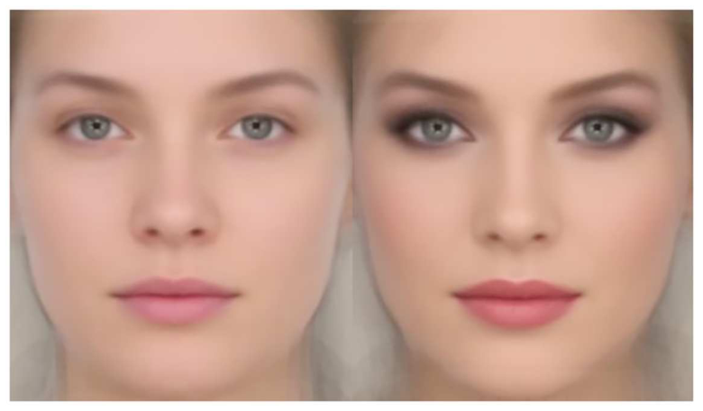
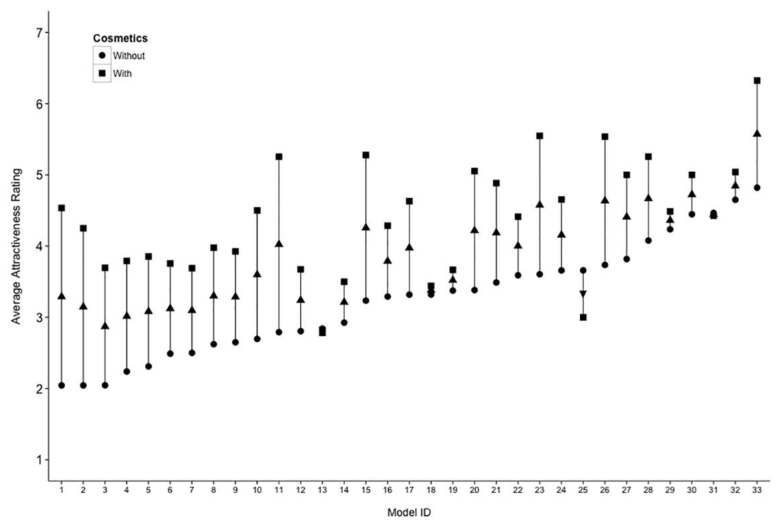
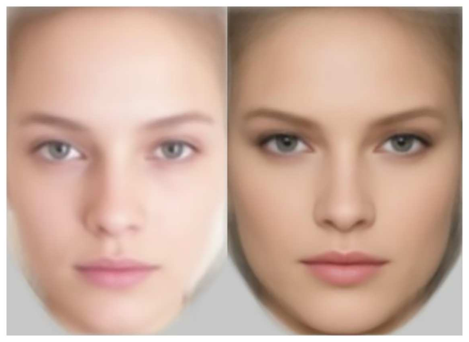
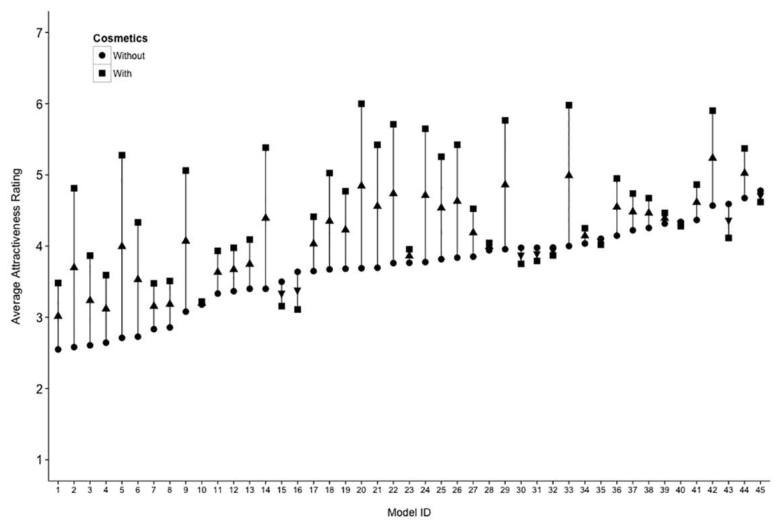

# 얼굴 화장과 매력: 전문가가 바른 화장과 정체성의 효과 크기 비교

> **원문** Jones AL, Kramer RSS (2016). *Facial Cosmetics and Attractiveness: Comparing the Effect Sizes of Professionally-Applied Cosmetics and Identity.* PLoS ONE 11(10): e0164218. https://doi.org/10.1371/journal.pone.0164218
>
> **라이선스** 원문 Copyright © 2016 Jones, Kramer. [Creative Commons Attribution License](https://creativecommons.org/licenses/by/4.0/)로 배포되며, 원저자와 출처를 밝히는 조건으로 모든 매체에서 제한 없는 이용·배포·복제를 허용합니다.
>
> **변경 사항** 영어 원문을 한국어로 번역했습니다. 그림은 원문에서 잘라 캡션 앞에 넣었고, 참고문헌 목록은 생략했습니다(본문의 [숫자]는 원문 참고문헌 번호). 원저자가 검토한 번역이 아닙니다.

**용어 대응** — 정체성(identity): 이 논문에서는 "사람마다 원래 얼굴이 다른 데서 오는 매력 차이"를 뜻함 · 개인 간 변동(between-person variation) · 개인 내 변동(within-person variation) · 효과 크기 η²(에타 제곱): 전체 변동 중 그 요인이 설명하는 비율 · 부분 에타 제곱(ηp²)

---

## 초록

몸을 꾸미는 형태는 모든 인간 문화에 존재한다. 그러나 서구 사회에서는 여성이 외모를 바꾸는 데, 특히 얼굴 화장을 통해 바꾸는 데 더 많이 참여한다. 화장은 매력을 바꾸는 데 얼마나 효과적인가? 기존 연구는 그 효과가 크지 않으며, 특히 정체성의 차이로 개인 사이에 나타나는 매력의 변동과 비교하면 더 그렇다고 암시해 왔다. 화장과 정체성이 매력에 어떻게 영향을 주는지 더 온전히 이해하기 위해, 우리는 전문가가 바른 화장이 매력을 어떻게 바꾸는지 조사하고 이 효과를 개인 사이에서 관찰되는 매력의 변동과 비교한다. 연구 1에서는 유튜브 모델 33명이 전문가 화장 전후로 매력을 평가받았다. 화장은 기존 연구보다 매력 변동의 더 큰 비율을 설명했지만, 이 효과는 개인 간 매력 차이로 인한 변동보다는 여전히 작았다. 연구 2는 개인 간 매력 변동이 작은 얼굴 표본에서 화장의 효과를 조사할 목적으로 슈퍼모델 45명의 표본으로 첫 연구의 결과를 재현했다. 화장의 효과 크기는 대체로 컸지만, 정체성으로 인한 개인 간 변동이 여전히 더 컸다. 두 연구 모두 화장과 정체성 사이의 상호작용도 발견했다. 더 매력적인 모델일수록 화장을 했을 때 더 작은 증가를 얻었다. 종합하면, 우리는 전문가가 바른 화장이 스스로 바른 화장보다 더 큰 효과를 낸다는 것을 보이며, 이는 이 분야에 중요한 이론적 고려 사항이다. 그러나 매력 지각에서는 결국 얼굴 외모의 개인차의 효과가 더 중요하다.

## 서론

염료, 물감, 기타 안료로 몸을 꾸미는 것은 가장 보편적인 인간 행동 중 하나로 모든 문화에 존재한다[1–3]. 그러나 서구 사회에서는 여성이 자기 치장의 대부분을 수행하며[4], 이런 종류의 행동 중 가장 흔한 것은 아마 얼굴 화장품의 사용일 것이다. 이 행동은 수십억 파운드 규모의 세계 화장품 산업이 떠받치고 있다[5].

여성들은 얼굴 외모에 대한 불안, 사회 규범에 대한 순응, 공적 자의식[6–8]부터 다른 사람에게 더 사교적이고 적극적으로 보이는 것[6]까지 다양한 이유로 화장품을 쓴다고 보고한다. 화장은 착용자가 조절하고 싶어 할 수 있는 사회적 지각을 개선하는 데 효과적이어서, 사람이 더 건강하고 돈을 더 버는 것처럼[9], 더 유능하고 호감 가고 믿을 만한 것처럼[10], 더 위신 있고 지배적인 것처럼[11] 보이게 한다. 화장은 다른 사람, 특히 남성의 행동에도 영향을 주는데, 남성은 화장을 한 여성 종업원에게 더 많은 금액을 더 자주 팁으로 주고[12], 환경 속에서 화장한 사람에게 더 쉽게 다가간다[13]. 화장이 사회적 지각에 주는 효과는 화장이 얼굴에 부여하는 매력의 증가에서 비롯될 가능성이 크며, 이 효과는 이제 잘 기록되어 있다[10,14–17]. 연구들은 화장이 얼굴 대비[18–21] 같은 성별 전형적 색 분포를 바꾸거나, 얼굴 피부의 균일성을 높이거나[22,23], 건강[24]이나 나이[25] 같은 특성의 색 단서에 영향을 주는 방식으로 작용한다는 것을 기록해 왔다.

화장이 지각된 매력에 주는 효과는 분명해 보이지만[14,17], 다른 연구들은 그것이 이전 생각보다 더 미묘하다는 것을 드러냈다. Etcoff와 동료들[10]은 매력이 화장의 양에 따라 선형으로 증가한다는 것, 간단히 말해 화장을 많이 할수록 더 매력적으로 보인다는 것을 보였다. 할 수 있는 여러 화장 중 눈과 입에 바른 화장의 양이 매력의 유의한 예측 변수로 나타났으며[26], 이 부위에 화장을 더 많이 할수록 매력 평가가 높아졌다. 그러나 다른 증거는 젊은 여성 표본이 바르는 전형적인 화장의 양이 과하며, 관찰자들은 최적의 매력을 위해 실제 양의 절반 가까이를 선호한다고 시사하여[16], 화장의 양과 매력 사이의 선형 관계에 의문을 제기한다.

얼굴 매력 연구의 한 가지 우려는 매력의 예측 변수(예: 대칭, 평균성, 성별 전형성[27])의 효과를 다른 변동의 원천과 비교하지 않는다는 것이다[28]. 최근 연구는 개인 내 매력 변동(예를 들어 화장의 유무로 인한)의 중요성을, 단순히 정체성의 차이로 인한 개인 간 매력 변동과 비교하는 방식으로 이 문제를 다루기 시작했다[29]. 구체적으로, 개인 내 변동의 한 원천인 화장이 매력에 주는 효과는 매우 작아서 평가의 변동 중 2%만 설명한다는 것이 이전에 밝혀졌다[15]. 이는 판단의 변동 중 69%를 설명한 개인 간 매력 차이, 즉 개인 간 변동과 비교하면 특히 작은 효과다. 더 간단히 말해, 얼굴 화장은 매력을 높이긴 하지만 그 기여는 작으며, 모집단 안에서 한 개인의 매력 순위를 바꾸는 데는 거의 도움이 되지 않는다.

그러나 화장의 사용은 개인 특유의 매우 다양한 관행이며[3], 그것이 매력에 주는 효과는 이전 생각보다 복잡하다. 화장이 지각에 주는 효과를 조사하는 거의 모든 연구에서 전문 메이크업 아티스트를 쓰는 것이 일반적인 관행이며[9,10,12,17,30,31], 스스로 바른 화장을 쓰는 연구는 몇 개뿐이다[14,16,26]. 화장이 매력에 주는 효과 크기를 처음 조사한 연구도 모델들이 스스로 화장하게 했다[15]. 전문가가 바른 화장을 쓸 좋은 이유가 있는데, 화장이 얼굴 매력을 어떻게 바꾸는지를 더 분명하게 검증할 수 있기 때문이다. 예를 들어 바르는 실력이나 쓰는 제품의 차이로 인해 스스로 바른 화장은 변동이 커서, 화장이 매력에 주는 효과를 검출하기 더 어렵게 만들 수 있으며, 실제로 기존 연구는 그 효과가 작다는 것을 발견했다[15]. 이 구분은 실험 통제와 생태학적 타당도 사이의 절충을 나타낸다. 대다수 여성은, 있다 해도 극소수만이 매일 전문 메이크업 아티스트에게 화장을 받지만, 화장과 매력을 조사하는 대부분의 연구는 전문가가 바른 화장에 근거해 결론을 내리며, 이는 실제 세계에서 화장이 매력에 어떻게 영향을 주는지에 대해 간접적으로만 알려 줄 수 있다.

우리는 화장이 매력에 어떻게 영향을 주는지에 관한 중요한 이론적 쟁점을 다루고자 한다. 화장을 전문가가 발랐을 때 화장이 매력에 주는 효과 크기는 얼마나 큰가? 심리학 실험의 화장이 보통 달성되는 것보다 더 숙련되게 발라진다면, 문헌이 전문가가 바른 화장에 의존하고 있는 점을 고려할 때 화장과 매력에 관한 현재 지식은 그 관계를 과장하고 있을 가능성이 크다. 더 나아가 전문가가 바른 화장의 효과는 화장이 매력에 주는 효과에 대한 기존 측정치와 어떻게 비교되는가? 다음 연구에서 우리는 전문가가 화장을 바른 두 얼굴 세트에서 화장이 매력에 주는 효과 크기를 조사하며, 그 효과가 스스로 바른 화장을 다룬 이전 평가[15]보다 상당히 클 것이라고 예측한다. 또한 이전 연구와 비슷한 설계를 사용함으로써 화장과 정체성이 매력에 어떻게 영향을 주는지에 대한 현재 지식과 직접 비교할 수 있다.

화장에 관한 별개이지만 관련된 질문은 화장이 매력 수준이 다른 얼굴에 어떻게 영향을 주는가이다. 화장과 사회적 지각에 관한 문헌의 많은 연구는 대학에서 모집한 모델을 사용했다[14,15,20]. 화장은 다른 모집단의 얼굴, 특히 매우 매력적이라고 여겨지는 얼굴에는 어떻게 영향을 주는가? 이전 연구는 화장과 정체성 사이에 상호작용이 없다는 것을 발견해[15], 화장이 각 얼굴의 매력에 비슷하게 영향을 준다고 시사했다. 그러나 사용된 모델은 모집단의 전형적인 매력 수준을 가진 대학생 나이의 표본이었다. 본 연구, 특히 연구 2는 일반적으로 매우 매력적이라고 여겨지는 여성 표본, 즉 모델에서 화장이 지각된 매력에 주는 효과를 조사한다. 이미 매력이 제한된 얼굴 표본을 사용하면 매력 변동의 또 다른 원천, 구체적으로 개인 간 변동을 조작할 수 있다. 따라서 정체성의 효과(개인 간 차이)가 다른 곳보다 (가설상) 낮은 표본에서 화장이 매력에 주는 효과를 관찰할 수 있다.

본 연구의 목표는 여러 가지다. 첫째, 화장을 전문가가 발랐을 때 화장이 매력에 어떻게 영향을 주는지 조사한다. 우리는 이 표본에서 화장이 이 질문을 조사한 이전 연구[15]보다 눈에 띄게 큰 효과 크기를 가질 것이라고 예측한다. 둘째, 개인 간 변동(정체성 효과 크기)이 줄어들어야 하는, 매우 매력적이라고 여겨지는 얼굴 세트에서 화장의 효과 크기를 고려한다. 따라서 화장의 상대적 효과 크기가 커질 수 있고, 더 작은 개인 간 매력 변동을 압도할 가능성이 커질 수 있다. 반대로 이 표본의 여성들은 화장 없이도 이미 매력의 높은 쪽 끝에 있어 화장을 했을 때 매력 판단이 올라갈 여지가 적으므로, 이 표본에서는 화장의 효과가 더 작을 수도 있다. 마지막으로, 이전 연구[15]와 동일한 설계를 사용함으로써, 매력 지각에서 화장과 정체성의 상대적 중요성에 대한 더 온전한 그림을 그리기 위해 이 연구에서 얻은 결과를 이전 연구에서 제시된 결과와 비교할 것이다.

## 연구 1

첫 연구에서 우리는 화장을 전문가가 발랐을 때 화장이 매력에 어떻게 영향을 주는지 조사한다. 이를 위해 인터넷 기반 표본을 활용해, 저명한 메이크업 아티스트가 화장을 바른 모델들의 이미지를 확보한다. 이 질문을 조사한 이전 연구[15]와 비교해, 우리는 여기서 화장으로 인한 효과 크기가 더 클 것이라고 예측한다. 그러나 정체성의 효과 크기가 여전히 그것을 압도할 수 있다.

### 방법

**참가자.** 북미 대학생 90명(나이 M = 18.57세, SD = 0.75, 남성 41명)이 학점을 받고 본 연구에 참가했다. 소프트웨어 오류로 처음 50명의 참가자는 나이 자료가 기록되지 않아, 평균 나이는 나머지 참가자로 계산했다. 그러나 모든 참가자는 같은 인구 집단과 나이 범위에 속했다. 추가로 학생 15명(나이 M = 19.93세, SD = 1.16, 남성 3명)이 모델들이 한 화장의 양을 평가했다. 연구에 포함된 모든 참가자에게서 사전 동의를 받았다.

**윤리 성명.** 모든 연구의 윤리 승인은 게티즈버그 칼리지 기관윤리위원회(IRB)에서 받았다. 모든 참가자는 연구를 시작하기 전에 서면 동의했다.

**자극.** 유튜브 웹사이트에서 영국의 저명한 전문 메이크업 아티스트가 화장을 바르는 동안 모델 역할을 한 영국 백인 여성(n = 33, 나이 불명이나 대략 20–35세)의 이미지를 수집했다. 모델 23명은 한 아티스트의 채널(www.youtube.com/user/lisaeldridgedotcom)에서, 나머지 10명은 다른 채널(www.youtube.com/user/ctilburymakeup)에서 얻었다. 집필 당시 이용 가능한 영상 중, 모델이 화장을 받는 메이크오버를 다루면서 화장 전후를 보여 주는 모든 영상을 사용했다. 또한 얼굴이 화장 없는 상태에서 시작하고, 아티스트가 잡티나 피부 상태(여드름 등)를 가리려는 목적이 아니라 특정한 화장 룩을 바를 의도를 가진 영상만 포함했다. 이미지는 다양한 상황에 맞는 여러 인기 화장 스타일을 시청자에게 가르치는 영상 튜토리얼에서 캡처했다. 두 저자가 영상의 설명에 나온 정보를 사용해 화장 룩을 범주로 분류했다. 세 범주가 뚜렷했는데, 일상적인 자연스러운 룩(n = 7), "외출" 룩(n = 14), 그리고 메이크업 아티스트가 과거 전문 촬영에서 바른 화장에 기반한 빈티지 또는 화보 룩(n = 12)이었다. 이 분야에 폭넓은 경험이 있는 세 번째 연구자가 독립적으로 같은 세 범주에 도달해 추가 확인을 제공했다.

각 영상의 끝에서, 모델의 화장 전후 이미지가 나란히 제시되는 장면에서 각 모델의 고해상도 스크린숏을 캡처했다. 모델들은 비교 장면에서 중립 표정으로 카메라를 정면으로 바라보았다. 또한 두 사진은 같은 조명과 카메라 조건에서 촬영되었다. 각 비교 스크린숏에서 각 모델의 "전"과 "후"를 잘라 별도의 두 이미지를 만들었다. 최종 이미지는 턱 바로 아래, 머리선(원본의 한계 때문에 이마 중간인 경우도 있음), 그리고 얼굴의 가장 넓은 부분에 딱 맞게(따라서 귀를 제외하고) 잘랐다. 머리 모양 면에서 이미지가 제각각이라, 머리카락이 얼굴을 가리지 않는 모델을 골랐고, 묶지 않은 머리카락은 이미지 아래쪽에서 가렸다. 이미지는 높이 451픽셀로 크기를 조정했다. 저작권 제한 때문에, 예시로 그림 1에 화장하지 않은 모델들의 평균과 화장한 모델들의 평균을 따로 제시한다. 평균 얼굴은 각 이미지의 얼굴 부위에 랜드마크를 찍은 뒤 JPsychomorph로 만들었다[32].

**절차.** 참가자들은 맞춤 제작한 PsychoPy 소프트웨어[33]로 모델들의 매력을 평가했다. 이미지는 무작위 순서로 제시되었고, 각 참가자는 각 모델을 무작위로 선택된 한 화장 조건(즉 화장 있음 또는 없음)에서 한 번만 평가했다. 이 설계는 조건 사이의 이월 효과를 막기 위해 특별히 선택되었다[15,29]. 참가자들은 모델의 매력을 1(매우 매력 없음)부터 7(매우 매력 있음)까지의 척도로 평가했고, 마우스 클릭으로 응답했다. 자극은 판단이 내려질 때까지 화면에 남아 있었다.

> **그림 1.** 화장하지 않은 평균 모델(왼쪽)과 화장한 평균 모델(오른쪽). 유튜브 영상 여럿이 인물을 이마 중간에서 잘라 보여 주어 그 위로는 평균을 만들 정보가 부족했기 때문에, 이 평균 얼굴들은 이마 중간에서 잘려 있다.

별도의 참가자 표본이 모델들이 한 화장의 양을 판단했다. 이 참가자들은 "화장 없음"과 "화장 있음" 이미지를 화면에서 나란히 보고 "이 얼굴에 화장을 얼마나 했습니까?"라는 질문을 받았다. 참가자들은 1(매우 옅음)부터 7(매우 짙음)까지의 척도에서 마우스 클릭으로 응답했다. 시행은 무작위 순서로 제시되었다. 이는 실제 화장의 양이 아니라 지각된 양의 측정일 뿐이지만, 관찰자의 지각에 영향을 주는 것은 지각된 양이므로 적절하다고 본다. 중요하게, 다른 연구들은 전문 메이크업 아티스트가 바른 화장의 양과 지각된 화장의 양이 대체로 일치한다는 것을 발견했다[31].

### 결과

각 이미지는 평균 45회(SD = 4.45) 평가되었다. 각 화장 조건에서 평가의 합동 표준편차를 계산해 일치도를 조사했다. 화장 없음 SDp = 1.34, 화장 있음 SDp = 1.44였다. 응답은 7점 척도로 주어졌으므로, 대체로 낮은 변동성은 평가의 좋은 일치를 나타낸다[15,34]. 관찰자 성별이 평가에 주는 효과를 조사하기 위해, 평균을 내기 전에 자료를 각 관찰자의 성별로 나눴다. 그 결과 각 모델마다 네 점수, 즉 남성과 여성이 평가한 각 화장 조건의 점수가 나왔다.

별도의 평가자 표본이 판단한, 바른 화장의 평균 지각된 양도 계산했다(M = 4.96, SD = 1.09). 이 양의 판단은 분석에서 각 모델이 한 화장의 다양한 양을 통제할 수 있도록 수집했다. 그러나 이 측정치는 관찰자 성별과 화장의 모든 수준에서 종속 변수(매력)와 아무 관계도 보이지 않았다(모두 r < .25, p > .160). 따라서 양을 공변량으로 포함할 이유가 없었고, 모델을 분석 단위로 하는 반복측정 분산분석으로 결과를 분석했다.

화장이 매력에 주는 실제 세계의 효과를 추정하기 위해 여기서는 변수들의 효과 크기에 초점을 맞춘다. 특히 효과 크기의 척도로 에타 제곱(η²)을 사용하는데, 이는 요인들에 걸쳐 합이 1이 되지 않는 부분 에타 제곱과 달리, 각 요인이 매력 평가의 전체 변동에 얼마나 기여하는지를 해석 가능한 백분율 값으로 나타낸다. 주효과(화장, 관찰자 성별)와 상호작용의 η² 효과 크기는 각 효과에 귀속되는 제곱합(SS)을, 각 효과와 그 오차에 귀속되는 SS를 모두 더해 계산한 전체 SS로 나누어 계산했다. 또한 항목 간 차이에 귀속되는 변동을 특별히 고려했다. 이 변동은 보통 측정된 종속 변수에 대한 참가자 간 변동을 나타내며, 이는 반복측정 설계(참가자 내 변동에 초점을 맞춤)에서 일반적으로 중요하지 않기 때문에 대개 무시된다. 그러나 이 경우에는 유용한 성질을 띤다. 모델의 이미지를 분석 단위로 사용함으로써, 모델 간 변동은 모델들이 서로 다른 얼굴 정체성이나 외모를 가진 데서 생기는 매력 변동을 나타낸다. 따라서 이 "정체성" 척도에 대한 효과 크기를 계산할 수 있었다. 분산분석의 전체 결과는 표 1에 보고했으며, 효과 크기, 관련 SS, 기타 통계치를 보여 준다. 모델 간 차이에 대해서는 F 검정을 할 오차항이 없으므로 F 비는 계산하지 않았다는 점에 유의해야 한다. 정체성 척도와의 상호작용은 그 변수의 오차항으로 해석할 수 있다[35].

**표 1.** 연구 1의 분산분석 결과

| 원천 | df | SS | η² | F | p |
|---|---|---|---|---|---|
| 정체성 (I) | 32 | 61.27 | 0.45 | | |
| 관찰자 성별 | 1 | 0.85 | 0.01 | 10.03 | .003 |
| 관찰자 성별 × I | 32 | 2.70 | 0.02 | | |
| 화장 | 1 | 44.83 | 0.33 | 76.33 | < .001 |
| 화장 × I | 32 | 18.79 | 0.14 | | |
| 관찰자 성별 × 화장 | 1 | 1.29 | 0.01 | 8.17 | .007 |
| 관찰자 성별 × 화장 × I | 32 | 5.05 | 0.04 | | |
| 합계 | 131 | 134.78 | | | |

*주. df = 자유도, SS = 제곱합.*

남성은 여성(M = 3.89, [3.66, 4.13])보다 낮은 매력 평가(M = 3.74, 95% CI [3.47, 4.00])를 주었으며, 이는 기존 문헌[15,36,37]과 일치하는 결과로 여기서 더 다루지 않는다. 중요하게, 모델들은 화장이 없을 때(M = 3.23, [2.95, 3.51])보다 화장이 있을 때(M = 4.39, [4.11, 4.68]) 더 매력적으로 평가되었다. 관찰자 성별 × 화장 상호작용은 남성이 화장하지 않은 얼굴을 같은 얼굴을 평가한 여성보다 덜 매력적으로 평가한 데서 비롯되었고(t(32) = 4.32, p < .001, d = 0.75), 두 성별 모두 화장한 모델에게는 비슷한 평가를 주어(t(32) = 0.42, p = .676, d = 0.07), 남성에게서 화장이 매력에 주는 영향이 더 크다는 것을 나타냈다. 그러나 이 상호작용의 효과 크기는 매우 작아서(η² = 0.01) 비교적 중요하지 않은 결과임을 시사했다.

더 중요한 것은 화장 × 정체성 상호작용(η² = 0.14)으로, 화장을 바르는 것이 개별 모델의 매력을 서로 다르게 바꾸었음을 나타낸다. 이를 더 조사하기 위해, 남성과 여성이 평가한 각 모델의 화장 전후 매력 차이 점수를 계산했다. 이 차이는 화장이 부여한 매력의 증가를 보여 주며, 우리는 이 값과 화장하지 않은 모델의 매력 사이의 상관을 구했다. 여성과 남성이 준 평가 모두 이 값들 사이에 부적 상관을 보였으며(각각 r(31) = −.53, 95% CI [−.73, −.23], p = .001, 그리고 r(31) = −.48, [−.71, −.16], p = .005), 이는 모델이 매력적일수록 화장이 부여하는 매력의 증가가 적다는 것을 나타낸다. 이 양상은 남성과 여성의 평가를 합쳐도 변하지 않았다(r(31) = −.46, [−.69, −.14], p = .007, 그림 2 참조).

> **그림 2.** 각 모델의 화장 전후 평균 매력(남성과 여성의 평가를 합침). 모델은 화장하지 않았을 때의 매력이 커지는 순서로 배열했다. 위쪽 화살표는 화장으로 매력이 증가한 것을, 아래쪽 화살표는 감소한 것을 나타낸다.

표 1은 정체성의 효과 크기(η² = 0.45)가 화장에 귀속되는 효과 크기(η² = 0.33)보다 1.36배 크다는 것을 보여 준다. 개인 간 매력 차이는 화장을 바르는 것보다 더 많은 변동을 설명하지만, 이 효과 크기들의 비는 이전 설명[15]보다 훨씬 작다. 이는 전문가가 바른 화장이 (스스로 바른 것과 비교해) 매력 지각에 더 큰 효과를 낼 수 있음을 시사하지만, 그 효과는 여전히 여성들 사이의 정체성 차이로 인한 효과보다 작다.

아티스트가 부여한 화장 "룩"이 남성과 여성의 매력 지각에 다르게 영향을 주었는지 조사하기 위해 마지막 분석을 수행했다. 위 분석을 반복하되, 모델 간 변동의 원천으로 "룩"을 추가했다. 3원 혼합 모형 분산분석은 화장 룩의 유의한 주효과나 이 요인과의 상호작용을 드러내지 않았다(모두 F < 1.18, p > .320). 그러나 "화장 룩" 변수는 검정력이 낮았으므로(주효과와 상호작용에 걸쳐 .076부터 .242까지), 화장 룩이 지각된 매력에서 하는 역할을 조사하려면 추가 연구가 필요하다는 점에 주목할 가치가 있다.

## 연구 2

연구 1에서 사용한 모델들은 메이크업 튜토리얼의 시연 목적으로 참가하기로 동의한 여성들이었다. 우리는 화장을 전문가가 바르면 이전 연구[15]보다 더 큰 효과 크기가 나타난다는 것을 보였다. 다음으로, 일반적으로 매우 매력적이라고 여겨지고 외모에 기반해 생계를 꾸리는 여성, 즉 슈퍼모델 표본의 매력을 화장이 어떻게 바꾸는지 조사한다. 화장으로 매력 변동을 얼마나 설명할 수 있는지 조사하고, 그것을 정체성의 효과 크기, 즉 슈퍼모델 사이의 매력 차이와 비교한다. 여기서는 매력 면에서 여성들이 동질적일 가능성을 고려할 때 정체성의 효과 크기가 더 작아야 한다. 화장은 매우 매력적인 여성에게 얼마나 이득을 주며, 나아가 화장이 개인 간 매력 차이를 극복하는가?

### 방법

**참가자.** 새로운 참가자 100명이 학점을 받고 연구를 완료했다(나이 M = 19.28세, SD = 1.46, 남성 46명). 그중 14명은 스코틀랜드 대학의 학생이었고(나이 M = 19.28세, SD = 1.68, 남성 1명), 나머지는 북미 대학의 학생이었다(나이 M = 19.28세, SD = 1.05, 남성 45명). 같은 대학의 북미 학생 14명(나이 M = 20.50세, SD = 1.28, 남성 2명)으로 된 추가 표본이 모델들이 한 화장의 양을 평가했다.

스코틀랜드 대학의 참가자 14명(미국이 아니라 영국에 거주)을 제외해도, 관찰자 성별의 유의한 주효과가 생긴 것(F(1, 44) = 18.64, p < .001, η² = .02)을 빼면 아래 기술하는 결과의 양상은 바뀌지 않았다. 연구 1처럼 남성은 여성(M = 4.32, [4.12, 4.53])보다 낮은 매력 평가(M = 4.07, [3.91, 4.23])를 주었다. 그러나 이는 잘 입증된 효과이고 화장과 관찰자 성별 사이의 상호작용의 존재를 바꾸지 않았으므로, 이들이 주는 추가 타당도를 위해 이 참가자들을 포함한다.

**윤리 성명.** 모든 연구의 윤리 승인은 게티즈버그 칼리지 기관윤리위원회(IRB)에서 받았다. 모든 참가자는 연구를 시작하기 전에 서면 동의했다. 애버딘 대학의 윤리 관리·승인 시스템이 그곳에서 수행한 연구를 승인했다. 역시 모든 참가자는 연구를 시작하기 전에 서면 동의했다.

**자극.** 인터넷에서 화장하지 않은 슈퍼모델들의 이미지(n = 45)를 수집했다. 이 사진들은 루이비통 2010 가을·겨울 런웨이 쇼의 캐스팅 사진이었다. 모든 사진은 모델이 중립 표정으로 카메라를 정면으로 바라본 상태에서 촬영되었다. 그다음 전문 촬영에서 같은 여성들이 화장한 이미지를 수집했고, 캐스팅 사진과 최대한 맞추기 위해 중립 표정으로 카메라를 정면으로 바라본 이미지를 선택했다. 그러나 이 화장 사진들은 이미지마다 조명이 달랐고, 각 모델의 두 사진 사이의 시간 간격도 달라서 훨씬 덜 통제되었다. 따라서 이 이미지들과 연구 1의 이미지 사이의 유사성을 보장하기 위해 모든 주의를 기울였지만, 이런 한계 때문에 이 연구에서 끌어낸 결론은 필연적으로 더 잠정적이라는 점을 밝혀 둔다.

최종 이미지는 연구 1처럼 턱 바로 아래, 머리선, 그리고 얼굴의 가장 넓은 부분에 딱 맞게(따라서 귀를 제외하고) 잘랐다. 이전처럼 이미지 아래쪽의 머리카락을 가렸고, 이미지는 높이 250픽셀로 크기를 조정했다. 저작권 제한 때문에, 예시로 그림 3에 화장하지 않은 슈퍼모델들의 평균과 화장한 슈퍼모델들의 평균을 따로 제시한다.

**절차.** 연구 1과 같은 절차를 사용했다. 그러나 사진이 슈퍼모델의 것이었으므로 관찰자가 알아볼 가능성이 있었다. 그래서 화면에 "알아봄" 선택지를 추가해, 참가자가 매력을 평가하는 대신 모델을 알아봤다고 표시할 수 있게 했다. 모델에 대한 친숙함은 평가에 원치 않는 영향을 줄 수 있다. 모든 이미지에 걸쳐 평균 4.95회의 시행을 건너뛰었다(SD = 2.97). 따라서 매력 평가는 평가자가 알아보지 못한 모델에 대해서만 수집했다.

### 결과

각 이미지는 평균 50회(SD = 4.68)의 평가를 받았다. 일치도는 이전처럼 각 화장 조건 안에서의 합동 표준편차로 계산했으며, 연구 1보다 대체로 높은 수준(더 낮은 변동)을 보였다. 화장 없음 SDp = 1.11, 화장 있음 SDp = 1.32였다. 이전처럼 관찰자의 성별로 자료를 나누고, 남성과 여성이 준 두 화장 조건에서의 각 모델 평균 평가를 계산했다.

그다음 이후 분석에 공변량으로 쓰기 위해 별도의 평가자 표본이 준 양의 평가를 평균했다(M = 4.29, SD = 1.17). 그러나 연구 1처럼 양의 척도는 각 독립 변수의 어느 수준에서도 종속 변수와 관계를 보이지 않았다(모두 r < .11, p > .476). 따라서 분석은 이 공변량을 포함하지 않고 반복측정 분산분석으로 수행했으며, 그 결과를 표 2에 요약했다. 또한 연구 1의 얼굴과 여기의 얼굴에 대한 지각된 양의 평가를 비교해, 슈퍼모델 표본(M = 4.29, [3.95, 4.63])이 유튜브 모델(M = 4.96, [4.57, 5.36])보다 화장을 덜 한 것으로 지각된다는 것을 발견했다(t(76) = 2.56, p = .012, d = 0.59).

> **그림 3.** 화장하지 않은 평균 슈퍼모델(왼쪽)과 화장한 평균 슈퍼모델(오른쪽).

이전처럼 모델들은 화장이 없을 때(M = 3.67, [3.49, 3.85])보다 화장이 있을 때(M = 4.53, [4.28, 4.77]) 더 매력적으로 평가되었다. 관찰자 성별 × 화장 상호작용은 다시 남성이 화장하지 않은 얼굴을 같은 얼굴을 평가한 여성보다 덜 매력적으로 평가한 데서 비롯되었고(t(44) = 4.65, p < .001, d = 0.69), 두 성별 모두 화장한 모델을 비슷하게 매력적으로 지각했다(t(44) = 1.37, p = .176, d = 0.21). 그러나 이전처럼 이 상호작용의 효과 크기는 작았다(η² = 0.01).

화장 × 정체성 상호작용의 효과 크기(η² = 0.23)는 화장 자체의 효과(η² = 0.25)만큼 거의 컸으며, 이는 화장을 바르는 것이 슈퍼모델들의 매력에 서로 다르게 영향을 주었음을 나타낸다. 이전처럼 화장 조건 사이의 차이 점수를 (남성과 여성의 평가에 대해 따로) 계산하고, 이 점수와 화장하지 않은 슈퍼모델의 매력 사이의 상관을 구했다.

**표 2.** 연구 2의 분산분석 결과

| 원천 | df | SS | η² | F | p |
|---|---|---|---|---|---|
| 정체성 (I) | 44 | 58.08 | 0.43 | | |
| 관찰자 성별 | 1 | 0.37 | 0.00 | 2.79 | .102 |
| 관찰자 성별 × I | 44 | 5.85 | 0.04 | | |
| 화장 | 1 | 33.35 | 0.25 | 47.89 | < .001 |
| 화장 × I | 44 | 30.64 | 0.23 | | |
| 관찰자 성별 × 화장 | 1 | 1.73 | 0.01 | 20.66 | < .001 |
| 관찰자 성별 × 화장 × I | 44 | 3.68 | 0.03 | | |
| 합계 | 179 | 133.70 | | | |

*모델 간 차이에 대해서는 F 검정을 할 오차항이 없으므로 비를 계산하지 않았다. df = 자유도, SS = 제곱합. 정체성 척도와의 상호작용은 그 변수의 오차항으로 해석할 수 있다[35].*

> **그림 4.** 각 모델의 화장 전후 평균 매력(남성과 여성의 평가를 합침). 모델은 화장하지 않았을 때의 매력이 커지는 순서로 배열했다. 위쪽 화살표는 화장으로 매력이 증가한 것을, 아래쪽 화살표는 감소한 것을 나타낸다.

다시 한번, 화장으로 인한 매력 증가와 화장하지 않은 모델의 매력 사이에는 여성(r(43) = −.40, [−.62, −.12], p = .006)과 남성(r(43) = −.42, [−.64, −.14], p = .004) 모두에서, 그리고 두 성별의 평가를 합쳤을 때도(r(43) = −.40, [−.62, −.12], p = .004) 부적 상관이 있었다. 이전처럼 이는 슈퍼모델이 매력적으로 지각될수록 화장이 부여하는 매력의 증가가 적다는 것을 나타낸다. 이는 그림 4에 나타나 있다.

슈퍼모델 사이의 매력 차이로 인한 정체성의 효과 크기(η² = 0.43)는 화장의 효과 크기(η² = 0.25)보다 1.72배 컸으며, 이는 연구 1에서 관찰된 것보다 조금 큰 비다. 매우 매력적이라고 여겨지는 여성 표본에서도 개인 간 매력 차이가 화장보다 더 많은 변동을 설명했다. 이 연구에서 화장의 효과 크기는 연구 1에서 발견된 것보다 작았으며, 이는 화장이 이미 매력 척도의 최상단에 있는 여성에게는 더 작은 매력 증가를 낼 수 있음을 시사하지만, 얼굴들의 평균 평가는 천장 효과를 시사하지 않는다.

이 연구에서 정체성의 효과 크기가 연구 1에서 보고된 값에 매우 가까웠다는 점도 주목할 가치가 있는데, 이는 슈퍼모델 표본이 더 작은 개인 간 매력 변동을 가져야 한다는 우리의 예측에 어긋난다. 그러나 이 값은 대학생 표본[15]에서의 개인 간 변동보다는 여전히 눈에 띄게 작아, 개인 간 변동이 줄어들 것이라는 우리의 예측을 지지한다.

### 통합 분석

우리는 전문가가 바른 화장이 모델과 슈퍼모델 모두의 매력을 높이며, 다른 곳에서 관찰된 것보다 대체로 더 큰 효과 크기를 가진다는 것을 보였다[15]. 여기서는 연구 1의 자료를, 학생 모집단이 스스로 바른 화장의 효과 크기 추정치를 제공한 이전 연구[15]에 보고된 자료와 합친다. 이렇게 하면 화장 전후의 두 모델 세트를 비교할 수 있고, 화장 사용을 모은 설정에서 화장과 정체성의 효과 크기를 전반적으로 비교할 수 있다. 이 이미지들이 이전 연구에서 사용된 이미지와 비슷하게 더 통제된 조건에서 캡처되었으므로 연구 1의 모델만 포함했다. 첫 연구[15]에서는 스스로 백인이라고 보고한 여성 44명이 모델로 참여했다(나이 M = 21.18, SD = 1.94). 모델들은 제공된 여러 제품 중에서 스스로 화장을 발랐고, 여기서 사용한 것과 같은 절차로 평가받았다. 자세한 것은 [15]를 보라.

이 분석을 수행하기 위해 3원 혼합 분산분석을 사용했다. 세트(학생, 유튜브) × 화장(있음, 없음) × 관찰자 성별(여성, 남성). 세트는 피험자 간 요인이었고, 나머지 요인은 모두 피험자 내 요인이었다. 이전처럼 모델이 분석 단위였다. 요인 분산분석은 여러 통계 검정을 만들어 내므로, 이론적으로 중요한 결과에 초점을 맞춘다. 이 경우 세트와 화장 사이의 상호작용은 화장을 바르는 것이 모델 세트에 다르게 영향을 준다는 것을 나타낸다. 우리는 전문가 화장을 받은 모델이 더 매력적으로 보일 것이라고 예측한다.

원래 자료[15]와 여기 제시한 두 연구에서 관찰된 것처럼 관찰자 성별의 주효과가 있었으며(F(1, 75) = 122.45, p < .001, η² = .04), 남성(M = 3.21, [3.05, 3.37])이 여성(M = 3.61, [3.44, 3.78])보다 낮은 평가를 주는 통상의 양상을 따랐다. 모델들은 또한 화장이 없을 때(M = 3.05, [2.88, 3.23])보다 화장이 있을 때(M = 3.76, [3.58, 3.95]) 더 높은 매력 평가를 받았다(F(1, 75) = 97.35, p < .001, η² = .12). 유튜브 세트의 모델들은 학생 세트의 모델들(M = 3.00, [2.79, 3.21])보다 더 매력적으로 평가되기도 했다(M = 3.82, [3.57, 4.06], F(1, 75) = 24.95, p < .001, η² = .16).

예측한 세트와 화장 사이의 상호작용이 나타났다(F(1, 75) = 40.59, p < .001, η² = .05). 본페로니 보정 사후 검정은 화장이 없을 때 유튜브 모델(M = 3.23, [2.97, 3.49])이 학생 세트의 모델(M = 2.87, [2.65, 3.09])보다 조금 더 매력적으로 평가되었음을 드러냈다(p = .041, d = 0.24). 그러나 화장이 있을 때 유튜브 모델(M = 4.39, [4.12, 4.67])은 학생 모델(M = 3.12, [2.88, 3.37])보다 유의하게 더 높은 매력 평가를 받아(p < .001, d = 0.79), 스스로 바른 화장보다 전문가가 바른 화장에서 매력의 변화가 더 크다는 것을 나타냈다.

세 연구(여기 제시한 둘과 학생 세트) 모두에 걸쳐 효과 크기를 비교할 수도 있다. η²는 한 연구 안에서 효과 크기를 비교하는 데 이상적이지만(합이 항상 100%), 전체 변동성이 연구 설계와 독립 변수의 수에 달려 있기 때문에 연구 간 비교는 일반적으로 권장되지 않는다[38]. 그러나 여기 보고한 두 연구와 이전 자료[15]는 동일한 연구 설계를 사용하며, 전체 변동성도 모든 경우에 매우 비슷하다(연구 1 SS 합계 = 134.76, 연구 2 SS 합계 = 133.70, [15] SS 합계 = 129.23). 주된 차이는 사용된 모델과 바른 화장의 유형이었다. 따라서 이 연구들에 걸쳐 화장과 정체성의 효과 크기를 어느 정도 비교하는 것은 정당하다.

정체성으로 인한 효과 크기는 연구 1과 2에서 비슷했지만(각각 η² = .45와 η² = .43), 학생을 사용한 이전 연구는 훨씬 큰 효과를 보였다(η² = .69). 반대로 연구 1과 2에서 화장의 효과 크기(각각 η² = .33과 η² = .25)는 학생 연구(η² = .02)보다 훨씬 컸다. 따라서 대학생 표본에서 개인 간 매력 변동이 모델과 슈퍼모델에 비해 다소 더 컸지만(우리가 예상한 대로), 전문가가 바른 화장의 효과 크기는 스스로 바른 화장보다 훨씬 컸다. 이미지가 덜 통제된 성격을 고려하면, 연구 2의 자료에서 얻은 효과 크기는 신중하게 해석해야 한다는 점도 중요하다.

## 종합 논의

여러 연구에 걸쳐, 우리는 화장을 하면 화장하지 않은 것에 비해 매력 지각이 높아지며, 여러 새로운 발견과 단서가 있음을 발견한다. 첫째, 화장을 전문가가 발랐을 때 화장이 매력에 주는 효과 크기가 크다는 것을 보이지만, 정체성의 효과는 여전히 더 크다. 그러나 정체성과 화장의 효과 차이는 스스로 바른 화장을 한 학생 얼굴 표본[15]보다 훨씬 작다. 둘째, 정체성의 효과 크기가 더 작고 제한된(즉 개인 간 매력 변동이 줄어든) 슈퍼모델 표본에서도 정체성이 화장보다 여전히 더 중요하지만, 화장의 효과 크기는 여전히 이전 사례보다 크다는 것을 보인다. 두 경우 모두, 그러나 특히 슈퍼모델 세트에서, 얼굴 정체성과 화장 사이의 상호작용에 대한 증거를 발견했으며, 이는 화장이 매력에 차등적인 효과를 준다는 것을 나타낸다. 추가 분석은 화장하지 않았을 때 얼굴이 매력적일수록 화장이 부여하는 매력의 증가가 적다는 것을 드러냈다.

모든 연구에 걸쳐 얼굴 정체성의 효과가 화장의 효과보다 크다는 것을 관찰했다. 이 결과는 개인 간 변동이 개인 내 매력 조작보다 일관되게 크다는 것을 보인 이전 연구[15,29]를 확장한다. 흥미롭게도 이 연구들에서 정체성과 화장의 효과 크기의 비(즉 매력 판단에서 정체성이 화장보다 얼마나 더 많은 변동을 설명했는지)는 감정 표현과의 비교에서 관찰된 것[29]보다 작아, 적어도 여성 얼굴에서는 전문가가 바른 화장이 얼굴 표정보다 매력 지각을 조절하는 데 더 효과적일 수 있음을 시사한다. 또한 정체성이 개인 내 변동보다 더 중요할 수 있다는 결과는 어쩌면 신중하게 해석해야 한다. 이 논문에서는 "정체성"이라고 부르지만 각 모델의 여권 스타일 이미지 한 장씩을 사용한다. 그러나 개인은 서로 다른 사진에서 다르게 보이며, 외모의 이런 개인 내 변동도 지각된 매력에 영향을 준다는 것이 밝혀졌다[39].

두 연구 모두에서 놀라운 변동의 원천은 정체성과 화장 사이의 상호작용이었다. 화장이 서로 다른 얼굴에 서로 다르게 영향을 주었음을 나타내는 이 결과를 추가로 분석해, 얼굴이 처음에 매력적일수록 화장이 부여하는 매력의 증가가 적다는 것을 드러냈다. 이는 직관적인 결과이지만 이전에 입증된 적이 없으며, 상호작용의 효과 크기가 화장 자체의 효과 크기만큼 거의 컸던 슈퍼모델 세트에서 특히 두드러졌다. 화장은 얼굴에 매력적인 색 분포 양상을 부여해 피부 반사율의 성별 전형적 특징을 강화하고[18,20], 피부의 균일성과 색 분포를 매끄럽게 한다[22,24,40]. 매력적이라고 여겨지는 여성 얼굴은 평균 여성 얼굴보다 피부가 더 밝고, 눈이 더 어둡고, 입술이 더 붉은 경향이 있으며[41], 이는 모두 매력의 상관 요인이고[20,21], 최근 연구에서는 화장이 얼굴에 부여하는 색 분포이기도 하다[18]. 더 매력적인 얼굴(즉 슈퍼모델의 얼굴)은 화장이 바꿀 수 있는 가장 매력적인 특징을 이미 가지고 있어서, 화장을 바른 뒤에도 매력의 변화가 거의 없을 수 있다. 덜 매력적인 얼굴이 화장으로 더 많은 증가를 얻는다는 것은 실용적 함의도 있다. 정의상 대다수 여성은 평균 매력 근처에 있을 것이므로, 상당수의 여성이 화장으로 매력의 증가를 얻을 수 있다.

또한 얼굴에 바른 화장의 지각된 양은 화장한 얼굴의 지각된 매력에서 거의 아무 역할도 하지 않았다는 것을 발견했다. 최근 증거는 옅은 화장을 한 얼굴이 짙은 화장을 한 얼굴보다 더 매력적으로 지각된다는 것을 보였는데[42], 이는 여기서의 우리 결과와 맞지 않는다. 그러나 그 연구는 화장 조건마다 다른 모델을 사용해 화장과 정체성의 변동 원천을 혼동했으며, 디지털로 입힌 화장을 사용했다. 관찰자들이 양을 바꿀 선택권이 주어졌을 때 더 옅은 화장을 최적으로 매력적이라고 여기는 것처럼 보이지만[16], 주어진 얼굴에 대해 더 옅은 화장이 최적으로 매력적이라는 것을 체계적으로 보인 연구는 아직 없다. 여기서의 우리 측정과 이전 자료[15]는 양이 화장을 한 상태의 매력 지각에서 큰 역할을 하지 않는다고 시사하는 것으로 보인다.

이전 연구[15]의 이미지 세트와 연구 1의 결과를 합치자, 연구 1의 모델들이 이전 연구의 모델들보다 조금 더 매력적이었지만, 화장을 했을 때는 유의하게 더 매력적으로 평가되었다는 것이 드러났다. 모든 연구(여기와 [15] 모두)에 걸친 설계와 전체 변동성의 유사성을 고려한 뒤, 정체성과 화장의 효과 크기를 직접 비교했다. 개인 간 매력(정체성)으로 인한 변동성은 예측대로 대학생보다 모델과 슈퍼모델에서 더 작았지만, 화장의 효과 크기는 전문가가 바른 화장에서 눈에 띄게 컸다. 그러나 모델의 표본 크기가 달랐으며, 표본 크기가 더 크면 개인 간 변동성도 더 커질 수 있다는 점에 유의해야 한다.

이 결과는 화장이 사회적 지각에 주는 효과를 조사하는 데 관련이 있다. 이제 화장을 스스로 발랐을 때[15]와 전문가가 발랐을 때의 화장 효과 크기 추정치가 존재한다. 이전 연구[15]에서는 화장이 매력 변동의 2%만 설명했지만, 모델 표본의 결과는 화장이 매력 변동의 33%를 설명한다는 것을 보였다. 이 연구는 이전 연구[15]와 직접 비교했을 때 화장의 더 큰 효과 크기를 입증했지만, 두 연구는 서로 다른 얼굴 세트를 사용했으며, 계산된 모든 효과 크기 추정치는 궁극적으로 연구의 맥락에 근거하고 그 맥락 안에서 해석해야 한다는 점이 중요하다[43]. 그러나 현재 연구와 이전 연구의 변동은 매우 비슷하고 연구 설계는 동일하므로, 직접 비교는 타당하고 적절하다.

화장이 사회적 지각에 주는 효과를 조사하는 문헌은 대부분 실험실 연구[9,10,17,30,31]와 현장 실험[12,13,44,45]에서 전문가가 화장을 바른 모델을 사용해 왔다. 스스로 바른 조건과 전문가가 바른 조건에서의 화장 효과 크기를 비교한 결과, 문헌에서 관찰된 화장의 효과 일부는 부풀려져 있을 가능성이 있어 보인다. 더 나아가 여성들은 전문가의 메이크오버 후에 더 높은 자신감을 보고하고 더 많은 사회 활동에 참여하며[46], 이런 자신감의 증가는 이미지에서 표정이나 자세의 미세한 차이로 나타나, 화장으로 인한 개인 내 매력의 추가 증가를 나타낼 수 있다.

이 연구에는 몇 가지 단서가 있다. 이미지는 여러 인터넷 출처에서 얻었으므로, 조명이나 감정 표현 면에서 이전 연구[15]만큼 통제되지 않았다. 연구 1은 이미지가 같은 촬영 세션에서 수집되었으므로 이 잠재적 문제를 덜 겪었다. 화장한 슈퍼모델의 이미지는 서로 다른 출처에서 얻은 반면 화장하지 않은 같은 여성들의 이미지는 같은 출처에서 얻었으므로, 정체성과 화장 사이의 상호작용의 크기는 신중하게 해석해야 한다. 그러나 더 통제된 자극을 사용한 연구 1에서도 그것이 나타났으므로, 화장이 더 매력적인 개인에게 다른 사람보다 덜 영향을 준다고 결론 내리는 것은 안전하다고 생각한다. 더 나아가 더 가변적인 사진을 사용한 연구 2에서도 그런 효과가 얻어졌다는 것은 강한 증거로 볼 수 있다. 이미지가 더 가변적이었고 화장이 조명의 변동과 혼동되었으므로(둘 다 현재 연구에서는 잡음으로 간주됨), 더 엄격한 조건에서도 효과가 얻어질 가능성이 커 보인다.

이제 화장을 통한 개인 내 얼굴 외모의 변경은, 스스로 발랐든 전문가가 발랐든, 단순한 정체성으로 인한 개인 간 매력 변동을 극복하지 못한다는 설득력 있는 증거가 존재한다. 얼굴 매력은 어느 정도 그것으로 무엇을 하느냐보다 무엇을 가졌느냐에 관한 것이다. 그러나 우리는 여기서 이 포괄적이고 일관된 결과에 대한 흥미로운 단서들을 밝혀냈다. 화장을 바르는 기술 수준이 높아지면 스스로 바른 화장보다 매력이 더 크게 증가하는 것으로 보인다. 전문 메이크업 아티스트가 화장을 발랐을 때 더 큰 효과가 뚜렷했다. 더 나아가 우리는 화장이 매력 수준이 다양한 얼굴에, 특히 개인 간 매력 변동이 낮은 얼굴 표본 안에서, 다르게 영향을 준다는 것을 보였다. 더 매력적인 개인은 화장을 써서 얻을 것이 단순히 더 적다. 이 결과는 매력 연구에 이론적 함의를 갖는다. 화장은 아마도 얼굴 외모를 바꾸는 가장 흔한 형태이며, 우리는 전문가가 바른 화장에 의존하는 현재 보고된 문헌이 일상적인 사용으로는 달성할 수 없어 보이는 효과를 부각하고 있음을 보였다.

화장이 매력에 어떻게 영향을 주는지는 성장하는 문헌이며, 많은 연구가 이 변화를 조사하는 수단으로 전문가가 바른 화장을 사용한다. 우리는 전문가가 바른 화장이, 대다수 화장 사용자가 속하는 범주인 스스로 바른 화장보다 매력 판단의 변동에서 더 큰 비율을 설명하는 것으로 보인다는 것을 보였다. 이는 현재 문헌에서 화장의 효과가 부풀려져 있으며, 화장이 일상적인 수단으로 달성할 수 있는 수준을 넘어 매력을 높이고 있을 수 있음을 시사할 수 있다. 또한 우리는 화장이 여성들에게 다르게 영향을 준다는 것, 즉 더 매력적인 여성, 특히 슈퍼모델은 덜 매력적인 여성보다 화장으로 매력의 증가를 덜 얻는다는 것을 보였다. 중요하게, 정체성의 효과 크기, 즉 개인 간 매력 변동은 두 연구 모두에서 화장의 효과보다 컸다. 화장에 관해서는, 얼굴 외모의 개인차가 전문가의 화장보다도 결국 더 중요하다고 결론짓는다.

## 보충 정보

- **S1 자료.** 연구 1의 자료. 각 참가자는 유튜브 모델 33명 모두를 평가했지만, 각 모델은 무작위로 선택된 한 화장 조건으로 나타났다. 모든 조건은 자료에 표시되어 있다. 각 이미지에 대해 참가자들에 걸쳐 평균을 내어, 두 화장 조건 모두에서 각 정체성의 점수를 만들었다. (XLS)
- **S2 자료.** 연구 2의 자료. 각 참가자는 슈퍼모델 45명 모두를 평가했지만, 각 모델은 무작위로 선택된 한 화장 조건으로 나타났다. 모든 조건은 자료에 표시되어 있다. 각 이미지에 대해 참가자들에 걸쳐 평균을 내어, 두 화장 조건 모두에서 각 정체성의 점수를 만들었다. (XLS)
- **S3 자료.** 두 연구의 양 평가자 자료. 시트 1은 연구 1의 양 자료, 시트 2는 연구 2의 양 자료를 담고 있다. 참가자들은 각 모델의 화장 전후를 비교해 얼굴에 화장을 얼마나 했는지 표시했다. (XLS)

## 감사의 말

자극을 수집·준비하고, 참가자를 검사하고, 화장 룩에 대해 조언해 준 Mila Mileva에게 감사한다. 참가자 검사와 모집을 도와준 Sarah Kramer에게도 감사한다.

## 저자 기여

개념화, 자료 관리, 공식 분석, 조사, 방법론, 프로젝트 관리, 자원, 소프트웨어, 감독, 검증: ALJ, RSSK. 시각화: ALJ. 초고 작성: ALJ. 검토 및 편집: ALJ, RSSK.

---

*참고문헌 목록은 원문을 참조하십시오.*
