# 눈, 눈썹, 얼굴형의 조화 정도에 관한 데이터 기반 연구

> **원문** Zhao J, Zhang M, He C and Zuo K (2019). *Data-Driven Research on the Matching Degree of Eyes, Eyebrows and Face Shapes.* Frontiers in Psychology 10:1466. https://doi.org/10.3389/fpsyg.2019.01466
>
> **라이선스** 원문 Copyright © 2019 Zhao, Zhang, He and Zuo. [Creative Commons Attribution License (CC BY)](https://creativecommons.org/licenses/by/4.0/)로 배포되며, 원저자와 출처를 밝히는 조건으로 이용·배포·복제를 허용합니다.
>
> **변경 사항** 영어 원문을 한국어로 번역했습니다. 그림은 원문에서 잘라 캡션 앞에 넣었고, 참고문헌 목록은 생략했습니다. 수식은 원문 기호를 유지했습니다. 원저자가 검토한 번역이 아닙니다.

**용어 대응** — 매력(attractiveness) · 기하 특징(geometric features) · 굽은 정도(curvature / bending degree) · 적응형 이진화(adaptive thresholding) · 블롭 분석(Blob analysis): 연결된 덩어리 단위로 잡음을 거르는 처리 · 최소제곱 맞춤(least-squares fitting) · 얼굴 가로/세로 비(transverse/longitudinal ratio, D1/D2)

---

## 초록

얼굴의 매력과 이목구비 사이에는 밀접한 관계가 있다. 이목구비의 모양이 매력의 수준을 결정하며, 그중에서도 눈과 눈썹이 특히 중요하다. 이 논문에서 우리는 얼굴 전체의 형태와 눈·눈썹의 국소 기하 특징을 결합하고 컴퓨터 빅데이터 분석의 도움을 받아 얼굴 매력을 연구하는 방법을 제안한다. 먼저 동아시아 여성의 이미지 300장을 수집하고 기계학습 방법으로 얼굴 이미지의 매력 점수를 평가한다. 둘째, 눈썹과 눈 각각에 대해 기하 모델을 구성해 기하·형태 특징을 얻는다. 얻은 자료에 상관 분석을 수행해 매력 평가 수준별로 둘의 형태 조화를 연구한다. 마지막으로 얼굴 비율과 눈썹의 기하 특징을 결합해 얼굴형과 눈썹의 관계를 분석한다. 이 논문의 연구는 의료·미용 기관과 여성의 화장에 참고가 될 수 있으며, 기하 특징에 기반한 얼굴 미학 분석 분야의 후속 연구에도 도움이 될 수 있다.

**키워드**: 이목구비, 눈, 눈썹, 얼굴형, 얼굴 매력

## 서론

아름다움은 늘 수많은 주제의 중심이었다. 매슬로는 인간이 언제나 아름다움을 동경한다고 보았다. 아름다운 것을 감상하는 것은 인간의 본능적인 추구이며, 아름다운 것은 사람을 상쾌하게 한다. 얼굴은 특별한 미적 대상이며, 다른 사람 얼굴의 매력에 대한 평가는 일상에서 자주 일어난다(Aharon et al., 2001). 사회에서 외모가 아름다운 사람은 더 나은 배우자, 더 나은 일자리 기회를 얻거나 도움을 받을 가능성이 더 큰 등 더 유리한 사회생활 조건을 누린다(Bashour, 2006; Johnston, 2006). 그래서 생활 수준이 계속 높아지면서, 점점 더 많은 사람이 외모를 더 매력적으로 만들기 위해 많은 돈과 에너지를 쓰고 있다. 인지심리학에서 연구자들은 아름다움이 주관적이라는 오랜 주장을 뒤집었고, 많은 실험이 어떤 얼굴이 아름다운지에 대해 높은 수준의 합의가 있으며 이것이 문화, 인종, 나이, 성별과 매우 일관됨을 발견했다(Langlois et al., 2000; Aarabi et al., 2001; Koscinski, 2009). 이런 일관성은 얼굴 매력의 지각이 데이터 기반이라고 믿게 한다(Etcoff, 1994). 따라서 컴퓨터 빅데이터로 얼굴 매력을 분석하면 얼굴 매력을 더 깊이 연구할 수 있다. 얼굴 매력의 규칙을 파악할 수 있다면 미용실 같은 곳에서 큰 응용 가치가 있을 것이다.

얼굴 매력에 영향을 주는 요인 중 얼굴의 기하 특징은 필수적이다. 고대와 현대의 중국과 외국에는 얼굴의 아름다움에 대한 판단 기준이 많으며(Perrett et al., 1999; Dobke et al., 2006; Rhodes, 2006; Atiyeh and Hayek, 2008; Holland, 2008; O'Toole et al., 2015), 특히 얼굴의 기하 특징에는 얼굴 각 기관의 위치, 각도, 비율의 기하 관계와 눈썹, 눈, 코, 입의 모양이 포함된다(Xu, 2008). 기하 특징에 기반한 얼굴 미학 분석은 얼굴 미학 분야에서 큰 연구 가치가 있다(Eisenthal, 2006). Yan 등(2017)은 관찰자의 시선 위치와 동공 크기 변화를 추적해, 참가자들이 주로 코에 주의를 기울여 매력을 판단한다는 것을 발견했다. Penna 등(2015)은 입술이 얼굴 매력에 주는 효과를 연구해, 무엇이 입술을 매력적으로 만드는지와 성별 차이와의 관계를 보였다. Aarabi 등(2001)은 2차원 정면 무표정 얼굴 이미지에서 얼굴 윤곽, 눈, 눈썹, 입 같은 특징점을 뽑고, 특징점 비율로 이루어진 벡터로 얼굴을 나타내 국소 영역에서 얼굴 매력을 분석했다. Young 등(2006)은 새로운 아름다움 이론인 돌출 원 이론(Circles of Prominence, COP)에 근거해 눈, 코, 귀, 입술의 이상적인 거리를 연구했는데, 이 이론은 홍채의 폭이 얼굴 안의 여러 거리와 모양의 이상값이 된다고 본다. 자료는 COP가 예측한 대로 눈썹 높이, 콧등과 코끝 폭, 아랫입술 높이의 이상적인 거리가 모두 홍채 폭 1개임을 뒷받침한다. 윗입술의 이상적인 높이는 통계적으로 홍채 폭의 1/2로 나타났다. 이목구비 중 눈썹과 눈은 없어서는 안 될 비중을 차지한다. 흔히 눈은 영혼의 창이라고 하니, 눈썹은 커튼이라고 볼 수 있다. 눈이 삶의 그림이라면 눈썹은 액자다. 옛날에 여성들은 더 아름다워지려고 눈썹을 그렸고, 이는 많은 시인이 여성의 눈썹을 묘사하게 했다. 현대에도 여성들은 눈썹을 다듬거나 문신해 더 매력적으로 만든다. 대비는 여성 얼굴의 지각된 아름다움의 한 요인으로 밝혀졌다. Russell(2009)은 화장이 성별 이형적 속성인 얼굴 대비를 과장해 얼굴을 더 여성스럽고, 그래서 더 매력적으로 보이게 하는 방식으로 부분적으로 작용할 수 있음을 발견했다. 아이라이너와 다른 화장품을 발라 주변 피부보다 어둡게 만드는 눈썹에서는 특히 그럴 것이다. 따라서 화장으로 눈썹 모양을 바꿔 자신에게 맞는 눈썹 모양을 고르면 얼굴을 더 매력적으로 만들 수 있다. 눈썹을 바꾸면 얼굴 전체의 인상이 바뀔 수 있으므로(Morikawa, 2012), 눈썹은 이목구비에서 중요한 역할을 한다. 연구들은 얼굴 매력에 영향을 주는 이목구비 중 눈이 가장 큰 비중을 차지한다는 것을 보였으며(Cunningham, 1986), 아름다운 한 쌍의 눈은 사람들에게 좋은 인상을 남기는 경향이 있다. 따라서 얼굴의 매력은 눈썹과 눈의 기하·형태 특징과 밀접하게 관련된다. Mitsuhiro와 Kitaoka(2016)는 얼굴 매력, 호감도, 눈의 특징 사이의 관계를 연구했다. 눈은 얼굴 평가의 중요한 단서임이 확인되었고, 눈의 일부 특징은 얼굴의 아름다움, 매력, 호감도와 선택적으로 관련되었다. Matsushita 등(2015)은 여성 눈썹의 모양과 위치가 눈에 주는 영향을 연구했다. 그 결과는 얼굴 매력이 눈썹에 직접, 눈의 특징에 간접적으로 영향을 받으며, 큰 눈이 더 매력적인 경향이 있음을 보여 준다.

여성은 남성보다 화장품을 더 필요로 하며, 이는 남성에 비해 여성에게 "아름다움"이 더 중요하다는 뜻이다. 그래서 여성 얼굴의 매력에 대한 연구가 많다. Rizvi 등(2014)은 뷰티 마스크와 얼굴 비율에 기반한 혼합 접근으로 여성 얼굴의 아름다움을 예측한다. Dantcheva와 Dugelay(2014)는 인체 계측적·비영구적·획득 특징에 기반해 여성 얼굴 아름다움의 주관적 지각과의 관계를 연구했다. Fan 등(2012)은 컴퓨터 소프트웨어로 머리 모양, 표정, 피부색, 질감 등의 영향을 받지 않는 서로 다른 비율의 얼굴 이미지를 생성했다. 이 이미지들과 매력 수준 사이의 관계를 분석해, 그들은 마침내 매력적인 여성 얼굴의 최적 비율을 발견하고 예측력이 좋은 얼굴 매력 예측 모델을 세웠다. 연구는 얼굴의 아름다움이 기계가 학습할 수 있는 보편적 개념임을 보여 준다(Eisenthal, 2006). Rizvi 등(2014)은 기계학습 기법에 기반해 여성 얼굴의 아름다움을 추정하는 혼합 접근을 제시했다. 그들은 뷰티 마스크와 얼굴 비율이라는 두 접근을 결합해 이상적인 여성 얼굴 아름다움을 이루는 특징을 찾고, 그에 기반한 여성 얼굴 아름다움 점수 시스템을 개발했다. Gray 등(2010)은 완전 자동화된 학습 방법에 집중했다. 얼굴 특징에 손으로 주석을 다는 대신, 원래 픽셀만 입력으로 써서 여성 얼굴 미학을 학습하고 사람과 비슷한 예측기를 만드는 지능형 시스템을 연구·개발했다. 최근 몇 년간 기존의 많은 데이터베이스가 얼굴 매력 연구에 쓰였고(Whitehill and Movellan, 2008), 컴퓨터 기술로 사람의 얼굴 아름다움 인지를 학습시키는 데 쓰였다. Liu 등(2017)은 심층 합성곱 신경망(CNN)과 기하 특징을 쓴 종단간 레이블 분포 학습(LDL) 틀을 제안하고 SCUT-FBP 데이터셋(Liang et al., 2018)에서 많은 실험을 했다. Choudhary와 Gandhi(2017)는 기계학습 환경에서 얼굴 매력 연구를 제안하고, SCUT-FBP 얼굴 이미지 데이터셋(Liang et al., 2018)에 여러 기법을 적용해 얼굴 매력을 학습했다. 이는 얼굴 아름다움이 기계가 학습할 수 있는 공통 개념임을 보여 준다.

얼굴 특징과 매력을 연구하는 방법은 많지만, 많은 연구가 이목구비 사이의 거리와 비율에 집중하고 그 모양 특징과 조화 정도는 고려하지 않는다. 얼굴 매력은 얼굴의 국소와 전체 사이의 연결로 더 종합적으로 측정할 수도 있다. 기존 연구는 얼굴 매력과 관련된 이목구비 중 하나에 집중했지만, 눈썹과 눈은 얼굴에서 서로 매우 가까우므로, 우리는 두 특징의 조합과 얼굴 매력 사이에 어떤 관계가 있을 것이라고 예측한다. 이 논문에서 우리의 기여는 다음과 같이 요약할 수 있다.

첫째, 인터넷에서 아시아 여성 이미지 300장을 수집하고 기계학습으로 모든 얼굴 이미지의 매력 점수를 평가한다. 둘째, 눈썹과 눈의 기하 모델을 구성하고, 그 특성에 따라 눈썹의 길이, 면적, 평균 두께, 굽은 정도와 눈과 동공의 크기, 눈 전체에 대한 홍채의 비율 등 눈썹과 눈의 매개변수를 계산한다. 얻은 기하·형태 특징 자료를 결합해 둘의 형태 조화와 얼굴 매력 사이의 관계를 분석한다. 마지막으로 얼굴 이미지의 특징점을 뽑고, 특징점 사이의 거리에 따라 얼굴 비율과 눈썹의 기하·형태 특징을 결합해 얼굴형과 눈썹의 관계를 분석한다.

다음 절에서는 이 연구에 쓰인 재료와 방법을 소개한다. 그다음 실험 결과와 논의를 제시한다. 마지막 절에서 이 논문을 요약한다.

## 재료와 방법

### 자료 수집

이 연구에서는 https://image.baidu.com/ 과 http://www.manmankan.com/dy2013/mingxing/neidi/nvmingxing.shtml# 에서 공개적으로 내려받은 동아시아 여성 얼굴 이미지 300장으로 된 이미지 데이터셋을 사용했다. 이 이미지들은 무표정이고 배경이 단순하며 가림이 최소여서, 기하와 외모에 대한 얼굴 아름다움 지각에 모두 도움이 된다. 다른 데이터셋이 아니라 이 특정 데이터셋을 쓴 주된 이유는, 이 연구에서는 여성 이미지의 눈썹과 눈이 뚜렷하고 머리카락에 가려지지 않아야 하기 때문이다. 그다음 이 이미지들의 매력 점수를 기계학습 방법으로 평가해 이후 연구에 쓴다.

### 얼굴 매력 평가 예측

오늘날 이미지 처리 분야에서는 과학기술과 인공지능의 빠른 발전으로 기계학습이 점점 더 중요한 위치를 차지하고 있다. 동아시아 여성 얼굴 300장의 아름다움을 정확히 분류하기 위해, 우리는 기계학습으로 이 얼굴 이미지들의 매력 점수를 평가했다. 평가 모델은 학습과 시험의 두 모듈로 나뉜다. 학습 과정에서는 먼저 얼굴 이미지의 특징점 68개를 뽑고, 그다음 얼굴 특징 벡터를 뽑은 뒤, 마지막으로 얻은 특징 벡터에 따라 학습한다. 분류 모델에 인용한, 실제 평가자들이 매긴 평균 매력 점수의 레이블은 논문(Xie et al., 2015)에서 가져온 것으로, 아시아 여성의 얼굴 매력 점수 평가에 적합하다고 밝혀진 것이다. 시험 중에는 얼굴 이미지를 예측기에 넣어 얼굴 매력의 최종 예측 점수를 얻는다. 구체적인 예측 과정은 그림 1과 같다.

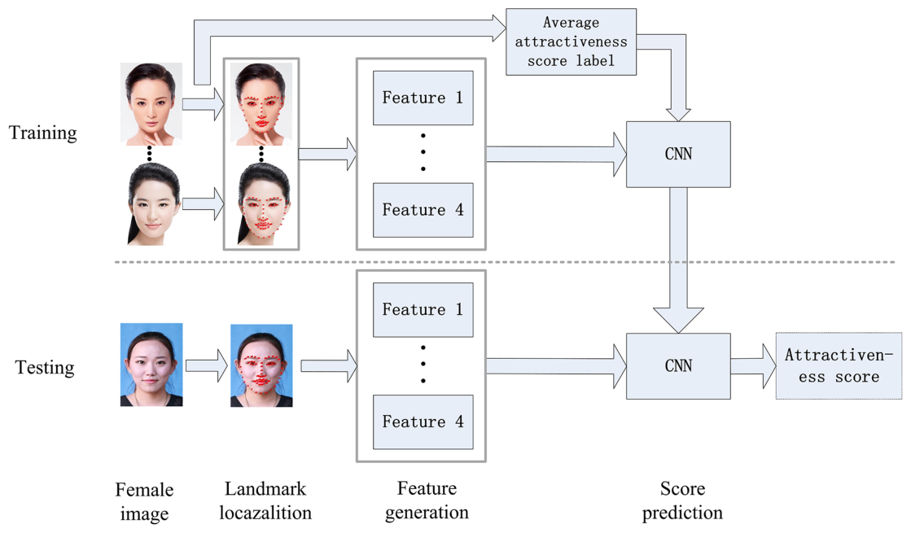

> **그림 1.** 얼굴 매력 점수의 예측 과정. (설명: 학습 이미지는 http://www.hcii-lab.net/data/SCUT-FBP 에서 공개된 SCUT-FBP 데이터셋에서 얻었으며, 시험 이미지는 게재에 대해 당사자의 서면 동의를 받았다.)

**랜드마크 위치 찾기** 파이썬 dlib 라이브러리의 frontal_face_detector를 주로 얼굴 추출기로 쓰고, 최종적으로 얼굴 랜드마크를 파일에 기록한다. 얻은 얼굴 표시점 이미지는 그림 2와 같다.

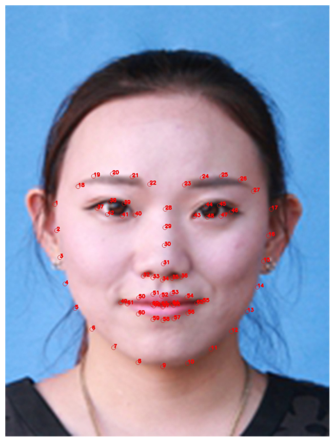

> **그림 2.** 얼굴 표시점 이미지. (설명: 이 이미지의 게재에 대해 당사자의 서면 동의를 받았다.)

**특징 생성** 각 학습 이미지에서 특징점을 사용해 얼굴 비율 특징 4개를 계산하고, 얻은 특징을 파일에 저장한다.

**모델 학습** 학습 모델에 쓰는 입력 자료는 이미지의 특징과 사람이 매긴 점수 레이블이다. 학습 과정에서 PCA 알고리즘으로 특징의 차원을 줄인 뒤, 랜덤 포레스트 학습 모델을 채택한다.

**매력 점수 예측** 위에서 얻은 자료와 모델에 따라, 직접 고른 이미지의 매력 점수를 예측하는 CNN을 설계한다. 그림 3은 네트워크의 구조를 보여 준다. 이 네트워크는 주로 특징 맵이 50, 100, 150, 200, 250, 300개인 합성곱 층 여섯 개를 포함한다. 해당 필터의 크기는 5 × 5, 5 × 5, 4 × 4, 4 × 4, 4 × 4, 2 × 2다. 이 네트워크에는 완전 연결 층도 있다. 마지막으로 입력 이미지의 매력 점수를 출력할 수 있다.

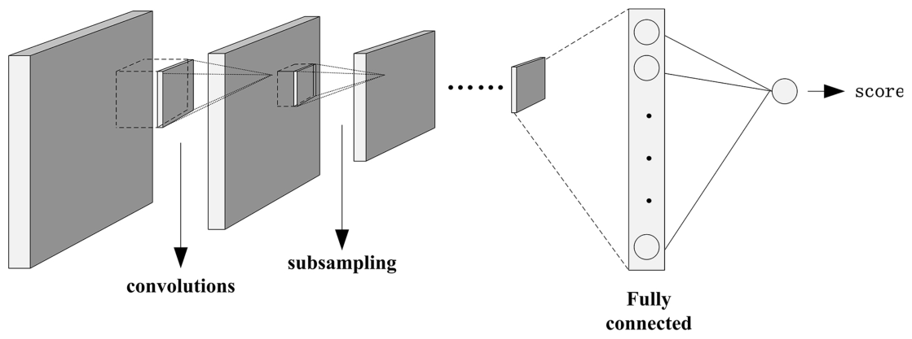

> **그림 3.** CNN의 네트워크 구조.

### 눈썹 모델 구성

흔한 눈썹 모양은 그림 4와 같다. 눈썹의 모양 특성에 따라, 눈썹의 모양 모델을 재는 데 길이, 면적, 평균 두께, 굽은 정도 같은 기하 매개변수를 쓴다. 이 매개변수들은 눈썹 외모의 특성을 직접 반영할 수 있다.

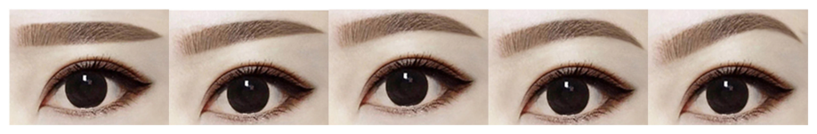

> **그림 4.** 흔한 눈썹 모양.

**눈썹 문턱값 분할** 먼저 정면 얼굴 이미지에서 한쪽 눈썹 이미지를 잘라 100 × 50 크기로 정규화한 뒤 적응형 이진화를 한다. 적응형 이진화 후의 이진 이미지에는 잡음이 있으므로, 블롭 분석으로 잡음과 약간의 머리카락 간섭을 제거해 정규화된 눈썹 영역의 이진 이미지를 얻는다. 회색조 이미지의 (i, j) 위치 값 B(i, j)는 식 (1)로 얻을 수 있다.

$$B(i, j) = \begin{cases} 255, & \mathrm{gray}(i, j) \ge T \\ 0, & \mathrm{gray}(i, j) < T \end{cases} \tag{1}$$

여기서 T는 적응형 닫힘값이다. 즉 문턱값 자체가 변수이며, 닫힘값 T는 픽셀마다 다르다. 이는 해당 픽셀 주위 이웃의 가중 평균을 계산한 뒤 상수를 빼서 얻는다. 식은 다음과 같다.

$$T = \frac{1}{N}\sum_{i=1}^{N} G_i - C \tag{2}$$

여기서 N은 계산할 픽셀 주위의 이웃 픽셀 수, G는 i번째 이웃 픽셀의 회색값, C는 주어진 상수다.

적응형 이진화로 눈썹 영역을 정확히 분할할 수 있으며, 그림 5와 같다. 첫 줄은 눈썹의 원본 이미지이고, 둘째 줄은 문턱값 분할과 잡음 제거의 결과다.

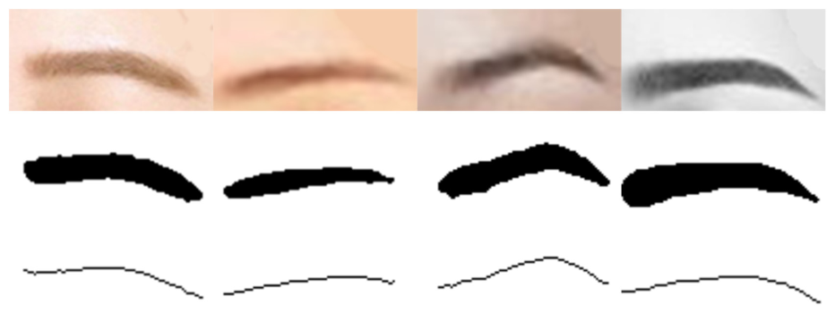

> **그림 5.** 첫 줄은 눈썹의 원본 이미지, 둘째 줄은 문턱값 분할과 잡음 제거 후의 눈썹 이진 이미지, 셋째 줄은 눈썹의 곡선이다.

**눈썹 모양을 재는 기하 매개변수**

*눈썹의 면적* 눈썹 이미지는 정규화되어 있으므로 눈썹의 면적은 사람마다 다르다. 이는 이진 눈썹 이미지를 문턱값으로 나누고 눈썹 영역의 픽셀 수, 즉 이진 이미지의 흰 픽셀 수를 세어 얻을 수 있다.

*눈썹의 길이* 눈썹의 길이를 계산하려면 먼저 눈썹의 곡선을 뽑는다. 눈썹의 곡선도는 눈썹의 이진 그림에서 얻을 수 있으며 과정은 다음과 같다. 먼저 눈썹 이진 이미지를 얻은 뒤 눈썹 영역을 검출한다. 둘째, 눈썹 영역의 각 가로좌표에서 세로좌표의 최댓값과 최솟값의 중간값을 취하고, 모든 가로좌표 값을 훑어 일련의 점을 얻는다. 셋째, 점들을 이어 눈썹의 곡선을 얻는다. 그림 5의 셋째 줄처럼 눈썹 곡선을 얻은 뒤, 곡선의 흰 픽셀 수를 세면 눈썹의 길이 L이 된다. 식은 다음과 같다.

$$L = \begin{cases} L + 1, & \mathrm{gray}(i, j) = 255 \\ L, & \mathrm{gray}(i, j) = 0 \end{cases} \tag{3}$$

*눈썹의 평균 두께* 눈썹의 면적을 눈썹의 길이로 나눈 값으로 정의한다.

*눈썹의 굽은 정도* 눈썹의 곡선은 눈썹 외모의 결정적 매개변수이며, 사람들이 눈썹을 구별하는 중요한 근거다. 먼저 눈썹의 곡선을 얻고, 눈썹 곡선으로 눈썹의 굽은 정도를 계산해야 한다. 눈썹의 굽은 정도를 계산하는 단계는 다음과 같다. 먼저 눈썹 곡선의 양 끝을 잇는 직선의 방정식을 계산한다. 둘째, 점과 직선 사이의 거리 공식으로, 두 끝점을 제외한 눈썹 곡선 위 모든 점에서 그 직선까지의 거리를 계산한다. 셋째, 가장 먼 거리를 눈썹의 굽은 정도로 정의한다.

점 (x₀, y₀)에서 직선 Ax + By + C = 0까지의 거리 M의 계산식은 다음과 같다.

$$M = \frac{|Ax_0 + By_0 + C|}{\sqrt{A^2 + B^2}} \tag{4}$$

### 눈 모델 구성

눈의 모양을 관찰하면 눈은 대략 타원으로, 홍채는 대략 원으로 볼 수 있다. 그래서 이 논문에서는 타원과 원의 최소제곱 맞춤으로 눈과 홍채의 기하 매개변수를 얻는다. 먼저 눈 영역의 이미지를 100 × 50 크기로 정규화한 뒤, 소벨 연산자로 눈 영역의 경계 검출과 처리를 해 눈과 홍채의 경계를 얻고, 타원과 원 맞춤으로 둘의 윤곽선을 얻는다. 마지막으로 윤곽 방정식의 계수로 눈과 홍채의 면적을 계산한다.

**눈과 홍채 윤곽 추출** 먼저 정규화된 눈 이미지를 소벨 연산자로 경계 검출 처리하고, 눈과 홍채의 경계를 뽑아 이진화한다. 이전 단계에서 처리한 경계 이미지에는 눈 윤곽의 경계점과 눈이 아닌 윤곽의 경계점이 모두 있다. 경계 픽셀이 가장 많은 연결 영역을 찾고 간섭을 보정해 눈과 홍채의 진짜 윤곽을 뽑는다. 이 두 단계의 결과는 그림 6과 같다.

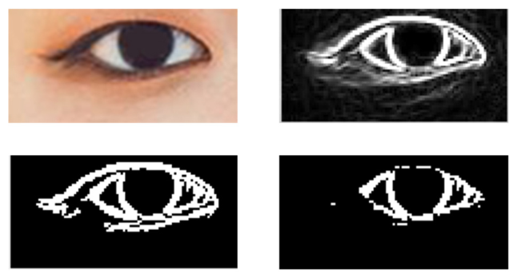

> **그림 6.** 정규화한 뒤, 소벨 연산자로 경계 검출을 하고, 경계 픽셀이 가장 많은 연결 영역을 찾아 간섭을 보정한 눈 이미지 네 장.

**눈 윤곽의 최소제곱 타원 맞춤** 이 논문에서는 직접 최소제곱법으로 맞춘다. 최소제곱 기법의 핵심은 자료점과 타원 사이의 거리 척도를 최소화하는 매개변수 집합을 찾는 것이며(Fitzgibbon et al., 1999), 효율이 높고 잡음에 대한 안정성이 좋다. 직접 최소제곱법(Fitzgibbon et al., 1999)의 기본 원리는 다음과 같다.

타원의 평면 이차 곡선의 일반 방정식은 식 (5)로 나타낼 수 있다.

$$F(A, X) = A \cdot X = ax^2 + bxy + cy^2 + dx + ey + f = 0 \tag{5}$$

여기서 A = [a, b, c, d, e, f]ᵀ, X = [x², xy, y², x, y, 1]ᵀ이다. F(A; Xᵢ)를 점 [xᵢ, yᵢ]에서 이차 곡선 F(A; X) = 0까지의 "대수적 거리"라고 한다. 기하 지식에 따르면, 곡선 계수가 4ac − b² = 1을 만족할 때 위 식이 나타내는 일반 이차 방정식은 타원이다. 따라서 타원 맞춤 문제는 제약 4ac − b² = 1 아래에서 점과 이차 곡선 F(A; X) = 0 사이의 대수적 거리 제곱합의 최솟값을 찾는 문제로 바뀐다.

$$\sum_{i=1}^{N} F(A; X_i)^2 \tag{6}$$

여기서 N은 맞출 점의 수이며, 다음을 얻는다.

$$D_{N \times 6} = [X_1 X_2 \ldots X_N]^T \tag{7}$$

$$C = \begin{bmatrix} 0 & 0 & 2 & 0 & 0 & 0 \\ 0 & -1 & 0 & 0 & 0 & 0 \\ 2 & 0 & 0 & 0 & 0 & 0 \\ 0 & 0 & 0 & 0 & 0 & 0 \\ 0 & 0 & 0 & 0 & 0 & 0 \\ 0 & 0 & 0 & 0 & 0 & 0 \end{bmatrix} \tag{8}$$

여기서 D를 설계 행렬, C를 제약을 나타내는 행렬이라고 한다. 이제 제약된 타원 맞춤 문제는 제약 AᵀCA = 1 아래에서 E = ‖DA‖²를 최소화하는 문제로 줄어든다. 라그랑주 승수를 도입하고 미분하면 연립 방정식을 얻는다.

$$2D^TDA - 2\lambda CA = 0, \qquad A^TCA = 1 \tag{9}$$

이는 다음과 같이 다시 쓸 수 있다.

$$SA = \lambda CA, \qquad A^TCA = 1 \tag{10}$$

여기서 S는 산포 행렬 DᵀD다. 식 (10)의 첫 식에 대해서는 일반화 고유벡터를 고려해 여섯 개의 해 집합을 얻을 수 있다. 임의의 μᵢ ∈ ℝ⁺에 대해 (λᵢ, μᵢuᵢ)도 해이며(i = 1, 2, …, 6), 따라서 (λᵢ, μᵢuᵢ)는 식 (10)의 둘째 식도 만족해야 한다. 즉 μᵢ²uᵢᵀCuᵢ = 1이므로

$$\mu_i = \sqrt{\frac{1}{u_i^T C u_i}} = \sqrt{\frac{\lambda_i}{u_i^T S u_i}} \tag{11}$$

문헌(Fitzgibbon et al., 1999)의 증명에 따르면 λᵢ > 0이며, 일반화 고유값의 부호는 S = Q²일 때 Q⁻¹CQ⁻¹과 조건 제약 행렬 C의 부호와 같다. C의 고유값이 {−2, −1, 2, 0, 0, 0}이므로, 유일한 양의 일반화 고유값 λᵢ와 그에 해당하는 일반화 고유벡터만이 타원 맞춤의 해다. 유일한 해는 다음과 같다.

$$A_j = \mu_i u_i, \quad j \in i \tag{12}$$

타원 방정식의 여섯 매개변수를 얻으면 타원의 기하 중심은 다음과 같다.

$$x_c = \frac{be - 2cd}{4ac - b^2} \tag{13}$$

$$y_c = \frac{bd - 2ae}{4ac - b^2} \tag{14}$$

긴 반축과 짧은 반축은 다음과 같다.

$$m = \sqrt{\frac{2(ax_c^2 + cy_c^2 + bx_cy_c - f)}{a + c - \sqrt{(a - c)^2 + b^2}}} \tag{15}$$

$$n = \sqrt{\frac{2(ax_c^2 + cy_c^2 + bx_cy_c - f)}{a + c + \sqrt{(a - c)^2 + b^2}}} \tag{16}$$

그러면 타원 맞춤 후 눈의 면적은 다음과 같다.

$$\mathrm{eyearea} = \pi mn \tag{17}$$

*(역자 주: 식 (15)·(16)은 PDF에서 텍스트로 뽑을 때 근호와 분수의 배치가 흐트러져, 타원 반축의 표준 공식 형태로 옮겼습니다. 원문 PDF의 식을 확인하십시오.)*

**홍채 윤곽의 최소제곱 원 맞춤** 홍채는 대략 원이므로 최소제곱 원으로 홍채 윤곽을 맞춘다. 최소제곱 원 방법(Moura and Kitney, 1991)의 기본 원리는 다음과 같다. 평면의 원은 중심 (A, B)와 반지름 R로 정할 수 있다. 평면 원 방정식의 일반형은 다음과 같다.

$$x^2 + y^2 + ax + by + c = 0 \tag{18}$$

중심 (A, B)와 반지름 R은 다음과 같다.

$$A = -0.5a, \quad B = -0.5b, \quad R = 0.5\sqrt{a^2 + b^2 - 4c} \tag{19}$$

원의 일반식 (18)은 a, b, c에 대한 선형 방정식이다. 최소제곱법으로 원 맞춤의 수학 모델을 세워 매개변수 a, b, c의 값을 얻은 뒤, 식 (19)에 따라 원의 실제 매개변수 A, B, R을 얻는다. 원래 측정한 N(N ≥ 3)개의 자료 (xᵢ, yᵢ), i = 1, 2, …, N에서, 일반식과 최소제곱 원리에 따라 목적 함수의 최솟값을 구해야 한다.

$$F(a, b, c) = \sum_{i=1}^{N} (x_i^2 + y_i^2 + ax_i + by_i + c)^2 \tag{20}$$

F(a, b, c)를 a, b, c로 편미분하고 편미분을 0으로 두어 극점을 구하면 다음 연립 방정식을 얻는다.

$$\begin{bmatrix} \sum x_i^2 & \sum x_iy_i & \sum x_i \\ \sum x_iy_i & \sum y_i^2 & \sum y_i \\ \sum x_i & \sum y_i & N \end{bmatrix} \begin{bmatrix} a \\ b \\ c \end{bmatrix} = -\begin{bmatrix} \sum (x_i^3 + x_iy_i^2) \\ \sum (y_i^3 + x_i^2y_i) \\ \sum (x_i^2 + y_i^2) \end{bmatrix} \tag{21}$$

*(역자 주: 식 (21)도 텍스트 추출에서 행렬 배치가 흐트러져, 식 (20)을 편미분한 표준 정규방정식 형태로 옮겼습니다.)*

위 방정식을 풀어 a, b, c를 얻는다. 식 (19)와 결합해 원의 중심 좌표와 반지름을 얻을 수 있으며, 홍채 면적은 다음과 같다.

$$\mathrm{irisarea} = \pi R^2 \tag{22}$$

**맞춤 결과** 위의 눈과 홍채에 대한 최소제곱 타원·원 맞춤 방법에 근거한 최종 맞춤 결과는 그림 7과 같다. 윤곽이 뚜렷한 눈일수록 맞춤 효과가 더 좋다.

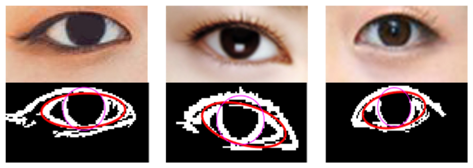

> **그림 7.** 눈과 홍채의 맞춤 결과.

### 얼굴 비율로 얼굴형을 나타내기

얼굴형은 얼굴 이미지에서 가장 직관적인 특징이며, 얼굴형 정보는 더 안정적이어서 사람들은 얼굴형에 특별한 주의를 기울인다. 흔한 얼굴형에는 하트형, 둥근형, 계란형, 각진형 등이 있다. 얼굴형과 눈썹의 관계를 연구하기 위해, 우리는 그림 8의 얼굴 가로/세로 비 D1/D2로 얼굴형의 차이를 나타냈다. 그리고 얼굴의 높이를 계산해야 하므로 맞춤 머리선 검출기를 설계해, 그림 2의 특징점 68개에 머리선의 점 하나를 추가했다. 전형적인 얼굴형 네 가지의 가로/세로 비는 그림 9와 같다.

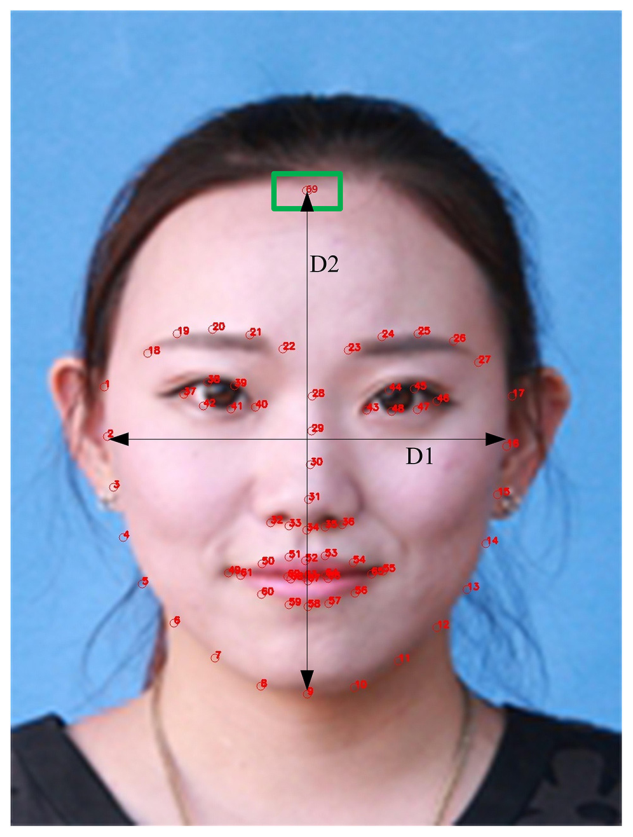

> **그림 8.** D1/D2는 얼굴의 가로/세로 비다. 초록 사각형은 머리선 검출기를 추가한 뒤의 머리선 점을 표시한다. (설명: 이 이미지의 게재에 대해 당사자의 서면 동의를 받았다.)

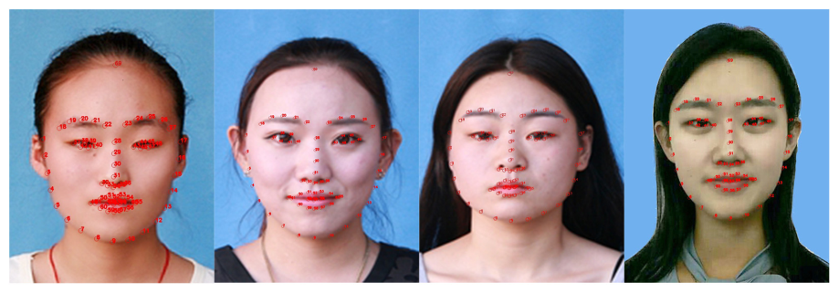

> **그림 9.** 전형적인 얼굴형 네 가지의 예. 왼쪽부터 각진형, 계란형, 둥근형, 하트형이며, 얼굴 가로/세로 비 D1/D2는 각각 0.754, 0.791, 0.872, 0.736이다. (설명: 이 이미지들의 게재에 대해 당사자들의 서면 동의를 받았다.)

## 결과와 논의

### 매력 점수 분석

기계학습 방법으로 얻은 얼굴 매력 점수 300개는 2–3점 범위 92장, 3–4점 범위 146장, 4–5점 범위 62장이다(전체 점수 범위는 1–5점, 최고 5점). 아름다운 얼굴을 효과적으로 연구하기 위해 매력 점수가 높은 얼굴의 비율을 더 크게 했다.

### 눈썹과 눈의 상관 분석

앞 절에서 구성한 눈썹의 기하 특징 모델로 얻은 눈썹 매개변수의 분포는 그림 10과 같다. 자료를 분석하면 눈썹 길이는 대부분 80–90픽셀에 모여 있고, 굽은 정도가 5–13픽셀 범위인 눈썹이 거의 3분의 2를 차지한다. 눈썹 면적은 대부분 900–1100픽셀 범위에 분포하고, 평균 두께는 11–13픽셀에 모여 있다. 눈썹 매개변수는 중간 범위가 다수를 차지했다. 그리고 앞 절에서 구성한 눈 기하 특징 모델로 얻은 눈 매개변수의 분포는 그림 11과 같다. 눈과 홍채의 기하 매개변수를 분석하면, 눈 크기는 600–1000픽셀에 모여 있고, 눈 전체에 대한 홍채의 비율은 0.5–0.6에 모여 있다. 매력 점수 2–3점의 얼굴에서는 눈이 800픽셀보다 큰 이미지가 약 24%를 차지한다. 매력 점수 3–4점의 얼굴에서는 눈이 800픽셀보다 큰 이미지가 약 46%를 차지한다. 그리고 매력 점수 4–5점의 얼굴에서는 이미지의 56%가 눈이 800픽셀보다 크다. 이 자료에서, 눈 크기는 얼굴 매력과 강하게 관련되지만 그 관계가 절대적이지는 않다는 결론을 내릴 수 있다. 매력 점수가 높은 얼굴이 모두 큰 눈을 가진 것은 아니며, 적절한 눈썹 모양을 가진 작은 눈도 얼굴을 점점 더 매력적으로 만들 수 있다. 그래서 우리는 눈과, 시각적으로 눈과 밀접하게 관련된 눈썹을 연결해 매개변수로 분석한다.

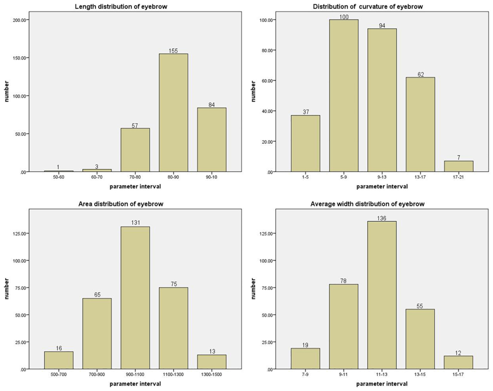

> **그림 10.** 네 그림은 각각 눈썹의 길이, 굽은 정도, 면적, 평균 두께의 분포다. 가로축은 해당 매개변수의 구간, 세로축은 그 구간에 속한 이미지 수다.

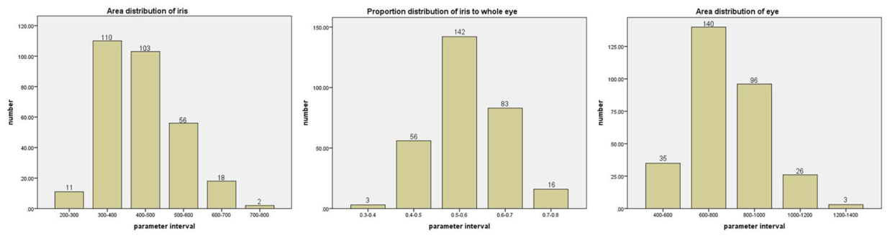

> **그림 11.** 세 그림은 각각 홍채 면적, 눈 전체에 대한 홍채의 비율, 눈 면적의 분포다. 가로축은 해당 매개변수의 구간, 세로축은 그 구간에 속한 이미지 수다.

자료를 분석한 결과, 눈썹의 굽은 정도와 눈 크기 사이에 관계가 있음을 발견했다. 얼굴 이미지의 매력 점수가 각각 2–3, 3–4, 4–5 범위일 때 둘의 산점도를 그렸으며, 그림 12와 같다. 그림에서 볼 수 있듯이 눈썹의 굽은 정도가 커질수록 눈의 크기는 작아지며, 매력 점수가 높아질수록 이 규칙을 따르는 점이 늘어나고 경향이 뚜렷해진다. 규칙을 따르지 않는 소수의 표본을 빼면, **큰 눈과 덜 굽은 눈썹, 작은 눈과 많이 굽은 눈썹의 조합이 얼굴 매력 점수를 높인다**는 결론을 내릴 수 있다. 이 결론은 중국 전통 미학을 반영하는 "삼정오안(三庭五眼)"으로 설명할 수 있다. 이는 고대 중국 화가들이 이목구비의 위치에 근거해 도출한 얼굴 구조의 일반 법칙이다. "삼정"은 상정, 중정, 하정으로 나뉜다. 상정은 머리선에서 눈썹 산까지의 영역을, 중정은 눈썹 아래에서 코 밑까지를, 하정은 코에서 아래턱까지를 뜻한다. 굽은 정도가 큰 눈썹은 일반적으로 눈썹 뼈가 더 높아, 눈썹과 눈이 차지하는 영역의 비율을 늘리고 눈 영역을 세로로 늘려 눈이 더 커 보이게 할 수 있다. 큰 눈에는 완만한 눈썹 뼈가 얼굴에서 눈썹이 차지하는 영역을 중화하고 사람들의 주의를 눈에 모을 수 있다.

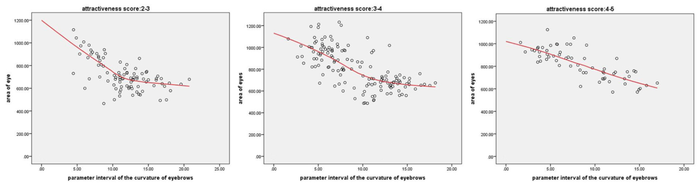

> **그림 12.** 세 그림은 각각 얼굴 이미지의 매력 점수가 2–3, 3–4, 4–5 범위일 때 눈 면적과 눈썹 굽은 정도의 산점도다.

### 눈썹과 얼굴형의 상관 분석

D1/D2와 눈썹 매개변수의 자료 분석은 얼굴형과 눈썹 사이에 관계가 있음을 드러냈다. 얼굴의 가로/세로 비인 D1/D2는 얼굴형의 변화를 나타내는 데 쓸 수 있다. D1/D2가 1에 가까울수록 얼굴형이 둥글고, D1/D2가 작을수록 얼굴형이 길다. 그림 13은 서로 다른 매력 점수 등급에서 D1/D2와 눈썹 굽은 정도의 관계를 비교한다. 위 자료의 분석에 따르면, 매력 점수 3–4와 4–5 범위에서 눈썹 굽은 정도 매개변수 구간이 커질수록 평균 가로/세로 비가 계속 올라가며, 이 변화는 4–5점 범위에서 더 뚜렷하다.

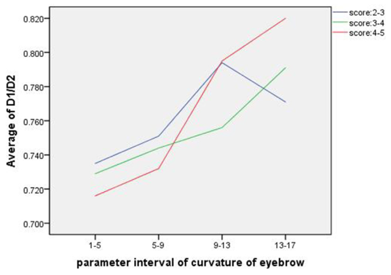

> **그림 13.** 세로축의 D1/D2는 각 눈썹 굽은 정도 매개변수 구간의 평균값이다. 세 곡선은 매력 점수 구간 2–3, 3–4, 4–5에서의 둘의 관계를 각각 보여 준다.

이는 **둥근 얼굴은 많이 굽은 눈썹과, 긴 얼굴은 덜 굽은 눈썹과 더 잘 어울린다**는 것을 시사한다. 시각적으로, 얼굴형이 길면 눈썹 뼈가 낮은 눈썹이 중화해 얼굴을 짧아 보이게 해야 한다. 눈썹 뼈가 높으면 얼굴이 더 길게 늘어나 보인다. 덜 굽은 눈썹은 시각적으로 얼굴을 옆으로 늘려 보이게 할 수 있으므로, 이런 눈썹이 긴 얼굴에 더 적합하다. 긴 얼굴과 반대로, 둥근 얼굴은 볼이 더 도톰해서 길고 갸름해 보이게 해야 한다. 높고 꺾임이 비교적 뚜렷한 눈썹은 눈썹과 아래턱 사이의 거리를 늘려 보이게 할 수 있으므로, 둥근 얼굴은 많이 굽은 눈썹을 그리기에 적합하다. 이런 얼굴과 눈썹의 조합은 얼굴을 점점 더 매력적으로 만들 것이다.

## 결론

얼굴 매력은 우리의 일상생활과 사회적 상호작용과 밀접하게 연결되어 있다. 이 논문에서 우리는 눈썹과 눈의 기하·형태 특징과 얼굴형을 결합해 매력을 연구하는 접근을 제안한다. 사용한 자료는 아시아 여성 얼굴 이미지 300장이며, 기계학습 방법으로 점수를 매겼다. 눈썹과 눈의 기하 모델을 각각 구성하고 얼굴의 비율을 계산했다. 서로 다른 매력 등급의 얼굴에서 이 기하 특징들을 결합해 눈썹, 눈, 얼굴형의 조화 정도를 연구했다. 결과는 **작은 눈과 둥근 얼굴에는 많이 굽은 눈썹이, 큰 눈과 더 긴 얼굴에는 덜 굽은 눈썹이** 얼굴 이미지의 매력 점수를 높인다는 것을 보여 준다. 이 방법은 이목구비의 조화 정도와 얼굴 매력 사이의 관계를 탐구하는 데 일정한 가치와 실용적 의의가 있으며, 성형외과 병원이나 미용 기관의 참고가 될 수 있다.

## 저자 기여

JZ가 아이디어를 제안했다. JZ, MZ, CH가 자료를 분석했다. 모든 저자가 모든 이미지를 수집하고, 실험을 설계하고, 원고를 작성·수정했다.

## 연구비

이 연구는 중국 국가자연과학기금(과제 번호 61701401)과 산시성 자연과학기금(과제 번호 2019KJXX-061)의 지원을 받았다.

---

*참고문헌 목록은 원문을 참조하십시오.*
