# ILoveEye: 눈 모양 특징을 쓰는 아이라이너 화장 가이드 시스템

> **원문** Hange Wang, Haoran Xie, Kazunori Miyata. *ILoveEye: Eyeliner Makeup Guidance System with Eye Shape Features.* arXiv:2203.13592v1 [cs.HC], 2022-03-25. https://arxiv.org/abs/2203.13592
>
> **라이선스** arXiv 게재본은 [CC BY 4.0](https://creativecommons.org/licenses/by/4.0/)으로 배포됩니다. 원저자와 출처를 밝히는 조건으로 이용·배포·변경을 허용합니다. 이 번역은 **arXiv 사전 인쇄본**을 옮긴 것이며, 학회 최종본(HCII 2022 논문집)은 출판사 저작권으로 따로 있습니다.
>
> **변경 사항** 영어 원문을 한국어로 번역했습니다. 그림은 원문에서 잘라 캡션 앞에 넣었고, 참고문헌 목록은 생략했습니다(본문의 [숫자]는 원문 참고문헌 번호). 원저자가 검토한 번역이 아닙니다.

**용어 대응** — 아이라이너(eyeliner) · 눈 윤곽(eye contour) · 가로세로 비(aspect ratio) · 바깥 눈꼬리 방향(outer corner orientation) · 눈 사이 거리(eye distance) · 올라간 눈(up-turned) · 처진 눈(down-turned) · 먼 눈(open-set) · 가까운 눈(close-set) · 윗 라이너(upper eyeliner) · 아래 라이너(lower eyeliner)

---

## 초록

아이라이너를 그리는 것은 눈 화장 경험이 부족한 사람에게 쉬운 일이 아니다. 모든 사람은 저마다 고유한 한 쌍의 눈을 가지고 있으므로, 자기 눈에 맞는 스타일로 아이라이너를 그려야 한다. 우리는 눈 화장 초보자가 자연스럽고 알맞은 아이라이너를 그리도록 돕는 대화형 시스템 ILoveEye를 제안했다. 제안한 시스템은 카메라 프레임에서 사용자 눈의 모양을 분석하고 눈 유형을 분류한다. 시스템은 설계된 추천 규칙에 근거해 사용자에게 아이라이너 스타일을 추천할 수 있다. 그다음 시스템은 그 아이라이너 스타일에 해당하는 원본 패턴을 생성할 수 있고, 사용자는 실시간 화장 가이드를 보면서 아이라이너를 그릴 수 있다. 사용자 평가 실험을 수행해, 제안한 ILoveEye 시스템이 일부 사용자가 특정 눈 모양에 근거해 합리적인 아이라이너를 그리고 눈 화장 실력을 높이는 데 도움을 줄 수 있음을 검증했다¹.

**키워드**: 아이라이너 화장 · 눈 특징 분석 · 화장 시스템 · 대화형 가이드

> ¹ 이것은 동료 심사 전의 사전 인쇄본이다. 최종 인증본은 HCII 2022(인간–컴퓨터 상호작용 국제학회) 논문집에서 온라인으로 볼 수 있다.

## 1 서론

화장은 그림이나 조각 같은 다른 창작 활동처럼 일상의 기술이며, 사용자가 숙련된 화장 기법을 익히고 얼굴 특징에 근거한 화장을 높은 수준으로 이해해야 한다. 눈 화장은 일상의 얼굴 화장에서 중요한 역할을 한다. 그러나 화장 경험이 적은 일반 사용자가 만족스러운 결과를 얻기는 여전히 어려운 문제다. 보통 사용자들은 유튜브나 틱톡 같은 영상 사이트나 소셜 미디어에서 화장 튜토리얼을 찾는다. 이런 영상 튜토리얼은 흔히 개인의 얼굴 특징과 맞지 않는데, 얼굴 특징은 눈 화장의 전략과 중요한 관계가 있다. 이 연구에서 우리는 일상에서 기본적인 얼굴 화장인 아이라이너 화장을 위한 가이드 시스템에 집중한다.

화장 가이드 시스템에 관해서는, 사용자의 얼굴 특징에 근거해 해당하는 화장 제안을 제공하고 기대되는 화장 효과를 실시간으로 얼굴에 보여 주는 것이 일반적인 접근이다. 우리는 화장 지식과 경험이 적은 사람에게 시각적인 추천 화장 스타일과 시각적인 화장 튜토리얼을 제공하는 것이 유익하다는 것을 발견했다. 이 연구는 직관적이고 효과적인 아이라이너 화장 가이드를 실시간으로 제공하는 것을 목표로 한다.

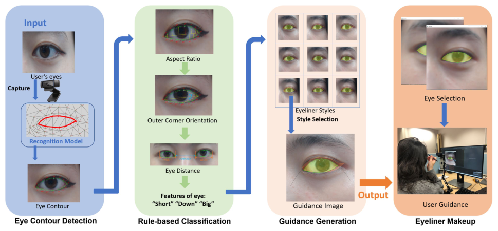

> **그림 1.** 제안한 ILoveEye의 화장 가이드 틀.

이 논문에서 우리는 그림 1처럼, 경험이 적은 사용자를 위해 사용자의 눈 모양 특징 분석에 기반한 대화형 규칙 기반 화장 시스템 ILoveEye를 제안한다. 눈의 특징점을 얻기 위해, 이 연구에서는 최신 딥러닝 기반 얼굴 인식 모델을 활용한다. 눈 모양의 특징을 분류하기 위해 눈 모양 분류를 수행하고 눈 윤곽의 특징을 뽑는다. 아몬드형, 둥근 눈, 처진 눈, 가까운 눈을 포함한 전형적인 눈 모양을 분석한 뒤, 눈의 세 가지 특징값, 즉 눈의 가로세로 비, 바깥 눈꼬리 방향, 눈 사이 거리로 눈 모양 특징의 레이블을 얻는 규칙 기반 분류 모델을 제안한다. 화장 가이드를 위해, 눈 모양과 아이라이너 스타일의 관계에 따라 전형적인 아이라이너 스타일의 규칙을 조사한다. 제안한 시스템에서 얻은 눈 특징점에 대해, 분류 규칙을 적용해 사용자 눈의 현재 특징점과 맞춘다. 제안한 시스템은 아이라이너 스타일을 재현해 실시간으로 표시함으로써, 사용자가 아이라이너 화장을 완성하도록 가이드로서 지원한다.

제안한 ILoveEye 시스템의 실현 가능성을 검증하기 위해 평가 실험을 설계하고 수행했다. 사용자 연구에서 우리는 얼굴 화장 경험이 적고 아이라이너를 그리는 기술이 거의 없는 참가자를 초대했다. 시스템 평가와 사용자의 실력 배경 사이의 관계를 밝히기 위해, 제안한 시스템을 경험한 뒤 수행하는 설문지를 설계했다. 설문 결과에서 우리는 제안한 시스템이 눈 모양을 효과적으로 분류하고 사용자가 대화형으로 아이라이너를 그리도록 지원할 수 있음을 발견했다. 또한 사용자의 화장 배경과 시스템 평가 사이의 피어슨 상관 계수를 분석했다. 분석 결과, 화장을 하는 빈도와 시스템 사용 후의 실력 향상 사이에 유의한 정적 상관이 있었다. 우리는 평소 화장을 하는 사용자들이 화장의 경험과 지식을 갖추고 있어서, 제안한 시스템으로 자기 눈 모양 특징의 정확한 윤곽을 익힌 뒤 더 나은 아이라이너를 그릴 수 있었다고 결론짓는다.

## 2 관련 연구

### 2.1 눈 특징

눈 특징 분석은 눈 화장 시스템에서 중요한 역할을 한다. Bhat 등은 능동 형태 모델을 사용해 눈 윤곽을 검출하는 방법을 제안했다[4]. 눈 윤곽 데이터셋으로 실시간에 눈 윤곽을 검출하는 효율적인 방법이 제안되었다[7]. 눈의 모양 분류에 대해, Alzahrani 등은 눈 모양의 특성을 정리하고 눈 모양 분류 규칙을 설계했다[3]. 이 연구에서 우리는 관련 정보를 수집해 분류 규칙을 독자적으로 설계하고, 평가 연구를 수행해 분류 규칙의 효과를 확인한다.

### 2.2 가이드 시스템

증강 현실과 이미지 처리 기술의 발전에 따라, 일상 활동을 지원하는 가이드 시스템이 폭넓게 탐구되어 왔다. 딥러닝 기반의 인체 메시 모델링이 코어 운동을 위해 사용자의 자세와 목표 자세를 비교하는 데 쓰였다[20]. 좋은 셀카를 찍도록 돕기 위해, 사진 미학의 크라우드소싱 평가를 활용한 음성 가이드 시스템이 제안되었다[6]. 공간 증강 현실은 서예 연습[10], 골프 훈련[11], 춤 지원[9]에 쓰였다. 디자인 활동에서 사용자의 의도를 맞추기 위해, 도미노 배열[16]과 도시락 장식[19]에 사용자 스케치가 활용되었다. 이 연구에서 우리는 특히 증강 현실 접근을 쓴 눈 화장 가이드 시스템에 집중한다.

### 2.3 화장 가이드

얼굴 인식 기술이 발전하면서 얼굴 특징에 근거한 알맞은 화장 가이드를 제공하는 것이 가능해졌다. Chiocchia 등은 사용자가 화장품을 고르도록 돕고 화장 튜토리얼을 보여 주는 모바일 앱을 개발했다[5]. 서로 다른 화장 참조로 화장 이미지를 합성하기 위해 얼굴 특징을 얻을 수 있다[8]. 추천 시스템을 위해 얼굴 매력을 분석하는 얼굴 데이터셋이 구축되었다[12]. 얼굴을 자동으로 분류하고 화장 방식을 제안하는 규칙 기반 시스템이 제안되었다[1]. iMake는 색과 모양 특징을 뽑는 새로운 눈 화장 디자인 시스템을 제안했다[15]. 얼굴 특징을 실시간으로 포착하고 분석하는 증강 현실(AR) 거울 시스템이 제안되었다[17]. 화장 튜토리얼을 위한 대화형 모바일 앱이 제안되었다[2]. 특수 화장 도구를 제공하는 AR 화장 교습이 제안되었다[18]. 이 연구에서 우리는 사용자가 더 나은 아이라이너를 그리고 화장 실력을 높이도록 실시간 가이드를 제공하는 것을 목표로 한다.

## 3 시스템 개요

그림 1은 딥러닝 기반 얼굴 검출을 포함한 세 주요 부분으로 이루어진 ILoveEye 시스템의 전체 작업 흐름을 보여 준다. 먼저 제안한 시스템은 일반 웹캠으로 눈을 검출하고 눈 윤곽의 기하 정보를 얻는다. 둘째, 기하 특징을 써서 눈 모양을 분류하는 규칙 기반 모델을 설계한다. 마지막으로 제안한 시스템은 앞서 분석한 분류 결과에 근거해 아이라이너 화장 가이드를 생성하고 화면에 실시간으로 표시한다. 제안한 ILoveEye 시스템으로 사용자는 알맞은 아이라이너를 그리는 동안 화면의 가이드 패턴을 볼 수 있다.

### 3.1 눈 검출

눈 모양 검출에 대해, 우리는 높은 효율과 정확도를 가진 사전학습 얼굴 인식 모델을 포함한 오픈소스 딥러닝 기반 얼굴 검출기 MediaPipe[13]를 채택했다. 검출 출력은 그림 2와 같은 랜드마크 486개의 얼굴 메시 지도다. 이 얼굴 메시에서 특징점 16개를 골라 눈 윤곽을 기술한다. 실제 시험을 통해, 우리는 이 검출기가 우리 연구 목표를 충족할 만큼 높은 정확도로 눈 윤곽의 모양을 효과적으로 식별할 수 있음을 발견했다.

*(역자 주: 원문은 "486개"라고 쓰지만, MediaPipe 얼굴 메시의 점은 468개(홍채 포함 478개)다. 원문 그대로 옮겼다.)*

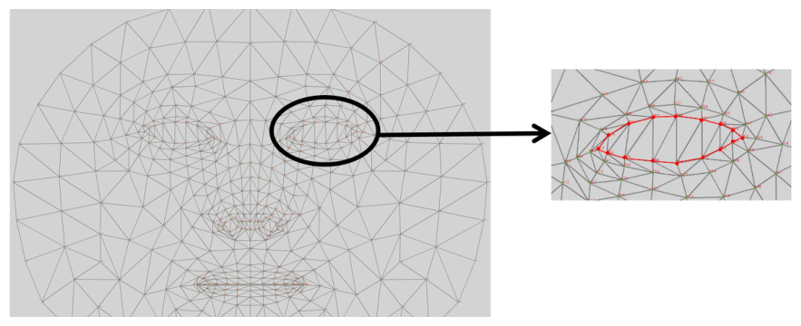

> **그림 2.** 사람 얼굴 메시에서의 눈 윤곽 랜드마크.

눈 검출 모듈을 구현하기 위해, 먼저 연결된 카메라(시제품에서는 60 fps)를 호출한다. 눈의 모양을 정확히 얻기 위해, 제안한 시스템은 사용자에게 현재 프레임의 메시 지도를 저장하도록 요청한다. 제안한 시스템은 저장된 메시 지도에서 눈 부분의 랜드마크를 고른다. 카메라 각도가 검출 결과에 영향을 줄 수 있다는 것을 발견해, 사용자에게 적절한 거리에 앉도록 하고 만족스러운 눈 윤곽을 얻을 때까지 카메라 각도를 조정할 수 있게 했다.

### 3.2 시스템 작업 흐름

눈 특징을 분석한 뒤, 제안한 시스템은 그림 3처럼 눈의 가로세로 비, 바깥 눈꼬리 방향, 눈 사이 거리에 따라 아이라이너 스타일을 결정한다. 눈 크기가 "작음" 또는 "보통"으로 레이블되면 시스템은 Style-Basic을 추천한다. 가로세로 비가 "큼"으로 레이블되면, 제안한 시스템은 아이라이너 두께를 더 낮춘 Style-Basic을 추천한다. 시스템은 바깥 눈꼬리의 방향을 분석해 Style-Winged, Style-Drop, Style-Extend를 추천할 수 있다. 시스템은 눈 사이 거리에 따라 아래 라이너 스타일인 Style-Inner와 Style-Outer를 추천할 수 있다. 마지막으로 제안한 시스템은 추천된 아이라이너 스타일을 모두 합쳐 마스크로 쓸 다각형을 생성하며, 이는 화장 가이드를 위해 주황색으로 시각화된다(그림 3).

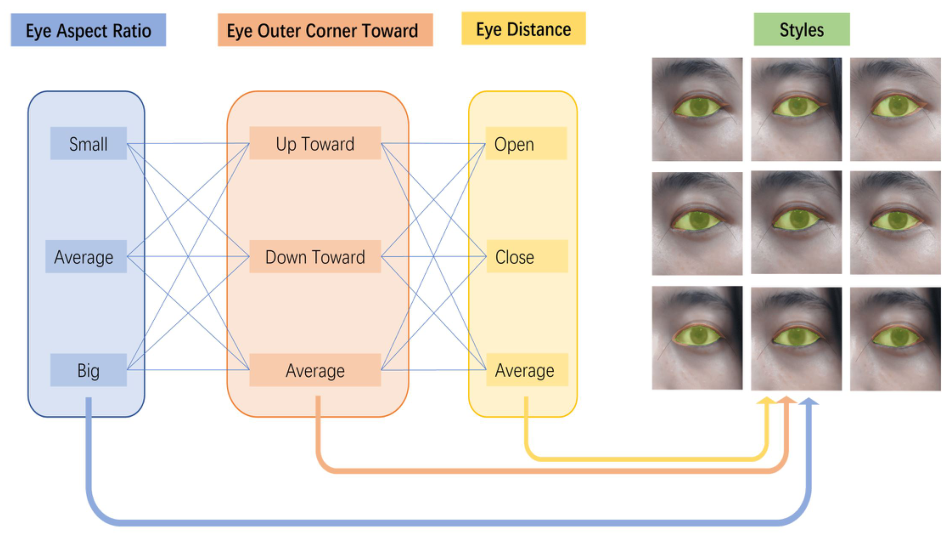

> **그림 3.** 추천 기능의 작업 흐름.

### 3.3 눈 특징 분석

우리는 둥근 눈(더 크고 더 원형), 가까운 눈(두 눈 사이 공간이 적음), 처진 눈(바깥 눈꼬리에서 아래로 가늘어짐) 같은 여러 전형적인 눈 유형을 검토했다[3]. 우리는 눈 모양이 눈의 크기, 바깥 눈꼬리의 각도, 두 눈 사이의 거리와 관련된다는 것을 발견했다. 따라서 이 세 특징을 눈 유형을 결정하는 분류 조건으로 정했다.

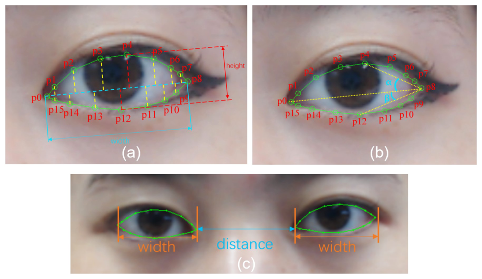

> **그림 4.** 눈 특징 매개변수. (a) 눈의 폭과 높이, (b) 바깥 눈꼬리 방향, (c) 눈 사이 거리.

**가로세로 비** 얻은 눈 윤곽 랜드마크에서(오른쪽 눈을 예로), 가장 왼쪽과 가장 오른쪽 점 p0과 p8을 눈머리와 눈꼬리의 위치로 정의한다. p1–p7과 p9–p15에서 각각 수선의 길이를 계산한 뒤, 윗부분과 아랫부분의 최댓값을 찾아 그 합을 눈 높이로 삼는다(그림 4(a)). p0–p8 선의 길이를 눈 폭으로 본다. 눈 폭과 높이의 비를 가로세로 비 a로 계산한다. 우리는 눈 스타일에 대해 비교적 합리적인 범위를 얻었다. 보통 눈은 a ∈ [2.75, 3.00], 작고 긴 눈은 a > 3.00, 크고 둥근 눈은 a < 2.75다.

**바깥 눈꼬리 방향** 우리는 눈의 바깥 눈꼬리 각도가 올라간 눈과 처진 눈을 판정하는 믿을 만한 기준으로 쓰일 수 있다는 것을 발견했다. 그림 4(b)처럼 p4와 p12는 가장 높은 점과 가장 낮은 점을 나타낸다. p0–p8 선이 바깥 눈꼬리 각을 두 각으로 나눈다. 위쪽 각 α는 p4–p8 선과 p0–p8 선이 이루는 각으로, 아래쪽 각 β는 p12–p8 선이 이루는 각으로 정의한다. α > β이면 바깥 눈꼬리가 아래를 향한다고 판정하고 그 눈을 처진 눈으로 레이블한다. 반대이면 그 눈을 올라간 눈으로 레이블한다.

**눈 사이 거리** 가장 왼쪽과 가장 오른쪽 점 사이의 거리를 눈 사이 거리 Dₑ로 잰다. 두 눈의 평균 거리 D_avg(그림 4(c))를 계산한다. Dₑ > 1.05 × D_avg이면 먼 눈 유형으로 보고 "open"으로 레이블한다. Dₑ < 0.95 × D_avg이면 가까운 눈 유형으로 보고 "close"로 레이블한다. 그 밖에는 "average"로 레이블한다.

## 4 화장 가이드

눈 화장은 아이라이너를 써서 눈을 더 커 보이게 하고 눈 모양을 다듬는다[14]. 일반적으로 아이라이너에는 바깥 라이너와 안쪽 라이너라는 두 가지 전형적인 유형이 있다. 그러나 안쪽 라이너는 속눈썹 뿌리에 바르며, 제안한 검출 방법으로는 검출하기 어렵다. 그래서 이 연구에서는 바깥 라이너에 집중한다. 우리는 그림 5처럼 눈 모양 특징과 관련된 전형적인 아이라이너 스타일을 정의했다.

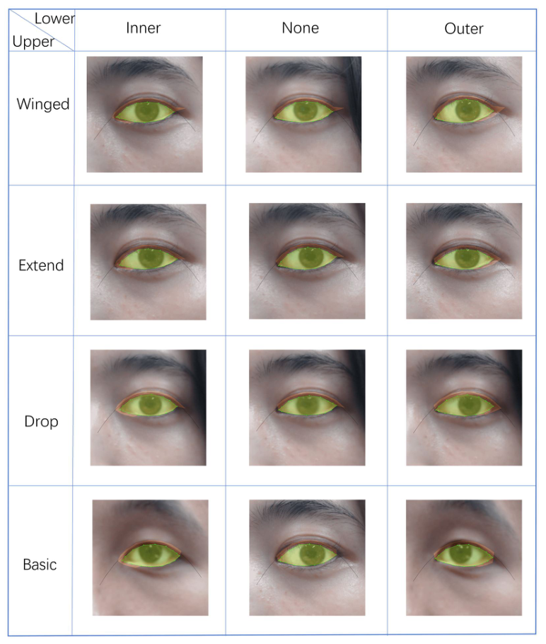

> **그림 5.** 제안한 ILoveEye 시스템에서 정의한 아이라이너 스타일.

### 4.1 아이라이너 스타일

**Style-Basic** Style-Basic은 눈머리에서 눈꼬리까지 윗눈꺼풀을 따라 그은 굵은 선이다(그림 6(a)). 이 연구에서는 윗눈꺼풀의 모양을 따라 굵은 선을 생성한다. 윗눈꺼풀의 각 선분의 중점을 계산한다. 그다음 중점에서 p0, p1, …, p7까지 각 선분의 수선을 세우고, 각 수선의 길이를 아이라이너 두께 h로 정의한다. 윗눈꺼풀의 점들을 이으면, 닫힌 다각형이 기본 윗 라이너 스타일인 Style-Basic이 된다.

**Style-Winged** 올린 날개 아이라이너 패턴에 대해, 가장 바깥 점 E를 정의한다. 그림 6(b)처럼 전형적인 날개 아이라이너 표본을 쟀다. 자연스러운 모습을 위한 아이라이너 꼬리의 각도는 약 15도이므로, E–p8과 p0–p8 사이의 평균 각도를 15도로 정의한다. 날개의 길이는 눈 폭의 약 12%로 정한다. 이 날개 길이는 다른 날개 아이라이너 스타일에도 알맞다. E점의 좌표는 삼각함수로 계산한다. Style-Basic을 E점까지 이어 닫힌 다각형을 만들면, 올린 날개 아이라이너인 Style-Winged를 얻는다.

**Style-Drop** 그림 6(c)처럼 E점을 정의해 처진 아이라인 스타일을 얻는다. p8–E는 p4–p8의 연장이며, p8–E의 길이는 Style-Winged에서처럼 눈 폭의 12%다. Style-Basic을 E점까지 이어 만든 닫힌 다각형을 Style-Drop으로 본다.

**Style-Extend** 그림 6(d)처럼 Style-Extend는 아이라이너의 끝이 수평으로 뻗는 스타일이다. 먼저 아이라이너의 가장 바깥 점을 E점으로 정의한다. p0, p8, E점은 같은 수평선 위에 있으며, E–p8의 길이는 눈 폭의 12%다. 마지막으로 Style-Basic을 E점과 이어 Style-Extend를 얻는다.

**기본 아래 라이너** 아래 라이너는 늘 윗 라이너보다 얇고 눈꼬리 쪽에 바른다. 바깥 눈꼬리 쪽 아래 라이너(그림 6(e))는 윗 라이너의 날개와 잇고, p8, p9, p10, p11을 골라 아래 라이너 스타일을 만든다. h의 값을 큰 것에서 작은 것으로 같은 비율로 줄여 모양이 굵은 데서 가늘어지게 한다. 안쪽 눈꼬리 쪽은 윗 라이너와 잇고 p13, p14, p15, p0을 골라 아래 라이너 스타일을 만든다. 바깥쪽의 h/3을 h 값으로 쓰면 이 패턴이 바깥쪽보다 가늘어 보이게 할 수 있음을 발견했다. 이 두 아래 라이너 스타일을 "Style-Inner"와 "Style-Outer"로 정의했다.

*(역자 주: 원문은 바깥쪽 아래 라이너를 설명하는 문장에서도 "on the inner corner side"라고 쓰지만, 앞뒤 맥락상 바깥 눈꼬리 쪽을 가리키는 것으로 보고 옮겼다.)*

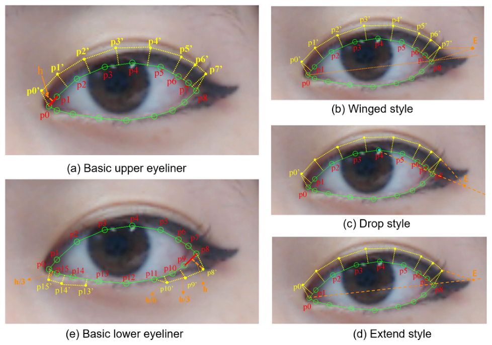

> **그림 6.** 여러 아이라이너 스타일의 생성.

### 4.2 합치는 방식

아래 라이너 스타일에 대해, 시스템은 추천된 스타일을 골라 윗 라이너 스타일과 합친다. Style-Outer와 Style-Winged를 합치는 경우, 시스템은 E점을 아래쪽 p8과 이어 그림 7(a)처럼 가이드용 결과인 닫힌 다각형을 얻는다.

Style-Inner와 Style-Basic을 합치는 경우(그림 7(b)), 시스템은 먼저 p0–p8과 p0–p7로 맞춤 곡선을 계산한 뒤, p0–p8 선과의 교점 E를 찾는다. 그림 7(b)처럼 E점, Style-Basic, Style-Inner를 이어 닫힌 다각형을 얻는다.

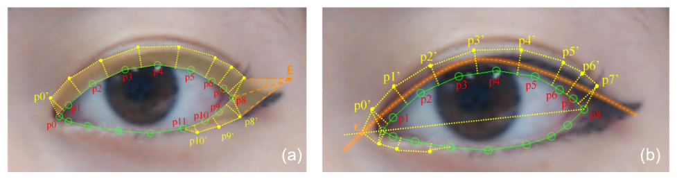

> **그림 7.** 아이라이너 스타일을 합치는 방식.

### 4.3 사용자 인터페이스

그림 8은 제안한 ILoveEye 시스템의 사용자 인터페이스를 보여 준다. 제안한 시스템은 왼쪽 눈과 오른쪽 눈의 창을 따로 새로 만들고 확대해, 사용자가 가이드와 자기 눈을 뚜렷하게 볼 수 있게 한다. 인식된 눈 윤곽을 시스템이 표시할 수 있어, 사용자는 자기 눈이 얼마나 잘 인식되었는지 알 수 있다.

사용자는 키보드 입력으로 한 창을 골라 현재 프레임의 특징 정보를 저장할 수 있다. 두 눈의 특징 정보가 동시에 저장되므로, 카메라의 촬영 각도와 렌즈 왜곡 때문에 인식된 눈 모양이 실제 모양과 다를 수 있다. 그래서 우리는 사용자에게 카메라를 똑바로 보면서 올바른 각도에서 눈 특징을 저장하도록 요청했다.

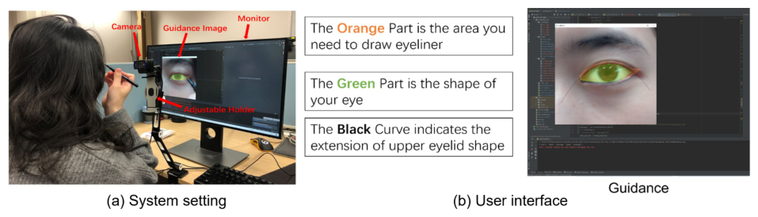

> **그림 8.** 실험 환경과 사용자 인터페이스.

## 5 시스템 평가

시제품 시스템은 Windows 10, Intel i7-9700 CPU, GeForce RTX 2060 SUPER GPU를 갖춘 데스크톱 컴퓨터에 구현했다. 제안한 시스템은 OpenCV 4.5.2, MediaPipe 0.8.6과 함께 Python으로 개발했으며, 사용자의 얼굴을 찍기 위해 로지텍 HD Pro 카메라 C920을 책상 위에 설치했다.

### 5.1 실험 절차

참가자에게 제안한 시스템을 쓰지 않고, 그리고 쓰고 눈 화장을 그리게 하는 비교 연구를 수행한다. 눈 화장을 한 뒤, 참가자에게 화장 지우개를 주어 화장을 지우고 제안한 시스템으로 화장을 그리기 시작하게 했다. 먼저 시스템의 작업 흐름을 소개하고, 사용자에게 주황색 화장 가이드를 참고해 아이라이너를 그리게 했다. 모든 참가자에게 카메라를 보게 했으며, 모니터는 참가자의 얼굴과 두 눈의 독립된 이미지를 표시할 수 있다. 참가자는 만족스러운 눈 인식 결과를 얻을 때까지 카메라 각도를 조정할 수 있었다. 분석된 눈 특징 결과는 텍스트로 참가자에게 알려 주었다. 참가자에게 아이라이너 두 개(젤 아이라이너 하나, 리퀴드 아이라이너 하나)를 주어 아이라이너를 그리게 했다. 참가자가 눈 화장을 마치면 소요 시간을 세고 화장 이미지를 보관했다.

### 5.2 평가 방법

사용자 연구에서 제안한 ILoveEye 시스템을 검증하기 위해 주관적 평가와 객관적 평가를 모두 채택했다. 주관적 평가에 대해서는 사용자 경험과 시스템의 유용성을 확인하는 설문지를 설계했다. 참가자의 기본 정보(성별과 나이)를 수집한 뒤, 먼저 눈 화장에 대한 사용자의 지식을 조사했다. 설문지의 질문 항목은 다음과 같다.

- Q1: 화장을 하나요?
- Q2: 화장 튜토리얼(영상, 잡지, 블로그)을 보나요?
- Q3: 자신의 화장 실력 수준을 어떻게 평가하나요?
- Q4: 자신의 눈 화장 실력 수준을 어떻게 평가하나요?
- Q5: 자신의 눈 모양을 고려해 눈 화장을 하나요?
- Q6: 이 시스템이 자신의 눈 모양을 올바르게 설명한다고 생각하나요?
- Q7: 이 시스템이 아이라이너 그리기를 지원한다고 생각하나요?
- Q8: 이 시스템이 혼자 그릴 때보다 더 나은 아이라이너를 그리도록 돕는다고 생각하나요?
- Q9: 이 시스템이 아이라이너 그리기 실력을 높인다고 생각하나요?

이 질문들은 모두 1이 "전혀 그렇지 않다", 5가 "매우 그렇다"인 5점 리커트 척도로 평가했다. 마지막으로 참가자에게서 조언이나 개선점에 대한 자유 의견을 모았다. 약 25세의 여성 대학원생 8명을 초대했다. 모든 참가자는 눈 화장을 하지 않은 상태로 참여하게 했으며, 눈 화장 경험이 적어야 했다.

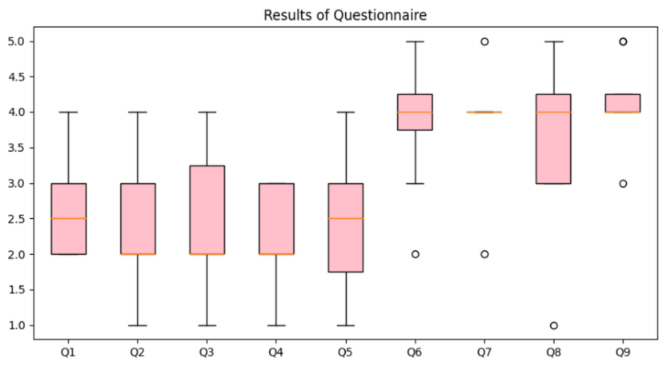

> **그림 9.** 사용자 연구의 설문 결과.

## 6 결과

### 6.1 주관적 평가

설문 결과는 그림 9와 같다. 대부분의 참가자는 화장을 자주 하지 않았고(Q1: 평균 2.63), 자신의 화장 실력에 자신이 없었다(Q3: 평균 2.50, Q4: 평균 2.25). Q6부터 Q9까지의 평균 점수는 Q6 3.88, Q7 3.88, Q8 3.63, Q9 4.13이었다. 우리 시스템의 전체 점수가 3.0을 넘어, 우리 시스템이 사용자가 더 나은 눈 화장을 그리고 화장 실력을 높이도록 도울 수 있음을 뜻한다고 보았다. 한 참가자가 Q6, Q7, Q8에 낮은 점수를 준 것을 알아챘고, 눈 화장을 그리는 잘 검증된 자기 방식을 이미 가진 숙련된 사용자는 우리 화장 가이드로 만족시키기 어렵다는 것을 확인했다.

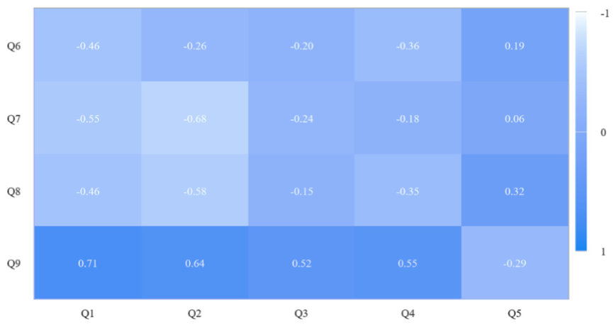

> **그림 10.** Q1–Q5와 Q6–Q9의 피어슨 계수.

참가자의 화장 지식 배경과 시스템 평가 사이의 상관을 그림 10처럼 Q1–Q5와 Q6–Q9의 피어슨 상관 계수로 분석했다. Q1과 Q9 사이에 유의한 정적 상관을 발견했다(p = 0.71). 이는 화장을 자주 하는 참가자가 제안한 시스템으로 실력 향상을 느낄 수 있다는 뜻이다. 평소 화장을 하는 참가자들은 화장의 경험과 지식을 어느 정도 갖추고 있음을 관찰했다. 이들이 자기 눈 특징의 정확한 윤곽을 익히면 그 뒤로 아이라이너를 그리는 데 도움이 될 수 있다. 또한 한 참가자는 시스템이 눈 특징을 설명하고 보여 줄 수 있어서, 튜토리얼 영상을 보는 것보다 화장 실력을 높이는 데 더 나은 경험을 얻었다고 보고했다.

*(역자 주: 원문은 상관 계수 값을 "p = 0.71"로 표기한다. 여기서 p는 유의확률이 아니라 상관 계수 값을 가리키는 것으로 보인다. 원문 그대로 옮겼다. 아래 "p = −0.723"도 같다.)*

### 6.2 객관적 평가

객관적 평가에서는 그림 11처럼 제안한 시스템을 쓸 때와 쓰지 않을 때의 화장 완성 시간과 화장 효과를 비교했다. 우리 시스템을 쓴 뒤 모든 사용자의 완성 시간이 늘어난 것을 발견했다. 사용자들은 시스템을 쓰는 동안 가이드 패턴의 위치를 찾고 가이드 패턴을 어떻게 재현할지 생각하는 데 더 많은 시간을 썼다. 또한 완성 시간과 설문지 질문 사이의 상관을 분석했다. Q2와 시스템 없이 한 완성 시간 사이에 유의한 부적 상관(p = −0.723)을 발견했는데, 이는 화장 튜토리얼을 덜 자주 보는 사람일수록 아이라이너를 완성하는 데 더 많은 시간을 썼다는 뜻이다.

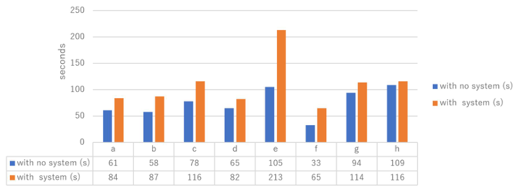

> **그림 11.** 사용자 연구에서의 완성 시간 비교.

그림 12처럼 두 조건의 눈 화장 결과에서, 화장 가이드를 참고한 눈 화장이 시스템을 쓰지 않은 것보다 대체로 더 두껍고 선명하다는 것을 발견했다. 제안한 화장 가이드가 이해하기 쉽고 사용자가 재현할 수 있음이 검증되었다. 자세한 비교 결과는 그림 13과 같다. 날개 부분의 비교 결과를 관찰하면, 제안한 시스템으로 참가자들이 그린 아이라이너가 더 두껍고 훨씬 선명해 보인다는 것을 발견했다. 시스템 상호작용성의 평가를 검토한 뒤, 제안한 시스템이 제공하는 화장 가이드가 이해하기 쉽고 사용자가 재현할 수 있음이 검증되었다. 기본적으로 이런 더 두껍고 훨씬 선명한 아이라이너는 사용자의 눈을 시각적으로 더 커 보이게 했다.

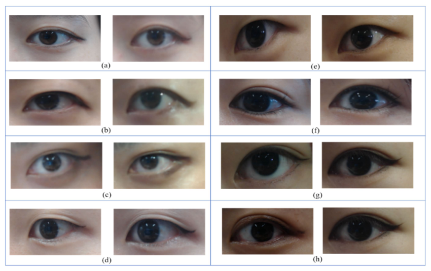

> **그림 12.** 참가자별 화장 효과 비교.

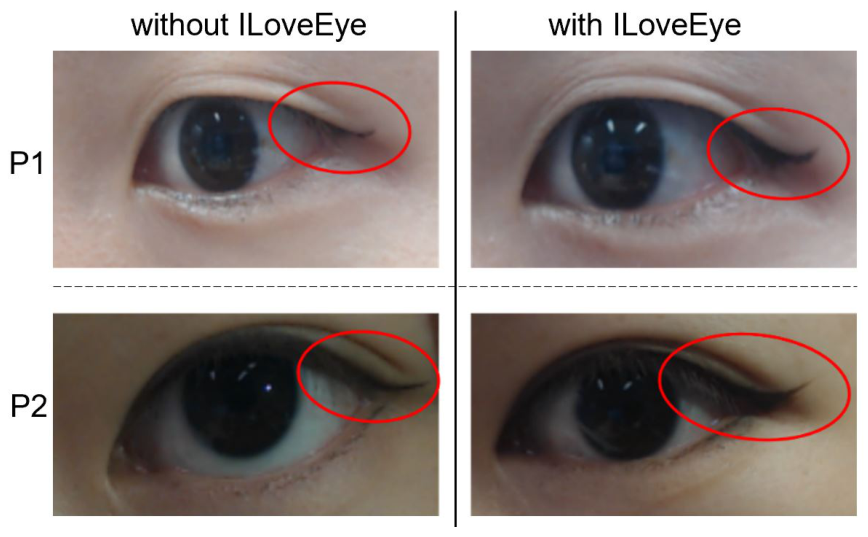

> **그림 13.** 아이라이너 날개의 차이(왼쪽: 시스템 없이, 오른쪽: ILoveEye 사용).

## 7 논의

참가자 인터뷰와 설문지의 자유 의견에서, 제안한 시스템이 화장 경험이 적은 사용자가 눈 모양의 특징에 맞는 더 나은 아이라이너를 그리도록 효과적으로 도울 수 있음을 발견했다. 또한 수집한 참가자 피드백에서, 제안한 시스템이 사용자가 자기 눈 특징을 이해하고 눈 화장 실력을 높이도록 도울 수 있음을 발견했다. 그러나 참가자에게 추천된 아이라이너 스타일은 대부분 Style-Wing, Style-Extend, Style-Outer였으며, 이는 참가자들이 비슷한 눈 모양을 가졌다는 뜻이다. 이 연구의 모든 참가자는 중국인과 일본인이었으므로, 더 많은 국적에서 제안한 시스템을 검증하는 것이 좋겠다. 눈 인식에 대해서는, 카메라 각도 때문에 정확한 인식 결과를 얻기 어려워 카메라 각도를 손으로 조정했다. 제안한 시스템이 눈 윤곽을 정확히 포착할 수는 있지만 눈꺼풀의 검출은 매우 제한적이어서, 눈꺼풀이 눈의 시각 효과에 크게 영향을 주는 사용자에게는 시스템이 어려움을 겪을 수 있다.

사용자 연구에서 사용자는 모니터와 거리를 두어야 했으므로, 근시인 사용자는 가이드를 따라 정확한 위치를 보기 어려울 수 있다. 가이드를 부드럽게 보기에는 프레임 속도가 때때로 낮았다. 한 참가자는 시스템이 사용자가 고를 수 있는 추천 방안을 더 많이 제공하면 도움이 되겠다고 보고했다. 예를 들어 파티, 업무, 쇼핑 같은 여러 용도를 위한 장면 선택 기능을 추가할 수 있다. 화장 스타일을 적용한 얼굴 미리보기를 제공하는 것도 유망할 것이다.

## 8 결론

이 연구에서 우리는 눈 모양 분석에 기반한 아이라이너 가이드 시스템 ILoveEye를 제안했다. 이 시스템은 카메라로 사용자의 눈을 포착하고 눈 모양을 분석하기 위해 눈 윤곽을 인식한다. 제안한 시스템은 사용자가 가이드를 참고해 아이라이너를 그릴 수 있는 추천 아이라이너 가이드를 제공할 수 있다. 우리는 딥러닝 기반 모델로 눈 윤곽을 인식했다. 눈 모양 특징을 분류하는 규칙 기반 모델을 제안했다. 제안한 시스템의 효과를 검증하기 위해 사용자 연구를 설계했다. 사용자 연구에서, 우리 시스템은 사용자의 눈을 효과적으로 식별하고 눈의 윤곽을 인식할 수 있으며, 사용자는 가이드를 따라 눈 화장을 완성할 수 있다. 시스템은 사용자가 더 나은 눈 화장을 그리도록 돕는 효과적인 가이드 기능을 제공했다. 사용자들이 추천된 가이드에 만족했으며, 화장 경험이 더 많은 사용자가 화장 실력의 향상을 얻을 수 있다는 것을 발견했다.

제안한 시스템의 사용자 경험을 높이고 사용자가 아이라이너를 그리도록 돕기 위해 몇 가지 가능한 향후 과제가 있다. 이 연구에서는 시스템이 사용자의 눈 윤곽을 인식할 때 얼굴 인식 모델이 눈꺼풀을 효과적으로 식별하지 못했으며, 이는 사용자의 실제 눈 모양 분류 정확도를 떨어뜨릴 수 있다. 이 문제를 풀기 위해, 눈꺼풀 모양이 레이블된 눈 이미지를 담은 새로운 데이터셋을 구축하고 지도 학습 모델을 학습시켜 눈 모양 인식의 효과를 최적화할 계획이다. 더 나아가 일부 참가자는 제안한 시스템이 제공하는 아이라이너 스타일이 적어 드문 눈 모양에는 맞지 않을 수 있다고 보고했으므로, 사용자의 다양성을 충족하기 위해 앞으로 더 많은 아이라이너 스타일을 화장 가이드로 설계할 가치가 있다. 우리는 제안한 ILoveEye 시스템이 눈썹 화장 같은 다른 화장 실력을 높이는 데로 확장될 수 있다고 생각한다.

## 감사의 말

귀중한 의견을 준 익명의 심사위원들에게 감사한다. 이 프로젝트는 JAIST 연구 보조금과 JSPS 과학연구비 JP20K19845의 일부 지원을 받았다.

---

*참고문헌 목록은 원문을 참조하십시오.*
