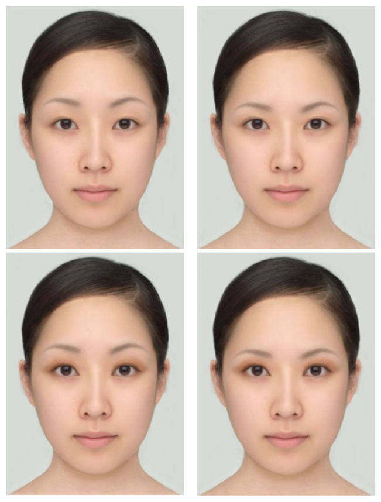
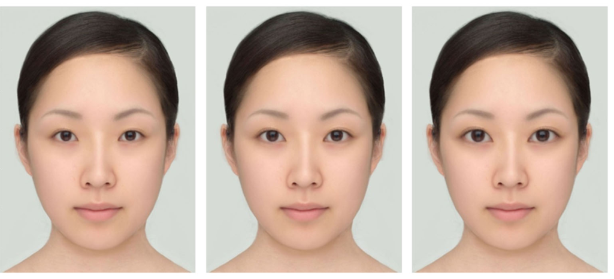
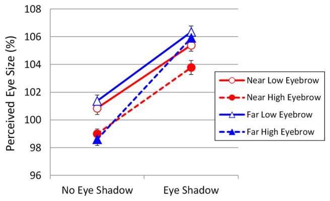
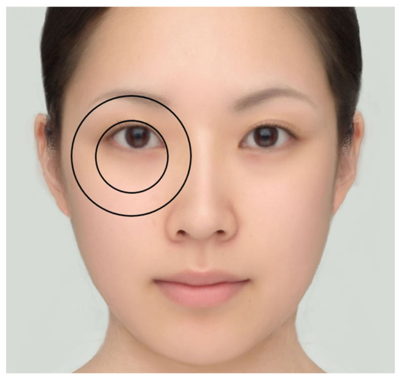
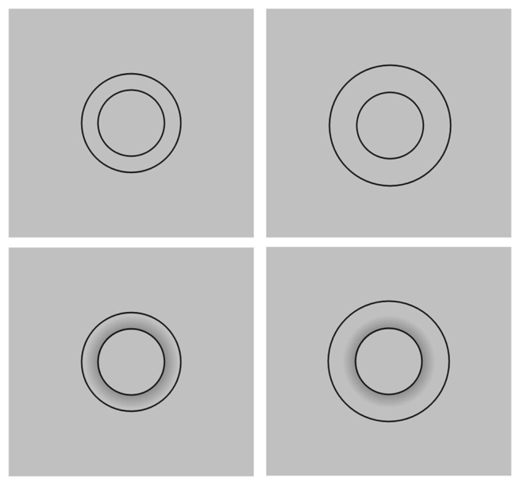
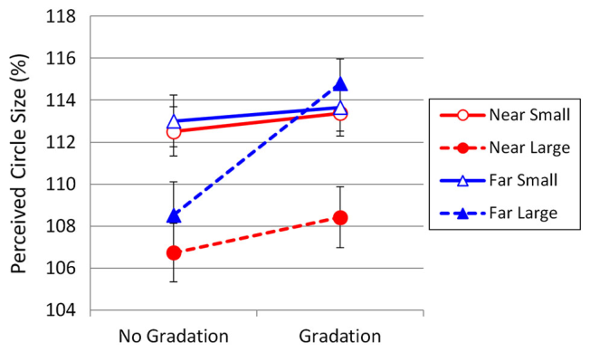

# 사람 얼굴에서 일어나는 실생활의 동화 착시: 눈썹과 아이섀도가 일으키는 눈 크기 착시

> **원문** Morikawa K, Matsushita S, Tomita A, Yamanami H (2015). *A real-life illusion of assimilation in the human face: eye size illusion caused by eyebrows and eye shadow.* Frontiers in Human Neuroscience 9:139. https://doi.org/10.3389/fnhum.2015.00139
>
> **라이선스** 원문 Copyright © 2015 Morikawa, Matsushita, Tomita and Yamanami. [Creative Commons Attribution License (CC BY)](https://creativecommons.org/licenses/by/4.0/)로 배포되며, 원저자(또는 권리자)를 밝히고 이 학술지의 원출판을 인용하는 조건으로 다른 곳에서의 이용·배포·복제를 허용합니다.
>
> **변경 사항** 영어 원문을 한국어로 번역했습니다. 그림은 원문에서 잘라 캡션 앞에 넣었고, 참고문헌 목록은 생략했습니다(본문의 저자·연도 인용은 원문 그대로). 원저자가 검토한 번역이 아닙니다.

**용어 대응** — 동화(assimilation): 중심 부분이 주변 부분 쪽으로 끌려가 둘의 차이가 실제보다 작게 보이는 현상 · 대비(contrast): 차이가 실제보다 크게 보이는 현상 · 델뵈프 착시(Delboeuf illusion): 동심원 착시 · 에빙하우스 착시(Ebbinghaus illusion) · 주관적 등가점(PSE, point of subjective equality) · 계단법(staircase method, 상하법) · 표준 자극(standard stimulus) · 비교 자극(comparative stimulus) · 안검열(palpebral fissure): 눈꺼풀이 벌어진 틈, 곧 보이는 눈 · ηp²: 부분 에타 제곱

---

## 초록

델뵈프 착시 같은 동화 착시가 사람 얼굴에서도 일어나는가? 우리는 사실적인 얼굴에서 눈의 지각된 크기에 영향을 줄 수 있는 요인을 조사했다. 실험 1은 눈썹의 위치(높음 또는 낮음), 아이섀도의 유무, 관찰 거리(0.6 m 또는 5 m)를 조작한 다음 정신물리학적 방법으로 지각된 눈 크기를 측정했다. 결과는 낮은 눈썹(즉, 눈에 더 가까운 눈썹)이 눈을 더 크게 보이게 한다는 것을 보여 주었으며, 이는 눈-눈썹 거리가 짧을수록 눈이 눈썹 쪽으로 동화되는 정도가 더 강하다는 것을 시사한다. 결과는 또한 아이섀도를 바르는 것도 눈을 더 크게 보이게 한다는 것을 보여 주었다. 더욱이 아이섀도의 효과는 멀리서 볼 때 더 두드러진다. 실험 1에서 보인 눈 크기 착시의 메커니즘을 조사하기 위해, 실험 2는 실험 1에서 사용한 아이섀도를 모사한 회색 그러데이션이 있거나 없는 상태에서, 0.6 m 또는 5 m의 관찰 거리에서 델뵈프 착시의 크기를 측정했다. 이 실험은 델뵈프 착시가 눈 크기 착시와 같은 방식으로 관찰 거리와 그러데이션에 의해 조절된다는 것을 보여 주었다. 이 결과는 눈썹이 유도하는 눈 크기 착시와 델뵈프 착시가 같은 메커니즘을 공유하며, 아이섀도가 눈을 자기 쪽으로 동화시키고 눈과 눈썹 사이의 동화를 강화한다는 것을 시사한다.

**키워드**: 착시, 델뵈프 착시, 눈, 눈썹, 얼굴, 동화, 아이섀도

## 서론

지각 착시 연구에서 상대적으로 덜 탐구된 방향 중 하나는 실생활 속 착시의 연구다. 역사적으로 대부분의 시각 착시는 일상생활과 거의 관련 없이 연구되어 왔다. 대부분의 시각 착시 도형은 매우 인위적이고 부자연스러운 자극이었다. 어떤 의미에서, 시각계의 생물학적 진화가 그런 자극을 예상하지 않았으므로 이런 인공 자극이 착시라고 불리는 부자연스러운 지각을 일으키는 것은 놀랍지 않다. 그러나 착시 연구에 쓰이는 자극이 그렇게 부자연스러울 필요는 없다. 자연스러운 착시는 훨씬 덜 극적이긴 하지만, 우리가 생각하는 것보다 일상에 훨씬 더 널리 퍼져 있다. 실제로 어떤 착시는 일상생활과 매우 관련이 깊을 수 있다(Morikawa, 2003, 2012, 2015). 본 연구에서 우리는 가장 자연스럽고 사회적으로 중요한 자극, 즉 사람 얼굴에서의 시각적 기하학적 착시를 조사한다.

사람의 시각계는 얼굴 특징과 그 공간적 관계를 얼굴의 전체적 표상으로 통합하는 전체적 처리(holistic processing)를 통해 얼굴을 지각하고 인식하므로(예: McKone and Robbins, 2011), 눈썹이 눈의 지각된 크기에 영향을 줄 수 있다. 전체적 처리에서 얼굴 특징들은 어떤 특징을 바꾸면 다른 특징의 처리에 영향을 준다는 의미에서 상호 의존적이다(예: Young et al., 1987; Tanaka and Sengco, 1997). 이는 눈썹의 위치를 바꾸면 눈의 지각이 바뀌는가라는 질문을 제기한다.

눈썹은 사람 얼굴에서 가장 두드러진 특징 중 하나이지만(Haig, 1985; Nagai et al., 2013), 눈썹의 지각적 효과를 조사한 선행 연구는 매우 적다. 그러나 흔히 소홀히 다뤄지는 눈썹이 더 과학적으로 조사할 가치가 있는 이유가 적어도 세 가지 있다.

첫째, 눈썹은 얼굴 식별에 상당한 영향을 준다. 예를 들어 얼굴 자극의 눈과 눈썹 영역의 정보는 관찰자가 그 얼굴들을 변별하는 능력과 가장 뚜렷하게 연결되어 있었다(Gosselin and Schyns, 2001; Sekuler et al., 2004; Nagai et al., 2013). 더 나아가 Sadr et al. (2003)은 눈썹이 없는 얼굴을 식별하는 것이 눈이 없는 얼굴을 식별하는 것보다 더 어렵다는 것을 보였다. 눈썹의 중요성은 얼굴의 다른 어떤 특징도 화장으로 눈썹만큼 쉽고 극적으로 바뀔 수 없다는 사실에서도 드러난다. 눈썹을 바꾸면 얼굴의 전체 인상이 바뀔 수 있다(Morikawa, 2012, 2015).

둘째, 많은 메이크업 아티스트가 눈썹의 위치와 모양을 바꾸면 지각되는 눈 크기가 바뀔 수 있다고 주장하지만, 이 주장은 아직 입증되지 않았다. 눈은 얼굴 매력의 중요한 결정 요인이다. 예를 들어 Baudouin and Tiberghien (2004)은 더 넓은 눈이 여성 얼굴을 더 매력적으로 만든다는 것을 보였다(Geldart et al., 1999도 참조). Gründl et al. (2008)은 젊은 관찰자들이 눈 축의 비스듬한 유형(바깥 눈구석이 더 높음)을 수평 유형보다 더 매력적으로 여긴다는 것을 보였다. 눈썹의 위치가 지각되는 눈 크기에 영향을 준다는 것이 실험적으로 입증된다면, 실용적 함의가 있을 수 있다.

셋째, 눈과 눈썹의 지각적 통합에서 생기는 기하학적 착시가, 눈썹 위치에 따른 눈 크기 지각의 변화를 설명할 수 있을지 모른다. 눈썹의 효과를 연구하면 사람 얼굴에서 자연적으로 일어나는 기하학적 착시를 밝히고, 얼굴 지각과 시각 착시의 관계를 조명할 수 있다. 윤곽 사이의 상호작용은 보통 동화 착시 또는 대비 착시로 나타난다. 동화 착시에서는 자극의 중심 부분과 주변 부분 사이의 크기, 방향 등의 차이가 실제보다 작게 보인다. 예를 들어 델뵈프 착시에서는 바깥 원이 너무 크지 않을 때 안쪽 원과 바깥 원 사이의 간격이 줄어든 것처럼 보인다. 반대로 대비 착시에서는 자극의 중심 부분과 주변 부분 사이의 크기, 방향 등의 차이가 과장되어 보인다. 예를 들어 에빙하우스 착시에서는 몇 개의 더 큰 원으로 둘러싸인 원이 줄어든 것처럼 보인다(크기 대비 효과). 이런 기하학적 착시가 얼굴 지각 중에도 일어날 가능성이 있다(Schwaninger et al., 2003; Morikawa, 2012, 2015; Xiao et al., 2014). 눈썹은 사람 얼굴의 시각 착시를 연구하는 훌륭한 도구가 될 수 있다.

눈 크기의 동화 착시를 유도할 수 있는 또 다른 요인은 아이섀도로, 이것은 눈꺼풀이나 눈 주위 피부에 바르는 색조 화장품이다. 화장이 얼굴의 지각된 형태에 주는 효과는 과학적으로 거의 조사되지 않았다. 아이섀도의 목적 중 하나는 눈의 깊이감을 높이는 것이지만(Abe et al., 2009), 아이섀도에는 깊이감을 더하는 것 이상의 무언가가 있을 수 있다. 전형적인 아이섀도는 윗눈꺼풀의 뚜렷한 경계를 따라 가장 진하고, 눈썹에 가까워질수록 피부 톤으로 그러데이션된다. 따라서 눈이 아이섀도와 동화될 가능성이 있으며, 이것이 눈 크기의 과대 추정을 유도할 수 있다. 또 다른 가능성은 아이섀도가 수채화 착시(Pinna et al., 2003)와 비슷한 방식으로, 대비를 줄이거나 색 번짐 과정을 통해 눈과 눈썹의 지각적 집단화를 강화하는 것이며, 이것이 눈을 더 크게 보이게 할 수 있다. 아이섀도가 실제로 이런 효과를 가진다면, 그것은 실생활 동화 착시의 또 다른 예가 될 수 있다.

눈썹과 아이섀도가 유도하는 동화를 조절할 수 있는 자연스러운 변수는 관찰 거리다. 관찰 거리가 늘어나면 눈, 아이섀도, 눈썹 사이의 절대적인 망막상 거리(상대적 망막상 거리는 아님)가 줄어든다. 일반적으로 지각적 집단화는 망막상에서 서로 더 가까운 부분들 사이에서 더 강하다(Masin, 2002). 더욱이 van der Kooij and te Pas (2009)와 Mareschal et al. (2010)은 자극에 잡음을 더하면 동화가 증가한다는 것을 발견했다. Masin (2002)은 가시성이 떨어질수록 정보가 시야의 점점 더 넓은 영역에 걸쳐 모인다고 시사했다. 관찰 거리를 늘리면 잡음이 늘어 눈-눈썹 영역의 가시성이 다소 낮아지고, 이것이 눈, 아이섀도, 눈썹의 더 강한 동화로 이어질 수 있다. 디스플레이 모니터에서 자극 크기를 줄여 망막상의 크기를 줄일 수도 있지만, 이 방법은 이미지 해상도를 떨어뜨리고 자극 얼굴의 모습을 바꾼다. 그래서 우리는 대신 관찰 거리를 늘리기로 했다. 1차 시각피질 뉴런의 관점에서는, 짧은 거리에서 본 작은 자극은 먼 거리에서 본 큰 자극과 같다. 그러나 실생활에서 관찰 거리는 물체 지각의 중요한 측면이다. 따라서 관찰 거리를 바꾸는 것은 과학적으로나 실용적으로나 관심을 가질 만한 자연스럽고 의미 있는 조작이다.

이 연구의 목적은 두 가지다. 첫째, 지각된 눈 크기가 눈썹과 아이섀도의 동화 효과에 영향을 받는지, 그리고 그런 효과가 관찰 거리에 의해 조절되는지 검토한다. 이를 위해 아이섀도와 눈썹 위치의 영향을 받은 눈의 지각된 크기를 정밀하게 측정하는 정신물리학적 방법을 사용한다. 둘째, 눈썹이 유도하는 눈 크기 착시가 델뵈프 착시와 같은 메커니즘에 기반하는지 조사한다.

## 실험 1

이 실험에서 우리는 눈썹의 위치가 높거나 낮고, 아이섀도가 있거나 없는 얼굴 사진에서 눈의 지각된 크기를 측정했다. 눈썹 위치는 눈썹 전체를 위나 아래로 옮겨 바꾸었다. 눈이 눈썹 쪽으로 동화되는 정도가 눈과 눈썹 사이의 거리와 관계없이 같다면, 마치 눈썹이 눈꺼풀을 들어 올리는 것처럼 눈썹 위치가 높을 때 눈이 더 크게 보여야 한다. 그러나 눈썹이 눈에 더 가까울 때 동화의 힘이 더 강하다면, 눈썹 위치가 낮을 때 눈이 더 크게 보여야 한다.

눈이 아이섀도 쪽으로도 동화된다면, 아이섀도를 바른 눈이 바르지 않은 눈보다 더 크게 보여야 한다. 아이섀도는 또한 눈꺼풀과 눈썹 사이의 휘도 차이를 줄이는데, 이것이 눈이 눈썹 쪽으로 동화되는 것을 강화할 수 있다. 어느 쪽이든, 아이섀도를 바르면 눈이 더 크게 보여야 한다.

또한 망막상을 더 작게 만드는 것이 눈이 눈썹 및/또는 아이섀도 쪽으로 동화되는 것을 강화한다면, 이미지를 더 먼 거리에서 보면 눈 크기 착시가 강해져야 한다.

### 방법

**참가자** 학부생 22명(남성 10명, 여성 12명)이 참가했다. 시력은 FrACT 3.7 검사(Bach, 1996)로 측정했다. 모두 0.7 이상의 정상 시력 또는 교정 시력을 가졌다. 참가자들은 대학 기준으로 적절한 가치로 여겨지는 물품으로 시간에 대한 보상을 받았다.

**자극과 장치** 실험은 Microsoft Visual Basic 6.0으로 우리가 만든 프로그램으로 컴퓨터에서 진행했다. 자극은 24.1인치 LCD 화면(NEC MultiSync LCD-PA241W, 화면 크기 518 × 324 mm, 1920 × 1200 픽셀, 주사율 60 Hz, 흰색의 CIE 색도 좌표: x = 0.322, y = 0.326)에 제시했다. 관찰 위치를 어떤 장치로도 고정하지 않았지만, 관찰 거리는 약 0.6 m 또는 5 m로 일정하게 유지되었다.

모든 얼굴 자극은 일본 젊은 성인 여성의 평균 얼굴에 기반한 하나의 얼굴 이미지에서 만들었다. 이 이미지는 전형적인 매력을 나타내도록 다소 수정되었다(Matsushita et al., 투고 중). 자극의 크기는 가로 660 픽셀, 세로 900 픽셀이었다(시각도로 0.6 m에서 16.53° × 22.03°, 5 m에서 2.04° × 2.78°). 얼굴 자체의 크기는 광대뼈 높이에서 가로 약 480 픽셀(시각도로 0.6 m에서 12.18°, 5 m에서 1.48°), 머리 꼭대기부터 턱 끝까지 세로 약 810 픽셀(0.6 m에서 20.01°, 5 m에서 2.50°)이었다. 자극은 컬러 이미지였고 얼굴 영역의 평균 휘도는 114.1 cd/m²였다. 얼굴 이미지의 배경은 RGB 중앙값 214, 219, 213의 약간 색이 섞인 회색이었다.

표준 자극은 눈썹 위치를 조작한 얼굴 이미지였다(그림 1). 눈썹의 위치를 원래 눈썹 위치에서 8픽셀 아래로 또는 8픽셀 위로 옮겼다(각각 낮음 조건과 높음 조건). 또한 눈썹 위치의 각 수준에 대해, 디지털 사진 편집 소프트웨어 PaintShop Pro XI를 사용해 갈색 아이섀도를 바른 모습을 모사했다. 따라서 표준 자극은 모두 네 개였다. 원래 얼굴에서, 동공 중심을 지나는 수직선 위에서 눈의 세로 길이(즉, 안검열의 위쪽과 아래쪽 사이의 거리)는 36픽셀이었고, 눈의 위쪽과 눈썹의 아래쪽 가장자리 사이의 거리는 45픽셀이었다. 따라서 8픽셀의 이동은 원래 눈-눈썹 거리의 18%에 해당했다. 계단법에 사용할 비교 자극은 아이섀도가 없는 얼굴 이미지였다. 이 자극들에서 눈의 크기는 원래 눈 크기(즉, 100%)의 90%부터 110%까지 가로와 세로 모두 2% 간격으로 차례로 바꾸었다(그림 2).

> **그림 1.** 실험 1에 사용한 표준 자극. 위쪽 줄은 아이섀도가 없는 얼굴이고, 아래쪽 줄은 아이섀도가 있는 얼굴이다. 왼쪽 열은 눈썹이 높은 얼굴이고, 오른쪽 열은 눈썹이 낮은 얼굴이다. 눈썹 위치와 아이섀도를 제외하면 얼굴은 동일하다.

> **그림 2.** 실험 1에 사용한 비교 자극의 예. 왼쪽: 눈 크기 90%. 가운데: 눈 크기 100%. 오른쪽: 눈 크기 110%.

**절차** 실험은 오사카대학 인간과학연구과 윤리위원회의 승인을 받았다. 참가자들이 사전 동의서에 서명하고 안내를 받은 뒤 실험 과제가 시작되었다.

각 시행에서 표준 자극과 비교 자극이 컴퓨터 화면에 나란히 제시되었다. 이미지의 배경은 회색이었다. 제시되는 동안 참가자들은 두 얼굴을 비교하기 위해 눈을 자유롭게 움직였다. 자극이 1500 ms 동안 제시된 뒤 화면은 빈 회색으로 바뀌었고, 이 화면은 최소 1500 ms 동안, 그리고 참가자가 반응할 때까지 지속되었다. 참가자의 과제는 어느 얼굴의 눈이 더 커 보이는지 판단하는 것이었다. 우리는 참가자들에게 자극의 몇몇 특정 지점에 초점을 맞추지 말고 얼굴 전체 영역에 주의를 기울이라고 지시했다. 반응 뒤에 다음 자극 쌍이 제시되었다. 표준 자극의 눈 크기와 같다고 지각되는 비교 자극의 눈 크기를 측정하기 위해, 상하법(up-and-down method)이라고도 알려진 계단법을 사용했다. 표준 자극마다 하나의 계단이 있었으므로, 실험은 무작위로 뒤섞인 네 개의 동시 진행 계단으로 이루어졌다. 표준 자극이 화면의 왼쪽에 제시될지 오른쪽에 제시될지는 시행마다 무작위로 정했다. 각 계단의 첫 시행에서 비교 자극의 눈은 표준 자극의 눈보다 확연히 작거나(상승 계열) 확연히 컸다(하강 계열). 각 계단은 계단의 방향이 아홉 번 바뀌면 종료되었다. 실험은 약 20분이 걸렸다.

### 결과와 논의

먼저 각 표준 자극에 대해 주관적 등가점(PSE)을 계산했다. PSE는 계단의 방향이 위에서 아래로 또는 아래에서 위로 바뀐 지점의 비교 자극 눈 크기 값 중 마지막 여덟 개의 평균이었다. 결과는 그림 3에 있다. 아이섀도가 없을 때 평균 지각 눈 크기는 낮은 눈썹 조건과 높은 눈썹 조건에서 각각 101.0%와 98.8%였다. 아이섀도가 있을 때 평균 지각 눈 크기는 낮은 눈썹 조건과 높은 눈썹 조건에서 각각 105.9%와 104.8%였다.

> **그림 3.** 실험 1의 결과. 눈썹 위치, 아이섀도, 관찰 거리에 따른 지각된 눈 크기. 세로 막대는 표준오차를 나타낸다.

아이섀도, 눈썹 위치, 관찰 거리를 요인으로 한 3원 반복측정 분산분석은 아이섀도의 주효과가 매우 유의함을 보였다, F(1,21) = 222.08, p < 0.001, ηp² = 0.914. 또한 눈썹 위치와 관찰 거리의 주효과도 유의했다(각각 F(1,21) = 20.55, p < 0.001, ηp² = 0.495 및 F(1,21) = 9.07, p = 0.007, ηp² = 0.302). 아이섀도와 관찰 거리의 상호작용이 유의했으며(F(1,21) = 8.19, p = 0.009, ηp² = 0.281), 이는 아이섀도를 바른 눈이 0.6 m보다 5 m에서 더 크게 지각되었음을 나타낸다. 더욱이 아이섀도와 눈썹 위치의 상호작용이 유의했으며(F(1,21) = 10.78, p = 0.004, ηp² = 0.339), 이는 아이섀도가 없을 때 높은 눈썹이 낮은 눈썹보다 눈을 유의하게 더 작게 보이게 했음을 드러낸다. 그러나 눈썹 위치와 관찰 거리의 상호작용은 유의하지 않았다(F(1,21) = 0.35, p = 0.85, ηp² = 0.002). 또한 3원 상호작용이 유의했다(F(1,21) = 5.79, p = 0.025).

단순 주효과 분석은 관찰 거리가 아이섀도가 있을 때에는 눈 크기 착시에 영향을 주었지만(F(1,42) = 17.261, p = 0.0002, ηp² < 0.291), 없을 때에는 그렇지 않았음을(F(1,42) = 0.028, p = 0.867, ηp² < 0.001) 확인해 주었다. 더욱이 단순-단순 주효과 분석은, 아이섀도가 있을 때 관찰 거리를 5 m로 늘리면 눈썹이 높을 때에만 눈 크기의 과대 추정이 강해졌고(F(1,84) = 14.853, p = 0.0002, ηp² = 0.150), 눈썹이 낮을 때에는 그렇지 않았음을(F(1,84) = 2.965, p = 0.089, ηp² = 0.034) 드러냈다.

아이섀도를 더하고 자극을 5 m에서 본 조건을 제외하면, 낮은 눈썹은 언제나 높은 눈썹보다 눈을 유의하게 더 크게 보이게 했다. 실제로 아이섀도는 자극을 5 m에서 본 높은 눈썹 조건에서 가장 큰 효과를 냈다. 이 결과는 멀리서 볼 때 아이섀도를 더하면 높은 눈썹이 눈을 작아 보이게 하는 효과를 극복할 수 있음을 시사하는데, 아마도 아이섀도가 눈과 눈썹 사이의 틈을 잇고 눈이 눈썹 쪽으로 동화되는 것을 강화하기 때문일 것이다.

결과는 높은 눈썹에서 "눈꺼풀을 들어 올리는 효과"를 보여 주지 않았다. 대신 눈썹 위치는 반대 효과를 냈다. 눈썹이 낮을 때 지각된 눈 크기가 더 컸다. 실제로 높은 눈썹은 눈 크기의 과소 추정을 낳았다. t 검정은 아이섀도 없음 조건에서 가까운 거리-높은 눈썹과 먼 거리-높은 눈썹의 평균값(각각 99.0%와 98.6%)이 100%보다 유의하게 작음을 보였다(각각 t(21) = 2.939, p = 0.008 및 t(21) = 3.185, p = 0.004). 그러나 이 과소 추정이 반드시 크기 대비를 뜻하지는 않는데, 높은 눈썹이라도 눈썹이 아예 없을 때보다는 눈을 더 크게 보이게 할 가능성이 크기 때문이다. 이 결과는 위치와 관계없이 눈썹이 있다는 것만으로 눈이 실제보다 더 크게 보이며, 눈과 눈썹 사이의 거리를 줄이면 동화의 힘이 커진다는 것을 나타낸다. 눈-눈썹 거리와 동화 강도 사이의 관계는 델뵈프 착시와 비슷할 수 있다. 델뵈프 착시는 안쪽 원이 바깥 원 쪽으로 동화되어 실제보다 크게 보이는 동화 착시다(그림 4).

> **그림 4.** 눈 크기 착시와 델뵈프 착시 사이의 가설적 관계. 이 그림에서 눈썹의 위치는 실험 1의 낮음 조건과 높음 조건의 중간이다. 안쪽 원과 바깥 원의 지름 비는 2:3.3으로, 실험 2의 작음 조건과 큼 조건의 중간이다.

## 실험 2

실험 2의 목적은 실험 1의 눈 크기 착시가 델뵈프 착시와 같은 메커니즘에 기반하는지 검토하는 것이었다. 우리는 실험 1에서 사용한 아이섀도를 모사한 회색 그러데이션이 있거나 없는 상태에서, 0.6 m 또는 5 m의 관찰 거리에서 델뵈프 착시의 크기를 측정했다. 실험 1의 눈 크기 착시와 델뵈프 착시가 실제로 같은 메커니즘을 공유한다면, 델뵈프 착시는 눈 크기 착시와 같은 방식으로 관찰 거리와 그러데이션에 의해 조절되어야 한다.

### 방법

**참가자** 학부생 22명(남성 10명, 여성 12명)이 참가했다. 이들은 실험 1에도 참가했다. 시력은 FrACT 3.7 검사(Bach, 1996)로 측정했다. 모두 0.7 이상의 정상 시력 또는 교정 시력을 가졌다.

**자극과 장치** 실험 1과 같은 장치를 사용했다. 표준 자극은 밝은 회색 배경 위에 검은 선으로 그린 동심원으로, 컴퓨터 화면에 제시했다(그림 5). 안쪽 원의 지름은 122픽셀로, 관찰 거리 0.6 m와 5 m에서 각각 시각도 3.14°와 0.38°에 해당했다. 작은 바깥 원(작음 조건)과 큰 바깥 원(큼 조건)의 지름은 각각 182픽셀(0.6 m와 5 m에서 4.68°와 0.56°)과 222픽셀(0.6 m와 5 m에서 5.70°와 0.69°)이었다. 안쪽 원과 바깥 원의 지름 비는 작음 조건에서 2:3, 큼 조건에서 2:3.64였다. 또한 바깥 원 지름의 각 수준에 대해, 동일한 회색 그러데이션을 안쪽 원 주위에 디지털로 더했다. 따라서 표준 자극은 모두 네 개였다. 그러데이션은 실험 1에서 사용한 아이섀도를 모사했으며, 안쪽 원과 시각적으로 구별될 만큼 옅었다.

비교 자극은 하나의 원으로, 그 지름은 실험 1과 같은 계단법을 사용해 관찰자의 판단에 따라 2%씩 차례로 줄이거나 늘렸다. 각 시행에서 표준 자극과 비교 자극이 나란히 제시되었다. 표준 자극이 화면의 왼쪽에 제시될지 오른쪽에 제시될지는 시행마다 무작위로 정했다.

**절차** 관찰자가 안쪽 원과 하나의 비교 원 중 어느 것이 더 커 보이는지 판단했다는 점을 제외하면, 실험 1과 같은 절차를 사용했다.

> **그림 5.** 실험 2에 사용한 표준 자극. 위쪽 줄은 그러데이션이 없는 작음(왼쪽) 조건과 큼(오른쪽) 조건을 보여 준다. 아래쪽 줄은 회색 그러데이션이 있는 작음 조건과 큼 조건을 보여 준다. 모든 안쪽 원의 크기는 동일하다.

### 결과와 논의

PSE는 실험 1과 같은 방식으로 계산했다. 결과는 그림 6에 있다. 그러데이션이 없을 때 평균 지각 원 크기는 작음 조건과 큼 조건에서 각각 112.8%와 107.6%였다. 그러데이션이 있을 때 평균 지각 원 크기는 작음 조건과 큼 조건에서 각각 113.5%와 111.6%였다. 전반적으로 실험 2에서 얻은 착시 크기는 실험 1의 착시 크기보다 훨씬 컸다. 눈과 눈썹은 델뵈프 착시 도형을 이루는 동심원의 일부에만 해당하므로(그림 4) 이것은 놀랍지 않다. Weintraub and Schneck (1986)은 바깥 원주를 더 많이 지울수록 델뵈프 착시가 약해진다고 보고했다.

> **그림 6.** 실험 2의 결과. 바깥 원 크기, 그러데이션, 관찰 거리에 따른 안쪽 원의 지각된 크기. 세로 막대는 표준오차를 나타낸다.

그러데이션, 바깥 원 크기, 관찰 거리를 요인으로 한 3원 반복측정 분산분석은 그러데이션의 유의한 주효과를 보였다, F(1,21) = 10.35, p = 0.004, ηp² = 0.330. 바깥 원 크기와 관찰 거리의 주효과도 유의했다(각각 F(1,21) = 17.42, p < 0.001, ηp² = 0.453 및 F(1,21) = 5.07, p = 0.035, ηp² = 0.195). 그러데이션과 바깥 원 크기의 상호작용이 유의했으며(F(1,21) = 14.20, p = 0.001, ηp² = 0.403), 이는 그러데이션을 더하면 작은 바깥 원이 유도하는 착시보다 큰 바깥 원이 유도하는 착시가 더 많이 커졌음을 나타낸다. 또한 바깥 원의 크기와 관찰 거리의 상호작용이 유의했으며(F(1,21) = 7.60, p = 0.012, ηp² = 0.266), 이는 관찰 거리가 늘어나면 작은 바깥 원이 유도하는 착시보다 큰 바깥 원이 유도하는 착시가 더 많이 증폭되었음을 나타낸다. 그러데이션과 관찰 거리의 상호작용은 경계선 수준에서 유의했으며(F(1,21) = 4.03, p = 0.058, ηp² = 0.161), 이는 그러데이션의 효과가 0.6 m보다 5 m에서 다소 더 컸음을 시사한다. 3원 상호작용도 유의했다(F(1,21) = 11.00, p = 0.003, ηp² = 0.344).

단순 주효과 분석은 관찰 거리가 그러데이션이 있을 때에는 델뵈프 착시에 영향을 주었지만(F(1,42) = 8.642, p = 0.0053, ηp² < 0.171), 없을 때에는 그렇지 않았음을(F(1,42) = 1.020, p = 0.318, ηp² = 0.0237) 확인해 주었다. 더욱이 단순-단순 주효과 분석은, 그러데이션이 있을 때 관찰 거리를 5 m로 늘리면 큰 바깥 원에서는 안쪽 원의 과대 추정이 강해졌지만(F(1,84) = 21.829, p < 0.0001, ηp² = 0.206), 작은 바깥 원에서는 그렇지 않았음을(F(1,84) = 0.042, p = 0.838, ηp² = 0.0005) 드러냈다.

실험 1에서 낮은 눈썹의 효과와 비슷하게, 그러데이션을 5 m에서 본 조건을 제외하면 작은 바깥 원은 언제나 큰 바깥 원보다 안쪽 원을 유의하게 더 크게 보이게 했다. 실제로, 실험 1에서 아이섀도의 가장 큰 효과가 5 m에서 본 높은 눈썹 조건에서 나타난 것과 마찬가지로, 그러데이션의 가장 큰 효과는 5 m에서 본 큰 바깥 원 조건에서 나타났다. 이 결과는 멀리서 볼 때 그러데이션을 더하면 큰 바깥 원의 약한 착시가 강해질 수 있음을 시사하는데, 아마도 그러데이션이 안쪽 원과 바깥 원 사이의 틈을 잇고 안쪽 원이 바깥 원 쪽으로 동화되는 것을 강화하기 때문일 것이다. 따라서 실험 2에서 얻은 결과의 양상은 실험 1의 양상과 밀접하게 일치한다.

## 종합 논의

본 연구에서 우리는 정신물리학적 방법을 사용해 사람 얼굴에서 동화 착시가 일어나는지 조사했다. 실험 1은 지각된 눈 크기가 눈썹과 아이섀도의 동화 효과에 영향을 받으며, 그런 효과가 관찰 거리의 영향을 받는다는 것을 보여 주었다. 눈썹 위치가 낮을 때 눈이 더 크게 보이는데, 이는 눈썹이 눈에 더 가까울 때 동화의 힘이 더 강하다는 것을 시사한다. 아이섀도도 눈을 더 크게 보이게 한다. 실험 2는 눈썹이 유도하는 눈 크기 착시가 델뵈프 착시와 같은 메커니즘에 기반하는지 조사하기 위해, 관찰 거리와 아이섀도를 모사한 그러데이션이 델뵈프 착시에 주는 효과를 측정했다. 결과는 델뵈프 착시가 눈 크기 착시와 같은 방식으로 그러데이션과 관찰 거리에 의해 조절된다는 것을 보여 주었으며, 이는 겉모습과 착시 크기의 큰 차이에도 불구하고 눈 크기 착시와 델뵈프 착시가 실제로 같은 메커니즘을 공유한다는 것을 시사한다.

Abe et al. (2009)은 착시의 절대적 크기를 측정하지는 않았지만, 아이섀도가 눈의 겉보기 깊이와 크기를 증가시킨다는 것을 보였다. Abe et al. (2009)은 관찰자와 눈 사이의 주관적 거리가 늘어나면 크기 항등성 보정(constancy scaling) 때문에 눈 크기의 과대 추정이 일어난다고 주장했다. 그러나 본 연구에서 아이섀도가 일으킨 눈 크기 착시의 크기는 크기 항등성 보정으로 설명하기에는 너무 크다. 크기 항등성 보정만으로 관찰 거리 0.6 m에서 5%의 과대 추정을 유도하려면 눈이 3 cm 뒤에 있는 것으로 지각되어야 하고, 관찰 거리 5 m에서 6%의 과대 추정을 유도하려면 눈이 머리 안쪽으로 30 cm 뒤에 있는 것으로 지각되어야 한다. 따라서 아이섀도는 눈의 깊이감을 높이는 것 이상의 효과를 일으키는 것이 틀림없으며, 우리는 그것이 동화 착시라고 믿는다.

아이섀도/그러데이션 효과의 메커니즘은 무엇인가? 아이섀도가 눈을 더 크게 보이게 하는 것은 눈이 아이섀도 쪽으로 직접 동화되기 때문인가, 아니면 아이섀도가 눈이 눈썹 쪽으로 동화되는 것을 강화하기 때문인가? 아이섀도 효과가 오직 눈이 아이섀도 쪽으로 동화되는 것에만 기반하고 눈썹과는 전혀 관련이 없다면, 아이섀도 효과의 크기는 눈썹 위치와 관계없이 같을 것이다. 그러나 그렇지 않았다. 특히 흥미로운 것은, 관찰 거리를 5 m로 늘리면 눈 크기와 안쪽 원 크기의 과대 추정이 각각 아이섀도가 있는 높은 눈썹 조건과 그러데이션이 있는 큰 바깥 원 조건에서만 강해진다는 사실이다. 눈썹이 낮거나, 바깥 원이 작거나, 아이섀도/그러데이션이 없을 때에는 관찰 거리가 착시에 영향을 주지 않는다. 이 결과는 아이섀도/그러데이션이 두 부분(즉, 눈과 눈썹, 또는 안쪽 원과 바깥 원) 사이의 동화의 다리로 기능하며, 그 둘 사이의 공간이 상대적으로 클 때 그 다리가 특히 효과적이 된다는 것을 시사한다. 그러나 아이섀도가 유도하는 착시는 평균 약 5%로, 눈썹 위치가 유도하는 약 2%의 착시보다 훨씬 크다. 따라서 아이섀도에는 눈이 눈썹 쪽으로 동화되는 것을 강화하는 것 이상의 기능이 있을 수 있다. 아이섀도/그러데이션 효과에는 눈/안쪽 원이 아이섀도/그러데이션 쪽으로 동화되는 것과, 눈/안쪽 원이 눈썹/바깥 원 쪽으로 동화되는 것의 강화가 모두 관여할 가능성이 크다.

동화가 아니라 대비의 관점에서 보면, 눈-눈썹 거리가 지각된 눈 크기에 주는 효과는 눈(즉, 안검열)과, 눈의 위쪽 가장자리와 눈썹의 아래쪽 가장자리 사이의 영역 사이의 크기 대비 착시로 해석될 수도 있다. Xiao et al. (2014)은 더 큰 얼굴 틀 안에 놓인 눈이 더 작은 얼굴 틀 안에 놓인 같은 크기의 눈보다 더 작게 지각된다고 보고했다. 이 저자들은 이것을 에빙하우스 착시와 비슷한 크기 대비 착시로 보았다. 본 연구에서 높은 눈썹은 낮은 눈썹보다 눈과 눈썹 사이에 더 넓은 공간을 남긴다. 따라서 눈과 높은 눈썹 사이의 더 넓은 공간이 눈을 상대적으로 더 작게 보이게 하는 반면, 눈과 낮은 눈썹 사이의 더 좁은 공간에서는 크기 대비가 그다지 두드러지지 않을 가능성도 있다.

본 연구의 눈 크기 착시는 대비 착시라기보다는 눈이 눈썹 쪽으로 동화되는 동화 착시일 가능성이 더 크다. 이 추측은 델뵈프 착시에 관한 선행 연구가 뒷받침한다. 델뵈프 착시에서 안쪽 원과 바깥 원의 지름 비를 바꾸면, 안쪽 원의 과대 추정 크기는 지름 비 2:3에서 최대가 된다(Oyama, 1960, 1962; Goto et al., 2007). 눈과 눈썹이 델뵈프 착시의 안쪽 원과 바깥 원에 부분적으로 대응한다면(그림 4), 낮은 눈썹에서의 "지름 비"가 높은 눈썹에서보다 최적값 2:3에 더 가깝다. 지름 비가 1:5 이하이면 동화가 대비로 바뀌어 델뵈프 착시 도형의 안쪽 원이 과소 추정되지만, 자연스러운 사람 얼굴에서 그런 극단적인 비는 불가능하다. 따라서 본 연구의 눈 크기 착시는 아마도 대비가 아니라 동화에서 생길 것이다.

Morikawa (2012, 2015)는 사람의 얼굴과 몸에서의 착시가 대비보다는 동화의 방향으로 일어나는 경향이 있다고 시사했다. 동화가 우세한 이유 중 하나는, 고전적 기하학적 착시를 이루는 선들 사이의 빈 공간과 달리, 얼굴 부위 사이나 몸 부위 사이의 공간이 피부, 근육, 뼈 같은 조직으로 채워지고 연결되어 있다는 사실일 수 있다. 더욱이 한 개인의 몸의 여러 부위의 발달은 흔히 같은 유전적·호르몬 메커니즘의 지배와 조절을 받는다. 따라서 어떤 사람의 눈썹이 처져 있다면 그 사람의 눈도 처져 있을 가능성이 크다. 몸의 한 부위가 가늘면 다른 부위도 가늘 가능성이 크다. 우리는 시각계가 이런 생물학적 동시 발생과 자연스러운 상관을 고려하기 때문에 눈썹이 눈 크기 착시를 유도한다는 가설을 세운다(Morikawa, 2012, 2015).

Morikawa (2012, 2015)는 또한 사람의 얼굴과 몸에서의 기하학적 착시를 정신물리학적으로 측정하면 최대 착시 크기가 약 5% 부근이 되는 경향이 있다고 지적했는데, 일종의 "마법의 수"다. 실험 1이 재현한 것이 바로 그것이다. 5%의 착시 크기는 잘 알려진 기하학적 착시에 비하면 작다. 아마도 사람의 얼굴과 몸에서의 시각 착시에는 자연스러운 상한이 있어서, 그 결과로 생기는 왜곡이 부자연스러워 보이지 않는 정도까지만 착시가 일어날 수 있는지도 모른다.

그림 3의 오차 막대가 매우 짧다는 사실은, 눈썹과 아이섀도가 일으킨 착시의 크기가 꽤 작았는데도(각각 약 2%와 5%) 관찰자들의 지각 판단이 일관되고 안정적이었음을 나타낸다. 이것은 사람의 시각계가 사람 얼굴의 미세한 차이를 탐지하는 데 특히 조율되어 있기 때문일 수 있다. 얼굴을 식별하고 인식하는 것은 사회에서 매우 중요한 기술이다. 우리는 얼굴 특징의 배치에 매우 민감해서, 아주 작은 차이도 믿을 만하게 지각할 수 있다(Morikawa, 2012, 2015).

우리의 결과는 눈썹이 얼굴 매력에 직접적으로뿐 아니라, 눈의 지각된 크기에 주는 영향을 통해 간접적으로도 영향을 줄 수 있음을 시사한다. 사람들은 더 큰 눈을 더 매력적으로 여기는 경향이 있다(Geldart et al., 1999; Baudouin and Tiberghien, 2004). Feser et al. (2007)은 젊은 관찰자(30세까지)가 눈썹이 더 낮은 위치에 있는(즉, 눈에 더 가까운) 얼굴을 선호한다는 것을 발견했다. 우리의 결과는 Feser et al.의 발견을 부분적으로 설명할 수 있을지 모른다. 낮은 눈썹이 눈 크기의 착시적 과대 추정을 유도하고, 이것이 더 높은 매력으로 이어질 수 있다.

일본 학생들이 본 현재의 자극에서 눈썹 위치가 지각된 매력에 영향을 주는지 알아보기 위해, 우리는 눈썹이 높은 얼굴(그림 1 왼쪽 위)과 눈썹이 낮은 얼굴(그림 1 오른쪽 위)을 제시하고 어느 얼굴이 다른 얼굴보다 더 매력적으로 보이는지 묻는 추가 조사를 실시했다. 두 얼굴은 종이 한 장에 나란히 인쇄되었으며, 좌우 위치는 역균형화했다. 학생 56명 중 73%가 눈썹이 낮은 얼굴을 더 매력적인 쪽으로 골랐다. 이 결과는 Feser et al. (2007)의 발견을 재현했다. 따라서 눈썹 위치는 아마도 눈을 더 크게 보이게 함으로써 지각된 매력에 영향을 준다.

눈 크기 착시와 델뵈프 착시의 바탕에 있는 공유 메커니즘에 관한 현재의 발견은, 이 연구의 몇 가지 한계 때문에 신중하게 해석해야 한다. 첫째, 착시 크기가 서로 달라 실험 1과 2 사이의 비교가 다소 문제가 된다. 이상적으로는 델뵈프 착시의 크기를 어떻게든 눈 크기 착시와 대략 같게 만들어야 한다. 둘째, 델뵈프 착시를 약하게 하는 자극 조작이 눈 크기 착시도 줄인다는 것을 보인다면 더 설득력이 있을 것이다. 그런 공유된 "부정적" 결과는 눈 크기 착시에서 보이는 동화 효과를 맥락/대비의 더 일반적인 효과와 구별하는 데 도움이 될 것이다.

우리의 발견은 연구자들이 얼굴 지각 연구에서 잘라 낸 고립된 얼굴 특징(예: 눈, 코, 입만 따로)을 실험 자극으로 사용할 때 주의해야 함을 시사한다. 고립된 얼굴 특징은 이웃한 특징이 일으키는 시각 착시 때문에, 얼굴 전체 안에 놓였을 때와 다소 다르게 지각될 수 있기 때문이다. 따라서 동일한 얼굴 특징이라도 따로 보이는지 얼굴 전체의 일부로 보이는지에 따라 다르게 보일 수 있다.

본 연구는 나아가, 화장품과 화장이 얼굴 모습을 바꾸는 메커니즘 중 하나가 얼굴에 시각 착시를 유도하는 것임을 시사한다. 우리의 결과는 화장 착시를 정신물리학적 방법으로 정량적으로 측정할 수 있음을 보여 주었다. 우리는 화장 착시의 측정과 분석이 앞으로 새롭고 유익한 정신물리학 연구 분야가 될 것이라고 믿는다.

## 감사의 말

이 연구는 KM에게 지급된 JSPS KAKENHI 연구비(과제 번호 22530795)와 KM에게 지급된 시세이도(Shiseido Co., Ltd.)의 연구비로 지원되었다.

## 이해 상충 진술

저자들은 이 연구가 잠재적 이해 상충으로 해석될 수 있는 어떠한 상업적·재정적 관계도 없는 상태에서 수행되었다고 밝힌다.

(역자 주: 네 번째 저자 Haruna Yamanami의 소속은 원문에 Shiseido Research Center로 적혀 있고, 연구비 일부도 시세이도에서 받았다. 이해 상충 진술은 원문 그대로 옮겼다.)

---

*참고문헌 목록은 원문을 참조하십시오.*
