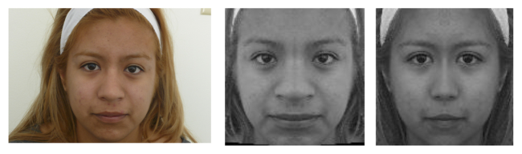
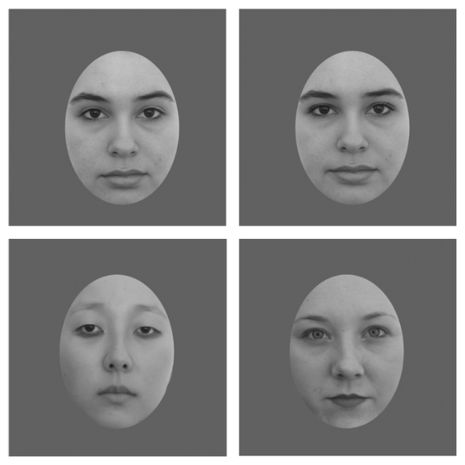
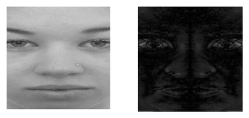
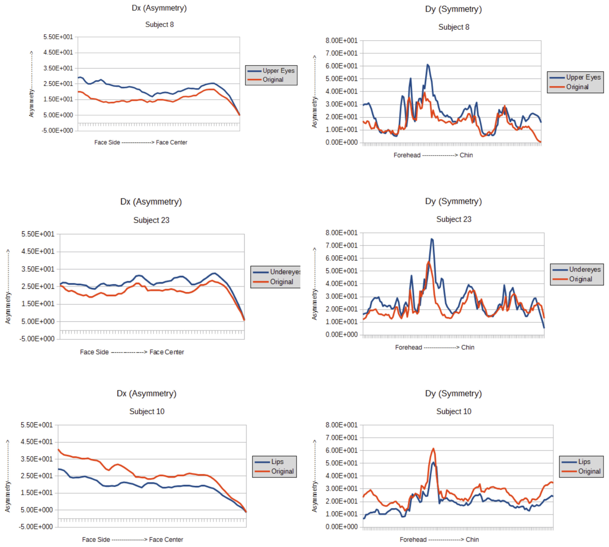
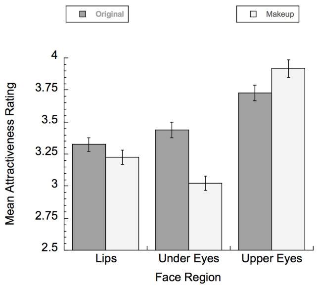
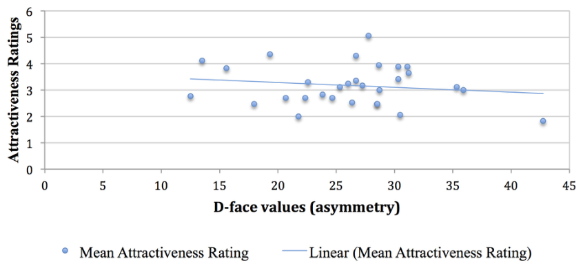
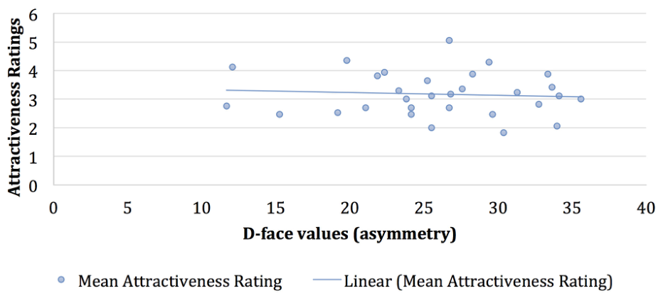

# 화장과 관련된 얼굴 매력에서 부위별 대비 변화와 비대칭의 역할

> **원문** Killian AC, Mitra S, Peissig JJ (2018). *The Role of Regional Contrast Changes and Asymmetry in Facial Attractiveness Related to Cosmetic Use.* Frontiers in Psychology 9:2448. https://doi.org/10.3389/fpsyg.2018.02448
>
> **라이선스** 원문 Copyright © 2018 Killian, Mitra and Peissig. [Creative Commons Attribution License (CC BY)](https://creativecommons.org/licenses/by/4.0/)로 배포되며, 원저자와 저작권자를 밝히고 이 학술지의 원출판을 인용하는 조건으로 다른 곳에서의 이용·배포·복제를 허용합니다.
>
> **변경 사항** 영어 원문을 한국어로 번역했습니다. 그림은 원문에서 잘라 캡션 앞에 넣었고, 표는 원문의 내용을 옮겨 다시 만들었으며, 참고문헌 목록은 생략했습니다(본문의 저자·연도 인용은 원문 그대로). 원저자가 검토한 번역이 아닙니다.

**용어 대응** — 대비(contrast): 이 논문에서는 주로 휘도(밝기) 대비 · 얼굴 대비값(CF, facial contrast value): Russell의 방식으로 계산한 대비 · 비대칭(asymmetry) · D-얼굴(D-face, density difference face): 얼굴과 그 좌우 반전 이미지의 픽셀 밝기 차이 · 윗눈(upper eyes): 윗눈꺼풀과 윗속눈썹 부위 · 눈 밑(under eyes / lower eyes): 아래 눈 부위 · 성적 이형성(sexual dimorphism): 남녀 간 차이

---

## 초록

이 연구는 화장품을 더해서 생기는 부위별 대비 변화가 매력 평가에 어떤 영향을 주는지 검증하기 위한 행동 자료를 수집했다. 또한 우리는 확립된 비대칭 모형을 사용해, 얼굴의 특정 부위에 화장품을 바른 것과 관련된 매력 변화와 대칭성 변화 사이의 상관을 찾아보았다. 이 비대칭 모형을 사용해 화장한 여성 얼굴과 화장하지 않은 여성 얼굴을 비교했다. 구체적으로, 화장을 표준화해 바른, 고도로 통제된 흑백(grayscale) 얼굴 세트를 사용해 이 문제들을 지각의 관점에서 탐구했다. 사람의 자료는 윗눈 화장을 더하면 매력 평가가 유의하게 높아진다는 것을 보여 주었다. 반면 아래 눈과 입술의 대비 증가는 매력 평가의 증가로 이어지지 않았다. 아래 눈에 화장품을 바르면 매력이 유의하게 감소했다. 우리는 매력을 높인 화장 조건에서, 여성 얼굴에 화장을 했을 때 비대칭이 유의하게 변하지 않았음을 발견했다. 이는 여성의 화장 사용과 관련된 매력 증가에 대칭성 이외의 메커니즘이 역할을 한다는 것을 시사한다.

**키워드**: 얼굴 지각, 매력, 비대칭, 대비, 얼굴 화장품, 메이크업

## 서론

많은 연구자가 무엇이 얼굴을 매력적으로 만드는지 밝히려고 시도해 왔으며(Cunningham, 1986; Fink and Penton-Voak, 2002; Baudouin and Tiberghien, 2004; Rhodes, 2006), 얼굴 매력은 다른 사람과의 사회적 상호작용에서 중요한 역할을 한다고 알려져 있다(Langlois et al., 2000; Buss, 2008; Schmid et al., 2008; Perilloux et al., 2013). 예를 들어 우리는 매력적이라고 지각되는 사람에게 긍정적인 자질을, 매력적이지 않다고 지각되는 사람에게 부정적인 자질을 부여하는 경향이 있다(Dion et al., 1972). 연구는 또한 매력에 대한 욕구가, 심각한 경제적 시기에도 우리의 지출에 영향을 준다는 것을 시사한다(Hill et al., 2012). Hill et al.은 최근의 경기 침체 동안 여성들이 화장품 같은 미용 제품에 대한 지출을 실제로 늘렸다는 것을 발견했다. 매우 어린 영아조차 매력적인 얼굴과 매력적이지 않은 얼굴을 구별한다는 자료가 있으므로(Langlois et al., 1990; Slater et al., 1998), 매력은 전 생애에 걸쳐 행동에 영향을 줄 수 있는 특성이다. 종합하면 이 연구들은 얼굴 매력이 우리의 일상생활에서 매우 중요한 역할을 한다는 것을 시사한다.

### 대칭과 얼굴 매력

대칭은 예술과 자연 모두에서 오랫동안 아름다움과 연결되어 왔으며, 당연하게도 얼굴 매력과 관련이 있는 것으로 밝혀졌다(Rhodes, 2006). 얼굴 비대칭은 표정 변화, 보는 방향, 조명 방향 같은 외적 요인이나, 성장, 부상, 노화 관련 변화 같은 내적 요인으로 생길 수 있다(Liu et al., 2003). 후자는 개인의 얼굴 구조와 직접 관련되므로 더 흥미로운 반면, 전자는 상당 부분 통제할 수 있고 적절한 이미지 정규화의 도움으로 제거할 수도 있다. 이 연구에서 우리는 특히 화장품을 바른 상태에서 얼굴 비대칭과 얼굴의 지각된 매력 사이의 관계를 검증했다. 또한 얼굴의 서로 다른 부위에 화장을 하는 것이 매력에 어떤 영향을 주는지 탐구했다.

사람의 얼굴은 좌우 대칭이지만, 얼굴의 두 쪽이 완전히 똑같지는 않다. 얼굴의 비대칭 정도를 눈으로 지각하기는 흔히 어렵지만, 그림 1에서는 이것이 꽤 분명해진다. 여기서는 얼굴의 한쪽을 사용해 거울상을 만드는 방식으로 얼굴을 재구성해 두 이미지를 만들었다. 재구성된 두 얼굴이 서로 다르게 보이고, 둘 다 원래 이미지와 모습이 상당히 다르다는 것이 분명히 보인다. 이는 사람 얼굴의 두 절반이 대칭이 아님을 보여 준다. 더욱이 얼굴의 비대칭 정도는 개인마다 상당히 다르므로, 매력 지각에서 중요한 요인이 될 가능성이 있다.

> **그림 1.** 왼쪽: 우리 데이터셋의 원래 얼굴 이미지. 가운데: 원래 얼굴의 왼쪽 절반으로 만든 완전히 대칭인 얼굴. 오른쪽: 원래 얼굴의 오른쪽 절반으로 만든 완전히 대칭인 얼굴.

심리학자들은 오랫동안 얼굴 비대칭과 매력 사이의 관계에 관심을 가져 왔다. 지난 20년간 수행된 연구는 얼굴 대칭성이 잠재적 짝에게 바람직한 자질이라는 것, 즉 얼굴이 대칭적일수록 더 좋다는 것을 보여 주었다(Grammer and Thornhill, 1994; Gangetsad and Thronhill, 1997; Rhodes, 2006). 실제로 일부 연구자는 더 나아가, 몸(머리 제외; Tovée et al., 2000)의 대칭이나 손 같은 다른 신체 특징 사이의 대칭도 선호된다고 말한다. 일반적인 가정은 신체 대칭이 좋은 건강의 대리 지표라는 것이다(Penton-Voak et al., 2001; Fink et al., 2006). 대칭은 자궁 안에서와 아동기 동안의 순조로운 발달을 시사하며, 따라서 이 가설들에 따르면 좋은 유전자부터 감염 저항성까지 다양한 바람직한 것을 반영한다. 짝 선택에서 대칭이 건강의 단서로 쓰일 수 있다는 생각을 뒷받침하는 연구로, 대칭이 체취(Rikowski and Grammer, 1999)와 목소리(Hughes et al., 2002) 같은 다른 짝 단서와 관련된다는 것을 보인 연구들이 있다.

Scheib et al. (1999)은 여학생 79명을 대상으로 한 연구에서, 여성이 남성 얼굴에 매긴 매력 평가와 대칭 사이에 관계가 있음을 발견했다. Korichi et al. (2011)은, 연구에서 화장을 위장이나 눈에 띄지 않기 위한 용도로 더 많이 쓰는 것으로 보인 여성들이 매력을 높이기 위해 화장품을 바르는 여성들에 비해 얼굴 아래쪽의 비대칭이 더 크다는 것을 관찰했다. 이는 화장 사용과 비대칭 사이에 관계가 있을 가능성을 시사한다.

다른 연구들은 환경 조건과 관련해 얼굴 대칭성을 탐구했다(Little et al., 2007; Dixson et al., 2017). 이 연구들은 더 가혹한 조건을 겪는 집단에서 대칭에 대한 선호가 더 강하다는 것을 발견했다. 특히 Dixson et al. (2017)은 세 개의 서로 다른 섬의 멜라네시아 참가자들을 비교했을 때, 말라리아에 더 많이 노출된 사람들이 대칭적인 얼굴에 대한 선호가 더 높다는 것을 발견했다. 이 대칭 선호는 페이스 페인트 같은 얼굴 장식에도 확장된다(Cárdenas and Harris, 2006). 이 연구들은 건강의 지각과 대칭 수준 사이의 관계에 대한 더 많은 증거를 제공한다.

한편, 사람들은 다른 이유로 얼굴 대칭성을 매력적으로 여길 수도 있다. 더 대칭적인 사람이 더 건강하게 지각되는 경우에도, 얼굴 대칭성이 개인의 객관적으로 측정된 건강과 관련된다는 증거는 매우 적다(Rhodes et al., 2001). 이는 사람들이 대칭적인 개인을 더 매력적이고 건강하다고 판단하더라도, 실제 건강은 대칭과 약하게만 관련되거나 전혀 관련되지 않을 수 있음을 시사한다. 그렇다면 건강 단서와 관련이 없다면, 사람들은 왜 대칭적인 얼굴을 더 매력적이라고 평가하는가? 한 가설은 사람들이 시각계 구조의 부산물로서 시지각에서 대칭에 대한 전반적 선호를 가질 수 있다고 시사한다(Enquist and Arak, 1994; Johnstone, 1994; Enquist and Johnstone, 1997). 이 지각적 선호가 얼굴 매력 판단에 적용된다는 것이다. 대칭 선호가 진화된 짝 단서의 결과이든 지각 체계의 편향이든, 화장 같은 얼굴 매력 조작이 얼굴 대칭성에 영향을 줄 수 있는가라는 질문은 여전히 남는다. 이는 화장품을 바르는 것이 매력을 높일 수 있는 지각적 경로 중 적어도 하나를 설명할 수 있다.

### 대비와 얼굴 매력

얼굴 매력의 지각에 중요할 수 있는 또 다른 요인은 대비다. Russell (2009)은 휘도가 얼굴을 남성 또는 여성으로 지각하는 데 핵심적인 역할을 한다는 것을 발견했다. 그는 중성적인 얼굴의 부위별 휘도 차이를 강화하거나 줄여서, 사람들의 얼굴 지각을 더 여성적이거나 더 남성적인 쪽으로 옮길 수 있었다(The Illusion of Sex¹). 구체적으로 그는 입과 눈 영역 모두와, 이 두 영역을 바로 둘러싼 피부 사이의 대비 차이를 조작했다. Russell은 입과 눈 영역 모두의 대비를 높여 얼굴을 더 여성적으로 보이게 만들면, 여성 얼굴에 대해 매력 지각이 높아진다는 것을 발견했다(Russell, 2009). 또한 그는 여성들이 바로 이 얼굴 부위에 화장품을 바르는 경향이 있으며, 이것이 아마도 성적 이형성과 매력을 강화한다는 것을 발견했다. 다른 연구들은 입술 색(아마도 대비 차이에 더해)이 매력에 역할을 하며, 아마도 건강의 단서일 것임을 발견했다(Stephen and McKeegan, 2010). 이 발견들은 다른 발견들과 함께, 아름다움의 지각이 단지 자의적인 문화적 발명이 아니라 인종과 문화에 걸쳐 일관된다는 생각을 뒷받침한다(Fink and Neave, 2005). 오히려 아름다움의 지각은 지각적 편향, 이 경우에는 증가된 대비에 대한 편향과 관련될 수 있다.

> ¹ http://illusionoftheyear.com/2009/the-illusion-of-sex/

얼굴 대비를 탐구한 또 다른 연구에서 Jones et al. (2015)은 눈 영역의 대비가 성적 이형성과 유의하게 관련된다는 것을 발견했다. 특히 그들은 여성이 남성보다 눈썹에서는 대비가 적고 눈 영역에서는 대비가 많다는 것을 발견했다. Jones et al.은 또한 여성이 눈 영역에서 이 이형적 차이를 과장하기 위해 화장을 사용한다는 것을 보였다. 입에 대한 효과는 유의하게 더 작았으며, 이는 매력 증가로 이어지는 대비 변화에서 눈 영역이 더 큰 역할을 할 수 있음을 시사한다.

이 연구에서 우리는 화장이 매력을 조작하는 데 관여하는 기저 메커니즘을 더 잘 이해하기 위해 Russell의 발견(Russell, 2003, 2009)을 확장한다. 이를 위해 통제된 방식으로 화장을 발라 대비를 더하는 방식으로 우리 자신의 얼굴 자극 세트를 수집했다. 이렇게 하면 각 적용 유형에서 대비 증가가 더 동등해지고, 개인이 스스로 화장을 바르는 방식에서 생길 수 있는 편향이 제거되었다. 스스로 바르는 데서 오는 이런 편향도 탐구할 만한 흥미로운 주제이지만, 우리는 먼저 더 통제된 자극 세트로 시작하려 했다. 그런 다음 이 얼굴 자극을 사용해 대비가 증가한 특정 부위(입술, 윗눈 영역, 아래 눈 영역)를 비교했다. Russell의 원래 연구에서는 눈 영역과 입술 영역 중 어느 쪽이 이 효과에 더 기여하는지, 또는 두 영역이 똑같이 기여하는지가 분명하지 않다. Jones et al. (2015)은 대비 변화와 관련된 매력 증가에서 눈 영역이 더 큰 역할을 한다고 시사하며, 이는 추가 검증을 필요로 한다. 또한 우리는 눈 영역 안에서도 어떤 유형의 대비 증가는 실제로 매력을 낮출 수 있는지 검증하여, 어떤 대비 증가든 매력을 높일 것이라는 가능성을 배제하고자 했다. 선행 연구는 매력 지각(Kampe et al., 2001)과 다른 지각 과제(Keil, 2009)에서 눈의 중요성을 강조해 왔으며, 이는 사람들이 눈에 초점을 맞추는 경향이 있다는 제안을 뒷받침한다.

### 화장품의 역할

인공적인 화장을 바르는 것은 얼굴의 지각된 모습을 바꿀 수 있는 미용적 변경의 한 예이며, 매력을 높이는 것으로도 알려져 있다. 비용이 많이 들고 영구적인 수술적 변경(성형수술로 인한 것 등)과 달리, 화장은 단순하고 비용 효율적인 경향이 있는 비영구적 변경을 제공하므로 더 흔하다. 그럼에도 화장품 사용은 얼굴의 대비, 피부 질, 색을 바꿈으로써 사람의 모습을 상당히 바꿀 잠재력이 있다. Law Smith et al. (2006)은 화장한 여성의 얼굴이 매력, 건강, 여성성을 포함한 여러 척도에서 더 긍정적으로 평가된다는 것을 발견했다. 이는 대칭과 대비의 영향을 받는 자질과 일부 같은 것들이다.

다른 연구들은 여성 얼굴을 화장품과 함께 보여 줄 때 매력이 유의하게 증가한다고 보고했다(Cash et al., 1989; Mulhern et al., 2003; Nash et al., 2006; Guéguen and Jacob, 2011). Cash et al. (1989)은 여대생들이 화장품을 바르고 있을 때 자기 이미지를 더 긍정적으로 평가한다는 것을 발견했다. 그들은 또한 남성이 화장한 얼굴 이미지를 화장하지 않은 것보다 더 매력적으로 평가한다는 것을 발견했다. 같은 얼굴을 평가한 여성은 화장한 얼굴과 화장하지 않은 얼굴 사이에 차이를 보이지 않았다. Mulhern et al. (2003)은 서로 다른 유형의 화장 적용, 그리고 풀 메이크업 대 노메이크업을 비교했다. 그들은 풀 메이크업과 노메이크업을 파운데이션만, 눈 화장만, 입술 화장만과 비교했다. 그들은 서로 다른 유형의 화장 적용에 대한 지각에서 성별 차이를 발견했다. Mulhern et al.은 남성과 여성 모두 같은 얼굴에서 풀 메이크업을 노메이크업보다 더 매력적으로 평가했다고 보고했다. 성별을 나누어 보면, 여성은 눈 화장을 얼굴 매력에 가장 크게 기여하는 것으로 평가했다. 그러나 남성은 파운데이션과 눈 화장이 매력에 비슷하게 기여한다고 평가했다. 남성과 여성 모두 립스틱이 매력에 유의하게 기여하지 않는다고 평가했다. 이 연구는 얼굴의 서로 다른 부위와 화장품이 매력에 주는 효과 사이에 차이가 있을 수 있음을 시사한다.

화장이 여성의 매력을 높인다는 일반적 발견은 실험실 밖에서도 적용된다. 예를 들어 Guéguen and Jacob (2011)은 여성 종업원이 화장을 했을 때 하지 않았을 때보다 남성들이 팁을 더 후하게 준다는 것을 발견했다. Jones and Kramer (2015)는 화장과 관련된 매력 증가의 수준을 비교했으며, 개인 간에 발견되는 매력 차이와 비교하면 매력 증가가 비교적 작다는 것을 발견했다. 그러나 화장이 매력에 주는 효과가 비교적 작더라도, 특히 더 매력적인 개인에게 주어지는 수많은 이점을 고려하면(van Leeuwan and Macrae, 2004), 작은 증가도 노력할 가치가 있을 수 있다. 또한 화장의 이점은 단순한 매력 증가를 훨씬 넘어설 수 있다. 수많은 연구가 같은 얼굴이 화장을 했을 때 더 위신 있고 지배적으로(Mileva et al., 2016), 더 높은 지위의 직업을 가진 것으로(Richetin et al., 2004; Nash et al., 2006), 그리고 더 유능한 것으로(Klatt et al., 2016) 지각된다는 것을 보여 주었다. 이를 뒷받침하는 것으로 화장품에 대한 높은 지출 수준이 있다. 그루폰 조사에 따르면 미국 여성은 화장에만 매달 평균 28달러를 쓴다(Haynes, 2017).

### 얼굴 데이터베이스

이 연구에서 우리는 여성 30명으로 이루어진 얼굴 데이터베이스를 검증했다. 이들은 캘리포니아 주립대학교 풀러턴 심리학과의 인간 참가자 연구 풀에서 모집되었다. 참가자들은 참여에 대해 수업 학점을 받았으며, 자신의 이미지가 실험에 사용되는 것을 허락했다.

우리는 (대비를 컴퓨터로 조작하거나 모핑하는 대신) 화장품을 얼굴에 직접 바르는, 생태학적으로 더 타당한 방법을 사용하기로 했다. 이 특정 얼굴 세트 전체에서 적용이 일관되도록 실험자가 화장을 발랐다. 얼굴은 조명과 카메라 거리를 일정하게 유지하는 표준화된 방법으로 수집했다. 참가자들은 화장품을 더하기 전에 얼굴에 미리 바른 화장이 없어야 했으며, 얼굴 전체가 잘 보이도록 머리카락을 얼굴 뒤로 넘겼다. 실험자가 각 참가자에게 같은 색의 화장을 세 관심 영역 중 하나에 발랐다. 입 영역에 립스틱(입술), 윗눈 영역에 아이섀도와 마스카라, 아래 눈 영역에 아이섀도였다(그림 2). 특정 화장 적용 영역은 윗눈 화장과 입술 화장을 따로 검증할 수 있도록 선택했다. 또한 눈 영역의 아무 부분에나 눈 화장을 더하는 것만으로는 매력 증가로 이어지기에 충분하지 않다는 것을 보이기 위해, 아래 눈 화장을 비교 조건으로 포함했다. 각 개인에 대해 한 가지 화장 적용만 사용했다. 즉, 각 얼굴에는 립스틱, 윗눈 화장, 아래 눈 화장 중 하나만 발랐다. 이는 화장을 지울 때 생기는 피부 질 변화와 변색 문제를 막기 위한 것이었다. 또한 마스카라처럼 어떤 유형의 화장은 지우기가 특히 어렵다. 우리는 지우려고 해도 일부 화장 잔여물이 남아, 한 가지 화장 적용 유형을 온전히 검증할 수 없게 될 것을 우려했다. Photoshop 4.0을 사용해 각 얼굴에 균일한 마스크를 적용해 혼입 특징(예: 머리카락; 그림 2 참조)을 제거하는 데 도움이 되도록 했다. 얼굴은 흑백으로 제시했는데, 이는 매력 평가에 대한 색의 기여를 통제하고, 대비 변화가 매력과 어떻게 관련되는지에 구체적으로 초점을 맞추기 위해서였다(Russell, 2003, 2009). 각 이미지에 마스크를 적용하고 흑백으로 변환한 뒤, 화장하지 않은 같은 얼굴과 화장을 바른 얼굴 사이의 대비 증가를 계산했다. 화장품 적용으로 생긴 대비 증가를 계산하기 위해, Russell (2003, 2009)이 사용한 대로 미켈슨(Michelson) 대비 공식을 변형한 버전을 사용해 얼굴 대비값(CF)을 산출했다. 평균 CF 값은 세 부위별 화장 적용 모두에서 비슷했다(입술 0.115, 윗눈꺼풀과 윗속눈썹 0.121, 눈 밑 0.133). 일원 분산분석은 이 CF 값들 사이에 유의한 차이가 없음을 보였다, F(2,29) = 0.126, p > 0.05. 우리 데이터베이스의 예시 이미지는 그림 2에 있다.

> **그림 2.** 왼쪽 위: 화장하지 않은 원래 얼굴의 예. 오른쪽 위: 윗눈 화장을 한 얼굴의 예. 왼쪽 아래: 눈 밑 화장을 한 얼굴의 예. 오른쪽 아래: 입술 화장을 한 얼굴의 예.

우리 데이터베이스의 요약은 표 1에 있다. 데이터베이스에는 총 30명이 있었다. 각 사람에게는 화장하지 않은 이미지 하나와 화장한 이미지(입술, 윗눈, 눈 밑 중 하나) 하나가 있었다. 따라서 총 60장의 이미지가 있었으며, 그중 30장은 화장하지 않은 것이고 30장은 세 가지 화장 유형 중 하나를 바른 것이었다.

**표 1.** 실험의 각 대비 조건에 속한 얼굴의 수. 각 얼굴 세트는 화장 전후로 제시된 개인 얼굴 10명으로 이루어졌으며, 자극은 모두 60개였다.

| 화장 얼굴 데이터베이스 설계 | | 원래 (화장 없음) | 변경 (화장 있음) |
|---|---|---|---|
| 얼굴 세트 A | 입술 | 10 | 10 |
| 얼굴 세트 B | 윗눈 | 10 | 10 |
| 얼굴 세트 C | 아래 눈 | 10 | 10 |

각 이미지는 Liu et al. (2001)에 언급된 단계에 따라 정렬하고 정규화했다. 이는 정량화된 비대칭 측정값을 계산하고 서로 다른 모든 얼굴에 걸쳐 의미 있게 비교할 수 있도록 공통 좌표계를 세우기 위한 것이었다.

## 재료와 방법

우리의 실험은 세 단계로 이루어졌다.

1. 이 얼굴들로부터 정량화된 비대칭 측정값을 계산해, 서로 다른 유형의 인공 화장을 적용하면 비대칭이 어떻게 달라지는지 연구한다.
2. 인간 참가자가 이 얼굴들을, 원래 얼굴(화장 없음)과 한 부위에 화장을 바른 같은 얼굴 모두에 대해 매력을 평가한다.
3. 매력 평가와 비대칭 측정값을 비교해, 화장이 있을 때와 없을 때 모두에서 이 두 측정값 사이의 관계를 연구한다.

이 연구에서 우리는 화장품을 표준화해 바른 것으로 인한 얼굴 매력 지각의 변화가 얼굴의 대칭성 변화와 관련되는지 탐구했다. 화장이 얼굴의 비대칭을 가리거나 상쇄할 수 있어서, 화장이 매력을 높이는 구체적인 메커니즘에 기여하는 요인 중 적어도 하나가 될 가능성이 있다.

### 얼굴 비대칭 측정

정렬과 정규화를 통해 얼굴 중심선이 정해지면, 정규화된 얼굴 이미지의 각 점은 이미지의 반대쪽에 고유한 대응점을 가진다(이미지의 열 수가 짝수일 때). 우리는 정규화된 얼굴 이미지에서, X축이 얼굴 중심선에 수직이고 Y축이 얼굴 중심선과 일치하는 좌표계를 사용했다. "I"는 정규화된 얼굴을, "I′"는 그것을 수직으로 반사한 이미지(vertically reflected image)를 나타낸다. 그러면 비대칭 측정값은 얼굴의 두 절반 사이의 픽셀 밝기 변동으로 정의된다(Liu et al., 2001에서 소개한 것과 비슷한 방식으로).

밀도 차이(D-얼굴):

$$D(x, y) = I(x, y) - I'(x, y)$$

그림 3은 우리 데이터베이스의 정규화된 얼굴 하나와 그에 해당하는 D-얼굴을 보여 준다. D-얼굴 값이 높을수록 얼굴이 더 비대칭적이고, 반대로 D-얼굴 값이 낮을수록 얼굴이 덜 비대칭적이다. 구성상 D-얼굴의 왼쪽 절반과 오른쪽 절반은 서로 반대다. 따라서 D-얼굴의 절반이 식별 목적에 필요한 모든 정보를 담고 있다. 이제부터 우리는 이 절반 얼굴을 D-얼굴이라고 부른다. 표 2에서 우리는 D-얼굴의 두 투영, Dx와 Dy를 정의한다. Dx 특징은 좌표계에서 x축을 따라, 즉 얼굴 가운데에서 얼굴 옆쪽으로 펼쳐진다는 점에 유의하라. 반면 Dy 특징은 좌표계의 y축을 따라, 즉 이마에서 턱까지 펼쳐진다. 각 차원을 특징이라 부르므로, 우리는 얼굴 비대칭을 나타내는, 서로 관련되지만 다르게 정량화된 두 측정값을 가진다. 이 특징들은 데이터베이스의 각 이미지에 대해 계산했다. D-얼굴 계산의 평균은 표 3에 있다.

> **그림 3.** 왼쪽: 원래의 정규화된 얼굴 이미지. 오른쪽: D-얼굴.

**표 2.** D-얼굴에 기반한 서로 다른 비대칭 특징.

| 비대칭 특징 | 설명 | 차원 (특징의 수) |
|---|---|---|
| Dx | X축에 대한 D-얼굴의 열 평균 | 64 |
| Dy | Y축에 대한 D-얼굴의 행 평균 | 128 |

여기서 얼굴 비대칭을 측정하는 다른 방법도 여럿 있다는 점을 밝혀 두고자 한다. 예를 들어 가장자리 방향에 기반한 방법이 있다(Liu and Palmer, 2003). Thornhill and Gangestad (1994)는 귀, 팔꿈치, 발처럼 (얼굴만이 아닌) 특정 신체 부위의 길이와 너비 차이에 기반해 비대칭을 계산했으며, 얼굴 매력이 남성의 신체 특성의 대칭으로 예측될 수 있음을 관찰했다. Scheib et al. (1999)은 디지털화한 사진에서, 얼굴의 좌우 대응 위치에 있는 랜드마크 점(눈구석, 광대뼈, 코의 바깥 가장자리 등)이 수직·수평 방향 모두에서 어떤 선으로부터 벗어난 정도에 기반해 남성 얼굴의 비대칭을 계산했고, 이를 나중에 사람의 평가와 비교했다. 우리가 이 실험에서 D-얼굴 측정값을 선택한 이유는, 이것이 특정 부위에 초점을 맞추지 않고 얼굴 전체의 비대칭을 포착하여, 여성 대상자의 서로 다른 화장 적용 조건에서 매력과의 관계를 탐구할 수 있기 때문이다. 우리는 이것이 이 관계의 초기 탐구에서 특히 중요하다고 느꼈다.

**표 3.** 원래 얼굴과 서로 다른 인공 화장품을 바른 얼굴에 대한, 서로 다른 얼굴 자극 30개의 평균 D-얼굴 값.

| | 화장 없을 때 평균 D-얼굴 값 | 화장 있을 때 평균 D-얼굴 값 | 통계 검정 P 값 |
|---|---|---|---|
| 윗눈 (n = 10) | 25.99 (9.006) | 24.86 (6.576) | 0.287 |
| 눈 밑 (n = 10) | 26.39 (3.57) | 28.09 (3.56) | 0.0471 |
| 입술 (n = 10) | 25.87 (6.66) | 24.54 (7.85) | 0.1331 |

괄호 안의 값은 자극 간 표준편차를 나타낸다.

### 얼굴 매력 평가

인간 참가자 34명(얼굴 데이터베이스를 만드는 데 쓰인 사람들과는 다른 사람들)을 CSUF 심리학과 연구 참가자 풀을 통해 모집했다. 참가자들은 참여에 대해 수업 학점을 받거나 7달러를 받았다. 참가자들은 얼굴 자극 60개(화장 전후로 제시된 얼굴 30명)를 평가했다. 이미지는 한 블록 안에서 완전히 무작위로 제시했다. 참가자들은 "1"이 "매우 매력적이지 않음", "7"이 "매우 매력적임"을 나타내는 7점 리커트형 척도로 얼굴을 평가했다. 시행은 500 ms 동안 제시되는 고정 십자로 시작했고, 이어서 얼굴 이미지가 나왔다. 얼굴 이미지는 참가자가 반응하거나 5000 ms가 지날 때까지 제시되었다.

### 분석

여기서는 화장품을 바르지 않았을 때와 바랐을 때 모두에서, 얼굴 비대칭과 매력 사이의 관계에 관한 우리의 실험과 분석 결과를 요약한다. 그림 4는 데이터베이스에서 무작위로 선택한 10명의 개인 대상자 부분집합에 대한 평균 비대칭 값을 보여 주는데, 화장하지 않은 원래 얼굴에 대한 값 하나와, 세 가지 서로 다른 유형의 화장을 바른 얼굴에 대한 값 하나씩이다. Dx 그래프는 평균적으로 얼굴의 비대칭이 얼굴 옆쪽에서 가운데 쪽으로 갈수록 점차 줄어든다는 것을 분명히 보여 준다. 반면 Dy에서는 가장 많은 비대칭이 콧등 부근에 있는 것으로 보이며, 이마 쪽으로, 그리고 턱 쪽으로 이동할수록 줄어든다. 두 차원에 걸쳐 비대칭 값을 비교하면, 코 부위가 가장 높은 값을 가지며, 이는 코 주변 영역이 최대 비대칭을 가진다는 것을 나타낸다. 이는 콧등의 비대칭이 상당하고 얼굴 인식에서 중요한 역할을 한다는 것을 관찰한 선행 연구와 일치한다(Liu and Palmer, 2003).

(역자 주: 원문 본문은 "무작위로 선택한 10명"이라고 쓰지만, 그림 4의 캡션과 그래프에는 대상자 3명(8번, 23번, 10번)이 나온다. 원문 그대로 옮겼다.)

> **그림 4.** 왼쪽: 세 가지 서로 다른 유형의 화장(윗눈, 눈 밑, 입술)을 한 대상자 3명의 Dx 값. 오른쪽: 눈 밑 화장을 한 대상자 3명의 Dy 값.
>
> (역자 주: 캡션의 오른쪽 설명은 "눈 밑 화장을 한 대상자 3명의 Dy 값"이지만, 그래프의 오른쪽 열에는 윗눈(8번), 눈 밑(23번), 입술(10번) 대상자의 Dy가 각각 그려져 있다. 캡션은 원문 그대로 옮겼다.)

화장을 윗눈, 아래 눈, 입술 중 어디에 발랐든, 화장 적용으로 인해 두 차원 모두에서 비대칭의 전체적인 양상은 변하지 않는다는 것이 분명하다. 우리가 관찰한 또 다른 점은 입술에 화장을 하면 비대칭이 줄어드는 반면 눈 영역의 화장은 비대칭을 늘린다는 것이다. 더욱이 모든 경우에 코 부위가 얼굴 전체에서 가장 많은 비대칭을 가진다(Dy 그래프의 정점으로 표시됨).

(역자 주: 그림 4의 윗눈 대상자(8번)는 그래프상 화장 후 비대칭이 커졌고, 이것이 "눈 영역의 화장은 비대칭을 늘린다"는 문장과 맞는다. 그러나 바로 아래 표 3 해설에서는 윗눈 화장 얼굴의 평균 비대칭이 원래 얼굴보다 약간 낮다고 쓴다. 대상자 3명의 그래프와 10명 평균의 차이로 보이며, 원문 그대로 옮겼다.)

표 3은 화장하지 않은 얼굴 데이터베이스의 개인들과, 세 가지 화장 적용 유형 각각을 한 개인들의 평균 D 값을 요약한다. 결과는 윗눈과 입술에 화장을 바른 얼굴보다 원래 얼굴에서 평균 비대칭이 약간 더 높은 반면, 눈 밑에 화장을 바르면 비대칭이 증가했음을 보여 준다. 여기서 연구한 세 유형의 화장 중 눈 밑 화장만이 얼굴의 비대칭을 유의하게 바꾸었으며, 이는 t 검정 결과[t(9) = −1.87; p = 0.0471]로 입증된다. 반면 다른 유형의 화장은 그렇지 않았다(윗눈과 입술에 바른 화장의 p 값은 각각 0.287과 0.1331). 화장하지 않은 얼굴과 눈 밑 화장을 한 얼굴 사이의 비대칭 차이에 대한 유의한 t 검정의 효과 크기(Cohen의 d)는 0.65로 계산되었으며, 이는 중간 정도의 효과를 보여 준다. 따라서 우리는 윗눈 영역과 입술에 바른 화장품은 얼굴의 평균 비대칭을 유의하게 바꾸지 않은 반면, 눈 밑 화장은 비대칭의 유의한 증가로 이어졌다고 결론짓는다.

### 인간 참가자 자료

반응의 효과를 검증하기 위해, 2 [대비 수준: 원래(즉, 화장 없음) 대 변경(화장을 더함)] × 3 (부위: 윗눈, 눈 밑, 입술) 설계의 분산분석으로 매력 평가를 분석했다. 종속 변수는 매력 평가였다. 매력 평가에서 부위의 전체적으로 유의한 주효과가 발견되었다, F(2,66) = 39.67, p < 0.0001, η² = 0.0135. 대비 수준의 유의한 주효과도 발견되었다, F(1,33) = 12.15, p < 0.001, η² = 0.006. 대비 수준과 부위 사이의 상호작용도 유의했다, F(2,66) = 26.16, p < 0.0001, η² = 0.024. 이 상호작용을 더 탐구하기 위해, 화장품을 바르지 않은 같은 얼굴(원래 얼굴)과 서로 다른 부위별 화장 적용 사이의 차이를 검증하는 계획 대비(planned contrasts)를 사용했다. 윗눈에 화장을 바른 얼굴(M = 3.89, SE = 0.041)은 원래 얼굴(M = 3.76, SE = 0.041)보다 유의하게 더 매력적으로 평가되었다, t(66) = −2.15, p = 0.04. 눈 밑에 화장을 바른 얼굴(M = 2.93, SE = 0.041)은 원래 얼굴(M = 3.39, SE = 0.041)보다 유의하게 덜 매력적으로 평가되었다, t(66) = −7.94, p < 0.001. 마지막으로, 입술 화장을 바른 얼굴에서는 입술 화장을 한 얼굴(M = 3.115, SE = 0.041)과 원래 얼굴(M = 3.19, SE = 0.041) 사이에 유의한 차이가 없었다, t(66) = −1.43, p > 0.05.

이 발견은 이 여성 얼굴 이미지들에서 매력 평가의 증가가 윗눈 화장품을 바른 경우에만 나타났음을 시사한다. 반면 눈 밑 영역에 화장을 바른 여성 얼굴은 화장하지 않은 같은 여성 얼굴보다 유의하게 덜 매력적인 것으로 나타났다. 입술 영역에만 화장을 더한 여성 얼굴은 화장하지 않은 같은 얼굴과 다르게 평가되지 않았다(그림 5 참조).

> **그림 5.** 입술, 눈 밑, 윗눈 영역에 화장을 바른 얼굴의 평균 매력 평가.

### 비대칭 값과 매력 평가의 비교

앞서 보고했듯이, 윗눈과 입술에 인공 화장품을 바르면 얼굴 비대칭이 (통계적으로 유의하지는 않지만) 줄어드는 반면 눈 밑 화장은 얼굴 비대칭을 늘린다. 비대칭이 높을수록 매력이 낮다는 통념을 고려하면, 이 측정값들에 근거해 우리는 윗눈과 입술 화장이 (대칭 측정값으로 측정한) 얼굴 매력을 약간 높인 반면 눈 밑 화장은 매력을 낮췄다고 결론 내릴 수 있다.

화장품을 전혀 바르지 않은 원래 얼굴에 대해, 기준선을 얻기 위해 평균 D-얼굴 값과 평균 매력 평가를 계산했으며, −0.16의 부적 상관이 관찰되었다. 이는 우리의 예측에 부합하지만, 연관이 약하고 통계적으로 유의하지 않다는 점(p > 0.05)에 유의하라. 산점도(그림 6 참조)는 화장하지 않은 얼굴에서 얼굴 비대칭 값과 매력 평가 사이 연관의 이 약간 부적인 경향을 보여 준다. 화장을 바른 경우, 평균 D-얼굴 값과 평균 매력 평가 사이의 상관은 −0.08로 줄었으며, 이 역시 통계적으로 유의하지 않았다(p > 0.05). 그림 7은 화장을 바른 얼굴에 대한 산점도를 보여 준다. 화장을 한 얼굴과 하지 않은 얼굴에서 평균 D-얼굴 값과 평균 매력 평가 사이 관계의 성격에는 거의 차이가 없으며, 둘 다 약간 부적인 선형 연관을 보였다.

> **그림 6.** 화장하지 않은 얼굴 데이터베이스의 개인 30명에 대한, 얼굴 비대칭 값(D-얼굴)과 평균 매력 평가 사이의 관계.

> **그림 7.** 화장품을 바른, 얼굴 데이터베이스의 같은 개인 30명에 대한, 얼굴 비대칭 값(D-얼굴)과 평균 매력 평가 사이의 관계.

## 결론과 논의

얼굴 비대칭은 강력한 생체 인식 지표로, 화장이 매력에 어떻게 영향을 주는지 설명할 잠재력을 가지고 있다. 얼굴 대칭성과 얼굴 매력 사이의 관계는 잘 확립되어 있다. 따라서 화장품이 적어도 부분적으로는 비대칭을 줄임으로써 매력을 높일 가능성이 있어 보인다. 이 논문에서 우리는 정량적 비대칭 측정값과 인간의 행동적 매력 평가에 대한 연구를 통해 이것을 탐구했다.

우리의 결과는 인간 참가자에게 어떤 부위에 화장품을 더하면 매력 평가가 높아지고(윗눈 화장), 다른 화장품 적용은 매력 평가를 낮추며(아래 눈 화장), 또 다른 유형의 화장품 적용은 지각된 매력 평가를 바꾸지 않았다(입술)는 것을 시사한다. 이 자료는 입과 눈 영역에 따로 더한 화장품으로 인한 대비 변화가 동등하지 않다는 것을 시사한다. 이는 입과 눈의 변화를 결합해서만 보았고 따로 본 적이 없는 Russell (2003, 2009)이 보고한 결과를 정교화한다. 우리의 발견은 Mulhern et al. (2003)과 Jones et al. (2015)이 보고한 결과와도 일치한다. Mulhern et al.은 사람들이 눈 화장(그들의 경우 윗눈)을 바르면 매력이 유의하게 높아진다고 보고했다는 것을 발견했다. 이를 뒷받침하여 Jones et al.은 성적 이형성에 눈 영역이 중요하고 입술 영역은 훨씬 덜 중요하다는 것을 발견했다.

또한 우리의 행동 자료는 모든 대비 변화가 매력 평가에 똑같이 영향을 주지는 않는다는 것을 보여 준다. 우리는 눈 영역만 보더라도, 윗눈에 화장을 바르면 매력이 높아지고 아래 눈에 화장을 바르면 매력이 낮아진다는 것을 발견했다. 윗눈 영역에 화장을 더하면 왜 매력이 높아지는지에 대해서는 가능한 설명이 많다. 한 가지 가능성은 속눈썹 주변 영역을 더 어둡게 보이게 하면 속눈썹의 겉보기 길이가 늘어난다는 것이다. 속눈썹은 에스트로겐 수준과 관련될 수 있으며, 따라서 생식력의 신호를 제공할 수 있다. 예를 들어 일부 연구는 여성에서 모발 성장이 에스트로겐과 관련된다고 시사하는데(Hinsz et al., 2001), 이것은 여성의 더 긴 머리카락이 더 매력적으로 평가될 수 있는 이유를 설명할 수 있다(생식력을 나타내는 단서로 쓰일 수 있다). 매력에서 에스트로겐의 역할은 가능해 보인다. 에스트로겐이 허리-엉덩이 비율과 얼굴 간격 같은 다른 여성적 특성과 높은 상관이 있다고 보고되었다(Buss, 2008). 이 현상이 속눈썹에도 적용될 가능성이 있다. 더 긴 속눈썹이 높은 생식력의 신호라면, 속눈썹의 실제 길이의 어떤 증가, 혹은 길이가 늘어난 것 같은 착시조차 지각된 매력을 유의하게 높일 것이다. 이 현상은 마스카라, 인조 속눈썹, 속눈썹 연장, 그리고 속눈썹 길이를 늘리는 약물(예: LATISSE®)의 인기를 설명할 수 있다. 문화 전반에 걸쳐 속눈썹을 어둡게 하기 위해 검은색이나 갈색 화장을 쓰는 것은 비교적 보편적인 반면 다른 색은 흔히 쓰이지 않는다는 점은 흥미롭다. 색 선택이 훨씬 더 다양한 다른 유형의 화장에서는 그렇지 않다. 한편 눈 밑 영역을 어둡게 하는 것은 나쁜 건강, 수면 부족, 또는 질병을 나타냈을 수 있다(Roh and Chung, 2009; Jones et al., 2016). 눈 밑에 어두운 화장품을 바르면 아마도 덜 건강해 보이고 따라서 덜 매력적인 모습을 주었을 것이다. 우리는 증가된 대비의 정확한 위치가 결정적이라는 것을 보이기 위해 이 조건을 비교로 포함했다.

화장품이 매력을 높이는 방식의 바탕에 있을 수 있는 다른 메커니즘도 여럿 있다. Morikawa et al. (2015)은 윗눈에 아이섀도를 더하면 눈이 더 커 보이는 착시가 생긴다는 것을 발견했다. 더 큰 눈은 흔히 더 매력적으로 지각된다. 따라서 지각된 눈 크기를 키우는 것은 특히 윗눈 화장이 매력을 높이는 또 다른 가능한 메커니즘이다. 또 다른 연구에서 Jones et al. (2018)은 화장품이 여성 얼굴의 공간 주파수를 바꾼다는 것을 발견했다. Morikawa et al.의 발견과 비슷하게, 이 공간 주파수 변화는 얼굴 특징을 더 크게 보이게 했다. 결과적으로 얼굴 특징, 특히 눈을 더 크게 보이게 하는 어떤 변화든 매력을 높일 수 있다.

립스틱 형태로 입술 영역에 대비를 더하는 것은 여성 얼굴의 매력을 유의하게 높이지 않았다. 선행 연구는 입술 영역에 색과 대비를 더하면 좋은 건강과 매력의 지각이 높아진다는 것을 보여 주었다(Stephen and McKeegan, 2010). 우리 연구와 이 선행 연구들 사이의 주요 차이 하나는 자극을 흑백으로 제시했다는 점이다. 우리는 대비 변화와 매력의 중요성을 보여 주는 연구들(Russell, 2003, 2009) 때문에 흑백 이미지를 사용하기로 특별히 선택했다. 색은 립스틱, 그리고 블러셔 같은 다른 유형의 화장품을 바를 때의 매력 증가에서 더 큰 역할을 할 수 있다. 립스틱이 매력을 유의하게 높이지 않는 것일 수도 있다. Mulhern et al. (2003)은 남성과 여성 모두 립스틱이 매력 증가에 유의하게 기여하지 않았다고 보고했다는 것을 발견했다. 입술에 화장을 더하는 것이 어떤 조건에서 매력 평가를 바꾸는지 더 잘 판단하려면 추가 연구가 필요할 것이다.

우리 행동 자료의 한 가지 가능한 문제는, 서로 다른 조건에 걸쳐 화장하지 않은 개인들의 전반적 매력을 동등하게 맞추지 않았다는 점이다. 우리는 같은 개인의 화장 전후를 비교했으므로, 어떤 의미에서는 그런 차이가 문제가 되지 않아야 한다. 그러나 화장이 매력에 어떻게 영향을 주는지에 대한 지각은, 개인이 전반적으로 매력적이라고 여겨지는지 매력적이지 않다고 여겨지는지에 따라 다를 가능성이 있다. 예를 들어 이미 매우 매력적이라고 지각되는 개인에게는 화장 적용이 더 큰 효과(매력적인 여성을 더욱 매력적으로 보이게 함)를 내거나, 더 작은 효과(이미 매력적이어서 매력이 오를 여지가 많지 않음)를 낼 수 있다. 매우 매력적이지 않다고 평가되는 개인에게서도 비슷한 유형의 효과가 발견될 수 있다. Jones and Kramer (2016)는 화장품의 적용이, 화장을 더하기 전에 서로 다른 매력 수준을 가진 개인들의 지각을 어떻게 바꾸는지 검증했다. 그들은 처음에 더 매력적이었던 여성들이, 처음에 덜 매력적이라고 평가된 개인들에 비해 화장품을 했을 때 매력의 증가가 더 작다는 것을 발견했다. 이는 우리가 발견한 효과가, 약간 더 매력적인 윗눈 화장 집단에서는 실제로 더 작을 것임을 시사한다. 또한 서로 다른 얼굴 세트에 걸친 전반적 매력 평가의 차이가 특별히 크지 않았다는 점에 유의하는 것이 중요하다. 화장하지 않은 얼굴의 평균 매력 평가는 윗눈 조건의 얼굴에서 3.89, 눈 밑 조건에서 3.39, 입술 조건에서 3.19였다. 따라서 평균이 유의하게 달랐지만, 그 차이는 1점 미만이었으며 매력 척도의 중간점(3.5) 부근에 있었다. 향후 연구에서 우리는, 특히 우리의 특정 자극을 사용해 전반적 매력이 화장이 매력에 주는 효과와 어떻게 상호작용하는지를 검증하면서, 이 효과들을 더 체계적으로 살펴볼 것이다. 또한 화장한 얼굴과 화장하지 않은 얼굴 사이의 전반적 차이는 꽤 작았지만, 이는 다른 연구의 발견과 일치한다(Jones and Kramer, 2015). Jones and Kramer는 화장한 얼굴과 화장하지 않은 얼굴 사이의 차이가 유의하지만 사람들이 예상할 수 있는 것보다 작다는 것을 발견했다.

(역자 주: 위 문단에서 윗눈 조건의 "화장하지 않은 얼굴" 평균을 3.89로 적었지만, 결과 절에서는 윗눈 조건의 원래 얼굴 평균이 3.76, 화장한 얼굴 평균이 3.89로 보고되어 있다. 원문 그대로 옮겼다.)

이 얼굴 세트의 대칭 분석은, 화장을 더하는 것이 때로는 대칭을 높였지만 다른 때에는 대칭을 낮췄다는 것을 보여 준다. 이 대칭 변화는 우리가 가장 매력적인 화장 적용일 것이라고 예측한 것과 일치했다. 즉 윗눈과 입술 화장품은 대칭 증가로 이어졌고(잠재적으로 매력을 높임), 눈 밑 화장은 대칭 감소로 이어졌다(잠재적으로 매력을 낮춤). 가장 중요한 것은, 화장품을 더해서 생긴 대칭 변화가 매력 평가의 차이와 관련이 없었다는 점이다. 이 결과는 우리의 화장 적용이 비대칭의 감소 때문에 인간의 매력 평가를 높인 것이 아님을 시사한다. 눈과 입술 영역에 대비를 더하면 자연스러운 결과로 그 영역들이 더 대칭적이 될 수 있다고 예측하는 것이 논리적으로 보이므로, 이 결과는 다소 놀랍다. 때로 그런 경우가 있다 하더라도, 이 경우의 이 변화는 우리가 측정한 매력 증가를 이끌 만큼 크지 않았다.

얼굴 비대칭은 매력 지각에 중요할 뿐 아니라, 특히 표정과 조명 변화로 인한 외적 변동 아래에서 사람 식별을 수행하는 분류 알고리즘에도 사용되어 왔다(Liu et al., 2001, 2003; Mitra and Liu, 2004; Mitra et al., 2006). 이 연구들의 결과는 그런 요인 아래에서 얼굴의 비대칭이 아주 조금만 변해서 인식을 위한 효과적인 생체 인식 지표가 된다는 것을 보여 주었다. 비슷하게, 화장품은 얼굴 인식 방법을 혼란시켜 정확도를 떨어뜨릴 수 있는 또 다른 요인이다(Dantcheva et al., 2012). Mitra et al. (2018)은 그런 상황에서 얼굴 비대칭 특징이 사람 식별을 효율적으로 수행할 수 있다는 것을 보였다. 이 연구들은 보안 분야에서 얼굴 비대칭의 잠재적으로 중요한 실용적 응용을 보여 주지만, 비대칭이 인식 방법을 구체적으로 어떻게 이끄는지 이해하려면 추가 연구가 필요하다.

우리 연구의 또 다른 한계는, 통제를 높이기 위해 실험자가 모든 참가자의 얼굴에 화장품을 균일하게 발랐다는 점이다. 사람이 스스로 화장을 할 때에는 (의식적이든 무의식적이든) 비대칭을 유의하게 줄이는 방식으로 바를 가능성이 있다. 그러나 윗눈에 바른 화장이 매력을 높였다는 것은 사실이다. 따라서 이런 방식으로 바른 화장품도 매력을 높이는 데는 여전히 효과적이었지만, 얼굴 대칭성에는 비슷한 영향을 주지 않았다. 또한 우리는 탐구를 대비 변화로 한정하기 위해 컬러 이미지를 사용하지 않았다. 많은 연구가 화장이 매력에 영향을 주는 방식에서 색이 중요한 역할을 한다는 것을 발견했으며(Porcheron et al., 2013; Jones et al., 2015, 2016; Russell et al., 2016), 우리는 향후 연구에서 이 얼굴들을 사용해 이 효과들을 탐구할 계획이다.

이 연구에서 우리는 대비 증가가 윗눈 영역에서만 매력에 영향을 준다는 것을 발견했으며, 이는 Russell (2003, 2009)이 보고한 효과가 주로 눈에 의해 이끌린다는 것을 시사하고, 매력 지각에서 눈의 중요성을 보여 주는 연구를 뒷받침한다(Mulhern et al., 2003; Jones et al., 2015). 더 중요한 것은, 화장품을 더한 데 근거해 사람이 판단한 매력 증가와, 같은 얼굴에 대한 대칭 변화의 계산 모형 사이에서 관계를 발견하지 못했다는 점이다. 이 자료에 근거해, 우리는 여성의 화장품 사용과 관련된 얼굴 매력 증가에 대칭 이외의 메커니즘이 기여한다고 예측한다.

## 윤리 진술

이 연구 프로토콜은 캘리포니아 주립대학교 풀러턴의 기관 심사위원회의 승인을 받았다. 인간 참가자들은 헬싱키 선언에 따라 서면 사전 동의를 했다.

## 저자 기여

AK와 JP가 행동 연구의 아이디어를 구상했다. SM과 JP가 비대칭 분석의 아이디어를 구상했다. AK가 행동 자료를 수집했다. SM이 비대칭 모형을 설계하고 비대칭 분석을 수행했다. AK와 JP가 행동 분석을 수행했다. 모든 저자가 이 원고의 작성에 기여했다.

## 연구비

이 연구는 캘리포니아 주립대학교 풀러턴의 교수-학생 연구비(Faculty-Student Research Grant)로 일부 지원되었다.

## 감사의 말

이 연구는 부분적으로 AK의 캘리포니아 주립대학교 풀러턴 심리학 문학석사 학위의 논문 요건을 충족했다. 자극 준비와 자료 수집·분석을 도와준 C. Huynh, J. Guidangan, G. Parsons에게 감사한다. 또한 이 연구에 유익한 의견을 준 M. Gofman에게도 감사한다.

## 이해 상충 진술

저자들은 이 연구가 잠재적 이해 상충으로 해석될 수 있는 어떠한 상업적·재정적 관계도 없는 상태에서 수행되었다고 밝힌다.

---

*참고문헌 목록은 원문을 참조하십시오.*
