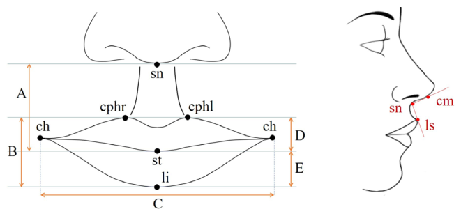
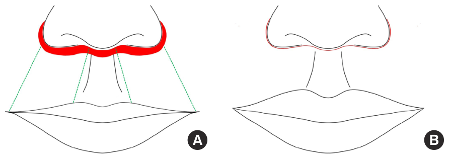
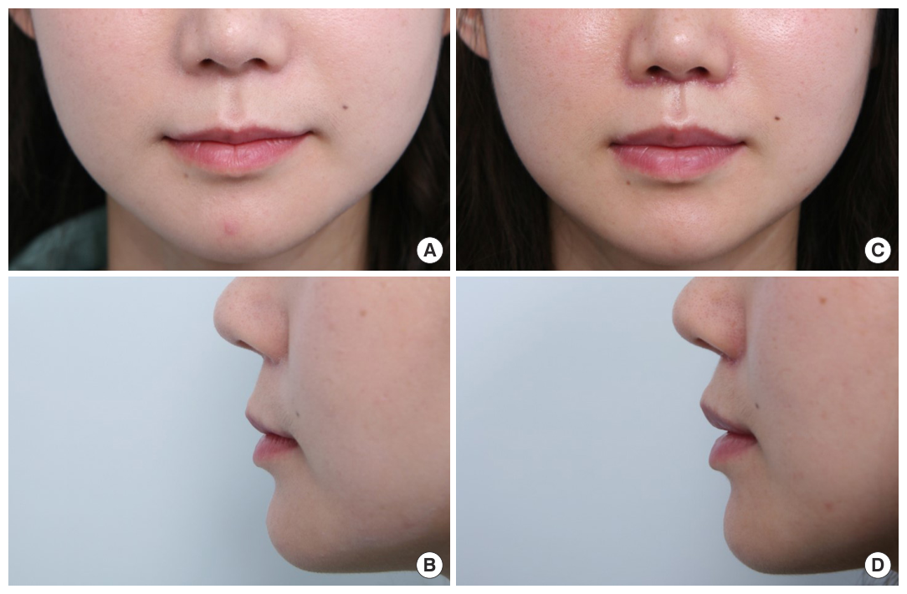
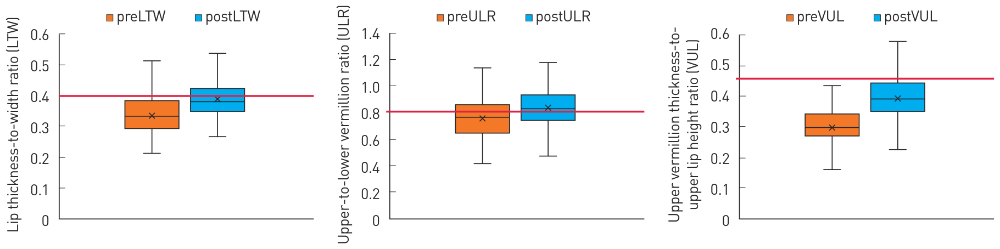
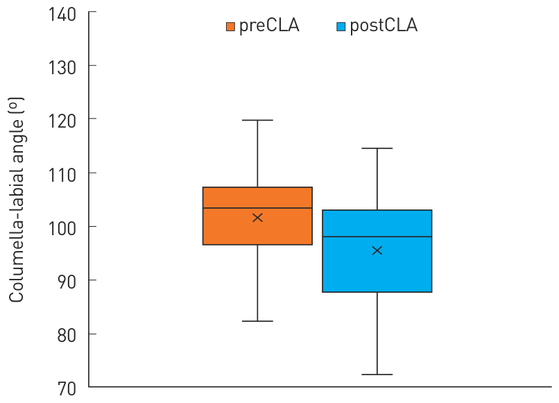

# 중앙 입술 거상술로 매력적이고 건강해 보이는 입술 얻기

> **원문** Seo MG, Sakong Y, Lee DE, Lee JH (2023). *Achieving attractive and healthy-looking lips through a central lip lift.* Archives of Aesthetic Plastic Surgery 29(2):109–114. https://doi.org/10.14730/aaps.2022.00759
>
> **라이선스** 원문 Copyright © 2023 The Korean Society for Aesthetic Plastic Surgery. [Creative Commons Attribution Non-Commercial License (CC BY-NC 4.0)](https://creativecommons.org/licenses/by-nc/4.0/)로 배포되며, 원 저작물을 적절히 인용하는 조건으로 비상업적 이용·배포·복제를 제한 없이 허용합니다. 이 번역도 비상업적 개인 학습용입니다.
>
> **변경 사항** 영어 원문을 한국어로 번역했습니다. 그림은 원문에서 잘라 캡션 앞에 넣었고, 표는 다시 입력했습니다. 참고문헌 목록·ORCID는 생략했습니다(본문의 [숫자]는 원문 참고문헌 번호). 원문의 숫자·표기가 서로 맞지 않는 곳은 고치지 않고 "(역자 주: …)"로 표시했습니다. 원저자가 검토한 번역이 아닙니다.

**저자 소속** 서민기¹, 사공용¹, 이동은², 이준호¹ — ¹영남대학교 의과대학 영남대학교병원 성형외과(대구), ²리즈성형외과(대구)

**용어 대응** — 입술 거상술(lip lift) · 중앙 입술 거상술(central lip lift) · 홍순(vermilion, 입술의 붉은 부분) · 인중(philtrum) · 비주-입술 각(columellar-labial angle, CLA) · 비주(columella, 콧기둥) · 비하점(subnasale, sn) · 인중능선점(crista philtri, cph) · 입꼬리점(cheilion, ch) · 구열점(stomion, st, 위아래 입술이 만나는 중앙점) · 하순점(labium inferius, li) · 상순점(labium superius, ls) · 비익-안면 고랑(alar-facial groove)

**참고: 이 논문의 "한국인이 선호하는 입술 비율"(LTW 0.4, ULR 0.8, VUL 0.5)은 이 논문이 직접 조사한 값이 아니라 Hwang 등(2019, 참고문헌 [4]: Hwang K, Kim YS, Kim H. Perceptions of attractive and healthy-looking lips. J Craniofac Surg 2019;30:596-603)의 결과를 인용한 것입니다.**

---

## 초록

**배경** 입술 거상술은 윗입술에 볼륨을 주어 더 젊어 보이게 하는, 널리 받아들여지고 효율적인 수술법이다. Hwang 등의 선행 연구는 한국인이 가장 선호하는 입술 관련 비율을 밝혔다. 입술 높이 대 너비 비(LTW) 0.4, 윗·아랫 홍순 비(ULR) 0.8, 윗홍순 두께 대 윗입술 높이 비(VUL) 0.5이다. 이 연구는 한국인이 선호하는 매력적인 입술 비율을 중앙 윗입술 거상술로 얻을 수 있는지 조사했다.

**방법** 2015년부터 2019년까지 한 기관에서 중앙 입술 거상술을 받은 한국인 환자를 대상으로 후향적 의무기록 검토를 했다. 환자의 수술 전후 임상 사진으로 LTW, ULR, VUL, 비주-입술 각을 측정했다.

**결과** 총 87명이 중앙 입술 거상술을 받았다. 수술 전 평균 LTW는 0.34, 평균 ULR은 0.76, 평균 VUL은 0.30이었다. 수술 후 LTW는 평균 0.39로, ULR은 0.84로, VUL은 0.393으로 늘었다. 환자의 수술 후 비율 값은 Hwang 등이 제시한 매력적인 입술 비율 값에 가까웠다. 평균 비주-입술 각은 101.59°에서 95.04°로 줄었으며, 따라서 코와 입술 사이의 미적 관계를 해치지 않았다.

**결론** 중앙 입술 거상술은 한국인이 이상적으로 여기는 매력적인 입술 모양을 만들어 준 효율적인 미용 기법이었다.

**핵심어** 입술 / 거상 / 미용 기법

## 서론

입술은 얼굴에서 중요한 미적 지표다. 두툼하고 볼륨 있는 입술은 여성의 아름다움과 젊음을 나타내며, 이런 모습을 얻기 위해 여러 미용 시술이 시행되어 왔다. 1980년대부터 윗입술 거상술, Austin형 입술 거상술, 코밑 입술 거상술 같은 수술법이 소개되었다[1-3].

2019년 Hwang 등[4]은 한국인이 가장 선호하는, 매력적이고 건강해 보이는 외모를 주는 윗입술·아랫입술·인중의 길이를 구했다. 그들은 네 가지 입술 관련 비율로 매력적이고 건강해 보이는 입술을 정의했고, 이 결과는 한국인의 미용 입술 성형에 적용되어 왔다.

중앙 입술 거상술로 환자는 윗홍순 두께와 입술 높이의 변화를 얻을 수 있다. 보툴리눔 독소 주사, 필러 주사, 지방 이식 같은 추가 미용 시술도 수술 결과를 개선할 수 있다[5-7]. 선행 연구에서 Lee 등[8]은 중앙 입술 거상술에서 인중 길이가 짧아지면서 윗입술 높이가 유의하게 늘어남을 확인했다. 이 연구는 Hwang 등[4]의 연구를 바탕으로, 추가 미용 시술 없이 중앙 입술 거상술만으로 한국인에게서 매력적인 입술 비율을 얻을 수 있는지 조사했다. 또한 중앙 입술 거상술로 인중의 위치가 바뀌면 비주-입술 각(CLA)이 영향을 받는다. 그래서 이 의도치 않은 CLA 변화의 미적 효과도 조사했다.

## 방법

### 연구 설계

2015년부터 2019년까지 한 개인 의원에서 중앙 입술 거상술을 받은 한국인 환자를 대상으로 후향적 의무기록 검토를 했다. 이 기간에 저자들의 개인 의원에서 중앙 입술 거상술을 받은 환자를 연구에 포함했다. 선천성 안면 기형, 구강 또는 악안면 질환, 비후성 흉터나 켈로이드 병력, 지나치게 처진 입꼬리, 필러나 보툴리눔 독소 주사 병력, 또는 입술·인중 주변의 다른 미용 시술 병력이 있는 환자는 제외했다. 추적 기간이 6개월 미만이거나 추적이 끊긴 환자도 제외했다. 모든 환자에게서 치료와 수술 후 결과 사진 게재에 대한 사전 동의를 받았다. 이 연구는 헬싱키 선언의 원칙을 따랐다. 연구는 영남대학교병원 기관윤리심의위원회의 승인을 받았다(IRB No. 2021-01-067-002).

환자의 정면·측면 사진은 수술 전과 수술 후 6개월에, 같은 카메라 설정과 배경으로, 일정한 거리(1.5 m)에서 디지털카메라(DSLR D7100; Nikon)로 촬영했다. Adobe Photoshop 7.0(Adobe Systems, Inc.)으로 사진의 픽셀 수를 재어 입술 관련 길이, 비율, CLA를 계산했다(그림 1). Hwang 등[4]이 보고한 입술 관련 비율을 측정한 각 길이로 계산했다. 입술 높이 대 너비 비(LTW), 윗·아랫 홍순 두께 비(ULR), 윗홍순 두께 대 윗입술 높이 비(VUL)이다. 모든 연령에서 선호되는 건강해 보이고 매력적인 입술 비율은 LTW 0.4, ULR 0.8, VUL 0.5로 보고되었다(표 1).

**그림 1.** 입술 관련 길이와 비주-입술 각. (A) A, 윗입술 높이: 비하점과 구열점 사이 길이. B, 입술 높이: 양쪽(오른쪽·왼쪽) 인중능선점과 하순점 사이 길이. C, 입술 너비: 양쪽 입꼬리점 사이 길이. D, 윗홍순 두께: 양쪽(오른쪽·왼쪽) 인중능선점과 구열점 사이 길이. E, 아랫홍순 두께: 구열점과 하순점 사이 길이(sn, 비하점; cphr·cphl, 오른쪽·왼쪽 인중능선점; ch, 입꼬리점; st, 구열점; li, 하순점). (B) 비주-입술 각: 비주와, 비하점과 상순점을 잇는 선 사이의 각, cm-sn-ls(cm, 비주; sn, 비하점; ls, 상순점).

**표 1.** 한국인이 선호하는 입술 관련 비율의 정의와 이상값

| 입술 관련 비율 | 정의 | 건강해 보이고 매력적인 입술 비율ᵃ⁾ |
|---|---|---|
| 입술 높이 대 너비 비 | 입술 높이(B) / 입술 너비(D) | 0.4 |
| 윗·아랫 홍순 비 | 윗홍순 두께(D) / 아랫홍순 두께(E) | 0.8 |
| 윗홍순 두께 대 윗입술 높이 비 | 윗홍순 두께(D) / 윗입술 높이(A) | 0.5 |

A: 윗입술 높이, B: 입술 높이, C: 입술 너비, D: 윗홍순 두께, E: 아랫홍순 두께(그림 1).
ᵃ⁾ Hwang 등[4]에 따른 비율.

(역자 주: 원문 표 1은 입술 높이 대 너비 비의 분모를 "입술 너비(D)"라고 적었지만, 그림 1과 표 아래 주석에서 입술 너비는 C이고 D는 윗홍순 두께입니다. 원문의 표기 오류로 보이며, 여기서는 원문 그대로 옮겼습니다.)

### 수술 기법

인중 길이(비하점에서 양쪽 인중능선점까지의 거리)와 입술 높이를 그림 1의 기준점으로 측정했다. 이 측정값을 참고하고 환자와 상의해, 원하는 입술 높이를 얻으려면 윗입술의 흰 부분(피부 부분)을 얼마나 절제할지 정했다. 이어 집도의는 거울 앞에서 핀치 테스트로 다시 설계한 윗입술과 윗니를 보여 주며 예상 결과를 환자에게 설명했다. 수술 전 디자인에서 절제 부위의 위쪽 경계는 비주 기저부와 콧구멍 바닥 바로 아래에 그렸다. 절제 부위의 양쪽 바깥 끝은 황소 뿔 모양으로 비익-안면 고랑의 가장 위쪽 바깥 지점까지 연장했다. 절개의 아래쪽 경계는 윗입술의 흰 부분을 얼마나 절제할지에 따라 위쪽 경계에서 간격을 두고 아래에 그렸다. 아래쪽 경계의 디자인은 윗입술의 자연스러운 윤곽과 대칭을 유지하도록 조정할 수 있었다. 수술 전 디자인을 바탕으로 국소 마취하에 피부, 피하 조직, 입둘레근 일부를 한 덩어리로 절제했다. 수술 후 절개 흉터는 대개 비주-입술 접합부와 양쪽 비익-안면 고랑 아래에 숨었다(그림 2)[8].

**그림 2.** 중앙 입술 거상술의 수술 전 디자인을 보여 주는 모식도. (A) 중앙 입술 거상술의 수술 전 그림. 절제 부위의 양쪽 바깥 끝은 황소 뿔 모양으로 비익-안면 고랑의 가장 위쪽 바깥 지점까지 연장했다. 절개의 아래쪽 경계는 윗입술의 흰 부분을 절제해야 하는 양에 따라 위쪽 경계에서 간격을 두고 아래에 그렸다. 수술 전 디자인에 따라 피부, 피하 조직, 입둘레근 일부를 한 덩어리로 절제했다(빨간 영역). (B) 인중 높이가 짧아지고 윗입술 높이가 늘어난 중앙 입술 거상술의 수술 후 그림.

### 통계 분석

중앙 입술 거상술을 받은 환자 87명의 인체 계측 평가를 위해, 수술 전후의 입술 관련 비율과 CLA 측정값을 SPSS 13.0(SPSS, Inc.)의 대응표본 t검정으로 통계 평가했다. 통계적 유의 수준은 P < 0.05로 정했다.

## 결과

환자 102명 중 87명이 포함 기준을 충족했다. 남성 10명, 여성 77명이었고 평균 나이는 35.6세(범위 19–67세)였다. 평균 추적 기간은 24.2개월(범위 6.0–31.2개월)이었다. 수술 전후 환자 분포를 표 2에 제시했다. 수술 전 평균은 LTW 0.34, ULR 0.76, VUL 0.30, CLA 101.59°였다. 수술 후 평균은 각각 LTW 0.39, ULR 0.84, VUL 0.39, CLA 95.04°로 바뀌었다. 대응표본 t검정으로 비교했을 때 모든 입술 관련 비율의 수술 전후 변화는 통계적으로 유의했다(표 3). 또한 모든 입술 관련 비율이 Hwang 등[4]이 밝힌 매력적인 값에 가까웠다.

**표 2.** 입술 관련 비율의 범위에 따른 환자의 수술 전후 분포

| 입술 관련 비율 | 범위 | 수술 전 (n = 87) | 수술 후 (n = 87) |
|---|---|---|---|
| LTW | < 0.25 | 5 | 0 |
| | 0.25–0.33 | 37 | 19 |
| | 0.33–0.40 | 33 | 32 |
| | 0.40–0.50 | 11 | 28 |
| | > 0.50 | 1 | 8 |
| ULR | < 0.60 | 11 | 6 |
| | 0.60–0.75 | 29 | 17 |
| | 0.75–0.80 | 16 | 10 |
| | 0.80–1.00 | 26 | 44 |
| | > 1.00 | 5 | 10 |
| VUL | < 0.33 | 61 | 13 |
| | 0.33–0.40 | 24 | 35 |
| | 0.40–0.50 | 2 | 36 |
| | 0.50–0.80 | 0 | 3 |
| | < 0.80 | 0 | 0 |
| CLA (°) | < 80 | 0 | 6 |
| | 80–90 | 12 | 18 |
| | 90–100 | 20 | 31 |
| | 100–110 | 46 | 27 |
| | > 110 | 9 | 5 |

LTW, 입술 두께 대 너비 비; ULR, 윗·아랫 홍순 비; VUL, 윗홍순 두께 대 윗입술 높이 비; CLA, 비주-입술 각.

(역자 주: VUL의 마지막 범위는 원문에 "< 0.80"으로 인쇄되어 있으나, 앞 범위(0.50–0.80) 다음이므로 "> 0.80"의 오기로 보입니다. 또 LTW를 초록·방법에서는 "lip height-to-width ratio(입술 높이 대 너비 비)"라 하고 표 주석·그림에서는 "lip thickness-to-width ratio(입술 두께 대 너비 비)"라 해 이름이 섞여 있습니다. 같은 비율로 보입니다.)

**표 3.** 중앙 입술 거상술 전후의 입술 관련 비율 비교

| 입술 관련 비율 | 수술 전 평균 | 수술 후 평균 | P값 |
|---|---|---|---|
| LTW | 0.34 | 0.39 | < 0.00 |
| ULR | 0.76 | 0.84 | < 0.00 |
| VUL | 0.30 | 0.39 | < 0.00 |
| CLA (°) | 101.59 | 95.04 | < 0.00 |

LTW, 입술 두께 대 너비 비; ULR, 윗·아랫 홍순 비; VUL, 윗홍순 두께 대 윗입술 높이 비; CLA, 비주-입술 각.

(역자 주: P값은 원문대로 "< 0.00"으로 옮겼습니다.)

## 고찰

"도톰하게 내민" 입술은 아름다움과 젊음의 상징으로 여겨진다. 입술은 나이가 들면서 형태적·조직학적으로 변한다. 윗입술 높이가 길어지고, 보이는 홍순이 줄고, 표피와 진피가 얇아지고, 입둘레근이 위축된다. 이런 변화로 입술 전체의 부피가 줄어든다[9,10].

최근 노화의 영향을 극복하고 입술을 더 매력적으로 만들기 위해 여러 윗입술 확대술과 입술 거상술이 소개되었다. 영구 주입형 필러와 입술 보형물은 간단한 시술로 큰 효과를 낼 수 있지만, 감염, 이물 육아종, 알레르기 반응 같은 부작용이 생길 수 있다[11,12]. 유리 지방 이식은 이런 부작용 없이 널리 쓰이는 효과적인 방법이지만, 장기간 유지되는지는 더 연구가 필요하다[7,13,14]. 점막 전진술은 흉터를 숨기면서 홍순 높이를 늘리지만 입술 주위 감각 저하가 생길 수 있다[15]. 1981년 Rozner와 Isaacs[16]가 처음 입술 거상술을 시행한 이래, Austin형, 흉터 없는 윗입술 현수술, 코밑 입술 거상술 등 여러 기법이 개발되었다[1-3,17]. 저자들의 중앙 입술 거상술은 인중 길이를 줄이면서 보이는 윗홍순의 높이를 성공적으로 늘렸다(그림 3)[8]. Austin과 Weston[2]은 윗입술의 중앙 부분을 올리면 입술 가장자리가 처져 환자가 슬퍼 보일 수 있다고 보고했다. 이 현상을 "슬픈 인상 변형(sad appearance deformity)"이라 한다. 이를 막기 위해 저자들은 절개선을 콧방울 바깥쪽까지 연장해 입술 바깥쪽이 약간 올라가게 했다. 중앙 입술 거상술에서는 비주-입술 접합부 바로 아래의 피부와 근육을 제거해 윗홍순이 위로 뒤집혀 올라갔다. 입술이 뒤집히면서 윗니의 앞니 끝이 드러날 수 있다.

**그림 3.** 중앙 입술 거상술을 받은 35세 여성 환자의 수술 전(A, B)과 수술 후(C, D) 임상 사진. 수술 후 사진은 수술 6개월 뒤에 찍었다. 입술 두께 대 너비 비, 윗·아랫 홍순 비, 윗홍순 두께 대 윗입술 높이 비는 정면 사진에서 측정했다. 비주-입술 각은 측면 사진에서 측정했다. (C, D) 중앙 입술 거상술로 인중 길이가 줄면서 보이는 윗홍순의 높이가 늘었다. 절개 흉터는 대개 비주-입술 접합부와 양쪽 비익-안면 고랑 아래에 숨었다.

이상적인 입술 비율에 관한 여러 연구가 발표되었다. Penna 등[9]은 윗홍순 높이 대 입술과 코 사이 길이의 매력적인 비율이 남성 0.28, 여성 0.28이라고 보였다. 그러나 아시아인은 백인보다 입 너비가 작고 턱이 뒤로 들어간 경향이 있으며, 아시아인의 입술은 더 돌출되어 있다[18]. 따라서 건강해 보이고 매력적인 입술은 인종에 따라 다를 수 있다. Hwang 등[4]은 한국 여성 258명과 한국 남성 72명에게 매력적이고 건강해 보이는 입술에 대해 네 가지 입술 비율을 평가하게 했다. 선호된 입술 비율은 LTW 0.4, ULR 0.8, VUL 0.5였다. 이 연구는 중앙 입술 거상술 후 결과가 한국인의 관점에서 이상적인 입술 모양에 해당하는지 판단하기 위해 Hwang의 연구를 인용했다. 중앙 입술 거상술 후 LTW, ULR, VUL은 각각 0.39, 0.84, 0.94로 유의하게 늘었으며, 이는 Hwang 등이 밝힌 매력적인 값에 가까웠다(그림 4)[4].

(역자 주: 여기서 VUL "0.94"는 결과·표 3·그림 4의 수술 후 VUL 0.39(0.393)와 맞지 않습니다. 원문의 오기로 보이며, 원문 그대로 옮겼습니다.)

**그림 4.** 입술 관련 비율의 변화. LTW 평균값은 수술 후 0.335에서 0.389로 늘었다. ULR과 VUL 평균값은 각각 0.757에서 0.837로, 0.299에서 0.393으로 늘었다. LTW, ULR, VUL의 평균값이 모두 매력적인 값(빨간 선: LTW 0.4, ULR 0.8, VUL 0.5)에 가까워졌다.

전체 평균 CLA는 수술 전 101.59°에서 수술 후 95.04°로 줄었다. 남성 10명의 수술 전 평균 CLA는 100.22°, 여성 77명은 101.79°였다. 두 평균값 모두 수술 후 각각 91.41°와 96.05°로 유의하게 줄었다. 다른 연구들에서 이상적인 CLA 값은 다양했고, 선호되는 각도 범위의 양상도 달랐다. Powell은 이상적인 CLA를 90°–120°로, Maran과 Lund는 90°–105°로 보고했다[19,20]. Armijo 등[21]은 이상적인 CLA를 남성 93.4°–98.5°, 여성 95.5°–100.1°로 보고했다. 이 연구에서 중앙 입술 거상술 후의 CLA 변화는 이상 범위 안에 있었다(그림 5). 중앙 입술 거상술은 코와 입술 사이의 미적 관계를 해치지 않았다.

**그림 5.** 비주-입술 각의 변화. 평균 비주-입술 각(CLA)은 101.59°에서 95.04°로 줄었다. 중앙 입술 거상술 후의 CLA 변화는 여러 연구에서 언급된 이상 범위 안에 있었다.

중앙 입술 거상술 결과를 분석한 저자들의 선행 연구에서 합병증은 비교적 경미했으며, 환자의 0.99%가 상처 벌어짐과 혈종으로 재치료가 필요했고 2.5%가 비대칭 윗입술로 재수술이 필요했다[8]. 이번 연구에서는 재치료가 필요한 심각한 합병증이 없었다. 12명에게 최소한의 상처 벌어짐이 있었으나 보존적 치료로 완전히 회복되었다. 25명은 윗입술이 올라가면서 윗니가 부분적으로 드러났으며, 이는 수술 후 환자의 미적 만족도에 영향을 줄 수 있다. 수술 후 흉터는 미용상 세심한 관리가 필요했다. 보이는 수술 후 흉터에는 프랙셔널 CO₂ 레이저 치료를 했다. 이 연구는 수술 중 근육에 보툴리눔 독소 주사를 받은 환자를 제외했지만, 흉터 감소에 대한 그 효과는 여러 연구에서 입증되었다[5,6,22]. 이 연구에 포함되지 않은 환자들에게는 중앙 입술 거상술 후 근육의 뒤틀림을 줄이고 피부 긴장을 최소화해 흉터가 넓어지는 것을 막기 위해 보툴리눔 독소를 주사했다.

이 연구에는 몇 가지 한계가 있었다. 첫째, 남성과 여성 환자 수에 차이가 있었고, 남성 환자는 10명만 포함되었다. 둘째, 입술 관련 비율과 CLA는 실제 환자가 아니라 임상 사진에서 Adobe Photoshop 7.0으로 계산했다. 따라서 측정값이 실제값과 비교해 오차를 포함할 수 있다. 마지막으로, Hwang 등[4]의 연구 외에는 한국인의 이상적인 입술 비율의 기준으로 쓸 수 있는 선행 연구가 거의 없었다.

이 연구에서 저자들은 Hwang 등[4]이 제시한 매력적이고 건강해 보이는 입술 비율을 바탕으로 중앙 입술 거상술의 효과를 정량적이고 객관적으로 평가하려 했다. 중앙 입술 거상술로 윗홍순 높이는 늘고 인중 높이는 줄어 이상적인 미적 비율에 가까워졌다. CLA는 코와 입술 사이의 미적 관계를 해치지 않았다. 결론적으로, 중앙 입술 거상술은 한국인에게 매력적인 입술을 만들어 주는 효율적인 미용 기법이 될 수 있다.

## 부기

**이해 상충** 이 논문과 관련해 보고된 잠재적 이해 상충은 없다.

**윤리 승인** 이 연구는 헬싱키 선언에 따라 수행되었다. 영남대학교병원 기관윤리심의위원회의 승인을 받았다(IRB No. 2021-01-067-002).

**환자 동의** 환자들은 자신의 사진 게재와 사용에 서면 동의했다.
