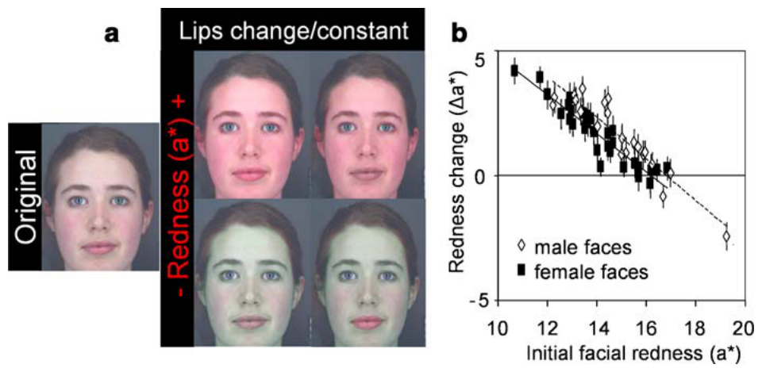
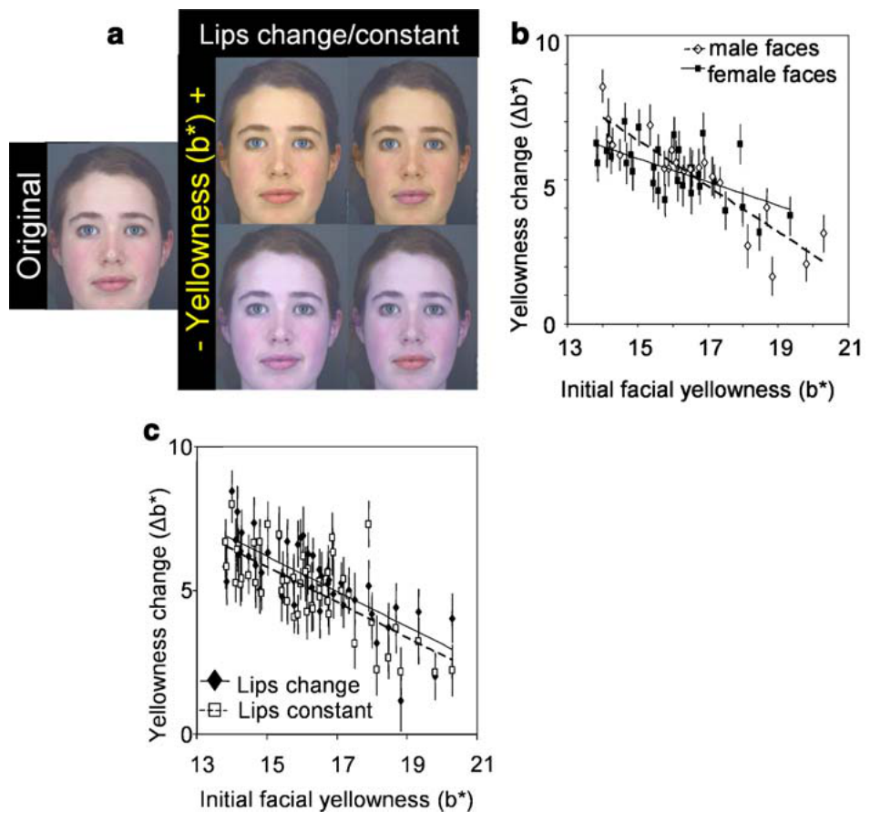
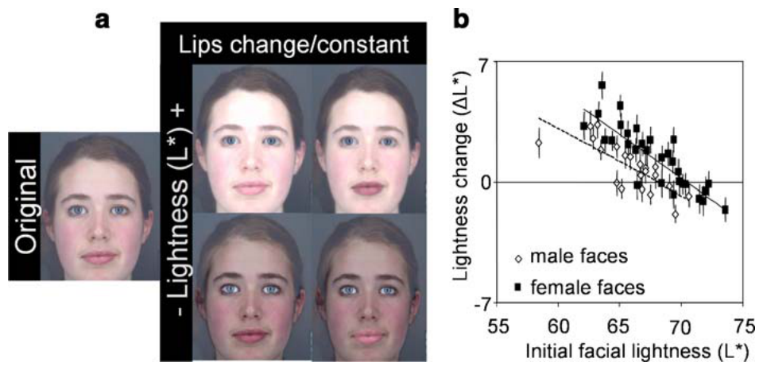
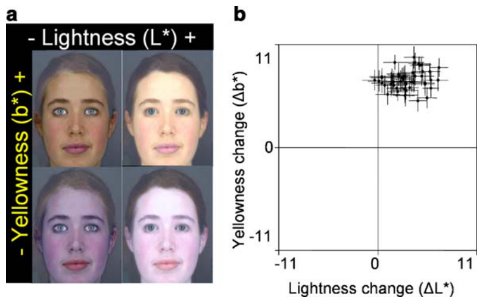

# 얼굴 피부색은 사람 얼굴의 지각된 건강에 영향을 준다

> **원문** Stephen ID, Law Smith MJ, Stirrat MR, Perrett DI (2009). *Facial Skin Coloration Affects Perceived Health of Human Faces.* International Journal of Primatology 30: 845–857. https://doi.org/10.1007/s10764-009-9380-z
>
> **라이선스** 원문 © The Author(s) 2009. Springerlink.com에서 오픈 액세스로 발표되었으며, [Creative Commons Attribution Noncommercial License](https://creativecommons.org/licenses/by-nc/)(CC BY-NC, 원문에 버전 표기 없음)로 배포됩니다. 원저자와 출처를 밝히는 조건으로 모든 매체에서 비상업적 이용·배포·복제를 허용합니다. 이 번역도 비상업적 목적으로만 씁니다.
>
> **변경 사항** 영어 원문을 한국어로 번역했습니다. 그림은 원문에서 잘라 캡션 앞에 넣었고, 참고문헌 목록은 생략했습니다(본문의 저자-연도 인용은 원문 참고문헌을 가리킴). 원저자가 검토한 번역이 아닙니다.

**용어 대응** — CIELab 색공간: L*(밝기, 밝음–어두움) · a*(붉은기, 빨강–초록) · b*(노란기, 노랑–파랑) · ΔE: CIELab 공간에서 두 색 사이의 유클리드 거리(색차) · 카로티노이드(carotenoid): 과일·채소에서 얻는 노란·주황 색소 · 멜라닌(melanin) · 혈류 관류(blood perfusion) · 산소 포화(oxygenation)

**접수** 2009년 3월 31일 / **게재 승인** 2009년 9월 28일 / **온라인 발표** 2009년 10월 26일

**저자 소속** I. D. Stephen, M. R. Stirrat, D. I. Perrett — 세인트앤드루스대학 심리학부 지각 연구실(Perception Lab), 스코틀랜드 · I. D. Stephen — 브리스톨대학 실험심리학과, 영국 · M. J. Law Smith — 트리니티 칼리지 더블린 트리니티 보건과학센터 신경정신유전학·정신의학과, 아일랜드

---

## 초록

많은 연구자가 질감과 색을 포함한 피부 상태가 사람 얼굴의 건강, 나이, 매력 지각에 주는 효과를 조사해 왔다. 이들은 얼굴 색의 분포, 색소 침착의 균일성, 또는 피부의 질에 초점을 맞췄다. 이 연구에서 우리는 색 보정된 백인(Caucasian) 얼굴 사진의 피부 부분을 참가자들이 CIELab 색 축을 따라 조작하게 하여, 얼굴에서 건강을 지각하는 데 전체 피부색이 하는 역할을 조사한다. 건강해 보이게 하려고 참가자들은 피부의 붉은기(a*)를 높였고, 이는 피부 혈액의 색이 얼굴을 더 건강해 보이게 한다는 기존 발견을 추가로 뒷받침한다. 참가자들은 피부의 노란기(b*)와 밝기(L*)도 높였는데, 이는 카로티노이드가 많고 멜라닌이 적은 색이 얼굴의 건강한 외모에 역할을 한다는 것을 시사한다. 여기서 기술한 색 선호는 사람이 아닌 많은 동물 종이 드러내는 건강의 빨강·노랑 색 단서와 닮았다.

**핵심어** 아름다움 · 식이 · 홍조 · 헤모글로빈 · 자외선 차단

## 서론

얼굴은 짝 선택을 포함한 사람 사이의 상호작용에서 중요한 역할을 한다(Perrett et al. 1998). 많은 연구자가 건강, 매력, 나이의 지각에 영향을 주는 사람 얼굴의 측면들을 조사해 왔는데, 대개 얼굴 형태에 초점을 맞췄다(Perrett et al. 1999; Rhodes et al. 1999). 그러나 최근에는 여러 연구가 피부의 색과 질감이 얼굴의 겉보기 건강과 매력에 기여하는 바에 초점을 맞추었다(Fink et al. 2001, 2006; Jones et al. 2004; Matts et al. 2007; Stephen et al. 2009). 여기서 우리는 질감과 형태의 효과를 실험적으로 통제하면서, 전체 피부색이 사람 얼굴의 건강해 보이는 정도에 주는 효과를 조사함으로써 이 접근을 확장한다.

기존 연구자들은 얼굴 전체에 걸친 피부색의 균일성과 분포가 사람 얼굴의 건강, 나이, 매력 지각에 기여한다는 것을 보였다(Fink et al. 2001, 2006; Matts et al. 2007). Fink et al.(2001)은 얼굴 매력 평가가 피부색 균일성 측정치와 상관이 있어서, 피부색 분포가 더 균일할수록 더 매력적이라는 것을 발견했다. 피부 전체에 걸친 발색단(멜라닌과 헤모글로빈) 분포가 더 균일할수록 건강, 매력, 젊음 평가와도 양의 상관이 있으며(Matts et al. 2007), 젊은 여성의 얼굴색 분포는 나이 든 여성의 것보다 더 젊고, 더 건강하고, 더 매력적으로 지각된다(Fink et al. 2006). 나아가 얼굴 이목구비와 나머지 얼굴 피부 사이의 휘도 대비를 높이면 여성 얼굴의 매력과 여성성은 높아지고, 남성 얼굴의 매력과 남성성은 낮아지는 것으로 나타났다(Russell 2003). 그러나 얼굴의 건강을 나타내는 데 역할을 하는 것은 색 분포만이 아니다. Jones et al.(2004)은 얼굴 사진에서 떼어 낸 피부 조각의 건강 평가가 얼굴 전체의 매력 평가와 상관이 있다는 것을 발견했는데, 이는 피부의 색과 질감 자체가 형태와 독립적으로, 그리고 얼굴 전체의 색 분포를 볼 수 없을 때에도 얼굴 매력에 기여한다는 것을 시사한다.

이 연구들은 얼굴색의 역할을 분명히 보여 주지만, 모두 피부의 색과 질감을 함께 다루어 질감 효과와 독립된 색 효과를 평가하지 않았거나, 색 분포를 다루었으며, 어느 것도 색 보정 기법(Hong et al. 2001)을 쓰지 않았다. 최근 우리는 CIELab 색공간을 통해 얼굴에서 건강을 지각하는 데 전체 얼굴 피부색이 하는 역할을 조사하기 시작했다(Stephen et al. 2009).

CIELab 색 체계는 사람의 지각 연구에서 흔히 쓰이며, 사람의 시각 체계를 본떠 만들어졌고, 지각적으로 균일하도록 설계되어 변화의 차원과 관계없이 1단위의 변화가 대략 같은 크기로 보인다(Martinkauppi 2002). 여기서 우리는 Stephen et al.(2009)이 확립한 색 조작 기법과 실험 패러다임을 사용해, 전체 피부색이 사람 얼굴의 겉보기 건강에 주는 효과를 조사한다. 단일 축 변환을 통해 참가자들은 색 보정된 얼굴 사진의 피부 부분을 CIELab의 3가지 성분 축 L*(밝음–어두움), a*(빨강–초록), b*(노랑–파랑)를 따라 각각 따로 조작하여 겉보기 건강을 최적화할 수 있었다. 사람 피부의 CIELab a* 값은 주로 혈액의 영향을 받으므로(Edwards and Duntley 1939), a* 차원에서는 단일 축 변환만 수행했다. 피부색의 b* 성분은 카로티노이드와 멜라닌이라는 2가지 색소의 영향을 크게 받지만, 이 색소들은 L* 성분에는 서로 다른 영향을 준다(Edwards and Duntley 1939; Stamatas et al. 2004). 그래서 L*와 b*에 대해서는 단일 축 시행과, 참가자가 L*와 b* 축을 따라 얼굴을 동시에 조작할 수 있는 2차원 시행을 모두 수행했다. 컬러 이미지 연구에서 대비를 조사하기 위해, 입술 색이 일정하게 유지될 때와 입술 색이 얼굴 피부와 함께 조작될 때 적용된 색 변화의 차이를 조사했다.

피부 혈관 분포가 늘면 피부 a*가 높아지며, 이는 사람에서 신체 체력 증가(Johnson 1998) 및 여성의 에스트로겐 수치 증가(Charkoudian et al. 1999; Thornton 2002)와 관련되지만, 2형 당뇨(Charkoudian 2003)와 고혈압(Panza et al. 1990) 환자에서는 손상되어 있다. 유산소 체력 증가와 관련된(Armstrong and Welsman 2001) 혈액 산소 포화의 증가는 혈액의 붉은기를 높인다. 피부 혈액의 산소 불포화는 심장·호흡기 질환과 관련되며, 피부에 칙칙하고 푸른 기를 띠게 한다(Ponsonby et al. 1997). 기존 지각 연구는 피부 혈류 관류와 산소 포화 색이 증가하면 사람 얼굴이 더 건강해 보인다는 것을 보였다(Stephen et al. 2009). 비슷한 현상이 사람이 아닌 영장류 종에도 있는 것으로 보이며, 붉은기가 밑바탕의 생리적 측면을 반영한다. 피부 혈류 관류 증가로 인한 얼굴 피부의 붉은기 증가는 수컷 붉은털원숭이에서 테스토스테론 증가와 연결되었고(Rhodes et al. 1997), 암컷 붉은털원숭이에서는 에스트로겐 수치 증가와 가임성이 항문생식기 피부의 붉은기 증가와 연결되었다(Czaja et al. 1977; Dixson 1983). 붉어진 이 두 부위는 모두 이성의 시각적 주의를 우선적으로 끈다(Waitt et al. 2003, 2006). 얼굴의 붉은기는 수컷 맨드릴에서 더 높은 테스토스테론 수치 및 서열(Setchell and Dixson 2001)과, 암컷 맨드릴에서는 번식 상태(Setchell et al. 2006)와도 관련되며, 암컷 맨드릴은 색이 선명한 수컷과 짝짓기를 선호한다(Setchell 2005). 따라서 수컷 맨드릴의 얼굴 붉은기는, 테스토스테론 증가로 인한 면역 억제의 부담을 감당할 수 있음을 보여 주는 정직한 신호일 수 있다(Folstad and Karter 1992; Setchell et al. 2009 참조). 우리는 혈류 관류 및 산소 포화 증가와의 관련 때문에, 피부 붉은기의 증가가 사람 얼굴을 더 건강해 보이게 할 것이라고 예측한다.

사람 피부의 CIELab b* 값은 주로 멜라닌과 카로티노이드의 영향을 받는다(Edwards and Duntley 1939; Stamatas et al. 2004). 카로티노이드는 과일과 채소 섭취로 얻어지며(Alaluf et al. 2002), 식이 보충은 피부를 노랗게 만든다(Stahl et al. 1998). 카로티노이드 보충은 사람 아동의 면역 체계 발달 향상과 관련되며(Alexander et al. 1985), HIV와 말라리아에 감염된 사람은 카로티노이드 수치가 낮다(Friis et al. 2001). 카로티노이드 수치는 수퇘지의 정자 형성에도 영향을 줄 수 있으며(Chew 1993), 체외수정 중 임신에 실패한 여성은 난포액의 카로티노이드 수치가 비정상적으로 변동했다(Schweigert et al. 2003). 많은 조류와 어류 종이 선명한 색의 카로티노이드 기반 장식을 드러내며, 그 크기와 선명도는 건강과 상태의 측면을 반영한다. 가슴 깃털의 노란색이 더 선명한 수컷 방울새(greenfinch)는 새로운 항원에 더 강한 체액성 면역 반응을 보였다(Saks et al. 2003). 눈 장식의 노란색이 더 포화된 노란눈펭귄은 암수 모두 한 번식기에 더 많은 새끼를 낳았다(Massaro et al. 2003). 연구자들은 방울새(Eley 1991), 노란눈펭귄(Massaro et al. 2003), 황금방울새(goldfinch; MacDougall and Montgomerie 2003)에서 카로티노이드 장식의 선명도에 기반한 짝 선택을 보였다. 우리는 참가자들이 단일 축 시행과 2차원 시행 모두에서 피부 b*를 높일 것이라고 예측하며, 이는 카로티노이드나 멜라닌이 얼굴을 더 건강해 보이게 하는 데 역할을 한다는 것을 나타낼 것이다.

CIELab L* 값은 주로 멜라닌의 영향을 받으며, 멜라닌 수치가 높아지면 피부 b* 값은 높아지고 피부 L* 값은 낮아진다(Stamatas et al. 2004). 멜라닌은 건강상 비용이 있을 수 있는데, 자외선을 거르는 효과가 비타민 D 합성을 저해하여 구루병과 골연화증으로 이어질 수 있다(Jablonski and Chaplin 2000; Murray 1934; Robins 1991 참조). 멜라닌의 건강상 이점으로는 해로운 자외선으로부터의 보호, 피부암과 햇볕 화상 발생의 감소(Robins 1991), 그리고 엽산의 광분해 감소가 있는데, 임신 중 엽산이 결핍되면 태아가 신경관 결손의 위험에 놓인다(Omaye 1993). 멜라닌은 곤충에서처럼(Boman and Hultmark 1987) 사람에서도 면역 방어에 역할을 한다(Burkhart and Burkhart 2005). 연구자들은 남성이 여성보다 피부가 더 어둡다는 것을 오래전부터 언급해 왔으며(Edwards and Duntley 1939; Hulse 1967; van den Berghe and Frost 1986), 밝은 피부가 더 매력적으로 여겨진다고 제안해 왔다. 특히 여성 얼굴에서 밝은 피부는 여성성, 젊음, 생식력의 신호로(Aoki 2002; Jones 2000; van den Berghe and Frost 1986; Wagatsuma 1968), 또는 양성 모두에서 높은 사회 계층의 신호로(Hulse 1967; Jones 2000) 받아들여질 수 있다. 여러 연구자가 사람 피부 밝기의 지각을 다루었지만, 서로 상충하는 결과를 내놓았고, 설문지(Feinmann and Gill 1978), 보정되지 않은 자극(Frost 1994), 상관 연구(Jones 2000)에 의존하는 등 신뢰하기 어려운 방법을 썼다. 우리 연구에서는 단일 축 시행과 2차원 시행 모두에서, 참가자들이 b* 값을 높이고 L* 값을 낮춘다면 — 즉 태닝한 색을 선호한다면 — 멜라닌 색소가 얼굴을 더 건강해 보이게 하는 데 역할을 한다는 것이 나타날 것이다. 참가자들이 b* 색을 높이되 L* 값은 낮추지 않는다면, 카로티노이드의 역할이 나타날 것이다. 카로티노이드는 많은 종에서 건강 신호와 관련되는 반면 멜라닌은 건강상 비용과 이점 모두와 관련되므로, 우리는 참가자들이 얼굴을 가장 건강해 보이게 하려고 L* 값을 낮추는 쪽을 선호하지는 않을 것이라고 예측한다.

피부색에 관한 기존 연구들은 색 선호에서 성적 이형성의 역할을 시사해 왔는데, 많은 집단에서 여성의 피부가 더 밝고, 여성에서 밝음이 더 매력적으로 보인다(van den Berghe and Frost 1986). 우리는 참가자들이 여성 얼굴에서 L*를 남성 얼굴보다 더 높이고, 남성 얼굴에서 a*와 b*를 여성 얼굴보다 더 높여, 얼굴의 성적 이형성을 강화하는 쪽을 선호할 것이라고 예측한다.

얼굴 대비에 관한 Russell(2003)의 발견에 따라, 우리는 이목구비와 피부 사이의 대비를 높이는 조작(입술 일정 조건)이 남성 얼굴보다 여성 얼굴에서 더 강화될 것이라고 예측한다.

## 재료와 방법

이 연구는 세인트앤드루스대학 윤리위원회의 승인을 받았다. 모든 참가자는 사전에 서면으로 충분한 설명에 근거한 동의를 했다.

### 사진 촬영

백인 참가자 51명(남성 21명, 여성 30명, 18–22세)을 피부 화장 없이 무표정으로, 먼셀 N5 회색으로 칠한 부스 안에서 촬영했다. 부스는 깜빡임의 영향을 줄이기 위해 고주파 기구에 장착한 Verivide F20 T12/D65 주광 모사 전구 3개로 조명했다(Verivide, 영국). 부스는 다른 조명이 없는 방에 있었다. 어깨 위에 먼셀 N5로 칠한 판을 두고, 화면 안에 GretagMacbeth Mini ColorChecker 색표를 넣었다. 24개 ColorChecker 패치의 카메라 RGB 값을 11항 다항식 전개(Hong et al. 2001)한 것에서 같은 패치들의 제조사 지정 CIELab 값으로 가는 최소제곱 변환을 써서 이미지의 색을 보정했다. 그 결과 제조사가 명시한 24개 색 값과 보정된 이미지에서 얻은 색 값 사이의 평균 색 오차(ΔE)는 2.44였다. (ΔE는 CIELab 공간에서 두 색 점 사이의 유클리드 거리이며, CIELab 색공간에서 색 차이를 나타내는 표준 방법이다.)

Matlab을 써서 각 얼굴 이미지의 피부 픽셀 전체에 걸친 평균 CIELab 값을 계산했다(초기 CIELab 얼굴색의 정의).

### 이미지 조작

Matlab을 써서 얼굴의 피부 영역을 나타내는 고른 색의 마스크를 만들었다(가장자리는 가우시안 블러 처리). 하나는 평균 얼굴색 +8 a* 단위(붉은기 증가), 다른 하나는 평균 얼굴색 −8 a* 단위(붉은기 감소)를 나타냈다. 이 마스크들을 각 얼굴 이미지(n=51)의 피부 부분 형태에 맞게 차례로 변형(warp)했다. 각 얼굴을 각 마스크 쌍 사이의 색 차이만큼 조작했다(Burt and Perrett 1995). 이렇게 해서 13개 프레임(0–12번)으로 이루어진 하나의 조작을 만들었는데, 프레임 0은 피부 붉은기를 16 a* 단위만큼 줄인 것이고, 단계적으로 늘어나 프레임 6은 원본 이미지, 프레임 12는 피부 붉은기를 16 a* 단위만큼 늘린 것이다(그림 1a).

단일 축 변환을 위해, 이 절차를 51개 얼굴 각각에 대해, 3가지 색 차원(L*, a*, b*; 그림 2a와 3a) 각각에서, 그리고 2가지 입술 조건(입술 색이 나머지 얼굴 피부와 함께 변하는 조건, 얼굴 피부색이 변하는 동안 입술 색은 일정한 조건) 각각에서 반복하여, 참가자에게 제시할 조작을 총 306개(얼굴 51개 × 색 차원 3개 × 입술 조건 2개) 만들었다. 각 조작은 13개 프레임의 연속으로 구성되었다. 306개 시행 각각에서 참가자는 마우스를 화면 위에서 가로로 움직여 조작을 이루는 13개 프레임을 넘겨 보면서, 가장 건강해 보이는 프레임을 고를 수 있었다.

2차원 변환에서는 참가자들이 51개 얼굴을 L*와 b* 색 축을 따라 동시에 조작하여 겉보기 건강을 최적화할 수 있었다. 이 2차원 변환을 만들기 위해 51개 얼굴 각각을 L* 축을 따라(13프레임), 그다음 b* 축을 따라(13프레임) 변환했으므로, 이 조작은 169개(13×13) 프레임으로 이루어졌다(그림 4a). 이는 세로 13칸(예: L*0에서 L*12)과 가로 13칸(예: b*0에서 b*12)의 격자로 생각할 수 있다. 마우스 포인터가 각 칸 위를 지나가면 그에 해당하는 조작 프레임이 표시된다. 따라서 51개 시행 각각에서 마우스를 가로로 움직이면 얼굴 피부가 한 색 차원 — L* 또는 b* 중 무작위로 배정 — 에서 바뀌고, 세로로 움직이면 다른 색 차원에서 바뀌어, L*와 b* 두 색 차원을 동시에 바꿀 수 있었다. 2차원 변환에서는 입술 색을 얼굴 피부와 함께 조작했다.

모든 변환에서 머리카락, 눈, 옷, 배경은 일정하게 유지했다.

**그림 1.** (a) 원본 얼굴 이미지와, 붉은기 변환의 양 끝 이미지. 입술이 변하는 조건(왼쪽)과 일정한 조건(오른쪽)에서 붉은기를 높인(위) 이미지와 낮춘(아래) 이미지(±16 a* 단위)를 보여 준다. (b) 제시된 색 보정 얼굴색의 범위에서, 참가자들은 건강해 보이는 정도를 최적화하려고 붉은기(a*)를 높였으며, 특히 남성 얼굴에서 그랬다. 채운 사각형과 회귀선(R²=0.87)은 여성 얼굴을 나타낸다. 속이 빈 마름모와 점선 회귀선(R²=0.86)은 남성 얼굴을 나타낸다.

### 실험

단일 색 축 조작에는 참가자 32명(남성 12명, 여성 20명, 19–26세)을, 2차원 시행에는 참가자 22명(남성 12명, 여성 10명, 18–25세)을 모집했다. 모든 참가자는 스스로를 백인이라고 밝혔다.

단일 축 변환에서는 참가자들에게 306개 시행을 한 번에 얼굴 하나씩 무작위 순서로 CRT 모니터에 제시했다(모니터는 ColorVision Spyder 2Pro로 색 보정했으며, 다양한 인종의 얼굴을 반영하는 피부 톤 범위에 대해 평균 ΔE 2.32). 각 참가자는 51개 얼굴 신원 각각을 시행 유형마다 한 번만 보았다. 모든 시행에서 참가자에게 "얼굴을 가능한 한 건강하게 만드세요"라는 지시를 주었다.

### 통계 방법

통계 분석은 SPSS 16판으로 수행했다. 각 얼굴에 적용된 평균 색 변화를 계산했다(얼굴 단위 데이터). 전체 색 변화를 평가하는 데는 일표본 t검정(H0: 색 변화 없음)을 썼다. 초기 얼굴색, 얼굴 성별과 참가자 성별, 입술 조건이 적용된 색 변화에 주는 효과를 검정하는 데는 일반 선형 혼합 모형을 썼다(종속변수 = 색 변화; 고정 요인 = 얼굴 성별, 참가자 성별, 입술 조건; 무작위 요인 = 참가자 ID; 공변량 = 초기 얼굴색: L*, a*, b*). 모든 주효과를 모형에 포함했다. 참가자 ID는 참가자 성별 안에 내포(nested)시켰다. 참가자 성별과 얼굴 성별 사이, 얼굴 성별과 입술 조건 사이의 상호작용을 모형에 포함했다.

**그림 2.** (a) 원본 얼굴 이미지와, 노란기 변환의 양 끝 이미지. 입술이 변하는 조건(왼쪽)과 일정한 조건(오른쪽)에서 노란기를 높인(위) 이미지와 낮춘(아래) 이미지(±16 b* 단위)를 보여 준다. (b) 제시된 색 보정 얼굴색의 범위에서, 참가자들은 건강해 보이는 정도를 최적화하려고 노란기(b*)를 높이며, 특히 남성 얼굴에서 그렇다. 채운 사각형과 회귀선(R²=0.22)은 여성 얼굴을 나타낸다. 속이 빈 마름모와 점선 회귀선(R²=0.80)은 남성 얼굴을 나타낸다. (c) 참가자들은 입술이 일정할 때보다 입술이 나머지 얼굴 피부와 함께 색이 변할 때 노란기를 더 많이 높인다. 채운 마름모와 회귀선(R²=0.55)은 입술 변화 조건의 얼굴을 나타낸다. 속이 빈 사각형과 점선 회귀선(R²=0.50)은 입술 일정 조건의 얼굴을 나타낸다.

## 결과

여기서 제시된 색 보정 얼굴색의 범위에서, 참가자들은 건강해 보이는 정도를 최적화하려고 a*를 높였다(평균 붉은기 변화 ± SE Δa*=1.62±0.19; t50=8.71; p<0.001; 그림 1b). 일반 선형 혼합 모형 분석의 통계 결과는 표 I에 요약했다. 건강해 보이는 정도를 최적화하려고 적용한 색 변화의 양은 얼굴의 초기 색, 특히 조작되는 차원의 초기 색에 영향을 받았다. 참가자들은 처음에 a*가 낮은 얼굴에서 a*를 더 많이 높였고(그림 1b), 그보다 덜한 정도로 b*가 높은 얼굴에서도 그랬다.

단일 축 시행에서 참가자들은 건강해 보이는 정도를 최적화하려고 b*를 높였다(Δb*=5.25±0.18; t50=29.64; p<0.001; 그림 2b). 참가자들은 처음에 b*가 낮은 얼굴(그림 2b), 그리고 처음에 L*와 a*가 높은 얼굴에서 b*를 더 많이 높였다.

참가자들은 건강해 보이는 정도를 최적화하려고 L*를 높였다(ΔL*=1.21±0.23; t50=5.20; p<0.001; 그림 3b). 참가자들은 처음에 L*가 낮은 얼굴에서 L*를 더 많이 높였고(그림 3b), 그보다 덜한 정도로 a*가 낮은 얼굴에서도 그랬다.

**그림 3.** (a) 원본 얼굴 이미지와, 밝기 변환의 양 끝 이미지. 입술이 변하는 조건(왼쪽)과 일정한 조건(오른쪽)에서 밝기를 높인(위) 이미지와 낮춘(아래) 이미지(±16 L* 단위)를 보여 준다. (b) 제시된 색 보정 얼굴색의 범위에서, 참가자들은 건강해 보이는 정도를 최적화하려고 밝기(L*)를 높였으며, 특히 여성 얼굴에서 그랬다. 채운 사각형과 회귀선(R²=0.73)은 여성 얼굴을 나타낸다. 속이 빈 마름모와 점선 회귀선(R²=0.59)은 남성 얼굴을 나타낸다.

**그림 4.** (a) 2차원 L* 대 b* 변환의 양 끝 이미지. (b) 제시된 색 보정 얼굴색의 범위에서, 참가자들은 건강해 보이는 정도를 최적화하려고 노란기와 밝기를 모두 높인다.

**표 I.** 일반 선형 혼합 모형 분석의 통계 요약

| | 조작한 차원: L* | a* | b* |
|---|---|---|---|
| 입술 | F1,3326=0.01; p=0.939 | F1,3326=1.12; p=0.290 | F1,3326=9.02; p=0.003 |
| 입술 × 얼굴 성별 | F1,3326=0.03; p=0.855 | F1,3326=0.81; p=0.370 | F1,3326=0.70; p=0.404 |
| L* | F1,3326=165.41; p<0.001 | F1,3326=0.12; p=0.730 | F1,3326=77.47; p<0.001 |
| a* | F1,3326=4.64; p=0.031 | F1,3326=484.32; p<0.001 | F1,3326=5.05; p=0.025 |
| b* | F1,3326=0.31; p=0.859 | F1,3326=4.31; p=0.038 | F1,3326=276.19; p<0.001 |
| 참가자 성별 | F1,31.06=3.66; p=0.065 | F1,31.05=0.67; p=0.420 | F1,31.05=1.13; p=0.297 |
| 얼굴 성별 | F1,3326=79.42; p<0.001 | F1,3326=19.00; p<0.001 | F1,3326=25.84; p<0.001 |
| 참가자 성별 × 얼굴 성별 | F1,3326=0.10; p=0.747 | F1,3326=0.35; p=0.556 | F1,3326=1.26; p=0.262 |
| 참가자 성별 (참가자 번호) | F31,3326=34.08; p<0.001 | F31,3326=43.76; p<0.001 | F31,3326=43.62; p<0.001 |

(역자 주: 마지막 행은 참가자 성별 안에 내포된 참가자 ID 효과로 보입니다. 원문 표기를 그대로 옮겼습니다.)

2차원 시행에서 참가자들은 건강해 보이는 정도를 최적화하려고 b*(Δb*=0.463±0.01; t50=49.940; p<0.001)와 L*(ΔL*=0.181±0.12; t50=10.629; p<0.001)를 높였다(그림 4b). (역자 주: 2차원 시행의 변화량은 단일 축 시행보다 훨씬 작은 수치로 보고되어 있는데, 단위나 척도에 대한 설명은 원문에 없습니다. 원문 수치를 그대로 옮겼습니다.)

참가자들은 여성 얼굴보다 남성 얼굴에 a*(그림 1b)와 b*(그림 2b)를 더 많이 더했고, 남성 얼굴보다 여성 얼굴에 L*를 더 많이 더했다(그림 3b). 우리 표본에서 여성 얼굴은 원래 남성 얼굴보다 밝다(t49=2.342; p=0.023).

입술 변환 조건은 L*나 a* 변환에서 적용된 색 변화에 영향을 주지 않았다. 참가자들은 입술이 일정할 때보다 입술이 얼굴과 함께 변할 때 얼굴의 b*를 더 많이 높였지만(그림 2c), 두 조건 모두에서 b*를 높였다. 3가지 차원 어디에서도 입술 조건과 얼굴 성별의 상호작용 효과는 없었다.

## 논의

우리 연구는 피부 질감이나 색 분포가 주는 정보와 별개로, 전체 피부색이 사람 얼굴의 건강해 보이는 정도에 역할을 한다는 것을 드러낸다. 우리는 색 보정된 백인 얼굴 사진 51장 표본에서, 피부의 a*, b*, L*가 높아지면 사람 얼굴의 지각된 건강이 높아진다는 것을 보였다. 참가자들은 처음에 그 차원의 값이 낮은 얼굴에서 색을 더 많이 높였는데, 이는 자연 범위를 벗어난 극단적인 피부색은 건강해 보이지 않는다는 것을 시사하며, 아마 정상 범위 안의 얼굴색에 대한 선호 때문일 것이다(Langlois and Roggman 1990).

Stephen et al.(2009)은 피부 혈류 관류와 산소 포화 색의 증가라는 생리적으로 의미 있는 단서가 얼굴을 더 건강해 보이게 한다는 것을 발견했다. 현재 연구는 더 지각적인 입장을 취해, 사람의 시각 체계를 본뜬 차원(Martinkauppi 2002)을 따른 순수한 색 변화가 사람 얼굴의 겉보기 건강에 영향을 준다는 것을 보여 준다. 우리는 피부 붉은기가 얼굴의 지각된 건강을 높인다는 것을 발견했는데, 이는 아마 피부 혈류 관류 및 산소 포화와의 관련 때문일 것이다(Edwards and Duntley 1939; Stephen et al. 2009). 이 관계는 사람이 아닌 영장류, 특히 구세계원숭이가 드러내는 색 신호와 유사점을 보인다(Dixson 1998). 이 집단에서 혈류 관류 증가로 인한 붉은기 증가는 호르몬 상태(Czaja et al. 1977; Dixson 1983; Rhodes et al. 1997; Setchell and Dixson 2001)와 번식 상태(Rhodes et al. 1997; Setchell et al. 2006) 같은 건강의 측면과 관련된다. 사람이 아닌 영장류의 붉은기는 서열 같은 사회적 요인과도 관련되며(Setchell and Dixson 2001; Setchell and Wickings 2005), 이성이 선호한다(Setchell 2005; Waitt et al. 2003, 2006). 따라서 사람의 지배성과 매력이 드러나는 데 얼굴 붉은기가 하는 역할을 조사할 필요가 있다.

선탠이 백인 얼굴을 더 건강하고 매력적으로 보이게 한다는 것은 널리 퍼진 견해다. 얼굴 지각에서 멜라닌의 역할은 대개 피부가 어두워지는 것(L* 감소)의 관점에서 고려된다(Frost 1994; van den Berghe and Frost 1986). 참가자들이 단일 축 시행과 2차원 시행 모두에서 b*를 높이고 L*도 높이기를 선택했다는 우리의 발견은, 태닝이 건강해 보이는 데 주는 어떤 이점이든 그에 따르는 피부 b*의 증가 때문이라는 것을 시사한다(Stamatas et al. 2004). 우리는 피부 b*가 건강해 보이는 것이 식이 카로티노이드의 피부 침착 때문일 수 있다고 제안한다. 이는 많은 조류와 어류 종에서 건강 신호(Massaro et al. 2003; Saks et al. 2003)와 성 선택(Eley 1991; MacDougall and Montgomerie 2003; Massaro et al. 2003)에 관여하는 카로티노이드가 사람의 건강해 보이는 정도에도 영향을 줄 수 있다는 것을 시사한다. 얼굴 건강에서 이 색소들의 상대적 역할을 밝히려면, 피부 멜라닌과 카로티노이드 색이 사람 얼굴의 겉보기 건강에 하는 역할을 조사하는 연구가 가치 있는 다음 단계가 될 것이다.

참가자들은 여성 얼굴을 남성 얼굴보다 더 밝게 하고, 남성 얼굴을 여성 얼굴보다 더 붉고 노랗게 함으로써, 피부색에 이미 있는 성적 이형성을 과장했다. 이는 많은 집단에서 남성이 여성보다 더 갈색이고 더 불그레하며(Edwards and Duntley 1939; Frost 1994) 더 어둡다(van den Berghe and Frost 1986)는 발견과 들어맞으며, 성적 이형 패턴에 맞는 얼굴에 대한 선호로 설명될 수 있다(Perrett et al. 1998; Rhodes 2006).

a*나 L* 시행에서는 입술 조건의 효과가 없었지만, 참가자들은 입술 색이 나머지 얼굴 피부와 함께 변할 때 피부 b*를 더 많이 높였다. 나머지 얼굴 피부의 b*를 높이는 동안 입술이 일정하게 유지되면 입술이 파랗게 보였는데(그림 3a), 이는 청색증(심장·호흡기 질환과 관련된 혈액 산소 포화의 부족; Ponsonby et al. 1997)의 증상이다. (역자 주: 원문은 여기서 "Fig. 3a"를 가리키지만, b* 조작을 보여 주는 것은 그림 2a입니다. 원문 표기를 그대로 두었습니다.) 3가지 색 차원 어디에서도 입술 조건의 효과에 두 성별 사이의 차이는 발견되지 않았다. 이 결과는 이목구비와 얼굴 피부 사이의 대비가 커지면 여성 얼굴에서는 여성성과 매력이 높아지지만 남성 얼굴에서는 남성성과 매력이 낮아진다는 Russell(2003)의 결과와 다르다. 이 결과는 3가지 설명 중 하나로 설명될 수 있다. 1) Russell이 흑백 사진을 써서 이미지에서 중요한 색 정보가 빠졌을 수 있다. 2) 이목구비와 얼굴 피부 사이의 대비는 매력과 성적 이형성 지각에는 중요하지만 건강 지각에는 중요하지 않을 수 있다. 3) Russell(2003)이 발견한 효과는 입술과 피부 사이의 대비가 아니라 눈과 피부 사이의 대비 때문일 수 있다. 따라서 이 문제들에 대한 더 자세한 연구가 필요하다.

## 요약

우리는 피부 질감이나 색 분포와 독립적으로, 전체 피부색이 사람 얼굴의 건강해 보이는 정도에 역할을 한다는 것을 확립했다. 피부 붉은기 증가로 인해 건강해 보이는 정도가 높아진다는 것은, 건강 지각에서 혈액 색이 역할을 한다는 것(Stephen et al. 2009)을 추가로 뒷받침한다. 피부 노란기와 밝기의 역할은 카로티노이드 색소도 건강 지각에 역할을 할 수 있음을 시사한다. 종합하면, 이 결과는 여러 동물 종에서 건강 신호 및 짝 선택과 관련된 색이 사람 얼굴의 건강 지각에서도 역할을 한다는 것을 시사한다.

**감사의 글** 색 보정에 관해 조언해 준 P. Hibbard, A. Hurlburt, Y. Ling, I. Penton-Voak, T. Troscianko에게; 의견을 준 M. Anderson, R. Byrne, R. Caldara, P. Ferretti, T. Fitch, P. Hancock, B. Jones, M. Johnston, D. Johnston, J. Lawson, J. Seddon, R. Sprengelmeyer, M. Tovée, D. Vishnawath, J. Higham, J. Setchell과 익명 심사자 2명에게; 부스를 제작한 P. Wilcox에게; 추가 컴퓨터 프로그램을 만든 J. Schindelin에게; 참가자를 모집한 L. Ferrier에게; 교정을 본 A. Perrett에게 감사한다. 이 연구는 BBSRC, Unilever Research, ESRC의 지원을 받았다.

**오픈 액세스** 이 논문은 Creative Commons Attribution Noncommercial License의 조건으로 배포되며, 원저자와 출처를 밝히는 조건으로 모든 매체에서 비상업적 이용·배포·복제를 허용한다.

**참고문헌** — 생략(원문 참조).
