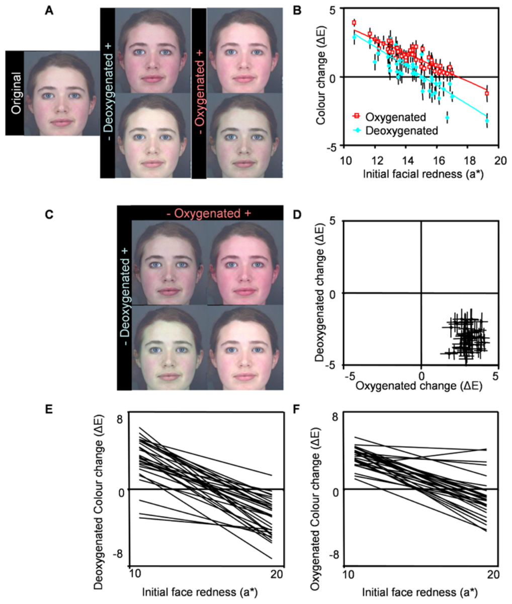
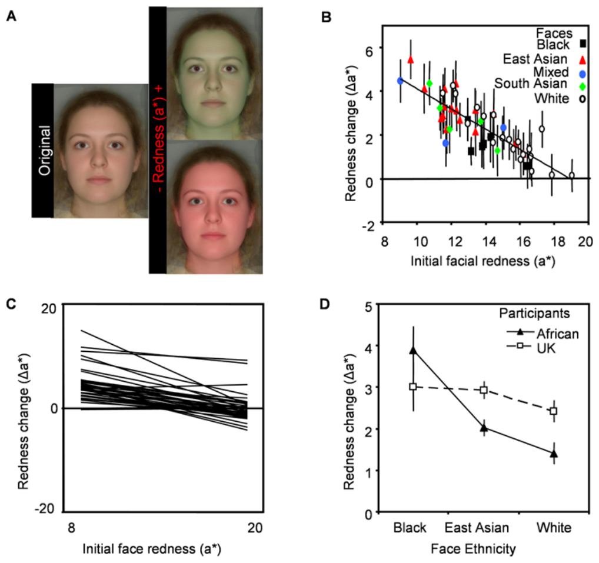

# 피부의 혈액 관류와 산소화 색이 지각된 건강에 영향을 준다

> **원문** Stephen ID, Coetzee V, Law Smith M, Perrett DI (2009). *Skin Blood Perfusion and Oxygenation Colour Affect Perceived Human Health.* PLoS ONE 4(4): e5083. https://doi.org/10.1371/journal.pone.0005083
>
> **라이선스** 원문 Copyright © 2009 Stephen et al. [Creative Commons Attribution License](https://creativecommons.org/licenses/by/)(원문에 버전 표기 없음)로 배포되는 오픈 액세스 논문이며, 원저자와 출처를 밝히는 조건으로 모든 매체에서 제한 없는 이용·배포·복제를 허용합니다.
>
> **변경 사항** 영어 원문을 한국어로 번역했습니다. 그림은 원문에서 잘라 캡션 앞에 넣었고, 참고문헌 목록은 생략했습니다(본문의 [숫자]는 원문 참고문헌 번호). 보충 자료(Table S1–S6)는 원문에 실린 설명만 옮겼고 표 자체는 싣지 않았습니다(원문 PDF에도 없음). 원문 PDF의 글꼴 문제로 깨진 기호(−, ±, <, °, Δ)는 원래 기호로 되살렸습니다. 원저자가 검토한 번역이 아닙니다.

**용어 대응** — 혈액 관류(blood perfusion): 피부 조직에 피가 얼마나 차 있고 흐르는가 · 산소화/탈산소화 혈액(oxygenated/deoxygenated blood): 산소와 결합한 밝은 붉은색 혈액 / 산소를 내준 약간 푸르스름한 붉은색 혈액 · 혈관 확장(vasodilation) · 혈관 분포 증가(vascularisation) · CIELab: 밝기 L\*, 붉은기 a\*(+빨강/−초록), 노란기 b\*(+노랑/−파랑)로 색을 나타내는 색 공간 · ΔE: CIELab 공간에서 두 색 사이의 거리(색 차이)

---

## 초록

인간에게서 피부의 혈액 관류와 산소화는 심혈관·호르몬·순환계 건강에 달려 있으며, 일부 영장류에서는 기저의 생리 상태, 서열, 번식 상태를 알리는 사회적·성적 신호가 된다. 우리는 참가자들이 색 보정된 얼굴 사진을, 경험적으로 측정한 산소화 혈액 색 축과 탈산소화 혈액 색 축을 따라 각각 따로, 또 동시에 조작하여 가장 건강해 보이게 만들도록 했다. 참가자들은 건강한 외모를 최적화하기 위해 피부의 혈액 색, 특히 산소화 혈액 색을 기본 수준보다 높였다. 따라서 우리는 피부의 혈액 관류와 산소화가 지각된 건강에 영향을 주며, 이것이 짝 선택에서 중요할 수 있음을 보인다.

## 서론

몸이나 장식 형질의 색은 여러 종에서 기저의 생리 상태를 반영한다. 더욱이 이러한 색 단서는 같은 종의 다른 개체에게 지각되어 사회적·성적 신호로 쓰인다.

헤모글로빈에 기반한 붉은색은 조류에서 생리 상태의 신호를 제공한다고 여겨진다. 카나리아 새끼의 입 안이 붉은 것은 혈액 관류 때문이다. 먹이를 못 먹은 정도가 커질수록 벌린 입 안이 더 붉어진다. 입 안이 더 밝은 빨강인 새끼는 어미에게서 먹이를 더 많이 받는데, 이는 붉은색이 새끼와 어미 사이의 신호로 작용함을 시사한다[1]. 헤모글로빈에 기반한 붉은 피부 홍조는 적어도 29개 조류 속(genus)에 있으며, 건강이나 호르몬 상태 또는 사회적 지위를 알리는 신호일 수 있다는 점이 지적되었다[2].

인간이 아닌 영장류 몇 종은 생리적 건강, 호르몬 상태, 번식 상태의 측면을 반영하는 피부의 붉어짐을 보인다. 같은 종의 개체들이 이러한 피부색 단서에 반응한다는 증거도 있다. 수컷 붉은털원숭이는 번식기에 테스토스테론 수준이 높아지면서 얼굴이 붉어진다[3]. 마찬가지로 일부 마카크 종에서는 난소 에스트로겐 수준이 높아지면 암컷의 항문·생식기 주변 피부가 붉어진다. 이 성피부(sexual skin)는 배란 전후(가장 가임력이 높은) 시기에 가장 붉어진다([4]에서 개관). 마카크 수컷 얼굴과 암컷 항문·생식기 부위의 피부가 더 붉으면 이성 개체의 시각적 주의를 더 많이 끄는데, 이는 붉은색이 컨디션과 번식 상태의 신호로 작용함을 시사한다[4,5].

수컷 맨드릴에서는 사회적 서열이 높아지는 것과 관련된 테스토스테론 상승이 얼굴의 붉은색을 강화한다[6]. 다른 수컷들은 자기보다 얼굴이 더 밝은 빨강인 개체와의 폭력적 충돌을 피하는데, 이는 이렇게 증가한 붉은색이 우위 수컷과 하위 수컷 사이에서 사회적 지위의 신호임을 시사한다[7]. 암컷 맨드릴의 얼굴 붉은색은 발정 주기에 걸친 가임력 및 번식 품질과 관련이 있다[8].

인간에서도 피부 혈관 확장과 혈관 분포 증가로 생기는 피부의 붉은기는 건강을 포함한 생리 상태와 관련이 있다. 또한 혈액의 산소화 상태는 건강 상태와 관련되며 피부색에 영향을 준다. 여성에서는 성호르몬 수준이 높을수록 피부 혈관 분포가 늘고[9] 혈관 확장 반응이 커지며[10], 이는 피부 속 혈액을 동맥혈화한다[11]. 피부의 혈관 확장 체계는 신체 훈련으로 더 민감하게 반응하게 되지만[12], 제2형 당뇨병[13]과 고혈압[14]에서는 손상된다. 혈액 산소화가 높은 것은 유산소 체력이 높은 것과 관련되는 반면[15], 혈액의 탈산소화가 높은 것은 저산소증과 관련되며 청색증(피부가 푸르스름해짐)으로 이어질 수 있는데, 청색증은 관상동맥 질환과 호흡기 질환을 시사한다[16].

인간에서 관찰자들이 색을 기저의 생리적 건강이나 품질의 단서로 해석한다는 증거가 있다. 피부 속 색소(혈액과 멜라닌)의 분포는 인간 얼굴의 겉보기 건강, 나이, 매력에 영향을 줄 수 있다[17,18]. 이목구비와 얼굴 피부의 상대적 밝기는 얼굴의 매력과 겉보기 여성성/남성성에 영향을 준다[19]. 빨간 옷을 입은 참가자는 스포츠 경기에서 이길 가능성이 더 높아 보이고[20] 실제로 스포츠 경기에서 더 많이 성공하는데[21,22], 인간에게 붉은색이 우위[23]나 분노[24]의 단서로 해석될 수 있기 때문일 수 있다. 빨간 옷을 입은 여성은 남성에게 더 매력적으로 보인다[25]. 그러나 이전 연구는 전체적인 색소 색이 인간 얼굴의 겉보기 건강에 주는 영향을 다루지 않았다.

혈액 관류가 정상 수준 아래로 줄어드는 것(창백함)은 건강이 나쁜 것과 관련된다(특히 빈혈[26]; 빈혈은 말라리아[27] 같은 다른 질병을 가리킬 수도 있다). 피부 혈액 관류를 정상 수준 위로 높이는 것이 지각된 건강에 이로운지 해로운지는 분명하지 않다. 더욱이 혈액 산소화 상태와 관련된 미묘한 색 변화가 건강해 보이는 정도에 영향을 주는지도 분명하지 않다. 이 연구는 이 질문들을 다룬다. 우리는 인간 얼굴 피부의 혈액 색이 증가하면 건강하게 지각될 것이고, 산소화 혈액 색이 탈산소화 혈액 색보다 더 건강해 보일 것이라고 가설을 세운다.

피부가 어두운 민족 집단에서는 혈액 관류의 변화를 알아채기가 더 어려울 수 있다[28]. 피부의 어두움은 얼굴에 대한 사회적 지각[29]과 매력 평가[30] 모두에 영향을 준다고 밝혀졌다. 따라서 얼굴의 붉어짐은 민족이 다른 얼굴에서, 그리고 피부가 밝은 관찰자와 어두운 관찰자에게서 다르게 지각될 것이라고 예상할 수 있다. 이 가설을 검토하기 위해 비교문화 연구를 수행한다.

예측을 검증하기 위해, 색 보정된[31] 백인 얼굴 이미지의 피부 부분을 경험적으로 측정한 색소 색 축, 즉 산소화 혈액 축과 탈산소화 혈액 축을 따라 변환했다[32](그림 1A). 백인 참가자들에게 보정된 CRT 모니터로 얼굴 이미지를 보여 주고, 색을 조작해 "얼굴을 가능한 한 건강해 보이게 만들라"고 요청했다. 이 시행은 처음에는 한 번에 한 색 축씩 수행했다. 추가 참가자들은 얼굴색을 2차원으로 조절하는 조건에서 검사했는데, 산소화 혈액 색 축과 탈산소화 혈액 색 축을 동시에 조작할 수 있게 했다(그림 1C).

얼굴과 참가자의 민족이 인간 얼굴의 붉은기에 대한 선호에 영향을 주는지 알아보기 위해 비교문화 연구를 수행했다. 여러 민족의 얼굴을 CIELab a\*(붉은기) 색 축을 따라 변환했다. 영국에 거주하는 백인 참가자와 남아프리카공화국의 흑인 참가자가 위와 같은 지시에 따라 얼굴의 붉은색을 조정했다.

## 재료 및 방법

이 연구는 세인트앤드루스대학교 윤리위원회의 승인을 받았다. 모든 참가자는 사전에 서면으로 설명 후 동의를 했다.

**그림 1. 피부의 붉은기와 혈액 색이 얼굴의 겉보기 건강에 주는 영향.** (A) 변환하지 않은 이미지, 그리고 산소화·탈산소화 혈액 색 변환의 낮은(−) 끝점과 높은(+) 끝점을 보여 주는 이미지 쌍. (B) 참가자들은 건강한 외모를 최적화하기 위해 탈산소화·산소화 혈액 색을 높인다. 얼굴의 처음 붉은기(a\*)는 건강한 외모를 최적화하려고 적용한 산소화(r = −0.911; p<0.001; R² = 0.83) 및 탈산소화(r = −0.831; p<0.001; R² = 0.69) 혈액 색 변화와 상관이 있다. (C) 산소화 대 탈산소화 혈액 색의 2차원 변환의 끝점. (D) 건강한 외모를 최적화하려고 적용한 2차원 색 변환(ΔE 평균±SE). (E) 참가자마다, 얼굴의 처음 붉은기와 건강한 외모를 최적화하려고 적용한 탈산소화 색 변화의 관계를 나타낸 회귀선. (F) 참가자마다, 얼굴의 처음 붉은기와 건강한 외모를 최적화하려고 적용한 산소화 색 변화의 관계를 나타낸 회귀선.
doi:10.1371/journal.pone.0005083.g001

### (a) 사진 촬영

백인 참가자 51명(남성 21명, 여성 30명; 18–22세)을 피부 화장 없이 무표정으로 촬영했다. 촬영 부스는 먼셀 N5 회색으로 칠했고, 깜빡임의 영향을 줄이기 위해 고주파 조명기구(Verivide, 영국)에 끼운 Verivide F20 T12/D65 주광 모사 전구 세 개로 조명했다. 부스는 다른 조명이 없는 방에 두었다. 먼셀 N5로 칠한 판을 어깨 위에 걸쳤고, GretagMacbeth Mini ColorChecker 색 차트를 화면 안에 넣었다. 24개 ColorChecker 패치의 카메라 RGB 값을 11항 다항식 전개[31]한 것에서 같은 패치들의 제조사 지정 CIELab 값으로 가는 최소제곱 변환을 써서 이미지의 색을 보정했다. 이로써 제조사가 밝힌 24개 색 값과 보정된 이미지에서 얻은 색 값 사이의 평균 색 오차(ΔE)가 2.44가 되었다. (ΔE는 CIELab 공간에서 두 색점 사이의 유클리드 거리로, CIELab 색 공간에서 색 차이를 나타내는 표준 방법이다.)

비교문화 연구를 위해서는 학부생(백인 남성 10명, 백인 여성 10명, 동아시아 남성 7명, 동아시아 여성 9명, 흑인 여성 6명, 남아시아 여성 5명, 혼혈 여성 3명)을 Nikon 60 mm 단초점 렌즈와 Nikon Canfield 렌즈 장착형 플래시를 단 Fujifilm FinePix S2Pro 디지털 SLR 카메라로 촬영했다. 참가자는 회색 스크린 앞에 카메라를 향해 앉았고 무표정을 유지하도록 요청받았다. GretagMacbeth ColorChecker 차트를 화면에 넣은 이미지를 추가로 찍었다. 이미지 속 색 패치의 색을 측정하고, Konica Minolta CM2600d 분광측색계로도 직접 측정했다(CIELab 색 공간). 선형 변환으로 이미지의 색을 보정했다(보정 후 평균 색 오차 [ΔE] 6.704).

Matlab으로 각 얼굴 이미지의 피부 픽셀 전체에 걸친 평균 CIELab 값을 계산했다(이것을 얼굴의 처음 CIELab 색으로 정의).

### (b) 색소 색 측정

산소화 혈액과 탈산소화 혈액이 피부색에 주는 영향을 경험적으로 측정했다.

**탈산소화 혈액.** 추가로 10명(남성 5명, 여성 5명; 24–35세)을 모집했다. 왼손 제1 배측 골간근 부위(눈에 보이는 힘줄과 정맥이 비교적 적어서 선택)를 분광측색계(Konica Minolta CM2600d)로 측정했다(CIELab 색 공간, D65 광원, 10° 조명 각도, SCI). 손을 몸 옆에 내린 채 30초 서 있은 뒤(충혈 — 혈액량이 많음) 한 번, 손을 머리 위로 10초 든 뒤(빈혈 상태 — 혈액량이 적음) 다시 한 번 측정했다. 내린 팔의 혈액량 증가는 주로 탈산소화 혈액 때문이다[33].

**산소화 혈액.** 추가로 10명(남성 2명, 여성 8명; 19–25세)을 모집했다. 왼손 제1 배측 골간근 부위를, 손을 책상에 올려놓고 2분 앉아 있은 뒤(빈혈 상태) 한 번, 왼손을 뜨거운 물(45–50°C; 동맥혈로 강한 충혈을 일으킴[34]; 측정 부위는 측정 전에 부드럽고 빠르게 말림)에 담그고 5분 앉아 있은 뒤 다시 한 번 분광측색계로 측정했다. 산소화 혈액과 탈산소화 혈액의 관류 증가로 생기는 색 변화는 손과 얼굴에서 비슷하다.

### (c) 이미지 조작

Matlab으로 얼굴 모양의 마스크를 만들었는데, 각각 높은 색소 색과 낮은 색소 색 하나씩을 나타낸다(Table S1 참조). 각 얼굴 이미지(n = 51)를 각 마스크 쌍 사이의 색 차이만큼 조작했다[32]. 각 색소마다 높은 색에서 낮은 색까지 같은 간격으로 13장의 이미지를 만들었다. 2차원 변환에서는 13장 각각을 두 번째 색 차원을 따라 다시 변환해, 얼굴 하나당 169장의 이미지를 얻었다(그림 1E)(역자 주: 원문이 그림 1E를 가리키지만, 2차원 변환의 끝점을 보여 주는 것은 그림 1C입니다). 머리카락, 눈, 옷, 배경은 그대로 두었다.

비교문화 연구에서는 얼굴을 CIELab a\*(붉은기) 색 축을 따라 변환해, 원래 얼굴색에서 a\* −16에서 +16 단위까지 같은 간격으로 13장의 이미지를 만들었다(그림 2A).

### (d) 실험

단일 혈액 색 축 조작의 참가자는 백인이었고(남성 14명, 여성 16명, 18–24세), 두 혈액 색 축 조작의 참가자도 백인이었다(남성 15명, 여성 14명, 18–25세).

참가자에게 자극을 한 번에 얼굴 하나씩 무작위 순서로 CRT 모니터에 보여 주었다(ColorVision Spyder 2Pro로 색 보정; 여러 민족의 얼굴을 반영하는 피부 톤 범위에서 평균 ΔE 2.32). 컴퓨터 프로그램으로 참가자가 얼굴 피부의 색을 단일 색소 색 축을 따라 조작해 가장 건강한 외모를 얻을 수 있게 했다. 각 참가자는 51개 얼굴 각각을 산소화 혈액 색 변환에서 한 번, 탈산소화 혈액 색 변환에서 한 번 보았다. 2차원 시행에서는 참가자가 마우스를 가로·세로로 움직여 두 차원의 색을 동시에 조작할 수 있었다. 각 참가자는 2차원 시행에서 51개 얼굴 각각을 한 번 보았다.

비교문화 연구에서는 남아프리카공화국 흑인 참가자(남성 10명, 여성 10명; 19–29세)와 영국 거주 백인 참가자(남성 7명, 여성 11명; 18–34세)에게 단일 축 CIELab a\* 변환 시행을 제시했다.

### (e) 통계 방법

통계 분석은 SPSS 16을 사용했다. 각 얼굴에 적용된 평균 색 변화를 계산했다(얼굴별 데이터셋). 각 참가자가 적용한 평균 색 변화도 계산했다(참가자별 데이터셋). 전체 색 변화를 평가하는 데는 단일표본 t-검정(H0: 색 변화 없음)을 썼다. 얼굴 성별, 참가자 성별, 그리고 둘의 상호작용이 적용된 색 변화에 주는 효과는 일반선형혼합모형으로 검정했다(종속변수 = 색 변화; 고정요인 = 얼굴 성별, 참가자 성별; 무선요인 = 참가자 ID; 공변량 = 얼굴의 처음 색: L\*, a\*, b\*). 모든 주효과를 모형에 넣었다. 참가자 ID는 참가자 성별 안에 내포(nested)시켰다. 참가자 성별과 얼굴 성별의 상호작용을 모형에 넣었다. 얼굴의 처음 색과, 건강한 외모를 최적화하려고 적용한 색 변화 사이의 관계는 일반선형혼합모형으로 검정했다(종속변수 = 색 변화; 무선요인 = 참가자 ID; 공변량 = 얼굴의 처음 색: L\*, a\*, b\*). 모형은 모든 주효과와 함께 참가자 ID와 각 색 공변량의 상호작용을 포함하도록 정의했다. 비교문화 연구에서는 얼굴 민족, 참가자 민족, 그리고 둘의 상호작용이 적용된 색 변화에 주는 효과를 일반선형혼합모형으로 검정했다(종속변수 = 적용된 붉은기 변화; 고정요인 = 얼굴 민족; 무선요인 = 참가자 민족, 참가자 ID; 공변량 = 얼굴의 처음 색: L\*, a\*, b\*). 모형에는 모든 주효과를 넣었다. 참가자 ID는 참가자 민족 안에 내포시켰다. 이미지의 민족과 얼굴의 민족 사이의 상호작용을 모형에 넣었다(역자 주: 원문 표현 그대로입니다. 문맥상 "얼굴의 민족과 참가자의 민족 사이의 상호작용"으로 보입니다).

**그림 2. 피부색이 여러 민족 얼굴의 겉보기 건강에 주는 영향.** (A) 변환하지 않은 이미지, 그리고 피부 붉은기 변환의 끝점(CIELab a\* 축에서 ±16 단위)을 보여 주는 이미지 쌍. 보이는 이미지는 여러 얼굴을 합성한 것이다. 실험에 쓴 자극은 실제 개인의 사진이었다. (B) 참가자들은 얼굴의 건강한 외모를 최적화하기 위해 붉은기를 높인다. 얼굴의 처음 붉은기는 건강한 외모를 최적화하려고 적용한 붉은기 변화와 상관이 있다(r = −0.832; p<0.001; R² = 0.69). 기호의 색이 다른 것은 얼굴의 민족 집단이 다름을 나타낸다. (C) 참가자 개인마다, 얼굴의 처음 붉은기와 건강한 외모를 최적화하려고 적용한 붉은기 변화의 관계를 나타낸 회귀선. (D) 아프리카 참가자들은 흑인 얼굴의 붉은기를 다른 얼굴보다 더 높인다. 아프리카 참가자와 영국 거주 참가자 모두 건강한 외모를 최적화하기 위해 세 민족 집단 얼굴 모두에서 붉은기를 높인다.
doi:10.1371/journal.pone.0005083.g002

## 결과

단일 축 변환에서 참가자들은 한 종류의 혈액으로 피부 관류가 늘거나 줄어드는 것을 모사할 수 있었다. 이 변환에서 참가자들은 건강한 외모를 최적화하기 위해 산소화 혈액 색(그림 1B; ΔE = 1.52±0.13; t50 = 12.101, p<0.001)과 탈산소화 혈액 색(그림 1B; ΔE = 0.51±0.19; t50 = 2.702, p = 0.009)을 높였다(Table S4도 참조). 얼굴의 처음 붉은기(CIELab a\*)는 참가자들이 건강한 외모를 최적화하려고 적용한 색 변화를 설명했는데, 처음에 덜 붉은 얼굴은 처음에 더 붉은 얼굴보다 혈액 색이 더 많이 높아졌다. 얼굴의 처음 붉은기는 건강한 외모를 최적화하려고 적용한 탈산소화(F1,1410 = 279.782; p<0.001; 그림 1E) 및 산소화(F1,1410 = 237.100; p<0.001; 그림 1F) 혈액 색 변화의 양에 영향을 주었다(Table S5). 산소화(F29,1410 = 2.057; p = 0.001)와 탈산소화(F29,1410 = 1.579; p = 0.026) 혈액 색 시행 모두에서 얼굴의 처음 붉은기와 참가자 ID 사이에 상호작용이 있었는데, 이는 참가자마다 얼굴의 처음 붉은기에 영향을 받는 정도가 다름을 시사한다.

이 효과를 더 자세히 보기 위해 참가자마다 개별 피어슨 상관을 구해, 색 변화와 얼굴의 처음 붉은기 사이의 관계를 살펴보았다. 상관의 크기는 참가자마다 달랐지만, 탈산소화 시행에서는 모든 참가자(100%; 그림 1E), 산소화 시행에서는 한 명을 뺀 모두(97%; 예외인 한 명은 유의한 관계를 보이지 않음)(그림 1F)가 이 변수들 사이에 음의 관계를 보였다. 따라서 혈액 색은 처음에 붉은기가 낮은(즉 피부 혈액 관류가 낮아 보이는) 얼굴에서 가장 많이 높여졌다.

얼굴 성별의 효과가 나타났다. 여성 얼굴에는 남성 얼굴보다 산소화 혈액 색이 더 많이 더해졌고(F1,1495 = 4.095; p<0.043), 남성 얼굴에는 여성 얼굴보다 탈산소화 혈액 색이 더 많이 더해졌는데(F1,1495 = 4.870; p = 0.027), 여성 얼굴이 혈액 산소화 색에 더 민감함을 시사하는 것일 수 있다. 참가자 성별의 효과나 얼굴 성별과 참가자 성별의 상호작용은 나타나지 않았다(Table S2). 산소화·탈산소화 혈액 색은 건강한 외모를 최적화하기 위해 남성 얼굴과 여성 얼굴 모두에, 그리고 남성 참가자와 여성 참가자 모두에 의해 더해졌다.

산소화 혈액 색은 탈산소화 혈액 색보다 겉보기 건강에 더 이로웠다. 얼굴 하나를 뺀 모두(98%)가 산소화 혈액 색을 높였을 때 더 건강해 보인 반면, 탈산소화 혈액 색을 높였을 때 더 건강해 보인 얼굴은 66%였다(그림 1D). 전체적으로 산소화 혈액 색이 탈산소화보다 더 많이 강화되었다(t50 = 8.753; p<0.001).

2차원 변환에서 참가자들은 건강한 외모를 최적화하기 위해 탈산소화 혈액 색을 줄이고(ΔE = −3.10±0.11, t50 = −29.295, p<0.001) 산소화 혈액 색을 높였다(ΔE = 3.03±0.07; t50 = 41.473, p<0.001). 2차원 변환에서의 결합된 색 변화에는 얼굴의 전체적인 붉은기 증가와 전체적인 푸른기의 작은 감소가 포함되었다(Table S6). 이 결과는 참가자들이 혈액 관류와 혈액 산소화 상태가 높은 것과 일치하는 피부색을 선호했음을 나타낸다.

비교문화 연구에서 참가자들은 건강한 외모를 최적화하기 위해 얼굴의 붉은기를 높였고(Δa\* = 2.39±0.18, t49 = 13.661; p<0.001; 그림 2B), 적용된 붉은기 변화는 얼굴의 처음 붉은기와 음의 관계였다(F1,1748 = 187.272; p<0.001; Table S5). 참가자들 사이에 역시 폭넓은 일치가 있었다. 세 명을 뺀 모든 참가자(92%)가 얼굴의 처음 붉은기와 적용한 붉은기 변화 사이에 음의 관계를 보였고, 두 명을 뺀 모두(95%)가 얼굴의 붉은기를 높였다(그림 2C). 다만 얼굴의 처음 붉은기와 참가자 ID 사이에 상호작용이 있었고(F37,1748 = 2.211; p<0.001), 참가자 ID의 효과도 있었다(F37,1748 = 3.256; p<0.001).

얼굴 민족이 색 조작에 주는 효과를 분석할 때는 표본이 작은 혼혈 집단과 남아시아 집단을 제외했다. 얼굴 민족(F2,2.95 = 0.602; p = 0.604)과 참가자 민족(F1,21.04 = 0.133; p = 0.719)은 건강한 외모를 최적화하려고 적용한 색 변화의 양에 영향을 주지 않았다. 둘 사이에는 상호작용이 있었는데(F2,1551 = 8.230; p<0.001), 아프리카 참가자들이 아프리카인 얼굴의 붉은기를 다른 얼굴보다 더 많이 높였다(그림 2D; Table S3). 이는 자기 인종 효과(own-race effect)의 가능성을 나타낸다. 건강한 외모를 최적화하기 위해, 아프리카 참가자와 영국 거주 참가자 모두 모든 민족의 얼굴에서 붉은기를 높였다.

## 논의

이 연구에서 얼굴의 건강한 외모는 혈액 색이 늘어나면 강화되었는데, 이는 참가자들이 피부의 혈액 색을 기저 건강의 단서로 해석함을 시사한다. 이는 피부 혈액 관류와 생리 상태 사이의 잘 확립된 관계와 일치한다. 피부의 혈관 확장과 혈관 분포가 늘면 피부의 혈액 색이 짙어진다. 이 과정은 여성에서 성호르몬 수준이 높을 때[35], 그리고 신체 훈련으로[36] 강화된다. 피부 혈류는 고혈압[37], 제2형 당뇨병[38], 노화[39] 환자와 흡연자[40]에서 줄어든다.

혈액 산소화는 건강 및 체력과 관련되는 반면[41], 탈산소화 혈액은 건강이 나쁜 것과 관련된다[16]. 이 연구에서 참가자들은 얼굴의 건강한 외모를 최적화할 때 탈산소화 혈액 색보다 산소화 혈액 색을 선호했다. 이 결과는 인간 관찰자가 산소화 혈액과 탈산소화 혈액 사이의 미묘한 색 차이(산소화 혈액은 밝은 빨강이고, 탈산소화 혈액은 약간 푸르스름한 빨강이다[16])에 민감하며, 피부 혈액 산소화 색의 이 차이를 개인의 건강 상태에 대한 단서로 해석함을 보여 준다. 여성 얼굴에서 남성 얼굴보다 혈액 산소화 색을 더 선호한 것은 심혈관 수행의 성차[42], 예를 들어 남성 혈액의 헤모글로빈과 동맥혈 산소 함량이 더 높은 것 때문일 수 있다. 이 때문에 산소화 색이 여성 얼굴에 주는 이득이 커지고, 또 남성 얼굴은 건강해 보이는 정도에 덜 해롭게 탈산소화 혈액 색을 더 받을 수 있는지도 모른다. 실제로, 일상적으로 삼색 시각을 가진 영장류(인간을 포함하는 집단)의 망막에서 중파장 원뿔세포와 장파장 원뿔세포의 최대 감도는 같은 종 개체의 피부에서 혈액 관류와 산소화의 작은 변화를 식별하는 데 이상적으로 맞춰져 있다는 주장이 있다[43]. 이 연구의 결과는 피부의 혈액 관류와 산소화가 제공하는 건강 단서를 지각하는 능력이 영장류 삼색 시각의 추가적 이점일 수 있음을 시사한다.

아프리카 참가자들이 영국 거주 참가자들보다 흑인 얼굴의 붉은기를 더 많이 높여 자기 인종 효과의 가능성이 관찰되기는 했지만, 얼굴의 붉어짐이 인간 얼굴의 겉보기 건강에 주는 효과는 얼굴의 민족이나 참가자의 민족에 따라 다르지 않았다. 이는 얼굴의 붉은기에서 얻는 단서가 서로 다른 민족 집단에서 비슷하며 문화의 영향을 받지 않음을 시사한다. 실제로 얼굴 붉힘(blushing) 반응은 이러한 생리적 변화가 보이는 정도가 다른데도 피부의 어두움이 다른 집단들에서 비슷하다[28,44].

조류, 어류, 영장류의 여러 종은 색이 화려한 장식 형질이나 밝은 색의 피부 부위를 드러내며, 그 크기와 밝기는 면역[45,46,47,48], 호르몬[3,4,6], 번식 상태[3,8], 사회적 지위[6,7] 등 기저 생리의 측면을 반영한다. 그러므로 색이 있는 장식 형질은 건강의 단서로 볼 수 있다. 많은 경우 이러한 색 부위는 수컷 사이의 경쟁적 충돌[2,7], 어미가 새끼에게 먹이를 주는 것[1], 짝 선택 등 같은 종 개체의 행동에 영향을 준다. 더 크고 더 밝은 장식 형질은 소유자의 더 나은 건강 상태를 반영하며 이성에게 선호되거나 이성의 시각적 주의를 더 많이 끄는데, 이는 이러한 장식 형질이 짝으로서의 품질에 대한 단서로 작용함을 시사한다[4,5,45,48,49,50,51,52].

인간에서 피부 상태가 짝으로서의 가치[53,54,55,56]와 MHC 이형접합성[57]을 믿을 만하게 알릴 수 있다는 주장이 있다. 연구들은 피부색 분포가 인간 얼굴의 건강, 나이, 매력의 겉보기에 영향을 주며[17,18], 건강과 관련된 피부 질감과 색이 인간 얼굴의 매력에 강하게 영향을 준다는 것을 보였다[58,59]. 인간에서 피부의 혈관 분포와 혈관 확장은 피부의 혈액 색을 결정하며 건강 상태와 관련된다. 이 연구에서 우리는 피부 혈액 관류 및 산소화와 관련된 색이 인간 얼굴의 건강한 외모에 영향을 준다는 것을 보인다. 매력은 기저 건강을 알린다고 여겨지며[60,61] 지각된 건강과 강하게 관련되고[60], 인간의 짝 선택, 특히 남성의 짝 선택에서 주요 요인이다[62]. 따라서 피부의 혈액 색과 산소화 색이 늘어나 건강해 보이는 정도가 강화되는 것은 매력과 짝 선택에도 영향을 미칠 가능성이 크다.

## 보충 자료

**Table S1** 높은 색 끝점 이미지를 만들기 위해 적용한 색 변환. 낮은 색 끝점 이미지에서는 부호를 바꾼다.
doi:10.1371/journal.pone.0005083.s001 (0.02 MB PDF)

**Table S2** 구성 CIELab 축을 따른 색 변화와 전체 색 변화(ΔE). 건강을 최대화하기 위한 단일 축 색소 변환에서 참가자와 얼굴 전체에 걸친 평균 변화(±SE).
doi:10.1371/journal.pone.0005083.s002 (0.02 MB PDF)

**Table S3** 참가자 ID와 얼굴의 처음 색이 건강한 외모를 최적화하려고 적용한 색 변화에 주는 효과.
doi:10.1371/journal.pone.0005083.s003 (0.01 MB PDF)

**Table S4** 얼굴 성별과 참가자 성별이 적용한 색 변화의 양에 주는 효과의 분석. 산소화 시행과 탈산소화 시행에서 참가자 ID의 효과가 나타났는데, 이는 참가자들이 서로 다르게 행동함을 시사한다. 참가자의 70%가 탈산소화 혈액 색을, 97%가 산소화 혈액 색을 얼굴에서 높여 건강한 외모를 최적화했다.
doi:10.1371/journal.pone.0005083.s004 (0.01 MB PDF)

**Table S5** 2차원 색소 시행에서의 전체 CIELab 및 ΔE 색 변화.
doi:10.1371/journal.pone.0005083.s005 (0.02 MB PDF)

**Table S6** 비교문화 연구에서 얼굴 민족과 참가자 민족이 적용한 색 변화에 주는 효과.
doi:10.1371/journal.pone.0005083.s006 (0.01 MB PDF)

(역자 주: 본문에서 Table S4·S5·S6을 가리키는 곳과 위 보충 자료 설명의 내용이 서로 어긋나 보이는 곳이 있습니다. 예를 들어 본문은 성별 효과를 Table S2로, 2차원 변환 결과를 Table S6으로 가리키지만 설명상으로는 각각 S4, S5에 해당하는 것으로 보입니다. 원문 표기를 그대로 두었습니다.)

## 감사의 글

색 보정에 대해 조언해 준 P. Hibbard, A. Hurlburt, Y. Ling, I. Penton-Voak, T. Troscianko; 의견을 준 M. Anderson, R. Byrne, R. Caldara, P. Ferretti, T. Fitch, P. Hancock, B. Jones, M. Johnston, D. Johnston, J. Lawson, J. Seddon, R. Sprengelmeyer, M. Tovée, D. Vishnawath; 부스를 제작한 P. Wilcox; 컴퓨터 프로그램을 만든 J. Schindelin과 M. Stirrat; 참가자 모집을 맡은 L. Ferrier; 교정을 본 A. Perrett; 비교문화 연구를 도운 J. Greeff, P. Henzi, A. Rankin; 통계 조언을 준 M. Oram, E. Bowman, D. Johnston에게 감사한다.

## 연구비

이 연구는 BBSRC와 Unilever Research의 지원을 받았다. 연구비 제공자는 연구 설계, 자료 수집과 분석, 출판 결정, 원고 준비에 아무 역할도 하지 않았다.

**이해 상충** 저자들은 이해 상충이 없다고 밝혔다.

## 저자 기여

실험 구상·설계: IDS MLS DP. 실험 수행: IDS VC. 자료 분석: IDS DP. 논문 작성: IDS DP.
