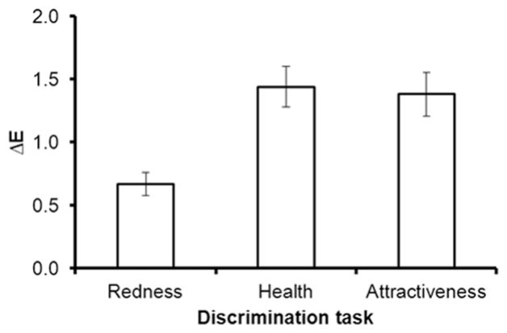

# 얼굴의 붉은기가 얼마나 달라져야 "더 건강·더 매력적"으로 보이나

**원제** Oxygenated-Blood Colour Change Thresholds for Perceived Facial Redness, Health, and Attractiveness
**저자** Daniel E. Re, Ross D. Whitehead, Dengke Xiao, David I. Perrett (세인트앤드루스대학)
**발표** PLoS ONE 2011;6(3):e17859 · [DOI 10.1371/journal.pone.0017859](https://doi.org/10.1371/journal.pone.0017859)
**라이선스** CC BY (Creative Commons Attribution License) (그래서 전문번역이 있습니다)

> **한 줄**: 산소화 혈색(붉은기)의 차이를 **"더 붉다"고 알아채는 데는 ΔE 0.67**이면 됐지만, **"더 건강하다"·"더 매력적이다"로 판단이 바뀌려면 ΔE 1.44·1.38**, 약 두 배가 필요했다. 건강과 매력의 문턱은 서로 같았다.

---

## 무엇을 물었나

앞선 연구(Stephen 외 2009)에서 산소화 혈색을 올리면 얼굴이 더 건강해 보였다. 그런데 **얼마나** 올려야 그렇게 보일까?

- 붉은색에 대한 선호가 단순한 **감각 편향**이라면, 눈에 보이는 붉은기 차이만 있으면 곧바로 더 매력적으로 보여야 한다.
- 선호가 **건강의 믿을 만한 단서**를 읽는 것이라면, 건강·매력 판단이 바뀌는 데는 **단순히 알아채는 것보다 더 큰 변화**가 필요할 것이다.

## 어떻게

| | 내용 |
|---|---|
| 얼굴 | 화장 안 한 20세 전후 남 2, 여 2 (영국, 색 보정 사진) |
| 색 조작 | 산소화 혈색 축(손을 뜨거운 물에 담근 전후 측정). 저·고 두 마스크 차이 ΔE 2.4를 ±100% 적용해 **64단계 연속체**, 양 끝 차이 **ΔE 4.8**. 피부만 바꾸고 머리·눈·배경은 그대로 |
| 과제 | 같은 얼굴을 붉기만 다르게 두 번(각 750 ms, 사이에 100 ms 마스크) 보여 주고 "어느 쪽이 더 **붉은가 / 건강해 보이나 / 매력적인가**" 강제 선택(2AFC) |
| 문턱 측정 | 계단법(staircase): 더 붉은 쪽을 고르면 차이를 절반으로, 틀리면 두 배로. 반전 3번의 평균을 문턱으로 |
| 참가자 | 대학생 26명(남 7, 여 19). 건강·매력 과제는 실험자 실수로 24명 분석 |

## 결과

| 판단 | 문턱 ΔE (평균, SEM) |
|---|---|
| 붉은기 구별 | **0.67** (0.09) |
| 건강 | **1.44** (0.16) |
| 매력 | **1.38** (0.17) |

- 붉은기 구별 문턱은 건강(d = −0.84), 매력(d = −0.78)보다 **유의하게 낮았다**.
- 건강과 매력의 문턱은 **다르지 않았다**(p = 0.70). (역자 주: 원문에는 이 비교가 t(22) = 3.92로 적혀 있는데 p = 0.70, d = 0.08과 맞지 않아 표기 오류로 보인다.)
- 얼굴 4개 사이, 참가자 성별에 따른 차이는 없었다.
- 저자 해석: 붉은기 선호는 단순 감각 편향이 아니라 **건강 상태의 단서**를 읽는 것에 가깝고, 얼굴 붉은기에 관해서는 **건강과 매력이 사실상 같은 판단**이다.

## 한계 (읽으며 본 것)

- **얼굴이 4개뿐**이다. 저자들도 원래 아주 건강해 보이는 얼굴은 더 큰 변화가 필요할 수 있다고 썼다.
- 750 ms씩 연달아 보여 주고 중간에 마스크를 넣었다. 실제로 얼굴을 보는 방식이 아니며, 오래 보거나 나란히 보면 문턱이 더 낮을 수 있다(저자 명시).
- 피부 전체의 색을 바꿨다. **볼에만 얹는 블러셔**의 문턱은 아니다.
- ΔE는 **보정된 모니터 위의 색 차이**다. 휴대폰 카메라가 찍은 사진의 ΔE와 바로 비교할 수 없다.
- 백인 얼굴, 영국 대학생 평가자.

---

## 우리 프로젝트에 주는 것

**1. 블러셔 "강도"의 하한선에 대한 감각.** 붉은기를 **알아채는 것**과 **좋아 보이는 것** 사이에 약 두 배의 간격이 있다(0.67 vs 1.44). "티는 나는데 효과는 없는" 옅은 블러셔 구간이 존재할 수 있다는 뜻이다. 강도 개인화에서 "너무 옅음" 경고의 논리 근거로 쓸 수 있다.

**2. 하지만 숫자를 그대로 채점 기준으로 쓰면 안 된다.**
- 이 ΔE는 **색 보정된 CRT 모니터**와 **얼굴 전체 피부** 기준이다. 우리가 휴대폰으로 잰 a\*·ΔE는 조명·화이트밸런스에 따라 이보다 훨씬 크게 흔들린다. **"볼 ΔE ≥ 1.44면 합격" 같은 규칙은 만들지 않는다.**
- 쓸 수 있는 형태는 "같은 사진 안에서 볼 영역과 기준 영역(이마·턱)의 **상대 차이**가 전보다 늘었는가" 정도의 **방향 판정**이다(우리 설계 아이디어, 논문이 검증한 것 아님).

**3. 건강 = 매력 (붉은기에 한해).** 블러셔의 목적을 사용자에게 설명할 때 "생기 있어 보이게"와 "예뻐 보이게"를 굳이 나눌 필요가 없다는 근거다.

**4. 발표용 한 줄**: "혈색을 알아채는 데 필요한 변화의 약 두 배가 있어야 '더 건강해 보인다'로 바뀝니다(Re 외, 2011). 옅게만 바르면 티는 나도 효과는 없을 수 있습니다."
