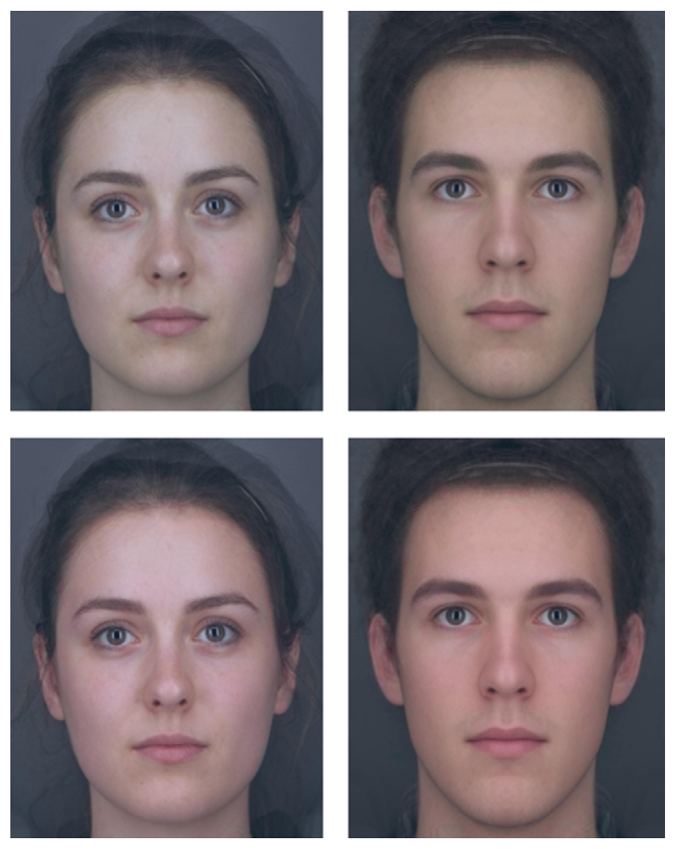

# 얼굴의 붉은 정도·건강·매력 지각에 필요한 산소화 혈액 색 변화의 역치

> **원문** Re DE, Whitehead RD, Xiao D, Perrett DI (2011). *Oxygenated-Blood Colour Change Thresholds for Perceived Facial Redness, Health, and Attractiveness.* PLoS ONE 6(3): e17859. https://doi.org/10.1371/journal.pone.0017859
>
> **라이선스** 원문 Copyright © 2011 Re et al. [Creative Commons Attribution License](https://creativecommons.org/licenses/by/)(원문에 버전 표기 없음)로 배포되는 오픈 액세스 논문이며, 원저자와 출처를 밝히는 조건으로 모든 매체에서 제한 없는 이용·배포·복제를 허용합니다.
>
> **변경 사항** 영어 원문을 한국어로 번역했습니다. 그림은 원문에서 잘라 캡션 앞에 넣었고, 참고문헌 목록은 생략했습니다(본문의 [숫자]는 원문 참고문헌 번호). 원저자가 검토한 번역이 아닙니다.

**용어 대응** — 산소화 혈액(oxygenated blood) · 탈산소화 혈액(deoxygenated blood) · 붉은 정도(redness): 이 논문에서는 "산소화 혈액 색"을 가리킴 · 역치(threshold): 판단이 바뀌는 데 필요한 최소 색 변화 · 2지선다 강제선택(2AFC) · 계단법(staircase method) · ΔE: CIE L\*a\*b\* 색공간에서의 색차 · 감각 편향(sensory bias)

**저자** Daniel E. Re, Ross D. Whitehead, Dengke Xiao, David I. Perrett — 세인트앤드루스 대학교 심리학부(영국)
**편집자** Satoru Suzuki, 노스웨스턴 대학교(미국)
**접수** 2010년 12월 22일 · **게재 승인** 2011년 2월 10일 · **출판** 2011년 3월 23일

---

## 초록

혈중 산소화 수준은 심혈관 체력과 관련되며, 사람 얼굴의 산소화 혈액 색을 높이면 지각된 건강이 높아진다. 이 연구는 2지선다 강제선택(2AFC) 정신물리학 설계를 사용해, 얼굴 색·건강·매력의 지각에 영향을 주는 데 필요한 산소화 혈액 색(붉은 정도) 변화의 역치를 정량화했다. 색 판단의 탐지 역치는 건강과 매력 판단의 역치보다 낮았고, 건강과 매력의 역치는 서로 다르지 않았다. 이 결과는 붉은 정도에 대한 선호가 감각 편향을 반영하는 것이 아니라, 건강 상태의 정확한 지표에 근거한 것일 수 있음을 시사한다. 또한 얼굴의 붉은 정도를 근거로 평가할 때 지각된 건강과 매력은 지각적으로 동등할 수 있음을 시사한다. 외모에 근거한 동기 부여는 생활 방식 변화에 효과적일 수 있다. 따라서 향후 연구는 심혈관 체력이 얼굴의 붉은 정도를 얼마나 높이는지 평가하고, 얼굴 매력을 높이는 데 필요한 유산소 운동의 변화를 정량화할 수 있을 것이다.

**재정 지원** 이 연구는 영국 학술원(British Academy)과 울프슨 재단(Wolfson Foundation)의 공동 연구 펠로십(참조 번호 WRP/2008/87)의 지원을 받았다. 지원 기관은 연구 설계, 자료 수집과 분석, 출판 결정, 원고 작성에 관여하지 않았다.

**이해 상충** 저자들은 이해 상충이 없다고 밝혔다.

## 서론

피부의 붉은 색은 여러 영장류 종에서 집단 상호작용에 영향을 준다. 수컷 맨드릴의 얼굴의 붉은 정도는 서열 위계에서의 위치와 상관이 있으며, 색이 강한 수컷일수록 더 높은 위치를 얻는다[1,2]. 수컷 마카크는 번식기에 테스토스테론이 증가하고[3], 이것이 얼굴의 붉은 정도를 높여[4] 암컷이 그 얼굴을 더 선호하게 만든다[5]. 붉은 피부색은 일부 암컷 영장류에도 나타나며 번식력의 신호로 작용한다. 암컷 마카크의 엉덩이 부위는 번식력이 높은 시기에 붉은 색이 증가하고, 수컷은 이 신호에 선택적으로 주의를 기울인다[6]. 암컷 맨드릴의 얼굴의 붉은 정도는 변동하며, 번식 가능한 시기에 가장 밝은 빨강이 된다[7]. 암컷 붉은털원숭이도 다른 암컷의 붉은 얼굴과 엉덩이에 선택적으로 주의를 기울이는데, 이는 붉은 색이 동성 간 상호작용에서도 두드러진 신호일 수 있음을 시사한다[8]. 수컷 차크마개코원숭이는 붉은 암컷 회음부를 보았을 때 성적 흥분이 증가하며, 이런 반응을 일으키는 색은 빨강뿐이다[9]. 영장류에서 붉은 신호가 매우 중요해서 영장류의 적-녹 색각 체계의 진화를 이끌었을 수 있다는 주장도 있다[10].

붉은 색은 사람의 상호작용에도 영향을 주는 것으로 보인다. Hill과 Barton[11]은 격투 종목 올림픽 경기를 연구해, 기량 수준을 통제했을 때 색이 임의로 배정되는데도 빨간 옷을 입은 선수가 파란 옷을 입은 선수보다 이길 가능성이 더 높다는 것을 발견했다. 가상 시뮬레이션에서 축구 골키퍼는 빨간 옷을 입은 선수의 페널티킥을 막는 데 자신감이 더 낮았다[12]. 태권도 심판은 파란 옷을 입은 상대와 수행이 똑같더라도 빨간 옷을 입은 선수에게 점수를 줄 가능성이 더 높다[13]. 화가 났을 때의 얼굴 홍조는 남녀 모두에서 붉은 정도를 높이며[14,15], 붉은 얼굴은 두려워하는 것보다 화나고 지배적인 것으로 지각될 가능성이 더 높다[16]. 실제로 원 같은 단순한 도형에서도 빨강은 파랑보다 더 공격적이고 지배적이며 신체 경쟁에서 이길 가능성이 더 높은 것으로 지각된다[17].

공격성·지배성과의 연관에도 불구하고, 빨강은 사람의 성(性)과의 연관이 잘 기록되어 있다. 빨강은 여러 문화와 연령 집단에 걸쳐 사랑·로맨스와 연결된다[18,19]. 인류학자들은 고대 문명에서 붉은 황토가 여성의 몸과 얼굴 칠에 쓰였으며, 아마도 성적 번식력을 상징했을 것이라고 본다[20]. 다른 영장류 종의 암컷과 비슷하게, 빨강의 표시(빨간 옷 등)는 여성을 남성에게 더 매력적으로 보이게 한다[21]. 마찬가지로 남성의 빨강 표시는 여성이 지각하는 남성의 지위와 전반적 매력을 높인다[22]. 여성은 기원전 10,000년부터 매력을 높이기 위해 입술에 붉은 치장을 해 왔다[23]. 사람의 성적 흥분은 흔히 가슴에서 목과 얼굴로 번지는 피부의 붉은 홍조를 동반한다[24]. 이런 결과들은 다른 영장류 종에서처럼 붉은 색이 사람의 성적 끌림과 연관되어 있음을 시사한다.

사람에게서 높은 수준의 산소화 혈액은 피부를 밝은 빨강으로 물들인다[25]. 높은 혈중 산소화는 심혈관 체력을 나타내며 유산소 운동으로 높일 수 있다[26]. 여성에서 에스트로겐 수준이 높으면 혈관 형성 증가[27]와 혈관 확장 증가[28]가 동반되는데, 이 두 반응은 피부 혈액의 동맥화를 높인다[29]. 반대로 피부로의 혈액 관류가 낮으면 눈에 띄는 창백함이 생기며, 이는 빈혈 같은 질병과 관련된다[30]. 높은 수준의 탈산소화 혈액은 피부에 푸르스름한 빛을 띠게 하며, 이는 관상동맥 질환이나 호흡기 질환을 나타낼 수 있다[31].

Stephen, Coetzee, Law-Smith, Perrett[32]는 얼굴의 붉은 정도를 조작하는 것(산소화 혈액 수준의 변화를 모사)이 건강 지각에 영향을 주는지 검사했다. 그들은 혈중 산소화 증가와 관련된 피부색을 높이면, 검사한 젊은 성인 백인 얼굴의 98%에서 지각된 건강이 높아진다는 것을 발견했다. 산소화 혈액 색 축과 탈산소화 혈액 색 축을 따라 피부색을 동시에 조작할 수 있을 때, 참가자들은 산소화 혈액 색을 높이고 탈산소화 혈액 색을 낮추는 쪽을 택했다. 또한 얼굴에 더해진 산소화 혈액 색의 양은 얼굴의 처음 색과 음의 상관이 있었다. 즉 처음에 얼굴의 붉은 정도가 낮을수록, 건강해 보이는 외모를 최적화하기 위해 더 많은 산소화 혈액 색이 더해졌다.

산소화 혈액 색(이하 붉은 정도)을 높이면 더 건강해 보이는 얼굴이 되지만, 이 효과가 지각될 수 있으려면 색이 얼마나 변해야 하는지는 알려져 있지 않다. 붉은 정도에 대한 사람의 선호가 감각 편향을 반영할 가능성이 있으며, 그렇다면 지각 가능한 붉은 색의 어떤 변화든 지각된 건강이나 매력에 영향을 줄 수 있을 것이다. 여러 종에서 짝 선택의 색 선호는 성과 무관한 감각 편향에서 진화했다[33,34]. 예를 들어 먹이 색에 대한 선호가 구피[35]와 바우어새[36]의 짝짓기 색 선호로 이어졌을 수 있다. 세가시큰가시고기와 아홉가시큰가시고기에서 붉은 색에 대한 성적 선호는 붉은 먹이 선호에 의해 형성되었을 수 있으며, 학습된 색 선호를 반영하지 않는다[37]. 사람에게도 빨강에 대한 비슷한 편향이 있을 수 있다. 실제로 빨간색에 대한 사람의 선호는 생후 4–5개월 영아에게서 발견되며[38], 영국과 중국 여성은 흰 배경 위의 불그스름한 대비를 선호한다[39]. 얼굴의 붉은 정도에 대한 사람의 선호가 빨강에 대한 기존의(학습되지 않은) 감각 편향에서 비롯된다면, 지각 가능한 붉은 정도의 어떤 변화든 지각된 얼굴 매력을 바꿀 수 있을 것이다(다른 모든 얼굴 특징이 일정하다고 가정할 때). 반대로 붉은 정도 선호는 밑바탕의 생리적 적합도나 생식 호르몬 상태의 지표에 근거한 짝 선택 결정을 반영할 수도 있다. 그렇다면, 다른 모든 얼굴 특징이 일정하다고 가정할 때, 지각된 건강과 매력을 바꾸는 데 필요한 색 변화는 단순한 색 변별의 역치를 넘을 것이다. 적합도나 호르몬 상태의 믿을 만한 변화는 피부 혈액 관류나 산소화의 상당한 변화로만 나타날 수 있기 때문이다. 붉은 정도 변별과 건강·매력 판단의 정신물리학적 역치를 구하면, 얼굴의 붉은 정도에 대한 선호의 근거를 밝히는 데 도움이 될 수 있다.

얼굴 매력은 밑바탕의 건강을 신호한다고 여겨지며[40,41], 얼굴 매력의 여러 특징(대칭, 평균성, 성적 이형성 등)은 지각된 건강을 통계적으로 통제하면 매력에 거의 영향을 주지 않는다[42,43]. 그러나 사람 얼굴 자극에서 가장 건강하게 지각되는 것과 가장 매력적으로 지각되는 것이 항상 일치하지는 않는다[44]. 따라서 얼굴의 붉은 정도의 작은 변동만으로도 지각된 매력이 바뀔 수 있는 반면, 건강 지각은 훨씬 두드러진 붉은 정도 차이로만 바뀔 가능성이 있다(또는 그 반대). 건강과 매력 판단에서 얼굴의 붉은 정도에 대한 정신물리학적 역치를 구하면, 얼굴의 붉은 정도를 근거로 평가할 때 건강과 매력 사이의 지각적 연관이 드러날 것이다.

얼굴의 붉은 정도는 혈중 산소화와 피부 관류의 결과이며[25], 이것은 유산소 훈련으로 높일 수 있다[26]. 지각된 얼굴 건강과 매력에 대한 붉은 정도 변화 역치를 구하면, 연구자들이 더 건강해 보이고 더 매력적이 되는 데 필요한 주당 유산소 운동량을 정량화할 수 있을지 모른다. 선행 연구는 더 건강한 생활 방식으로 인한 외모 개선을 보여 주는 것이 더 건강한 생활을 동기 부여할 수 있음을 발견했다[45]. 더 건강해 보이고 매력적이 되는 데 필요한 운동 증가를 정량화하면, 더 의욕적이고 목표 지향적인 운동 계획으로 이어질 수 있다.

이 연구에서 우리는 혈중 산소화 수준의 변화를 모사하기 위해 얼굴의 붉은 정도를 조작했다. 그런 다음 세 가지 지각 변수, 즉 얼굴의 붉은 정도·건강·매력을 바꾸는 데 필요한 붉은 정도 변화 역치를 구했다. 이 연구의 결과는 붉은 정도 선호의 본질을 밝히는 데 도움이 될 수 있으며, 지각된 얼굴 건강과 매력을 높이는 데 필요한 유산소 운동 증가를 정량화하는 데 쓰일 수 있다.

## 방법

이 연구는 세인트앤드루스 대학교 윤리위원회의 승인을 받아 수행되었다. 모든 참가자는 참여 전에 서면 동의서를 제출했다.

### 피부 색소 결정

정확한 산소화 혈액 색을 만들기 위해 Stephen 등[32]의 방법을 사용했다. 왼손을 책상 위에 2분 동안 올려 둔 뒤, 왼손의 제1 등쪽 뼈사이근 부위를 분광측색계로 CIE L\*a\*b\* 공간에서 측정했다(정반사 성분 제외, 광원 D65, 10° 관찰자 각도). 이어서 손을 뜨거운(45–50 °C) 물에 5분 동안 담근 뒤 추가로 측정했는데, 이는 강한 충혈을 일으키고 혈액의 동맥화를 높인다. 산소화 혈액 수준과 관련된 피부색 변화는 손과 얼굴에서 비슷하다[32].

### 사진 촬영

촬영 조건은 Stephen 등[32]과 동일했다. 남성 2명과 여성 2명(평균 나이 = 20, 범위 = 19–21)을 조명이 통제된 촬영 부스에서 화장하지 않은 무표정한 얼굴로 촬영했다. 참가자들에게 안경과 눈에 보이는 장신구를 벗고 무표정을 유지하도록 요청했다. 사진은 고정 초점거리 60 mm 렌즈를 단 Fujifilm FinePix S5Pro 디지털 SLR 카메라로, 모든 면을 Munsell N5 회색으로 칠한 부스 안에서 찍었다. 조명은 Verivide 6504K 주광 모사 전구 3개만 사용했다. 참가자는 옷에서 오는 반사를 가리기 위해 Munsell N5로 칠한 판을 어깨 위에 들었다. 이미지의 색 보정을 위해 각 이미지에 GretagMacbeth Mini ColourChecker 차트를 함께 넣었다. 24개 컬러체커 패치 각각의 관찰된 RGB 값을, 분광측색계로 구한 같은 패치들의 CIE L\*a\*b\* 값 쪽으로, 11항 다항식 전개의 최소제곱 변환을 사용해 변환함으로써 이미지의 색을 보정했다[46]. 그 결과 평균 색 오차(ΔE)는 1.97이었다. ΔE는 CIE L\*a\*b\* 색공간에서 색 오차를 나타내는 표준 방법이며, 여기서는 보정된 이미지와 기준 색 패치 사이의 유클리드 거리를 뜻한다.

### 이미지 조작

Matlab에서 얼굴 색 마스크 두 개를 만들었다. 하나는 높은 혈중 산소 색소를, 다른 하나는 낮은 혈중 산소 색소를 모사한다. 두 마스크 사이의 ΔE는 2.4였다. 두 마스크 사이의 색 차이의 ±100%를 조작하지 않은 얼굴 이미지 4장(남성 2, 여성 2; 사용한 자극의 유형의 예는 그림 1 참조)의 모든 피부 부분에 적용해, 낮은 산소 색소 색에서 높은 산소 색소 색까지 이르는 64장의 이미지로 된 색 연속체를 만들었다. 이렇게 해서 양 끝의 ΔE가 4.8인 얼굴 연속체가 만들어졌다. 이미지의 머리카락, 눈, 배경은 조작하지 않았다. 모든 얼굴 이미지는 색 보정된 CRT 화면에 같은 크기로 제시되었다. 참가자들은 어두운 부스에서 화면으로부터 약 50 cm 떨어져 앉았다.

**그림 1.** 사용한 얼굴 자극 유형의 예. 윗줄은 검사한 자극 중 산소화 혈액 색이 가장 낮은 것이고, 아랫줄은 가장 높은 것이다. 윗줄과 아랫줄의 색 차이는 4.8(ΔE)이다. 이 이미지들은 여러 얼굴을 평균해 만든 것으로 실제 실험에는 쓰이지 않았지만, 얼굴이 어떻게 제시되었는지를 정확히 보여 주며 색 연속체 양 끝의 색 차이를 보여 준다.
doi:10.1371/journal.pone.0017859.g001

### 참가자와 절차

학부생 26명(평균 나이: 18.9, 표준편차: 0.95, 범위: 18–22; 남성 7명, 여성 19명)이 학점을 받고 연구에 참여했다. 모든 참가자가 정상 색각이라고 보고했다. 26명 모두 붉은 정도 변별 분석에 포함되었고, 실험자의 실수로 건강과 매력 과제의 분석에는 24명만 포함되었다(한 참가자는 두 과제를 모두 놓쳤고, 다른 두 참가자는 각각 한 과제를 놓쳤다).

참가자들은 붉은 정도·건강·매력 변별의 세 블록으로 나뉜 2지선다 강제선택(2AFC) 과제를 수행했다. 과제는 다음과 같이 진행되었다. 얼굴을 750 ms 동안 보여 준 뒤, 흰 배경 위에 무작위 검은 점으로 된 짧은(100 ms) 시각 차폐 자극(시각 영역의 약 절반을 덮으며 각 점은 몇 픽셀 크기)을 보여 주고, 이어서 붉은 정도가 다른 같은 얼굴을 750 ms 동안 보여 주었다. 그런 다음 참가자에게 어느 얼굴(첫째 또는 둘째)이 더 붉어 보이는지(붉은 정도 변별), 더 건강해 보이는지(건강 변별), 또는 더 매력적으로 보이는지(매력 변별)를 물었다. 세 블록의 제시 순서는 무작위였으며, 우연히 특정 제시 순서로 치우치지도 않았다.

선행 연구는 산소화 혈액 색이 얼굴을 더 건강해 보이게 한다는 것을 보였고[32], 얼굴 매력은 흔히 건강 단서에 근거한다[42]. 그래서 우리는 이 실험에서 얼굴의 붉은 정도가 높을수록 더 건강하고 매력적으로 지각될 것이라고 가정했다. 각 블록 안에서 네 얼굴 각각에 대해 계단법 설계로 붉은 정도 변화 역치를 구했다. 각 블록은 색 연속체의 양 끝에 있는 얼굴들(ΔE = 4.8)을 보여 주는 시행으로 시작했다. 참가자가 붉은 정도가 더 높은 얼굴을 고르면, 그 얼굴을 쓰는 다음 시행은 이전 시행의 색 차이의 절반을 가졌다(예: 첫 시행에서 더 붉은 얼굴을 고르면, 그 얼굴을 쓰는 두 번째 시행은 ΔE 2.4를 보여 준다). 각 시행에서 두 얼굴의 평균 색은 계단 전체에 걸쳐 일정하게 유지되었다. 참가자가 첫 시행에서 붉은 정도가 더 낮은 얼굴을 고르면 그 시행을 반복했고, 네 번 연속으로 붉은 정도가 더 낮은 얼굴을 고르면 색 역치를 4.8(연속체 양 끝의 색 차이)로 기록했다. 참가자가 색 차이가 가장 작은 계단 시행에서(거기까지 도달했다면) 붉은 정도가 더 높은 얼굴을 고르면 그 시행을 반복했다. 네 번 연속으로 붉은 정도가 더 높은 얼굴을 고르면 색 역치를 0.075(연속체의 각 간격 사이의 색 차이)로 기록했다. 연속된 시행에서 같은 얼굴이 나오는 일이 드물도록 네 얼굴을 각 블록 안에서 섞어 제시했다. 이는 특정 얼굴에 대한 시각적 적응을 피하기 위해서였는데, 그런 적응은 붉은 정도 변화 역치에 영향을 줄 수 있다. 프로그램은 네 얼굴 각각에 대해 따로 붉은 정도 변화 역치를 구했다. 즉 한 얼굴을 보여 주는 시행은 다른 얼굴들의 '계단' 상태에 영향을 주지 않았다. 참가자가 붉은 정도가 더 낮은 얼굴을 고르면 이것은 계단의 '반전'이 되고, 그 얼굴의 다음 시행은 이전 시행의 두 배의 색 차이를 가졌다. 역치 값은 세 번의 계단 반전의 평균 색 차이로 정의했다. 계단 반전은 참가자가 첫 시행에서 붉은 정도가 더 높은 얼굴을 고른 뒤부터만 셌다.

## 결과

각 판단 유형에 대해 네 얼굴의 역치를 분석했다. 반복측정 분산분석(ANOVA) 결과, 붉은 정도 변별(F(3, 75) = 2.23, p = 0.09, η² = 0.08), 건강(F(3, 69) = 0.62, p = 0.61, η² = 0.03), 매력(F(3, 69) = 0.62, p = 0.60, η² = 0.03) 과제에서 얼굴 간 유의한 차이가 없었다. 그래서 세 판단 유형 각각의 평균 역치를 계산하기 위해 얼굴들의 역치를 합쳤다.

평균 ΔE 역치는 붉은 정도 변별에서 0.67(SEM: 0.09), 건강 변별에서 1.44(SEM: 0.16), 매력 변별에서 1.38(SEM: 0.17)이었다(그림 2). 붉은 정도(F(1,24) = 1.30, p = 0.27, η² = 0.05), 건강(F(1,22) = 0.08, p = 0.78, η² < 0.01), 매력(F(1,22) = 0.37, p = 0.55, η² = 0.02) 변별 역치에 참가자 성별의 효과는 없었다. 붉은 정도(F(1,24) = 0.37, p = 0.54, η² = 0.02), 건강(F(1,22) = 0.62, p = 0.44, η² = 0.03), 매력(F(1, 22) = 0.40, p = 0.53, η² = 0.02) 변별 역치에서 얼굴 성별과 참가자 성별 사이의 유의한 상호작용도 없었다.

대응표본 t검정 결과, 붉은 정도 변별의 역치는 건강(t(23) = −3.97, p < 0.01, Cohen's d = −0.84)과 매력(t(23) = −3.64, p < 0.01, Cohen's d = −0.78)의 역치보다 유의하게 낮았다. 건강과 매력의 역치는 유의하게 다르지 않았다(t(22) = 3.92, p = 0.70, Cohen's d = 0.08). (역자 주: 원문에 t(22) = 3.92로 인쇄되어 있으나, p = 0.70·d = 0.08과 맞지 않아 원문의 오기일 가능성이 있습니다. 숫자는 원문 그대로 두었습니다.)

**그림 2.** 붉은 정도·건강·매력 변별의 변별 역치와 표준오차(ΔE 값).
doi:10.1371/journal.pone.0017859.g002

## 논의

얼굴 색은 건강과 매력의 여러 단서 중 하나일 뿐이지만, 이 실험에서는 얼굴의 붉은 정도만 조작했다. 따라서 이 연구에서 지각된 건강과 매력의 차이는 모두 얼굴의 붉은 정도의 변화에서 온 것이다. 사람의 붉은 정도 선호가 감각 편향에서 비롯된다면, 다른 점에서는 똑같은 두 얼굴 사이의 탐지 가능한 붉은 정도 차이는 지각된 매력을 바꿔야 한다. 이 연구의 결과는 같은 검사 절차를 쓸 때, 작지만 탐지 가능한 붉은 정도 변화가 지각된 얼굴 건강과 매력을 반드시 바꾸지는 않는다는 것을 보여 준다. 우리 결과는 붉은 정도에 대한 끌림이, 건강과 짝 선택에 대한 믿을 만한 색 단서(예: 심혈관 체력[26]과 관련된 혈중 산소화 수준[25])에 대한 타고난 또는 학습된 선호를 반영한다는 것과 일치한다. 여성의 피부 붉은 정도는 에스트로겐 수준에 따라 증가하며[27], 에스트로겐은 번식력이 높은 시기에 높아진다[47]. 따라서 여성의 붉은 정도는 심혈관 체력만이 아니라, 다른 영장류 종의 암컷에서 발견되는 것처럼[6,7] 번식력의 미묘한 단서일 수도 있다. 건강과 매력 과제의 붉은 정도 변화 역치는 유의하게 다르지 않았다. 이 결과의 한 가지 해석은, 얼굴의 붉은 정도를 근거로 평가할 때 건강과 매력이 지각적으로 동등하다는 것이다. 피부의 붉은 정도는 혈중 산소화[25], 따라서 심혈관 체력[26]을 나타낸다. 얼굴의 붉은 정도 선호가 이 건강 단서를 이용하도록 진화했을 가능성을 생각해 볼 수 있다. 얼굴 지방량[44] 같은 일부 얼굴 변수에서는 지각된 최적의 건강과 매력 사이에 차이가 생길 수 있지만, 지각된 건강과 매력에 대한 붉은 정도 변화 역치가 비슷하다는 것은 색에 관해서는 두 속성이 밀접하게 연결되어 있음을 시사한다. 얼굴의 붉은 정도는 매력이 밑바탕의 건강과 연결된 또 하나의 변수일 수 있다[41–43].

붉은 정도 변별 과제는 건강이나 매력 과제보다 더 작은 붉은 정도 변화를 요구했다. 이런 역치 차이는 신경 처리 정도의 차이 때문일 수 있다. 붉은 정도 변별 과제는 색 강도에 대한 직접적인 결정을 요구한다[48–49]. 건강과 매력에 대한 판단은 더 복잡하며, 판단을 내리기 전에 뇌의 보상 중추가 관여해야 할 가능성이 높다[50–54]. 이 연구에서 발견한 역치 차이는 건강과 매력 판단을 처리하는 추가 단계 때문일 수 있다. 그러나 사회적 귀인에 관한 다른 정신물리학 연구들은 사회적 귀인의 자극 변화 역치가 단순 변별의 역치보다 항상 높지는 않다는 것을 발견했다. 예를 들어 목소리 음높이 변별과 목소리 남성성(음높이와 관련된 특성) 귀인의 역치는 유의하게 다르지 않다(Re, 미발표 자료). 따라서 자극 변별 과제와 사회적 귀인 과제 사이의 역치 차이는 그 사회적 귀인이 감각 단서와 얼마나 밀접하게 연결되어 있는지에 달려 있을 수 있다. 예를 들어 붉은 정도 변별과 건강·매력 판단 사이의 역치 차이는, 건강·매력과 덜 연관된 단서의 역치 차이보다 작을 가능성이 높다.

이 실험은 건강과 매력 평가에서 얼굴의 붉은 정도의 역치를 구하기 위해 남성 얼굴 2장과 여성 얼굴 2장을 사용했다. 이 네 얼굴 사이에서는 역치가 다르지 않았지만, 처음부터 지각된 건강과 매력이 매우 낮거나 높은 얼굴에서도 역치가 다르지 않을지는 확신할 수 없다. 예를 들어 이미 매우 건강해 보이고 매력적인 얼굴은 지각된 건강과 매력을 높이는 데 더 큰 붉은 정도 변화가 필요할 수 있다. 여기서 사용한 네 얼굴 각각에서 붉은 정도를 높이면 지각된 건강과 매력이 높아졌으며(그렇지 않았다면 사용한 계단법 절차가 작동하지 않았을 것이다), 이는 이 네 얼굴에서 지각된 건강과 매력에 천장 효과가 없었음을 나타낸다. 추가 연구로 역치가 처음의 지각된 건강과 매력에 따라 달라지는지 밝힐 수 있을 것이다.

얼굴의 붉은 정도는 혈중 산소화[25]와 에스트로겐 수준[27]만이 아니라 분노나 당황 같은 감정과도 관련된다는 점[14,15]에 유의해야 한다. 그러나 이런 감정에 따른 피부 붉은 정도의 변동은 일시적이며 비교적 빨리 지나간다[14]. 얼굴의 붉은 정도에 대한 장기적인 선호가 이런 단기 변동을 반영할 가능성은 낮으며, 생리의 안정적인 장기 단서에서 비롯될 가능성이 더 높다(다만 성적 흥분으로 인한 피부 붉은 정도의 단기 증가도 끌림의 원인일 수 있다).

이 실험은 시행 이미지를 순차적으로, 짧은 시간(750 ms) 동안, 사이에 시각 차폐 자극(100 ms)을 두고 제시했다는 점에 유의해야 한다. 이는 얼굴에 대한 시각적 적응을 피하기 위한 것이었으며, 분명 자연스럽게 얼굴을 보는 방식은 아니다. 얼굴을 더 오래 보여 주거나 중간 차폐 자극 없이 보여 주는 등 다른 이미지 제시 방법을 쓰면 더 낮은 역치가 나올 수 있다. 그렇지만 우리 방법에서 붉은 정도 탐지의 역치와 건강·매력 판단의 역치가 갈라진다는 것은 분명하다.

산소화 혈액 수준과 관련된 피부의 붉은 정도는 유산소 훈련으로 높아진다[26]. 이 연구의 결과는 지각된 매력을 높이는 데 필요한 색 변화를 정량화한다. 향후 연구는 유산소 운동의 변화(즉 주당 운동 시간)가 피부의 붉은 정도에 어떻게 영향을 주는지 정량화할 수 있을 것이다. 그런 연구는 얼굴의 건강과 매력에 눈에 띄는 변화를 만드는 데 필요한 운동 계획의 변화를 제시할 수 있다. 얼굴 매력을 높이는 데 심혈관 체력이 얼마나 개선되어야 하는지 정량화할 수 있다면, 더 목표 지향적인 운동 계획으로 이어지고 더 건강한 생활 방식을 실천할 유인이 더해질 수 있다.

## 감사의 글

편집과 이론적 논의를 해 준 Amanda Hahn, 자극을 만들어 준 Ian Stephen, 교정을 봐 준 Anne Perrett에게 특별히 감사한다.

## 저자 기여

실험 착안·설계: DER DX DIP. 실험 수행: DER RDW. 자료 분석: DER RDW DIP. 시약·재료·분석 도구 제공: DER RDW. 논문 작성: DER RDW DIP. 실험에 쓴 소프트웨어 설계: DX.

## 참고문헌

(생략 — 원문 참조)
