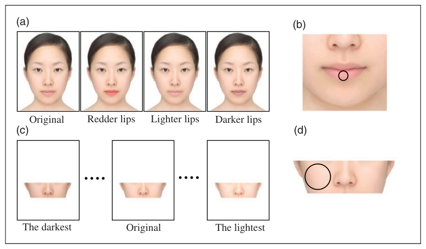
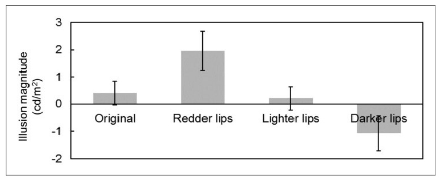
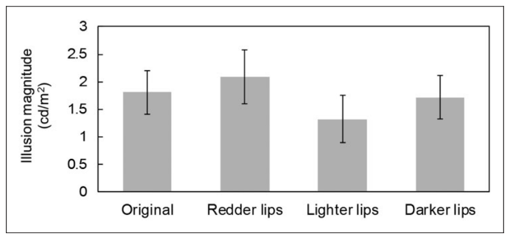

# 입술 색이 얼굴 피부의 지각된 밝기에 미치는 효과

> **원문** Kobayashi Y, Matsushita S, Morikawa K (2017). *Effects of Lip Color on Perceived Lightness of Human Facial Skin.* i-Perception 8(4) (July–August 2017): 1–10. https://doi.org/10.1177/2041669517717500
>
> **라이선스** 원문 © The Author(s) 2017. [Creative Commons Attribution 4.0 License](http://www.creativecommons.org/licenses/by/4.0/)로 배포되며, SAGE 및 Open Access 페이지에 명시된 방식으로 원저작물의 출처를 밝히는 조건으로 추가 허락 없이 모든 이용·복제·배포를 허용합니다.
>
> **변경 사항** 영어 원문을 한국어로 번역했습니다. 그림은 원문에서 잘라 캡션 앞에 넣었고, 참고문헌 목록과 저자 소개는 생략했습니다(본문의 인용은 원문 표기 그대로 둠). 원저자가 검토한 번역이 아닙니다.
>
> **정오표** 이 논문에는 2019년 정오표(erratum)가 나왔습니다([DOI 10.1177/2041669519865375](https://doi.org/10.1177/2041669519865375)). 이 번역은 2017년 원문을 옮긴 것이며, 정오표의 내용은 반영하지 않았습니다(정오표 본문은 확인하지 못했습니다).

**용어 대응** — 밝기(lightness): 표면이 얼마나 밝은 색으로 보이는지 · 휘도(luminance, cd/m²): 측정된 물리적 밝기 · 동화(assimilation): 주변의 속성을 닮아 보이는 방향의 착시 · 대비(contrast): 주변과 반대로 보이는 방향의 착시 · 전체적 처리(holistic processing): 얼굴을 부분의 합이 아니라 하나의 전체로 처리하는 것 · 주관적 등가점(PSE, point of subjective equality) · 항상자극법(method of constant stimuli)

---

## 초록

여러 연구가 사람 얼굴에서 일어나는 기하학적 착시를 보고했지만, 얼굴에서의 색이나 밝기 착시는 거의 탐구되지 않았다. 여기서 우리는 입술 색이 얼굴 피부의 지각된 밝기에 영향을 주는지를 정신물리학적으로 조사했다. 실험 1의 결과, 더 붉은 입술은 지각된 안색을 밝게 하고 더 어두운 입술은 어둡게 했다. 이런 밝게 하거나 어둡게 하는 유도 효과는 두 가지 이유에서 얼굴이 아닌 대상에서의 고전적인 밝기 대비 착시와 다르다. 첫째, 착시 효과가 대비보다는 동화에 가깝다. 둘째, 유도하는 영역(즉, 입술)이 영향받는 영역(얼굴 피부)보다 훨씬 작다. 실험 2는 이 동화적 밝기 유도가 얼굴의 전체적 처리에 의해 일어났음을 보였다. 이 연구는 입술 색이 지각되는 얼굴 피부색을 바꿀 수 있다는 화장품 제조사와 메이크업 아티스트의 주장을 과학적으로 입증한 첫 연구다. 얼굴 지각, 밝기 착시, 화장의 지각적 효과에 대한 함의를 논의한다.

**키워드** 동화, 화장품, 얼굴, 착시, 밝기, 입술

## 서론

이 연구는 지각 연구의 세 분야, 즉 얼굴 지각, 밝기 착시, 화장의 지각적 효과 사이의 상호작용을 살펴보았다. 얼굴 지각과 밝기 착시(예: 밝기 지각은 인접 영역의 밝기에 영향을 받는다)는 수많은 연구에서 따로따로 조사되어 왔고(Adelson, 2000; Tanaka & Farah, 1993), 서로 관련이 거의 없는 별개의 연구 분야로 이미 자리 잡았다. 또한 최근 몇 년 사이 화장의 지각적 효과가 유망한 새 지각 연구 분야로 주목받기 시작했다(Matsushita, Morikawa, Mitsuzane, & Yamanami, 2015; Morikawa, Matsushita, Tomita, & Yamanami, 2015). 그러나 이 세 분야의 교차점을 다룬 연구는, 있다 해도 매우 적다.

몇몇 연구가 얼굴에서의 모양이나 크기 착시를 조사했지만(Lee & Freire, 1999; Matsushita, Morikawa, & Yamanami, 2015; Morikawa et al., 2015), 얼굴의 색이나 밝기 착시는 대체로 탐구되지 않은 채 남아 있다. 메이크업 아티스트와 화장품 광고는 입술 색이 얼굴 피부의 겉보기 밝기에 영향을 줄 수 있다고 자주 주장한다(예: http://verilymag.com/2015/02/best-lipstick-skin-tone). 현재 우리에게는 이런 주장을 뒷받침하거나 부정할 과학적 증거가 없다.

선행 연구들은 얼굴의 색이나 밝기가 지각된 건강함과 매력의 주요 결정 요인임을 밝혔다(Frost, 1990; Pazda, Thorstenson, Elliot, & Perrett, 2016; Stephen, Coetzee, & Perrett, 2011). 더구나 밝은 얼굴 피부와 어두운 얼굴 부위(눈과 입술) 사이의 대비는 지각된 건강, 여성성, 매력과 양의 상관을 보인다(Jones, Russell, & Ward, 2015; Russell, 2003, 2010). 실제로 화장품이 얼굴을 더 여성적으로, 따라서 더 매력적으로 보이게 하는 한 가지 방법은 얼굴 대비를 과장하는 것이다(Jones et al., 2015; Russell, 2010). 화장품이 매력에 주는 효과는 크지 않을 수 있지만(Jones & Kramer, 2015, 2016), 입술의 색과 밝기는 립스틱으로 쉽고 극적으로 바꿀 수 있다. 립스틱은 입술과 얼굴 피부 사이의 대비를 높일 뿐 아니라 피부의 지각된 밝기에도 영향을 줄 수 있다. 따라서 입술 색이 얼굴 피부의 지각된 밝기에 주는 효과를 검증하는 것은 과학적으로 흥미로울 뿐 아니라 실용적으로도 유익할 것이다.

한편으로는 입술 색이 얼굴 피부의 지각된 밝기에 영향을 주지 않으리라고 생각할 이유가 있다. 입술 영역은 얼굴 피부 영역보다 훨씬 작다. 일반적으로 얼굴이 아닌 대상과 표면에서는, 더 크고 둘러싸는 영역의 색이나 밝기가 더 작고 둘러싸인 영역의 지각된 색이나 밝기에 영향을 주지만 그 반대는 아니다(Yund & Armington, 1974). 더 작은 영역이 더 큰 주변 영역에 영향을 줄 수도 있겠지만, 그 효과는 관찰하기에 너무 약할 것이다. 입술은 그것을 둘러싼 얼굴 피부보다 훨씬 작다. 이런 사실을 고려하면, 입술의 색이나 밝기가 더 크고 둘러싸는 영역, 즉 얼굴 피부의 색이나 밝기에 영향을 줄 가능성은 낮다고 예측할 수 있다.

다른 한편으로, 많은 연구자는 얼굴 처리가 얼굴이 아닌 대상의 처리와 다르다고 주장해 왔다. 얼굴 처리는 전체적 처리에 훨씬 더 크게 의존하기 때문이다(Cornes, Donnelly, Godwin, & Wenger, 2011; Rossion, 2013; Tanaka & Farah, 1993). 따라서 얼굴에서의 밝기 유도 양상은 얼굴이 아닌 대상에서의 양상과 다를 수 있다. Morikawa(2017)는 사람의 얼굴과 몸에서 일어나는 기하학적 착시가 대비보다는 동화 방향으로 일어나는 경향이 있다고 지적했다. Morikawa는 기하학적 착시의 이런 양상이 고전적인 비(非)얼굴 착시와 구별된다고 주장하며, 이를 "생물학적 착시(biological illusion)"라고 불렀다. 이 독특한 경향이 얼굴의 밝기 지각에서도 일어난다면, 입술 색이 지각되는 얼굴 피부톤에 영향을 줄 수 있다. 사람 얼굴에서의 밝기 착시를 조사하고 그것을 얼굴이 아닌 대상에서의 착시와 비교하는 일은 밝기 지각과 얼굴 지각 연구 모두에 기여할 수 있다. 그래서 이 연구는 입술의 색과 밝기가 얼굴 피부의 지각된 밝기에 영향을 줄 수 있는지 조사하고자 했다.

## 실험 1

### 방법

이 연구는 오사카대학 인간과학연구과 연구윤리위원회의 승인을 받았다. 실험의 목적을 모르는 자원자 21명(여성 10명)이 실험 1에 참여했다. 나이는 20~32세였다(M = 23.4, SD = 2.54). 이들은 정상 시력 또는 교정 시력이 정상이었고 정상 삼색형 색각을 가졌으며, 서면 동의서를 제출했다. 이 연구의 표본 크기는 전형적인 밝기 지각 연구(예: Madigan & Brainard, 2014; Sawayama & Kimura, 2012)에 비해 훨씬 크다. 자극은 PsychoPy2 1.82.01(Peirce, 2007, 2008)로 만든 컴퓨터 프로그램으로 LCD 화면(NEC MultiSync LCD-PA241W, 화면 크기 518 × 324 mm, 1920 × 1200 픽셀, 주사율 60 Hz, 흰색의 CIE 색도 좌표: x = 0.322, y = 0.326)에 제시했다. 관찰 거리는 턱받침을 써서 57 cm로 고정했다. 실내는 보통 조명이었다.

모든 얼굴 자극은 20대 일본 여성 40명의 평균 얼굴로부터 만들었다. 이들은 같은 확산 조명 아래에서 무표정을 유지한 채 촬영되었다. 얼굴을 평균하는 데는 Morph 2.5 J 소프트웨어를 사용했다. 자극 이미지의 크기는 얼굴의 흰 배경(113.8 cd/m²)을 포함해 가로 816 픽셀, 세로 1052 픽셀(가로 220 mm, 세로 284 mm)이었다. 이 연구는 입술 색이 일으키는 색이나 밝기 착시를 측정하려는 가장 초기의 시도 중 하나이므로, 출발점으로 평균 얼굴을 채택했다.

표준 자극은 네 가지를 썼다(그림 1(a)). 하나는 원래 얼굴이고, 나머지는 더 밝은 입술, 더 어두운 입술, 더 붉은 입술을 가진 얼굴이었다. 주된 관심이 밝기 착시였으므로 표준 자극에 더 어두운 입술과 더 밝은 입술을 넣었다. 선행 연구는 붉은 기가 도는 얼굴 피부가 더 밝게 지각된다고 보고했다(Yoshikawa, Kikuchi, Yaguchi, Mizokami, & Takata, 2012). 입술 색이 얼굴 피부색에 동화된다면, 더 붉은 입술은 얼굴 피부를 더 밝아 보이게 만들 수 있다. 그래서 표준 자극에 더 붉은 입술도 포함했다. 이렇게 바꾼 입술은 Adobe Photoshop CS3로 만들었다. Hue/Saturation(색조/채도) 기능을 써서 어둡게 할 때는 밝기 값을 8만큼 낮추고, 밝게 할 때는 12만큼 높였다. Color Balance(색상 균형) 기능을 써서 붉게 할 때는 빨강 값을 100만큼 높였다. 얼굴 자체의 크기는 눈 높이에서 가로 약 544 픽셀(147 mm), 정수리부터 턱 끝까지 세로 약 937 픽셀(253 mm)이었다. 아랫입술을 덮는 작은 원형 영역(그림 1(b))의 평균 휘도와 CIE 색도 좌표는 각각 다음과 같았다. 원래: 53.5 cd/m², (x, y) = (0.414, 0.347); 더 붉은 입술: 45.0 cd/m², (x, y) = (0.466, 0.340); 더 밝은 입술: 56.0 cd/m², (x, y) = (0.397, 0.353); 더 어두운 입술: 43.7 cd/m², (x, y) = (0.414, 0.347). 더 어두운 입술의 휘도를 낮춘 폭이 더 밝은 입술의 휘도를 높인 폭보다 큰데, 일상 화장에서는 입술을 밝게 하는 립스틱보다 어둡게 하는 립스틱이 훨씬 흔하기 때문이다(Russell, 2009).

**그림 1.** (a) 네 가지 표준 자극. 입술 색을 제외하면 동일한 얼굴이다. (b) 휘도와 색도 좌표를 측정한 영역을 아랫입술 위의 원으로 표시했다. (c) 비교 자극의 예. 아홉 단계를 준비했다. (d) 각 비교 자극에서 휘도를 측정한 영역을 뺨 위의 원으로 표시했다.

비교 자극은 세 가지 이유로 평균 얼굴의 가운데 가로 띠만으로 구성했다(그림 1(c)). 첫째, 사람 얼굴에서 "안색"을 가장 잘 대표하는 부위는 이마나 턱이 아니라 뺨이다. 둘째, 밝기 대비나 동화 착시는 유도 영역과 검사 영역 사이의 공간적 거리에 민감하다는 것이 잘 알려져 있다. 입술 색에 조금이라도 착시 효과가 있다면, 그것은 이마가 아니라 입술 가까운 피부 영역에서 나타날 가능성이 가장 크다. 셋째, 참가자들이 얼굴의 같은 부위에서 휘도를 비교하기를 원했다. 비교 자극이 얼굴 전체였다면, 어떤 참가자는 이마를, 다른 참가자는 코나 뺨 등을 비교했을 수 있다. 휘도는 아홉 단계를 준비했다: 60.5, 63.0, 65.4, 67.6, 69.9, 71.9, 73.9, 75.7, 77.5 cd/m². 각 자극의 휘도는 뺨을 덮는 원형 영역(그림 1(d))의 평균이다.

항상자극법을 사용했다. 한 시행에서 표준 자극 하나와 비교 자극 하나를 회색 배경(56.4 cd/m²) 위에 나란히 제시했다. 두 자극 사이의 거리는 144 픽셀(39 mm)이었고, 부분 얼굴이 전체 얼굴의 해당 부위와 정확히 같은 높이에 오도록 정렬했다. 참가자에게 어느 쪽 얼굴 피부가 더 밝아 보이는지 키를 눌러 답하게 했다. 자극은 최대 1,500 ms 동안 제시되었지만, 참가자가 키를 누르면 중단되었다. 시행 사이에는 회색 배경만 보이는 500 ms 간격이 있었다. 실험 1은 288시행(표준 자극 4 × 비교 자극 9 × 제시 위치 2 × 반복 4)으로 이루어졌고, 시행 순서는 무작위였다. 참가자들은 40시행(표준 자극 4 × 비교 자극 5 × 제시 위치 2)의 연습을 마친 뒤 실험을 시작했다.

### 결과

참가자마다 각 비교 자극의 휘도와 그것이 선택된 확률로부터 정신측정함수를 구했다. 그런 다음 개인 데이터에 최소제곱법으로 누적 정규분포 함수를 적합했다. 함수의 확률 값(세로축)이 50%에 이를 때(즉, 평균)의 휘도 값(가로축)을 주관적 등가점(PSE)으로 정의했다. PSE는 표준 자극의 지각된 밝기가 비교 자극의 지각된 밝기와 같아지는 점이다. 개인 데이터에 함수를 제대로 적합하려면, 가장 어두운 비교 자극과 가장 밝은 비교 자극의 선택 확률이 각각 0%와 100%가 될 것으로 기대했다(이 두 극단의 비교 자극은 표준 자극보다 뚜렷하게 어둡거나 밝게 만들었다). 이 두 자극에 대해 정답률 75%라는 기준을 두었는데, 이는 2지선다 강제선택 정신물리 실험에서 흔히 쓰는 역치의 정의다. 남성 참가자 한 명이 이 기준에 미치지 못했다. 따라서 그를 제외하고 나머지 20명을 분석했다. 그림 2는 표준 자극별 PSE의 평균을 보여 준다. 일원 반복측정 분산분석 결과 입술 색의 주효과가 유의했다, F(3, 57) = 15.07, p < .001, ηp² = .44. 데이터에 Holm 방법(Holm, 1979)을 쓴 사후 t 검정을 수행했다. 순차적 기각 검정을 쓰는 Holm 방법은 Bonferroni 방법만큼 범용성이 있는 것으로 알려져 있지만, 제2종 오류율은 Bonferroni 방법보다 낮다. 아래의 p 값은 Holm 방법으로 순차적으로 보정한 값이다. t 검정 결과, 더 붉은 입술을 가진 얼굴 피부는 원래 얼굴보다 밝아 보였고, t(19) = 2.94, p = .017, d = 0.57, 더 어두운 입술을 가진 얼굴 피부는 원래 얼굴보다 어두워 보였다, t(19) = 4.03, p = .004, d = 0.58. 그러나 더 밝은 입술을 가진 피부와 원래 얼굴 사이에는 유의한 차이가 없었다, t(19) = 1.18, p = 1.00, d = 0.10. 성별 차이에 관해서는 성별의 주효과도, 성별과 입술 색의 상호작용도 유의하지 않았다(각각 p = .066, p = .932).

**그림 2.** 실험 1에서 표준 자극별로 본 지각된 휘도의 착시 크기. 오차 막대는 표준오차를 나타낸다.

(역자 주: 그림의 세로축은 "Illusion magnitude (cd/m²)"입니다. 본문은 PSE의 평균을 보여 준다고 쓰고 있으며, 원문은 착시 크기를 PSE로부터 어떻게 계산했는지 따로 설명하지 않습니다.)

이 결과는 더 붉은 입술이 얼굴 피부의 지각된 밝기를 밝게 하고, 더 어두운 입술이 그것을 어둡게 한다는 것을 드러냈다. 다시 말해, 입술 색은 얼굴 피부의 겉모습에 영향을 줄 수 있다. 여기서는 더 밝은 입술의 효과를 관찰하지 못했는데, 더 밝은 입술의 휘도 증가 폭이 비교적 작았기 때문일 수 있다. 실험 1의 결과는 입술 색이 사람 얼굴에서 밝기 동화를 일으킬 수 있음을 보여 주었다. 더 붉은 입술의 효과는 논의 절에서 다룬다.

앞서 말했듯이, 보통은 작고 둘러싸인 영역에서 크고 둘러싸는 영역으로의 밝기 유도가 일어나기 어렵다. 이 특이한 밝기 유도 양상은 아마 전체적 처리 때문일 것이다. 전체적 처리는 사람 얼굴 처리의 고유한 특성으로 알려져 있으며, 도치(즉, 위아래를 뒤집는 것)로 방해받을 수 있다(예: Tanaka & Farah, 1993; Thompson, 1980; Valentine, 1988). 그래서 이 효과를 전체적 처리로 설명할 수 있는지 검토하기 위해 얼굴 도치 실험을 수행했다. 실험 1에서 관찰된 밝기 유도 효과가 전체적 처리 때문이라면, 실험 2에서는 그 효과가 훨씬 약해야 한다.

## 실험 2

### 방법

자원자 22명(여성 12명)이 실험 2에 참여했다. 나이는 19~44세였다(M = 24.6, SD = 4.79). 이들은 정상 시력 또는 교정 시력이 정상이었고 정상 삼색형 색각을 가졌으며, 서면 동의서를 제출했다. 이들 중 누구도 실험 1에 참여하지 않았다.

장치와 절차는 모든 자극을 뒤집어 제시했다는 점을 빼면 실험 1과 같았다.

### 결과

앞서 말한 기준에 따라 여성 참가자 두 명을 분석에서 제외했고, 나머지 20명을 분석했다. PSE는 실험 1과 같은 방법으로 계산했다. 그림 3은 전반적으로 높은 PSE를 보여 주는데, 뒤집힌 비교 자극이 전체적 처리의 방해에 더 취약했기 때문일 수 있다. 뒤집힌 부분 얼굴이 얼굴로 지각되지 않으면 얼굴의 밝기 항등성이 무너지고, 그러면 부분 얼굴이 동시 대비 효과를 받아 주변의 흰 영역 때문에 지각적으로 어두워진다(Yund & Armington, 1974). 일원 반복측정 분산분석 결과 입술 색의 주효과는 유의하지 않았다, F(3, 57) = 2.43, p = .074, ηp² = .11. Holm 방법(Holm, 1979)을 쓴 사후 t 검정에서도 원래 얼굴과 나머지 세 조건 사이에 유의한 차이가 없었다(원래 vs. 더 붉은 입술: t(19) = 0.98, p = .680, d = 0.14; 원래 vs. 더 밝은 입술: t(19) = 1.66, p = .565, d = 0.26; 원래 vs. 더 어두운 입술: t(19) = 0.466, p = .647, d = 0.05). 성별 차이에 관해서는 성별의 주효과도, 성별과 입술 색의 상호작용도 유의하지 않았다(각각 p = .755, p = .766).

**그림 3.** 실험 2에서 표준 자극별로 본 지각된 휘도의 착시 크기. 오차 막대는 표준오차를 나타낸다.

실험 1과 달리 실험 2에서는 밝기 유도 효과를 관찰할 수 없었다. 이는 입술이 얼굴 피부에 주는 밝기 유도 효과가 주로 전체적 처리에서 비롯됨을 보여 준다.

## 논의

실험 1은 더 붉은 입술이 얼굴 피부의 지각된 밝기를 밝게 하고, 더 어두운 입술이 그것을 어둡게 한다는 것을 드러냈다. 얼굴이 아닌 자극을 쓴 선행 연구(Yund & Armington, 1974)는 더 작고 둘러싸인 영역이 더 큰 주변 영역에 밝기 유도를 일으키기 어렵다는 것을 보였다. 따라서 실험 1에서 관찰된 이 밝기 유도 효과는 얼굴에 고유한 것일 수 있다. 실험 2의 결과는 뒤집힌 얼굴 자극에서는 그런 효과를 관찰할 수 없음을 보여 이 가설을 지지했다. 얼굴의 전체적 처리가 동화적 밝기 유도를 일으킬 가능성이 크다. 아래에서는 이번 발견이 지각 연구의 세 분야, 즉 얼굴 지각, 밝기 착시, 얼굴 화장의 효과에 갖는 함의를 논의한다.

앞서 언급한 Morikawa(2017)의 "생물학적 착시"가 이 독특한 밝기 유도 양상을 설명할 수 있다. 그의 주장에 따르면, 사람의 얼굴과 몸에서의 착시는 얼굴이 아닌 대상에서는 드문 경향들을 공유한다. 하나는 동화적 경향이다. 신체 부위에서의 기하학적 착시는 대비가 아니라 동화 착시를 유도하는 경향이 있다. 그리고 Morikawa는 사람의 얼굴과 몸에서 더 작은 영역의 시각적 속성이 인접한 더 큰 영역으로 퍼져 나갈 수 있다는 것도 관찰하고, 이 현상을 "시각적 메아리 착시(visual echo illusion)"라고 불렀다. 생물학적 착시의 이런 경향들은 몇몇 다른 연구에서도 확인되었다(Matsushita et al., 2015; Morikawa, 2017). 실제로 이번 연구의 결과는 생물학적 착시 이론과 맞아 보인다.

더 붉은 입술이 피부의 지각된 밝기를 밝게 한 현상은 언뜻 생물학적 착시의 경향과 맞지 않아 보이지만, 붉은 기가 도는 얼굴이 더 밝게 보인다는 발견(Yoshikawa et al., 2012)을 고려하면 생물학적 착시와 조화시킬 수 있다. 더 구체적으로, 더 붉은 입술의 동화 착시로 얼굴 피부가 붉은 기를 띠어 보이면, 그것이 안색을 더 밝게 보이게 할 것이다. 따라서 더 어두운 입술과 더 붉은 입술의 효과는 모두 생물학적 착시의 특성과 일치하는 색 또는 밝기의 동화 착시로 볼 수 있다.

Kiritani, Okazaki, Motoyoshi, Takano, Okubo(in press)도 입술 색이 얼굴 피부의 지각된 색으로 동화된다고 보고했다. 예를 들어, 그들은 오렌지색 입술이 얼굴 피부를 노르스름하게 보이게 하고, 붉은 입술이 얼굴 피부를 불그스름하고 더 밝게 보이게 한다는 것을 발견했다. 그들의 발견은 대체로 우리의 발견과 일치한다. 그러나 Kiritani 등(in press)의 실험은 정신물리학적 방법이 아니라 쌍대 비교를 썼기 때문에 착시의 절대적 크기가 분명하지 않았다. 또한 그들의 실험에서는 표준 자극과 비교 자극 모두 입술을 포함한 얼굴 전체였고, 참가자에게 "얼굴 전체"의 색을 평가하게 했다. 따라서 참가자들이 입술을 포함한 얼굴 전체의 평균 색을 판단했을 가능성이 있다. 즉, 그들의 결과는 얼굴 피부색에 대한 판단뿐 아니라 입술 색 자체에 대한 판단에서도 나왔을 수 있다. 이번 연구는 정신물리학적 방법을 쓰고, 입술을 뺀 부분 얼굴을 비교 자극으로 써서 이런 문제를 극복했다.

우리가 아는 한, 이 연구는 립스틱이 얼굴 피부의 지각된 밝기에 영향을 줄 수 있다는 화장품 제조사와 메이크업 아티스트의 주장을 뒷받침하는 첫 정신물리학적 증거를 제시한다. 입술 색은 얼굴 매력과 성별 전형성의 주요 결정 요인으로 알려져 왔다(Stephen & McKeegan, 2010). 립스틱은 입술과 얼굴 피부 사이의 대비를 직접 높일 수 있고, 이는 지각된 건강, 여성성, 매력의 증가로 이어진다(Jones et al., 2015; Russell, 2003, 2010). 이에 더해 우리는 얼굴 피부의 지각된 밝기 착시를 매개로 입술 색이 얼굴 인상에 주는 간접 효과가 존재함을 발견했다. 얼굴 피부의 밝기는 성적 이형성 및 겉보기 건강과 관련된다(예: Frost, 1990; Stephen et al., 2011). 더욱이 붉은 입술 색이 얼굴 피부에 주는 착시 효과는 얼굴 대비를 높일 수 있고, 얼굴 대비는 지각된 여성성, 건강, 젊음을 높인다(Porcheron, Mauger, & Russell, 2013; Russell et al., 2016). 따라서 화장품은 얼굴의 아름다움, 여성성, 매력을 높이는 직접 효과와 간접적인 착시 효과를 모두 가진다.

그래도 향후 연구에서 조사해야 할 미해결 문제가 남아 있다. 첫째, 이 연구의 심각한 약점은 평균 얼굴 하나만 썼다는 사실이다. 따라서 결론의 일반화 가능성은 제한적이다. 밝기 동화가 다른 얼굴에서도 일어나는지 검토하려면 다양한 개인 얼굴을 쓰는 후속 연구가 필요하다. 둘째, 입술 붉은 기의 밝기 효과와 채도 효과를 분리해야 할 것이다. 셋째, 밝기 동화가 입술에서 어떻게 퍼져 나가는지 아직 이해하지 못한다. 예를 들어, 입술을 어둡게 하면 입술 바로 주변은 더 밝게 보이지만 더 먼 영역(뺨)은 더 어둡게 보일 가능성도 있다. 마지막으로, 더 밝은 입술의 효과는 관찰되지 않았지만, 입술 휘도의 증가 폭이 작았기 때문일 수 있다. 훨씬 더 밝은 입술이었다면 피부의 지각된 밝기를 유의하게 높였을지도 모른다. 얼굴 밝기 착시의 정확한 성격을 조사하려면 추가 연구가 필요하다.

이번 연구는 얼굴의 전체적 처리 때문에 얼굴 지각에서 특이한 밝기 또는 색 동화 착시가 일어날 수 있음을 보였다. 또한 정신물리학적 방법이 얼굴 화장의 지각적 효과를 측정하는 데 매우 유용할 수 있음을 시사했다. 끝으로, 밝기 지각의 관점에서 얼굴을 학문적 관심을 받을 만한 고유한 대상으로 연구해야 한다고 제안했다. 이번 연구는 얼굴 지각, 밝기 착시, 화장의 시각적 효과라는 지각 연구의 세 분야에 새로운 기여를 할 수 있을 것이다.

## 감사의 글

저자들은 건설적인 의견을 준 Alex Jones 박사와 익명의 심사위원에게, 그리고 일본 여성 평균 얼굴 이미지를 제공해 준 Shiseido Co. Ltd.에 감사한다.

## 이해 상충 선언

저자들은 이 논문의 연구, 저술, 출판과 관련하여 잠재적 이해 상충이 없다고 선언했다.

## 연구비

저자들은 이 논문의 연구, 저술, 출판에 대해 재정 지원을 받지 않았다.
