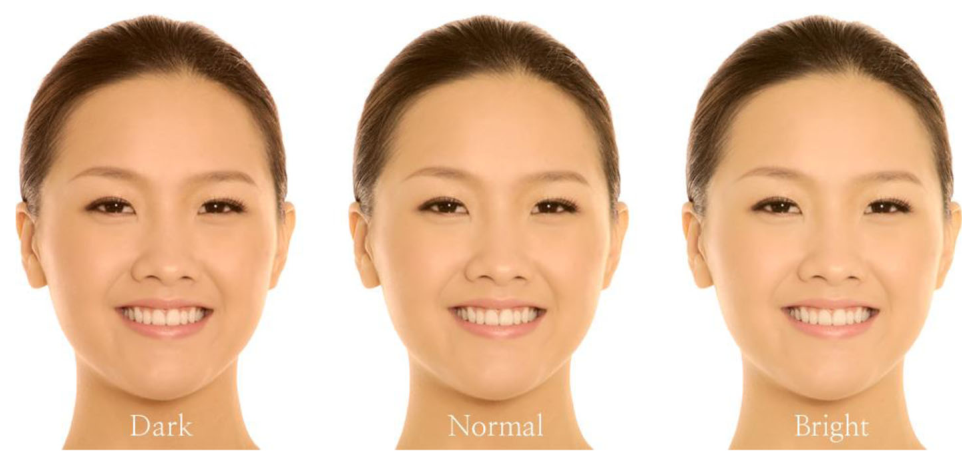

# 한국 여성의 얼굴 L\*a\*b\* 값과 선호하는 베이스 메이크업 제품: 임상 연구

> **원문** Jung I, Jo AR, Kwon YJ, Kwon S, An I-S (2017). *Facial L\*a\*b\* values and preferred base makeup products among native Korean women: a clinical study.* Biomedical Dermatology 1:2. https://doi.org/10.1186/s41702-017-0002-7
>
> **라이선스** 원문 © The Author(s) 2017. [Creative Commons Attribution 4.0 International License](http://creativecommons.org/licenses/by/4.0/)로 배포되며, 원저자와 출처를 밝히고 라이선스 링크를 제공하며 변경 여부를 표시하는 조건으로 모든 매체에서 제한 없는 이용·배포·복제를 허용합니다.
>
> **변경 사항** 영어 원문을 한국어로 번역했습니다. 그림은 원문에서 잘라 캡션 앞에 넣었고, 표는 원문 PDF의 페이지 이미지를 보고 옮겼으며, 참고문헌 목록은 생략했습니다(본문의 저자·연도 인용은 원문 그대로). 원저자가 검토한 번역이 아닙니다.

**용어 대응** — L\*: 명도(밝기) · a\*: 적색도(+빨강, −초록) · b\*: 황색도(+노랑, −파랑) · 베이스 메이크업(base makeup): 피부 톤을 보정하는 BB크림·파운데이션·쿠션 등 · 분광측색계(spectrophotometer) · SCI/SCE: 정반사 포함/제외 측정 모드

---

## 초록

**배경:** 한국 여성을 위한 베이스 메이크업 제품을 개발할 때 표준 기준점으로 쓸 수 있는 맨얼굴 L\*a\*b\* 값이 필요하다.

**방법:** 20대부터 50대까지 한국 여성 총 543명이 일정한 온도(22 ± 2%)와 습도(50 ± 5%) 조건에서 분광측색계로 피부 분석을 받았다. (역자 주: 원문은 온도 단위를 "%"로 적었다. 실제로는 °C로 보인다.) 각 대상자의 얼굴 여덟 부위(이마 중앙, 오른쪽 광대, 오른쪽 뺨, 턱 아래, 왼쪽 뺨, 왼쪽 광대, 인중, 입술 아래)를 측정해 평균값을 계산했다. 이후 대상자들은 베이스 메이크업 제품의 사용과 선호에 관한 설문지를 작성했다.

**결과:** 피부 톤은 L\* 값에 따라 세 범주(어두움, 보통, 밝음)로 분류되었다. 대비값과 비교하면 어두운 그룹의 L\*는 60.66, 보통 그룹의 L\*는 63.87(차이 3.21), 밝은 그룹의 L\*는 66.66(보통 그룹과의 차이 2.79)이었다. 베이스 메이크업 제품의 선호와 사용에 관한 설문 응답에서, 나이와 관계없이 전체 응답자에게 가장 흔한 답은 자신의 피부 톤이 또래와 비교해 평균이거나 약간 어둡다는 것이었다. 선호하는 베이스 메이크업 제품은 대개 실제 피부 톤보다 약간 밝은 색이었다. 선행 연구에서와 마찬가지로, 나이와 관계없이 가장 자주 쓰는 베이스 메이크업 제품은 BB크림이었다.

**결론:** 그룹 간 평균 L\* 표준편차가 3이었으므로, 피부 톤 한 단계의 차이는 이 L\* 값 차이에 해당한다고 볼 수 있다. 설문 결과는 베이스 메이크업 제품 개발의 목표 색이 맨얼굴 톤보다 밝아야 함을 시사한다.

**키워드:** 피부색, 피부 톤, 한국 여성, L\*a\*b\* 값, 베이스 메이크업 제품

## 배경

피부 톤은 개인의 혈통을 반영할 뿐 아니라, 인류 역사를 거치며 특정한 톤의 변이가 아름다움의 기준으로 받아들여져 왔다(Wagatsuma 1967). 서양 문화보다 동아시아 문화에서, 흰 피부에 대한 특별한 숭배는 안타깝게도 납이 든 화장품의 광범위한 사용에 기여했고, 그 결과 납 중독이 사회 문제가 되었다(Dunbabin et al. 1992; Witkowski and Parish 2001). 의약 성분으로 분류되는 미백제가, 훨씬 더 흰 피부를 원하는 소비자를 겨냥한 일부 화장품에 불법으로 첨가되기도 한다(Desmedt et al. 2014).

피부색은 피부 색소, 두께, 수분 함량, 멜라닌·헤모글로빈·빌리루빈의 상대적 비율, 계절 환경, 유전 요인, 자외선 노출, 개인의 건강 상태 등 상당히 많은 요인의 복잡한 상호작용에 영향을 받는다(Jablonski 2006; Muehlenbein 2010). 멜라닌은 피부색을 직접 좌우하는 검은색 또는 갈색 색소로, 피부·털과 식물·동물의 조직에 존재한다. 멜라닌은 다음 과정에 따라 산화된다: 티로신 → 3,4-다이하이드록시페닐알라닌(DOPA) → DOPA 퀴논 → 멜라닌(Kang et al. 2007). 의약·화장품·식품 분야에서 멜라닌 억제에 관한 연구가 활발히 이루어지고 있다. 그중 미백 화장품과 베이스 메이크업 제품은 더 자세히 살펴볼 가치가 있다.

균일한 피부 톤을 얻으려는 시도는 피부 결점을 가리고 피부 톤을 보정할 수 있는 베이스 메이크업 제품의 혁신으로 이어졌다(Couteau et al. 2016). 화장품 산업에서 한국 제품은 현재 세계 시장을 선도하고 있으며, 인기 품목은 블레미시 밤(BB) 크림부터 쿠션 콤팩트까지 다양하다(Park and Chin 2010; Baek 2015). 따라서 피부 톤 매칭과 개선을 더 발전시키려면 베이스 메이크업 제품의 색 설정에 참고할 L\*a\*b\* 값 범위를 확립할 필요가 생겼다.

한국 여성의 피부 톤 변이를 측정한 기존 연구는 주로 퍼스널 컬러와 패션 산업의 색채 연구를 위해 수행되었다. 이 연구들의 대상자 수는 극히 제한적이어서 데이터를 해석하고 일반화하기가 다소 어려웠다. 지금까지 이 결과들은 화장품 과학 분야에서 제한적으로만 활용되어 왔다. 또한 여러 연령대의 데이터가 수집되지 않아 평균값을 계산할 수 없었다. 이 연구에서는 한 대도시 지역(대한민국 수도 서울)에 거주하는 20대부터 50대까지의 한국 여성 543명의 얼굴 L\*a\*b\* 값을 측정하고, 베이스 메이크업 제품의 사용을 조사했다.

## 방법

### 얼굴 톤 L\*a\*b\* 값 측정

얼굴 톤 L\*a\*b\* 값의 임상 시험은 20대부터 50대까지 한국 여성 543명을 대상으로 일정한 온도(22 ± 2%)와 습도(50 ± 5%) 조건에서 수행되었다(Park et al. 2015). 모든 임상 연구는 개정 헬싱키 선언(Shin 2009)에 근거했으며, 연구 계획서는 한국피부과학연구원 기관생명윤리위원회(IRB)의 승인을 받았다(IRB no. KIDS2016W217). 모든 대상자는 같은 세안제로 메이크업과 자외선 차단제를 지워 맨얼굴을 드러냈다. 세안 후 대상자들은 30분간 휴식한 뒤 측정을 받았다(Binggeli et al. 2003). 그다음 숙련된 연구원이 분광측색계(CM-2600D, Konica Minolta, 일본)를 사용해 각 대상자의 얼굴에서 선택된 여덟 부위, 즉 이마 중앙, 오른쪽 광대, 오른쪽 뺨, 턱 아래, 왼쪽 뺨, 왼쪽 광대, 인중, 입술 아래를 측정했다. 각 측정은 연속 세 번 이루어졌고 평균을 계산했다(Weatherall and Coombs 1992; Piérard 1998; Ahn et al. 2002; Latreille et al. 2007).

분광측색계는 시료 표면에서 파장의 세기를 측정해 색도 좌표를 측정하는 장치다. 측정 모드에는 정반사(유리 같은 표면에서처럼)와 확산 반사(거친 표면에서처럼)를 모두 측정하는 전반사 모드인 정반사 포함(SCI, Specular Component Inclusion)과, 정반사를 제외하고 확산 반사만 측정하는 정반사 제외(SCE, Specular Component Exclusion)가 있다. L\*a\*b\* 값은 색의 오차를 나타내며, 변환의 방향을 빠르게 볼 수 있다. 따라서 이 방법은 인간이 색을 지각하는 노랑·파랑·초록·빨강 사이의 보색 관계에 기반한 방법으로 널리 받아들여지고 있다. L\*(명도) 값은 광도 지수로, 0부터 100까지의 수로 표현되며 검은색에 가까울수록 0에, 흰색에 가까울수록 100에 가깝다. a\*(적색도) 값과 b\*(황색도) 값은 채도를 나타내는 지수다. 따라서 a\* 값이 높으면 빨강을, 낮으면 초록 쪽으로의 변화를 나타낸다. b\* 값이 높으면 노랑을, 낮으면 파랑 쪽으로의 변화를 나타낸다(Baulieu et al. 2000; Lee et al. 2002; Armas et al. 2007).

선행 연구에서 기술한 대로, L\* 값을 오름차순으로 정렬해 연구 대상자를 각각 181명씩 세 그룹으로 나누었다(Jung et al. 2013). L\* 값이 가장 어두운 그룹을 어두움(dark), 중간 그룹을 보통(normal), 가장 밝은 그룹을 밝음(bright)으로 지정했다. 같은 연령대 안에서도 또래보다 훨씬 밝거나 어두운 대상자가 있었고, 시판 베이스 메이크업 제품이 나이가 아니라 얼굴색에 따라 나뉘어 있으므로 얼굴색을 나이별로 나누지는 않았다.

### 설문 응답

베이스 메이크업 제품의 사용과 선호를 조사하기 위해, 얼굴색 측정을 마친 뒤 대상자들에게 아홉 문항으로 된 설문지를 작성하게 했다. 설문지는 인구통계학적 특성에 관한 세 문항, 피부색에 관한 세 문항, 베이스 메이크업 제품 사용과 선호에 관한 세 문항으로 이루어졌다. 나이에 따른 설문 응답을 비교하기 위해 대상자를 두 연령 그룹, 즉 20~39세(20~30대)와 40~59세(40~50대)로 나누었다(Shin and Park 2015).

데이터를 코딩한 뒤 데이터 처리에는 SPSS 18.0(SPSS Inc., 시카고)을 사용했고, p < 0.05일 때 통계적으로 유의하다고 보았다. 대상자의 인구통계학적 분석에는 빈도 분석을 수행했고, 나이에 따른 베이스 메이크업 제품의 실제 사용과 선호를 비교하는 데에는 χ² 적합도 검정과 독립성 검정을 사용했다.

**표 1** 명도 그룹별 L\*a\*b\* 값

| | | ΔL\* | Δa\* | Δb\* |
|---|---|---|---|---|
| 평균 ± 표준편차 | 어두움 | 60.66 ± 2.16 | 12.63 ± 1.36 | 17.82 ± 0.65 |
| | 보통 | 63.87 ± 2.27 | 11.10 ± 1.67 | 18.12 ± 0.54 |
| | 밝음 | 66.66 ± 2.34 | 9.84 ± 1.62 | 17.47 ± 0.64 |

(역자 주: 원문 표의 열 머리는 ΔL\*, Δa\*, Δb\*로 되어 있지만, 본문은 이 값들을 측정된 L\*, a\*, b\* 값으로 설명한다.)

## 결과

### 한국 여성의 얼굴색 L\*a\*b\* 값

명도를 나타내는 변수인 측정 L\* 값은 어두운 그룹 60.66 ± 2.16, 보통 그룹 63.87 ± 2.27(어두운 그룹과의 차이 3.21), 밝은 그룹 66.66 ± 2.34(보통 그룹과의 차이 2.79)였다. 적색도를 나타내는 변수인 a\* 값은 피부색이 밝아질수록 감소했다: 어두운 그룹 12.63 ± 1.36, 보통 그룹 11.10 ± 1.67, 밝은 그룹 9.84 ± 1.62. 황색도를 나타내는 변수인 b\* 값은 어두운 그룹 17.82 ± 0.65, 보통 그룹 18.12 ± 0.54, 밝은 그룹 17.47 ± 0.64로, 그룹 간 유의한 차이가 없었다(표 1).

이 결과를 보면, 같은 인종의 대상자 사이에서 황색도에는 유의한 차이가 없었지만 적색도에는 차이가 관찰되었다. 비교하자면, 한국 여성 110명을 대상으로 한 선행 연구에서 측정된 값은 L\* 63.4 ± 2.5(이 연구의 보통 그룹과 비슷), a\* 13.0 ± 1.8(이 연구의 어두운 그룹보다 약간 더 붉음), b\* 15.3 ± 1.9(이 연구의 모든 그룹보다 더 푸름)였다. 두 연구 사이에서 L\* 값만 비슷했다(Jung et al. 2013).

### 아시아인 모델을 이용한 얼굴색 시뮬레이션

Adobe Photoshop® CS5를 사용해 아시아인 모델의 얼굴에 평균값을 적용했다. 이미지 모드를 Lab Color로 설정하고, 사진을 불러온 뒤 새 투명 레이어를 만들어 페인트 통(Paint Bucket) 도구로 덧씌웠다. 덧씌우기는 레이어 설정을 이용해 만들었으며, 그림 1과 같이 어두움·보통·밝음 얼굴색의 예를 보여 주는 사진 세트를 만들 수 있었다.

**그림 1** 아시아인 모델을 이용한 얼굴색 시뮬레이션. Adobe Photoshop® CS5를 사용해 아시아인 모델의 얼굴에 평균값을 적용했다. 이미지 모드를 Lab Color로 설정하고, 사진을 불러온 뒤 새 투명 레이어를 만들어 페인트 통 도구로 덧씌웠다

### 나이에 따른 피부색 보정용 베이스 메이크업 제품 사용의 차이

피부색 보정에 쓰는 제품을 사용 순으로 보면, 20~30대 그룹은 BB크림, 파운데이션, 쿠션 콤팩트였고, 40~50대 그룹은 BB크림, 쿠션 콤팩트, 틴티드 선크림 순이었다(표 2). BB크림은 나이와 관계없이 가장 자주 쓰는 제품으로 보고되었다. 선행 연구에서와 마찬가지로 모든 연령에서 BB크림 선호가 가장 높았으며, 이는 BB크림이 다른 베이스 메이크업 제품보다 선호된다는 이전 보고를 확인해 준다.

**표 2** 나이에 따른 선호 제품의 차이 (N (%))

| | | BB크림 | CC크림 | 파운데이션 | 쿠션 콤팩트 | 틴티드 모이스처라이저 | 틴티드 선크림 | 파우더 | χ² (p) |
|---|---|---|---|---|---|---|---|---|---|
| 나이 | 20~30대 | 101 (47.6) | 17 (37.8) | 63 (64.3) | 59 (48.4) | 3 (100.0) | 15 (25.9) | 1 (20.0) | 28.51 (0.000) |
| | 40~50대 | 111 (52.4) | 28 (62.2) | 35 (35.7) | 63 (51.6) | 0 (0) | 43 (74.1) | 4 (80.0) | |
| 합계 | | 212 (39.0) | 45 (8.3) | 98 (18.0) | 122 (22.5) | 3 (0.6) | 58 (10.7) | 5 (0.9) | |

### 나이에 따른 주요 피부색 보정용 베이스 메이크업 제품의 색 표기

피부색을 번호로 표현하는 특정 체계는 한국에만 있다. 이 체계는 두 자리 숫자로 색의 차이를 나타낸다. 첫 숫자 1은 핑크, 2는 베이지, 3은 브라운을 뜻한다. 둘째 숫자는 밝기를 나타내는 명도 값으로, 숫자가 작을수록 밝은 색, 클수록 어두운 색을 나타낸다(Shin 2016). 두 그룹 사이에 가장 자주 쓰는 베이스 메이크업 제품의 색 표기에 약간의 차이가 있었지만, 응답자의 75.1%가 각각 13호, 21호, 23호 베이스 메이크업 제품을 쓴다고 보고했다(표 3). 이는 대상자들이 자신의 피부 밝기를 번호로 인식하는지 확인하려면 추가 연구가 필요함을 시사한다.

**표 3** 나이에 따른 사용 제품의 표기 (N (%))

| | | 번호로 된 특정 코드 표기 | 한국어 표기 | 영어 표기 | 회사마다 다른 고유 표기 | 모든 피부 타입용(표기 없음) | χ² (p) |
|---|---|---|---|---|---|---|---|
| 나이 | 20~30대 | 183 (44.9) | 18 (39.1) | 28 (65.1) | 20 (90.9) | 10 (41.7) | 24.72 (0.000) |
| | 40~50대 | 225 (55.1) | 28 (60.9) | 15 (34.9) | 2 (9.1) | 14 (58.3) | |
| 합계 | | 408 (75.1) | 46 (8.5) | 43 (7.9) | 22 (4.1) | 24 (4.4) | |

### 나이에 따른 지각된 피부 밝기의 차이

20~30대와 40~50대 그룹 모두 또래와 비교해 자신의 피부색이 평균이라고 인식한다는 응답이 가장 많았고, 그다음으로 많은 응답은 다른 사람보다 피부가 약간 어둡다고 인식한다는 것이었다(표 4). 전체 대상자 중 36.8%는 자신의 피부색이 다른 사람보다 약간 또는 훨씬 어둡다고 응답했지만, 21.6%는 다른 사람보다 약간 또는 훨씬 밝다고 인식한다고 응답했다.

**표 4** 나이에 따른 피부색 인식의 차이 (N (%))

| | | 다른 사람보다 훨씬 어둡다 | 다른 사람보다 약간 어둡다 | 평균 피부색이다 | 다른 사람보다 약간 밝다 | 다른 사람보다 훨씬 밝다 | χ² (p) |
|---|---|---|---|---|---|---|---|
| 나이 | 20~30대 | 9 (45.0) | 88 (48.9) | 105 (46.4) | 54 (49.5) | 3 (37.5) | 0.781 (0.941) |
| | 40~50대 | 11 (55.0) | 92 (51.1) | 121 (53.5) | 55 (50.5) | 5 (62.5) | |
| 합계 | | 20 (3.7) | 180 (33.1) | 226 (41.6) | 109 (20.1) | 8 (1.5) | |

### 자신이 인식하는 피부색과 현재 쓰는 베이스 메이크업 제품 색의 비교

두 연령 그룹 모두 실제 피부색과 완전히 일치할 제품 색보다 약간 밝은 제품 색을 쓰는 것으로 나타났다(표 5). 훨씬 어둡거나 훨씬 밝은 색을 쓰는 응답자는 매우 적었지만, 베이스 메이크업 제품의 색이 피부색을 타고난 피부색보다 밝게 만드는 쪽으로 가장 자주 선택되었다는 점은 주목할 만하다.

**표 5** 나이에 따른 피부색과 제품 색의 일치 비교 (N (%))

| | | 제품 색이 피부색보다 훨씬 어둡다 | 제품 색이 피부색보다 약간 어둡다 | 제품 색이 피부색과 같다 | 제품 색이 피부색보다 약간 밝다 | 제품 색이 피부색보다 훨씬 밝다 | χ² (p) |
|---|---|---|---|---|---|---|---|
| 나이 | 20~30대 | 0 (0.0) | 15 (30.6) | 75 (42.9) | 165 (52.9) | 4 (66.7) | 12.51 (0.014) |
| | 40~50대 | 1 (100.0) | 34 (69.4) | 100 (57.1) | 147 (47.1) | 2 (33.3) | |
| 합계 | | 1 (0.2) | 49 (9.0) | 175 (32.2) | 312 (57.5) | 6 (1.1) | |

### 나이에 따른 피부색 보정용 베이스 메이크업 제품 선택 시 가장 중요한 고려 사항의 비교

선행 연구 논문들의 메이크업 제품 측정 항목을 검토했다(Lee et al. 2014). 응답 빈도 순으로, 20~30대 그룹은 제품의 밀착력, 지속력, 커버력을 신경 쓴다고 답했다(표 6). 40~50대 그룹은 가장 중요한 고려 사항이 커버력, 제품 밀착력, 피부와의 색 맞춤이라고 답했다. 이 항목에서 조사한 커버력 효과는 각 대상자에게 자신만의 기준점이 있는지, 그리고 그것이 더 약하기를 원하는지 반대로 더 강하기를 원하는지를 묻지 않았기 때문에, 나머지 다섯 가지 보기 항목과의 동등성에는 한계가 있었다.

**표 6** 나이에 따른 제품 선택 시 가장 중요한 고려 사항 (N (%))

| | | 피부와의 색 맞춤 | 커버력 | 지속력 | 밀착력 | 피부 트러블 | 해당 없음 | χ² (p) |
|---|---|---|---|---|---|---|---|---|
| 나이 | 20~30대 | 34 (35.1) | 51 (34.7) | 52 (58.4) | 104 (56.2) | 17 (77.3) | 1 (33.3) | 33.63 (0.000) |
| | 40~50대 | 63 (64.9) | 96 (65.3) | 37 (41.6) | 81 (43.8) | 5 (22.7) | 2 (66.7) | |
| 합계 | | 97 (17.9) | 147 (27.1) | 89 (16.4) | 185 (34.1) | 22 (4.1) | 3 (0.6) | |

## 고찰

늘 노출되어 있는 얼굴은 자외선에 계속 그을리며, 피부의 밝기나 붉기는 미백 화장품, 피부과 시술, 또는 다른 변수의 영향을 더 받을 수 있다. 따라서 얼굴색을 측정할 때는 같은 대상자라도 계절, 날씨, 최근 사용한 미백 화장품, 피부과 시술 등이 얼굴 피부 L\*a\*b\* 값에 영향을 줄 수 있는 요인에 속한다. 그러므로 측정 시간 간격을 정하고 대상자 선정 기준을 명시하는 것이 실험을 시작하기 위한 최소한의 준비 단계로 여겨진다. 이 연구는 한 번만 측정했지만, 더 객관적인 피부색 차트를 만들려면 대상자를 추적하고 같은 대상자의 피부 톤을 다시 측정해 편차를 연구하는 후속 연구가 필요할 것이다.

이 연구의 한 가지 한계는 대상자를 세 피부색 그룹으로 나누는 데 L\* 값만 사용했다는 점이다. 30~40대 한국 여성 180명을 대상으로 한 색 선호에 관한 선행 연구에서는 b\* 값이 특정 색 선호에 영향을 주었다(Kang et al. 2014). 피부색을 L\* 값만으로 정의하기는 다소 어렵지만, a\*와 b\* 값까지 포함하면 고유한 피부색이 수백 가지가 된다. 따라서 일정한 기준점을 설정하는 것은 의미가 있어 보인다.

설문 평가에서는 같은 연령대 안에서도 직업이나 생활 환경에 따라 응답이 달라질 수 있다는 점을 고려하지 않았다. 또한 더 잘 이해하려면 20대, 30대, 40대, 50대 대상자의 선호를 나누어 볼 필요가 있다. 마지막으로, 대부분의 응답자는 한국에서만 베이스 메이크업 제품에 쓰는 번호 체계의 색 표기(예: 21호, 23호)를 사용했다. 대상자들이 자신의 피부색이 어둡거나 밝다고 인식하는 것 같은 피부색에 대한 주관적 기준을 가지는 대신, 화장품 회사가 만든 표기로 자신의 피부색을 인식하는지 조사하려면 추가 연구가 필요하다.

## 결론

이 연구에서 한국 여성의 얼굴색은 어두움, 보통, 밝음의 세 가지 색으로 분류되었다. 맨얼굴의 색 L\*a\*b\* 값은 베이스 메이크업 제품의 색 설정에 기준으로 쓰일 수 있다. 기준점으로 설정한 대비값을 보면, 어두운 그룹은 60.66, 보통 그룹은 63.87로 차이가 3.21이었다. 밝은 그룹은 66.66으로, 보통 그룹과의 차이가 2.79였다. 그룹 간 L\* 값의 평균 표준편차가 3이었다는 점을 고려하면, 피부 톤 한 단계의 차이는 L\* 값에 3을 더하거나 빼는 것과 같다고 가정할 수 있다.

설문을 이용해 연령 그룹 간 유사점과 차이점을 비교했으며, 베이스 메이크업 제품의 선호와 사용에 관한 응답에서 대부분의 대상자는 나이와 관계없이 자신의 피부색이 또래와 비교해 평균이거나 약간 어둡다고 공통적으로 답했다. 또한 대상자들은 자신의 피부색보다 약간 밝은 베이스 메이크업 제품을 고른다는 것이 확인되었다. 따라서 베이스 메이크업 제품을 개발할 때 맨얼굴보다 밝은 색을 목표로 하는 것이 의미 있을 것이다. 선행 연구에서 확인된 것처럼, 모든 연령 그룹에서 가장 자주 쓰는 베이스 메이크업 제품은 BB크림이었다.

## 약어

BB: 블레미시 밤(Blemish balm); DOPA: 3,4-다이하이드록시페닐알라닌; IRB: 기관생명윤리위원회; SCE: 정반사 제외(Specular Component Exclusion); SCI: 정반사 포함(Specular Component Inclusion)

## 연구비

이 연구는 산업통상자원부(MOTIE)·한국산업기술진흥원(KIAT)의 경제협력권산업육성사업(과제 R0003962)과 해양수산부가 지원한 해양생명공학사업(20150184)의 지원을 받았다.

## 데이터 및 자료 이용 가능성

해당 없음.

## 저자 기여

IJ, ARJ, YJK가 실험을 수행했다. YJK와 SK가 실험 설계와 자문을 맡았다. IJ와 ISA가 데이터를 분석하고 원고를 작성했다. 모든 저자가 최종 원고를 읽고 승인했다.

## 윤리 승인 및 참여 동의

이 연구에 제시된 모든 임상 연구는 개정 헬싱키 선언에 근거했으며, 연구 계획서는 한국피부과학연구원 기관생명윤리위원회(IRB)의 승인을 받았다(IRB no. KIDS2016W217).

## 출판 동의

이 증례 보고와 첨부 이미지의 출판에 대해 환자로부터 서면 동의를 받았다. 서면 동의서 사본은 이 학술지의 편집장이 검토할 수 있다. (역자 주: 이 논문은 증례 보고가 아니지만 원문 문구를 그대로 옮겼다.)

## 이해 상충

저자들은 이해 상충이 없다고 밝혔다.

## 출판사 주

Springer Nature는 출판된 지도와 기관 소속에 관한 관할권 주장에 대해 중립을 유지한다.

---

접수: 2017년 4월 17일 · 게재 승인: 2017년 8월 10일
