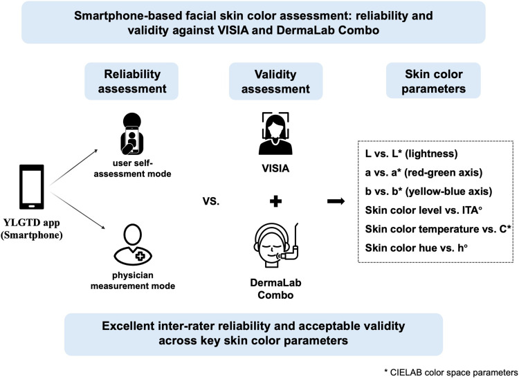
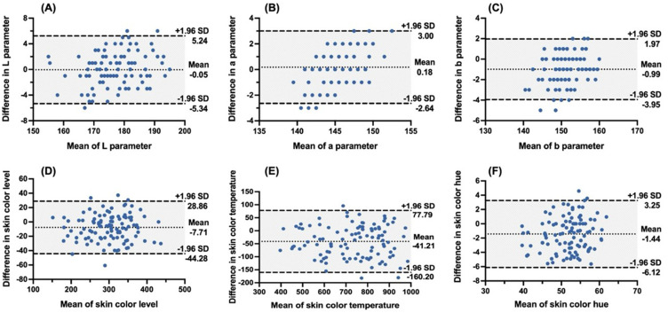
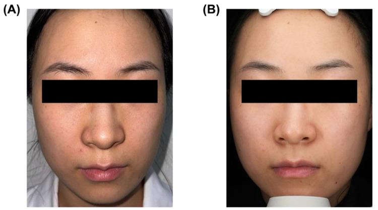

# 접근성과 정밀성 잇기: 스마트폰 기반 피부 측색기의 신뢰도와 타당도 평가

> **원문** Ouyang H, Yang J, Ning X, Xia Q, Zuo X, Xu J, Sheng Y, Song J, Ma Z, Wu L, Song X, Cui Y (2026). *Bridging Accessibility and Precision: Evaluating the Reliability and Validity of a Smartphone-Based Skin Colorimeter.* Clinical, Cosmetic and Investigational Dermatology 19:589014. https://doi.org/10.2147/CCID.S589014
>
> **라이선스** 원문 © 2026 Ouyang et al. Dove Medical Press Limited가 출판·라이선스하며, [Creative Commons Attribution – Non Commercial 4.0 License](http://creativecommons.org/licenses/by-nc/4.0/)를 포함하는 Dove Press 이용 약관(https://www.dovepress.com/terms.php)에 따라 배포됩니다. 적절한 출처 표시를 조건으로 비상업적 이용이 허용됩니다.
>
> **변경 사항** 출판사 PDF를 받을 수 없어 PubMed Central(PMC13050169)의 공식 JATS XML을 원문으로 삼아 한국어로 번역했습니다. 그림은 PMC가 제공하는 출판사 이미지이며 캡션 앞에 넣었습니다. 참고문헌 목록은 생략했습니다(본문의 숫자는 원문 참고문헌 번호). 보충 자료(Supplementary Table S1)는 번역하지 않았습니다. 비상업적 개인 학습용 번역이며, 원저자가 검토한 번역이 아닙니다.

**용어 대응** — YLGTD: 앱 이름 "You Look Good Today" · 사용자 자가 측정 모드(user self-assessment mode) · 의사 측정 모드(physician measurement mode) · 급내상관계수(ICC) · 블랜드–알트만 분석(Bland–Altman) · 일치 한계(LoA, limits of agreement) · 준거 타당도(criterion validity) · 개인 유형각(ITA°, individual typology angle) · 채도(C\*, chroma) · 색상각(h°, hue angle) · 피부색 레벨/피부색 온도/피부색 색상(skin color level/temperature/hue): YLGTD가 만든 합성 지표

---

## 초록

**배경:** 피부색의 정확한 정량화는 피부과 연구와 임상 진료에 필수적이다. 기존 방법은 전문 장비, 훈련된 조작자, 높은 비용에 의존한다. 스마트폰 기반 기술은 접근하기 쉬운 피부색 평가를 위한 유망한 대안을 제공한다.

**목적:** 얼굴 피부색 평가를 위한 스마트폰 기반 피부 측색 애플리케이션 You Look Good Today(YLGTD)의 신뢰도와 타당도를, 검증된 두 장비인 VISIA 및 DermaLab Combo와 비교해 평가하는 것.

**방법:** 얼굴 피부가 건강한 중국인 참가자 총 105명을 모집했다. 뺨 피부색을 YLGTD(사용자 자가 측정 모드와 의사 측정 모드), VISIA, DermaLab Combo로 측정했다. YLGTD 측정 모드 간 평가자 간 신뢰도는 급내상관계수(ICC)와 블랜드–알트만 분석으로 평가했다. 준거 타당도는 YLGTD 측정값과 기준 장비 사이의 피어슨 상관계수로 평가했다.

**결과:** YLGTD는 모든 변수에서 우수한 평가자 간 신뢰도를 보였다(ICC: 0.85–0.95). 블랜드–알트만 분석에서 두 측정 모드 간 L, a, b의 편향은 작았다(각각 −0.05, 0.18, −0.99). 준거 타당도에서, 사용자 모드의 YLGTD는 DermaLab Combo와 L\*(r = 0.71), 개인 유형각(ITA°, r = −0.81), 채도(C\*, r = 0.78)에서 강한 상관을, b\*(r = 0.59)와 색상각(h°, r = 0.57)에서 중간 정도의 상관을 보였다. 의사 모드에서는 상관이 일관되게 더 강했다(L\*: r = 0.77; b\*: r = 0.75; C\*: r = 0.84; ITA°: r = −0.87). VISIA는 YLGTD에 비해 a\*에서 더 강한 상관(r = 0.55)을 보였지만 L\*(r = 0.56)와 ITA°(r = −0.68)에서는 더 약한 상관을 보였다.

**결론:** 스마트폰 기반 애플리케이션 YLGTD는 얼굴 피부색 평가에서, 특히 색소 관련 변수에 대해 우수한 신뢰도와 수용 가능한 타당도를 보였다. 표준화된 측정 절차와 통합된 알고리즘 덕분에 여러 기기와 실제 환경에서 일관된 피부색 평가가 가능하며, 객관적 피부색 평가를 위한 편리하고 비용 효율적인 방법을 제공한다.

**키워드:** 피부색, 피부 측색, 스마트폰 애플리케이션, YLGTD, 신뢰도, 기기 검증

### 그래픽 초록

(역자 주: 그래픽 초록 이미지 안의 글자는 번역하지 않았다. 내용은 "스마트폰 기반 얼굴 피부색 평가: VISIA 및 DermaLab Combo 대비 신뢰도와 타당도" — 신뢰도 평가(사용자 자가 측정 모드 vs 의사 측정 모드), 타당도 평가(VISIA + DermaLab Combo), 피부색 변수(L vs L\*, a vs a\*, b vs b\*, 피부색 레벨 vs ITA°, 피부색 온도 vs C\*, 피부색 색상 vs h°) — "주요 피부색 변수에서 우수한 평가자 간 신뢰도와 수용 가능한 타당도"이다.)

## 서론

인간의 피부색은 주로 멜라닌, 카로티노이드, 헤모글로빈에 의해 결정되는 두드러진 표현형 특성이다.¹ 이 중 멜라닌은 자외선(UVR)에 대한 광보호에서 중심 역할을 한다.¹ 피부색의 변화는 색소 질환(예: 기미, 백반증), 염증성 피부 질환(예: 주사), 특정 전신 질환(예: 황달) 등 다양한 병적 상태와 밀접하게 관련된다.² 정량적 피부색 측정은 질병 진단과 치료 모니터링을 위한 객관적 지표를 제공하며, 광손상 평가, 피부암 위험 예측, 수술 피판 색 맞춤도 뒷받침한다.³⁻⁵ 따라서 객관적 피부색 평가는 개인 맞춤 피부과 진료, 미용 시술, 치료 결과의 정량적 모니터링에 필수적이다.

현재의 피부색 평가 방법은 관찰자가 매기는 시각 척도부터 기기 기반 측색까지 다양하다.⁶ 원래 백인 집단의 자외선 반응을 분류하려고 개발된 피츠패트릭 피부 유형(FST)은 임상에서 여전히 널리 쓰인다.⁷ 그러나 객관적 측색 변수와의 상관은 제한적이다.⁸ 반면 기기 기반 측색 장비는 정량적이고 재현 가능한 피부색 측정을 제공하며, 여기에는 삼자극치 측색계(예: Colorimeter CL-400)와 반사 분광측색계(예: DermaLab Combo)가 포함된다.⁹ 이 기기들은 국제조명위원회(CIE)가 표준화한 CIELAB 색공간 안에서 L\*a\*b\*와 개인 유형각(ITA°) 값으로 피부색을 정량화한다.⁹,¹⁰ 정확하긴 하지만, 높은 비용, 환경에 대한 민감성, 훈련된 인력에 대한 의존 때문에 널리 쓰이는 데는 한계가 있다.

분광 영상과 인공지능(AI)의 최근 발전은 피부과 도구의 혁신을 이끌었다.¹¹,¹² VISIA 영상 시스템(Canfield Scientific, 미국)은 피부과와 화장품 연구에서 널리 쓰인다. 표준 백색광, 자외선, 교차 편광 조명 조건에서 종합적인 피부 평가를 가능하게 한다.¹³ 한편 스마트폰 기반 애플리케이션은 빠르고 비용 효율적인 피부 평가를 위한 유망한 도구로 등장했다.¹⁴ 그러나 스마트폰 영상은 기기 간 하드웨어 차이와 환경 영향에 취약하다. 스마트폰 모델마다 다른 카메라 모듈, 센서 성능, 이미지 신호 처리 알고리즘, 그리고 주변 조명 조건은 의료 영상 분석에 결정적인 영상 재현성을 해칠 수 있다.¹⁵

"You Look Good Today"(YLGTD; Hangzhou C2H4 Internet Technology Co., 중국)는 AI 기반 이미지 처리 알고리즘을 통합한 스마트폰 기반 피부 분석 애플리케이션이다. 이 시스템은 대규모 피부 이미지 데이터베이스로 학습되었으며, 신경망 기반 색 보정과 특징 인식을 포함한다. 이 기법들은 기기 간·환경 간 변동을 줄여 안정적이고 정량적인 피부색 평가를 가능하게 한다. 그러나 임상 적용을 위해서는 확립된 기준 표준에 대해 측정 재현성과 정확도를 엄격히 검증해야 한다.

이 연구는 얼굴 피부색 평가에서 YLGTD의 신뢰도와 준거 타당도를 조사한다. 두 측정 모드(사용자 자가 측정 모드와 의사 측정 모드)에서 성능을 평가하고, 확립된 두 기준 시스템인 VISIA와 DermaLab Combo와 비교했다. 모바일 피부과 기술의 검증에서 핵심 공백을 다룸으로써, 이 연구는 YLGTD가 기존 측색 장비를 대체할 수 있는, 확장 가능하고 비용 효율적이며 사용하기 쉬운 대안이 될 수 있는지 판단하는 것을 목표로 한다.

## 재료 및 방법

### 연구 설계와 참가자

이 연구는 2024년 7월부터 2024년 9월까지 중일우호병원에서 수행된 단일 기관 단면 연구다. 피부과에서 참가자 총 105명을 모집했다. 표본 크기는 임상적 실현 가능성과 실용성에 근거해 정했다. 이 연구는 중일우호병원 임상연구윤리위원회의 승인을 받았으며(2023-KY-218), 헬싱키 선언의 원칙에 따라 수행되었다. 모든 참가자는 서면 동의서를 제출했고 YLGTD 애플리케이션의 개인정보 처리방침을 확인했다. 이 연구는 역학 관찰 연구 보고 강화(STROBE) 지침에 따라 수행·보고되었다.¹⁶

뺨의 피부 톤이 균일하고 색소 질환, 주사, 기타 피부 질환 같은 얼굴 피부 질환이 없는 사람만 포함했다. 빈혈, 황달, 신부전 같은 상태로 인한 이차성 피부 색소 이상이 있거나 광과민성 병력이 있는 참가자는 제외했다.

### 기기

#### YLGTD

얼굴 이미지는 스마트폰 기반 애플리케이션 YLGTD(Hangzhou C2H4 Internet Technology Co., Ltd., 중국)로 사용자 자가 측정과 의사 측정의 두 모드에서 얻었다. 하드웨어 관련 변동을 최소화하기 위해 스마트폰은 고해상도 후면 카메라(≥2448×3264 픽셀)를 갖춰야 했다. 참가자는 직사광선이 없는 균일하게 조명된 환경에 위치했다. 얼굴 이미지는 애플리케이션의 음성 안내에 따라 후면 카메라로 촬영했으며, 얼굴이 화면의 80% 이상을 차지하도록 거리와 각도를 실시간으로 조정해 유지했다. 조명을 표준화하기 위해 스마트폰 발광 다이오드(LED) 플래시가 자동으로 켜졌다.

촬영 후 처리에는 색 복원, 얼굴 특징 위치 파악, 정량 분석이 포함되었다. 신경망 기반 반복 색 보정 알고리즘은 스마트폰 모델과 노출 설정 같은 기기별 변수를 반영해 기기 간 변동을 줄이고 원래 피부 톤을 재구성했다. 색 정규화 후 뺨 영역을 자동으로 분할했으며, 이때 잡티, 점, 여드름 병변은 제외했다.

피부색 분석은 3단계 이미지 처리 파이프라인으로 수행했다. 먼저 관심 영역 안의 평균 픽셀 값을 적녹청(RGB) 색공간에서 계산했다. 이 값을 OpenCV(버전 3.4.20)를 이용해 CIELAB 색공간으로 변환하고 8비트 정수 형식(L: 0–255; a: 0–255; b: 0–255)으로 인코딩했다. 마지막으로 머신러닝 기반 매개변수화 모델이 피부의 밝기, 채도, 색상을 나타내는 세 가지 정량 지표, 즉 피부색 레벨(0–1000), 피부색 온도(0–1000), 피부색 색상(0°–90°)을 도출했다.

#### VISIA

얼굴 이미지는 표준화된 조명 조건에서 VISIA 영상 분석 시스템(Canfield Scientific, 미국)으로 얻었다. 주변 간섭을 없애기 위해 이미지 획득은 빛이 통제된 암실에서 수행했다. 이 시스템은 자동 초점과 화이트 밸런스 기능을 갖춘 1500만 화소 카메라를 사용한다. 획득한 이미지는 이후 YLGTD 내장 알고리즘으로 처리해 피부색을 정량화했다.

#### DermaLab Combo

DermaLab Combo 시스템(Cortex Technology, 덴마크)은 반사 분광측색법을 이용해 피부색 변수를 정량화한다. 반사된 광학 신호는 L\*(밝기), a\*(적–녹 축), b\*(황–청 축)를 포함한 CIELAB 변수로 변환된다. 피부과 연구에서 L\*는 피부 밝기를, a\*는 홍반과 관련되며, b\*는 색소 침착과 태닝을 반영한다.¹⁰ 이 변수들을 바탕으로 세 가지 합성 지표가 도출된다: 멜라닌 관련 피부 톤의 객관적 지표인 ITA°, 색의 포화도를 나타내는 채도(C\*), 색조를 나타내는 색상각(h°).¹⁰,¹⁷ 별표(\*)는 CIELAB 색공간의 변수를 뜻한다.¹⁰

### 측정 절차

피부색 측정은 통제된 임상 조건과 실제 사용자 환경에서 YLGTD, VISIA, DermaLab Combo로 수행했다. 측정 절차는 세 단계로 이루어졌다. (1) 전처리: 참가자는 세안 후 통제된 환경 조건(22 ± 2 °C; 상대습도 50 ± 10%; 햇빛이 들지 않는 창 없는 방)에서 15분간 적응했다. (2) 전문가 측정: 의사가 YLGTD(iPhone 15 Pro)와 VISIA 시스템으로 차례로 얼굴 이미지를 얻었다. 이어서 DermaLab Combo 색 프로브로 양쪽 뺨의 미리 정한 네 지점에서 접촉 측정을 했다. 색소성 모반, 여드름 병변, 흉터, 고르지 않은 색소 침착을 피해 평균값을 계산했다. (3) 사용자 자가 측정: 참가자가 자신의 스마트폰으로 실제 환경에서 YLGTD를 이용해 얼굴 이미지를 촬영했다.

데이터 수집은 훈련된 연구자가 감독했다. FST 분류는 Eilers 등의 방법¹⁸에 따라 임상의가 안내하는 평가로 수행했다. 인구통계학적 특성(나이, 성별, 민족)과 자가 측정에 쓴 스마트폰 모델을 기록했다.

### 통계 분석

통계 분석은 SPSS(버전 27.0)와 GraphPad Prism(버전 10)으로 수행했으며, p < 0.05를 통계적으로 유의하다고 보았다. 두 YLGTD 측정 모드(사용자 자가 측정과 의사 측정) 간 신뢰도는 급내상관계수(ICC)로 평가했으며, > 0.75(우수), 0.40–0.75(양호), < 0.40(불량)으로 해석했다.¹⁹ 짝지은 차이의 정규성은 샤피로–윌크 검정으로 확인했다. 측정 방법 간 일치도는 블랜드–알트만 분석으로 평가했다. 기기 간 타당도는 피어슨 상관계수(r)로 평가했으며, |r| ≥ 0.70(강함), 0.50–0.69(중간), < 0.50(약함)으로 해석했다.²⁰ 스마트폰 플랫폼(iPhone과 Android)별로 층화한 하위군 분석을 수행했다.

## 결과

### 참가자와 기술 통계

참가자의 인구통계학적·임상적 특성은 표 1에 요약했다. 총 105명이 등록되었으며, 여성 85명(80.95%)과 남성 20명(19.05%)이었고, 나이 범위는 18–50세(평균 ± SD: 25.8 ± 3.7세)였다. 대다수는 한족이었다(95.24%). 피츠패트릭 피부 유형은 II형(19.05%), III형(58.10%), IV형(22.86%)으로 분포했다. 자가 측정에 쓴 스마트폰 브랜드는 iPhone(53.33%), Huawei(19.05%), Xiaomi(12.38%), vivo(9.52%)였고, 나머지는 기타 브랜드였다.

**표 1** 참가자의 인구통계학적·임상적 특성 (n = 105)

| 특성 | 인원 (%) |
|---|---|
| **나이(세)** | |
| 평균 (SD) | 25.8 (3.7) |
| 최소–최대 | 18–50 |
| **성별** | |
| 여성 | 85 (80.95%) |
| 남성 | 20 (19.05%) |
| **민족** | |
| 한족 | 100 (95.24%) |
| 기타 민족 | 5 (4.76%) |
| **피츠패트릭 피부 유형** | |
| II | 20 (19.05%) |
| III | 61 (58.10%) |
| IV | 24 (22.86%) |
| **스마트폰 브랜드** | |
| iPhone | 56 (53.33%) |
| Huawei | 20 (19.05%) |
| Xiaomi | 13 (12.38%) |
| vivo | 10 (9.52%) |
| 기타 브랜드 | 6 (5.71%) |

약어: SD, 표준편차.

### YLGTD의 평가자 간 신뢰도: 사용자 대 의사 측정

YLGTD 사용자 자가 측정(사용자 모드)과 의사 측정(의사 모드) 간 평가자 간 신뢰도를 평가했다(표 2와 그림 1). 여섯 피부색 변수의 ICC 값은 0.85에서 0.95 범위로 우수한 신뢰도를 나타냈다. 블랜드–알트만 분석에서 L, a, b 변수의 편향은 작았고(각각 −0.05, 0.18, −0.99), 95% 일치 한계(LoA)는 비교적 좁았다(L: −5.34 ~ 5.24; a: −2.64 ~ 3.00; b: −3.95 ~ 1.97). 피부색 레벨과 피부색 온도에서는 더 큰 절대 편향이 관찰되었다(각각 −7.71과 −41.21). 모든 변수에서 차이의 92.38%–97.14%가 95% LoA 안에 들어, 두 측정 모드 간 일치도가 좋음을 보였다. 스마트폰 플랫폼별로 층화한 하위군 분석에서 iPhone과 Android 기기 간 ICC 값과 평균 편향은 비슷했다(보충 표 S1).

**표 2** 피부색 평가에서 YLGTD의 평가자 간 신뢰도: 사용자 대 의사 측정

| 변수 | 사용자 모드 (평균 ± SD) | 의사 모드 (평균 ± SD) | ICC (95% CI) | 편향 | SD | 95% LoA | LoA 안의 비율 |
|---|---|---|---|---|---|---|---|
| L | 176.94 ± 8.55 | 176.99 ± 7.81 | 0.95 (0.92–0.96) | −0.05 | 2.70 | −5.34 ~ 5.24 | 97.14% |
| a | 145.89 ± 3.03 | 145.71 ± 2.26 | 0.85 (0.79–0.90) | 0.18 | 1.44 | −2.64 ~ 3.00 | 96.19% |
| b | 150.30 ± 4.26 | 151.29 ± 3.87 | 0.93 (0.90–0.95) | −0.99 | 1.51 | −3.95 ~ 1.97 | 92.38% |
| 피부색 레벨 | 296.38 ± 58.40 | 304.09 ± 57.75 | 0.95 (0.93–0.97) | −7.71 | 18.66 | −44.28 ~ 28.86 | 95.24% |
| 피부색 온도 | 710.46 ± 147.36 | 751.67 ± 148.65 | 0.92 (0.88–0.94) | −41.21 | 60.71 | −160.20 ~ 77.79 | 97.14% |
| 피부색 색상 | 51.05 ± 5.31 | 52.48 ± 4.90 | 0.89 (0.84–0.92) | −1.44 | 2.39 | −6.12 ~ 3.25 | 97.14% |

(편향·SD·95% LoA·LoA 안의 비율은 블랜드–알트만 분석 결과.)
약어: L, 밝기; a, 적–녹 축; b, 황–청 축. 피부색 레벨, 피부색 온도, 피부색 색상은 각각 피부의 밝기, 색 포화도, 색상을 나타낸다. SD, 표준편차; ICC, 급내상관계수; CI, 신뢰구간; LoA, 일치 한계.

(역자 주: YLGTD의 L, a, b는 OpenCV 8비트 인코딩(0–255) 값이라 CIELAB의 L\*a\*b\*와 척도가 다르다. 방법 절 참조.)

**그림 1** YLGTD 사용자 자가 측정과 의사 측정 간 일치도를 보여 주는 블랜드–알트만 도표(n = 105). 패널 (**A**–**F**)는 각각 L, a, b, 피부색 레벨, 피부색 온도, 피부색 색상 변수에 해당한다. y축은 사용자 측정과 의사 측정의 차이(사용자 − 의사)를, x축은 둘의 평균을 나타낸다. 가운데 점선은 평균 편향을, 파선은 95% 일치 한계의 상한과 하한을 나타낸다. 값이 같아 일부 점이 겹쳐 있다.

### YLGTD와 VISIA의 일치도

피부 이미지는 YLGTD(그림 2A)와 VISIA(그림 2B)로 얻었다. 두 시스템 간 일치도는 표 3에 요약했다. 사용자 자가 측정 모드에서 ICC 값은 a 변수의 0.15(불량한 일치)부터 피부색 레벨의 0.78(우수한 일치)까지 분포했다. 나머지 변수는 양호한 일치를 보였으며, L(ICC = 0.56), b(ICC = 0.50), 피부색 온도(ICC = 0.69), 피부색 색상(ICC = 0.54)이 이에 해당한다. 의사 측정 모드에서 ICC 값은 a 변수의 0.24(불량한 일치)부터 피부색 레벨의 0.74(양호한 일치)까지 분포했다. b(ICC = 0.60)와 피부색 색상(ICC = 0.59) 등 여러 변수에서 일치도가 개선되었고, 다른 변수들은 사용자 모드와 비슷한 수준의 일치도를 보였다.

**표 3** 피부색 평가에서 YLGTD와 VISIA의 일치도

| YLGTD 측정 모드 | 변수 | ICC (95% CI) | 편향 | SD | 95% LoA | LoA 안의 비율 |
|---|---|---|---|---|---|---|
| 사용자 모드 | L | 0.56 (0.41–0.68) | 7.33 | 7.12 | −6.63 ~ 21.29 | 94.06% |
| | a | 0.15 (−0.05–0.33) | 0.21 | 3.11 | −5.89 ~ 6.30 | 94.06% |
| | b | 0.50 (0.34–0.63) | 4.14 | 3.42 | −2.57 ~ 10.84 | 96.04% |
| | 피부색 레벨 | 0.78 (0.69–0.84) | −10.90 | 36.05 | −81.57 ~ 59.76 | 97.03% |
| | 피부색 온도 | 0.69 (0.58–0.78) | 94.52 | 95.79 | −93.22 ~ 282.30 | 95.05% |
| | 피부색 색상 | 0.54 (0.39–0.67) | 5.31 | 4.17 | −2.86 ~ 13.49 | 92.08% |
| 의사 모드 | L | 0.56 (0.41–0.68) | 7.37 | 6.69 | −5.74 ~ 20.47 | 94.06% |
| | a | 0.24 (0.05–0.42) | −0.02 | 2.38 | −4.67 ~ 4.64 | 94.06% |
| | b | 0.60 (0.45–0.71) | 5.12 | 2.85 | −0.46 ~ 10.70 | 96.04% |
| | 피부색 레벨 | 0.74 (0.64–0.82) | −3.25 | 38.50 | −78.82 ~ 72.21 | 97.03% |
| | 피부색 온도 | 0.67 (0.54–0.76) | 136.60 | 100.1 | −59.62 ~ 332.8 | 95.05% |
| | 피부색 색상 | 0.59 (0.45–0.70) | 6.82 | 3.73 | −0.48 ~ 14.12 | 92.08% |

(편향·SD·95% LoA·LoA 안의 비율은 블랜드–알트만 분석 결과.)
주: VISIA 이미지 4장을 쓸 수 없어 분석은 참가자 101명을 대상으로 했다. L, 밝기; a, 적–녹 축; b, 황–청 축. 피부색 레벨, 피부색 온도, 피부색 색상은 각각 피부의 밝기, 색 포화도, 색상을 나타낸다. 약어: ICC, 급내상관계수; CI, 신뢰구간; SD, 표준편차; LoA, 일치 한계.

**그림 2** YLGTD(**A**)와 VISIA(**B**)로 촬영한 얼굴 이미지.

블랜드–알트만 분석은 변수마다 다양한 평균 편향을 보였다. 사용자 모드에서 편향 값은 −10.90에서 94.52까지, 의사 모드에서는 −3.25에서 136.60까지 분포했다. 이에 따라 비교적 넓은 95% LoA가 관찰되었다. 그럼에도 LoA 안에 드는 차이의 비율은 92.08%에서 97.03%로 높게 유지되었다.

### DermaLab Combo와 비교한 YLGTD와 VISIA의 준거 타당도

DermaLab Combo 대비 준거 타당도는 표 4에 요약했다. 사용자 자가 측정 모드에서 YLGTD는 DermaLab Combo와 L\*(r = 0.71)와 채도(C\*, r = 0.78)에서 강한 상관을, b\*(r = 0.59)와 색상각(h°, r = 0.57)에서 중간 정도의 상관을 보였다. 피부색 레벨은 ITA°와 강한 음의 상관(r = −0.81)을 보였지만, a와 a\* 사이의 상관은 약했다(r = 0.21). 의사 측정 모드에서는 DermaLab Combo와의 상관이 전반적으로 더 강해, L\*(r = 0.77), b\*(r = 0.75), ITA°(r = −0.87), 채도(C\*, r = 0.84)에서 강한 상관, 색상각(h°, r = 0.65)에서 중간 정도의 상관, a\*(r = 0.28)에서 약한 상관을 보였다. 두 YLGTD 모드와 비교해 VISIA는 a\*에서 중간 정도의 상관(r = 0.55)을 보였지만 L\*(r = 0.56)와 ITA°(r = −0.68)에서는 더 약한 상관을 보였다.

**표 4** 피부색 평가에서 DermaLab Combo와 비교한 YLGTD와 VISIA의 준거 타당도

| 비교 변수 | YLGTD (사용자 모드) r (95% CI) | p | YLGTD (의사 모드) r (95% CI) | p | VISIA r (95% CI) | p |
|---|---|---|---|---|---|---|
| L vs. L\* | 0.71 (0.60–0.79) | < 0.0001 | 0.77 (0.68–0.84) | < 0.0001 | 0.56 (0.41–0.68) | < 0.0001 |
| a vs. a\* | 0.21 (0.02–0.39) | 0.0313 | 0.28 (0.10–0.45) | 0.0029 | 0.55 (0.40–0.67) | < 0.0001 |
| b vs. b\* | 0.59 (0.45–0.71) | < 0.0001 | 0.75 (0.65–0.82) | < 0.0001 | 0.79 (0.70–0.85) | < 0.0001 |
| 피부색 레벨 vs. ITA° | −0.81 (−0.87 ~ −0.73) | < 0.0001 | −0.87 (−0.91 ~ −0.81) | < 0.0001 | −0.68 (−0.77 ~ −0.56) | < 0.0001 |
| 피부색 온도 vs. C\* | 0.78 (0.70–0.85) | < 0.0001 | 0.84 (0.77–0.89) | < 0.0001 | 0.74 (0.63–0.81) | < 0.0001 |
| 피부색 색상 vs. h° | 0.57 (0.43–0.69) | < 0.0001 | 0.65 (0.52–0.75) | < 0.0001 | 0.74 (0.63–0.81) | < 0.0001 |

주: YLGTD 분석은 참가자 105명, VISIA 기반 분석은 101명을 대상으로 했다. 별표(\*)는 CIELAB 색공간의 변수를 뜻한다. L\*, 밝기; a\*, 적–녹 축; b\*, 황–청 축; ITA°, 개인 유형각; C\*, 채도; h°, 색상각. L, a, b는 YLGTD가 측정한 대응 변수다. 피부색 레벨, 피부색 온도, 피부색 색상은 각각 피부의 밝기, 색 포화도, 색상을 나타낸다. 약어: r, 피어슨 상관계수; CI, 신뢰구간.

(역자 주: 원문 초록은 VISIA의 a\* 상관(r = 0.55)을 "더 강한 상관"으로, 본문은 "중간 정도의 상관"으로 표현한다. 두 표현 모두 YLGTD보다 높다는 뜻이다.)

## 고찰

이 연구는 얼굴 피부색 평가를 위한 스마트폰 기반 애플리케이션 YLGTD의 신뢰도와 타당도를 두 기준 장비, 즉 VISIA 영상 시스템 및 DermaLab Combo 분광측색계와 비교해 평가했다.

ICC와 블랜드–알트만 분석을 이용한 결과, YLGTD는 사용자 자가 측정 모드와 의사 측정 모드 모두에서 우수한 신뢰도(ICC: 0.85–0.95)를 보였고, L, a, b 변수의 편향은 작았다. 두 모드 설계는 서로 다른 사용 조건에서의 측정 일관성을 평가할 수 있게 했다. 의사 모드의 이미지는 통제된 환경에서 하나의 동일한 기기로 촬영한 반면, 사용자 모드의 참가자들은 일상 환경에서 여러 브랜드의 개인 스마트폰을 사용했다. 스마트폰 플랫폼별로 층화한 하위군 분석에서도 iPhone과 Android 기기 간 신뢰도가 비슷했다. 종합하면, 이 결과는 표준화된 절차와 통합된 보정 알고리즘이 기기와 사용 조건에 따른 측정 변동을 줄일 수 있음을 시사했다. 이 결과는 이질적인 실제 환경에서 스마트폰 기반 피부과 평가 도구가 신뢰할 만한 성능을 보였다고 보고한 선행 연구와 일치했다.²¹

평가한 변수 중 a 변수(ICC = 0.85)는 L(ICC = 0.95)과 b(ICC = 0.93)보다 평가자 간 신뢰도가 약간 낮았지만, 모든 변수가 여전히 우수한 신뢰도를 보였다. 홍반 평가에 관한 이전 DermaLab 연구에서도 비슷한 관찰이 보고되었다.²² 이 차이는 홍반 관련 신호가 미세한 생리적 변동과 환경 조명에 더 민감하기 때문일 수 있다. 이 결과는 홍반 관련 변수를 평가할 때 표준화된 이미지 획득 절차와 적절한 사용자 안내가 중요함을 강조했다.

기본 색 변수 외에, 도출된 합성 지표인 피부색 레벨, 피부색 온도, 피부색 색상도 우수한 신뢰도(ICC: 0.89–0.95)를 보였다. 피부색 레벨과 온도는 측정 범위가 넓어 절대 편향이 비교적 컸지만, 관측값의 92% 이상이 95% 일치 한계 안에 있었다. 기존 CIELAB 지표를 더 직관적인 표현으로 바꿈으로써, 이 지표들은 해석을 쉽게 하고 비전문가 사용자의 접근성을 높일 수 있다.

VISIA는 피부과와 화장품 연구에서 널리 쓰이는 얼굴 영상 시스템으로, 정밀한 피부 평가를 위한 표준화된 이미지를 제공한다. 이전 연구들은 갈색 반점 같은 VISIA 유래 지표가 멜라닌 수준과, 붉은 영역이 홍반 중증도와 상관됨을 보였다.¹³,²³ 이 연구에서 YLGTD와 VISIA의 일치도는 변수에 따라 불량부터 우수까지 분포했으며, a 변수에서 불량한 일치가, 나머지 대부분의 피부색 변수에서 양호에서 우수한 일치가 관찰되었다. 체계적 편향이 관찰되었는데, 이는 VISIA와 스마트폰 카메라의 하드웨어 차이를 반영할 수 있다. VISIA는 표준화된 광원을 쓰는 반면, 스마트폰 영상은 분광 분포가 다르고 연색 지수가 더 낮은 플래시 LED에 의존한다.²⁴,²⁵ 스마트폰 플래시 LED는 대개 청색이 우세한 스펙트럼을 보이며, 이것이 피부색의 겉보기에 영향을 주어 측정 불일치에 기여할 수 있다.²⁴,²⁵ 이러한 차이에도 불구하고, 결과는 스마트폰 기반 피부 톤 평가가 여러 멜라닌 관련 변수, 특히 색소 침착의 흔한 지표인 L과 채도에 대해 비슷한 정보를 제공할 수 있음을 시사했다.

DermaLab Combo는 주로 화장품 연구에 쓰이는 전문 피부 분석 기기다. 색 프로브는 반사 분광측색법을 이용해 CIELAB 색공간 안에서 멜라닌과 홍반을 정량화해, 객관적이고 표준화된 피부색 측정을 제공한다.²⁶ 이전 연구들은 DermaLab 측정의 평가자 간 신뢰도가 우수하다고 보고해(ICC: 0.94–0.98), 정량적 피부색 평가의 기준 장비로서의 역할을 뒷받침했다.²²

DermaLab Combo와 비교해 YLGTD는 L\*(밝기)와 C\*(채도) 변수에서, 특히 의사 모드에서 강한 상관을 보여 분광측색 측정과의 높은 일관성을 나타냈다. 피부색 레벨과 ITA° 사이의 뚜렷한 음의 상관은 색소 침착의 단계를 특성화하는 YLGTD의 능력을 더 뒷받침했다. 이 결과는 스마트폰 기반 도구가 비전문 환경에서 피부 톤 분류를 위한 실용적인 방법이 될 수 있음을 시사했다. 그러나 홍반 관련 a\* 변수에서는 약한 상관이 관찰되었으며, 이는 VISIA 비교에서도 낮은 일치도를 보였다. 이 한계는 부분적으로 스마트폰 플래시 LED의 분광 제약, 특히 정확한 홍반 검출에 중요한 적색 스펙트럼 성분의 부족과 관련될 수 있다.²⁷

객관적 피부색 평가는 피부과 진료, 특히 색소 침착 평가, 치료 모니터링, 광손상 평가에서 중요한 역할을 한다. 접근하기 쉽고 비용 효율적인 방법으로서, 스마트폰 기반 피부색 정량화는 대규모 선별 검사, 종단 모니터링, 원격 피부과 상담, 화장품이나 레이저 시술 결과의 객관적 평가를 쉽게 할 수 있다. 이러한 응용은 전문 영상 장비를 쓸 수 없는 1차 의료 현장과 자원이 제한된 지역에서 특히 가치가 있을 수 있다. 전반적으로 YLGTD는 실제 환경에서 정밀한 피부색 평가를 위한 실용적이고 경제적인 선택지를 제공한다.

이 연구에는 인정해야 할 몇 가지 한계가 있다. 첫째, 단일 기관 설계, 비교적 작은 표본 크기, 비교적 동질적인 중국인 집단에서의 참가자 모집은 결과의 일반화 가능성을 제한할 수 있다. 둘째, 홍반 관련 측정은 여전히 하드웨어와 조명 제약에 더 취약하다. 셋째, 정상 얼굴 피부를 가진 참가자만 포함했으므로 병적 피부 상태에 대한 적용 가능성은 추가 연구가 필요하다. 향후 연구는 더 큰 다기관 집단을 포함하고, 영상 기법을 최적화하며, 병적 피부 상태에서의 성능을 평가해야 한다.

## 결론

전반적으로 스마트폰 기반 애플리케이션 YLGTD는 우수한 신뢰도와 확립된 기준 장비에 대한 수용 가능한 타당도를 보였으며, 특히 밝기와 채도를 포함한 색소 관련 변수에서 그러했다. 표준화된 이미지 획득과 알고리즘 기반 색 보정을 통해 YLGTD는 서로 다른 기기와 다양한 실제 조건에서 일관된 피부색 평가를 가능하게 한다. 편리하고 비용 효율적이며 사용하기 쉬운 도구로서, 객관적 피부색 평가를 위한 접근하기 쉬운 방법을 제공하며, 종단 피부 모니터링과 개인 맞춤 스킨케어 평가에 응용될 가능성이 있다. 더 큰 다기관 집단에서의 추가 검증과 홍반 관련 알고리즘의 지속적인 최적화가 필요하다.

## 감사의 글

저자들은 모든 참가자에게 감사를 전한다.

## 데이터 공유 성명

데이터는 합리적인 요청이 있을 때 교신저자에게서 받을 수 있다. 개인정보 또는 윤리적 제한 때문에 데이터는 공개되지 않는다.

## 윤리 성명

이 연구는 중일우호병원 임상연구윤리위원회의 승인을 받았으며(2023-KY-218), 헬싱키 선언의 원칙에 따라 수행되었다. 모든 참가자에게서 서면 동의를 받았으며, 여기에는 식별 가능한 이미지의 출판에 대한 동의도 포함된다.

## 저자 기여

모든 저자는 구상, 연구 설계, 수행, 데이터 수집, 분석 및 해석 중 하나 또는 전부에서 보고된 연구에 상당한 기여를 했고, 논문의 초안 작성·수정·비판적 검토에 참여했으며, 출판될 판을 최종 승인했고, 논문을 투고할 학술지에 동의했으며, 연구의 모든 측면에 책임을 지기로 동의했다.

## 이해 상충

저자들은 이 연구에 이해 상충이 없다고 보고한다.

## 연구비

이 연구는 국가 고수준 병원 임상연구 기금(National High Level Hospital Clinical Research Funding, No.2023-NHLHCRF-YXHZ-ZRZD-06)과 중일우호병원 횡적 과제(Horizontal Project of China-Japan Friendship Hospital, No.2024-HX-92)의 지원을 받았다.

---

접수: 2025년 12월 15일 · 게재 승인: 2026년 3월 24일
