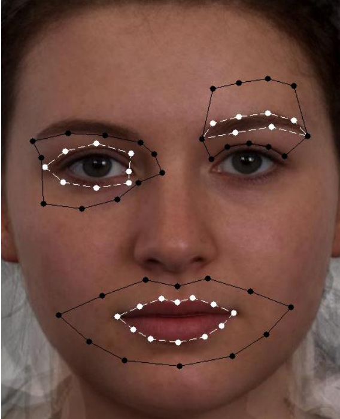
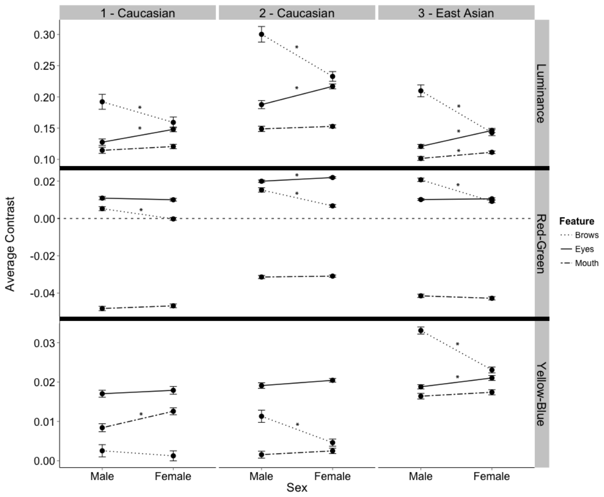
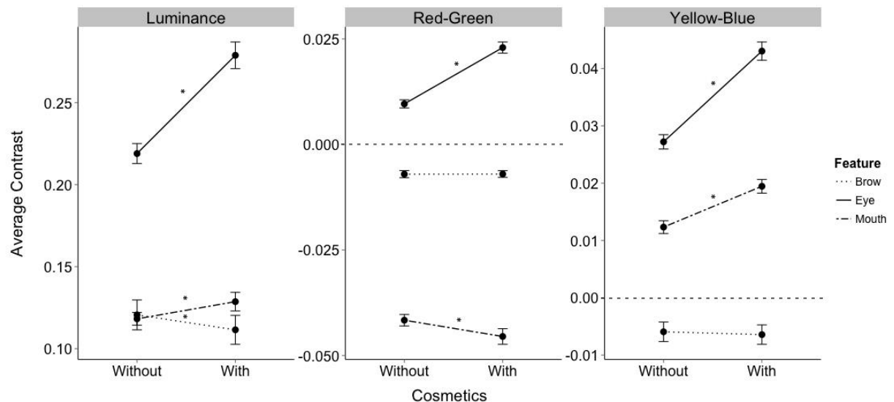

# 화장은 아름다움의 생물학적 요인을 바꾼다: 얼굴 대비의 증거

> **원문** Jones AL, Russell R, Ward R (2015). *Cosmetics Alter Biologically-Based Factors of Beauty: Evidence from Facial Contrast.* Evolutionary Psychology 13(1): 210–229. https://doi.org/10.1177/147470491501300113 (PMC10426925)
>
> **라이선스** 원문 © 2015 SAGE Publications Inc. [Creative Commons Attribution-NonCommercial 3.0 License](https://creativecommons.org/licenses/by-nc/3.0/)로 배포되며, 원저작물의 출처를 밝히는 조건으로 비상업적 이용·복제·배포를 허용합니다. 이 번역본도 비상업적 용도로만 이용할 수 있습니다.
>
> **변경 사항** 영어 원문을 한국어로 번역했습니다. 그림은 원문에서 잘라 캡션 앞에 넣었고, 표 1은 PMC 판의 표를 옮겼습니다. 참고문헌 목록은 생략했습니다(본문의 (저자, 연도)는 원문 참고문헌을 가리킴). 원저자가 검토한 번역이 아닙니다.

**용어 대응** — 얼굴 대비(facial contrast): 이목구비(눈·입·눈썹)와 주변 피부 사이의 밝기·색 차이 · 성적 이형성(sexual dimorphism): 남녀 사이의 체계적 차이 · 고리(annulus): 부위를 둘러싼 피부 영역 · 휘도/밝기(luminance, L\*) · 빨강-초록(red-green, a\*) · 노랑-파랑(yellow-blue, b\*) · 관심 영역(ROI) · "전해 내려온 스타일"(received style): 이목구비를 피부보다 어둡게 하는 전형적 화장 방식

---

## 초록

여성의 화장품 사용은 일관되게 매력을 높이는 것으로 보인다. 이를 위해 화장품은 매력의 어떤 요인을 바꾸는가? 얼굴 대비는 성적 이형성과 젊음의 단서로 알려져 있으며, 화장품은 얼굴 대비의 성적 이형성을 과장한다. 여기서 우리는 큰 얼굴 표본에 걸쳐 눈과 눈썹의 휘도 대비 패턴이 일관되게 성적으로 이형적임을 보인다. 여성은 남성보다 눈썹 대비가 낮고 눈 대비가 크다. 빨강-초록과 노랑-파랑 색 대비는 성별 간에 일관되게 다르지 않았다. 또한 우리는 여성이 화장품을 써서 눈썹과 눈 대비의 성적 이형성을 과장할 뿐 아니라, 나이가 들면서 감소하는 대비도 높인다는 것을 보인다. 이 결과는 얼굴 대비의 개념을 다듬고, 화장품이 얼굴 대비와 관련된 아름다움의 요인을 조작함으로써 어떻게 매력을 높일 수 있는지를 보여 준다.

**키워드**: 얼굴 대비, 성적 이형성, 아름다움, 화장품, 피부색

## 서론

우리의 얼굴은 우리에 대한 풍부한 정보를 전달하지만, 아마도 얼굴에서 가장 분명한 신호는 성별일 것이다. 남성과 여성의 얼굴은 서로 다른 호르몬의 영향 아래 서로 다른 발달 궤적을 따르며, 가장 뚜렷하게는 형태에서 다르다(Farkas, 1987). 얼굴 형태의 이러한 성적 이형성은 건강(Thornhill and Gangestad, 2006)과 매력(Perrett et al., 1998) 같은 생물학적으로 중요한 수많은 특성과 연결되어 있다.

얼굴의 성적 이형성과 그것이 매력 지각과 짝 선택에 어떻게 영향을 주는지에 대한 연구(개관은 Rhodes, 2006 참조)는 얼굴 형태에 크게 집중해 왔다(Thornhill and Gangestad, 2006). 그러나 피부 질감 같은 표면 반사 속성이 얼굴의 성별을 지각하는 데 실제로 얼굴 형태보다 더 중요하다(Hill, Bruce, and Akamatsu, 1995). 색 분포(Samson, Fink, and Matts, 2010)와 휘도(Jablonski and Chaplin, 2000) 같은 피부의 속성도 건강과 매력에 관련된 특성의 지각에 역할을 한다(Samson, Fink, and Matts, 2010; Stephen, Coetzee, and Perrett, 2011). 얼굴 색에도 성적 이형성이 있다. 여성은 남성보다 피부가 밝은 경향이 있고 남성은 더 어둡고 붉은데(Nestor and Tarr, 2008), 이 차이는 여러 인종·민족 집단에서 일관된다(Frost, 2005).

피부색의 전반적인 성차 외에도, 얼굴의 색 안에는 성별의 단서가 있다. 특히 대비는 시각 지각의 핵심 요소인데, 1차 피질 뉴런 대부분이 부호화하는 속성이기 때문이다(Geisler, Albrecht, and Crane, 2007). 그러나 얼굴 지각의 진화 모형에서 대비의 역할은 충분히 연구되지 않았다. 얼굴은 더 어두운 이목구비와 더 밝은 피부라는 전형적인 패턴을 이루며(Sinha, 2002), 우리는 다른 곳에서 이목구비(눈과 입)와 피부 사이의 휘도 차이, 즉 "얼굴 대비"가 성적으로 이형적임을 보였다(Russell, 2009). 여성 얼굴은 평균적으로 남성보다 얼굴 대비가 높은데, 여성의 피부가 남성의 피부보다 밝기 때문이며, 여성의 이목구비가 남성의 것보다 밝은 것은 아니다. 얼굴 대비는 여성성 평정과 정적으로, 남성성 평정과 부적으로 상관하며, 얼굴 대비를 바꾸면 중성적인 얼굴이 남성이나 여성으로 보이게 된다(Russell, 2009). 얼굴 대비의 변화는 얼굴의 매력에도 영향을 준다. 눈과 입의 대비를 높이면 여성에 대해서는 매력 판단이 높아지지만 남성에 대해서는 같은 판단이 약해지며, 대비를 낮추면 그 반대가 된다(Nestor and Tarr, 2008; Russell, 2003).

얼굴 대비는 주름 같은 더 명백한 단서를 넘어 나이 지각에도 역할을 한다. Porcheron, Mauger, and Russell(2013)은 얼굴 대비의 여러 측면이 나이에 따라 변하며, 입술의 붉음 같은 여러 색 원천에 걸쳐 대부분의 이목구비 대비가 나이가 들수록 감소함을 보였다. Porcheron 외(2013)는 또한 이 대비들이 나이 판단을 예측할 뿐 아니라, 이 대비들을 조작하면 조작 방향에 따라 얼굴이 더 젊게 또는 더 늙게 보일 수 있음을 보였다. 따라서 얼굴 대비는 젊음의 지각에 영향을 주며, 젊음은 번식 잠재력의 단서이므로 여성 얼굴 매력의 핵심 구성 요소다(Jones, 1996).

여성의 얼굴 매력을 높이는 극히 널리 퍼진 행동은 화장품의 사용이다. 화장품은 피부 질감을 매끄럽게 하는 것(Samson, Fink, and Matts, 2010) 등 여러 방식으로 매력을 높인다. 그러나 여성이 화장품을 바를 때는, 이목구비를 주변 피부에 비해 어둡게 함으로써 얼굴 대비의 성차를 일관되게 과장하는 방식으로 바른다(Etcoff, Stock, Haley, Vickery, and House, 2011; Russell, 2009). 화장품으로 이루어지는 얼굴 대비의 조작이 우연히 이루어질 가능성은 낮다. 이목구비를 피부에 비해 어둡게 하는 화장품의 "전해 내려온 스타일"(Russell, 2010)은 현대 사회뿐 아니라 고고학적 기록에서도 널리 나타나며, 이는 그것이 역사 전반에 걸쳐 일관됨을 가리킨다(Corson, 1972). 여성이 화장을 했을 때 일관되게 더 매력적으로 평정되는 것(Cash, Dawson, Davis, Bowen, and Galumbeck, 1989; Etcoff et al., 2011; Mulhern, Fieldman, Hussey, Lévêque, and Pineau, 2003; Nash, Fieldman, Hussey, Lévêque, and Pineau, 2006)이나, 여성이 화장품을 짝 유인 기법으로 사용하는 것(Buss, 1988)은 놀랍지 않다. 얼굴 대비는 나이에 따라 감소하므로(Porcheron et al., 2013), 화장품은 나이에 따라 감소하는 대비 중 적어도 일부를 높여 얼굴을 더 젊어 보이게 하는 방식으로도 작용할 가능성이 있다. 화장품은 여성의 짝 가치를 예측하는 성적 이형성과 젊음의 단서인 대비들을 바꿈으로써 얼굴을 아름답게 할 수 있다(Jones, 1996).

그러나 얼굴 대비에는 아직 이해되지 않은 측면이 남아 있다. 눈썹 두께(즉, 눈썹의 아래 가장자리에서 위 가장자리까지의 거리)와 눈썹-눈 거리 모두에 성적 이형성이 존재하며(Farkas and Munro, 1987), 여성은 더 높고 얇은 눈썹을 가진다. 현대 여성의 일부 몸단장 행동은 눈썹을 아래쪽에서 뽑음으로써(Aucoin, 1997) 이 두 이형성을 동시에 강조하여 이 이목구비를 더 여성적으로 만드는 것으로 보인다. 더 얇은 눈썹은 더 큰 매력과도 연관된다(Kociski, 2012). 뽑기는 눈썹 털의 밀도를 줄여 그 아래 피부를 더 드러내므로, 눈썹과 주변 피부 사이의 대비도 줄일 수 있다. 모호한 얼굴이 남성으로 분류될 때 그 얼굴은 여성으로 분류된 얼굴보다 눈썹이 더 어두운 경향이 있다(Nestor and Tarr, 2008). 또한 눈과 눈썹의 휘도 패턴은 얼굴을 남성이나 여성으로 분류하는 데 중요한 역할을 한다(Dupuis-Roy, Fortin, Fiset, and Gosselin, 2009). 이 결과들은 눈썹 대비에 성차가 있을 수 있음을 시사하는데, 이는 어쩌면 눈썹을 뽑을 가능성의 성차 때문일 수 있다. 그렇다면 성별에 대한 정보를 전달하는 것은 눈 대비만이 아니라 눈과 눈썹의 결합된 대비 패턴일 수 있다. 그러나 얼굴 대비의 성차를 조사한 이전 연구들(Russell, 2009; Stephen and McKeegan, 2010)은 눈썹 주변의 대비를 조사하지 않았다. 우리는 남성 눈썹의 털이 더 굵다는 점을 고려할 때, 눈썹 대비에 성적 이형성이 존재하여 남성이 여성보다 눈썹 대비가 클 것이라고 예측한다.

다른 연구들이 서로 다른 색 채널이 성별의 지각과 분류에 기여하는 역할을 조사했지만(Nestor and Tarr, 2008; Dupuis-Roy et al., 2009), 이 연구들은 이목구비에 걸쳐 얼굴 대비에 성차가 있는지를 구체적으로 조사하지 않았다. 이런 이유로 우리는 눈썹, 눈, 입에 대해 휘도, 빨강-초록, 노랑-파랑 대비의 성차를 조사하는데, 이는 Porcheron 외(2013)가 나이에 따른 얼굴 대비의 변화를 조사하는 데 앞서 사용한 접근이다. 이와 관련해, 나이에 따라 감소하는 대비가 화장품으로 실제로 강화되는지는 알려져 있지 않다. 우리는 화장품이 입과 눈에 대해 젊음과 관련된 색 대비를 높일 것이라고 예측한다. 그러나 눈썹의 경우 화장품이 어떻게 쓰일지 분명하지 않다. 여성이 남성보다 눈썹 대비가 낮다면, 성적 이형성을 강화하기 위해 화장품으로 눈썹 대비를 낮춰야 할 것이다. 그러나 이것은 나이에 따라 감소하는 대비이며, 나이 지각과 상관한다. 이는 매력과 젊음을 신호하는 데 충돌을 낳을 수 있으며, 이에 대해서는 뒤에서 더 다룬다. 더 나아가 다른 연구들은 얼굴 대비가 특정 특성의 지각에 역할을 한다는 데 상반된 증거를 발견했다. Stephen, Law-Smith, Stirrat and Perrett(2009)는 매력과 연결된 특성인 건강(Shackelford and Larsen, 1999)의 지각에 입 대비가 영향을 준다는 증거를 거의 찾지 못했고, 입 대비가 건강 지각에 주는 효과에 성차가 있다는 증거도 찾지 못했다. Stephen 외(2009; 854쪽)는 Russell(2003)이 흑백 이미지를 사용함으로써 얼굴 대비의 성적 이형성에 대한 중요한 색 단서를 제거했을 수 있다고 제안했다. Stephen 외(2009)의 또 다른 제안은, 얼굴 대비가 특성 지각에 주는 효과(Russell, 2003; 2009)가 입보다는 눈 영역의 대비에서 더 많이 비롯될 수 있다는 것이었다. 우리는 이 두 제안 모두와 관련된 증거를 제시할 것이다.

실험 1에서 우리는 백인과 동아시아인 집단의 얼굴 대비를 측정하여, 얼굴의 세 가지 대비 원천인 눈썹, 눈, 입에 걸쳐 색과 휘도 대비의 성차를 측정한다. 우리는 여성 얼굴에서 눈과 입의 휘도 대비는 더 높고 눈썹 대비는 더 낮을 것이라고 예측한다. 그런 다음 실험 2에서 화장품 사용 전후 색과 휘도 채널에 걸친 이목구비의 대비 변화를 조사하여, 화장품이 얼굴 대비의 성적 이형성을 키우는지, 그리고 나이에 따라 감소하는 대비를 바꾸는지를 검증한다. 우리는 화장품이 성적 이형성을 과장하는 대비와 나이에 따라 감소하는 대비를 모두 높일 것이라고 예측한다.

## 실험 1 — 얼굴 색 대비의 성차

세 얼굴 세트(이하 세트 1, 2, 3)에 걸쳐 눈썹, 눈, 입의 대비를 계산하고 성별 간 차이를 조사했다. 이목구비 대비는 CIE L\*a\*b\* 색 공간을 사용해 조사했는데, 이 색 공간은 인간의 색 지각을 모형으로 하여 피부색에 대한 정보를 지각적으로 적절한 용어로 제공한다(Weatherall and Coombs, 1992). 모든 이미지 세트에서 뱅고어대학 학생들에게 얼굴 화장품과 장신구의 흔적을 모두 제거하고, 필요하면 머리를 얼굴 뒤로 묶고, 카메라를 보며 무표정을 유지하도록 요청했다. 남성은 면도를 깨끗이 했다. 모델에게는 참여 대가로 6파운드를 지급했다.

### 윤리 선언

이 논문에 제시된 모든 실험은 뱅고어대학 기관윤리위원회의 승인 아래 수행되었다.

### 재료와 방법

#### 모델 인구통계와 이미지 촬영

**세트 1.** 스스로 민족을 백인으로 보고한 백인 여성 73명(18–28세, M = 20.23, SD = 2.47)과 남성 43명(18–28세, M = 20.30, SD = 2.35)을 Canon EOS 5D MII 카메라로 전문 확산 조명과 반사판을 사용해 촬영했다. 참가자는 흰 배경 앞에서 약 1미터 거리에서 촬영했다. 모든 사진에서 렌즈 조리개(F8.0), 노출 시간(1/100초), ISO 감도(100)를 일정하게 유지했다.

**세트 2.** 스스로 민족을 백인으로 보고한 백인 여성 134명(18–28세, M = 20.53, SD = 2.00)과 남성 57명(18–30세, M = 20.70, SD = 1.95)을 세트 1과 같은 카메라로, 그러나 반사판 없이 다른 시기에 촬영했다. 참가자는 흰 배경 앞에서 약 1미터 거리에서 촬영했다. 모든 사진에서 렌즈 조리개(F9.0), 노출 시간(1/25초), ISO 감도(125)를 일정하게 유지했다.

**세트 3.** 동아시아인 학생 여성 79명(18–29세, M = 22.89, SD = 2.65)과 남성 55명(18–30세, M = 23.36, SD = 4.01)을 흰 배경 앞에서 약 1미터 거리에서 Nikon D3000 카메라로, 천장을 향해 45° 기울인 카메라 장착 플래시를 사용해 촬영했다. 앞서와 같이 렌즈 조리개(F4.5), 노출 시간(1/160초), ISO 감도(200)를 사진 전체에 걸쳐 일정하게 유지했다.

세 이미지 세트 사이의 조명 차이가 일정하지 않으므로, 우리는 서로 다른 세트의 얼굴 사이에서 값을 직접 비교하지 않고(예: 한 인종이 다른 인종보다 대비가 큰지를 말하는 것), 세트 안에서만 대비의 성차를 비교한다. 모든 사진은 raw 형식으로 촬영했다.

#### 이미지 분석 절차

모든 얼굴은 179개 점의 템플릿을 사용해 JPsychomorph로 수작업 랜드마크를 찍었다(Tiddeman, Burt and Perrett, 2001). 각 얼굴에서 눈, 눈썹, 입의 윤곽을 그렸는데, 평균 얼굴 제작과 질감 변환을 위해 얼굴 윤곽을 그릴 때의 표준 관행대로 랜드마크가 이 이목구비의 가장자리에 밀착하도록 했다. 각 얼굴의 눈, 눈썹, 입을 둘러싼 랜드마크를 추출하기 위해 맞춤형 MATLAB 소프트웨어(버전 R2009b; The Mathworks Inc, 매사추세츠)를 작성했다. 또한 세 이목구비 각각의 주변 영역을 도출해 주변 피부색을 담는 고리를 만들었다. 모든 관심 영역(ROI)은 그림 1에 나타나 있다. 입 영역의 경우, 입을 둘러싼 영역을 두 배로 확장해 고리를 만들었다. 눈 영역의 경우, 콧등과 눈 둘레를 그리는 랜드마크, 그리고 눈썹의 가장 아래를 그리는 랜드마크를 포함해 눈 영역의 약 두 배인 고리를 만들었다. 눈썹 영역의 경우, 눈썹 윗부분을 따라 있는 랜드마크의 Y 좌표를 50픽셀 올려 눈썹 고리의 위쪽 경계를 정했고, 눈 위의 랜드마크를 사용해 눈썹 고리의 아래쪽 경계를 정했다. 이런 방식으로 ROI는 모든 얼굴에 대해 정확히 같은 방식으로 도출되었지만, 각 모델에 찍힌 고유한 랜드마크에 기반했다.

각 얼굴의 RGB 이미지를 MATLAB을 사용해 CIE L\*a\*b\* 색 공간으로 변환했다. 이 색 공간은 서로 직교하는 세 차원, 즉 휘도(L\*), 빨강-초록(a\*), 노랑-파랑(b\*)을 가진다. 각 색 채널의 픽셀 값은 전통적인 0–100 및 −127에서 +127의 CIE L\*a\*b\* 척도 대신 0(L\*, 검정; a\*, 초록; b\*, 파랑)에서 255(L\*, 흰색; a\*, 빨강; b\*, 노랑)까지다. 이는 MATLAB이 L\*a\*b\* 색을 부호 없는 8비트 정수 값으로 표현하기 때문으로, 정의상 음수가 될 수 없다(색 공간의 디지털 표현에 대한 입문은 Baldevbhai and Anand, 2012 참조). MATLAB은 국제색채협회(ICC)의 변환 지침(ICC; International Color Consortium, 2004)에 기술된 프로파일 연결 공간(PCS)을 사용해 RGB 이미지를 CIE L\*a\*b\* 색 공간으로 변환한다. RGB 값은 PCS를 사용해 D50 광원 백색점 기준으로 1976 CIE L\*a\*b\* 색 값으로 변환되었다.

얼굴 대비를 계산하기 위해 두 눈 영역 안 픽셀의 휘도 값을 평균했고, 눈썹 안의 휘도 값과 입술의 휘도 값도 마찬가지로 평균했다. 비슷하게 눈, 눈썹, 입을 둘러싼 고리의 픽셀 값도 따로 평균했다. 그런 다음 두 눈 영역 각각의 평균값을 다시 평균해 평균 눈 부위 값을 만들었고, 눈썹 부위, 눈 고리, 눈썹 고리에 대해서도 같은 과정을 반복했다. 각 부위의 대비는 Russell(2009)의 변형 미켈슨 대비를 사용해 다음과 같이 도출했다: CL\* = (피부 L\* − 부위 L\*)/(피부 L\* + 부위 L\*). 값의 범위는 −1에서 1까지이며, 양수는 주변 피부가 부위보다 휘도 값이 높음을, 음수는 그 반대를 가리킨다. 이 계산을 a\*와 b\* 채널에 대해서도 반복했다. 빨강-초록 대비의 경우 양수는 주변 피부가 부위보다 붉음을, 노랑-파랑 대비의 경우 양수는 주변 피부가 부위보다 노람을 가리킨다.

대비 스펙트럼의 양 끝(즉 양수와 음수) 모두 더 큰 대비로 해석될 수 있으므로, 표 1에 평균을 제시한다. 그러나 달리 언급하지 않는 한 대비 값의 대부분은 양수다(즉 피부가 부위보다 색 값이 크다).

**그림 1.** 눈, 입, 눈썹 부위의 색 정보를 추출하는 데 사용한 ROI의 예시
*주.* 흰 점선은 부위 영역을, 검은 실선은 고리를 나타낸다. 눈과 눈썹 부위는 양쪽 모두에 대해 계산했다.

### 결과

각 이미지 세트의 각 색 채널에 대해, 이목구비 간 성차를 검정하기 위해 3(부위: 눈썹, 눈, 입) × 2(성별: 여성, 남성) 혼합 모형 ANOVA를 사용했다. 이 모든 검정에서 부위와 성별 사이의 유의한 상호작용(표 1에 보고)이 관찰되어, 부위에 따라 남녀 간 대비의 차이가 있음을 가리켰다. 이 상호작용은 아래에서 색 채널별로 따로 더 살펴본다. 색 채널과 이미지 세트에 걸친 이목구비 대비의 성차는 그림 2에도 나타나 있다.

#### 휘도 대비

세트 1에서 부위 × 성별 상호작용은 남성의 눈썹 대비가 여성보다 높은 것, t(114) = 2.27, p = .03, d = 0.44, 그리고 여성의 눈 휘도 대비가 남성보다 유의하게 높은 것, t(114) = 3.24, p = .002, d = 0.62에서 비롯되었다. 세트 2에서도 같은 패턴이 관찰되어, 남성의 눈썹 대비가 여성보다 높았고, t(189) = 4.66, p < .001, d = 0.73, 여성의 눈 대비가 남성보다 높았다, t(189) = 3.98, p < .001, d = 1.25. 세트 3에서도 마찬가지로 남성의 눈썹 대비가 더 높았고, t(80.69) = 6.35, p < .001, d = 1.14, 여성의 눈 대비가 더 높았다, t(132) = 5.36, p < .001, d = 0.96. 모든 세트에서 입 대비는 수치상 여성이 남성보다 컸지만, 이는 동아시아인 집단(세트 3)에서만 유의했고, t(132) = 2.68, p < .001, d = 0.52, 두 백인 집단에서는 유의하지 않았다, 두 t 모두 < .92, p 모두 > .30, 세트 1 d = 0.19, 세트 2 d = 0.13.

**표 1.** 색 채널과 이미지 세트에 걸친 대비 값의 평균, 표준오차, 부위 × 성별 상호작용

| 이미지 세트 | CIE L\*a\*b\* 채널 | 성별 | 눈썹 | 눈 | 입 | 부위 × 성별 상호작용 |
|---|---|---|---|---|---|---|
| 세트 1 (백인) | 휘도 | 여성 | .159 (.009) | .148 (.004) | .121 (.004) | 9.97\* |
| | | 남성 | .192 (.012) | .127 (.005) | .114 (.005) | ηp² = .08 |
| | 빨강-초록 | 여성 | .000 (.001) | .010 (.001) | −.047 (.001) | 8.32\* |
| | | 남성 | .005 (.001) | .011 (.001) | −.048 (.001) | ηp² = .07 |
| | 노랑-파랑 | 여성 | .001 (.001) | .018 (.001) | .013 (.001) | 4.32† |
| | | 남성 | .003 (.002) | .017 (.001) | .008 (.001) | ηp² = .04 |
| 세트 2 (백인) | 휘도 | 여성 | .233 (.008) | .217 (.004) | .153 (.003) | 29.14\* |
| | | 남성 | .300 (.012) | .188 (.006) | .149 (.004) | ηp² = .13 |
| | 빨강-초록 | 여성 | .007 (.001) | .022 (.000) | −.031 (.001) | 37.74\* |
| | | 남성 | 0.15 (.001) | .020 (.001) | −.031 (.001) | ηp² = .16 |
| | 노랑-파랑 | 여성 | .005 (.001) | .020 (.000) | .003 (.001) | 23.08\* |
| | | 남성 | .011 (.001) | .019 (.001) | .002 (.001) | ηp² = .12 |
| 세트 3 (동아시아인) | 휘도 | 여성 | .143 (.006) | .146 (.003) | .111 (.002) | 55.70\* |
| | | 남성 | .210 (.007) | .121 (.004) | .101 (.003) | ηp² = .29 |
| | 빨강-초록 | 여성 | .009 (.001) | .011 (.000) | −.043 (.001) | 43.19\* |
| | | 남성 | .021 (.001) | .010 (.001) | −.041 (.001) | ηp² = .25 |
| | 노랑-파랑 | 여성 | .023 (.001) | .021 (.001) | .017 (.001) | 59.04\* |
| | | 남성 | .033 (.001) | .019 (.001) | .016 (.001) | ηp² = .31 |

*주.* 괄호 안의 숫자는 SEM이다. 대비 측정의 척도 때문에 모든 값을 소수점 셋째 자리까지 보고한다. 상호작용의 자유도: 세트 1, F(2, 228); 세트 2, F(2, 378); 세트 3, F(2, 264). F 비의 유의성: †p < .05, \*p < .001.
(역자 주: 세트 2 남성 눈썹의 빨강-초록 값 "0.15"는 원문 표기 그대로이며, 그림 2로 보아 .015의 오기로 보인다.)

**그림 2.** 이미지 세트, 대비 원천, 색 채널에 걸친 평균 대비
*주.* 색 채널마다 척도가 다르다. 별표는 부위 대비 값의 유의한 성차를 가리킨다. 오차 막대는 ±1 SEM을 나타낸다.

대비의 측정은 두 색 원천 사이의 비이므로, 무엇이 대비를 일으키는지는 분명하지 않다. 예를 들어 피부 휘도는 성별 간에 다르지 않지만 여성이 남성보다 더 어두운 눈과 입술, 그러나 더 밝은 눈썹을 가질 수도 있다. 이것이 체계적이라면 위에서 말한 차이를 일으킬 것이다. 이를 더 분명히 보이기 위해, 위의 유의한 비교에 해당하는 부위에 대해 원래의 부위 휘도 값과 고리 휘도 값을 성별 간에 비교했다. 모든 이미지 세트에서 원래의 눈 부위 휘도에는 성차가 없었지만(모든 t < .189), 눈 고리는 여성에서 유의하게 더 밝았다(모든 t > 5.82, p < .001). 이는 눈 대비의 성차가 여성의 더 흰 피부에서 비롯됨을 가리킨다(Russell, 2009). 나아가 모든 이미지 세트에서 눈썹 부위는 남성에서 일관되게 더 어두웠다(모든 t > 8.23, p < .01). 눈썹 고리도 남성 얼굴에서 더 어두웠다(모든 t > 6.74, p < .02). 더 어두운 눈썹이, 더 밝은 눈썹과 더 밝은 피부를 가진 여성 얼굴에 비해 남성 얼굴에서 더 큰 대비로 이어졌다.

동아시아인 여성에서는 입술이 더 밝았지만, t(132) = 3.68, p < .001, 주변 피부의 성차가 그보다 더 커서, t(132) = 5.36, p < .001, 이것이 입술 주변 휘도 대비의 성차를 이끌었다. 세트 2에서도 휘도 값에 차이가 있었다. 여성은 입술이 더 밝았지만, t(189) = 2.50, p = .01, 남성보다 피부도 훨씬 더 밝았다, t(189) = 3.71, p < .001. 눈과 입 대비의 성차는 여성의 더 밝은 피부에서 비롯되는 것으로 보이며, 눈썹 대비의 성차는 여성의 더 밝은 피부와 남성의 더 어두운 눈썹 모두에 의해 생긴다.

#### 빨강-초록 대비

세트 1에서 부위 × 성별 상호작용은 남성의 눈썹 빨강-초록 대비가 더 큰 것에서 비롯되었다, t(114) = 4.40, p < .001, d = 0.76. 세트 2에서는 남성의 눈썹 대비가 더 컸고, t(189) = 6.46, p < .001, d = 0.94, 여성의 눈 대비가 남성보다 컸다, t(189) = 2.53, p = .01, d = 0.40. 세트 3에서 상호작용은 남성의 더 높은 눈썹 대비에 의해 생겼다, t(132) = 10.40, p < .001, d = 1.84. 입 대비는 세트에 걸쳐 성별 간에 다르지 않았고, 다른 부위 대비도 마찬가지였다, 모든 t < 1.01, 모든 p > .32.

#### 노랑-파랑 대비

세트 1에서 부위 × 성별 상호작용은 여성의 입 노랑-파랑 대비가 더 높은 것에서 비롯되었지만, t(114) = 2.99, p = .003, d = 0.77, 세트 2에서는 남성의 눈썹 대비가 더 높은 것에 의해 생겼다, t(189) = 3.90, p < .001, d = 0.54. 세트 3에서는 남성의 눈썹 대비가 여성보다 컸고, t(132) = 8.57, p < .001, d = 1.53, 여성의 눈 대비가 남성보다 높았다, t(131.92) = 2.71, p = .008, d = 0.46. 다른 입 대비는 유의하지 않았고, 다른 부위 대비도 마찬가지였다, 모든 t < 1.56, 모든 p > .55.

### 논의

이 실험의 결과는 얼굴 대비의 성적 이형성 개념을 다듬는다. Russell(2009)은 여성 얼굴이 남성보다 입과 눈의 대비가 크다는 것을 보였는데, 우리는 얼굴 위쪽 영역의 성적 이형성 단서를 더 풀어내어, 눈과 눈썹의 휘도 대비가 서로 갈라지는 패턴을 발견했다. 여성은 남성보다 눈 대비가 크지만(Russell, 2009), 남성은 여성보다 눈썹 대비가 크며, 이 차이는 인종에 걸쳐 일관된다.

입 주변의 휘도 대비 결과는 다소 덜 분명하다. 세 세트 모두에서 여성 얼굴의 대비가 더 컸다(세트 1 d = 0.19, 세트 2 d = 0.13, 세트 3 d = 0.52). 그러나 이 성차는 동아시아인 얼굴(세트 3)에서만 통계적으로 유의했다. 그런데 Russell(2009)과 Stephen and McKeegan(2010)은 여성이 남성보다 입 휘도 대비가 크다는 것을 동아시아인이 아닌 백인 얼굴에서 발견했다. 입 휘도 대비의 성차 효과 크기는 Stephen and McKeegan(2010)의 백인 얼굴 세트에서 약 d = 0.70이었고, Russell(2009)의 백인 얼굴 세트에서 d = 0.58, 동아시아인 얼굴 세트에서 d = 0.11이었다.

이를 더 살펴보기 위해, 보고된 입 휘도 대비의 d 점수 여섯 개에 대해 간단한 메타분석을 수행했다. 무선효과 모형(Field, 2005)을 사용한 결과, 입 대비의 성차는 표본 간에 동질적이었다, χ²(5) = 6.39, p = .27. 또한 입 휘도 대비의 평균 성차는 d = 0.34(95% CI [0.14, 0.53]), SEM = 0.09였으며, 모집단 효과 크기가 유의했다, z = 3.42, p = .001. 이 결과로 보아 입 휘도 대비에는 성차가 있지만, 일반적으로 눈 대비의 성차보다 작다고 결론 내릴 수 있다. 눈 대비의 성차는 이 연구와 Russell(2009)의 자료로 보아 평균 d = 0.78(95% CI [0.46, 1.12]), SEM = 0.17이다. 이 결과는 또한 얼굴 대비로부터의 성적 이형성 지각이 입보다는 눈 영역에서 더 많이 비롯될 수 있다는 Stephen 외(2009, 854쪽)의 세 번째 제안을 지지한다.

빨강-초록 대비를 조사했을 때도 일관된 차이가 발견되었다. 남성은 눈썹 주변의 빨강-초록 대비가 더 높았다. 이는 아마 남성이 일반적으로 여성보다 피부가 더 붉기 때문일 것이다. 일관되게, 남성은 여성보다 눈썹 주변의 노랑-파랑 대비가 더 높았지만, 표본들은 그 밖의 점에서는 거의 다르지 않았다. 세 색 채널 모두에서 남성 얼굴의 눈썹 대비가 더 큰 것은 남성의 눈썹 털 밀도가 더 높기 때문일 수 있다. 털의 밀도가 낮으면 그 아래 피부가 더 드러나, 주변 피부와의 대비가 더 낮아진다. 이미지 세트 간에 일관되지 않은 결과도 일부 있었다. 세트 1에서는 여성이 남성보다 입의 노랑-파랑 대비가 컸고, 세트 2에서는 여성이 남성보다 빨강-초록 대비가 높았다. 이러한 일관되지 않은 차이는 이 색 채널들에 성적 이형성이 없음을 시사한다.

## 실험 2 — 화장품에 의한 대비 변화

얼굴 화장품을 바르면 외모를 수많은 방식으로 바꿀 수 있다. 그러나 "전해 내려온 스타일"(Russell, 2010)이라 불리는 전형적인 화장은 피부 균일도(피부 톤의 고름)를 높이고 이목구비를 어둡게 하는 일관된 패턴을 따르며, 이 효과는 문화와 역사 기록에 걸쳐 일관된다(Corson, 1972). 이는 Russell(2009)이 밝힌 얼굴 대비의 성적 이형성을 정확히 과장하며, 우리는 나이에 따라 감소하는 것으로 나타난 대비 중 일부(Porcheron et al., 2013)도 높일 것이라고 예측한다.

실험 1의 결과는 얼굴 대비의 성차 개념을 다듬어, 눈과 눈썹의 휘도 대비가 갈라진다는 것을 보여 준다. 눈썹과 관련된 몸단장 행동은 대비를 줄이도록 설계된 것으로 보인다. 뽑기는 극히 흔하고, 아마 털을 제거함으로써 대비를 줄이며, 표준적인 미용 조언이다(Aucoin, 1997). 실제로 여성 얼굴의 눈썹 두께는 지각된 매력과 부적으로 상관한다(Kociski, 2012). 그러나 이것은 더 지속적인 조작으로, 화장품을 쓰든 안 쓰든 외모에 영향을 준다. 실제로 이것이 실험 1에서 관찰된 휘도 대비의 성적 이형성의 원인일 수도 있다. 그러나 눈썹 펜슬 같은 화장품은 역사적으로 널리 쓰였고(Corson, 1972) 현대 화장 관행의 필수품이다. 이 제품들은 눈썹을 어둡게 하도록 설계되어, 나이에 따른 눈썹 부위 대비의 감소를 되돌릴 수 있다(Porcheron et al., 2013). 여성이 보통 화장품을 어떻게 바르는지 조사함으로써, 눈썹 대비의 성적 이형성이 성적으로 이형적인 외모에 관련되는지, 아니면 화장품에 의한 눈썹 조작이 나이와 연관된 대비를 바꾸는 데 쓰이는지를 확인할 수 있다. 이 생각에 더해, Stephen and McKeegan(2010)은 여성 얼굴에서 입의 빨강-초록 대비가 더 높고 노랑-파랑 대비가 더 낮을 때 여성성 지각이 강화됨을 밝혔다. 이 대비들은 화장품으로 바꿀 수 있으며, 우리는 실험 1에서처럼 다른 색 채널을 포함하여 이 변화를 조사함으로써, 화장품이 이루는 얼굴 대비 강화와 화장품이 작용할 가능성이 큰 여러 신호 채널(예: 성적 이형성이나 나이)에 대해 더 온전한 이해를 제공하고자 한다.

우리는 여기서 화장품 사용에 대해 몇 가지를 예측한다. 첫째, 여성은 아마 눈과 입을 어둡게 하고 이 부위 주변의 피부를 밝게 함으로써(Russell, 2009), 눈과 입 휘도 대비의 성적 이형성을 강화하는 화장을 할 것이다. 또한 눈의 빨강-초록과 노랑-파랑 대비는 나이에 따라 감소하는 대비이므로 화장품으로 높아질 것이라고 예측한다. 화장품은 입술의 붉음을 높임으로써 입의 빨강-초록 대비를 낮출 것이다. 이는 여성 얼굴을 더 성 전형적이고 매력적으로 보이게 하는 것으로 나타난 조작이며(Stephen and McKeegan, 2010), 나이에 따라 증가하는 대비이므로(Porcheron et al., 2013) 이 대비의 감소는 젊음의 단서가 될 것이다. 마찬가지로 입의 노랑-파랑 대비도 화장품 사용으로 낮아질 것이라고 예측한다. 이 대비의 감소 역시 성 전형성과 매력의 지각과 연관되며(Stephen and McKeegan, 2010), 나이에 따라 증가하기 때문이다(Porcheron et al., 2013). 이 예측들이 지지된다면, 화장품은 성적 이형성과 젊음 모두와 관련된 대비를 강화할 것이다.

눈썹 부위에서는 성적 이형성과 젊음의 단서가 충돌한다. 실험 1에서 우리는 여성이 남성보다 일관되게 눈썹 휘도 대비가 낮다는 것을 보였지만, 눈썹 대비의 감소는 나이에 따라 일어난다. 따라서 화장품이 성적으로 이형적인 외모를 희생하고 젊음을 신호하기 위해 눈썹 휘도 대비를 높일지, 아니면 젊음을 희생하고 성적 이형성을 신호하기 위해 눈썹 휘도 대비를 낮출지 예측하기 어렵다.

### 방법

스스로 민족을 백인으로 보고한 백인 여성 44명(18–27세, M = 21.18, SD = 1.94)을 모델로 모집했다. 모델들은 착용하고 있던 화장품의 흔적과 얼굴 장신구를 모두 제거했다. 그런 다음 자연스러운 모습으로 촬영했다.

모델들에게 모두 같은 브랜드의 인기 있는 화장품을 다양하게 제공했다. 여기에는 아이라이너 두 색상과 눈썹 펜슬 두 색상, 마스카라 네 종류, 파운데이션 여섯 색상, 아이섀도 열 색상, 그리고 열 종류가 넘는 립스틱이 포함되었다. 모델들에게 "밤 외출"을 위해 하듯이 화장을 하도록 한 뒤 다시 촬영했다. 이 맥락은 여성이 매력을 극대화하기 위해 화장품을 쓸 수 있는 흔한 상황을 제공하기 위해 선택했으며(Buss, 1994; Singh, 2004), 이전 연구에서도 사용되었다(Russell, 2009). 사진은 흰 배경 앞에서 Nikon D3000 카메라로 촬영했다. 조명은 천장을 향해 45° 기울인 플래시로 표준화했다. 모든 사진에서 렌즈 조리개(F5.3), 노출 시간(1/60초), ISO 감도(200)를 포함해 카메라 설정을 일정하게 유지했다. 대비는 실험 1에 기술한 것과 정확히 같이 도출하고 분석했다.

### 결과

화장품 사용이 가져온 대비의 차이를 조사하고자 했다. 이를 위해 색 채널마다 따로 2(화장품: 없음, 있음) × 3(부위: 눈썹, 눈, 입) 반복측정 ANOVA를 사용했다. 앞서와 같이, 화장품 사용에 따라 부위들이 어떻게 갈라질 수 있는지에 관심이 있으므로 상호작용을 살펴본다. 화장품 사용 전후의 부위 대비는 그림 3에 나타나 있다.

**그림 3.** 색 채널에 걸쳐 나타낸 화장품과 부위 사이의 상호작용
*주.* 별표는 화장품에 의한 부위 대비 값의 유의한 변화를 나타낸다. 오차 막대는 ±1 SEM을 나타낸다.

#### 휘도 대비

예측한 화장품 × 부위 상호작용이 유의했다, F(2, 86) = 62.83, p < .001, ηp² = .59. 이전 연구와 일관되게, 눈 부위 대비는 화장품 사용으로 유의하게 높아졌고, t(43) = 9.73, p < .001, d = 1.46, 입 대비도 마찬가지였다, t(43) = 2.13, p = .04, d = 0.32. 또한 눈썹 휘도 대비의 유의한 감소도 관찰되었다, t(43) = 3.47, p = .001, d = 0.52. 대비는 비이므로, 여성이 주변 피부를 어둡게 해서 눈썹 대비를 낮췄는지 아니면 눈썹 부위 자체를 밝게 해서 낮췄는지를 조사하고자 했다. 원래의 눈썹 부위 휘도 값에 대한 추가 대응 t 검정 결과, 이 부위는 화장품 사용으로 미미하지만 일관되게 밝아졌다, t(43) = 2.05, p = .05, d = 0.31(화장품 없는 휘도 값 M = 121.07, SD = 17.66, 화장품 있음 M = 122.82, SD = 16.25). 눈썹 고리는 화장품으로 약간 더 어두워졌지만 유의하지 않았다, t(43) = 0.61, p = .55, d = .09(화장품 없는 휘도 값: M = 152.96, SD = 7.00; 화장품 있음: M = 152.60, SD = 7.25). 눈썹용 화장품 대부분이 이 부위를 어둡게 하는 쪽으로 맞춰져 있으므로, 화장 관행이 눈썹을 특별히 밝게 한다는 것은 이례적이다. 또한 눈썹 고리는 화장품에 의해 서로 다른 방향으로 바뀌는 영역들로 이루어져 있다. 아이섀도는 보통 눈썹 아래에 바르고, 파운데이션은 아마 그 위에 바를 것이다. 중요하게도, 눈 바로 위와 눈썹 아래 영역을 화장품으로 어둡게 하면 매력 지각이 높아진다는 일부 증거가 있다(Killian and Peissig, 2013).

이를 더 살펴보기 위해, 눈 바로 위와 눈썹 아래의 피부 영역을 분리해 화장품 사용 전후 이 영역의 원래 휘도 값을 계산했다. 그림 1에서 이것은 눈썹 고리 중 눈썹 바로 아래이면서 눈 위에 있는 영역으로, 이제부터 눈 위 영역이라 부른다. 이 영역은 화장품 사용으로 유의하게 어두워졌다, t(43) = 4.85, p < .001, d = 0.73(화장품 없는 휘도 값: M = 121.83, SD = 12.41; 화장품 있음: M = 106.83, SD = 12.52). 이는 눈썹 부위가 화장품으로 직접 바뀌었을 뿐 아니라 눈썹 아래 영역도 (더 큰 정도로) 조작되어 대비 변화에 기여했음을 가리킨다. 이 조작은 인접 영역을 어둡게 함으로써 눈 대비를 낮추는 쪽으로 작용하여, 눈 부위의 성적 이형성을 희생하고 눈썹 부위의 성적 이형성을 높일 것이다.

#### 빨강-초록 대비

예측한 화장품 × 부위 상호작용이 유의했다, F(2, 86) = 64.92, p < .001, ηp² = .60. 상호작용은 눈과 입 대비의 갈라지는 변화에서 비롯되었다. 빨강-초록 대비는 화장품으로 높아졌다, t(43) = 13.89, p < .001, d = 2.09. (역자 주: 문맥과 그림 3으로 보아 이 문장은 눈의 빨강-초록 대비를 가리킨다.) 예상대로 화장품은 입 대비를 더 낮추어(대비의 절댓값을 높여), t(43) = 2.38, p = .02, d = 0.36, 입의 붉음 대비를 더 강화했다. 눈 위 영역의 원래 값은 화장품으로 감소하여(더 초록으로), t(43) = 8.24, p < .001, d = 1.24(화장품 없는 빨강-초록 값: M = 150.10, SD = 1.77; 화장품 있음: M = 147.48, SD = 1.91), 눈썹 대비를 조절하는 데 역할을 함을 가리켰다. 그러나 이 채널에서 전체 눈썹 대비는 화장품으로 바뀌지 않았다, t(43) = .06, p = .95.

#### 노랑-파랑 대비

또 하나의 화장품 × 부위 상호작용이 유의했다, F(2, 86) = 88.86, p < .001, ηp² = .67. 이 상호작용도 눈과 입 대비의 변화에서 비롯되었으며, 둘 다 화장품으로 높아졌다, 눈, t(43) = 13.23, p < .001, d = 1.99, 입, t(43) = 5.75, p < .001, d = 0.86. 눈 위 영역에 대한 추가 분석에서 이 영역의 픽셀 값은 화장품으로 감소했다(더 파랗게), t(43) = 7.04, p < .001, d = 1.05(화장품 없는 노랑-파랑 값: M = 157.78, SD = 1.83; 화장품 있음: M = 155.11, SD = 2.37). 이 채널에서 눈썹 대비는 화장품으로 바뀌지 않았다, t(43) = .68, p = .49.

### 논의

화장품이 성적 이형성을 강화하는 대비를 바꾼다는 우리의 예측은 부분적으로 지지되었다. 화장품 사용은 눈과 입의 휘도 대비를 높였지만 눈썹의 휘도 대비를 낮추어, 성별 간 휘도 차이를 과장했다. 화장한 얼굴에서 눈썹의 휘도 대비가 높아지기보다 낮아졌다는 것은 주목할 만하며, 이례적이다. 낮은 눈썹 대비는 여성적이지만 나이 든 얼굴의 전형이기도 하므로, 이 젊은 성인 참가자 집단에서 화장은 젊음을 희생하고 여성성을 강화했을 수 있다. 눈썹 부위 휘도의 미미한 감소가 검출되었지만, 이것이 나이에 따라 이 부위가 겪는 휘도의 바램은 아닐 것이다. (역자 주: 원문은 "reduction of eyebrow feature luminance"라고 쓰지만, 결과 절에서는 눈썹 부위의 휘도가 약간 높아졌다(밝아졌다)고 보고한다. 원문 그대로 옮겼다.)

실험 1의 증거와 다른 연구 결과(Stephen and McKeegan, 2010) 모두 입의 빨강-초록 대비가 성적으로 이형적이지 않음을 시사한다. 그러나 참가자들이 립스틱을 바르자 입술이 더 붉어지면서 이 대비 원천의 값이 낮아졌다. 다른 연구들은 입의 빨강-초록 대비를 낮추면 여성의 여성성과 매력 지각이 높아짐을 보였다(Stephen and McKeegan, 2010). 왜 그럴까? 이 질문에는 두 가지 답이 가능하다. 첫째는 붉은 입술이 젊다는 것이다. 입의 빨강-초록 대비는 나이에 따라 증가하며, 나이 든 얼굴에서 이 대비를 낮추면 얼굴이 더 젊어 보인다(Porcheron et al., 2013). 젊음은 여성 매력의 구성 요소이므로(Jones, 1996), 입의 빨강-초록 대비는 아마 나이의 단서이며 따라서 매력의 단서일 것이다. 즉 붉은 입술 색이 이형적이지 않더라도, 여성의 매력을 위해 강조할 가치가 있는 단서다. 두 번째 이유는 빨간색의 동기적 가치와 관련될 수 있다. 남성은 빨간색이 있을 때 여성을 신체적으로나 성적으로 더 매력적으로 여기며(Elliot and Niesta, 2008), 빨간색을 입은 여성을 볼 때 접근 행동을 더 자주 하고(Niesta Kayser, Elliot, and Feltman, 2010), 빨간색을 입은 여성이 더 많은 성적 의도를 가진다고 지각한다(Guéguen, 2012a). 인간이 아닌 암컷 영장류에서 빨간색은 에스트로겐 순환 수준이 높아져 혈류가 늘면서 여러 신체 부위에 나타나 배란의 시작을 신호하는 데 쓰인다(Dixson and Herbert, 1977). 이는 같은 종의 수컷이 배란의 정직한 신호로 사용하는 신호다(Deschner, Heistermann, Hodges, and Boesch, 2004). 이와 부합하게, 인간 여성은 배란기 즈음에 빨간 옷을 더 많이 입고(Beall and Tracey, 2013) 화장품을 더 많이 쓴다(Guéguen, 2012b). 빨간색이 고대부터 립스틱의 인기 있는 선택이었다는 것(Regas and Kozlowski, 1998)은 아마 놀랍지 않다. 화장품으로 과장된 입의 빨강-초록 대비는 초정상 자극으로 기능하여, 젊음뿐 아니라 성적 의도에 대한 정보도 신호할 수 있다.

입의 노랑-파랑 대비가 감소할 것이라는 예측은 지지되지 않았다. 대신 화장품은 이 대비를 높였는데, 이는 피부가 입술보다 더 노랬음을 가리키며, Stephen and McKeegan(2010)이 보인 패턴의 반대다. 이 대비는 나이에 따라 증가하지만(Porcheron et al., 2013), 여기서의 피부 노란색 증가는 지각된 건강에 영향을 줄 수 있다. 카로티노이드 형태의 더 높은 피부 노란색은 더 건강하게 지각되므로(Stephen, Coetzee, and Perrett, 2011), 이 노란색 증가는 이 변화가 가져오는 지각된 나이의 변화를 상쇄할 수 있다.

화장품은 눈의 빨강-초록과 노랑-파랑 대비를 높여, 피부를 부위보다 더 붉고 노랗게 만들었다. Porcheron 외(2013)는 이 대비들이 나이에 따라 줄어든다는 것을 보였다. 이 결과들은 화장품이 성적 이형성뿐 아니라 젊음과도 연관된 이목구비의 색 대비를 바꾼다는 것을 보여 주며, 화장품이 얼굴을 아름답게 하는 방식에 대해 젊음의 단서를 높인다는 추가 설명을 제공한다.

마지막으로, 휘도를 제외한 다른 채널에서는 눈썹 대비의 변화가 관찰되지 않았다. 실험 1에서 모든 채널에서 눈썹 대비의 일관된 성차를 관찰했다는 점을 고려하면 이는 놀랍다. 그러나 휘도 대비는 여전히 성 전형적인 방향으로 바뀌었고, 눈 위 영역은 화장품에 의해 어두워지면서 더 초록·파랑이 되도록 조작되었다. 눈썹 위와 아래의 피부를 모두 포함해 눈썹의 대비를 직접 고려했을 때, 눈썹 대비 조작의 효과가 더 작게 관찰되었을 가능성이 크다. 그러나 눈 위 영역을 어둡게 하는 아이섀도 같은 화장품의 작용은, 눈썹과 바로 인접한 피부 사이의 대비를 줄임으로써 눈 대비를 높이는 동시에 눈썹 대비를 낮춘다. 여기 제시된 분석은 화장품이 눈썹 부위를 바꿈으로써 직접적으로, 그리고 눈썹 바로 주변 영역을 조작함으로써 간접적으로 눈썹 대비에 작용함을 보여 준다.

이 결과는 Russell(2009)의 결과를 확장하여, 여성이 남녀 사이의 차이를 과장함으로써 이목구비에 걸친 성적으로 이형적인 대비 패턴을 바꾸도록 화장품을 바른다는 것을 보여 준다. 나아가 화장품은 젊음과 지각된 성 전형성과 관련된 대비를 강화하는 데 쓰였다. 눈썹의 경우, 이 바람직한 특성들의 단서는 명백히 충돌한다. 젊음의 신호(더 높은 대비)가 여성성의 신호(낮은 대비)와 반대된다. 이 경우 우리 표본의 여성들은 (눈 아래 영역에 음영을 줌으로써) 대비를 낮추는 것을 택했다. (역자 주: 원문은 "the area under the eye"라고 쓰지만, 결과 절의 분석 대상은 눈 위·눈썹 아래 영역이다. 원문 그대로 옮겼다.) 아이섀도 같은 화장품의 사용은 실제로 눈썹 부위에서 비롯되는 여성성과 젊음의 상충하는 단서에 대한 설명을 제공할 수 있다. 나이는 이 부위의 대비를 줄일 수 있지만, 여성성은 눈 위 영역에서 더 분명하게 신호될 수 있으며, 이 신호를 우리 표본의 여성들이 강화했다.

### 화장품은 매력을 높이는가?

마지막으로, 모델들이 바른 화장품이 그들의 매력을 높였는지 고려하는 것이 중요하며, 이는 일관된 결과다(Cash et al., 1989; Etcoff et al., 2011; Mulhern et al., 2003). Jones and Kramer(2015)는 이 연구와 같은 모델을 사용해 두 화장품 조건 모두에서 62명의 참가자에게 매력을 평정받았다. 모델들은 화장품이 없을 때보다 있을 때 더 매력적으로 평정되었다, t(43) = 3.28, p = .002, d = 0.57(이 결과에 대한 더 온전한 논의는 Jones and Kramer, 2015 참조). 또한 관찰자들은 얼굴의 화장품 양을 바꿀 수 있는 선택권이 주어졌을 때 같은 모델들이 상당한 양의 화장품을 했을 때 가장 매력적이라고 여긴다(Jones, Kramer, and Ward, 2014). 종합하면, 이 결과들은 모델들이 사용한 화장품이 그들의 매력을 성공적으로 높였음을 보여 준다.

## 종합 논의

우리는 눈과 눈썹의 휘도 대비가 성별 간에 일관되게 갈라진다는 것을 보여, 눈썹 대비가 성적으로 이형적일 것이라는 가설을 지지했다. 이 대비의 성적 이형성은 화장품 사용으로 과장되었으며, 화장품 사용은 눈썹 대비를 낮추고 눈 대비를 높였다. 우리는 눈 바로 위이자 눈썹 아래 영역이 화장품으로 어두워져 눈썹 대비를 줄인다는 것을 보인다. 이 영역을 어둡게 하면 화장품을 한 얼굴의 매력 판단이 높아진다(Killian and Peissig, 2013).

눈과 눈썹의 대비 패턴이 성 전형성 지각에 영향을 준다는 것은 다른 곳에서도 암시되었다. Dupuis-Roy 외(2009)는 눈썹-눈 영역, 특히 이 부위들의 휘도 속성이 얼굴의 성별 분류에 중요하다는 것을 보였다. 관찰자들은 다른 성별 색 단서가 없어도 이 패턴에 의존할 수 있다. 중요하게도, 형태나 눈썹-눈 거리는 성별 분류를 예측하지 못했고, 색 정보가 더 신뢰할 만한 것으로 드러났다. 우리는 얼굴 위쪽 영역의 대비 성적 이형성이 남녀 간에 일관되게 다르며, 화장품이 조작하는 패턴임을 보임으로써 이 결과를 확장한다. 또한 이 결과는 얼굴 대비가 여성성과 남성성에 주는 효과(Russell, 2009)가 입 주변의 대비보다 눈 주변의 대비에서 더 비롯된다는 Stephen 외(2009)의 제안을 어느 정도 지지한다. 우리는 화장품의 효과가 입보다 눈에서 더 크다는 것을 관찰했으며(각각 d = 1.46, d = 0.32), 이는 이 대비들의 성차 크기에 대한 메타분석 결과와 일관된다. 화장품 사용의 효과 크기는 색 채널과 관계없이 다른 어떤 부위보다 눈에서 더 컸으며, 이는 이 부위에 대한 더 광범위한 조작을 가리킨다. 실제로 눈 휘도 대비의 효과 크기(d = 1.46)는 이 부위 대비에서 관찰된 어떤 자연적 성차(세트 1, 2, 3에서 각각 d = 0.62, 1.25, 0.96)보다 컸다. 이 결과는 또한 눈 화장만으로는 매력이 높아지지만 입 화장은 그렇지 못한 이유(Mulhern et al., 2003)를 설명할 수 있다. 나아가 여기의 결과는, 흑백 이미지를 사용하면 얼굴 대비의 성적 이형성을 조사할 때 중요한 색 정보가 제거된다는 Stephen 외(2009)의 대안적 제안과 모순된다. 실험 1에서 모든 채널의 대비를 조사한 결과, 휘도(L\*) 채널 이외의 색 채널에서는 눈이나 입 대비의 성적 이형성에 대한 일관된 증거를 찾지 못했다.

이 결과는 여성의 짝 가치와 짝 유인 기법에 대한 우리의 지식을 발전시킨다. 여성의 짝 가치는 신체적 매력과 묶여 있으며, 신체적 매력은 그 자체로 성적 이형성(즉 여성성; O'Toole et al., 1999; Rhodes, 2006)과 강하게 연결되어 있다. 여성의 화장품 사용이 얼굴 대비를 강화해 더 여성적으로 보이게 한다는 점을 고려하면, 여성이 관계를 시작하기 위해 외모를 향상시키는 주된 방법으로 화장품을 사용하고(Greer and Buss, 1994), 화장을 했을 때 남성의 관심을 더 많이 받는 것(Guéguen, 2008)은 놀랍지 않다. 위의 증거는 화장품이 여성적 특성을 과장하는 초정상 자극으로 기능함을 시사할 수 있다. 인간이 아닌 동물에서 길어진 꼬리 같은 과장된 성적 특성(Winquist and Lemon, 1994)은 더 큰 짝짓기 성공으로 이어진다. 입 대비에 성차가 없다는 것은 놀라웠고, 화장품이 얼굴 대비의 성적 이형성을 강화하는 역할을 한다는 개념을 지지하지 않지만, 현재 결과는 화장품이 매력적인 대비(예: 붉어진 입술, Stephen and McKeegan, 2010)를 과장함으로써 여성 얼굴을 초정상적으로 보이게 할 수 있음을 확인한다. 이 결과는 화장품이 젊음과 여성성 같은 여러 얼굴 신호 채널에 작용함으로써 매력을 높일 수 있음을 가리킨다.

현재 실험에서 눈썹을 대비의 원천으로 포함한 결과, 이 영역이 성적으로 이형적임이 드러났다. 눈과 눈썹을 따로 조사함으로써, 이제 우리는 이 영역에 두 가지 서로 다른 이형성 단서가 있음을 발견한다. 그러나 여성 대다수가 뽑기나 다듬기로 눈썹을 바꾸기 때문에, 여기서 관찰된 성적 이형성에는 문화적 요소가 작용했을 가능성이 크다. 눈썹을 표준적인 미용 관행의 일부로 바꾸지 않는 얼굴 표본의 자료가 있으면, 우리가 관찰한 이형성이 자연적인지 인위적인지를 밝히는 데 도움이 될 것이다. 그러나 조작의 성격과 관계없이 눈썹 두께의 감소는 매력의 증가와 연관되며(Kociski, 2012), 이 감소는 화장품으로 더 진행될 수 있다.

여성 눈썹의 낮아진 대비는 바람직한 이형성을 강화할 수 있지만, 잠재적으로 바람직하지 않은 노화의 신호도 강화할 수 있다. 따라서 여성은 한편으로는 여성성을, 다른 한편으로는 활력이나 생기 같은 것을 강조하기 위해 눈썹에 화장품을 전략적으로 쓸 것으로 예상할 수 있다. 그러나 이 글을 쓰는 시점의 인기 있는 화장 경향은 눈썹을 어둡게 하라고 조언하는데, 아마 눈썹 대비가 나이에 따라 감소하기 때문일 것이다. 그러나 이것은 (대부분의 화장 관행이 그렇듯이; Huguet, Croizet, and Richetin, 2004 참조) 나이 든 여성에게 더 이로울 수 있으며, 젊은 여성은 이 관행을 따른 결과 더 남성적으로 보일 수 있다. 비슷한 충돌이 입의 노랑-파랑 대비 증가로 이어졌을 수 있는데, 이 대비는 나이에 따라 증가하며 화장품으로도 높아졌다. 그러나 앞서 말했듯이, 이는 파운데이션이 건강의 단서인 피부의 노란색을 높여 대비 변화가 생긴 것일 수 있다(Stephen, Coetzee, and Perrett, 2011).

이 연구에는 몇 가지 한계가 있다. 첫째, 실험 1에 사용한 이미지 세트들 간에 조명과 카메라 조건이 일정하지 않아, 이미지의 색 속성에 영향을 주는 조명과 카메라의 차이 때문에 이미지 세트 간의 차이를 비교할 수 없었다. 그러나 이것은 이 연구의 강점이기도 하다. 눈과 눈썹의 얼굴 대비 성차는 다양한 조명과 카메라 상황에 걸쳐 일관되었으며, 이는 이미지 속성의 변동에 취약하지 않은 견고한 효과임을 가리킨다. 둘째, 실험 2의 여성들에게 "밤 외출"을 하는 것처럼 화장하도록 지시했으므로, 우리의 결과는 이 맥락에서 쓰인 화장품에 적용되며 다른 화장 스타일(예: 일상, 취업 면접)과는 다를 수 있다. 그러나 다른 문헌은 다양한 화장 스타일에 걸쳐 얼굴 대비가 일관되게 증가함을 보였으므로(Etcoff et al., 2011), 조작의 강도는 상황에 따라 다를 수 있더라도 우리 결과는 대부분의 화장 맥락에 일반화될 가능성이 크다. 이미지에 색 보정이 없었다는 점은 문제로 볼 수 있다. 얼굴 같은 표면의 1차원 색 속성을 조사하는 연구는 이미지의 색 보정이 필요하다(Stephen et al., 2009). 그러나 우리의 관심 변수(얼굴 대비)는 같은 이미지 안의 색 속성에 대한 상대적 측정이므로, 여기서는 색 보정 문제가 덜 관련된다. 또한 화장품 사용은 대비 변화로 이어졌다. 휘도 채널의 차이는 이전 연구(Russell, 2009) 및 우리 자신의 결과와 일관되지만, a\*와 b\* 채널의 대비 변화는 제공한 화장품의 범위가 제한되었기 때문에 생겼을 수 있다. 그럼에도 불구하고, 나이에 따라 감소하는 이목구비 대비가 화장품으로 강화되는 것으로 보인다는 점에서, Porcheron 외(2013)가 기술한 나이에 따른 대비 변화와 일관된 유사성이 있었다.

## 결론

우리는 눈과 눈썹의 이목구비 대비가 성별 간에 일관된 패턴으로 갈라지며, 여성이 눈의 휘도 대비는 더 크지만 눈썹의 휘도 대비는 더 낮다는 것을 보였다. 화장품을 바른 여성들은 이 이목구비 대비의 성차를 과장하는 방식으로 발랐다. 화장품은 또한 나이에 따라 감소하는 이목구비 대비와 함께, 매력 및 여성성의 증가와 연관된 대비도 높여, 얼굴의 여러 신호 채널에 대한 화장품의 작용을 보여 주었다. 이 결과는 얼굴 대비의 개념을 다듬음으로써 아름다움의 생물학적 기반에 대한 이해를 넓히고, 화장품이 얼굴을 어떻게 아름답게 하는지에 대한 추가 설명을 제공한다.

## 감사의 말

이 연구는 지식경제기술장학금(KESS)의 지원을 받았다. KESS는 웨일스 고등교육 부문을 대표해 뱅고어대학이 이끄는 웨일스 전역의 고급 기술 계획이다. 웨일스 서부와 계곡 지역을 위한 웨일스 정부(ESF) 수렴 프로그램이 일부 자금을 지원한다. 연구비 제공 기관은 이 논문에 관여하지 않았다.

접수 2014년 10월 2일; 수정본 제출 2015년 1월 12일; 게재 승인 2015년 1월 12일

---

*참고문헌 목록은 원문을 참조하십시오.*
