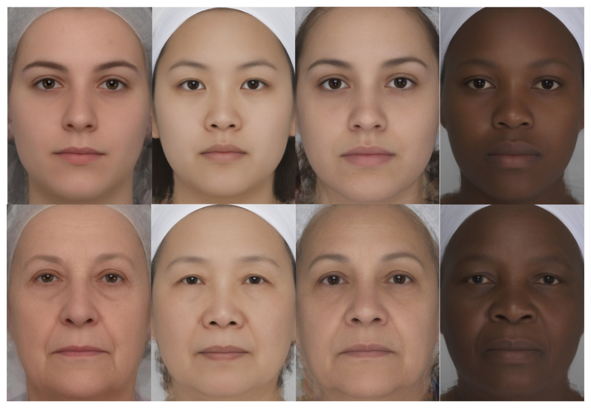
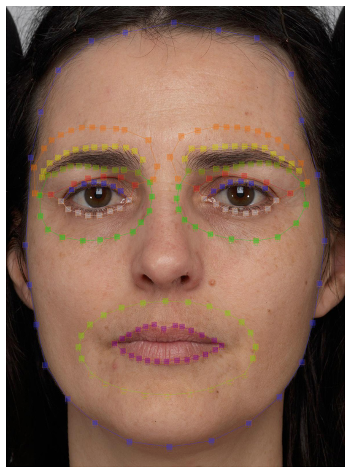
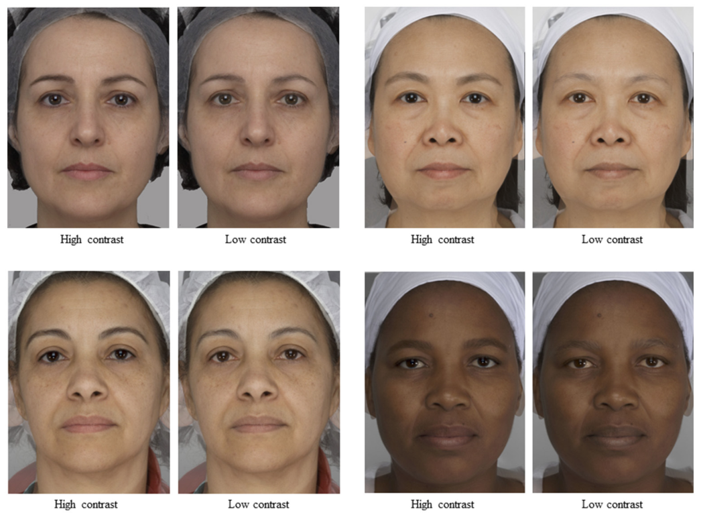
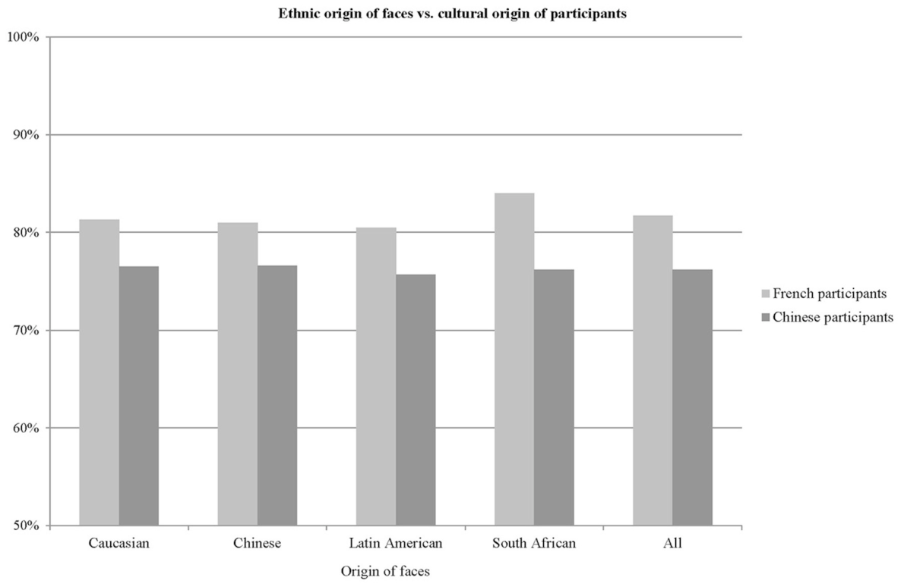

# 얼굴 대비는 나이를 지각하는 비교문화적 단서다

> **원문** Porcheron A, Mauger E, Soppelsa F, Liu Y, Ge L, Pascalis O, Russell R, Morizot F (2017). *Facial Contrast Is a Cross-Cultural Cue for Perceiving Age.* Front. Psychol. 8:1208. https://doi.org/10.3389/fpsyg.2017.01208
>
> **라이선스** 원문 Copyright © 2017 Porcheron, Mauger, Soppelsa, Liu, Ge, Pascalis, Russell and Morizot. Creative Commons Attribution License(CC BY)로 배포되는 오픈 액세스 논문이며, 원저자 또는 라이선스 보유자를 밝히고 이 학술지의 원 출판물을 인용하는 조건으로 다른 곳에서의 이용·배포·복제를 허용합니다.
>
> **변경 사항** 영어 원문을 한국어로 번역했습니다. 그림은 원문에서 잘라 캡션 앞에 넣었고, 표는 원문 PDF를 보고 옮겼습니다. 참고문헌 목록은 생략했습니다(본문의 (저자, 연도)는 원문 참고문헌을 가리킴). 원저자가 검토한 번역이 아닙니다.

**용어 대응** — 얼굴 대비(facial contrast): 이목구비(눈·입·눈썹)와 주변 피부 사이의 색·휘도 차이 · 휘도(luminance, L) · a 축(초록-빨강) · b 축(파랑-노랑) · 고리(annulus): 부위를 둘러싼 피부 영역 · 강제 선택(forced choice) · 자기 인종 편향(own-race bias)

**소속** ¹ 샤넬 PB, 프랑스 팡탱 · ² 그르노블알프스대학 심리학·신경인지연구소, 프랑스 그르노블 · ³ Lincoln Group, 프랑스 불로뉴비양쿠르 · ⁴ 저장이공대학 심리학과, 중국 항저우 · ⁵ 게티스버그 칼리지 심리학과, 미국 펜실베이니아주 게티스버그
**접수** 2017년 2월 24일 · **게재 승인** 2017년 7월 3일 · **발행** 2017년 7월 25일

---

## 초록

나이는 기본적인 사회적 차원이며 젊은 외모는 많은 개인에게 중요한데, 아마 그것이 건강, 얼굴 매력, 전반적 안녕의 여러 측면을 예측하기 때문일 것이다. 우리는 최근 얼굴 대비, 즉 이목구비와 주변 피부 사이의 색과 휘도 차이가 백인 여성에서 나이와 관련되며 나이 지각의 단서임을 보였다. 구체적으로, 얼굴 대비의 여러 측면이 백인 여성에서 나이에 따라 감소하며, 대비가 더 높은 백인 여성 얼굴이 더 젊어 보인다(Porcheron et al., 2013). 여기서 우리는 얼굴 대비가 비교문화적인 젊음 관련 속성인지 알아보기 위해 다른 민족 집단의 얼굴과 다른 문화의 평가자를 조사했다. 20–80세의 중국인, 라틴아메리카인, 남아프리카 흑인 여성의 큰 전체 얼굴 컬러 사진 세트를 사용해, 이목구비(눈, 입술, 눈썹)와 주변 피부 사이의 휘도와 색 대비를 측정했다. 이전에 백인 여성에서 나이에 따라 감소하는 것으로 나타난 얼굴 대비의 측면 대부분이 다른 민족 집단에서도 나이에 따라 감소했다. 나이에 따른 변화의 전반적 패턴은 모든 여성에게 공통적이었지만, 집단 간에 일부 차이도 있었다. 별도의 연구에서, 대부분의 얼굴에서 나이에 따라 변하는 얼굴 대비의 측면을 인위적으로 높이면 4개 민족 집단의 개별 얼굴이 프랑스인과 중국인 참가자에게 더 젊게 지각되었고, 인위적으로 낮추면 더 늙게 지각되었다. 종합하면 이 결과는 얼굴 대비가 비교문화적인 젊음의 단서임을 가리킨다. 화장품이 얼굴 대비를 강화하는 것으로 나타났으므로, 이 연구는 화장품의 보편적 기능 하나가 여성 얼굴을 더 젊어 보이게 하는 것이라는 생각을 어느 정도 뒷받침한다.

**키워드**: 얼굴 대비, 나이, 얼굴 지각, 인종, 비교문화

## 서론

나이는 직업적·개인적 맥락에서 사회적 행동을 이끄는 기본적인 사회적 차원이다. 한 사람이 다른 사람들에게 받는 대우를 예측하는 것은 실제 나이, 즉 연대기적 나이만이 아니다. 사회적 상대의 겉보기 나이에 두는 강조의 정도에는 뚜렷한 문화 차이가 분명히 있지만(Anzures et al., 2010), 겉보기 나이는 많은 개인에게 주요한 동기 요인이다. 젊은 외모는 많은 개인에게 중요한데, 아마 그것이 건강과 얼굴 매력의 여러 측면을 예측하기 때문일 것이다(Christensen et al., 2004; Rhodes, 2009).

젊은 외모를 이끄는 얼굴 단서는 서로 다른 인종에 걸쳐 유사성을 공유하는 것으로 나타났는데, 특히 얼굴이 서로 다른 인종에 걸쳐 비슷한 방식으로 나이 들기 때문이다(Tschachler and Morizot, 2006; Hillebrand et al., 2007; Farage et al., 2010). 피부 질감(주름)과 피부색 균일도(과색소 침착)는 백인(Nkengne et al., 2008; Gunn et al., 2009)과 중국인(Mayes et al., 2010) 얼굴에서 지각된 나이의 좋은 예측 변수다. 피부 주름, 피부 처짐, 피부색 불균일을 디지털로 줄이면 중국인 여성(Porcheron et al., 2014)과 백인 여성(Fink et al., 2006; Fink and Matts, 2008; Samson et al., 2010)에서 젊은 외모가 향상되는 것으로 나타났다. 다른 얼굴 기준도 나이 지각에 기여하는 것으로 나타났지만, 그 연구들은 백인 얼굴과 백인 관찰자로만 수행되었다: 피부색(Nkengne et al., 2008), 얼굴 형태(Lai et al., 2013), 내부 이목구비(George and Hole, 1998), 공막 색(Russell et al., 2014), 머리 모양과 색(Rexbye and Povlsen, 2007; Gunn et al., 2009). 젊은 외모에 대한 얼굴 단서의 비교문화적 타당성을 실험적으로 보이는 연구는 부족하며, 백인과 동아시아인 이외의 인종 집단에 대한 연구도 마찬가지다.

얼굴 내부 이목구비의 크기와 형태는 나이 지각과 관련된다(George and Hole, 1998; Nkengne et al., 2008; Gunn et al., 2009). 입술, 눈, 눈썹의 색은 몇몇 연구에서 나이에 따라 변하는 것으로 나타났고(Wee et al., 2013; Russell et al., 2014), 시간에 따른 얼굴 피부색의 변화는 폭넓게 기술되었다. 눈, 입, 눈썹과 이 부위를 둘러싼 피부 사이의 휘도와 색 차이, 즉 얼굴 대비는 최근 알려진 노화 징후의 목록에 추가되었다(Porcheron et al., 2013). 얼굴 대비는 앞서 백인과 동아시아인 얼굴에서 성적으로 이형적이며, 얼굴에서 성별을 지각하는 단서임이 밝혀졌다(Russell, 2009; Jones et al., 2015). Porcheron 외(2013)에서는 얼굴 대비의 일부 측면이 백인 여성 얼굴에서 나이에 따라 변하는 것이 관찰되었고, 얼굴의 지각된 나이와도 유의하게 상관했다. 여기에는 눈과 눈썹 주변의 휘도 대비, 입과 눈 주변의 빨강-초록 대비, 눈 주변의 노랑-파랑 대비가 포함되었다. 또한 백인 여성의 개별 얼굴은 얼굴 대비의 이 측면들을 인위적으로 높였을 때 더 젊게, 인위적으로 낮췄을 때 더 늙게 지각되었다. 따라서 우리는 화장품이 얼굴 대비를 높임으로써 여성 얼굴의 여성성과 젊음을 높이며, 그 효과는 나이 든 얼굴에서 더 크다고 제안했다.

여기서 우리는 얼굴 대비가 나이 지각의 비교문화적으로 타당한 단서라는 가설을 검증했다. 이 일반적 질문은 두 부분을 포함한다. 나이에 따라 관찰되는 얼굴 대비의 감소가 서로 다른 인종이나 민족의 여성에게 일반화되는가, 그리고 서로 다른 문화의 사람들이 얼굴 대비를 얼굴의 나이를 지각하는 단서로 사용하는가?

인종 간 피부색의 차이에도 불구하고(Jablonski and Chaplin, 2000), 나이에 따라 관찰되는 피부색 변화는 모든 인종에서 꽤 비슷해 보인다. 나이에 따른 이 변화는 노화의 내재적 기전의 효과와, 보호되지 않은 부위에 대한 자외선의 장기 효과(만성 햇빛 노출) 때문이다. 나이에 따른 얼굴 피부색의 주된 변화는 만성 햇빛 노출과 관련되며, 이는 모든 인종의 피부 유형에서 피부의 전반적인 어두워짐을 일으킨다. 다만 나이에 따른 피부색의 일부 작은 변화는 특정 인종에 고유한 것으로 보고되었다. 예를 들어 광노화는 아시아인에서는 얼굴 피부의 황변을, 백인에서는 얼굴 피부의 붉어짐을 일으킨다(Cazorla, 2014). 인종에 걸쳐 이목구비에 대한 내재적·외재적 요인의 효과는 거의 연구되지 않았다. 따라서 문헌만을 근거로 얼굴 대비가 인종에 걸쳐 나이에 따라 어떻게 변하는지 예측하기는 어려웠다. 우리는 예측을 정하기 위해 나이와 인종별로 합성 얼굴을 만들었다. 그림 1의 평균 얼굴로 보면, 서로 다른 인종의 여성에서 나이에 따라 얼굴 대비가 전반적으로 감소하는 것으로 보인다. 네 개의 나이 든 합성 얼굴은 대응하는 네 개의 젊은 합성 얼굴보다 대비가 낮아 보인다. 그럼에도 얼굴 대비의 측면들이 나이에 따라 감소하는 방식은 인종에 따라 약간 다를 수 있다.

**그림 1** | 프랑스 백인, 중국인, 라틴아메리카인, 남아프리카 출신 젊은(20–29세) 여성과 나이 든(60–69세) 여성의 평균 얼굴. 각 평균 얼굴은 개별 얼굴 20개로 만들었다.

따라서 우리의 첫 번째 가설은, 얼굴의 모든 영역의 얼굴 대비가 서로 다른 인종이나 민족의 얼굴에 걸쳐 비슷하게 감소해야 한다는 것이다. 서로 다른 인종이나 민족의 여성 얼굴에서 나이에 따라 얼굴 대비가 전반적으로 감소한다면, 우리는 얼굴 대비가 얼굴의 민족적 기원과 관찰자의 문화적 기원과 무관하게 나이 지각의 적절한 단서일 것이라고 예상한다.

첫 번째 연구에서 우리는 중국인, 라틴아메리카인, 남아프리카 흑인 여성 얼굴 세트를 사용해 얼굴 대비를 측정하여, 이 세 민족 집단의 얼굴에서 Porcheron 외(2013)에서 측정한 백인 얼굴과 비슷하게 얼굴 대비가 나이에 따라 감소하는지 확인했다. 서로 다른 인종 집단에서 얼굴 대비를 예측하는 것으로 나타난 성별 변수(Russell, 2009; Jones et al., 2015)를 일정하게 유지하기 위해 여성 얼굴만 사용했다. 실제로 우리는 민족에 따른 얼굴 대비와 나이의 관계를 분리하고자 했다. 두 번째 연구에서는 얼굴 대비가 얼굴의 민족적 기원과 관찰자의 문화적 기원과 무관하게 지각된 나이와 인과적으로 관련되는지를 실험적으로 검증했다. 네 얼굴 집단에서 나이에 따라 비슷하게 변하는 것으로 나타난 얼굴 대비의 측면을 조작하여, 얼굴 대비를 높이거나 낮춘 얼굴의 새 판을 만들었다. 강제 선택 검사 설계에서, 프랑스인과 중국인 참가자에게 두 이미지를 보여 주고 어느 얼굴이 더 젊어 보이는지 고르게 했다.

## 연구 1: 얼굴 대비는 서로 다른 민족 집단에서 나이에 따라 변하는가?

### 재료와 방법

#### 얼굴 세트

다양한 민족의 건강한 피부를 가진 여성 763명의 전체 얼굴 컬러 이미지를 사용했다: 프랑스 파리에 사는 중국계 아시아인 여성 139명(20–78세; 41.6 ± 13.8세), 미국 동부 해안에 사는 라틴아메리카인 여성 180명(인종적으로 이질적인 집단, 20–80세; 44.8 ± 16.2세), 남아프리카 프레토리아에 사는 남아프리카 흑인 여성 155명(20–70세; 45.8 ± 15.0세), 그리고 Porcheron 외(2013)에서 분석한 파리에 사는 프랑스 백인 여성 289명(20–70세; 45.66 ± 13.2세). 중국인 여성 중 67%는 중국에서 태어나(48.1 ± 11.7세) 프랑스에서 21.9 ± 11.9년을 지냈고, 33%는 프랑스에서 태어났다(21.9 ± 6.9세). 라틴아메리카인 집단은 여러 출신국의 여성으로 이루어졌다. 이 중 81%는 브라질, 콜롬비아, 멕시코, 푸에르토리코, 도미니카공화국 또는 미국에서 태어났고, 19%는 남아메리카나 중앙아메리카의 다른 나라에서 태어났다.

이 이미지들은 피험자의 정확하고 재현 가능한 위치 설정과 통제된 조명 조건을 가능하게 하는 폐쇄형 촬영 시스템으로 촬영했다. 촬영 시스템의 세부 사항은 Porcheron 외(2013)를 참조하라. 피험자는 화장이나 장신구를 하지 않았다. 피험자 대다수(총 763명 중 737명)는 머리카락이 얼굴에 닿지 않도록 머리띠를 했다. 피험자는 눈을 뜨고, 무표정을 유지하며 카메라를 똑바로 응시하도록 요청받았다. 반영구 화장이나 컬러 콘택트렌즈를 한 얼굴은 포함하지 않았다. 이미지는 얼굴 윤곽이 보이도록 잘랐다.

이 연구는 단면 연구였으므로, 나이에 따른 눈 대비의 변화가 연구 내 젊은 여성과 나이 든 여성 사이의 홍채 색 차이 때문일 수 있는지 확인하고자 했다. 이는 홍채 색이 파랑에서 짙은 갈색까지 다양한 프랑스 백인과 라틴아메리카인 여성에게만 해당했다. 이를 위해 이 두 집단의 각 얼굴의 홍채 색을 Seddon 외(1990)가 기술한 체계로 평가했다. 각 이미지 세트에서 나이 든 얼굴과 젊은 얼굴 사이의 눈 색 차이를 χ² 검정으로 분석한 결과, 두 얼굴 표본 모두에서 10년 단위 나이 등급 사이에 홍채 색의 유의한 차이는 없었다(백인 p = 0.65, 라틴아메리카인 p = 0.43).

#### 얼굴 대비 측정

얼굴 영역은 Porcheron 외(2013)와 비슷하게 표시했으며, 눈, 입술, 눈썹, 눈을 둘러싼 고리, 입술을 둘러싼 고리, 눈썹을 둘러싼 고리에 해당했다(그림 2). 표시 후, 눈과 주변 피부, 눈썹과 주변 피부, 입과 주변 피부 사이의 대비를 CIELab의 L(휘도), a(초록–빨강), b(파랑–노랑) 축에서 Porcheron 외(2013)와 Jones 외(2015)에 기술된 것과 정확히 같은 방법으로 측정했다. 대비 측정은 MATLAB 7.8.0(R2010a)으로 수행했다. 눈 안의 모든 픽셀의 휘도 값을 평균했고, 다른 각 부위와 각 부위를 둘러싼 고리의 모든 픽셀도 마찬가지로 평균했다. 이런 방식으로 세 색 채널 각각에 대해 각 얼굴 영역(부위든 주변 피부든)의 단일 평균 픽셀 값을 측정했다. 대비는 각 부위에 대해 Cf = (피부 휘도 − 부위 휘도)/(피부 휘도 + 부위 휘도)로 계산했다. 이는 미켈슨 대비의 변형으로, −1에서 1까지 변하며, 절댓값이 클수록 대비가 크고 0은 대비가 없음을 가리킨다. 같은 방법을 빨강-초록과 노랑-파랑 얼굴 대비의 측정에도 적용했으며, a는 0(초록)에서 255(빨강), b는 0(파랑)에서 255(빨강)까지다. (역자 주: 원문은 b의 255 쪽을 "red"라고 적었으나, b 축의 양 끝은 파랑–노랑이므로 "노랑"의 오기로 보인다.)

**그림 2** | 얼굴 영역의 표시. 점선은 부위와 주변 피부를 정의한 방식을 보여 준다(눈 영역: 파란 점과 흰 점, 눈 주변 피부: 초록 점, 입 영역: 보라 점, 입 주변 피부: 연두 점, 눈썹 영역: 노랑 점과 연두 점, 눈썹 주변 피부: 주황 점과 빨간 점). 여기에 얼굴이 나온 사람은 이 논문에 자신의 모습이 실리는 데 동의했다.

### 결과

얼굴의 민족적 기원에 따른 나이와 얼굴 대비 각 측면의 관계를 피어슨 상관으로 검정했다. 결과는 표 1에 자세히 제시되어 있다. 음의 상관계수는 얼굴 대비의 그 측면이 나이에 따라 감소함을, 양의 계수는 나이에 따라 대비가 증가함을 가리킨다.

얼굴 대비의 여러 측면이 네 얼굴 표본 모두에서 나이에 따라 유의하게 감소하는 것으로 나타났다. 구체적으로, 눈썹 주변의 휘도 대비, 입 주변의 a(초록에서 빨강) 대비, 눈 주변의 b(파랑에서 노랑) 대비가 모든 얼굴에서 나이에 따라 유의하게 감소했다. 눈 주변의 휘도 대비와 눈 주변의 a 대비는 모든 얼굴에서 나이에 따라 감소했지만, 중국인 얼굴에서는 유의하지 않았다.

한 얼굴 집단이나 다른 집단에 고유한 대비 변화도 몇 가지 있었다. 예를 들어 입 주변의 휘도 대비는 중국인 얼굴에서 나이에 따라 증가했고 라틴아메리카인 얼굴에서 증가하는 경향이 있었지만, 남아프리카 흑인이나 프랑스 백인 얼굴에서는 변하지 않았다. 입 주변의 노랑 대비는 백인과 중국인 얼굴에서 나이에 따라 증가했지만 라틴아메리카인과 남아프리카 흑인 얼굴에서는 변하지 않았다.

요약하면, 얼굴 대비의 대부분의 측면이 네 얼굴 세트에서 나이에 따라 감소하는 것으로 나타났다. 세 집단은 민족적으로 동질적이었고 한 집단(라틴아메리카인 얼굴)은 민족적으로 다양했다. 나이에 따른 감소는 얼굴 대비와 나이의 관계가 더 다양했던 중국인과 라틴아메리카인 세트보다 백인과 남아프리카인 얼굴에서 더 강해 보였다.

**표 1** | 4개 얼굴 집단에서 나이와 휘도(L\*) 또는 색(a\*, b\*) 대비의 관계

| 부위 | 대비 | 백인 R | P | 방향 | 중국인 R | P | 방향 | 라틴아메리카인 R | P | 방향 | 남아프리카인 R | P | 방향 |
|---|---|---|---|---|---|---|---|---|---|---|---|---|---|
| 눈썹 | L\* | **−0.50** | **<0.05** | **감소** | **−0.33** | **<0.05** | **감소** | **−0.49** | **<0.05** | **감소** | **−0.21** | **<0.05** | **감소** |
| | a\* | −0.27 | <0.05 | 감소 | 0.21 | <0.05 | / | −0.06 | ns | / | −0.36 | <0.05 | 감소 |
| | b\* | −0.23 | <0.05 | 감소 | 0.08 | ns | / | −0.11 | ns | / | −0.26 | <0.05 | 감소 |
| 눈 | L\* | *−0.11* | *<0.10* | *감소* | *−0.09* | *ns* | */* | *−0.13* | *<0.10* | *감소* | *−0.25* | *<0.05* | *감소* |
| | a\* | *−0.32* | *<0.05* | *감소* | *−0.10* | *ns* | */* | *−0.30* | *<0.05* | *감소* | *−0.46* | *<0.05* | *감소* |
| | b\* | **−0.24** | **<0.05** | **감소** | **−0.18** | **<0.05** | **감소** | **−0.17** | **<0.05** | **감소** | **−0.40** | **<0.05** | **감소** |
| 입 | L\* | 0.03 | NS | / | 0.21 | <0.05 | 증가 | 0.14 | <0.10 | 증가 | 0.18 | <0.05 | 증가ᵃ |
| | a\* | **−0.292** | **<0.05** | **감소** | **−0.35ᵇ** | **<0.05** | **감소** | **−0.34ᵇ** | **<0.05** | **감소** | **0.23ᶜ** | **<0.05** | **감소** |
| | b\* | 0.16 | <0.05 | 증가 | 0.28 | <0.05 | 증가 | 0.06 | ns | / | −0.06 | ns | / |

ᵃ 남아프리카인 얼굴의 입 L\* 대비는 40세쯤까지 감소했다가 이후 나이에 따라 증가했다.
ᵇ 입의 a\* 대비는 백인, 중국인, 라틴아메리카인 얼굴에서 모두 음수 값을 가졌으므로 절댓값으로 분석했다.
ᶜ 남아프리카인 얼굴의 입 a\* 대비는 얼굴에 따라 양수와 음수 값을 가졌다. 나이가 증가할수록 상관선의 기울기가 증가했지만 음수 값 범위 안에서였다(따라서 나이 든 얼굴에서 젊은 얼굴보다 0에 더 가까웠다). 4개 얼굴 집단 모두에서 나이에 따라 감소한 대비의 측면은 짙은 회색으로, 4개 중 3개 얼굴 집단에서 나이에 따라 감소한 대비의 측면은 옅은 회색으로 강조했다.
(역자 주: 이 번역에서는 원문의 짙은 회색 행을 **굵게**, 옅은 회색 행을 *기울임*으로 표시했다.)

## 연구 2: 얼굴 대비는 나이 지각의 비교문화적으로 타당한 단서인가?

얼굴 대비의 여러 측면이 모든 얼굴 집단에서 나이에 따라 감소한다는 것을 발견했으므로, 얼굴 대비가 얼굴의 민족적 기원과 관찰자의 문화적 기원과 무관하게 나이의 지각에 영향을 주는지 알아보고자 했다. 4개의 얼굴 민족적 기원(연구 1과 같은 기원)과 2개의 참가자 문화적 기원(프랑스 백인과 중국계 아시아인)을 검사했다. 민족에 걸쳐 나이에 따라 감소한 얼굴 대비의 측면을 조작하여, 그것이 나이 지각과 인과적으로 관련되는지를 검정했다. 대부분의 집단에서 일관된 것을 보기 위해, 최소 3개 얼굴 집단에서 나이에 따라 같은 변화를 보이는 대비를 모두 고려했다. 즉 눈과 눈썹 주변의 휘도 대비, 눈과 입 주변의 a 대비, 눈 주변의 b 대비다. 얼굴 대비의 이 다섯 측면을 높이거나 낮추어 각 얼굴의 두 판, 즉 고대비 판과 저대비 판을 만들었다. 그런 다음 참가자들이 각 얼굴의 두 판을 나란히 비교하는 강제 선택 검사 설계를 사용했다.

### 재료와 방법

#### 자극

민족 집단당 23명의 여성을 두기 위해, 첫 번째 연구에서 사용한 763장 중 92장의 이미지를 무작위로 골랐다. 각 민족 집단에서 23개 얼굴은 표 2에 기술한 대로 나이별로 고르게 분포했다.

**표 2** | 연구 2 얼굴의 민족적 기원별 나이 분포

| 나이 | 백인 | 중국인 | 라틴아메리카인 | 남아프리카인 |
|---|---|---|---|---|
| N | 23 | 23 | 23 | 23 |
| 평균 ± SD | 43.00 ± 12.92 | 42.35 ± 12.82 | 41.83 ± 13.37 | 42.87 ± 14.02 |
| 최소–최대 | 23.0–63.0 | 20.0–63.0 | 20.0–66.0 | 21.0–67.0 |

각 얼굴은 나이에 따라 감소하는 것으로, 또는 네 민족 집단 중 다수에서 나이에 따라 감소하는 것으로 관찰된 얼굴 대비의 측면을 높이거나 낮추도록 조작했다. 구체적으로 눈과 눈썹 주변의 휘도 대비, 눈과 입 주변의 a 대비, 눈 주변의 b 대비를 조작했다. 부위 주변의 대비를 조작하기 위해 부위를 조작하고 주변 피부는 바꾸지 않았다. 조작의 방향과 크기는 표 3에 요약되어 있다.

조작 절차는 Porcheron 외(2013)에서 사용한 것과 비슷했다. Adobe Photoshop®의 번 도구로 눈썹을 선택적으로 어둡게 했고, 닷지 도구로 눈썹을 선택적으로 밝게 했다. 다른 모든 부위 대비(즉 눈과 주변 피부 사이의 a, b 대비와 입과 주변 피부 사이의 a 대비)를 조작하기 위해서는, 얼굴의 나머지 부분을 바꾸지 않고 해당 부위의 L, a 또는 b 채널(0–255)을 개별적으로 조작했다. 각 부위와 각 얼굴에 대해, 자연스러운 외모를 유지하면서 겉보기 나이의 변화를 최대화하는 것으로 보이는 변화 크기를 선택했다. 자연스러운 외모를 유지하기 위해 일부 얼굴의 일부 부위에서는 조작 크기를 약하게 했다. 핵심은 변화의 방향이 모든 얼굴에서 일관되었다는 점이다. 자극의 예는 그림 3에 나와 있다.

**표 3** | 각 판(저대비 대 고대비)의 조작 방향과 얼굴의 민족적 기원별 조작 크기

| 부위 | 색 채널 | 저대비 판 | 고대비 판 | 백인 | 중국인 | 라틴아메리카인 | 남아프리카인 |
|---|---|---|---|---|---|---|---|
| 눈썹 | L\* | 더 밝게 | 더 어둡게 | 17.84 ± 3.05 | 19.21 ± 4.34 | 17.02 ± 3.69 | 11.09 ± 3.16 |
| 눈 | L\* | 더 밝게 | 더 어둡게 | 11.22 ± 2.99 | 10.13 ± 1.74 | 10.69 ± 2.25 | 7.79 ± 2.06 |
| 눈 | a\* | 더 붉게 | 덜 붉게 | 2.32 ± 0.98 | 2.41 ± 0.62 | 2.99 ± 0.64 | 2.23 ± 0.49 |
| 눈 | b\* | 더 노랗게 | 덜 노랗게 | 4.75 ± 0.69 | 4.49 ± 0.72 | 4.90 ± 0.63 | 4.99 ± 0.99 |
| 입 | a\* | 덜 붉게 | 더 붉게 | 4.86 ± 1.31 | 3.74 ± 0.53 | 3.98 ± 0.82 | 3.08 ± 0.71 |

조작의 크기(평균 ± SD)는 고대비 얼굴과 저대비 얼굴 사이 부위의 a\*, b\* 또는 L\*의 평균 절대 차이에 해당한다.

**그림 3** | 백인, 중국인, 라틴아메리카인, 남아프리카인 얼굴의 고대비 판과 저대비 판의 예. 여성들의 사생활을 존중하기 위해, 연구의 개별 얼굴을 평균하여 고대비 판과 저대비 판의 합성 얼굴 4개를 만들었다.

#### 참가자

92쌍의 얼굴을 두 참가자 집단에게 보여 주었다. 첫 번째 집단은 파리에서 검사를 받은 프랑스 백인 참가자 108명(여성 59명: 20–59세, 38.8 ± 11.4세; 남성 49명: 21–64세, 41.5 ± 12.2세)으로 구성되었다. 두 번째 집단은 항저우에서 검사를 받은 중국인 참가자 74명(여성 40명: 18–70세, 42.8 ± 17.9세; 남성 34명: 17–74세, 44.6 ± 19.2세)으로 구성되었다.

#### 강제 선택 검사 설계

92개 자극 얼굴 각각에 대해, 참가자는 고대비 판과 저대비 판을 나란히 보고 어느 판이 더 젊어 보이는지 버튼을 눌러 표시했다. 얼굴의 제시는 무작위로 했고 나이 집단, 조작[저/고], 민족적 기원에 따라 균형을 맞췄다. 얼굴 쌍은 시간 제한 없이 제시했다. 프랑스 연구에서는 두 대의 서로 다른 모니터를 사용했으며, 둘 다 보정되었다. 중국인 참가자는 모두 같은 모니터로 자극을 보았고, 이 모니터는 보정되지 않았다. 두 장소 모두 검사실에서 통제된 조명 조건을 사용했다.

### 결과

얼굴 대비가 나이를 지각하는 비교문화적 단서라는 가설과 관련하여, 우리는 얼굴의 민족적 기원과 참가자의 문화적 기원의 효과를 예상하지 않았다. 그러나 고대비 판을 선택할 가능성에 대한 자기 인종 편향 가능성을 검정했다. 다시 말해, 프랑스 참가자는 백인 얼굴에서, 중국인 참가자는 중국인 얼굴에서 고대비 얼굴을 가장 자주 선택했는지를 검정했다. 최근 연구에 따르면 우리는 다른 인종의 두 얼굴보다 자기 인종의 두 얼굴 사이의 작은 나이 차이를 더 잘 지각한다(Anzures et al., 2010). 참가자의 나이와 성별이 고대비 판을 선택할 가능성에 주는 효과에 대해서는 특별한 예측이 없었다.

강제 선택 과제였으므로 각 종속 변수는 이항(피험자는 얼굴의 고대비 판 또는 저대비 판을 선택)이며, 따라서 얼굴의 민족적 기원과 참가자의 문화적 기원이 고대비 판을 선택할 가능성에 주는 효과를 조사하기 위해 반복 측정(얼굴과 참가자)이 있는 요인 로지스틱 회귀 모형을 수행했다. 통계 방법에 대한 자세한 내용은 Russell 외(2014)를 참조하라.

전체적으로 참가자들은 시행의 79.2%에서 고대비 얼굴을 선택했다. 이 결과는 얼굴의 민족적 기원과 참가자의 문화적 기원에 따라 그림 4에 나타나 있다. 각 얼굴 집단에 대해 프랑스인과 중국인 참가자에서 관찰된 높은 백분율(각각 프랑스인과 중국인 참가자에 대해 백인 얼굴: 80.2 대 77.4%, 중국인 얼굴: 79.1 대 77.6%, 라틴아메리카인 얼굴: 80.4 대 76.5%, 남아프리카인 얼굴: 82.3 대 77.2%)은, 참가자의 문화적 기원과 얼굴의 민족적 기원(자기 인종과 다른 인종 얼굴)과 관계없이 얼굴 대비를 높인 얼굴이 더 젊게 지각되었음을 가리킨다. 참가자의 문화적 기원의 유의한 주효과가 있었다(χ² = 26.73, p < 0.0001). 조작의 효과는 얼굴의 민족적 기원과 관계없이 프랑스인 참가자에서 중국인 참가자보다 유의하게, 그러나 약간 더 강했다. 예측대로 얼굴의 민족적 기원의 효과와 상호작용 효과는 없었다.

**그림 4** | 고대비 얼굴이 저대비 얼굴보다 더 젊다고 판단된 시행의 백분율. 우연 수준은 50%다.
(역자 주: 그림 4의 막대 높이는 본문에 적힌 백분율과 눈대중으로 조금 달라 보인다. 원문 그대로 옮겼다.)

## 종합 논의

이 연구들은 얼굴 대비가 얼굴에서 나이를 지각하는 비교문화적으로 타당한 단서인가라는 일반적 질문을 다루었다. 이 일반적 질문은 두 부분을 포함한다. 얼굴 대비가 다양한 인종이나 민족의 여성에서 나이에 따라 감소하는가, 그리고 서로 다른 문화의 사람들이 얼굴 대비를 얼굴의 나이를 지각하는 단서로 사용하는가? 네 대륙의 네 가지 인종·민족 집단에서 뽑은 네 가지 얼굴 표본을 사용해, 얼굴 대비의 측면들이 나이에 따라 감소한다는 가설을 검증했다. 그런 다음 두 대륙의 서로 다른 인종 집단과 문화에서 뽑은 두 참가자 집단으로, 사람들이 얼굴 대비를 얼굴에서 나이를 지각하는 단서로 사용한다는 가설을 검증했다. 우리는 모든 얼굴과 참가자 표본에서 두 가설 모두에 대한 지지를 발견했다. 첫째, 우리가 검사한 네 얼굴 표본 모두에서 얼굴 대비의 일관된 감소가 있었다. 둘째, 두 참가자 집단 모두 얼굴 대비를 높인 얼굴을 대비를 낮춘 같은 얼굴보다 더 젊게 지각했다. 이 결과들은 모두 얼굴 대비가 얼굴 나이를 지각하는 비교문화적 단서라는 생각과 일관된다. 얼굴 대비의 측면들이 백인, 중국인, 라틴아메리카인, 남아프리카 흑인 여성 얼굴에서 나이에 따라 감소한다는 것을 확인했지만, 일부 변동도 있었다. 얼굴 대비의 아홉 측면 중 세 가지가 네 집단 모두에서 나이에 따라 감소했다: 눈썹 주변의 휘도 대비, 입 주변의 빨강-초록 대비, 눈 주변의 노랑-파랑 대비. 얼굴 대비의 두 측면은 대부분의 얼굴에서 나이에 따라 감소했거나 감소하는 경향이 있었지만 중국인 세트에서는 그렇지 않았다. 여기에는 눈 주변의 휘도 대비와 눈 주변의 빨강-초록 대비가 포함되었다. 마지막으로, 얼굴 대비의 네 측면은 얼굴의 민족적 기원에 따라 다양한 방식으로 나이에 따라 변했다. 입 주변의 휘도와 노랑-파랑 대비, 그리고 눈썹 주변의 빨강-초록과 노랑-초록 대비가 그것이었다. (역자 주: "yellow-green"은 원문 표기 그대로이며, 표 1로 보아 노랑-파랑(b\*)을 가리키는 것으로 보인다.) 또한 얼굴 대비의 대부분의 측면(아홉 중 일곱)이 백인과 남아프리카 흑인 얼굴에서 나이에 따라 감소한 반면, 중국인과 라틴아메리카인 얼굴에서는 나이에 따라 관찰된 변화가 더 다양했다는 점도 주목할 만하다.

연구 2의 결과는 얼굴 대비의 측면들이 프랑스인과 중국인 참가자 모두에서 여성 얼굴의 나이를 지각하는 단서로 사용된다는 분명한 증거를 제시했다. 이 집단들을 네 인종 집단과 넓은 나이 범위의 얼굴로 검사했을 때, 얼굴 대비를 높인 여성 얼굴은 대비를 낮춘 얼굴보다 더 젊게 판단되었다. 효과는 견고했고 얼굴의 민족적 기원이나 참가자의 문화적 기원과 관계없이 우연 수준을 크게 웃돌았으며, 프랑스인 참가자가 중국인 참가자보다 고대비 얼굴을 약간 더 자주 선택했다. 종합하면, 이 결과는 대부분의 여성 얼굴에서 나이에 따라 감소하는 얼굴 대비의 측면이 여성의 나이 지각에 대한 비교문화적으로 타당한 단서라는 생각과 일관된다.

얼굴 대비의 측면들은 모든 여성에서 나이에 따라 감소하지만, 화장품의 사용은 얼굴 대비의 휘도와 색 부분을 높이는 역할을 한다(Russell, 2009; Etcoff et al., 2011; Jones et al., 2015). 예를 들어 립스틱을 바르면 입 주변의 빨강 대비가 높아지는데(Jones et al., 2015), 이는 여기서 네 인종 집단 모두에서 나이에 따라 감소하는 것으로 나타났다. 현재 연구는 여성이 이목구비와 주변 피부 사이의 대비를 높임으로써 아름다움을 강화하기 위해 화장품을 어떻게 바르는지에 대한 지식을 발전시킨다. 이 시각적 특징은 알려진 아름다움의 두 요인, 즉 나이와 성적 이형성과 관련된다. 이 특징을 높임으로써 화장품은 아름다움의 중요한 보편적 요인을 바꾸어 여성을 더 여성적이고 더 젊어 보이게 할 수 있다. 이는 문화적 영향에 더해, 화장품 사용 패턴에 대한 생물학적 영향의 증거를 제공한다.

화장이 얼굴의 외모를 바꾸는 방식에 대한 과학적 연구는 최근에야 시작되었으며, 이 주제에 대해 발표된 연구는 적다. 우리가 아는 한, 서로 다른 인종 집단의 여성이 화장을 사용하는 방식을 체계적으로 비교한 연구는 없다. 우리는 특정 인종의 여성이 그 인종에서 나이에 따라 얼굴 대비가 변하는 방식대로 얼굴 대비를 바꾸기 위해 화장을 사용한다고(또는 사용해야 한다고) 예측한다. 여기서 우리는 얼굴 대비의 측면이 나이에 따라 변하는 방식에서 인종에 따른 일부 고유성을 관찰했다(즉 입 주변의 휘도와 노랑 대비). 중국인 여성과 라틴아메리카인 여성만이 나이에 따라 입 주변의 휘도 대비가 더 높다. 즉 나이가 들면 입술이 더 어두워 보인다. 이 관찰은 여성이 사용하는 화장품 색조의 문화적 선호에 대한 가능한 이유를 시사하며, 립스틱 색조가 서로 다른 인종과 문화의 여성에서 지각된 나이에 서로 다른 효과를 가질 수 있음을 시사한다. 여성의 출신에 따라 얼굴 대비가 나이에 따라 변하는 방식에 일부 유사성과 함께 일부 고유성도 관찰되었으므로, 이는 화장품 개발과 화장품 개인화에 대한 합리적 접근을 가리킨다.

이 연구의 증거는 분명히 비교문화성과 일관되지만, 결과는 다른 참가자 집단(예: 남아프리카인, 라틴아메리카인)과 다른 인종·민족의 목표 얼굴로 확장될 필요가 있다. 마지막으로, 여기서의 초점은 성별이 아니라 인종 간 차이였다. 얼굴 대비에 알려진 성차가 있으므로, 우리는 인종은 다르지만 성별은 다르지 않은 큰 얼굴 표본을 검사하고자 했다. 최근 연구는 얼굴 대비의 감소가 남성과 여성 얼굴(백인 모집단)에서 매우 비슷하다는 것을 보였다(Russell et al., 2017). 앞으로의 연구는 얼굴 대비가 남성 얼굴의 나이를 지각하는 데에도 비교문화적 단서인지 확인해야 할 것이다. 마찬가지로 우리는 20세 이전이나, 얼굴 표본에 따라 70세 또는 80세 이후의 얼굴 대비 변화에 대한 증거가 없다. 이 모든 질문은 나이에 대한 얼굴 대비 단서의 보편성에 대한 증거를 제공하기 위해 조사할 가치가 있다.

## 결론

이것은 전 세계에서 촬영한 다양한 인종의 큰 얼굴 표본을 서로 다른 인종적·문화적 기원의 참가자로 검사한 나이 지각 연구 분야의 첫 연구다. 우리는 얼굴 대비의 여러 측면이 모든 인종 집단에서 나이에 따라 감소하지만, 얼굴 대비의 다른 일부 측면은 인종에 고유한 방식으로 나이에 따라 변한다는 것을 보였다. 전반적으로 나이 든 얼굴은 젊은 얼굴보다 얼굴 대비가 적다. 또한 다양한 인종과 민족에서 나이에 따라 감소하는 얼굴 대비의 측면을 인위적으로 높이면, 얼굴의 민족적 기원과 관찰자의 문화적 기원과 무관하게 얼굴이 더 젊어 보인다는 것을 발견했다. 이 결과는 얼굴 대비가 나이를 지각하는 비교문화적으로 타당한 단서라는 생각과 일관된다.

## 윤리 선언

모든 연구 참가자는 헬싱키 선언에 따라 서면 동의를 했다. 프랑스에서 이 연구는 데이터 처리, 데이터 파일 및 개인 자유에 관한 프랑스 법률의 준수를 담당하는 국가 데이터보호기관 CNIL에 대한 통지가 필요했다. 개인 데이터를 처리하기 전에 연구 모델과 참가자의 동의가 필요했다. 사전 동의는 연구에의 자발적 참여와, 프랑스 국가 데이터보호기관 CNIL의 관련 법률 요건에 부합하는 개인의 사생활 및 데이터 보호 권리를 모두 보장한다. 또한 이 연구에 참여한 모든 모델은 자신의 얼굴 이미지가 CE.R.I.E.S에 의해 연구 목적으로 사용되거나 CE.R.I.E.S의 책임 아래 연구에 사용될 수 있다는 내용의 사전 동의서에 서명했다. CE.R.I.E.S는 샤넬 PB의 피부 연구 센터다. 연구 2는 저장이공대학의 윤리위원회 승인을 받았다.

## 저자 기여

연구의 구상과 설계: AP, RR, FM. 자료 수집: AP, YL, LG. 자료 분석: EM, FS. 결과 해석: AP, YL, LG, OP, RR, FM. 초고 작성: AP. 논문의 비판적 수정: OP, RR, FM. 출판될 판의 최종 승인과 연구 내용에 대한 책임 동의: 모든 저자.

## 연구비

이 연구는 샤넬 PB의 연구비를 받았다.

## 감사의 말

프랑스에서의 연구 1에 기여한(얼굴 이미지 표시, 연구 자료 준비, 참가자 검사) J. Gill, 컴퓨터 프로그램을 작성한 N.G. Xiao, 비교문화 연구를 도운 K. Lee, 초안의 중간본에 비판적 의견을 준 A. Jones에게 감사한다.

## 이해 상충 선언

AP, EM, FM은 화장품 회사인 샤넬 PB의 직원이다. 다른 저자들은 잠재적 이해 상충으로 해석될 수 있는 상업적·재정적 관계 없이 연구가 수행되었음을 선언한다.

---

*참고문헌 목록은 원문을 참조하십시오.*
