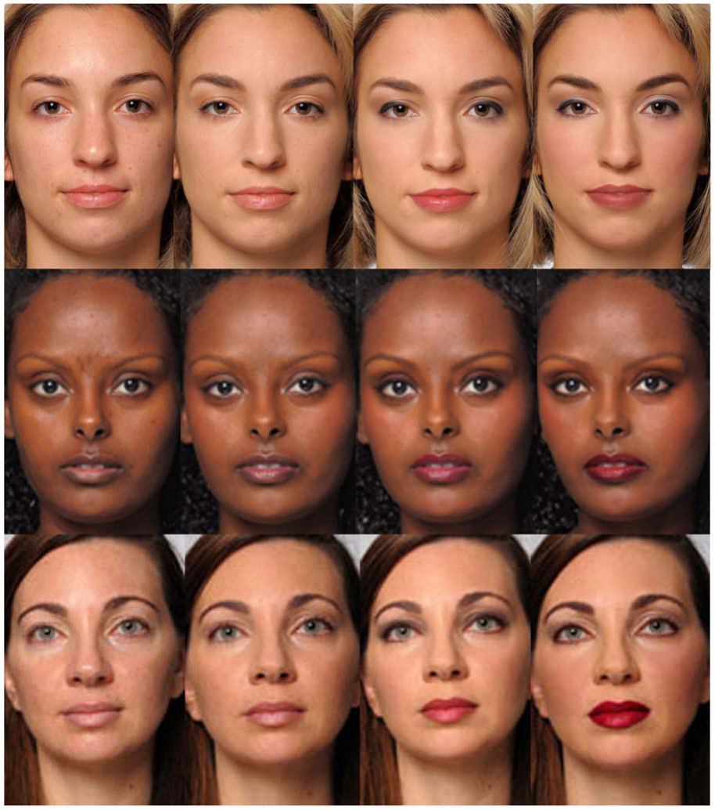
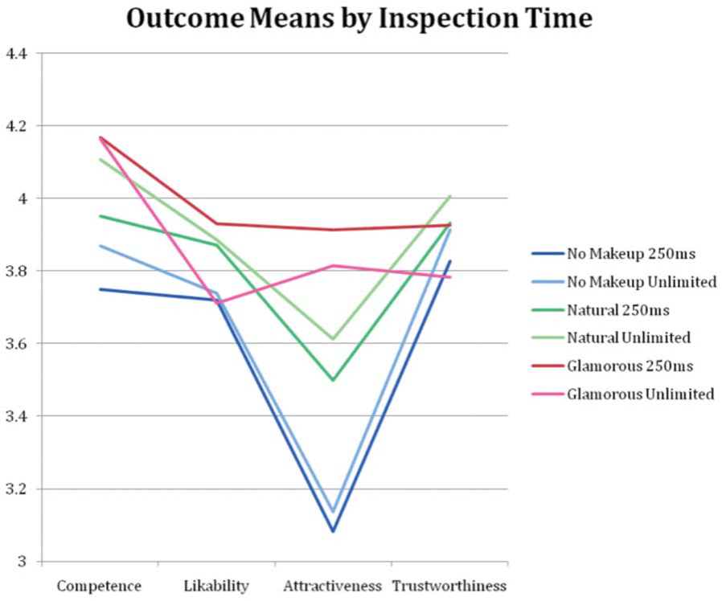

# 확장된 인간 표현형의 특징으로서의 화장품: 생물학적으로 중요한 얼굴 신호의 지각 조절

> **원문** Etcoff NL, Stock S, Haley LE, Vickery SA, House DM (2011). *Cosmetics as a Feature of the Extended Human Phenotype: Modulation of the Perception of Biologically Important Facial Signals.* PLoS ONE 6(10): e25656. https://doi.org/10.1371/journal.pone.0025656
>
> **라이선스** 원문 Copyright © 2011 Etcoff et al. [Creative Commons Attribution License](https://creativecommons.org/licenses/by/4.0/)로 배포되는 오픈 액세스 논문이며, 원저자와 출처를 밝히는 조건으로 모든 매체에서 제한 없는 이용·배포·복제를 허용합니다. (역자 주: 원문에는 라이선스 버전이 적혀 있지 않습니다. 링크는 현재 판입니다.)
>
> **변경 사항** 영어 원문을 한국어로 번역했습니다. 그림은 원문에서 잘라 캡션 앞에 넣었고, 표는 원문 PDF를 보고 옮겼습니다. 참고문헌 목록은 생략했습니다(본문의 [숫자]는 원문 참고문헌 번호). 원저자가 검토한 번역이 아닙니다.

**용어 대응** — 확장된 표현형(extended phenotype): 유전자가 생물의 몸 바깥에 미치는 효과(거미줄, 비버 댐 등). 이 논문에서는 화장·옷 같은 몸 꾸밈 · 초정상 자극(supernormal stimulus): 자연 신호를 과장해 정상보다 강한 반응을 끌어내는 자극 · 시스템 1/시스템 2: 빠르고 자동적인 처리 / 느리고 숙고하는 처리 · 호감도(likability) · 신뢰도(trustworthiness) · 유능함(competence) · 얼굴 대비(facial contrast)

**소속** ¹ 매사추세츠종합병원 정신과, 미국 보스턴 · ² 하버드의대, 미국 케임브리지 · ³ 다나파버 암연구소 생물통계·계산생물학과, 미국 보스턴 · ⁴ P&G 뷰티·그루밍, P&G 코스메틱스, 미국 메릴랜드주 헌트밸리 · ⁵ 보스턴대학 컴퓨터과학과, 미국 보스턴
**편집자** Satoru Suzuki, 노스웨스턴대학 · **접수** 2011년 4월 8일 · **게재 승인** 2011년 9월 8일 · **발행** 2011년 10월 3일
**연구비** 이 연구는 P&G 뷰티·그루밍의 연구비를 받았으며, Sarah A. Vickery가 그곳의 수석 연구원으로 재직 중이다. 연구비 제공자는 연구 설계, 자료 수집과 분석, 출판 결정, 원고 준비에 아무런 역할을 하지 않았다.
**이해 상충** 저자들은 학술지의 정책을 읽었으며 다음과 같은 이해 상충이 있다: 이 연구는 P&G 뷰티·그루밍의 연구비를 받았으며, SAV가 그곳의 수석 연구원으로 재직 중이다. 이는 자료와 재료 공유에 관한 PLoS ONE의 모든 정책을 저자들이 준수하는 것을 바꾸지 않는다.

---

## 초록

얼굴 지각 연구는 물려받은 이목구비의 크기, 형태, 배치, 즉 생물학적 표현형에 초점을 맞춰 왔으며, 꾸밈의 효과, 즉 확장된 표현형은 대체로 무시해 왔다. 신호의 진화에 관한 연구는 동물들이 같은 종의 개체를 유인하거나 위협하거나 그로부터 자신을 보호하기 위해 색 단서를 포함한 시각적 특징을 자주 바꾼다는 것을 보여 주었다. 인간은 진화적 시간에 걸친 유전적 변화가 아니라 문화적 도구를 사용해 실시간으로 시각 신호를 의식적으로 조작한다. 여기서 우리는 그러한 도구 하나, 즉 색조 화장품의 사용을 조사한다. 두 연구에서 우리는 관찰자들에게 색조 화장품을 한 또는 하지 않은 같은 여성 얼굴을 평정하게 했고, 화장 스타일을 최소(내추럴)에서 중간(프로페셔널), 극적(글래머)까지 다양하게 했다. 각 룩은 이목구비와 주변 피부 사이에 점점 더 큰 휘도 대비를 제공했다. 얼굴은 250 ms 동안 또는 시간 제한 없이 제시되었고, 피험자들은 얼굴의 매력, 유능함, 호감도, 신뢰도를 평정했다. 250 ms에서 화장품은 모든 결과 변수에 유의한 긍정적 효과를 보였다. 관찰 시간의 길이는 유능함이나 매력에 대한 효과를 바꾸지 않았다. 그러나 관찰 시간이 길어지면 호감도와 신뢰에 대한 화장품의 효과가 특정 화장 룩에 따라 달라졌으며, 이는 화장품이 자동적 판단과 숙고적 판단에 다르게 영향을 줄 수 있음을 가리킨다. 이 결과는 화장품이 초정상 얼굴 자극을 만들 수 있으며, 그렇게 하는 한 가지 방법이 성적 이형성의 단서를 과장하는 것일 수 있음을 시사한다. 우리의 결과는 얼굴의 신뢰도 판단과 매력 판단이 적어도 부분적으로 분리 가능하다는 것, 아름다움이 사회적 인지의 보편적 차원인 유능함 판단에 유의한 긍정적 효과를 갖지만 다른 보편적 차원인 사회적 따뜻함에는 더 미묘한 효과를 갖는다는 것, 그리고 확장된 표현형이 첫눈에 그리고 더 긴 관찰에서 생물학적으로 중요한 신호의 지각에 유의하게 영향을 준다는 것에 대한 증거를 제공한다.

## 서론

얼굴 외모에 기반한 첫인상은 자동적으로 일어나고, 극복하기 어려우며, 의사 결정에 영향을 준다. 얼굴 아름다움의 강한 동기적 영향은 노동 시장 연구에서 나타났는데, 이 연구들은 매력적인 개인이 매력적이지 않은 개인보다 채용되고 승진하고 더 높은 급여를 받을 가능성이 크다는 "아름다움 프리미엄"과 "평범함 페널티"[1]가 있음을 시사한다[2–4]. 사회심리학자들은 아름다운 사람이 더 사회적으로 능숙하고, 자신감 있고, 성공적이라는 것을 포함한 다양한 긍정적 추론으로 이어지는 아름다움의 "후광" 효과를 밝혀냈다[5–7]. 또 다른 속성인 유능함의 추론은, 알려지지 않은 하원의원 후보들의 얼굴을 1초 동안 보고 얻은 것만으로 그들의 선거 성공을 예측한다[8,9]. 신뢰 게임의 참가자들은 얼굴 외모와 실제 행동 사이에 객관적 관계가 없는데도 얼굴이 신뢰할 만하다고 평정된 개인에게 더 많은 돈을 투자했다[8].

다윈주의적 접근은 아름다운 얼굴의 특징이 다른 사람들의 행동을 동기화하는 짝 가치의 중요한 생물학적 신호라고 가정하며, 평균성, 대칭, 성적 이형성 같은 특징을 여성 얼굴 아름다움의 핵심 기여 요인으로 밝혀냈다[5–7,10,11]. 어떤 시각적 얼굴 속성이 얼굴로부터 신뢰도, 유능함, 호감도에 대한 빠른 판단으로 이어지는지는 덜 분명하다. "아름다움의 후광"이 부분적인 설명을 제공할 수 있지만, 얼굴 표정(실제 표정이거나 타고난 이목구비의 윤곽이 흉내 낸 것)의 단서와 얼굴의 미성숙 또는 성숙이 중요한 동인일 가능성이 크다. 전자는 우호적이거나 적대적인 의도(긍정적 감정이나 분노)를, 후자는 자신의 의도를 실행할 수 있는 지각된 능력을 신호한다[12–14]. 이러한 모든 얼굴 판단은 빠르고 신뢰할 만하게 일어나며 관찰 시간에 따라 거의 변하지 않아, 그것이 노력이 들지 않고 자동적임을 시사한다. 사회적 인지와 의사 결정의 최근 모형들은 이러한 빠르게 작동하는 반사적 과정, 즉 "시스템 1 과정"과, 더 느리고 의도적이며 노력이 들고 성찰적인 "시스템 2" 과정을 구별한다[15,16].

지금까지 얼굴 연구는 이목구비의 형태, 크기, 배치, 움직임 같은 생물학적 표현형에 주로 초점을 맞추었고, 얼굴 꾸밈과 몸단장, 즉 "확장된 표현형"의 효과는 무시해 왔다. 확장된 표현형[17,18]은 유전자가 생물의 몸 너머에 미치는 모든 효과를 가리킨다. 거미의 거미줄, 소라게의 껍데기, 바우어새의 정자, 비버의 댐은 모두 확장된 표현형의 예로 간주된다. 인간의 인공물 중에서는 옷, 화장, 그리고 다른 형태의 몸 꾸밈이 표현형의 확장으로 간주된다. 이것들은 보편적으로 발견되며 지각된 생물학적 적합도를 높이는 것으로 여겨진다.

신호의 진화에 관한 연구는 동물들이 같은 종의 개체를 유인하거나, 흉내 내거나, 위협하거나, 그로부터 자신을 보호하기 위해 색 단서를 포함한 시각적 특징을 자주 바꾸거나 과장하며, 때로는 속임과 그 속임의 탐지 사이에 군비 경쟁을 일으킨다는 것을 보여 주었다[19]. 인간은 진화적 시간에 걸친 유전적 변화가 아니라 문화적 도구를 사용해 실시간으로 시각 신호를 의식적으로 조작한다. 이 도구들은 유전되는 표현형의 특징을 강조하거나, 과장하거나, 감추며, 사회적 인상을 조절하고 이점을 주기 위한 것이다. 그러나 그것이 얼마나 효과적인지, 어떤 목적에 대해, 어떤 기전으로 효과적인지는 거의 탐구되지 않은 질문이다.

틴베르헌의 실험 연구는 시각적 신호 자극을 과장하여 초정상 반응을 끌어내는 초정상 자극을 만들 수 있음을 처음 보였다[20]. 예를 들어 재갈매기 새끼는 정상적인 재갈매기 부리보다 빨간 뜨개질바늘을 더 세게 쪼는데, 그 바늘이 어미 부리에서 발견되는 형태와 색 단서를 과장하기 때문이다. 초정상 자극은 많은 종에서 발견되었다. 기존의 매력 단서를 분리하고 과장하며 인간의 감각 편향을 이용함으로써, 꾸밈은 우리의 정상적인 미적 반응을 고조시키고 과장하여, 꾸민 얼굴이나 몸을 초정상 자극으로, 우리의 반응을 초정상 반응으로 만들 수 있다.

여기서 우리는 인간의 확장된 표현형의 한 예, 즉 주로 여성이 얼굴 매력을 높이기 위해 사용하는 도구인 색조 화장품의 사용을 조사한다. 화장품의 사용은 오래되었다. 기원전 1200년에서 200년 사이의 이집트 화장품 분말을 분석한 결과, 그 제조에 이미 매우 정교한 습식 화학 기술이 사용되고 있었음이 드러났다[21]. 고대 이집트인들은 오늘날 우리가 가진 화장품 대부분의 형태를 가지고 있었다[22]. 흥미롭게도 화장품의 사용은 사진의 등장과 함께 급격히 늘었는데[23], 이는 둘 다 고조되는 아름다움 군비 경쟁의 도구로 쓰일 수 있음을 시사한다. 오늘날 화장품 사용은 어디에나 있다. 2010년 조사에서 미국의 18세 이상 여성 대다수(63%)가 지난 1년 동안 어떤 종류든 화장품을 사용했다고 보고했다[24]. 세계 색조 화장품 시장은 2015년까지 414억 달러에 이를 것으로 예상된다[25]. 놀랍게도 화장품이 관찰자에게 주는 효과를 조사한 연구는 거의 없다. 조사한 몇 안 되는 연구들은 화장품이 20대와 30대 백인 여성의 매력을 높일 수 있음을 보여 준다[26–29]. 성격과 인품의 추론에 관한 연구는 상충하고 결론이 나지 않은 결과를 내놓았다[28–31].

대중적인 자기 광고 수단으로서 화장품은 그 사용에 대한 변화하는 문화적 태도의 대상이 되어 왔다. 18세기 후반에는 화장품이 남편을 속이는 데 너무 뛰어나고 남편들이 너무 두려워한 나머지, 영국 정부가 다음과 같은 법을 제안했다고 한다. "이 법 이후로 향수, 물감, 화장품, 세안제 …를 사용하여 국왕 폐하의 신민 누구든 속이거나, 유혹하거나, 배신하여 결혼에 이르게 하는 모든 여성은 … 마녀 행위 및 그와 유사한 경범죄에 대해 현재 시행 중인 법의 처벌을 받으며, 유죄 판결 시 그 결혼은 무효가 된다"[22]. 수 세기에 걸쳐 여성들은 화장품이 "세련된 미인의 영역인가, 방탕한 영혼의 몰락인가"[23], 또는 존경받고 부러움을 사는 사람의 도구인가, 잠재적으로 신뢰할 수 없는 사람의 도구인가를 논쟁했다. 화장품은 제한적인 것부터 허용적인 것까지 다양한 관행을 가진 "표시 규칙"의 대상이 되어 왔다. 옷의 유행처럼, 어떤 화장 룩이 가장 매력적인 것으로 여겨지는지에 대한 규범도 바뀐다.

현재 문화에서 화장품은 자유롭게 선택되고 도덕적으로 중립적인 아름다움 향상의 수단으로 여겨진다. 그 사용은 개인의 선호와 선택을 반영하며, 그 사용에 대한 반응은 자기 표현 형태와 몸단장 관행에 대한 관찰자의 태도를 반영한다. 따라서 화장한 얼굴을 볼 때, 관찰자는 화장품이 대칭, 피부의 깨끗함, 이목구비 대비의 외관에 주는 효과뿐 아니라, 화장품 사용과 그것이 사용자의 성격, 인품, 의도에 대해 무엇을 의미할 수 있는지에 대한 의식적 생각에 기초해 추론한다.

우리는 화장품이 시스템 1과 시스템 2 수준에서 얼굴 지각에 영향을 주어, 반사적 반응과 성찰적 반응을 모두 일으킬 것이라는 가설을 세운다. 우리는 자동적이고 암묵적인 수준에서 화장품이 아름다움, 성격, 인품의 판단에 한결같이 긍정적인 효과를 가질 것이라고 예측한다. 관찰 시간이 길어지면 화장품은 계속 매력을 높이겠지만, 화장품 사용에 대한 다양한 사회적 태도를 고려할 때 호감도나 신뢰의 판단을 더 이상 한결같이 높이지는 않을 수 있다고 예측한다. 더 긴 관찰에서 우리는 더 큰 아름다움을, 그러나 모든 룩에서 반드시 그것을 둘러싼 후광은 아니라는 것을 발견할 것으로 예상한다.

마지막으로, 얼굴 지각에 대한 화장품 효과의 잠재적 원천 하나를 측정하기 위해, 화장하지 않은 얼굴과 각 화장 룩에 대해 눈, 입술, 주변 피부 사이의 휘도 대비를 측정했다. Russell[26,32]은 얼굴 대비의 성차가 얼굴 성별의 지각에 영향을 준다는 것을 발견했다. 중성적인 얼굴은 얼굴 대비를 높이면 여성으로, 낮추면 남성으로 보이게 만들 수 있다. 또한 화장품을 한 여성 얼굴은 화장품을 하지 않은 같은 얼굴보다 얼굴 대비가 더 컸는데, 이는 화장품이 부분적으로 성적으로 이형적인 속성, 즉 얼굴 대비를 과장함으로써 기능할 수 있음을 시사한다.

## 방법

### 윤리 선언

우리는 참가자를 모집하고 인간 실험을 수행한 매사추세츠종합병원의 Partners Human Research Committee로부터 연구에 대한 윤리 승인을 받았다. 이 프로젝트는 45 CFR 46.101(b)(2) 교육 검사(인지, 진단, 적성, 성취), 설문 절차, 면접 절차, 또는 공적 행동의 관찰의 사용에 관한 규정에 따라 추가 IRB 심사 면제 기준을 충족한다. 동의서 대신 피험자에게 안내문을 제공하고 서명을 받지 않도록 지시받았다. 이 원고에 사진이 실린 개인/피험자는 자신의 사례 세부 사항의 출판에 대해 서면 동의를 했다. 우리의 동의서와 사진 사용 허가서에 서명함으로써, 이들은 자신의 이름 및/또는 개인 정보가 공개되지 않는다는 이해 아래 우리가 자신의 얼굴 디지털 이미지를 출판하거나 다른 공적 용도로 사용하는 것을 허락한다.

화장품이 얼굴 판단에 주는 영향을 검사하기 위해, 같은 모델을 화장한 상태와 하지 않은 상태로 판단하게 하는 두 연구를 수행했다.

### 참가자

첫 번째 연구의 피험자는 얼굴을 250 ms 동안 본 다양한 민족의 성인 149명(남성 61명, 여성 88명)이었다. 두 번째 연구는 각 얼굴을 시간 제한 없이 살펴볼 수 있었던 다양한 민족의 성인 119명(남성 30명, 여성 89명)이었다.

### 자극

100장의 고해상도 컬러 이미지는 스스로 히스패닉, 백인, 또는 아프리카계 미국인이라고 밝힌 20–50세 여성 25명의 것으로, 무표정의 정면 얼굴 사진이었고 옷과 머리 모양이 보이지 않도록 잘랐다. 여성이 얼굴 화장품 사용자의 대다수를 차지하므로 여성 모델만 사용했다. 전문 사진가가 균일한 조건에서 이미지를 촬영했다. 화장은 메이크업 아티스트가 바른 다음 디지털로 조정했다. 각 모델은 화장하지 않은 상태와, 최소에서 중간, 극적에 이르는 3가지 화장 룩으로 촬영했으며, 이 룩들을 비공식적으로 "내추럴", "프로페셔널", "글래머"라고 불렀다(그림 1). 모델이나 피험자와 작업할 때는 이 이름을 한 번도 사용하지 않았다. 마지막으로, 모델이 화장한 자신을 보면서 생길 수 있는 태도 단서를 없애기 위해 스튜디오에서 거울을 모두 치웠다.

**그림 1.** 화장하지 않은 모델과 내추럴, 프로페셔널, 글래머 화장을 한 모델.
doi:10.1371/journal.pone.0025656.g001

### 절차

자극은 iMac 데스크톱에서 제시했다. 각 피험자는 25명의 모델 각각에 대해 네 가지 룩을 모두 무작위 순서로 보았고, "전혀 아니다"에서 "매우/극도로"까지로 양 끝이 표시된 7점 "슬라이더 척도"로 매력, 호감도, 신뢰도, 유능함을 평정했다.

## 결과

### 분석

관찰 시간에 따른 화장의 통계 분석은 Baayen 외[33]가 기술한 모형과 비슷한, 교차 무선효과를 가진 선형 혼합효과 모형으로 얻었다. 두 가지 분석을 수행했다. 첫 번째는 화장 룩을 합산하여 화장품의 모든 사용을 화장하지 않은 상태와 비교했다. 두 번째는 각 개별 화장 룩을 화장하지 않은 상태와 비교했다. 각 분석 안에서 사용된 쌍별 비교에 대해 전체 1종 오류율 0.05를 유지하기 위해 본페로니 보정을 사용했다.

전체적으로, 화장(모든 룩에 걸쳐 합산)은 250 ms 제시에서 모든 결과 변수의 판단에 유의한 긍정적 주효과를 냈고(모두 p<0.0001), 더 긴 관찰에서는 매력(p<0.0001), 유능함(p<0.0001), 호감도(p<0.0001)의 판단에는 유의한 긍정적 주효과를 냈지만 신뢰도에는 그렇지 않았다(p = 0.8988)(표 1, 본페로니 보정 유의 수준 = 0.05/8 = 0.006). 화장 × 관찰 시간의 유의한 상호작용은, 호감도와 신뢰도의 지각이 시간 제한 없이 제시되었을 때보다 250 ms 제시에서 유의하게 더 큰 긍정적 화장 효과를 보였음을 드러냈다: 호감도(F(1,27000) = 10.71, p = 0.0011)와 신뢰도(F(1,27000) = 10.85, p = 0.0010). 관찰 시간의 길이는 유능함이나 매력에 대한 화장 효과의 강도를 바꾸지 않았다(표 2).

**표 1.** 화장(합산) 대 화장하지 않음의 평균 결과 점수 비교, 회귀 모형(표 2 참조)에서 얻음.

| 관찰 시간 | 결과 변수 | 대비 | 추정치 | SE | t 통계량 | DF | P |
|---|---|---|---|---|---|---|---|
| 250ms | 유능함 | 화장 대 화장 안 함 | 0.34 | 0.02 | 15.98 | 26506 | <0.0001 |
| | 호감도 | 화장 대 화장 안 함 | 0.2 | 0.02 | 9.15 | 26506 | <0.0001 |
| | 매력 | 화장 대 화장 안 함 | 0.66 | 0.02 | 30.5 | 26506 | <0.0001 |
| | 신뢰도 | 화장 대 화장 안 함 | 0.11 | 0.02 | 5.08 | 26506 | <0.0001 |
| 시간 제한 없음 | 유능함 | 화장 대 화장 안 함 | 0.3 | 0.02 | 12.61 | 26506 | <0.0001 |
| | 호감도 | 화장 대 화장 안 함 | 0.09 | 0.02 | 3.8 | 26506 | 0.0001 |
| | 매력 | 화장 대 화장 안 함 | 0.64 | 0.02 | 26.22 | 26506 | <0.0001 |
| | 신뢰도 | 화장 대 화장 안 함 | 0 | 0.02 | 0.13 | 26506 | 0.8988 |

doi:10.1371/journal.pone.0025656.t001

**표 2.** 화장 룩을 합산한 회귀 모형.

| 결과 변수 | 공변량 | | | 추정치 | SE | t 통계량 | DF | P | F 통계량 | 분자 DF; 분모 DF | P |
|---|---|---|---|---|---|---|---|---|---|---|---|
| 유능함 | 절편 | | | 3.87 | 0.12 | 33.53 | 65.95 | <0.0001 | | | |
| | ModelMakeup | 화장 | | 0.30 | 0.02 | 12.61 | 26506.06 | <0.0001 | 402.04 | 1;27000 | <.0001 |
| | | 화장 안 함 | | 0.00 | | | | | | | |
| | length | | 250 ms | −0.12 | 0.10 | −1.24 | 300.10 | 0.2167 | 1.13 | 1;270 | 0.2889 |
| | | | 제한 없음 | 0.00 | | | | | | | |
| | ModelMakeup\*length | 화장 | 250 ms | 0.04 | 0.03 | 1.26 | 26506.04 | 0.2079 | 1.59 | 1;27000 | 0.2079 |
| | | | 제한 없음 | 0.00 | | | | | | | |
| | | 화장 안 함 | 250 ms | 0.00 | | | | | | | |
| | | | 제한 없음 | 0.00 | | | | | | | |
| 호감도 | 절편 | | | 3.74 | 0.14 | 26.50 | 44.19 | <0.0001 | | | |
| | ModelMakeup | 화장 | | 0.09 | 0.02 | 3.80 | 26506.06 | 0.0001 | 79.83 | 1;27000 | <.0001 |
| | | 화장 안 함 | | 0.00 | | | | | | | |
| | length | | 250 ms | −0.01 | 0.10 | −0.14 | 304.32 | 0.8893 | 0.19 | 1;270 | 0.6673 |
| | | | 제한 없음 | 0.00 | | | | | | | |
| | ModelMakeup\*length | 화장 | 250 ms | 0.11 | 0.03 | 3.27 | 26506.03 | 0.0011 | 10.71 | 1;27000 | 0.0011 |
| | | | 제한 없음 | 0.00 | | | | | | | |
| | | 화장 안 함 | 250 ms | 0.00 | | | | | | | |
| | | | 제한 없음 | 0.00 | | | | | | | |
| 매력 | 절편 | | | 3.13 | 0.17 | 18.93 | 40.81 | <0.0001 | | | |
| | ModelMakeup | 화장 | | 0.64 | 0.02 | 26.22 | 26506.05 | <0.0001 | 1590.49 | 1;27000 | <.0001 |
| | | 화장 안 함 | | 0.00 | | | | | | | |
| | length | | 250 ms | −0.04 | 0.11 | −0.37 | 295.32 | 0.7115 | 0.07 | 1;270 | 0.7984 |
| | | | 제한 없음 | 0.00 | | | | | | | |
| | ModelMakeup\*length | 화장 | 250 ms | 0.03 | 0.03 | 0.80 | 26506.03 | 0.4240 | 0.64 | 1;27000 | 0.424 |
| | | | 제한 없음 | 0.00 | | | | | | | |
| | | 화장 안 함 | 250 ms | 0.00 | | | | | | | |
| | | | 제한 없음 | 0.00 | | | | | | | |
| 신뢰도 | 절편 | | | 3.91 | 0.12 | 33.36 | 60.94 | <0.0001 | | | |
| | ModelMakeup | 화장 | | 0.00 | 0.02 | 0.13 | 26506.07 | 0.8988 | 12.13 | 1;27000 | 0.0005 |
| | | 화장 안 함 | | 0.00 | | | | | | | |
| | length | | 250 ms | −0.09 | 0.10 | −0.88 | 302.96 | 0.3819 | 0.11 | 1;270 | 0.7389 |
| | | | 제한 없음 | 0.00 | | | | | | | |
| | ModelMakeui\*length | 화장 | 250 ms | 0.11 | 0.03 | 3.29 | 26506.04 | 0.0010 | 10.85 | 1;27000 | 0.001 |
| | | | 제한 없음 | 0.00 | | | | | | | |
| | | 화장 안 함 | 250 ms | 0.00 | | | | | | | |
| | | | 제한 없음 | 0.00 | | | | | | | |

doi:10.1371/journal.pone.0025656.t002
(역자 주: 변수 이름 ModelMakeup, length와 신뢰도 행의 "ModelMakeui"(오타)는 원문 표기 그대로 두었다.)

개별 화장 "룩"의 효과를 분석한 결과, 각 룩은 250 ms와 더 긴 관찰 시간 모두에서 유능함과 매력의 판단에 유의한 긍정적 효과를 가졌다(표 3). 시간 제한 없는 관찰에서 내추럴과 프로페셔널 룩은 호감도에 유의한 긍정적 효과를 가졌지만(내추럴 t(26502) = 4.93, 프로페셔널 t(26502) = 5.18, 둘 다 p<.0001, 본페로니 보정 유의 수준 = 0.05/24 = 0.002), 글래머 룩은 유의한 효과가 없었다(t(26502) = −0.79, p = 0.4293). 내추럴 룩은 신뢰도에도 유의한 긍정적 효과를 가졌지만(t(26502) = 3.15, p = 0.0016), 프로페셔널 룩은 유의한 효과가 없었고(t(26502) = 1.50, p = 0.1337), 글래머 룩은 유의한 부정적 효과를 가졌다(t(26502) = −4.33, p<0.0001). 모든 결과 변수에서 글래머 룩에 대해 화장 × 관찰 시간의 유의한 상호작용이 있었으며, 이 룩이 시간 제한 없이 제시되었을 때보다 250 ms 동안 제시되었을 때 유의하게 더 큰 긍정적 효과가 있었다. 프로페셔널 룩은 호감도(t(26502) = 2.4, p = 0.0162)와 신뢰도(t(26502) = 2.33, p = 0.0198)에 대해 250 ms에서 유의하게 더 큰 긍정적 화장 효과를 보인 반면, 내추럴 룩의 판단은 관찰 시간에 따라 유의하게 변하지 않았다(표 4). 그림 2는 3가지 룩, 즉 화장 안 함, 내추럴, 글래머 룩에 대한 이 효과들을 보여 준다.

마지막으로, 휘도 대비를 결정하기 위해 컬러 이미지를 개별적으로 손으로 표시하여 4개 영역을 정의했다: 눈(눈 자체(공막, 홍채, 동공), 속눈썹, 눈구석 주름과 눈 사이의 피부, 그리고 눈 바로 아래의 피부 포함), 입술, 눈을 둘러싼 고리, 입술을 둘러싼 고리. 그런 다음 Spectra® PhoRad® 광도계를 사용해 네 영역 안에서 iMac 컴퓨터 화면의 휘도 값을 제곱미터당 칸델라(cd/m²) 단위로 수집해 평균하여, 네 영역 각각의 평균 휘도 값을 얻었다. 눈과 입술의 평균 휘도를 평균해 평균 이목구비 휘도를 만들었고, 눈과 입술 고리의 평균 휘도 값을 평균해 평균 피부 휘도를 만들었다. 얼굴 대비는 Cf = (이목구비 휘도 − 피부 휘도)/(이목구비 휘도 + 피부 휘도)로 계산했다[26,32].

**표 3.** 서로 다른 화장 룩 대 화장하지 않음의 평균 결과 점수 비교, 회귀 모형(표 4 참조)에서 얻음.

| 관찰 시간 | 결과 변수 | 대비 | 추정치 | SE | t 통계량 | DF | P |
|---|---|---|---|---|---|---|---|
| 250 ms | 유능함 | 글래머 대 화장 안 함 | 0.42 | 0.03 | 16.03 | 26502 | <0.0001 |
| | | 프로페셔널 대 화장 안 함 | 0.41 | 0.03 | 15.55 | 26502 | <0.0001 |
| | | 내추럴 대 화장 안 함 | 0.2 | 0.03 | 7.64 | 26502 | <0.0001 |
| | 호감도 | 글래머 대 화장 안 함 | 0.21 | 0.03 | 7.59 | 26502 | <0.0001 |
| | | 프로페셔널 대 화장 안 함 | 0.26 | 0.03 | 9.41 | 26502 | <0.0001 |
| | | 내추럴 대 화장 안 함 | 0.15 | 0.03 | 5.45 | 26502 | <0.0001 |
| | 매력 | 글래머 대 화장 안 함 | 0.83 | 0.03 | 31.19 | 26502 | <0.0001 |
| | | 프로페셔널 대 화장 안 함 | 0.76 | 0.03 | 28.79 | 26502 | <0.0001 |
| | | 내추럴 대 화장 안 함 | 0.4 | 0.03 | 15.28 | 26502 | <0.0001 |
| | 신뢰도 | 글래머 대 화장 안 함 | 0.09 | 0.03 | 3.52 | 26502 | 0.0004 |
| | | 프로페셔널 대 화장 안 함 | 0.14 | 0.03 | 5.17 | 26502 | <0.0001 |
| | | 내추럴 대 화장 안 함 | 0.1 | 0.03 | 3.76 | 26502 | 0.0002 |
| 시간 제한 없음 | 유능함 | 글래머 대 화장 안 함 | 0.3 | 0.03 | 10.16 | 26502 | <0.0001 |
| | | 프로페셔널 대 화장 안 함 | 0.37 | 0.03 | 12.54 | 26502 | <0.0001 |
| | | 내추럴 대 화장 안 함 | 0.24 | 0.03 | 8.22 | 26502 | <0.0001 |
| | 호감도 | 글래머 대 화장 안 함 | −0.02 | 0.03 | −0.79 | 26502 | 0.4293 |
| | | 프로페셔널 대 화장 안 함 | 0.16 | 0.03 | 5.18 | 26502 | <0.0001 |
| | | 내추럴 대 화장 안 함 | 0.15 | 0.03 | 4.93 | 26502 | <0.0001 |
| | 매력 | 글래머 대 화장 안 함 | 0.68 | 0.03 | 23.01 | 26502 | <0.0001 |
| | | 프로페셔널 대 화장 안 함 | 0.76 | 0.03 | 25.56 | 26502 | <0.0001 |
| | | 내추럴 대 화장 안 함 | 0.48 | 0.03 | 16.1 | 26502 | <0.0001 |
| | 신뢰도 | 글래머 대 화장 안 함 | −0.13 | 0.03 | −4.33 | 26502 | <0.0001 |
| | | 프로페셔널 대 화장 안 함 | 0.04 | 0.03 | 1.5 | 26502 | 0.1337 |
| | | 내추럴 대 화장 안 함 | 0.09 | 0.03 | 3.15 | 26502 | 0.0016 |

doi:10.1371/journal.pone.0025656.t003

**표 4.** 화장 룩별 회귀 모형.

| 결과 변수 | 공변량 | | | 추정치 | SE | t 통계량 | DF | P | F 통계량 | 분자 DF | 분모 DF | P |
|---|---|---|---|---|---|---|---|---|---|---|---|---|
| 유능함 | 절편 | | | 3.87 | 0.12 | 33.53 | 65.93 | <0.0001 | | | | |
| | Model Makeup | 글래머 | | 0.30 | 0.03 | 10.16 | 26502.03 | <0.0001 | 162.05 | 3 | 27000 | <0.0001 |
| | | 프로페셔널 | | 0.37 | 0.03 | 12.54 | 26502.09 | <0.0001 | | | | |
| | | 내추럴 | | 0.24 | 0.03 | 8.22 | 26502.03 | <0.0001 | | | | |
| | | 화장 안 함 | | 0.00 | | | | | | | | |
| | Length | | 250 ms | −0.12 | 0.10 | −1.24 | 299.97 | 0.2167 | 0.93 | 1 | 266 | 0.3369 |
| | | | 제한 없음 | 0.00 | | | | | | | | |
| | Model Makeup \*Length | 글래머 | 250 ms | 0.12 | 0.04 | 3.11 | 26502.01 | 0.0019 | 6.26 | 3 | 27000 | 0.0003 |
| | | | 제한 없음 | 0.00 | | | | | | | | |
| | | 프로페셔널 | 250 ms | 0.04 | 0.04 | 1.01 | 26502.05 | 0.3119 | | | | |
| | | | 제한 없음 | 0.00 | | | | | | | | |
| | | 내추럴 | 250 ms | −0.04 | 0.04 | −1.04 | 26502.02 | 0.2993 | | | | |
| | | | 제한 없음 | 0.00 | | | | | | | | |
| | | 화장 안 함 | 250 ms | 0.00 | | | | | | | | |
| | | | 제한 없음 | 0.00 | | | | | | | | |
| 호감도 | 절편 | | | 3.74 | 0.14 | 26.50 | 44.18 | <0.0001 | | | | |
| | Model Makeup | 글래머 | | −0.02 | 0.03 | −0.79 | 26502.02 | 0.4293 | 37.33 | 3 | 27000 | <0.0001 |
| | | 프로페셔널 | | 0.16 | 0.03 | 5.18 | 26502.09 | <0.0001 | | | | |
| | | 내추럴 | | 0.15 | 0.03 | 4.93 | 26502.03 | <0.0001 | | | | |
| | | 화장 안 함 | | 0.00 | | | | | | | | |
| | Length | | 250 ms | −0.01 | 0.10 | −0.14 | 304.24 | 0.8893 | 0.52 | 1 | 266 | 0.4725 |
| | | | 제한 없음 | 0.00 | | | | | | | | |
| | Model Makeup \*Length | 글래머 | 250 ms | 0.23 | 0.04 | 5.65 | 26502.01 | <0.0001 | 14.43 | 3 | 27000 | <0.0001 |
| | | | 제한 없음 | 0.00 | | | | | | | | |
| | | 프로페셔널 | 250 ms | 0.10 | 0.04 | 2.40 | 26502.05 | 0.0162 | | | | |
| | | | 제한 없음 | 0.00 | | | | | | | | |
| | | 내추럴 | 250 ms | 0.00 | 0.04 | −0.04 | 26502.02 | 0.9674 | | | | |
| | | | 제한 없음 | 0.00 | | | | | | | | |
| | | 화장 안 함 | 250 ms | 0.00 | | | | | | | | |
| | | | 제한 없음 | 0.00 | | | | | | | | |
| 매력 | 절편 | | | 3.13 | 0.17 | 18.93 | 40.80 | <0.0001 | | | | |
| | Model Makeup | 글래머 | | 0.68 | 0.03 | 23.01 | 26502.02 | <0.0001 | 650.34 | 3 | 27000 | <0.0001 |
| | | 프로페셔널 | | 0.76 | 0.03 | 25.56 | 26502.07 | <0.0001 | | | | |
| | | 내추럴 | | 0.48 | 0.03 | 16.10 | 26502.02 | <0.0001 | | | | |
| | | 화장 안 함 | | 0.00 | | | | | | | | |
| | Length | | 250 ms | −0.04 | 0.11 | −0.37 | 294.88 | 0.7114 | 0.04 | 1 | 266 | 0.8450 |
| | | | 제한 없음 | 0.00 | | | | | | | | |
| | Model Makeup \*Length | 글래머 | 250 ms | 0.14 | 0.04 | 3.65 | 26502.01 | 0.0003 | 10.42 | 3 | 27000 | <0.0001 |
| | | | 제한 없음 | 0.00 | | | | | | | | |
| | | 프로페셔널 | 250 ms | 0.00 | 0.04 | 0.12 | 26502.04 | 0.9018 | | | | |
| | | | 제한 없음 | 0.00 | | | | | | | | |
| | | 내추럴 | 250 ms | −0.07 | 0.04 | −1.81 | 26502.01 | 0.0701 | | | | |
| | | | 제한 없음 | 0.00 | | | | | | | | |
| | | 화장 안 함 | 250 ms | 0.00 | | | | | | | | |
| | | | 제한 없음 | 0.00 | | | | | | | | |
| 신뢰도 | 절편 | | | 3.91 | 0.12 | 33.36 | 60.92 | <0.0001 | | | | |
| | Model Makeup | 글래머 | | −0.13 | 0.03 | −4.33 | 26502.03 | <0.0001 | 17.96 | 3 | 27000 | <0.0001 |
| | | 프로페셔널 | | 0.04 | 0.03 | 1.50 | 26502.10 | 0.1337 | | | | |
| | | 내추럴 | | 0.09 | 0.03 | 3.15 | 26502.03 | 0.0016 | | | | |
| | | 화장 안 함 | | 0.00 | | | | | | | | |
| | Length | | 250 ms | −0.09 | 0.10 | −0.88 | 302.87 | 0.3819 | 0.00 | 1 | 266 | 0.9598 |
| | | | 제한 없음 | 0.00 | | | | | | | | |
| | Model Makeup \*Length | 글래머 | 250 ms | 0.22 | 0.04 | 5.58 | 26502.01 | <0.0001 | 13.51 | 3 | 27000 | <0.0001 |
| | | | 제한 없음 | 0.00 | | | | | | | | |
| | | 프로페셔널 | 250 ms | 0.09 | 0.04 | 2.33 | 26502.06 | 0.0198 | | | | |
| | | | 제한 없음 | 0.00 | | | | | | | | |
| | | 내추럴 | 250 ms | 0.01 | 0.04 | 0.16 | 26502.02 | 0.8699 | | | | |
| | | | 제한 없음 | 0.00 | | | | | | | | |
| | | 화장 안 함 | 250 ms | 0.00 | | | | | | | | |
| | | | 제한 없음 | 0.00 | | | | | | | | |

doi:10.1371/journal.pone.0025656.t004
(역자 주: 원문 표 4의 "fAttractiveness"는 "Attractiveness"의 오타로 보아 "매력"으로 옮겼다.)

분석 결과, 각 룩 쌍은 얼굴 휘도 대비 수준에서 유의하게 달랐다(모두 |t(72)|≥5.87, p<.0001, 본페로니 보정 유의 수준 = 0.05/18 = 0.003). 다만 내추럴 룩 대 화장 안 함은 경계선에서 유의하지 않았다(t(72) = −1.83, p = 0.0717)(표 S1, S2). 얼굴 휘도 대비는 화장하지 않은 얼굴에서 내추럴, 프로페셔널, 글래머 화장을 한 얼굴로 차례로 증가했다. 여기에 요약하지 않은 추가 분석에서 인종에 의한 효과 수정 가능성을 허용했지만, 상호작용 항들은 유의하지 않았다. 모든 룩은 이목구비 휘도를 유의하게 낮췄으며(모두 |t(72)|≥4.19, p<0.0001), 내추럴 대 화장 안 함은 예외였다(t(72) = −.76, p = 0.4479). 반면 피부 휘도에 대해서는 어떤 룩도 서로 유의하게 다르지 않았다(모두 |t(72)|≤1.55, p>0.12).

**그림 2.** 250 ms와 시간 제한 없는 관찰 시간에서 화장 안 함, 내추럴, 글래머 룩의 평균.
doi:10.1371/journal.pone.0025656.g002

요약하면, 우리는 두 연구 모두에서 화장품의 유의한 효과의 증거를 발견했다. 모든 화장 룩은 250 ms와 더 긴 관찰에서 매력과 유능함 평정을 유의하게 높였다. 호감도와 신뢰의 평정은 화장 룩과 관찰 시간에 따라 달랐으며, 이는 룩들이 서로 다른 반사적 반응과 성찰적 반응을 끌어냈음을 시사한다.

## 논의

우리의 결과는 여러 함의를 갖는다. 예측대로 화장은 짧은 관찰 시간과 긴 관찰 시간 모두에서 여성 얼굴 매력의 평정에 유의한 긍정적 효과를 가졌다. 유능함의 평정은 첫눈과 더 긴 관찰 모두에서 검사한 화장 룩에 따라 유의하게 증가했다. 호감도와 신뢰도의 평정에 대한 효과는 대체로 긍정적이었지만 더 약하고 더 가변적이었다.

사회심리학자들은 사회적 따뜻함과 사회적 유능함이 우리가 개인과 집단을 평가하는 사회적 지각의 두 가지 보편적 차원을 이룬다고 제안했으며[34], 따뜻함은 사회적 협력과 관련된 특성을, 힘/유능함은 지위와 지배력 같은 사회적 경쟁에서의 이점과 관련된 단서를 담는다. 여기서 우리는 증가한 아름다움이 사회적 힘/유능함에 견고하고 긍정적인 효과를, 사회적 따뜻함에는 대체로 긍정적이지만 더 미묘하고 가변적인 효과를 갖는다는 것을 보인다.

과거 연구들은 매력적인 사람들이 직장에서, 학교에서, 삶에서 더 잘할 것으로 기대되며, 그렇게 대우받는다는 것, 즉 동의를 얻고, 존중받고, 도움을 받고, 더 넓은 개인 공간을 허용받는다는 것을 보였다[7]. 신체적 매력이 생산성을 높이지 않는 과제를 사용한 최근 실험 연구에서, 연구자들은 고용주가 신체적으로 매력적인 노동자가 일을 더 잘하고 더 유능할 것이라고 기대한다는 것을 결정적으로 입증했다[35].

그러나 사회학자 Webster와 Driskell이 지위로서의 아름다움이라는 생각을 처음 제안하면서 지적했듯이, 매력과 인종이나 성별 같은 다른 지위 특성 사이에는 중요한 차이가 있다. 아름다움은 바꿀 수 있는 특성이라는 것이다[36]. 그들은 지위의 강력한 효과를 고려할 때 "인종과 성별 같은 다른 특성이 쓰이지 않게 됨에 따라 매력이 점점 더 중요해질 것"이라고 예측했다. 우리는 매력이 점점 더 중요해졌으며, 아름다움이 지위와 능력의 흔히 무의식적인 대리 지표로 남아 있는 한 계속 그럴 것이라고 제안한다.

아름다움의 후광 효과는 "아름다운 것은 좋다" 효과라고 불려 왔다. 우리 연구에서 화장은 얼굴이 매우 짧게 제시되었을 때 따뜻함과 협력(호감도와 신뢰도)의 추론을 높였지만, 더 긴 관찰에서는 항상 그렇지는 않았다. 일반적으로 아름다움이 항상 사회적 협력을 신호하는지에 대해서는 합의가 덜하며, 일부 연구는 허영, 겸손하지 않음, 또는 상대를 속일 가능성이 더 큼으로 특징지어지는 아름다움의 "어두운 면"이 있음을 시사한다[37]. 우리의 결과는 아름다움의 효과를 아름다움 향상의 효과로부터, 여기서는 표현형을 확장된 표현형으로부터 풀어내는 것이 유익할 수 있음을 시사한다. 자연스러운 아름다움이나 자연스러워 보이는 아름다움은 사회적 협력의 긍정적 추론으로 이어지는 반면, 더 뻔한 아름다움 향상은 중립적이거나 심지어 부정적인 추론으로 이어질 수 있다. 마지막으로, 우리의 결과는 얼굴 신뢰도의 판단과 얼굴 매력의 판단이 적어도 부분적으로 분리 가능하다는 추가 증거를 제공한다. 대비가 가장 높은 화장(글래머)은 매력을 유의하게 높이는 동시에 신뢰도의 판단을 낮췄다.

우리 연구는 얼굴 지각에 대한 화장품 효과의 잠재적 원천 하나, 즉 이목구비(눈과 입술)와 주변 피부 사이의 휘도 대비 증가를 살펴보았고, 처음으로 아프리카계 미국인과 히스패닉 얼굴의 휘도 대비를 살펴보았다. 우리는 화장품이 눈과 입술을 유의하게 어둡게 함으로써 휘도 대비를 높인다는 것을 발견했다. 피부는 유의하게 밝아지지도 어두워지지도 않았다. 그러나 화장하지 않은 얼굴과 비교한 우리의 내추럴 룩의 휘도 대비 효과는 경계선에서만 유의했다. 휘도 대비의 변화 외에 화장품이 유발한 다른 이미지 변화가 우리의 효과에 기여했을 가능성이 크다. 여기에는 피부 톤의 매끄러움, 피부색이나 입술 색의 붉음, 광대뼈를 강조하는 음영의 가능한 변화가 포함된다. 이전 연구는 화장이 피부의 외관, 균일도, 질감을 개선하여 더 건강하고, 가임력 있고, 젊어 보이게 할 수 있으며[38,39], 피부와 입술 색이 성 전형성과 매력의 지각에 유의하게 기여할 수 있고[40,41], 입술의 붉음이 백인 여성 얼굴의 여성성과 매력을 높인다는 것[41]을 보였다.

마지막으로, 우리 연구는 북미 피험자만 포함했다. 이러한 효과가 다른 문화의 피험자에게서도 발견될지는 알지 못한다.

요약하면, 우리는 화장품을 한 얼굴이 빠르고 반사적인 과정과 더 숙고적인 의식적 과정 모두를 끌어들인다는 것을 보인다. 빠르고 자동적인 효과는 모든 결과 변수에 대해 한결같이 강하고 긍정적이다. 관찰자가 높은 인지 부하나 시간 압박 아래 있는 상황에서는, 그러한 자동적 판단에 의존해 결정을 내릴 가능성이 더 크다. 얼굴 이미지는 투표용지, 입사 지원서, 웹사이트, 데이트 사이트에 나타난다. 우리의 결과는 처음 보는 한 개인의 얼굴 이미지에서 얻는 판단, 매우 중대한 결과를 가질 수 있는 판단이 바뀔 수 있음을 강조한다. 이미지로부터 신뢰도, 호감도, 또는 유능함을 추론할 때, 우리는 물려받은 표현형의 매력뿐 아니라 "확장된 표현형", 이 경우 화장의 효과에도 유의하게 영향을 받는다.

## 보충 정보

- **표 S1** 휘도 분석 회귀 모형(표 2 참조)에서 얻은, 서로 다른 화장 룩에 대한 평균 휘도 측정값의 비교. (DOCX)
- **표 S2** 휘도 분석을 위한 회귀 모형. (DOCX)

(역자 주: 보충 자료는 이 폴더에 포함되어 있지 않다.)

## 감사의 말

도움을 준 Al Carlay, Christina Congleton, Angelique Dada, Igor Elman MD, Shekhar Mitra Ph.D., James Sarzotti, Beth Twohy, Eva Wisten, 편집자, 그리고 익명의 심사자 두 분께 감사한다.

## 저자 기여

실험의 구상과 설계: NLE. 실험 수행: LEH. 자료 분석: SS, LEH. 시약/재료/분석 도구 제공: DMH, SS, SAV. 논문 작성: NLE, LEH.

---

*참고문헌 목록은 원문을 참조하십시오.*
