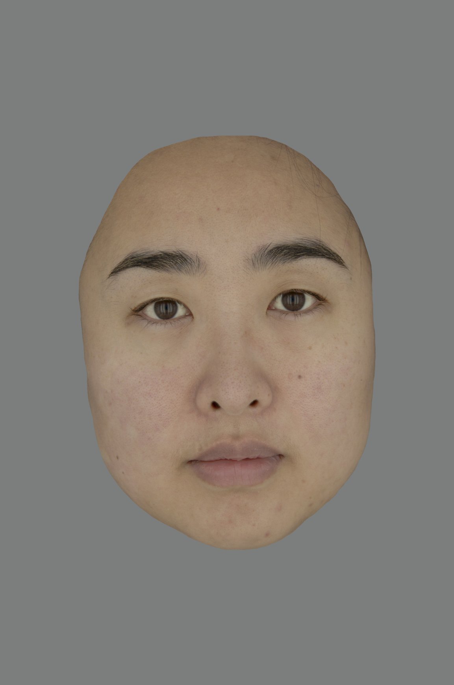
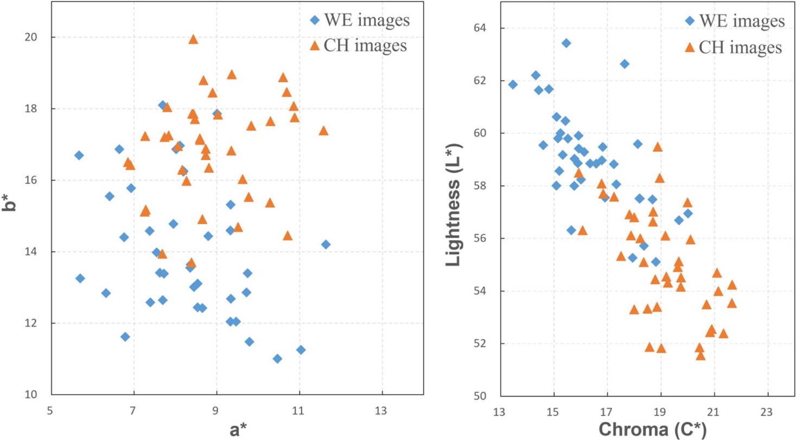

# 피부색은 중국계와 서유럽계 관찰자에게 매력·건강·젊음의 문화 특이적 단서다

> **원문** Lu Y, Yang J, Xiao K, Pointer M, Li C, Wuerger S (2021). *Skin coloration is a culturally-specific cue for attractiveness, healthiness, and youthfulness in observers of Chinese and western European descent.* PLoS ONE 16(10): e0259276. https://doi.org/10.1371/journal.pone.0259276
>
> **라이선스** 원문 Copyright © 2021 Lu et al. [Creative Commons Attribution License](https://creativecommons.org/licenses/by/4.0/)로 배포되며, 원저자와 출처를 밝히는 조건으로 모든 매체에서 제한 없는 이용·배포·복제를 허용합니다.
>
> **변경 사항** 영어 원문을 한국어로 번역했습니다. 그림은 원문에서 잘라 캡션 앞에 넣었고, 표는 원문 PDF의 페이지 이미지를 보고 옮겼으며, 참고문헌 목록은 생략했습니다(본문의 [숫자]는 원문 참고문헌 번호). 보충 자료(S1 File)는 번역하지 않았습니다. 원저자가 검토한 번역이 아닙니다. 폴더 이름은 경로 길이 제한 때문에 제목 뒷부분을 줄였습니다.

**용어 대응** — L\*: 밝기(명도) · a\*: 붉기(적색도) · b\*: 노랗기(황색도) · C\*: 채도 · WE: 서유럽인(western European) · CH: 중국인(Chinese) · 이미지 민족(Im): 평가받는 얼굴 사진의 민족 · 관찰자 민족(Ob): 평가하는 사람의 민족 · 선형 혼합효과 모형(linear mixed-effect model) · 단순 효과(simple effect): 하위 집단 안에서의 효과 · 지각된 나이(perceived/estimated age)

---

## 초록

얼굴 피부색은 개인에 관한 정보를 신호하며, 건강·매력·나이와의 추정된 연관 때문에 사회적 상호작용과 짝 선택에서 중요한 역할을 한다. 진화적으로 중요한 단서로서의 피부색이 보편적인지 특정 문화에 한정되는지는 분명하지 않으며, 건강과 매력의 단서로서 피부색의 보편성에 관한 현재의 증거는 엇갈린다. 이 연구는 중국계 또는 서유럽계의 실제 인간 얼굴을 담은, 보정되고 해상도가 높으며 조작하지 않은 이미지 80장을 사용했고, 관찰자 44명 — 서유럽인 22명(남성 13명; 평균 나이 ± SD = 24.27 ± 5.30)과 중국인 22명(남성 7명; 평균 나이 ± SD = 26.05 ± 3.96) — 이 이 이미지들을 매력, 건강, 지각된 나이의 측면에서 평가했다. 피부색과 이러한 지각 평가 사이의 연관, 그리고 이 연관이 관찰자 또는 이미지의 민족에 의해 조절되는지를 밝히기 위해, 피부 밝기(L\*; CIELAB), 붉기(a\*), 노랗기(b\*), 관찰자와 이미지의 민족을 독립 변수로, 지각된 매력, 건강, 추정 나이를 종속 변수로 하는 선형 혼합효과 모형을 설정했다. 우리는 얼굴 피부 밝기(L\*)와 매력, 건강, 젊음 사이에 견고한 양의 연관을 발견했지만, 이는 중국인 관찰자가 자기 민족의 얼굴 이미지를 판단할 때뿐이었다. 반면 유럽계 관찰자는 중국인 얼굴 이미지에서 노랗기(b\*)의 증가를 더 높은 매력 및 건강과 연관 지었다. 얼굴 붉기가 이러한 속성과 양의 연관을 가진다는 증거는 찾지 못했다. 대신 붉기(a\*)의 증가는 유럽인 얼굴 이미지의 추정 나이 증가와 연관되었다. 우리는 두 민족의 관찰자 모두 매력, 건강, 지각된 나이를 평가하는 데 피부색과 밝기를 사용하지만, 이전에 생각했던 것보다는 그 정도가 덜하다고 결론짓는다. 또한 이러한 색 단서는 보편적이지 않으며 중국인과 서유럽인 민족 집단 안에서 다르게 활용된다. 우리의 연구는 진화적으로 의미 있는 매개변수 공간 안에서, 이상적으로는 물리적 매개변수에 기반한 사실적인 피부 모델을 사용해 피부색을 조작하는 것이 중요함을 보여 주는 연구들에 보탬이 된다.

## 서론

인간 얼굴의 가장 중요한 특징 중 하나로서 피부색은 성선택의 요인으로 시사되어 왔으며[1], 얼굴 피부의 밝기·붉기·노랗기의 증가는 건강해 보이는 외모 및 얼굴 매력과 양의 연관을 보여 왔다[2, 3]. 특히 얼굴 붉기는 지각된 건강과 매력을 똑같이 높이는 것으로 나타났는데[4], 이는 인간의 심혈관 건강을 반영하는 것일 수 있다. 피부 발색단인 멜라닌과 헤모글로빈의 분포가 좌우하는 피부색 균일성은 더 젊게 지각되는 나이, 더 큰 건강과 매력과 양의 연관을 가진다[5–7].

최근의 몇몇 연구[8–11]를 제외하면 거의 모든 실험에서, 관찰자는 색을 조작한(흔히 모핑한) 얼굴 이미지를 보거나[4, 12, 13], 지각된 건강이나 매력이 최적이 되도록 색공간의 고정된 차원을 따라 얼굴 이미지를 조작하도록 요청받았다[2, 3]. 그러나 컴퓨터로 생성하거나 모핑한 얼굴 이미지는 이미지 처리 후 피부 질감을 잃고 비현실적으로 보일 수 있다. 게다가 얼굴 이미지의 각 픽셀에 적용한 균일한 색 이동은 자연스럽게 일어나는 색 변화와 반드시 일치하지는 않는데, 색 패턴의 변이는 얼굴 전체에 균일하지 않은 혈관 분포에 달려 있기 때문이다. 인간 관찰자는 이러한 공간적 색 변이에 민감한 것으로 나타났으며, 지각된 건강은 특정 얼굴 부위의 색 변화에 따라 다르게 영향을 받는다[14].

몇몇 주목할 만한 예외를 빼면, 얼굴 색이 주관적 속성(지각된 건강, 매력, 젊음)에 미치는 영향은 참가자와 자극 모두 유럽계 표본으로 연구되어 왔다. 민족 특이적 효과는 주로 얼굴의 구조적 특징에 초점을 맞추어 왔으며, 평균적 특징, 유형 성숙(neoteny) 특징, 여성적 특징이 지각된 매력에 영향을 주는 것으로 나타났다[15–17]. 흑백 얼굴 이미지를 볼 때 관찰자들은 자기 민족 얼굴의 매력 평가에서 더 강하게 일치했다[16, 17]. 지각된 건강과 매력의 단서로서의 피부색과 관련해서는, 백인과 아프리카인 표본과 관찰자에서 자기 민족뿐 아니라 민족을 넘어서도 비슷한 피부색 선호가 입증되었다[18, 19]. 중국 본토 관찰자는 백인 관찰자와 달리 더 밝은 피부와 줄어든 노랗기를 선호하는 것으로 나타났지만, 이는 자기 민족의 얼굴을 판단할 때뿐이었다[20]. 반면 지각된 건강을 최적화하도록 요청받았을 때 말레이시아 화교 관찰자는 얼굴이 말레이시아 화교, 백인, 아프리카인 중 어느 민족이든 관계없이 얼굴의 노랗기와 붉기를 높이고 밝기를 낮추었다[21]. 이 연구의 목적 중 하나는 이렇게 엇갈리는 결과를 밝히고, 이러한 주관적 판단에 대한 관찰자 민족과 얼굴 이미지 민족의 효과를 분리하는 것이었다.

피부색과 지각 평가 사이의 일부 연관은 분명히 물리적 피부 변화에 근거한다. 예를 들어 밝기(L)와 물리적 나이 및 지각된 나이 사이의 음의 연관은 시간에 걸친 햇빛 노출과 관련된다[22]. 피부색과 선호 평가 사이의 다른 연관은 서양과 동양 문화의 미적 차이를 반영할 수 있으며, 이는 오랜 기간에 걸친 여러 사회적·문화적 요인의 발전에서 비롯되었을 가능성이 크다[23–26]. 따라서 우리는 피부색과 선호 사이의 연관이 관찰자의 민족과 보는 얼굴 이미지의 민족 둘 다에 달려 있을 것이라고 가정한다.

우리 연구의 목적은 (1) 피부색(L, a, b)과 지각 속성(매력, 건강, 젊음) 사이 연관의 강도, 그리고 (2) 이러한 피부색 단서(L, a, b)의 활용이 관찰자의 민족, 보는 이미지의 민족, 또는 둘 다에 의해 조절되는지를 확립하는 것이었다. 우리는 민족 특이적 피부색(밝기 L, 붉기 a, 노랗기 b)의 범위를 포함하는, 보정된 고해상도의 실제 인간 얼굴(중국인과 서유럽인) 이미지 대규모 세트(n = 80)를 피부색이나 질감을 디지털로 조작하지 않고 사용했다. 두 관찰자 집단(중국인과 서유럽인)이 두 얼굴 이미지 세트를 지각된 매력, 건강, 젊음의 세 차원에 따라 평가했다.

## 재료 및 방법

### 촬영과 이미지 처리

이 연구에 쓴 모든 얼굴 이미지는 리버풀 대학과 리즈 대학이 구축한, 네 민족 집단(서유럽인, 동양인, 남아시아인, 아프리카인, 남녀 모두 포함)의 대상자 188명의 데이터를 담은 리버풀–리즈 피부색 데이터베이스(LLSD)에서 골랐다[27, 28]. 각 대상자의 얼굴 이미지는 VeriVide DigiEye 조명 부스에서 촬영했으며, 이 부스는 균일한 무광 중간 회색 배경과 CIE 표준광 D65(주광)를 모사한 고르고 확산된 조명을 제공했다. 촬영이 이루어진 방에는 다른 조명이 없었다. 데이터 수집 중 참가자는 관찰 부스 안에 앉았고, 대상 얼굴 영역이 카메라 이미지 안에 들어오도록 조정되었다. DigiEye 시스템 소프트웨어가 제어하는 디지털 SLR 카메라(Nikon D7000)로 카메라 특성화를 위한 학습용 색 차트와 각 대상자의 얼굴을 촬영했다. 참가자와 카메라 사이의 거리는 약 57.5 cm였고 참가자는 카메라를 똑바로 바라보았다.

이 연구를 위해 LLSD 데이터베이스에서 모두 무표정인 실제 얼굴 이미지 80장 — 중국인 이미지 40장과 서유럽계 이미지 40장 — 을 골랐다. 모든 얼굴은 20–40세의 같은 연령 범위에 속하며 각 민족 집단에 남녀가 모두 포함되었다. 각 이미지의 각 픽셀의 RGB 데이터를 먼저 분광 반사율로 변환한 뒤[29] CIELAB 색 좌표로 변환했다[30]. 이 얼굴 이미지들의 색 외관을 충실히 표현하기 위해, 백색점을 D65(얼굴 이미지 촬영 조명과 같음)로 설정한 BenQ 전문가용 컬러 디스플레이를 사용했다. 디스플레이의 색 특성화에는 일정 색도를 가정한 구간별 선형 보간법(PLCC)[31, 32]을 사용했고, 각 얼굴 이미지의 각 픽셀의 CIELAB 값을 디스플레이 RGB 값으로 변환했다. 이후 각 얼굴 이미지에서 머리카락, 귀, 보이는 옷을 수작업으로 지우고 이미지를 화면 가운데에 오도록 크기를 조정했다. 마지막으로 모든 이미지를 표시할 중간 회색 배경(L, a, b = 50, 0, 0)을 설정했다. 모든 이미지는 MATLAB으로 처리했다. 그림 1은 이 연구에 쓴 중국인 실제 얼굴 이미지의 예다.

**그림 1.** 중국인 얼굴 이미지의 예.

### 자극 설명

시험 얼굴 이미지 80장(중국인 40장, 서유럽인 40장)의 CIELAB 좌표로 된 평균 색 명세는 입, 코, 눈, 눈썹을 제외한 얼굴 영역의 각 픽셀의 전체 평균으로 계산했다. CIELAB 색공간은 기기에 독립적인 표준 색 외관 공간으로, 피부색을 밝기 L, 붉기 a, 노랗기 b의 세 차원으로 기술한다[33]. 또한 채도(chroma)는 색의 포화도를 대략 나타내는 데 쓰인다. 그림 2에서 보듯이 서유럽인과 중국인 이미지 모두의 피부색을 a-b 색도도와 채도–밝기 도표에 표시했다. 두 민족 집단 사이에는 밝기와 색도의 체계적인 평균 차이가 있다. 서유럽인 이미지(평균 L = 59.0, a = 8.3, b = 14.1)는 중국인 이미지(평균 L = 55.0, a = 8.9, b = 16.9)에 비해 평균적으로 밝기가 높고 노랗기(b)가 낮다.

**그림 2.** CIELAB a\*b\* 공간(왼쪽)과 L\*C\* 공간(오른쪽)에서 시험 얼굴 이미지의 평균 얼굴 색 분포. ◆ 서유럽인(WE), ▲ 중국인(CH).

### 관찰자

서유럽인 22명(남성 13명; 평균 나이 ± SD = 24.27 ± 5.30)과 중국인 22명(남성 7명; 평균 나이 ± SD = 26.05 ± 3.96)을 포함한 관찰자 44명으로 심리물리 실험을 수행했으며, 각 관찰자는 얼굴 이미지 80장(중국인 40장, 서유럽인 40장)의 외관을 지각된 매력, 지각된 건강, 지각된 나이의 세 가지 주관적 속성으로 평가했다. 필요한 표본 크기는 G-power 3.1 소프트웨어 패키지[34]로 추정했으며, p<0.05에서 중간 효과 크기 0.5를 80% 검정력으로 검출하려면 최소 34명의 전체 표본이 필요했다. 모든 관찰자는 영어로 지시를 받았고 실험 전에 이해했음을 확인했다. 중국인 관찰자는 중국 본토 출신으로, 연구 당시 영국 리즈 대학에 학생이나 방문 학자로 있었다. 평균적으로 영국에서 약 1–3년을 보냈다. 이 연구는 리즈 대학 윤리위원회의 승인을 받았으며(LTDESN-090), 모든 참가자는 연구 참여 전에 서면 동의서를 제출했다. 이 원고에 나오는 개인은 이 사례 세부 사항의 출판에 대해 (PLOS 동의서 양식에 명시된 대로) 서면 동의를 했다.

### 실험 절차

실험은 세 개의 별도 세션으로 나뉘었다. 각 세션에서 관찰자는 무작위 순서로 제시되는 얼굴 이미지 80장을 보고, 각 이미지의 피부색을 세 속성 중 하나에 대해 평가했다. 관찰자는 각 이미지를 8초 동안 본 뒤 시간 제한 없이 얼굴 피부색에 대한 판단을 내렸다. 각 이미지를 관찰한 뒤 다음 질문을 했다: "피부색을 바탕으로, 방금 본 이미지에 매력 점수(세션에 따라 건강 점수 또는 추정 나이)를 몇 점 주겠습니까?" 범주 판단법을 사용해, 지각된 얼굴 매력과 건강을 1이 '가장 낮은 매력'/'건강', 7이 '가장 높은 매력'/'건강'을 나타내는 7점 리커트형 척도로 평가했다. 시각적 나이는 1세부터 99세까지 1년 단위 척도로 평가했다. 이 연구에서는 성별 효과를 검정하지 않았으며, 관찰자와 이미지의 성별은 균형을 맞추었다. 관찰자는 판단할 때 이미지의 성별을 듣지도, 판단하도록 요청받지도 않았다. 각 얼굴 이미지에서 머리카락, 귀, 보이는 옷을 지웠기 때문에 이 연구에서 얼굴의 성별은 그리 분명하거나 두드러지지 않았다.

### 통계 분석

관찰자 간 변동성은 크론바흐 알파 계수를 계산해 검토했다[35]. 세 종속 변수(DV: 매력, 건강, 지각된 나이) 각각에 대해, 밝기(L), 붉기(a), 노랗기(b)를 연속 예측 변수로, 이미지 민족과 관찰자 민족을 범주 예측 변수로 하는 고정 효과와, 이미지와 관찰자 모두에 대한 무작위 절편을 포함한 선형 혼합효과 모형을 설정했다.

모든 선형 혼합효과 모형은 lme4 R 패키지[36]로 구현했다. 각 모형의 주효과를 검정하기 위해, 편차 코딩으로 이미지 민족과 관찰자 민족을 편차 코딩 요인으로 변환했다(서유럽인 이미지/관찰자는 '-0.5', 중국인 이미지/관찰자는 '0.5'). 각 DV에 대해 단순 모형과 완전 모형을 고려했는데, 완전 모형은 색(L, a, b)과 민족(관찰자 민족, 이미지 민족) 사이의 모든 상호작용을 허용했다. 모든 경우 두 모형의 예측은 서로 유의하게 달랐고, AIC/BIC 모두 상호작용을 포함한 모형을 지지했다[37]. 각 선형 혼합효과 모형의 고정 효과에 대한 P 값은 lmerTest R 패키지[38]에서 제3종 제곱합과 새터스웨이트 자유도 근사를 이용한 F 검정으로 계산했다. 검정에서 드러난 유의한 상호작용은 각 하위 집단의 단순 효과에 대한 추가 분석으로 후속 검토했다. 또한 두 관찰자 집단 모두에서 세 속성의 지각 사이 연관을 검정하는 데 피어슨 상관계수(양측)도 사용했다.

## 결과

### 민족 안과 민족 간의 일관성

서유럽인과 중국인 관찰자 집단 모두에서 매력, 건강, 나이 평가의 내적 일관성은 매우 높았으며, 크론바흐 알파 계수 값이 모두 0.87보다 컸다(표 1). 평균적으로 두 관찰자 집단 모두 자기 민족 얼굴과 다른 민족 얼굴에 대한 주관적 평가에서 높은 수준의 일치를 보였다.

**표 1.** 서유럽인(WE)과 중국인(CH) 관찰자의 관찰자 간 변동성을 평가하는 크론바흐 알파 계수(표본 크기).

| | | WE | CH | WE & CH |
|---|---|---|---|---|
| WE 이미지 | 매력 | 0.96 (22) | 0.93 (22) | 0.96 (44) |
| | 건강 | 0.96 (22) | 0.93 (22) | 0.97 (44) |
| | 나이 | 0.90 (22) | 0.91 (22) | 0.95 (44) |
| CH 이미지 | 매력 | 0.95 (22) | 0.96 (22) | 0.97 (44) |
| | 건강 | 0.96 (22) | 0.96 (22) | 0.98 (44) |
| | 나이 | 0.87 (22) | 0.92 (22) | 0.94 (44) |

(역자 주: 열 머리 WE, CH, WE & CH는 관찰자 집단이다.)

**표 2.** 모형 비교: 세 속성 모두에 대한 상호작용 포함·미포함 혼합 모형.

| 모형 | npar | AIC | BIC | logLik | deviance | χ² | χ² df | P |
|---|---|---|---|---|---|---|---|---|
| **DV = 매력** | | | | | | | | |
| 상호작용 없음 | 9 | 9725 | 9781 | -4854 | 9707 | | | |
| + 상호작용 | 19 | 9534 | 9651 | -4748 | 9496 | 211.03 | 10 | <0.001\*\*\* |
| **DV = 건강** | | | | | | | | |
| 상호작용 없음 | 9 | 9471 | 9526 | -4726 | 9453 | | | |
| + 상호작용 | 19 | 9344 | 9460 | -4653 | 9306 | 147.1 | 10 | <0.001\*\*\* |
| **DV = 나이** | | | | | | | | |
| 상호작용 없음 | 9 | 20013 | 20068 | -9997 | 19995 | | | |
| + 상호작용 | 19 | 20002 | 20119 | -9982 | 19964 | 31.09 | 10 | <0.001\*\*\* |

\*P≤0.05, \*\*P≤0.01, \*\*\*P≤0.001.

### 피부색, 관찰자 민족, 이미지 민족이 지각된 건강·매력·나이에 미치는 효과

모든 지각 속성에 대해, 우리는 먼저 상호작용이 있는 선형 혼합효과 모형과 없는 모형을 평가한다. 표 2에서 보듯이 모든 경우 상호작용을 허용하는 모형이 상호작용이 없는 모형보다 낫다. 나이에 대해서는 BIC가 상호작용 없는 모형을 약하게 지지하지만, 모든 AIC가 상호작용 있는 모형을 강하게 선호하며 유의한 우도비 검정도 마찬가지다. 따라서 상호작용이 있는 모형의 분석을 보고한다.

표 3은 얼굴 매력에 대한 선형 혼합효과 모형의 모든 주효과를 보여 준다. 매력에서는 피부색(L\*, a\*, b\*)도 관찰자 민족도 유의하지 않지만, 이미지 민족, 이미지 민족과 밝기의 상호작용(p = 0.017), 그리고 관찰자 민족과 밝기/붉기/노랗기의 상호작용이 유의하다(p = 0.001/<0.001/<0.001). 이 상호작용들은 밝기가 매력에 미치는 효과가 서로 다른 민족의 얼굴을 볼 때 다르며, 밝기/붉기/노랗기가 매력에 미치는 효과가 서유럽인 관찰자와 중국인 관찰자에게 다르다는 것을 나타낸다. S1 File의 S1 Fig에 있는 회귀선은 선형 혼합효과 모형에서 색과 민족(관찰자/이미지) 사이의 이 모든 상호작용을 보여 준다.

**표 3.** 매력에 대한 선형 혼합효과 모형의 고정 효과 추정치, 표준오차(SE), t 값, 하한(2.5%)·상한(97.5%) 신뢰구간과 P 값.

| 고정 효과 | 추정치 | SE | t 값 | 2.5% CI | 97.5% CI | P 값 |
|---|---|---|---|---|---|---|
| (절편) | 2.346 | 4.465 | 0.525 | -6.513 | 11.206 | 0.601 |
| L\* | 0.021 | 0.058 | 0.359 | -0.094 | 0.136 | 0.720 |
| a\* | -0.113 | 0.085 | -1.328 | -0.282 | 0.056 | 0.188 |
| b\* | 0.106 | 0.061 | 1.739 | -0.015 | 0.228 | 0.086 |
| Im | -20.703 | 8.929 | -2.319 | -38.419 | -2.987 | **0.023**\* |
| Ob | -1.531 | 1.780 | -0.860 | -5.020 | 1.958 | 0.390 |
| Im:Ob | -6.266 | 3.546 | -1.767 | -13.218 | 0.686 | 0.077 |
| L\*:Im | 0.284 | 0.116 | 2.448 | 0.054 | 0.515 | **0.017**\* |
| L\*:Ob | 0.077 | 0.023 | 3.353 | 0.032 | 0.123 | **0.001**\*\*\* |
| a\*:Im | 0.187 | 0.170 | 1.102 | -0.150 | 0.525 | 0.274 |
| a\*:Ob | -0.166 | 0.034 | -4.901 | -0.232 | -0.099 | **<0.001**\*\*\* |
| b\*:Im | 0.182 | 0.122 | 1.487 | -0.061 | 0.425 | 0.141 |
| b\*:Ob | -0.089 | 0.024 | -3.646 | -0.136 | -0.041 | **<0.001**\*\*\* |
| L\*:Im:Ob | 0.079 | 0.046 | 1.707 | -0.012 | 0.169 | 0.088 |
| a\*:Im:Ob | 0.137 | 0.068 | 2.030 | 0.005 | 0.270 | **0.042**\* |
| b\*:Im:Ob | 0.050 | 0.049 | 1.024 | -0.046 | 0.145 | 0.306 |

\*P≤0.05, \*\*P≤0.01, \*\*\*P≤0.001. Im = 이미지 민족, Ob = 관찰자 민족.

**표 4.** 건강에 대한 선형 혼합효과 모형의 고정 효과 추정치, 표준오차(SE), t 값, 하한(2.5%)·상한(97.5%) 신뢰구간과 P 값.

| 고정 효과 | 추정치 | SE | t 값 | 2.5% CI | 97.5% CI | P 값 |
|---|---|---|---|---|---|---|
| (절편) | 4.829 | 4.998 | 0.966 | -5.088 | 14.745 | 0.337 |
| L\* | -0.015 | 0.065 | -0.231 | -0.144 | 0.114 | 0.818 |
| a\* | -0.100 | 0.095 | -1.055 | -0.289 | 0.088 | 0.295 |
| b\* | 0.093 | 0.068 | 1.357 | -0.043 | 0.229 | 0.179 |
| Im | -20.374 | 9.995 | -2.039 | -40.205 | -0.544 | **0.045**\* |
| Ob | 2.141 | 1.725 | 1.241 | -1.242 | 5.523 | 0.215 |
| Im:Ob | -4.515 | 3.434 | -1.315 | -11.248 | 2.218 | 0.189 |
| L\*:Im | 0.300 | 0.130 | 2.306 | 0.042 | 0.558 | **0.024**\* |
| L\*:Ob | 0.027 | 0.022 | 1.208 | -0.017 | 0.071 | 0.227 |
| a\*:Im | 0.133 | 0.190 | 0.697 | -0.245 | 0.510 | 0.488 |
| a\*:Ob | -0.141 | 0.033 | -4.309 | -0.205 | -0.077 | **<0.001**\*\*\* |
| b\*:Im | 0.137 | 0.137 | 1.002 | -0.134 | 0.409 | 0.320 |
| b\*:Ob | -0.147 | 0.024 | -6.237 | -0.193 | -0.101 | **<0.001**\*\*\* |
| L\*:Im:Ob | 0.060 | 0.045 | 1.339 | -0.028 | 0.147 | 0.181 |
| a\*:Im:Ob | 0.102 | 0.065 | 1.563 | -0.026 | 0.231 | 0.118 |
| b\*:Im:Ob | 0.034 | 0.047 | 0.726 | -0.058 | 0.126 | 0.468 |

\*P≤0.05, \*\*P≤0.01, \*\*\*P≤0.001. Im = 이미지 민족, Ob = 관찰자 민족.

표 4는 완전한 지각된 건강 모형의 주효과 결과를 보여 준다. 지각된 건강에서는 피부색의 유의한 주효과는 없었지만 이미지 민족의 효과는 유의했다. 또한 이미지 민족과 밝기 사이(p = 0.024), 그리고 관찰자 민족과 붉기, 노랗기 사이에 각각(p<0.001; p<0.001) 유의한 상호작용을 발견했다. 얼굴 매력과 마찬가지로, 밝기가 지각된 건강에 미치는 효과는 출신이 다른 얼굴에 따라 다르며, 붉기/노랗기가 건강에 미치는 효과는 두 관찰자 집단에 따라 다르다.

추정 나이에 대해서는 표 5에서 보듯이 붉기(a\*), 이미지 민족, 이미지와 관찰자 민족의 상호작용의 주효과가 유의하다. 색과 민족 사이 상호작용의 유의한 효과에는 밝기와 이미지 민족의 상호작용(p = 0.015), 붉기와 이미지 민족의 상호작용(p = 0.036), L\*:Im:Ob의 3원 상호작용(p = 0.035)이 포함된다. 얼굴의 밝기/붉기는 유럽인 얼굴과 중국인 얼굴의 지각된 나이에 서로 다른 효과를 가지며, 밝기가 나이 지각에 미치는 영향은 관찰자의 민족에도 달려 있다.

**표 5.** 추정 나이에 대한 선형 혼합효과 모형의 고정 효과 추정치, 표준오차(SE), t 값, 하한(2.5%)·상한(97.5%) 신뢰구간과 P 값.

| 고정 효과 | 추정치 | SE | t 값 | 2.5% CI | 97.5% CI | P 값 |
|---|---|---|---|---|---|---|
| (절편) | 23.676 | 14.317 | 1.654 | -4.731 | 52.082 | 0.102 |
| L\* | -0.112 | 0.186 | -0.603 | -0.482 | 0.257 | 0.548 |
| a\* | 0.550 | 0.273 | 2.017 | 0.009 | 1.091 | **0.047**\* |
| b\* | 0.237 | 0.196 | 1.210 | -0.152 | 0.626 | 0.230 |
| Im | 70.588 | 28.617 | 2.467 | 13.805 | 127.37 | **0.016**\* |
| Ob | 4.551 | 8.080 | 0.563 | -11.290 | 20.392 | 0.573 |
| Im:Ob | 31.712 | 16.046 | 1.976 | 0.254 | 63.170 | **0.048**\* |
| L\*:Im | -0.926 | 0.372 | -2.487 | -1.665 | -0.187 | **0.015**\* |
| L\*:Ob | -0.072 | 0.104 | -0.693 | -0.277 | 0.132 | 0.488 |
| a\*:Im | -1.165 | 0.545 | -2.136 | -2.247 | -0.083 | **0.036**\* |
| a\*:Ob | 0.294 | 0.153 | 1.922 | -0.006 | 0.593 | 0.055 |
| b\*:Im | -0.602 | 0.392 | -1.536 | -1.380 | 0.176 | 0.129 |
| b\*:Ob | -0.142 | 0.110 | -1.294 | -0.358 | 0.073 | 0.196 |
| L\*:Im:Ob | -0.440 | 0.209 | -2.106 | -0.849 | -0.030 | **0.035**\* |
| a\*:Im:Ob | -0.133 | 0.306 | -0.434 | -0.732 | 0.467 | 0.665 |
| b\*:Im:Ob | -0.313 | 0.220 | -1.425 | -0.744 | 0.118 | 0.154 |

\*P≤0.05, \*\*P≤0.01, \*\*\*P≤0.001. Im = 이미지 민족, Ob = 관찰자 민족.

위의 상호작용을 더 이해하고 각 이미지·관찰자 세트 안에서 L\*, a\*, b\*의 단순 효과를 밝히기 위해, 표 6과 같이 세 선형 혼합효과 모형에서 각 하위 집단 안의 고정 효과에 대한 매개변수 추정치를 계산했다. 중국인 관찰자가 중국인 얼굴을 평가할 때, 밝기의 증가는 더 큰 매력과 강하게 연관된다(p = 0.002). 서유럽인 얼굴에 대해서는 붉기의 감소가 더 큰 매력을 예측한다(p = 0.018). 유럽계 관찰자는 노랗기의 증가를 더 높은 매력과 연관 짓지만, 유럽인 얼굴 이미지를 볼 때뿐이다(p = 0.010). 더 밝은 피부는 더 큰 건강과 연관되지만, 중국인 관찰자가 중국인 이미지를 평가할 때뿐이다(p = 0.037). 서유럽인 관찰자는 중국인 얼굴 이미지를 볼 때 노랗기의 증가를 건강과 연관 짓는다(p = 0.021). 이 연관은 서유럽인 이미지가 이끈다: 붉기의 증가는 서유럽인 관찰자(p = 0.033)나 중국인 관찰자(p = 0.004)가 볼 때 서유럽인 이미지의 더 많은 지각된 나이와 연관된다. 중국인 관찰자가 중국인 얼굴을 평가할 때 밝기는 지각된 젊음의 강한 예측 변수다(p = 0.002). S1 File의 S2 Figs 2–4는 서유럽인 관찰자와 중국인 관찰자에서 지각 평가와 피부색 사이의 연관을 보여 준다. 회귀선은 선형 혼합효과 모형에서 유의한 고정 효과에 대해 그렸다.

(역자 주: 이 문단과 표 6 사이에는 원문 자체의 불일치가 있다. ① "서유럽인 얼굴에 대해서는 붉기의 감소가 더 큰 매력을 예측한다(p = 0.018)"는 표 6에서 중국인 관찰자 칸의 결과다(본문은 관찰자를 밝히지 않음). ② "유럽인 얼굴 이미지를 볼 때뿐(p = 0.010)"은 표 6에서 중국인 이미지(CH images) 칸에 있고, 고찰 절도 "중국인 얼굴 이미지를 볼 때뿐"이라고 쓴다. ③ 나이에서 서유럽인 관찰자의 p는 표 6에 0.03으로, 본문에 0.033으로 적혀 있다. ④ "이 연관은 서유럽인 이미지가 이끈다"는 문장은 앞 문장(중국인 이미지의 노랗기)과 이어지지 않는다. 번역은 원문대로 두었다.)

**표 6.** 선형 혼합효과 모형에서 단순 효과의 매개변수 추정치.

| 고정 효과 | | WE 관찰자 | CH 관찰자 |
|---|---|---|---|
| **DV = 매력** | | | |
| WE 이미지 | L\* | β = -0.140, P = 0.149 | β = -0.102, P = 0.291 |
| | a\* | β = -0.090, P = 0.507 | **β = -0.324, P = 0.018**\* |
| | b\* | β = 0.072, P = 0.425 | β = -0.041, P = 0.647 |
| CH 이미지 | L\* | β = 0.105, P = 0.133 | **β = 0.221, P = 0.002**\*\* |
| | a\* | β = 0.029, P = 0.790 | β = -0.068, P = 0.538 |
| | b\* | **β = 0.229, P = 0.010**\*\* | β = 0.166, P = 0.059 |
| **DV = 건강** | | | |
| WE 이미지 | L\* | β = -0.164, P = 0.131 | β = -0.166, P = 0.124 |
| | a\* | β = -0.071, P = 0.638 | β = -0.263, P = 0.083 |
| | b\* | β = 0.106, P = 0.292 | β = -0.058, P = 0.567 |
| CH 이미지 | L\* | β = 0.106, P = 0.170 | **β = 0.163, P = 0.037**\* |
| | a\* | β = 0.011, P = 0.930 | β = -0.079, P = 0.519 |
| | b\* | **β = 0.226, P = 0.021**\* | β = 0.097, P = 0.318 |
| **DV = 나이** | | | |
| WE 이미지 | L\* | β = 0.277, P = 0.381 | β = 0.424, P = 0.180 |
| | a\* | **β = 0.952, P = 0.03**\* | **β = 1.312, P = 0.004**\*\* |
| | b\* | β = 0.531, P = 0.074 | β = 0.545, P = 0.066 |
| CH 이미지 | L\* | β = -0.429, P = 0.060 | **β = -0.721, P = 0.002**\*\* |
| | a\* | β = -0.146, P = 0.684 | β = 0.081, P = 0.821 |
| | b\* | β = 0.085, P = 0.763 | β = -0.213, P = 0.451 |

\*P≤0.05, \*\*P≤0.01, \*\*\*P≤0.001. DV = 종속 변수. (역자 주: 원문 표에는 하위 집단마다 빈 "Model" 행이 있는데 생략했다.)

### 지각 속성 사이의 상관

매력과 건강 평가는 이미지와 관찰자 민족 모두에 걸쳐 높은 상관을 보이지만(표 7, S1 File의 S3 Fig 5도 참조), 추정 나이와는 음의 상관을 보인다. 후자의 음의 상관은 중국인 관찰자에서 매우 유의하다. 가장 강한 음의 상관은 중국인 관찰자가 중국인 이미지를 평가할 때 관찰되며, 이는 민족과 피부색 단서 사이의 상호작용과 일치한다.

**표 7.** 서유럽인(WE)과 중국인(CH) 관찰자의 나이, 건강, 매력 점수 사이의 피어슨 상관계수.

| | WE 이미지 | CH 이미지 | 전체 이미지 |
|---|---|---|---|
| **WE 관찰자** | | | |
| 매력–건강 | 0.912\*\*\* | 0.946\*\*\* | 0.929\*\*\* |
| 매력–나이 | -0.343 | -0.354 | -0.351\* |
| 건강–나이 | -0.293 | -0.295 | -0.298 |
| **CH 관찰자** | | | |
| 매력–건강 | 0.881\*\*\* | 0.927\*\*\* | 0.893\*\*\* |
| 매력–나이 | -0.632\*\*\* | -0.828\*\*\* | -0.730\*\*\* |
| 건강–나이 | -0.651\*\*\* | -0.818\*\*\* | -0.726\*\*\* |

\*P≤0.05/18, \*\*P≤0.01/18, \*\*\*P≤0.001/18. WE, CH, 전체 이미지에 대해 각각 N = 40, 40, 80. 모든 p 값은 본페로니 보정했다.

## 고찰

서유럽인과 중국인 실제 인간 얼굴의 색 보정 이미지 80장을 사용해, 중국인과 서유럽인 관찰자가 자기 민족 또는 다른 민족의 얼굴 이미지의 건강, 매력, 젊음을 평가할 때 얼굴 색을 어떻게 활용하는지 연구했다. 이 이미지들의 밝기와 색 변이는 각 집단의 색 변이를 대표했다[28]. 우리의 주된 발견은, 피부색이 지각된 매력, 건강, 나이의 보편적 예측 변수가 아니라, 중국인과 서유럽인 관찰자가 자기 민족 또는 다른 민족의 얼굴 이미지를 평가할 때 서로 다르게 활용된다는 것이다.

### 지각된 매력과 건강

매력과 건강의 평가는 같은 얼굴 단서에 의해 이끌리며(표 3, 4, 6), 이는 매력과 건강 평가 사이의 높은 상관(표 7)으로도 뒷받침되고 Han 등[39]과 일치한다. 그러나 이 단서들은 중국인과 서유럽인 관찰자에게 다르게 활용된다. 중국인 관찰자는 매력과 건강을 모두 판단할 때 피부 밝기를 견고한 단서로 사용하지만, 중국인 얼굴을 판단할 때뿐이다(표 6). 우리 연구와 달리 Han 등[39]은 중국인과 서양인 얼굴 모두에서 밝기가 매력/지각된 건강에 미치는 효과를 발견했지만, 우리 연구에서는 중국인 얼굴을 평가할 때만 유의한 연관을 발견했다. 이 불일치에 대한 가능한 설명은, 중국인 피부가 서유럽인 피부에 비해 평균 L\* 값이 낮고, 결정적으로 밝기의 변이가 더 작다는 특징을 가진다는 것이다[40]. 우리는 중국인 얼굴의 L\* 변이가 더 작다는 점이 더 유익하고 더 믿을 만한 밝기 단서로 이어진다고 추측한다.

중국인 관찰자에게 붉기(a\*)는 매력 및 건강과 모두 음의 연관을 가지지만, 유의 수준(p<0.05)에 이르는 것은 유럽인 얼굴을 볼 때의 매력뿐이다(표 6). 반면 서유럽인 관찰자는 노랗기(b\*)의 증가를 증가된 매력 및 건강과 연관 짓지만, 중국인 얼굴 이미지를 볼 때뿐이다(표 6). 피부 노랗기(b\*)의 증가와 지각된 매력 및 건강 사이의 연관은, b\*의 증가와 L\*의 감소가 동시에 일어나는 '태닝한' 피부에 대한 서유럽인의 선호를 반영할 가능성이 크다[41]. 지각된 건강의 유의한 예측 변수로서의 피부 노랗기는 이전 연구와 일치한다(예: [42]). 피부 노랗기가 신체 건강과 연관되는지는 논란이 있다. 일부 연구는 체력과 피부 노랗기 사이의 상관을 발견했지만[43], 다른 연구는 피부 노랗기와 지각된 건강 사이의 연관은 발견했으나 신체 건강과의 연관은 발견하지 못했다[10]. 고카로티노이드 식단을 객관적 피부색 변화와 연결한 실험들은 카로티노이드 섭취와 피부 노랗기(b\*) 사이의 일관된 연관을 보고했지만, 카로티노이드–붉기(a\*) 연결에 대한 결과는 결론에 이르지 못했다. 과일·채소(FV) 섭취는 피부 노랗기의 유의한 증가(b\* 약 2 단위, a\* 값에서는 훨씬 작음) 및 지각된 매력과 연관되었으며, 이는 짝 선택을 위한 카로티노이드 연계 건강 신호 체계라는 가설과 일치한다[12, 44]. Pezdirc 등[45]은 b\*의 0.6 증가를 보고했지만 붉기(a\*)의 측정 가능한 증가는 없었고, 이는 Appleton 등[8]의 무작위 대조 시험에서 확인되었다. 이 시험은 FV 섭취가 피부 노랗기에 작지만 유의한 효과(b\* 약 1–2 단위)를 주었지만 피부 붉기에는 변화가 없었고 지각된 건강에도 효과가 없었음을 기록했다. 반대로 Tan 등은 4주간의 FV 중재 후 피부 노랗기와 붉기 모두에서 유의한 증가(p<0.001)를 보고했다[46]. 크게 높아진 피부 노랗기 수준은 황달 같은 기저 건강 문제를 반영할 가능성이 크다[47]. 따라서 객관적으로 측정 가능한 건강상 이득을 반영하는, 노랗기의 작은 변화만이 지각된 건강과 양의 연관을 가질 것이라고 예측할 수 있다. 물리적 피부색 변화와 지각적 선호 사이의 이러한 비선형 관계는, 물리적 피부 변화와 건강·매력 같은 지각 속성 사이의 연관을 물리적으로 그럴듯하고 진화적으로 의미 있는 매개변수 범위 안에서 조사해야 한다는 주장을 뒷받침한다.

### 지각된 나이

가장 강한 음의 연관은 피부 밝기와 추정 나이 사이에서 발견되지만, 중국인 관찰자가 자기 민족의 얼굴을 평가할 때뿐이다(표 6). 중국 문화에서 피부 밝기와 지각된 젊음 사이의 이 견고한 관계는 나이에 따른 물리적 밝기 변화를 반영할 수 있다: 중국인 여성 피부에서 L 한 단위의 감소는 나이 10년 증가에 해당한다[48]. 반면 서유럽인 관찰자는 피부 밝기와 측정된 어떤 속성 사이에서도 견고한 연관을 보이지 않는다. 따라서 매력과 젊음의 단서로서의 피부 밝기는 이 두 문화에서 다르게 쓰인다. 서유럽인 이미지에서는 관찰자의 민족과 관계없이 얼굴 붉기(a\*)가 추정 나이와 양의 연관을 가진다(표 6). 얼굴 붉기의 역할은 아래에서 더 자세히 논의한다.

### 다른 얼굴 단서의 역할

두 가지 얼굴 색 단서는 견고하게, 그러나 민족에 따라 다르게 쓰인다: 중국인 표본 안에서 매력, 건강, 젊음의 지표로서의 피부 밝기(L\*), 그리고 서유럽인 얼굴 이미지에서 젊음과 음의 연관을 가지는 피부 붉기(a\*)(표 6). 우리는 조작하지 않은 실제 얼굴 이미지를 사용했기 때문에, 피부색은 필연적으로 다른 얼굴 형태 특징과 함께 변했다. 민족 안과 민족 간 모두에서 높은 관찰자 일관성(표 1)은 관찰자가 판단에서 추가적인 얼굴 단서에 의존할 수 있음을 시사하며, 이는 전체 얼굴 이미지와 따로 잘라 낸 뺨 조각에 대해 지각된 나이, 건강, 매력 평가를 얻은 Fink 등의 연구[49]와 일치한다. 이 두 평가 세트 사이의 연관은 크지 않았다: R²는 0.31(지각된 나이), 0.14(건강), 0.06(매력)이었으며, 이는 참가자들이 피부 조각/얼굴을 이 속성들로 평가할 때 (따로 떼어 낸 피부 조각에 들어 있지 않은) 다른 얼굴 특징을 사용해야 함을 보여 준다. Fink 연구에서 가장 견고한 연관은 지각된 나이에서 보고되었는데, 따로 떼어 낸 피부 이미지가 전체 얼굴 이미지 평가 변동의 약 31%를 설명했으며, 이는 멜라닌 분포가 젊음의 강한 지표라는 것과 일치한다[50]. 우리의 현재 연구는 평균 피부색(L\*, a\*, b\*)과 지각된 건강, 매력, 지각된 나이 평가 사이 연관의 강도를 추정하도록 설계되었다. 피부 질감, 국소적 색 변화, 기타 해부학적 얼굴 특징 같은 다른 단서의 기여에 대한 피부색의 상대적 기여를 추정할 수는 없다. 유용한 후속 연구는 선형 고정효과 모형에 공간적 위치와 피부 질감을 독립 변수로 포함하는 것이며, 이를 통해 평균 피부색 대 2차 피부 특성의 상대적 기여를 평가할 수 있을 것이다.

### 피부 붉기와 지각된 매력·건강·젊음 사이의 양의 연관에 대한 증거 없음

우리는 얼굴 피부 붉기가 지각된 매력, 건강, 젊음과 양의 연관을 가진다는 증거를 찾지 못했으며(표 6 참조), 이는 서유럽인 관찰자(Stephen et al., 2009a; Stephen et al., 2009b; Pazda et al., 2016; Stephen et al., 2012)[2, 3, 13, 18]와 중국인 관찰자(Han et al., 2018; Tan et al., 2019)[20, 21]에 대한 이전 보고와 대조된다. 그러나 우리의 결과는 실제 여성 얼굴의 대규모 이미지 데이터베이스를 사용해, 얼굴 붉기와 객관적 건강 지표 사이의 어떤 연관도, 붉기와 매력 사이의 어떤 양의 연관도 발견하지 못한 최근 연구와 일치한다[9]. 조작하지 않은 실제 얼굴 이미지를 사용한 다른 연구들은 피부 노랗기와 얼굴 매력 사이의 약한 양의 연관을 발견했지만, 매개 변수로서의 피부 붉기는 얼굴 매력과 작지만 음의 연관을 보였다[8]. 혈중 산소화 증가로 생기는 얼굴 붉기는 생식력의 지표로서 짝 선택의 중요한 신호라고 가정되어 왔지만[51–53], 최근 증거는 여성 얼굴 붉기와 생식력 신호 역할 사이에 더 복잡한 관계가 있음을 시사한다. 지각된 매력과 건강은 여포기에 더 높은 것으로 나타났지만, 붉기(a\*)의 변화는 측정할 수 없었거나[54], 지각 문턱 아래였거나[55], 주기 특이적이지 않았다[56]. 이는 얼굴 형태와 피부 균일성 같은 다른 얼굴 단서가 더 두드러진 역할을 할 수 있음을 시사한다.

얼굴 붉기와 매력 또는 건강 사이의 강한 양의 연관을 보고한 연구들은 색을 조작한 얼굴 이미지를 사용했다[2, 3, 12, 13]. 현재 연구를 포함해 조작하지 않은 얼굴 이미지를 사용한 더 최근의 연구들은 이러한 강한 연관을 보이지 못했다[8–11]. 이 불일치는 부분적으로 방법의 차이, 즉 붉기 변화의 크기(a\* 10 단위 초과)와 얼굴 전체에 균일하게 적용한 색 이동 때문일 수 있다. 피부색 조작은 흔히 CIELAB 차원 a\*, b\*, L\*에 한정되었지만, 자연의 피부색 공간에서 피부색 차원들은 서로 높은 상관을 가진다[28, 43]. 결정적으로, 진화적으로 의미 있거나 생활 방식에 따른 변화(생식력, 운동, 식단, 신체 건강)를 반영하는 피부색 변화는 이 차원 중 하나에 한정되지 않고 세 차원 모두에 걸친 공변으로 특징지어진다(예: [8, 55]). 우리의 얼굴 이미지 표본(n = 80)이 주관적 평가와의 연관을 드러낼 만큼 충분히 큰 색 범위, 특히 붉기 변이를 포함하지 않았을 가능성도 생각할 수 있다. 우리는 이것이 결과를 설명할 가능성은 낮다고 믿는다. 우리 이미지가 포괄하는 붉기 값의 범위는 약 6 a\* 단위인 반면(그림 2), 색각이 정상인 관찰자에게 얼굴 피부 조각에서 2 a\* 단위는 쉽게 구별되기 때문이다[4, 57]. 우리 연구의 잠재적 한계는 특정 얼굴 위치의 색 값 대신 평균 피부색을 예측 변수로 사용했다는 점인데, 특정 위치의 색은 중요한 요인으로 나타난 바 있다[14].

이 모든 방법론적 차이를 함께 고려하면, 건강과 매력의 주관적 평가에서 피부색의 역할에 대해 제시된 불일치 일부를 설명할 수 있을 것이다. 대체로 말해, 조작한 얼굴 이미지를 사용한 평가 실험들은 피부색과 건강·매력의 주관적 평가 사이의 강한 연관을 보였다[2, 3, 12, 19, 20, 58]. 얼굴 이미지의 색 조작은 피부색 단서의 역할을 얼굴 형태 단서와 분리할 수 있다는 장점이 있지만, (위에서 논의했듯이) 진화적으로 의미 있는 색 변화를 반영하지 않을 수 있다. 자연스러운 조작하지 않은 이미지[8–11, 43]나 그럴듯한 물리 기반 피부 이미지 조작[59, 60]을 사용한 최근 연구들은 피부색과 건강·매력 사이의 훨씬 약한 연관을 보고했으며, 이는 앞선 연구들이 건강과 매력에서 피부색의 역할, 특히 얼굴 붉기와의 연관을 과대평가했을 수 있음을 시사한다. Jones[11]는 지각된 건강과 매력이 거의 전적으로 얼굴 형태 특징에 의존하며 평균 얼굴 색은 작은 역할만 한다고 결론지었다. 얼굴 형태, 평균 피부색, 피부 균일성의 서로 다른 기여를 완전히 특성화하려면 모든 특징을 독립적으로 조작해야 하지만, 진화적으로 의미 있는 매개변수 공간 안에서, 이상적으로는 발색단 분포와 크기[59], 혈중 산소화, 피부 수분, 반투명도, 피부 아래 산란 등 물리적 매개변수에 기반한 사실적인 피부 모델을 사용해야 한다. 이 모두는 피부 외관에 영향을 주며 따라서 건강, 매력, 젊음의 잠재적 단서가 될 수 있다.

요약하면, 가장 견고한 양의 연관은 얼굴 피부 밝기(L\*)와 매력, 건강, 젊음 사이에서 발견되었지만, 중국인 관찰자가 자기 민족의 얼굴 이미지를 판단할 때뿐이었다. 평가와 피부 밝기 사이의 이 연관은 알려진 물리적 변화에 근거한다: 중국인 여성 피부에서 L\* 한 단위의 감소는 나이 10년 증가에 해당한다[48]. 이전 연구와 달리, 우리는 얼굴 붉기가 지각된 매력이나 건강과 양의 연관을 가진다는 증거를 찾지 못했다. 이전 결과와의 이 불일치에 대한 가능한 설명은, 우리가 얼굴 이미지를 조작하는 대신 자연적으로 발생하는 피부색 변이를 사용했다는 것이다. 우리는 이전 실험들이 조작하지 않은 이미지에서 발견되는 범위를 훨씬 넘어서는 피부색 조작을 사용하고, 특정 부위 대신 얼굴 전체의 색을 바꿈으로써 이러한 연관을 과대평가했을 수 있다고 추측한다.

민족의 효과는 남녀 관찰자 모두를 사용한 실험에서 조사되었지만, 우리는 관찰자 성별이 가능한 추가 변수임을 알고 있다. 우리 표본은 의미 있는 성별 기반 분석을 수행하기에는 너무 작지만, 이전 연구들은 피부색 조작으로 남녀 피부 모두에서 지각된 건강과 매력에 영향을 주는 얼굴 붉기의 강한 효과를 발견했다[61, 62]. 얼굴 색 외관에 성별 간 지각 차이가 있는지, 있다면 사실적인 피부 모델에서 그 효과가 문화적 차이에 비해 얼마나 큰지는 추가 연구가 필요하다.

우리는 두 민족의 관찰자 모두 매력, 건강, 지각된 나이를 평가하는 데 피부색과 밝기를 사용하지만, 이러한 단서의 활용은 이전에 생각했던 것보다 더 미묘하다고 결론짓는다. 결정적으로, 피부색 단서는 보편적이지 않으며 중국인과 서유럽인 민족 집단 안에서 다르게 활용되어, 동양과 서양 문화의 서로 다른 미적 선호를 반영한다. 이러한 객관적 미적 기준의 민족적 차이는 미용 수술을 포함해 선호 피부색 재현의 여러 응용에서 고려되어야 한다[63].

## 보충 자료

S1 File. (RAR)

## 저자 기여

개념화: Yan Lu, Kaida Xiao, Michael Pointer, Changjun Li, Sophie Wuerger. 데이터 관리: Yan Lu, Jie Yang, Kaida Xiao. 정식 분석: Yan Lu, Jie Yang, Changjun Li, Sophie Wuerger. 연구비 확보: Sophie Wuerger. 조사: Yan Lu, Michael Pointer, Changjun Li. 방법론: Yan Lu, Jie Yang, Kaida Xiao, Michael Pointer, Sophie Wuerger. 프로젝트 관리: Michael Pointer. 지도: Kaida Xiao, Michael Pointer, Sophie Wuerger. 검증: Yan Lu. 시각화: Yan Lu, Changjun Li. 원고 초안 작성: Yan Lu, Kaida Xiao. 원고 검토 및 편집: Yan Lu, Kaida Xiao, Michael Pointer, Changjun Li, Sophie Wuerger.

## 연구비

이 실험에 사용한 데이터베이스는 영국 공학·물리과학연구위원회(EPSRC)의 연구비로 만들어졌다[과제 번호 EP/K040057, SW에게 수여]. www.epsrc.ac.uk 연구비 제공 기관은 연구 설계, 데이터 수집과 분석, 출판 결정, 원고 준비에 아무 역할도 하지 않았다.

## 이해 상충

저자들은 이해 상충이 없다고 밝혔다.

## 데이터 이용 가능성

이 연구와 관련된 데이터는 https://pcwww.liv.ac.uk/~sophiew/skin.htm 에서 이용할 수 있게 될 예정이다.

---

편집자: Alex Jones, 스완지 대학, 영국 · 접수: 2021년 4월 27일 · 게재 승인: 2021년 10월 15일 · 출판: 2021년 10월 28일
