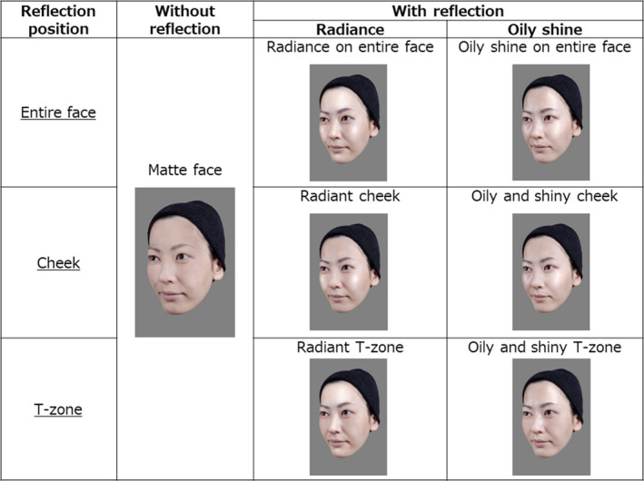
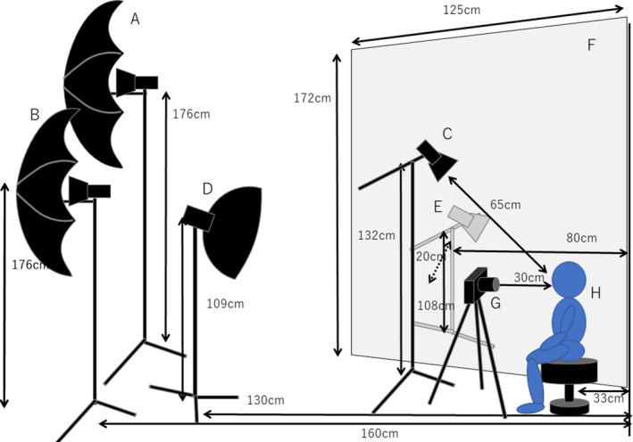
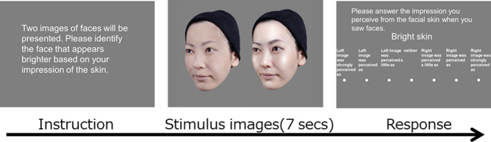
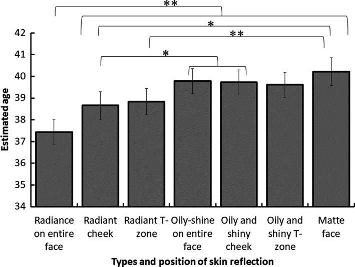
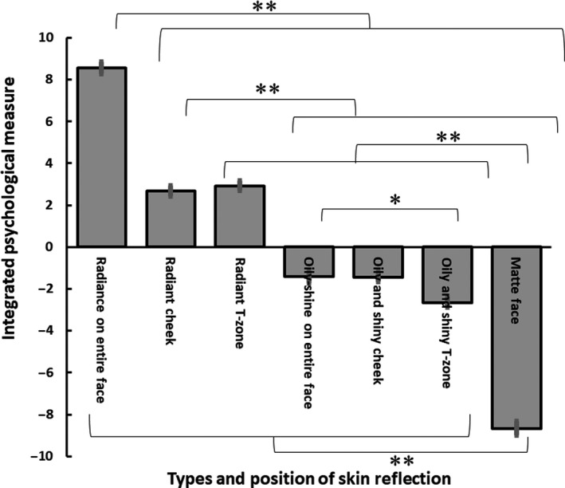
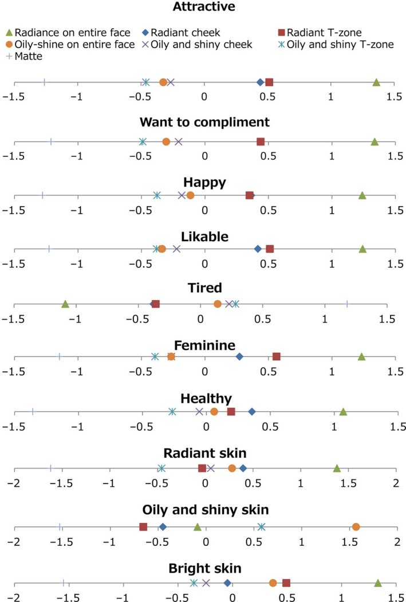

# 얼굴의 광채는 얼굴 매력과 얼굴의 정서적 인상에 영향을 준다

> **원문** Ikeda H, Saheki Y, Sakano Y, Wada A, Ando H, Tagai K (2021). *Facial radiance influences facial attractiveness and affective impressions of faces.* International Journal of Cosmetic Science 43(2): 144–157. https://doi.org/10.1111/ics.12673 (PMC8246902)
>
> **라이선스** 원문 © 2020 Shiseido Global Innovation Center. *International Journal of Cosmetic Science*는 Society of Cosmetic Scientists와 Société Française de Cosmétologie를 대신해 John Wiley & Sons Ltd가 발행합니다. [Creative Commons Attribution License (CC BY 4.0)](https://creativecommons.org/licenses/by/4.0/)에 따른 오픈 액세스 논문으로, 원저작물을 적절히 인용하는 조건으로 모든 매체에서 이용·배포·복제를 허용합니다.
>
> **변경 사항** 영어 원문을 한국어로 번역했습니다. 출판사 PDF를 받을 수 없어 PMC 공개 XML을 원문으로 삼았고, 그림은 PMC 기록에 연결된 이미지를 캡션 앞에 넣었습니다. 표 1은 원문의 구조를 따르되 모든 칸이 비어 있는 "광채·전체와의 차" 열을 뺐습니다. 참고문헌 목록과 그래픽 초록은 생략했습니다(본문의 [숫자]는 원문 참고문헌 번호). 원저자가 검토한 번역이 아닙니다.

**용어 대응** — 광채(radiance): 피부의 윤기 중 긍정적인 종류 · 번들거림(oily and shiny / oily shine): 유분에 의한 기름진 윤기 · 무광(matte) · 확산 반사(diffuse reflection) · 정반사(specular reflection) · T존(T‐zone): 이마와 콧대 · 쌍비교법(paired comparison) · 기준 간격(yardstick): Scheffé 쌍비교법에서 두 조건의 차가 유의한지 판단하는 기준값

---

## 초록

### 목적

얼굴 매력은 얼굴 형태, 피부의 색과 결 같은 시각적 특징의 영향을 받는다고 보고되어 왔다. 그러나 얼굴 피부의 광채가 얼굴 매력에 미치는 효과를 조사한 실증 연구는 없다. 본 연구는 피부 반사의 종류(즉 광채, 번들거림, 무광)와 얼굴에서 반사가 나타나는 위치가 얼굴 매력과 그 밖의 정서적 인상에 영향을 주는지 조사했다.

### 방법

여성 참가자 총 160명이 (1) 모르는 여성 얼굴의 나이를 추정하고, (2) 총 일곱 가지 피부 반사 조건의 얼굴에 대해 매력과 그 밖의 인상을 평가했다. 이 조건들은 세 가지 반사 종류(즉 광채, 번들거림, 무광)와 얼굴에서의 세 가지 반사 위치(즉 얼굴 피부 전체, 볼만, T존만)를 조합한 것이다.

### 결과

얼굴 전체에 광채가 있는 얼굴 이미지는 얼굴 전체가 번들거리는 얼굴 이미지와 무광 얼굴보다 더 어려 보인다고 평가되었다. 매력 평가와 그 밖의 긍정적 인상은 무광(가장 낮음), 얼굴 전체 번들거림, 얼굴 전체 광채(가장 높음) 조건의 순서로 높아졌다. 반사 위치도 얼굴 매력에 영향을 주었다. 매력 평가와 그 밖의 긍정적 인상은 얼굴 전체 광채 조건에서 볼 광채 조건과 T존 광채 조건보다 높았다. 흥미롭게도 볼에 광채가 있는 얼굴은 T존에 광채가 있는 얼굴보다 더 광채 있고 건강해 보인다고 평가되었지만, 덜 여성스럽고 덜 밝다고 평가되었다.

### 결론

이 결과는 얼굴의 광채가 얼굴 매력을 높이고 관찰자에게 매우 다양한 긍정적 인상을 전달한다는 것을 시사한다. 볼 광채와 T존 광채의 효과 크기는 정서적 인상에 따라 다르다. 그럼에도 결과는 볼과 T존의 광채가 모두 얼굴 전체 광채의 더 높은 매력과 그 밖의 긍정적 인상에 기여한다는 것을 보여 준다. 우리는 이 결과가 피부 광채를 통해 얼굴의 긍정적 인상을 높이는 지침으로 기여하고, 나아가 스킨케어와 베이스 메이크업의 가치를 더 잘 이해하는 데 이어질 수 있다고 믿는다.

**키워드**: 효능 입증(claim substantiation), 색조 화장품, 얼굴, 광택, 피부 생리, 구조

## 서론

다른 사람의 얼굴을 볼 때 어떤 시각적 특징이 얼굴 매력과 그 밖의 인상에 영향을 줄까? 얼굴의 형태, 색, 결이 얼굴 매력에 영향을 준다는 것은 잘 알려져 있다[1, 2, 3, 4]. Baudouin과 Tiberghien[5]은 여성 얼굴이 대칭적이고, 형태가 평균에 가까우며, 몇몇 다른 특징(예: 큰 눈, 두꺼운 입술, 가는 눈썹)을 가질 때 매력적으로 여겨진다고 주장했다. 다른 많은 연구도 평균 얼굴이 매력적으로 여겨진다고 보고했다[6]. 얼굴의 색 분포[2]와 피부 결의 균일성[7]도 얼굴 매력에 영향을 준다고 보고되었다. 매력 이외의 인상에 영향을 주는 시각적 특징에 관해서는, 얼굴의 붉은 기가 얼굴을 건강해 보이게 한다고 보고되었고[8, 9], 얼굴의 잡티는 건강이 좋지 않고 능력이 낮다는 인상을 주는 것으로 보인다[7].

위에서 말한 시각적 특징(즉 형태, 색, 결)에 더해, 얼굴 피부의 반사도 매력을 포함한 정서적 인상에 영향을 줄 수 있다. 예를 들어 소비자 화장품 잡지에 따르면, 소비자들은 특정한 종류의 반사인 얼굴 광채를 높이기 위해 스킨케어와 베이스 메이크업 제품을 쓰는 경향이 있는 것으로 보이기 때문이다[10, 11]. 광채 있는 피부에 대한 이런 선호는 얼굴 피부 반사와, 매력을 포함한 얼굴의 정서적 인상 사이에 실질적인 연관이 있음을 나타낼 수 있다.

그러나 얼굴 피부 광채에 관한 이전 연구 대부분은 피부 광채가 얼굴 매력에 주는 효과를 조사하기보다 물리량을 바탕으로 광채를 정량화하는 데에만 집중했다. 이는 피부 광채가 광학적 피부 반사의 한 종류(또는 이 반사의 심리적으로 결정된 범주)임에도 심리적으로 정의되는 양이기 때문이다. 예를 들어 Baret과 동료들[12]은 기기 데이터를 바탕으로 전체적인 광채 현상을 정량화하는 수학적 모델을 제안했다. 그러나 이 모델은 피부 광채의 전체적 지각을 완전히 설명하지는 못했다. Musnier와 동료들은 훈련된 평가자가 피부 착색, 광도, 밝기, 투명도를 평가한 것을 바탕으로 안색의 광채를 평가하는 방법론을 개발했다[13]. 그들은 이 방법론을 화장품에 적용해 그 제품이 안색의 광채를 개선하는지도 보았다. 안색의 광채를 객관적으로 평가하기 위해 Petitjean과 동료들은 광채 관련 지표 세 가지를 측정하는 광학 장치를 개발하고 평가했다[14]. 그들은 측정한 지표 중 하나가 반복 가능하지 않다는 것을 발견하고, 항상 같은 훈련된 조사자가 측정할 것을 권했다. Fujii와 동료들은 얼굴 이미지의 정반사 성분에서 높은 공간 주파수 대역과 낮은 공간 주파수 대역이 각각 결(예: 모공과 주름)과 얼굴 특징(예: 코와 광대뼈)을 나타낸다고 보고했다. 그들은 또한 이 고주파 대역에서 휘도 대비가 높은 얼굴과 낮은 얼굴이 각각 번들거리는 얼굴과 광채 있는 얼굴로 분류될 수 있다고 보고했다[15]. Matsubara 등[16]은 얼굴 피부의 광채에는 얼굴 전체에 걸친 휘도의 평균과 표준편차 사이의 균형이 필요하며, 이 둘은 각각 피부의 표면 아래 반사와 표면 반사에서 생긴다고 보고했다. 비슷하게 Masuda 등[17]은 광채 있다고 여겨지는 얼굴 피부가 얼굴에서 정반사된 빛과 확산 반사된 빛을 모두 보이며, 이 반사광들을 측정하는 것이 피부 광채 측정에 결정적이라고 보고했다. Haeri 등[18]은 얼굴 피부 광채를 특징짓는 프랙털 분석이라는 새로운 접근을 제안하고, 색의 균일성이 광채의 중요한 단서일 때 이 새로운 분석이 고전적인 윤기에 기반한 분석보다 유리하다고 보고했다.

요컨대 얼굴 광채에 관한 이전 연구 대부분은 피부 광채가 얼굴 매력과 그 밖의 정서적 인상에 주는 효과를 조사하기보다 물리량을 바탕으로 광채를 정량화하려 했다. 본 연구의 주된 목적은 물리량에 기반한 피부 광채의 정의를 탐구하는 것이 아니라, 얼굴 피부 광채가 얼굴 매력에 주는 효과를 밝히는 것이었다.

얼굴 광채는 좋은 인상을 만들 수 있지만[10], 이른바 '번들거리는 광택'이라는 다른 종류의 반사는 나쁜 인상을 만들 수 있다[19, 20, 21]. Torizuka와 동료들[20]은 여성이 화장이 무너질 때 번들거리는 피부를 의식한다는 것을 보였다. Fujii와 동료들은 얼굴 이미지의 고주파 대역에서 휘도 대비를 높이고 낮추면 얼굴의 부정적 인상이 각각 커지고 줄어든다고 보고했다. 이 고주파 대역에서 휘도 대비가 높은 얼굴이 번들거리는 얼굴로 분류되었다는, 위에서 언급한 그들의 다른 실험 결과와 합치면, 그들의 결과는 번들거리는 상태가 얼굴의 부정적 인상을 높인다는 것을 나타낼 수 있다[15]. Arce‐Lopera와 동료들(2012)은 얼굴 피부를 확대해 잘라 낸 사진에서 정반사 성분을 없애면 더 어린 인상이 생긴다고 보고했는데, 아마 주름이 사실상 보이지 않게 되었기 때문일 것이다. 이런 종류의 정반사 이미지 성분이 번들거리는 광택을 이룰 수 있다[19]. 그러나 얼굴 피부 일부를 잘라 낸 사진을 쓰면, 얼굴에서 피부 반사가 나타나는 위치의 잠재적 효과를 놓칠 수 있다. 광대뼈의 돌출과 높이는 매력과 정적 상관이 있다고 보고되었다[5]. 그런 뚜렷한 얼굴 특징은 얼굴에서 반사가 나타나는 위치를 바꿀 수 있다. 따라서 우리는 피부 반사의 위치가 얼굴 매력과 그 밖의 정서적 인상에 주는 효과도 조사했다.

화장품 소비자들 사이에서 인식이 커지고 있는 또 다른 종류의 피부 반사는 무광이라는 속성이다. 무광 피부는 정반사가 없기 때문에 광채나 번들거림의 인상을 거의 주지 않는다[16].

본 연구의 목적은 얼굴 피부 반사의 종류(즉 광채, 번들거림, 무광)와 얼굴에서 반사가 나타나는 위치가 얼굴 매력과 그 밖의 정서적 인상에 영향을 주는지 밝히는 것이었다. 이를 위해 우리는 각각 여성 참가자 160명으로 두 가지 심리 실험을 수행했다. 먼저 피부 반사의 종류와 위치가 추정 나이에 주는 효과를 조사했다. 다음으로 그 효과들이 얼굴 매력과, 칭찬하고 싶은 마음, 행복해 보임, 호감, 피곤해 보임, 여성스러워 보임, 건강해 보임, 피부 광채, 번들거림, 피부 밝기를 포함한 아홉 가지 다른 정서적 인상에 주는 효과를 종합적으로 조사했다.

## 방법

### 참가자

30세에서 49세 사이의 성인 여성 총 160명(M = 39.65, SD = 5.86)을 모집했다. 모든 참가자는 스킨케어 제품에 매달 1,000엔 넘게 쓰고 있었고 일주일에 5일 넘게 사용했다. 모두 일본에 살았고 일본어가 모국어였다. 모두 건강했고, 신경 질환 병력이 없었으며, 시력이 정상이거나 교정 시력이 정상이었다. 모두 각 실험 전에 서면 동의서를 냈다. 실험 절차는 시세이도 글로벌 이노베이션 센터 윤리위원회의 승인을 받았다.

### 장치

모든 시각 이미지와 설문은 24.1인치(1920 × 1200 픽셀) 액정 디스플레이로 각 참가자에게 제시했다. 얼굴 이미지는 회색(RGB (128, 128, 128)) 배경 위에 719 × 1078 픽셀 해상도로 제시했다. 참가자 10명의 실험을 동시에 진행하기 위해 디스플레이 10대와 컴퓨터 10대를 썼다. 모든 디스플레이가 같은 색 조건이 되도록 X‐rite i1 Pro(X‐Rite Inc.)로 디스플레이의 색을 보정했다. 최대 휘도와 감마를 각각 160 cd/m²와 2.2로 맞췄다. 사진 이미지의 제시 순서는 컴퓨터 프로그램으로 제어했다.

### 얼굴 자극

이 실험에 쓴 이미지에는 30세에서 44세 사이의 성인 여성 모델 10명(M = 35.90, SD = 4.44)이 등장한다. 모두 일본에 살았고, 모두 각 촬영 전에 서면 동의서를 냈다. 절차는 시세이도 글로벌 이노베이션 센터 윤리위원회의 승인을 받았다. 그림 1은 얼굴 광택의 세 조건(광채, 번들거림, 무광)과 광택의 세 위치(T 부위, 볼 부위, 전체 부위)를 보여 준다. '무광 얼굴'은 광택이 없는 얼굴이다. T 부위는 이마와 콧대를 가리킨다. 우리 실험에서는 이 일곱 가지 얼굴을 얼굴 자극으로 썼다. 광택 종류가 다른 얼굴들 사이에 표정과 그 밖의 특징이 미묘하게 달라지는 것을 피하기 위해, 여성 모델마다 기본 얼굴을 만들었다. 그림 1의 일곱 가지 얼굴은 기본 얼굴을 리터칭해 만들었다.

> **그림 1.** 실험에 쓴 자극의 예. 피험자는 자기 얼굴 이미지를 게재하는 데 동의했다.

사진 자극을 준비하는 과정은 두 단계로 이루어졌다. 첫 단계인 촬영 단계에서는 여성 모델의 얼굴에 서로 다른 화장품을 바르고 서로 다른 조명 조건에서 여러 포즈로 촬영했다. 스킨케어를 제외한 모든 화장은 전문 메이크업 아티스트가 했다. 두 번째 단계인 리터칭 단계에서는 사진을 컴퓨터 그래픽 기법으로 리터칭했다. 여성 모델 10명 모두의 이미지에 같은 과정을 적용했다. 촬영 단계에서는 조명을 바꾸고 서로 다른 화장품을 발라, 기본 얼굴 이미지의 재료와 여러 종류의 피부 반사 재료를 모았다. 리터칭 단계에서는 먼저 기본 얼굴 이미지를 만들었는데, 이 이미지는 실험에 쓰지 않고 실험에서 제시할 사진을 준비하는 데 썼다. 실험에 쓴 모든 얼굴은 기본 얼굴 이미지에 반사를 더하거나 빼서 만들었다.

#### 촬영 단계

사진에서 피부에 광택이 나타나도록 모든 여성 모델은 몸을 정면에서 45도 수평 오른쪽 방향으로 돌렸다. 따라서 카메라에는 얼굴의 왼쪽이 찍혔다. 모든 참가자에게 같은 얼굴 각도를 유지하기 위해 턱받침을 썼다. (역자 주: 원문 표현 그대로 "all participants"이나, 문맥상 촬영된 모델을 뜻하는 것으로 보인다.) 모든 여성 모델은 앉은 상태로, 50 mm 렌즈(Tamron Co., Ltd)를 단 디지털 일안 반사식 카메라 Canon 5D(Canon Inc.)로 촬영했다.

얼굴에 서로 다른 종류의 광택을 표현하기 위해 여러 조명 조건과 화장품을 준비하고 조건을 조합했다. 얼굴에 바를 화장품과 조명 조건을 고르는 참고로 이전 연구[15, 17, 22]의 결과를 여기서 확인했다. 이전 연구에서 관찰자들은 얼굴 피부에 생기는 정반사광과 확산 반사광의 세기 조합에 따라 광채나 번들거림 같은 서로 다른 인상을 보고했다. Masuda 등의 연구는 정반사광이 많으면 번들거리는 피부라는 인상이 두드러지고, 확산 반사광이 많으면 투명한 피부라는 인상이 생긴다는 것을 보였다[17]. 또한 두 종류의 반사가 모두 높은 피부는 광채 있어 보이고, 둘 다 낮으면 칙칙해 보였다[17].

확산 반사광은 광원이 불분명한 다중 반사다. 확산 반사의 정도가 높은 피부는 수분이 많고 결이 고운 특징을 보였다[23]. 정반사와 달리, 확산 반사는 울퉁불퉁한 피부에 대한 표면 정보를 적게 담지 않았다[24]. (역자 주: 원문 문장 "it did not have a small amount of surface information on irregular skin"을 직역했다. 의미가 분명하지 않다.) 정반사광은 강한 반사광이 되었다. 결의 거칠기는 정반사광이 높고 확산 반사광이 낮은 피부의 특징으로 보고되었다[17]. 또한 정반사광 이미지는 작은 표면 형상과 피부 표면에 분포된 피지에 의해 피부의 결을 보여 주었다[15].

피부에서 빛의 확산 반사 특성을 인위적으로 표현하려면, 피부의 거칠기를 두드러지게 전달하지 않는 반사광을 만들어야 했다. 이를 위해 촬영에는 확산 조명을 쓰고, 얼굴 피부를 매끄럽게 할 수 있는 화장품을 발랐다. 광채 있는 얼굴 이미지를 만들기 위해서는 확산 반사광에 더해 정반사광을 표현하도록 방향성 반사광의 조명 세기를 조절했다. 반대로 강한 정반사 특성을 만들기 위해서는 확산되지 않은 빛을 썼다. 얼굴 피부의 인상과 피부 생물학의 관계에 관한 이전 연구[25, 26]와 화장 무너짐에 관한 연구[20]는 얼굴 번들거림(기름지고 번들거리는 광택)의 인상과 얼굴 피지의 양 사이에 정적 상관이 있음을 시사한다. 따라서 번들거리는 얼굴의 정반사 특성을 만들기 위해 기제에 기름을 많이 함유한 화장품을 얼굴 피부에 발랐다. 촬영은 아래의 조명 조건과 얼굴에 바른 화장품 패턴을 조합해 진행했다.

모든 여성 모델은 무표정한 얼굴과 웃는 얼굴로 촬영했다. 여성 모델이 웃을 때는 볼의 볼록함이 커져서 특히 강한 정반사가 있었다.

##### 촬영 중 조명 조건

모든 여성 모델을 비확산 조명 조건(강하고 확산되지 않은 조명)과 확산 조명(빛을 퍼뜨리는 조명)에서 촬영했다. 비확산 조명 조건에서는 스트로보 조명(COMET 스트로보 조명과 스트로보 헤드)에 더해, 우산 모양 반사판을 단 스트로보 조명 두 개를 썼다. 세 조명 모두 200 W 출력으로 썼다. 확산 조명 조건에서는 디퓨저 천 뒤쪽에서 비추는 측면광 하나와 디퓨저를 단 스트로보 조명 하나를 112 W 출력으로 썼다. 그림 2는 조명, 카메라, 모델의 배치를 보여 준다.

> **그림 2.** 이 그림은 촬영 배치를 보여 준다. A와 B는 우산 모양 반사판을 단 스트로보 조명이다. C는 스트로보 조명이다. A, B, C는 비확산 조명 조건에서 썼다. D는 디퓨저를 단 스트로보 조명이다. E는 스트로보 조명으로, 천 디퓨저 뒤에 두었다. F는 천 디퓨저다. D와 E는 확산 조명 조건에서 썼다. G는 카메라, H는 모델이다.

##### 여성 모델의 얼굴에 바른 화장품

모든 여성 모델은 촬영 전에 세안한 뒤, 건조를 막기 위해 로션(ELIXIR SUPERIEUR LIFTING MOISTURE LOTION W II) 2 mL와 에멀전(ELIXIR SUPERIEUR LIFTING MOISTURE EMULSION W II) 1.4 mL를 얼굴에 발랐다. 그런 다음 피부의 붉은 기가 줄어들 때까지 약 10분 쉬었다. 스킨케어를 제외한 모든 화장은 전문 메이크업 아티스트가 했다. 이어서 눈썹이 없는 얼굴이 얼굴 인상에 주는 영향을 피하기 위해 아티스트가 여성 모델에게 눈썹을 그렸다. 실제로 몇몇 모델은 원래 눈썹 모양의 일부를 없애 눈썹 모양을 바꿨다. 그 뒤 세 가지 화장품 패턴으로 촬영했다. 피부에 고형 파운데이션(cle de peau BEAUTE RADIANT STICK FOUNDATION)만 바른 패턴, 피부 건조를 막기 위해 파운데이션 위에 화장용 오일(Carita14) 0.2 mL를 바른 패턴, 그리고 파운데이션 위에 화장용 오일(Carita14) 약 0.2 mL에 더해 흰 입자가 없는 보습 젤(ELIXIR SUPERIEUR SLEEPING GEL PACK W)을 볼에만 바른 패턴이다.

시험 촬영에서 피부에 바른 파운데이션은 매끄럽게 펴졌고, 피부의 매끄러운 결이라는 인상이 관찰되었다. 파운데이션만 바른 얼굴의 사진 이미지는 광채 있는 얼굴과 기본 얼굴을 만드는 확산 반사광의 재료로 썼다. 시험 촬영에서 화장용 오일과 젤을 바른 얼굴은 번들거리는 피부와 피부 표면의 요철을 보여 주는 반사 이미지를 낸다는 것이 확인되었다. 그래서 화장용 오일과 젤은 번들거리는 얼굴의 정반사광을 표현하는 데 썼다.

#### 이미지 리터칭 단계

얼굴의 디지털 이미지는 컴퓨터 그래픽(CG) 소프트웨어(Adobe Photoshop CC2017)로 리터칭했다. 리터칭에 쓴 디스플레이 Color Edge CG243W(Eizo Corporation)의 감마 값은 2.2였다. 우리는 여성 모델마다 기본 얼굴을 만들고, 같은 여성 모델의 사진에서 다양한 하이라이트 재료를 기본 얼굴로 옮겨 붙여 세 조건의 광택 이미지를 만들었다. 하이라이트 재료는 이마, 콧대, 볼, 턱을 포함한 얼굴의 볼록한 부분에 옮겨 붙였다. 옮겨 붙인 하이라이트의 범위는 여성 모델 각자의 얼굴 형태에 자연스럽게 맞도록 정했다. 이미지 리터칭 담당자 한 명에 더해, 저자 세 명과 시세이도 주식회사 직원 두 명, 모두 다섯 명이 하이라이트의 범위, 모양, 강도가 적절한지 확인했다.

##### 기본 얼굴을 만드는 방법

기본 얼굴은 확산 조명 조건에서 파운데이션만 바른 무표정 얼굴 이미지의 볼록한 부분에서 강한 하이라이트를 제거해 만들었다. 하이라이트가 없는 부분의 피부 이미지를 하이라이트가 있는 부분에 옮겨 붙였다. 다만 자연스러운 하이라이트는 그대로 두었다. 피부의 뾰루지, 잡티, 긁힌 자국도 제거했다.

##### 광채 있는 얼굴을 만드는 방법

광채 있는 얼굴의 이미지는 한 이미지 속 여성 모델 얼굴의 윤기 있는 피부 부분을 복사해, CG 소프트웨어로 리터칭하여 같은 모델 얼굴의 기본 얼굴에 적용해 만들었다. 광채 있는 얼굴을 만드는 재료로 쓴 이미지 속 윤기 있는 피부 부분은 서로 다른 종류의 반사광을 조합해 만들었다. 하나는 확산 반사광의 특성을, 다른 하나는 얼굴 피부에서의 강한 정반사광의 특성을 가졌다. 확산 반사광 특성을 가진 광택은 확산 조명 아래 얼굴 피부에 바른 파운데이션에서 잘라 내어 기본 얼굴에 옮겨 붙였다. 더 나아가, 강한 비확산 조명 아래 파운데이션을 바른 피부에서 생긴 정반사(구체적으로는 웃는 얼굴 이미지에서)를 잘라 내어 기본 얼굴에 옮겨 붙였다.

##### 번들거리는 얼굴을 만드는 방법

번들거리는 얼굴의 이미지는 여성 모델 얼굴의 번들거리는 광택 피부 부분을 그 모델의 기본 얼굴에 적용해 만들었다. 번들거리는 얼굴을 만드는 재료인 광택 피부 부분은 정반사 특성을 보이고, 기름기가 많으며, 요철이 두드러진 피부에서 만들었다. 번들거리는 광택 재료 이미지는 비확산 조명 아래 촬영한, 파운데이션과 오일 또는 파운데이션·오일·젤을 바른 웃는 얼굴 이미지에서 잘라 냈고, 이 재료들을 기본 얼굴에 옮겨 붙였다.

##### 무광 얼굴을 만드는 방법

기본 얼굴에서 윤기를 포함한 모든 하이라이트를 제거했다.

### 과제와 절차

각 참가자는 과제 1에서 사진을 보고 여성 모델의 나이를 추정했고, 과제 2에서 사진이 불러일으키는 여러 인상을 평가했다. 과제 2에서는 Scheffé 쌍비교법(나카야 변법)[27, 28]을 썼다.

모든 참가자가 두 과제를 모두 수행했고 각 질문에 컴퓨터로 답했다. 각 참가자는 컴퓨터 디스플레이에서 1미터 떨어져 앉았다. 참가자 160명을 16명씩 10개 집단으로 나눴다. 참가자들은 여성 모델 10명 중 한 명의 일곱 가지 얼굴(그림 1)을 모두 보았다. 따라서 각 참가자는 실험 내내 모델 한 명의 얼굴 사진만 보았다. 나이 분포는 모든 집단에서 대략 같았다. 참가자들에게는 피부가 불러일으키는 얼굴 이미지의 직관적 인상으로 답하라고 안내했다.

#### 과제 1 — 나이 추정

일곱 가지 이미지 조건의 얼굴 이미지 하나를 컴퓨터 디스플레이에 5초 동안 제시했다. 이미지가 사라진 뒤 참가자들에게 이미지 속 인물의 나이를 0세에서 80세 사이로 추정하게 했다. 답하는 시간에는 제한이 없었다. 각 참가자가 같은 얼굴 모델의 일곱 조건 이미지를 모두 보았으므로, 참가자들은 이 과제에서 일곱 번의 시행을 수행했다. 이 이미지들은 참가자마다 무작위 순서로 제시했다.

#### 과제 2 — 인상 평가

이 과제에서 참가자들은 얼굴 이미지를 볼 때 다음 열 가지 인상의 정도를 평가했다: '매력적이다', '칭찬하고 싶다', '행복해 보인다', '호감이 간다', '피곤해 보인다', '여성스럽다', '건강해 보인다', '광채 피부', '번들거리는 피부', '밝은 피부'. 우리는 '매력적이다', '칭찬하고 싶다', '행복해 보인다', '호감이 간다', '피곤해 보인다', '여성스럽다', '건강해 보인다'를 추상어로, '광채 피부', '번들거리는 피부', '밝은 피부'를 감각 기술어로 분류했다. 각 시행에서 한 여성 모델의 일곱 이미지 조건 중 두 얼굴을 컴퓨터 디스플레이에 7초 동안 동시에 제시했다. 얼굴이 사라지면 참가자들에게 지정된 종류의 인상이 어느 얼굴에서 더 강하게 느껴졌는지 판단하고, 이를 7단계 척도로 점수 매기게 했다('왼쪽 이미지가 강하게 그렇게 느껴졌다' – '왼쪽 이미지가 그렇게 느껴졌다' – '왼쪽 이미지가 조금 그렇게 느껴졌다' – '어느 쪽도 아니다' – '오른쪽 이미지가 조금 그렇게 느껴졌다' – '오른쪽 이미지가 그렇게 느껴졌다' – '오른쪽 이미지가 강하게 그렇게 느껴졌다')(그림 3). 과제 절차는 Scheffé 쌍비교법(나카야 변법)[27, 28]을 따랐다. 같은 얼굴 인물의 일곱 이미지 사이에서 가능한 모든 짝 조합을 나타내는 21쌍을 만들었다. 참가자들은 같은 사진 모델로 만든 각 이미지 조합에 대해 열 가지 질문에 답했다. 따라서 모두 210회 시행을 수행했다. 각 참가자에 대해, 21쌍 모두에 답을 마치면 질문을 한 번 바꾸었다. 질문 순서는 참가자마다 무작위로 했고, 각 질문에서 짝지은 이미지의 제시 순서도 무작위로 했다.

> **그림 3.** 과제 2 절차의 예. 지시문은 일본어였다. 참가자들은 두 얼굴 이미지를 본 뒤 화면 가운데의 단어가 나타내는 인상의 정도를 평가해야 했다.

## 결과

### 과제 1

그림 4는 각 이미지 조건에서 여성 모델의 추정 나이를 모든 참가자에 걸쳐 평균한 것이다. 일원 반복측정 분산분석에서 이미지 조건의 주효과가 유의했다(F(6,954) = 18.59, P < 0.001). Bonferroni 사후 검정 결과, 얼굴 전체에 광채가 있는 얼굴이 모든 이미지 조건 중 가장 어리게 추정되었다(ps < 0.005). 볼에 광채가 있는 얼굴은 얼굴 전체가 번들거리는 얼굴, 볼이 번들거리는 얼굴, 무광 얼굴보다 유의하게 어리게 평가되었다(ps < 0.03). 그러나 볼에 광채가 있는 얼굴과, T존에 광채가 있는 얼굴 및 T존이 번들거리는 얼굴 사이에는 평가의 유의한 차이가 없었다(ps > 0.13). T존에 광채가 있는 얼굴은 무광 얼굴보다 유의하게 어리게 평가되었지만(p < 0.001), 얼굴 전체가 번들거리는 얼굴, 볼이 번들거리는 얼굴, T존이 번들거리는 얼굴의 평가와는 유의한 차이를 보이지 않았다(ps > 0.08). 얼굴 전체가 번들거리는 얼굴, 볼이 번들거리는 얼굴, T존이 번들거리는 얼굴, 무광 얼굴의 평가 사이에는 유의한 차이가 없었다(ps = 1).

> **그림 4.** 각 얼굴 이미지에서 모델의 추정 나이. 오차 막대는 참가자 간 ±1 SEM을 나타낸다. 주: \* P < 0.05, \*\* P < 0.01

### 과제 2

일곱 조건의 얼굴 자극에 대한 긍정적(또는 부정적) 인상의 정도를 개관하기 위해, 우리는 추상어 일곱 개('매력적이다', '칭찬하고 싶다', '행복해 보인다', '호감이 간다', '피곤해 보인다', '여성스럽다', '건강해 보인다')의 선호 값을 합산한 통합 긍정‐부정 척도를 고안했다. '피곤해 보인다'는 부정적 인상을 나타내므로 그 값의 부호를 뒤집었다. 그림 5는 그 값을 모든 참가자에 걸쳐 평균한 결과다. 일원 반복측정 분산분석에서 이미지 조건의 주효과가 유의했다(F(6,954) = 326.6, P < 0.001). Bonferroni 사후 검정 결과, 볼에 광채가 있는 얼굴과 T존에 광채가 있는 얼굴 사이(P = 1), 볼이 번들거리는 얼굴과 T존이 번들거리는 얼굴 사이, 볼이 번들거리는 얼굴과 얼굴 전체가 번들거리는 얼굴 사이(ps > 0.05)에는 유의한 차이가 없었다. 이 밖의 모든 쌍은 유의한 차이를 보였다(ps < 0.05). 이 결과는 얼굴 전체에 광채가 있는 얼굴이 모든 이미지 조건 중 가장 긍정적인 인상을 만든다는 것을 시사한다. 볼 광채와 T존 광채는 번들거리는 모든 얼굴과 무광 얼굴보다 더 긍정적으로 평가되었다. T존 번들거림은 얼굴 전체 번들거림보다 더 부정적으로 평가되었다. 무광 얼굴이 가장 부정적인 인상을 만들었다. 각 설문의 더 자세한 결과는 아래에 제시한다.

> **그림 5.** 과제 2의 결과. 각 얼굴 이미지에 대한 추상어 일곱 개('매력적이다', '칭찬하고 싶다', '행복해 보인다', '호감이 간다', '피곤해 보인다', '여성스럽다', '건강해 보인다')의 선호 값 합을 보여 준다. 오차 막대는 참가자 간 ±1 SEM을 나타낸다. 주: \* P < 0.05, \*\* P < 0.01

그림 6은 과제 2의 자세한 결과를 보여 준다. 각 가로 막대 위의 각 점은 각 질문에 대한 각 이미지 조건의 결과를 나타낸다. 값이 클수록 얼굴 이미지가 전달하는 인상이 강하다는 뜻이다. 인상에 관한 모든 질문에서 일원 반복측정 분산분석은 이미지 조건의 유의한 효과를 보였다(P < 0.001). 이는 이미지 조건들 사이에 유의한 차이가 있음을 시사한다. 기준 간격(yardstick) 값을 계산했고, 특정 조건들 사이에서 유의한 차이가 발견되었다. 표 1은 이미지 조건 사이의 차이를 보여 준다.

> **그림 6.** 과제 2의 자세한 결과. 각 수직선은 각 인상에 대한 모든 이미지 조건의 심리 척도 값을 보여 준다.

**표 1.** 과제 2의 쌍비교 점수 차이. 5% 기준 간격(\*)과 1% 기준 간격(\*\*)에서 유의한 결과가 있었다. (a)–(j)는 모든 설문 각각의 결과를 나타낸다.

(역자 주: 각 칸은 "행의 조건 점수 − 열의 조건 점수"다. 조건 이름 줄임: 광채·전체 = 얼굴 전체 광채, 번들 = 번들거림. 원문의 "광채·전체와의 차" 열은 모든 칸이 비어 있어 뺐다. 원문에 소수점 넷째 자리까지 적힌 값(0.1276, 0.1331, 0.1151)은 그대로 옮겼다.)

**(a) 매력적이다** (원문 'Attractive')

| 이미지 조건 | 점수 | 광채·볼과의 차 | 광채·T존과의 차 | 번들·전체와의 차 | 번들·볼과의 차 | 번들·T존과의 차 | 무광과의 차 |
|---|---|---|---|---|---|---|---|
| 광채·전체 | 1.36 | 0.92\*\* | 0.85\*\* | 1.68\*\* | 1.63\*\* | 1.82\*\* | 2.62\*\* |
| 광채·볼 | 0.44 |  | −0.07 | 0.77\*\* | 0.71\*\* | 0.90\*\* | 1.71\*\* |
| 광채·T존 | 0.51 |  |  | 0.84\*\* | 0.78\*\* | 0.98\*\* | 1.78\*\* |
| 번들·전체 | −0.32 |  |  |  | −0.06 | 0.14\*\* | 0.94\*\* |
| 번들·볼 | −0.27 |  |  |  |  | 0.20\*\* | 1.00\*\* |
| 번들·T존 | −0.46 |  |  |  |  |  | 0.80\*\* |
| 무광 | −1.26 |  |  |  |  |  |  |

**(b) 칭찬하고 싶다** (원문 'Want to compliment')

| 이미지 조건 | 점수 | 광채·볼과의 차 | 광채·T존과의 차 | 번들·전체와의 차 | 번들·볼과의 차 | 번들·T존과의 차 | 무광과의 차 |
|---|---|---|---|---|---|---|---|
| 광채·전체 | 1.34 | 0.90\*\* | 0.90\*\* | 1.64\*\* | 1.54\*\* | 1.83\*\* | 2.55\*\* |
| 광채·볼 | 0.44 |  | 0.00 | 0.75\*\* | 0.65\*\* | 0.93\*\* | 1.65\*\* |
| 광채·T존 | 0.44 |  |  | 0.74\*\* | 0.65\*\* | 0.93\*\* | 1.65\*\* |
| 번들·전체 | −0.31 |  |  |  | −0.10 | 0.18\*\* | 0.91\*\* |
| 번들·볼 | −0.21 |  |  |  |  | 0.28\*\* | 1.00\*\* |
| 번들·T존 | −0.49 |  |  |  |  |  | 0.72\*\* |
| 무광 | −1.21 |  |  |  |  |  |  |

**(c) 행복해 보인다** (원문 'Happy')

| 이미지 조건 | 점수 | 광채·볼과의 차 | 광채·T존과의 차 | 번들·전체와의 차 | 번들·볼과의 차 | 번들·T존과의 차 | 무광과의 차 |
|---|---|---|---|---|---|---|---|
| 광채·전체 | 1.24 | 0.88\*\* | 0.89\*\* | 1.35\*\* | 1.42\*\* | 1.62\*\* | 2.52\*\* |
| 광채·볼 | 0.36 |  | 0.01 | 0.48\*\* | 0.55\*\* | 0.74\*\* | 1.64\*\* |
| 광채·T존 | 0.35 |  |  | 0.47\*\* | 0.53\*\* | 0.73\*\* | 1.63\*\* |
| 번들·전체 | −0.11 |  |  |  | 0.07 | 0.26\*\* | 1.17\*\* |
| 번들·볼 | −0.18 |  |  |  |  | 0.19\*\* | 1.10\*\* |
| 번들·T존 | −0.38 |  |  |  |  |  | 0.90\*\* |
| 무광 | −1.28 |  |  |  |  |  |  |

**(d) 호감이 간다** (원문 'Likeable')

| 이미지 조건 | 점수 | 광채·볼과의 차 | 광채·T존과의 차 | 번들·전체와의 차 | 번들·볼과의 차 | 번들·T존과의 차 | 무광과의 차 |
|---|---|---|---|---|---|---|---|
| 광채·전체 | 1.24 | 0.83\*\* | 0.73\*\* | 1.58\*\* | 1.47\*\* | 1.62\*\* | 2.47\*\* |
| 광채·볼 | 0.42 |  | ‐0.09 | 0.75\*\* | 0.64\*\* | 0.80\*\* | 1.64\*\* |
| 광채·T존 | 0.51 |  |  | 0.85\*\* | 0.73\*\* | 0.89\*\* | 1.74\*\* |
| 번들·전체 | −0.34 |  |  |  | −0.11\* | 0.04 | 0.89\*\* |
| 번들·볼 | −0.22 |  |  |  |  | 0.16\*\* | 1.00\*\* |
| 번들·T존 | −0.38 |  |  |  |  |  | 0.85\*\* |
| 무광 | −1.23 |  |  |  |  |  |  |

**(e) 피곤해 보인다** (원문 'Tired')

| 이미지 조건 | 점수 | 광채·볼과의 차 | 광채·T존과의 차 | 번들·전체와의 차 | 번들·볼과의 차 | 번들·T존과의 차 | 무광과의 차 |
|---|---|---|---|---|---|---|---|
| 광채·전체 | −1.09 | −0.71\*\* | −0.73\*\* | −1.23\*\* | −1.32\*\* | −1.37\*\* | −2.27\*\* |
| 광채·볼 | −0.38 |  | −0.02 | −0.52\*\* | −0.61\*\* | −0.66\*\* | −1.56\*\* |
| 광채·T존 | −0.36 |  |  | −0.50\*\* | −0.59\*\* | −0.64\*\* | −1.54\*\* |
| 번들·전체 | 0.14 |  |  |  | −0.09 | −0.14\*\* | −1.04\*\* |
| 번들·볼 | 0.23 |  |  |  |  | −0.05 | −0.95\*\* |
| 번들·T존 | 0.28 |  |  |  |  |  | −0.90\*\* |
| 무광 | 1.18 |  |  |  |  |  |  |

**(f) 여성스럽다** (원문 'Feminine')

| 이미지 조건 | 점수 | 광채·볼과의 차 | 광채·T존과의 차 | 번들·전체와의 차 | 번들·볼과의 차 | 번들·T존과의 차 | 무광과의 차 |
|---|---|---|---|---|---|---|---|
| 광채·전체 | 1.23 | 0.96\*\* | 0.67\*\* | 1.50\*\* | 1.50\*\* | 1.63\*\* | 2.38\*\* |
| 광채·볼 | 0.27 |  | −0.29\*\* | 0.54\*\* | 0.54\*\* | 0.67\*\* | 1.42\*\* |
| 광채·T존 | 0.56 |  |  | 0.83\*\* | 0.83\*\* | 0.96\*\* | 1.71\*\* |
| 번들·전체 | −0.27 |  |  |  | 0.00 | 0.1276\* | 0.88\*\* |
| 번들·볼 | −0.26 |  |  |  |  | 0.13\*\* | 0.88\*\* |
| 번들·T존 | −0.39 |  |  |  |  |  | 0.75\*\* |
| 무광 | −1.15 |  |  |  |  |  |  |

**(g) 건강해 보인다** (원문 'Healthy')

| 이미지 조건 | 점수 | 광채·볼과의 차 | 광채·T존과의 차 | 번들·전체와의 차 | 번들·볼과의 차 | 번들·T존과의 차 | 무광과의 차 |
|---|---|---|---|---|---|---|---|
| 광채·전체 | 1.07 | 0.71\*\* | 0.88\*\* | 1.01\*\* | 1.13\*\* | 1.34\*\* | 2.43\*\* |
| 광채·볼 | 0.36 |  | 0.16\*\* | 0.30\*\* | 0.41\*\* | 0.62\*\* | 1.72\*\* |
| 광채·T존 | 0.19 |  |  | 0.1331\* | 0.25\*\* | 0.46\*\* | 1.55\*\* |
| 번들·전체 | 0.06 |  |  |  | 0.12 | 0.33\*\* | 1.42\*\* |
| 번들·볼 | −0.06 |  |  |  |  | 0.21\*\* | 1.30\*\* |
| 번들·T존 | −0.27 |  |  |  |  |  | 1.09\*\* |
| 무광 | −1.36 |  |  |  |  |  |  |

**(h) 광채 피부** (원문 'Radiant skin')

| 이미지 조건 | 점수 | 광채·볼과의 차 | 광채·T존과의 차 | 번들·전체와의 차 | 번들·볼과의 차 | 번들·T존과의 차 | 무광과의 차 |
|---|---|---|---|---|---|---|---|
| 광채·전체 | 1.38 | 0.98\*\* | 1.41\*\* | 1.10\*\* | 1.32\*\* | 1.84\*\* | 3.00\*\* |
| 광채·볼 | 0.40 |  | 0.43\*\* | 0.1151\* | 0.34\*\* | 0.85\*\* | 2.02\*\* |
| 광채·T존 | −0.03 |  |  | −0.31\*\* | −0.09 | 0.43\*\* | 1.59\*\* |
| 번들·전체 | 0.28 |  |  |  | 0.22\*\* | 0.74\*\* | 1.90\*\* |
| 번들·볼 | 0.06 |  |  |  |  | 0.52\*\* | 1.68\*\* |
| 번들·T존 | −0.46 |  |  |  |  |  | 1.16\*\* |
| 무광 | −1.62 |  |  |  |  |  |  |

**(i) 번들거리는 피부** (원문 'Oily and shiny skin')

| 이미지 조건 | 점수 | 광채·볼과의 차 | 광채·T존과의 차 | 번들·전체와의 차 | 번들·볼과의 차 | 번들·T존과의 차 | 무광과의 차 |
|---|---|---|---|---|---|---|---|
| 광채·전체 | −0.09 | 0.36\*\* | 0.57\*\* | −1.66\*\* | −0.67\*\* | −0.67\*\* | 1.44\*\* |
| 광채·볼 | −0.45 |  | 0.20\*\* | −2.02\*\* | −1.03\*\* | −1.03\*\* | 1.08\*\* |
| 광채·T존 | −0.66 |  |  | −2.22\*\* | −1.23\*\* | −1.24\*\* | 0.87\*\* |
| 번들·전체 | 1.57 |  |  |  | 0.99\*\* | 0.99\*\* | 3.10\*\* |
| 번들·볼 | 0.58 |  |  |  |  | 0.00 | 2.11\*\* |
| 번들·T존 | 0.58 |  |  |  |  |  | 2.11\*\* |
| 무광 | −1.53 |  |  |  |  |  |  |

**(j) 밝은 피부** (원문 'Bright skin')

| 이미지 조건 | 점수 | 광채·볼과의 차 | 광채·T존과의 차 | 번들·전체와의 차 | 번들·볼과의 차 | 번들·T존과의 차 | 무광과의 차 |
|---|---|---|---|---|---|---|---|
| 광채·전체 | 1.33 | 1.38\*\* | 0.84\*\* | 0.96\*\* | 1.58\*\* | 1.69\*\* | 2.88\*\* |
| 광채·볼 | −0.05 |  | −0.54\*\* | −0.42\*\* | 0.20\*\* | 0.31\*\* | 1.50\*\* |
| 광채·T존 | 0.49 |  |  | 0.12 | 0.74\*\* | 0.85\*\* | 2.04\*\* |
| 번들·전체 | 0.37 |  |  |  | 0.61\*\* | 0.73\*\* | 1.92\*\* |
| 번들·볼 | −0.24 |  |  |  |  | 0.11 | 1.31\*\* |
| 번들·T존 | −0.36 |  |  |  |  |  | 1.20\*\* |
| 무광 | −1.55 |  |  |  |  |  |  |

'매력적이다', '칭찬하고 싶다', '행복해 보인다', '호감이 간다', '여성스럽다', '건강해 보인다'는 비슷한 경향을 보였다. 이 인상들은 얼굴 전체, 볼, T존에 광채가 있는 경우에 가장 강하게 느껴졌다. 반대로 번들거리는 얼굴의 세 조건은 '매력적이다', '칭찬하고 싶다', '행복해 보인다', '호감이 간다', '여성스럽다', '건강해 보인다'의 인상을 더 약하게 주었고, 무광 얼굴 조건이 그런 인상을 가장 약하게 불러일으켰다.

'매력적이다', '칭찬하고 싶다', '행복해 보인다'는 볼에 광채가 있는 얼굴 이미지 조건과 T존에 광채가 있는 조건 사이에 유의한 차이가 없었다. 이 질문들에서 볼이 번들거리는 이미지 조건과 얼굴 전체가 번들거리는 조건 사이에도 유의한 차이가 없었다. T존이 번들거리는 얼굴 이미지는 번들거리는 얼굴의 다른 조건들보다 '칭찬하고 싶다', '행복해 보인다', '매력적이다'에 관해 유의하게 더 약한 인상을 불러일으켰다(표 1, 그림 6).

'호감이 간다'는 볼에 광채가 있는 얼굴 이미지와 T존에 광채가 있는 얼굴 이미지 사이에 유의한 차이가 없었다. T존이 번들거리는 이미지와 얼굴 전체가 번들거리는 이미지 사이에도 유의한 차이가 없었다. 볼이 번들거리는 얼굴 이미지는 다른 번들거리는 얼굴보다 '호감이 간다'는 인상을 더 강하게 불러일으켰다(표 1, 그림 6).

'여성스럽다'와 '건강해 보인다'는 볼이 번들거리는 이미지와 얼굴 전체가 번들거리는 이미지 사이에 유의한 차이가 없었다. T존이 번들거리는 이미지는 다른 번들거리는 얼굴보다 '여성스럽다'와 '건강해 보인다'의 인상을 더 약하게 불러일으켰다. '여성스럽다'는 T존에 광채가 있는 얼굴 이미지에서 볼에 광채가 있는 이미지보다 유의하게 더 강하게 느껴졌고, '건강해 보인다'는 볼에 광채가 있는 이미지에서 T존에 광채가 있는 이미지보다 유의하게 더 강하게 느껴졌다(표 1, 그림 6).

'피곤해 보인다'는 무광 얼굴 이미지에서 가장 강하게 느껴졌고, 번들거리는 얼굴의 세 조건에서 다른 조건들보다 강하게 느껴졌다. 볼과 T존에 광채가 있는 얼굴 이미지는 더 약한 인상을 불러일으켰고, 얼굴 전체에 광채가 있는 이미지가 '피곤해 보인다'는 인상을 가장 약하게 주었다. 번들거리는 얼굴의 세 이미지를 비교했을 때, '피곤해 보인다'의 인상에서 T존이 번들거리는 이미지와 얼굴 전체가 번들거리는 이미지 사이에 유의한 차이가 있었다. 즉 T존이 번들거리는 얼굴 이미지는 얼굴 전체가 번들거리는 얼굴 이미지보다 '피곤해 보인다'는 인상을 더 강하게 주었다(표 1, 그림 6).

'광채 피부'는 얼굴 전체에 광채가 있을 때 가장 강하게 느껴졌고, 그다음은 볼에 광채가 있는 얼굴 이미지, 얼굴 전체가 번들거리는 얼굴, 볼이 번들거리는 얼굴과 T존에 광채가 있는 얼굴, 그리고 T존이 번들거리는 얼굴 순이었다. 무광 얼굴이 '광채 피부'의 인상을 가장 약하게 주었다. 볼이 번들거리는 얼굴과 T존에 광채가 있는 얼굴 사이에는 '광채 피부'의 인상에 유의한 차이가 없었다(표 1, 그림 6).

'번들거리는 피부'는 얼굴 전체 피부가 번들거리는 이미지에서 가장 강하게 느껴졌고, 그다음은 볼과 T존이 번들거리는 얼굴, 그리고 광채 있는 얼굴의 세 조건 순이었다. 무광 얼굴 이미지가 '번들거리는 피부'의 인상을 가장 약하게 주었다. 볼이 번들거리는 얼굴 이미지와 T존이 번들거리는 얼굴 이미지 사이에는 유의한 차이가 없었다(표 1, 그림 6).

'밝은 피부'는 얼굴 전체에 광채가 있는 얼굴 이미지에서 가장 강하게 느껴졌고, 그다음은 T존에 광채가 있는 얼굴과 얼굴 전체가 번들거리는 얼굴, 볼에 광채가 있는 얼굴, 그리고 볼과 T존이 번들거리는 얼굴 이미지 순이었다. 무광 얼굴 이미지가 '밝은 피부'의 인상을 가장 약하게 주었다. 얼굴 전체가 번들거리는 얼굴 이미지와 T존에 광채가 있는 얼굴 이미지 사이, 그리고 T존이 번들거리는 얼굴과 볼이 번들거리는 얼굴 사이에는 유의한 차이가 없었다(표 1, 그림 6).

## 논의

본 연구의 첫째 목적은 얼굴 피부 반사의 종류(즉 광채, 번들거림, 무광)가 얼굴 매력과 그 밖의 정서적 인상에 영향을 주는지 조사하는 것이었고, 둘째 목적은 얼굴에서 반사가 나타나는 위치의 영향을 조사하는 것이었다. 이 연구에서 우리는 두 가지 심리 실험을 수행해 피부 반사의 종류와 위치가 추정 나이에 주는 효과를 조사했다. 그리고 그 효과들이 얼굴 매력과, 칭찬하고 싶은 마음, 행복해 보임, 호감, 피곤해 보임, 여성스러워 보임, 건강해 보임, 피부 광채, 번들거림, 피부 밝기를 포함한 아홉 가지 다른 정서적 인상에 주는 효과를 종합적으로 조사했다. 우리는 얼굴 반사의 특정한 종류인 광채가 얼굴에 대한 매우 다양한 인상에 긍정적 효과를 준다는 것을 실증 데이터로 처음 보인다. 더 나아가, 얼굴에서 광채가 나타나는 위치가 건강과 여성스러움의 인상을 서로 다르게 개선한다는 것을 밝혔다. 이는 얼굴 인상과 얼굴 광채 사이의 연관을 이해하면 스킨케어와 베이스 메이크업으로 얻는 얼굴 광채의 가치를 소비자에게 제시할 수 있다는 점에서 중요하다.

### 나이 추정

얼굴 전체에 광채가 있는 이미지가 가장 어리게 평가되었다. 광채가 있는 다른 두 조건인 볼 광채와 T존 광채는 무광 얼굴 이미지보다 어리게 평가되었다. 반대로 번들거리는 세 얼굴 이미지와 무광 얼굴 사이에는 유의한 차이가 없었다. 따라서 이 결과는 모든 종류의 얼굴 광택이 젊은 인상을 주는 것은 아니라는 것을 시사한다.

광택 위치의 효과에 관해서는, 볼에 광채가 있는 얼굴 이미지와 T존에 광채가 있는 얼굴 이미지 사이에도, 볼이 번들거리는 얼굴과 T존이 번들거리는 얼굴 사이에도 유의한 차이가 없었다. 따라서 광택의 위치는 나이 추정에 효과가 없었다.

그럼에도 볼과 T존의 광채에는 더해지는 효과가 있었다. 위에서 말했듯이, 볼과 T존에 광채가 있는 얼굴 이미지는 무광 얼굴 이미지보다 어리게 평가되었다. 또한 얼굴 피부 전체에 광채가 있는 얼굴은 볼에만 또는 T존에만 광채가 있는 얼굴보다 어리게 평가되었다. 이 결과는 얼굴 전체 광채 속 볼 광채와 T존 광채가 더해지는 효과를 내어 얼굴을 더욱 어려 보이게 했음을 시사한다.

반대로 번들거리는 얼굴 이미지에서는 번들거리는 세 조건 사이에 유의한 차이가 없었으므로 그런 더해지는 효과가 발견되지 않았다. 따라서 추정 나이를 낮추는 더해지는 효과는 광채에만 고유한 것으로 보인다.

이전 연구는 피부 밝기, 반사, 색[19, 21], 얼굴 대비[29], 피부 색 분포[2], 눈가 주름, 잡티, 피부 처짐[30] 같은 얼굴 정보가 추정 나이에 영향을 준다고 시사했다. 더 나아가 Nagasaki 등은 40대 여성이 피부 피지가 늘수록 더 나이 들어 보이게 평가되는 경향이 있음을 보였다[30]. Arakawa 등은 피부 피지가 늘면 피부 결이 거칠어진다고 시사했다[31]. 정반사의 정도가 높고 확산 반사가 낮은 피부는 결이 거칠고, 이는 번들거리는 광택의 인상을 준다[17]. 이전 연구[19]는 정반사의 휘도를 강조한 얼굴 피부 조각 이미지의 인물이 정반사가 없는 이미지보다 더 나이 들어 추정되었고, 그 차이가 40세 이상 피험자에서 커졌다는 것을 보였다(해당 연구의 그림 5, 7, 9). 이는 피부의 정반사가 결의 거칠기를 강조하고, 이 거칠기가 중년의 특징으로서 나이 든 인상을 강조한다는 것을 시사한다. 광채 있는 피부의 인상에는, 젊은 사람에서처럼 정반사와 확산 반사 두 종류의 반사가 모두 필요하다고 시사되어 왔다[17]. 그러나 이전 연구[19]는 그런 효과를 드러내지 않았다. 이는 우리 실험 결과와 맞지 않는 것으로 보인다. 한 가지 가능한 이유는 사용한 자극 이미지의 크기 차이다. 우리는 얼굴 전체 사진을 썼지만, 참고문헌 [19]는 피부 조각 이미지를 썼는데, 이것이 관찰자에게 확대되어 제시되었기 때문에 젊은 사람에서도 피부의 결과 주름을 강조했다. 그 결과 정반사가 광채 있는 피부보다 번들거리는 피부의 느낌을 불러일으켰을 수 있다. 참고문헌 [19]에서 정반사와 확산 반사를 가진 피부 조각 이미지가 번들거리는 피부를 대표하는 것으로 여겨졌는지는 분명하지 않았다. 그러나 이는 광채 있는 피부가 번들거리는 피부보다 여성 모델을 더 어려 보이게 한 여기의 결과와 모순되지 않는다.

### 얼굴의 인상

광채 있는 얼굴 이미지는 모든 질문에서 참가자들에게 가장 긍정적인 인상을 주었다. 또한 번들거리는 얼굴은 무광 얼굴보다 더 긍정적인 인상을 불러일으켰다. 따라서 얼굴의 광채는 관찰자에게 긍정적 인상을 불러일으킨다.

얼굴 피부의 광채는 왜 긍정적 인상을 높였을까? 한 가지 가능한 이유는 생물학적 관점에서 온다. 광채 있는 피부는 확산 반사와 정반사가 결합해 만들어지며, 확산 반사를 보이는 피부는 멜라닌이 줄고, 수분이 늘고, 결이 더 곱고, 혈액 순환이 좋다는 특징이 있다[17]. 따라서 그런 상태의 피부는 건강하다고 해석된다. 이전 연구들은 얼굴 매력과 건강 사이의 연관을 보고했다. 일부 연구는 얼굴 대칭성과 평균성이 얼굴 매력에 기여한다고 결론지었다[5, 6]. 이런 특징은 유전적 이형접합성을 표현하는 단서로 해석되며, 이는 근친이 아닌 짝임을 알리거나 기생충에 대한 방어에서 유전적 다양성을 제공할 수 있다[6]. 다른 연구들은 눈에 보이는 피부 특징, 매력, 건강 인상 사이의 관계를 시사한다. 한 이전 연구는 피부 결의 고움과 피부 채도가 높을수록 매력이 증가한다고 보여 준다[1]. 또 다른 연구의 저자들은 피부 결이 생식력과 건강의 단서라고 제안했다. 피부 잡티가 건강과 매력의 인상을 떨어뜨린다는 것도 보고되었다[7]. 따라서 건강한 개체는 짝으로서 가치가 더 높고, 그래서 매력적으로 여겨진다. 이 연구들은 광채 있는 피부의 얼굴이 관찰자의 긍정적 인상을 개선한다는 여기의 주장을 뒷받침한다.

인상 평가 설문에는 '광채 피부', '번들거리는 피부', '밝은 피부' 같은 감각어가 들어 있었다. '번들거리는 피부'의 인상은 번들거리는 광택이 있는 얼굴에 대해 더 강하게 느껴졌다. 이 경향은 이전 연구에서 번들거리는 얼굴의 자극 이미지를 만든 방법이 이 인상을 적절히 불러일으킬 수 있음을 나타낸다. '광채 피부'의 인상은 얼굴 전체에 광채가 있는 얼굴에서 가장 강하게 느껴졌고, 그다음은 볼에 광채가 있는 얼굴이었다. 그러나 볼이 번들거리는 얼굴과 얼굴 전체가 번들거리는 얼굴은, 두 이미지 조건이 번들거리는 얼굴이었음에도 T존에 광채가 있는 얼굴과 같거나 더 강한 '광채 피부'의 느낌을 주었다. '광채 피부'의 인상은 볼에 광채가 있는 얼굴에서 T존에 광채가 있는 얼굴보다 더 강하게 느껴졌다. 이는 광택의 종류뿐 아니라 위치도 '광채 피부'의 인상에 영향을 준다는 것을 시사한다. '밝은 피부'의 인상은 광택이 더 넓은 영역에 있을 때 더 강하게 느껴졌고, T존에 광채가 있는 얼굴과 얼굴 전체가 번들거리는 얼굴은 같은 정도의 인상을 불러일으켰다. 따라서 광택의 종류와 영역 모두 '밝은 피부'의 인상에 영향을 줄 수 있다. 또한 참가자들에게 '밝은 피부'의 강한 인상이 항상 '광채 피부'의 인상을 동반하지는 않았다.

광채가 있는 세 종류의 얼굴에 대한 결과는, 얼굴 전체에 광채가 있는 얼굴 이미지가 가장 긍정적인 인상을 불러일으킨 반면, 볼에 광채가 있는 얼굴과 T존에 광채가 있는 얼굴의 인상 사이에는 거의 차이가 없었음을 보여 주었다. 볼의 광채와 T존의 광채를 결합하는 상승 효과는 참가자들에게 더 강한 인상을 불러일으켰으며, 이는 '번들거리는 피부' 인상을 제외하고 이 범주의 이미지에 대한 느낌을 기술하는 데 쓰인 모든 추상어와 감각어에서 나타났다.

일부 설문의 응답은 볼에 광채가 있는 얼굴 이미지와 T존에 광채가 있는 얼굴 이미지 사이에 정도의 차이를 보였다. '광채 피부'와 '건강해 보인다'의 인상은 전자에서 후자보다 더 강하게 느껴졌다(그림 6, 표 1). 반대로 '여성스럽다'와 '밝은 피부'의 인상은 T존에 광채가 있는 얼굴에서 볼에 광채가 있는 얼굴보다 더 강하게 느껴졌다. 이 결과는 광채가 볼과 T존 모두에 있을 때 관찰자에게 더 강한 긍정적 인상을 불러일으킬 수 있고, 광채의 위치가 다르면 서로 다른 인상을 강화할 수 있음을 나타낸다.

피부 광채의 위치가 다르면 왜 '여성스럽다'와 '건강해 보인다'라는 서로 다른 긍정적 인상이 개선되었을까? 한 이전 연구[32]가 실마리를 준다. 그 저자들은 평가된 얼굴 특성의 주축 요인분석 결과를 보여 주었다. 분석 과정에서 '매력', '건강', '미소' 설문 항목은 같은 요인에 포함되었지만 '성적 이형성'은 다른 요인에 포함되었다. 이 결과의 함의는, T존과 볼이라는 서로 다른 광채 위치가 '여성스럽다'와 '건강해 보인다'의 인상을 불러일으키는 단서로 작용했을 가능성을 뒷받침한다.

번들거리는 세 종류의 얼굴은 일관되게 광채가 있는 얼굴보다 더 부정적으로 평가되었다. 더 나아가 번들거리는 얼굴 이미지의 조건들 사이에도 차이가 있었다. T존이 번들거리는 얼굴 이미지는 다른 두 종류의 번들거리는 얼굴보다 참가자들에게 더 긍정적인 인상을 주지 않았다. 참가자들은 감각 표현과 추상어 모두에서 얼굴 전체가 번들거리는 얼굴 이미지를 T존만 번들거리는 얼굴보다 더 긍정적으로 평가하는 경향이 있었다. 감각 표현에 관한 설문 응답은 얼굴 전체가 번들거리는 얼굴 이미지가 볼이 번들거리는 얼굴보다 참가자들에게 더 강한 인상을 불러일으켰음을 나타낸다. 게다가 얼굴 전체가 번들거리는 얼굴 이미지는 추상어 면에서 볼이 번들거리는 얼굴과 같은 강도의 인상을 불러일으켰고, '호감이 간다'는 인상은 덜 전달했다. 이 결과는 T존이 번들거리는 얼굴이 볼이 번들거리는 얼굴보다 더 부정적인 인상을 불러일으켰으므로, 번들거리는 광택의 위치가 얼굴 인상에 효과를 준다는 것을 시사한다. 볼과 T존의 번들거리는 광택을 합쳐서 긍정적 또는 부정적 인상이 커지는 식의 상승 효과는 없었다.

번들거리는 피부의 얼굴은 왜 광채가 있는 얼굴보다 더 부정적인 인상을 낳았을까? 한 가지 가능한 이유는, 번들거리는 피부는 거친 결, 적은 수분, 나쁜 혈액 순환으로 인해 확산 반사가 낮고 정반사가 높은 특징이 있으므로 덜 건강한 인상을 주었다는 것이다[17]. 또한 번들거리는 피부는 파운데이션이 무너질 때 여성에게 걱정거리가 된다[20]. 이 연구에서 얼굴 전체가 번들거리는 이미지는 볼이 번들거리는 이미지보다 '호감이 간다'는 인상을 약하게 주었다. 이 결과는 T존의 번들거리는 광택이 부정적 효과를 유발한다고 해석될 수 있다. Torizuka 등은 여성이 피지 분비 때문에 특히 T존에서 파운데이션이 무너지는 것을 걱정한다고 주장했다[20]. 이는 개인적 경험이 번들거리는 얼굴 이미지와 부정적 인상 사이의 연결에 영향을 주었음을 함축한다. 이 제안을 검토하려면 남성 관찰자와 여성 모델을 포함한 또 다른 실험이 필요하다.

### 문화적 효과

본 연구의 한 가지 한계는 모델과 관찰자로 일본 여성만 모집했다는 점이다. 이 한계는 피부 반사가 얼굴 인상에 영향을 주는 방식에 대한 문화적 효과라는, 이전 연구가 암시해 온 질문을 남긴다. 예를 들어 중국에서의 대규모 연구는 지성 피부의 유병률과 관련된 자기 평가 요인들을 찾아냈는데, 이는 중국 여성 집단에 특수한 것일 수 있다(Nouveau‐Richard [26]). 화장품에 관한 비교 문화 조사는 프랑스 여자 대학생은 햇볕에 그을린 피부를 선호하는 경향이 있는 반면 일본 여자 대학생은 반대의 선호를 보인다고 보고했다(Ishimaru [33]). 따라서 이 연구들은 우리가 발견한 피부 광채가 얼굴 매력에 주는 효과에 문화적 차이가 있을 가능성을 나타낼 수 있다. 따라서 본 결과를 보편적이고 문화를 초월하는 경향으로 여기기 전에 주의해야 한다. 그런 가능한 문화적 효과를 더 밝히는 것은 과학적·산업적 의의가 있을 수 있으며, 앞으로의 과제다.

## 결론

본 연구는 얼굴 반사의 특정한 종류인 광채가 얼굴에 대한 매우 다양한 인상에 긍정적 효과를 준다는 것을 실증적으로 보인 첫 연구다. 더 나아가 얼굴에서 광채가 나타나는 위치가 건강과 여성스러움의 인상을 서로 다르게 개선한다는 것을 밝혔다. 이전 연구들은 얼굴의 형태[1, 2, 3, 4], 색[8, 9], 결[7]이 정서적 인상 형성의 필수 요인이라고 시사해 왔다. 우리는 여기서 얼굴의 반사가 또 하나의 중요한 요인임을 보였다. 우리의 실증적 발견은 얼굴의 광채를 개선함으로써 얼굴의 주관적 인상을 높일 수 있음을 뒷받침하며, 이는 스킨케어와 베이스 메이크업에 대한 더 나은 이해를 제공할 수 있다.

우리는 얼굴 광채가 얼굴 매력과 그 밖의 정서적 인상에 주는 효과에 관한 본 과학적 증거로 얼굴 광채의 가치에 대한 새로운 관점을 제공할 수 있기를 바란다. 결과적으로 얼굴 인상과 얼굴 광채 사이의 연관을 이해하면, 스킨케어와 베이스 메이크업으로 얻는 얼굴 광채의 가치를 판단하는 데 도움이 될 수 있다.

## 감사의 글

저자들은 이 원고의 이미지 준비를 도와준 Ayaka Ichimi, Kei Fukazawa, Tomomi Yagasaki, Seiko Matsumoto에게 감사한다. 이 원고 초안을 교정해 준 Edanz Group(www.edanzediting.com/ac)의 Saad Anis 박사에게 감사한다.
