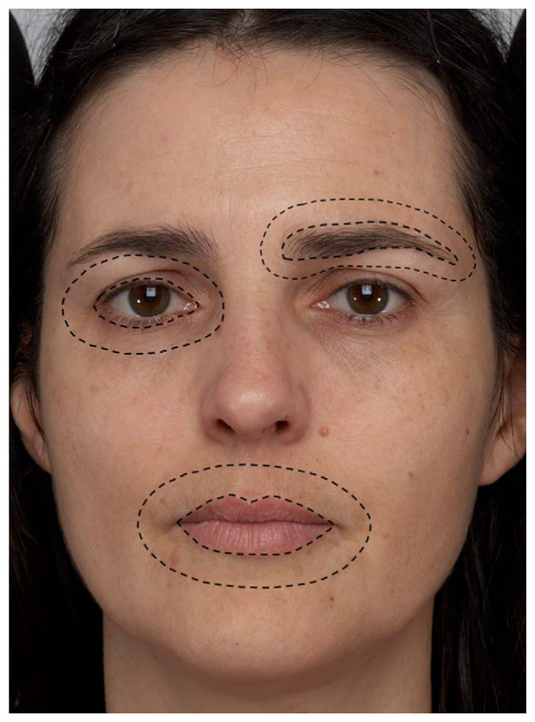
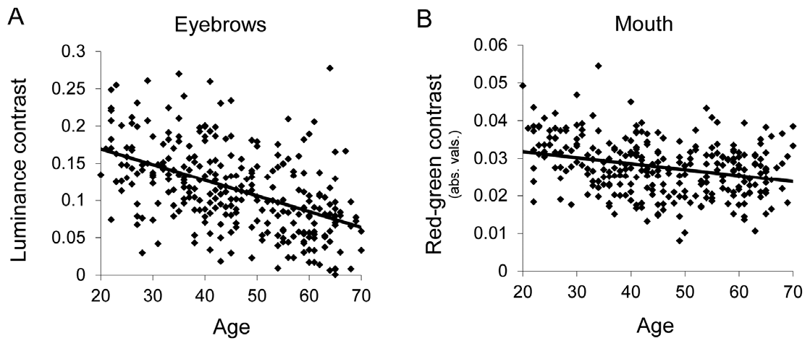
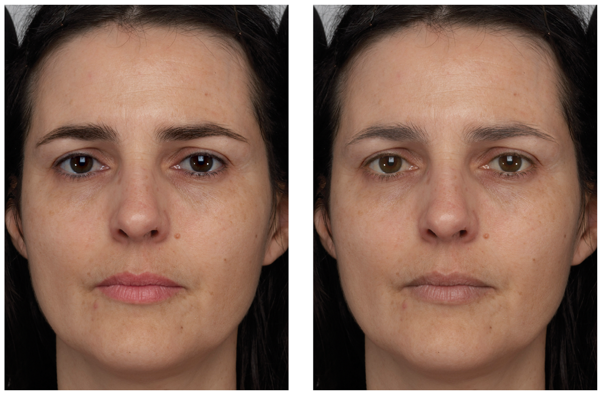
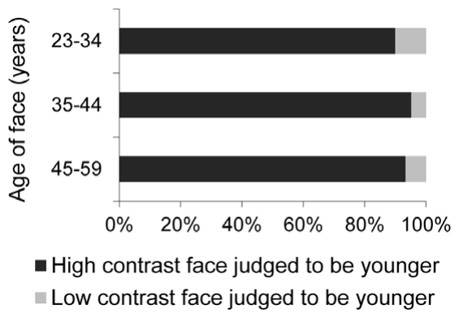

# 얼굴 대비의 여러 측면은 나이에 따라 줄어들며 나이 지각의 단서가 된다

> **원문** Porcheron A, Mauger E, Russell R (2013). *Aspects of Facial Contrast Decrease with Age and Are Cues for Age Perception.* PLoS ONE 8(3): e57985. https://doi.org/10.1371/journal.pone.0057985
>
> **라이선스** 원문 Copyright © 2013 Porcheron et al. [Creative Commons Attribution License](https://creativecommons.org/licenses/by/4.0/)로 배포되며, 원저자와 출처를 밝히는 조건으로 모든 매체에서 제한 없는 이용·배포·복제를 허용합니다.
>
> **변경 사항** 영어 원문을 한국어로 번역했습니다. 그림은 원문에서 잘라 캡션 앞에 넣었고, 참고문헌 목록은 생략했습니다(본문의 [숫자]는 원문 참고문헌 번호). 원문 PDF에서 깨진 기호(음수 부호, ±, 도, χ²)는 문맥에 맞게 복원했습니다. 원저자가 검토한 번역이 아닙니다.

**용어 대응** — 얼굴 대비(facial contrast): 얼굴 특징(눈, 눈썹, 입술)과 그 주변 피부 사이의 휘도·색 차이 · 휘도(luminance, L\*): 밝고 어두움 · a\*: 빨강–초록 축 · b\*: 노랑–파랑 축 · 지각된 나이/추정 나이(perceived/estimated age) · 혼합 효과 모형(mixed model) · 강제 선택(forced choice)

---

## 초록

나이는 일차적인 사회적 차원이다. 우리는 사람들을 얼마나 나이 들었다고 지각하는지에 따라 그들에게 다르게 행동한다. 나이 지각은 주름처럼 나이와 상관된 단서에 의존한다. 여기서 우리는 얼굴 대비의 여러 측면, 즉 얼굴 특징과 주변 피부 사이의 대비가 성인 백인 여성의 대규모 표본에서 나이에 따라 줄어들었다고 보고한다. 이 같은 얼굴 대비의 측면들은 얼굴의 지각된 나이와도 유의하게 상관되었다. 개별 얼굴은 이 얼굴 대비의 측면들을 인위적으로 높였을 때 더 어리게, 인위적으로 낮췄을 때 더 나이 들게 지각되었다. 이 발견은 얼굴 대비가 나이 지각에서 역할을 하며, 얼굴 대비가 더 큰 얼굴이 더 어려 보인다는 것을 보여 준다. 얼굴 대비는 전형적인 화장품 사용으로 커지므로, 우리는 화장품이 부분적으로는 얼굴을 더 어려 보이게 함으로써 작용한다고 추론한다.

**연구비** 저자들은 보고할 지원이나 연구비가 없다. **이해 상충** AP와 EM은 CE.R.I.E.S.(샤넬 R&T 건강한 피부 연구 센터)의 직원이다. 신고할 특허, 개발 중인 제품, 시판 제품은 없다. 이는 데이터와 자료 공유에 관한 모든 PLOS ONE 정책을 저자들이 준수하는 데 영향을 주지 않는다.

## 서론

나이는 사회 구조와 상호작용의 근본적 결정 요인이다. 나이는 서열, 권리, 책임을 결정한다. 서로 다른 나이의 사람들은 서로 다른 종류의 사회적 상호작용을 가능하게 하며, 나이는 사회 인지와 행동의 일차적 차원이다. 그러나 한 사람의 건강, 능력, 타인에게 받는 대우를 예측하는 것은 실제 나이, 즉 역연령만이 아니다. 실제 나이와 별개로 나이의 겉모습만으로도 건강과 안녕의 중요한 측면이 예측된다.

나이보다 더 늙어 보이거나 어려 보이는 것은 체질량지수(BMI), 우울, 결혼 상태, 사회 계층 같은 건강 요인·환경 요인과 연관된다[1,2]. 실제로 지각된 얼굴 나이는 노화의 임상적으로 유용한 생체 지표이며[3], 나이보다 늙어 보이는 것은 건강이 좋지 않다는 신호[4,5]이자 사망률의 신호다[6]. 건강이 나쁜 것이 나이에 비해 늙어 보이는 데 분명 기여하지만, 외모가 거꾸로 건강과 심리적 안녕을 떨어뜨릴 수도 있다는 증거가 있다. 소유자 자신을 포함해 아무도 '만지고 싶어 하지 않는' 피부를 가지면 사회적 접촉과 사회적 신체 접촉이 줄어들기 때문이다[7]. 더 늙어 보이는 사람은 더 자율적이고 지배적으로 지각되며[8], 이는 신체 접촉을 꺼리게 한다[9]. 접촉의 이점은 나이가 들수록 커지지만, 접촉을 받을 기회는 크게 줄어든다[10].

젊은 외모를 유지하는 것은 많은 사람에게 매우 중요한데, 아마 나이의 겉모습과 건강 사이, 그리고 나이의 겉모습과 아름다움 사이의 관계 때문일 것이다[11]. 많은 사람이 노화의 시각적 징후를 줄이는 데 관심을 두며, 이것이 수십억 달러 규모의 화장품 산업과 미용 성형 산업을 떠받친다.

나이의 겉모습은 노화 과정에서 일어나는 신체 변화와 밀접하게 관련된다. 약 20세에 성장이 멈춘 뒤에도 얼굴 형태는 계속 변하며, 특히 성인기 후반에 그렇다[12]. 얼굴 피부는 나이에 따라 극적으로 변하는데, 주름과 처짐[13–16], 색소 불균일의 증가, 그리고 피부 반사율의 균일성 감소 같은 피부색 변화[17,18]가 포함된다.

얼굴의 내부 특징도 나이 지각과 관련된다. George와 Hole은 같은 사람이 서로 다른 두 나이에 찍은 사진으로 사진 사이의 특징을 바꿔 넣었다. 더 나이 든 특징을 젊은 얼굴에 옮겨 넣으면 나이 추정이 약 40% 늘었고, 그 반대는 나이 든 얼굴의 나이를 약 33% 줄였다[19]. 내부 특징의 크기와 형태 모두 나이 지각에 영향을 준다. 실제 얼굴에서 크고 둥근 눈과 더 짧은 코는 그 사람의 추정 나이를 낮췄다[8]. 입술의 높이와 경계의 선명도는 나이에 따라 줄어들며 나이 지각의 시각 단서가 된다[20,21].

눈과 주변 피부, 입술과 주변 피부 사이의 휘도 대비는 '얼굴 대비'라고 불려 왔다. 여성 얼굴은 남성 얼굴보다 얼굴 대비가 크며, 얼굴 대비는 성별 분류와 남성성·여성성의 지각, 그리고 매력에서 중요한 역할을 한다[22–26]. 그러나 얼굴 대비가 나이에 따라 변하는지, 또는 나이 지각에서 역할을 하는지는 알려져 있지 않다. 나이 든 성인과 젊은 성인의 평균 얼굴을 살펴본 결과, 우리는 얼굴 대비가 나이에 따라 줄어들며 지각된 얼굴 나이와 관련된다는 가설을 세우게 되었다.

우리는 얼굴 대비의 정의를 눈썹까지 넓히는데, 눈썹은 얼굴에서 지각적으로 중요한 대비의 주요 원천이기 때문이다[27]. 얼굴의 털은 나이에 따라 희어지고 양이 줄어들므로, 눈썹 대비는 나이 지각에서 특히 중요할 수 있다. 다른 곳에서 우리는 휘도 대비에만 집중했지만[24,25], 최근 연구는 성별 분류와 관련 얼굴 지각 과제에서 특징과 주변 피부 사이의 색 대비가 중요함을 보였다[22,23,26]. 그래서 우리는 휘도 대비의 나이 관련 변화뿐 아니라 빨강–초록 대비와 노랑–파랑 대비의 변화도 조사했다.

첫 번째 연구에서는 20세에서 70세 사이 백인 여성의 얼굴 이미지 289장에서 얼굴 대비를 측정해, 얼굴 대비가 나이에 따라 변하는지 알아보았다. 얼굴 대비가 나이 지각과 관련되는지 알아보기 위해, 두 번째 연구에서는 참가자들에게 그 얼굴 중 150장의 나이를 추정하게 했다. 세 번째 연구에서는 얼굴 대비가 지각된 나이와 인과적으로 관련되는지 알아보기 위해 얼굴 대비를 조작했다. 서른 개의 얼굴 각각을 조작해 얼굴 대비를 높이거나 낮춘 새 판을 만들었다. 강제 선택 설계에서 참가자들은 조작된 두 이미지를 모두 보고 어느 얼굴이 더 어려 보이는지 판단하도록 지시받았다. 두 번째 참가자 집단은 조작된 각 얼굴을 한 장씩 보고 나이를 추정하도록 요청받았다.

## 연구 1

여성 얼굴의 휘도 대비와 색 대비가 나이에 따라 변한다는 가설을 검증하기 위해 연구 1을 수행했다.

### 윤리 선언

우리는 게티즈버그 칼리지 인간 피험자 연구 심의위원회로부터 연구에 대한 윤리 승인을 받았으며, 연구는 헬싱키 협약의 원칙을 따랐다. 이 원고에 보고된 피험자들은 서면 동의서를 냈다. 이 원고에 사진이 실린 사람은, 자신의 이름과 개인 정보가 공개되지 않는다는 이해 아래, 자신의 이미지(변형된 판과 변형되지 않은 판 모두)가 과학 출판물에 실리는 것에 서면으로 동의했다.

### 재료와 절차

건강한 피부를 가진 20세에서 69세 사이 프랑스 백인 여성 289명의 얼굴 전체 이미지(20–29세 얼굴 40장, 30–39세 60장, 40–49세 71장, 50–59세 60장, 60–69세 58장)를, 피험자를 정확하고 재현 가능하게 위치시키고 조명 조건을 통제할 수 있는 폐쇄형 촬영 시스템으로 얻었다. 모든 피험자에게서 연구에 사진을 사용하는 것을 허락하는 서면 동의를 받았다.

카메라(Canon EOS-1 Ds Mark II, 17 MP)의 높이는 얼굴 높이에 맞췄다. 각 얼굴은 세 개의 플래시로 조명했다. 하나는 얼굴 앞(확산광)으로, 이 플래시의 높이는 피험자의 얼굴 높이에 맞췄다. 나머지 두 플래시는 45° 각도에서 얼굴을 비췄으며(직사광), 이 플래시들의 높이는 고정했다. 이 조명 조건은 드리운 그림자를 피하고 얼굴의 음영에서 오는 변동을 최소화하도록 정했다. 피험자들은 화장이나 장신구를 하지 않았다. 피험자 대다수(총 289명 중 263명)는 머리카락이 얼굴에 닿지 않도록 헤어밴드를 했다. 피험자들은 눈을 떴고, 무표정을 유지하고 카메라를 똑바로 바라보도록 요청받았다. 반영구 화장이나 컬러 콘택트렌즈를 한 얼굴은 포함하지 않았다. 이미지는 얼굴 윤곽이 보이도록 잘랐다.

이것은 횡단 연구였으므로, 나이에 따른 눈 대비의 변화가 우리 연구의 젊은 여성과 나이 든 여성 사이의 홍채 색 차이 때문일 수 있는지 알아보고자 했다. 이를 위해 각 얼굴의 홍채 색을 Seddon 등[28]이 기술한 체계로 평가했다. 우리 이미지 세트에서 나이 든 얼굴과 젊은 얼굴의 눈 색 차이를 χ² 검정으로 분석했고, 서로 다른 10년 단위 나이 집단 사이에 홍채 색의 유의한 차이는 없었다(p = 0.65).

얼굴 영역의 표시와 대비 측정은 MATLAB 7.8.0(R2010a)으로 수행했다. Russell(2009)[25]의 절차와 비슷하게, 각 이미지마다 눈(속눈썹 주위의 좁은 피부 띠 포함), 입술, 눈썹, 눈을 둘러싼 고리 모양 영역(눈의 대략적 폭이며 눈썹은 포함하지 않음), 입술을 둘러싼 고리 모양 영역(입의 대략적 폭), 눈썹을 둘러싼 고리 모양 영역(눈썹의 대략적 폭), 그리고 얼굴 윤곽에 해당하는 영역을 개별적으로 표시했다(그림 1).

> **그림 1. 얼굴 영역의 표시.** 점선은 특징과 주변 피부를 어떻게 정의했는지 보여 준다.

얼굴의 휘도 대비와 색 대비를 측정하기 위해, 인간 시각계의 색 채널에 대략 대응하는 CIE L\*a\*b\* 색 공간을 썼다. L\*a\*b\* 색 공간은 자극 좌표 사이의 차이가 자극 사이의 지각된 색 차이를 예측하도록 설계되었다[29]. 이 색 공간의 세 직교 차원은 밝음–어두움(L\*), 빨강–초록(a\*), 노랑–파랑(b\*)이다.

눈 안의 모든 픽셀의 휘도 값을 평균했고, 다른 특징들과 특징을 둘러싼 고리 영역의 모든 픽셀도 마찬가지로 평균했다. 피부와 특징의 휘도는 모두 8비트 픽셀 값의 평균이므로 0(검정)에서 255(흰색)까지의 범위를 가질 수 있었다. 대비는 각 특징에 대해 Cf = (피부 휘도 − 특징 휘도)/(피부 휘도 + 특징 휘도)로 계산했다. 이는 Michelson 대비를 변형한 것으로, −1에서 1까지 변하며 절댓값이 클수록 대비가 크고 0은 대비가 없음을 나타낸다. 빨강–초록과 노랑–파랑 얼굴 대비를 측정하는 데도 같은 방법을 적용했으며, a\*는 0(초록)에서 255(빨강), b\*는 0(파랑)에서 255(빨강)까지의 범위였다. (역자 주: b\*는 노랑–파랑 축이므로 "255(빨강)"은 "255(노랑)"의 오기로 보인다. 원문 그대로 옮겼다.) 얼굴 대비에 대한 기술 분석을 수행했고, 나이와 대비 사이의 관계는 피어슨 상관으로 검정했다.

### 결과

얼굴들은 눈, 입술, 눈썹에서 양의 휘도 대비를 가져, 모든 얼굴에서 눈, 입술, 눈썹이 주변 피부보다 어둡다는 것을 나타냈다. 입의 a\* 대비는 모든 얼굴에서 음수였는데, 입이 주변 피부보다 더 붉기 때문이다(이후 분석에서 이 지표는 절댓값으로 다룬다). 입의 b\* 대비와 눈의 a\*, b\* 대비는 거의 모든 얼굴에서 양수였는데, 이는 대부분의 얼굴에서 입이 주변 피부보다 더 푸르고, 눈은 주변 피부보다 더 푸르고 초록빛임을 나타낸다. 눈썹의 평균 색 대비(a\*와 b\*)는 0과 유의하게 다르지 않았으며, 이 대비들은 이후 통계 분석에서 제외했다.

나이와 휘도·색 대비의 관계는 표 1에 제시했고, 그림 2는 대비 중 두 가지(눈썹 주위의 휘도 대비와 입 주위의 a\* 대비)의 그래프를 보여 준다. 얼굴 대비에는 나이에 따른 여러 변화가 있었다. 눈썹 영역의 휘도 대비가 나이에 따라 유의하고 강하게 감소했고(p < 0.0001), 눈 영역에서는 나이에 따라 감소하는 경향만 발견되었다(p = 0.06). a\* 대비(절댓값)는 입 영역(p < 0.0001)과 눈 영역(p < 0.0001)에서 나이에 따라 유의하게 감소했다. b\* 대비는 눈 영역에서 나이에 따라 유의하게 감소했지만(p < 0.0001) 입 영역에서는 증가했다(p < 0.01). 입 영역의 휘도 대비는 얼굴의 나이와 관계가 없었다. 종합하면 이 발견은 얼굴 대비의 여러 측면이 나이에 따라 변하며, 이 성분들 대부분이 나이에 따라 줄어든다는 것을 보여 준다.

> **그림 2. 나이에 따른 대비의 감소.** 얼굴 나이의 함수로 본 눈썹의 L\* 대비(왼쪽)와 입의 a\* 대비(오른쪽). 각 점은 특정 얼굴 하나를 나타낸다.

**표 1. 나이와 휘도(L\*) 또는 색(a\*, b\*) 대비의 관계.**

| 특징 | 대비 | N | p 값 | 상관계수 |
|---|---|---|---|---|
| 눈썹 | L\* | 289 | < 0.0001 | −0.50 |
| 눈 | L\* | 289 | 0.0645 | −0.11 |
| 입 | L\* | 289 | 0.6625 | 0.03 |
| 눈 | a\* | 289 | < 0.0001 | −0.32 |
| 입¹ | a\* | 289 | < 0.0001 | −0.29 |
| 눈 | b\* | 289 | < 0.0001 | −0.24 |
| 입 | b\* | 289 | 0.0081 | 0.16 |

¹ 절댓값.

## 연구 2

얼굴 대비의 여러 측면이 나이에 따라 줄어든다는 것을 발견했으므로, 우리는 얼굴 대비가 나이 지각에서 역할을 하는지 알아보고자 했다. 서론에서 살펴보았듯이 얼굴 대비 이외에도 나이 지각에서 역할을 하는 단서가 매우 많이 알려져 있으므로, 얼굴 대비가 지각된 나이를 완벽하게 예측하리라고는 기대하지 않지만, 그래도 지각된 나이와 유의하게 상관되리라고 기대한다. 연구 2는 얼굴 대비와 얼굴의 지각된 나이 사이에 관계가 있다는 가설을 검증했다.

### 재료와 절차

연구 2에서는 연구 1의 이미지 중 여성의 나이와 홍채 색에 따라 고르게 분포된 150장을 골랐다. 게티즈버그 칼리지 학부생 74명(17–22세, 남성 36명과 여성 38명)이 실험 2에 참여했다. 150개의 얼굴 모두를 각 참가자에게 무작위 순서로 한 번에 하나씩 제시했다. 참가자들은 각 얼굴의 나이를 10세에서 99세 사이로 키보드로 응답해 추정하도록 요청받았으며, 시간 제한은 없었다.

지각된 나이에 대한 기술 분석을 수행했고, 지각된 나이와 얼굴 대비의 여러 성분 사이의 관계는 혼합 효과 분산분석으로 검정했다. 혼합 모형이라는 용어는 같은 분석에서 고정 효과와 무선 효과를 모두 쓰는 것을 가리킨다. 혼합 모형 방법론은 일반적으로 한 변수가 같은 개인에 대해 시간에 걸쳐 또는 여러 실험 조건에서 반복 측정될 때(우리 연구에서는 얼굴의 추정 나이) 쓰인다. 우리 모형에서 얼굴 대비의 여러 측면, 참가자 나이, 참가자 성별은 고정 효과이고, 참가자 신원과 얼굴 신원은 무선 효과다. 혼합 모형에 대한 더 자세한 설명은 Verbeke와 Molenberghs[30]를, 비슷한 연구에서 혼합 모형을 쓴 예는 Stephen과 McKeegan[26]을 보라.

### 결과

평균적으로 참가자들은 얼굴을 실제보다 약간 더 나이 들게 지각했으며, 평균 나이 차(지각된 나이 − 실제 나이)는 2.8세(표준편차 = 8.7)였다. 참가자 나이나 성별이 지각된 나이에 주는 유의한 효과는 발견되지 않았다.

이 관계들은 표 2에 제시했다. 얼굴 대비의 성분들은 추정 나이와 음의 상관을 보였는데, 예외는 지각된 나이와 양의 상관을 보인 입의 b\* 대비, 그리고 지각된 나이와 상관이 없었던 입의 휘도 대비였다. 눈썹의 휘도 대비(p < 0.0001)와 입의 a\* 대비(p < 0.0001)가 얼굴의 추정 나이와 가장 강하게 연관된 요인이었고, 그다음은 눈 영역의 a\* 대비(p < 0.001), 그리고 입 영역(p < 0.01)과 눈 영역(p = 0.02)의 b\* 대비였다. 눈 영역의 휘도 대비가 얼굴의 나이를 예측하는 경향이 있었다(p = 0.05). 일반적으로 대비가 더 큰 얼굴이 더 어리게 지각되었다. 구체적으로, 나이에 따라 변하는 얼굴 대비의 측면들만 지각된 나이와 연관되는 것으로 나타났다.

**표 2. 지각된 나이와 휘도(L\*) 또는 색(a\*, b\*) 대비의 관계.**

| 특징 | 대비 | N | p 값 | 지각된 나이와의 관계 |
|---|---|---|---|---|
| 눈썹 | L\* | 150 | < 0.0001 | 감소 |
| 눈 | L\* | 150 | 0.0529 | 감소 |
| 입 | L\* | 150 | 0.4513 | 없음 |
| 눈 | a\* | 150 | 0.0009 | 감소 |
| 입¹ | a\* | 150 | < 0.0001 | 감소 |
| 눈 | b\* | 150 | 0.0160 | 감소 |
| 입 | b\* | 150 | 0.0069 | 증가 |

¹ 절댓값.

## 연구 3a와 3b

세 번째 연구에서는 나이에 따라 변하는 얼굴 대비의 측면들을 조작해, 그것들이 나이 지각과 인과적으로 관련되는지 알아보았다. 실험은 두 가지 판으로 진행했다. 하나는 각 얼굴의 두 판을 직접 비교하는 강제 선택 설계(연구 3a)였고, 두 번째는 참가자들이 얼굴의 나이를 한 번에 하나씩 추정하는 설계(연구 3b)였다. 두 판 모두 생태학적으로 타당한 과제인데, 서로 다른 두 사람(또는 그 이상)의 나이를 비교해 추정하는 것(즉 누가 더 어린가)과 한 개인의 나이를 추정하는 것(즉 이 사람은 대략 몇 살인가)이 모두 흔하기 때문이다. 강제 선택 설계는 얼굴 대비가 나이 지각에서 역할을 하는지 알아보는 가장 민감한 방법인데, 참가자들이 조작된 얼굴 대비의 측면에서만 다른 같은 얼굴의 두 판을 직접 비교하기 때문이다. 평정 설계도 수행함으로써 다른 설계로 결과를 재현할 수 있었고, 조작의 효과 크기를 측정해 비슷한 설계를 쓴 다른 연구와 비교할 수도 있었다.

### 재료

23세에서 34세 여성의 얼굴 10장, 35세에서 44세 여성의 얼굴 10장, 45세에서 59세 여성의 얼굴 10장이 되도록 실험 2에 쓴 150장에서 30장을 골랐다.

각 얼굴은 나이에 따라 유의하게 낮았던, 또는 나이에 따라 낮아지는 경향이 있었던 얼굴 대비의 측면들만 높이거나 낮추도록 조작했다. 구체적으로, 눈썹과 눈 주위의 L\* 대비, 눈과 입술 주위의 a\* 대비, 눈과 입술 주위의 b\* 대비를 조작했다. 입 주위의 L\* 대비는 나이에 따라 변하는 것으로 나타나지 않았으므로 조작하지 않았다. 특징 주위의 대비를 조작하기 위해, 주변 피부는 그대로 두고 특징만 조작했다(즉 눈과 눈썹의 휘도, 눈과 입술의 붉은 기, 눈과 입술의 노란 기를 높이거나 낮췄다). Adobe Photoshop®의 번(burn) 도구로 눈썹을 선택적으로 어둡게 했고, 닷지(dodge) 도구로 눈썹을 선택적으로 밝게 했다. 눈과 주변 피부 사이의 L\*, a\*, b\* 대비의 크기와, 입과 주변 피부 사이의 a\*, b\* 대비의 크기를 조작하기 위해, 얼굴의 나머지는 바꾸지 않고 해당 특징의 L\*, a\* 또는 b\* 채널(0에서 255)을 개별적으로 조작했다. 예를 들어 입술의 a\* 값을 높이면 입술이 더 붉어지고 입술과 입술 주변 피부 사이의 a\* 대비가 커졌다.

본 연구의 목표는 이 얼굴 대비의 측면들이 나이 지각에서 어떤 역할이라도 하는지 알아보는 것이었으므로, 각 얼굴에 대해 자연스러운 외모를 유지하면서 겉보기 나이의 변화를 최대화하는 것으로 보이는 각 특징의 변화 크기를 골랐다. 실제로 조작의 크기는 대부분의 얼굴에서 같았지만, 일부 얼굴에서는 자연스러운 외모를 유지하기 위해 약하게 했다. 특징은 연구 1에서 기술한 대로 정의했다. 참가자들에게는 조작된 얼굴(낮은/높은 대비)만 제시했다. 자극의 예는 그림 3에 제시했다.

그림 3에서 몇 가지 주목할 점이 있다. 첫째, 대비가 더 높은 얼굴(왼쪽)이 대비가 더 낮은 얼굴(오른쪽)보다 꽤 분명하게 더 어려 보이며, 이런 식으로 만든 다른 얼굴 쌍들도 마찬가지다. 이 관찰은 연구 3a와 3b의 주요 결과를 예고한다. 이 이미지를 본 몇몇 사람들은 조작된 부분만이 아니라 얼굴 전체가 다르게 보인다는 것도 관찰했다. 예를 들어 오른쪽 얼굴의 피부는 왼쪽 얼굴보다 다소 덜 채도가 높아 보이고('핏기가 빠진') 전반적으로 덜 건강해 보인다. 우리는 조작하지 않은 얼굴 영역의 겉모습이 바뀐 것이 일반적으로는 얼굴 처리의 전체적 성질 때문이고, 구체적으로는 나이 지각의 전체적 성질[31] 때문이라고 추정한다. 이는 또한 대비가 더 높은 얼굴이 더 어려 보일 뿐 아니라 대비가 더 낮은 얼굴보다 더 건강하고 매력적으로 보인다는 것을 시사하며, 이는 얼굴 색이 지각된 건강에 영향을 준다는 최근 발견[32,33]과 관련될 수 있다.

> **그림 3. 대비를 조작한 얼굴의 판들.** 왼쪽 이미지는 얼굴 대비를 높인 얼굴을, 오른쪽 이미지는 얼굴 대비를 낮춘 같은 얼굴을 보여 준다.

### 연구 3a: 절차와 결과

게티즈버그 칼리지 학부생 21명(여성 10명과 남성 11명, 18세에서 20세)이 연구 3a에 참여했다. 30개의 자극 얼굴 각각에 대해, 참가자들은 대비를 높인 판과 낮춘 판을 나란히 보고 어느 쪽이 더 어려 보이는지 버튼을 눌러 표시했다. 인물의 순서는 나이에 대해 균형을 맞추고 참가자마다 무작위로 했으며, 높은/낮은 대비 판의 좌우 배치는 균형을 맞췄다.

시행의 93%에서 참가자들은 대비가 높은 얼굴이 더 어려 보인다고 표시했다. 이 압도적인 효과는 참가자들이 나이를 지각할 때 얼굴 대비를 단서로 썼으며, 얼굴 대비를 높인 얼굴이 더 어리게 지각되었음을 나타낸다. 효과 크기가 나이가 다른 얼굴에서 달랐는지 알아보기 위해, 반복 측정을 포함한 로지스틱 회귀 모형을 썼다. 얼굴 대비 조작의 효과와 얼굴의 나이 사이에 교호작용은 없었다. 이는 얼굴 대비의 효과가 나이가 다른 얼굴에서 다르지 않았음을 뜻한다. 연구 3a의 결과는 그림 4에 제시했다.

> **그림 4. 강제 선택 대비 조작 실험의 결과.** 대비가 높은 얼굴이 더 어리다고 판단된 시행의 비율은 진한 막대로, 대비가 낮은 얼굴이 더 어리다고 판단된 시행의 비율은 옅은 막대로 보여 준다. 결과는 세 나이 집단별로 제시했다.

### 연구 3b: 절차와 결과

참가자 81명(여성 60명과 남성 21명)이 파리의 CE.R.I.E.S. 실험실에서 실험 3b에 참여했다. 여성 60명 중 20명은 18세에서 22세, 20명은 37세에서 42세, 20명은 53세에서 57세였다. 남성 21명은 37세에서 42세였다. 따라서 참가자 나이의 효과는 세 여성 참가자 집단을 비교해 검정했고, 참가자 성별의 효과는 남성과 37세에서 42세 여성을 비교해 검정했다.

참가자들은 조작된 얼굴 30개의 높은 대비 판과 낮은 대비 판을 모두 보았고, 실험 1에 쓴 세트에서 뽑아 조작된 30개 얼굴과 나이를 맞춘 조작하지 않은 얼굴 60개('방해 자극')도 보았다. 각 참가자는 연속된 세 블록을 보았는데, 첫 블록에서는 조작된 각 얼굴의 한 판(낮은 대비 또는 높은 대비)을, 두 번째 블록에서는 방해 자극 60개를, 세 번째 블록에서는 각 얼굴의 두 번째 판(낮은 대비 또는 높은 대비)을 보았다. 방해 자극의 목적은 참가자들이 각 얼굴의 두 제시가 다르다는 것을 알아챌 가능성을 줄이는 것이었다. 참가자들에게는 같은 사람을 두 번 볼 수 있다고 말했지만, 이미지가 조작되었다고는 말하지 않았다. 얼굴은 각 블록 안에서 나이에 대해, 첫 번째와 세 번째 블록 안에서 조작(낮은/높은 대비)에 대해 무작위화하고 균형을 맞췄다. 각 얼굴은 참가자가 10에서 99 사이의 추정 나이를 입력할 때까지 모니터에 제시되었다.

참가자 집단의 성격 때문에, 참가자 나이와 참가자 성별의 효과를 검정하는 두 개의 독립 분석을 수행했다. 참가자 나이 분석은 참가자의 나이, 얼굴의 실제 나이, 얼굴 대비의 종류(낮음 또는 높음)가 지각된 나이에 주는 효과를 검정했다. 참가자 성별 분석은 참가자 성별, 얼굴의 실제 나이, 얼굴 대비의 종류(낮음 또는 높음)가 지각된 나이에 주는 효과를 검정했다. 첫 번째 분석은 서로 다른 세 나이 집단의 여성 참가자 60명으로, 두 번째 분석은 37–42세 집단의 여성 참가자 20명과 남성 참가자 20명으로 수행했다. 두 분석 모두 연구 2에서 기술한 대로 혼합 효과 분산분석을 써서 수행했다. (역자 주: 앞에서는 이 나이대 남성이 21명이라고 했으나 여기서는 20명이라고 적혀 있다. 원문 그대로 옮겼다.)

두 분석 모두에서 얼굴 대비의 유의한 효과가 발견되었다. 참가자 나이 분석에서 대비가 높은 얼굴은 대비가 낮은 얼굴보다 평균 1.3 ± 0.2세 더 어리게 지각되었고, 참가자 성별 분석에서는 대비가 높은 얼굴이 대비가 낮은 얼굴보다 평균 1.1 ± 0.2세 더 어리게 지각되었다(두 분석에서 대비의 효과가 약간 다른 것은 참가자가 대부분 달랐기 때문이다). 두 분석 모두에서 얼굴의 나이와 대비 조작 사이에 유의한 교호작용은 없었다. 이는 얼굴 대비의 효과가 나이가 다른 얼굴에서 다르지 않았음을 뜻한다.

참가자 나이 분석에서 참가자 나이의 유의한 효과도, 참가자 나이와 얼굴 대비 조작 효과 사이의 교호작용도 없었다. 이는 나이가 다른 참가자들에서 얼굴 대비 조작의 효과가 다르지 않았음을 뜻한다. 참가자 성별 분석에서는 참가자 성별의 유의한 효과가 있었다. 남성 참가자는 여성 참가자보다 얼굴을 1.9 ± 0.8세 더 나이 들게 추정했다. 무엇이 이 성차를 일으켰는지는 분명하지 않다. 그러나 참가자 성별과 얼굴 대비 조작 효과 사이에 유의한 교호작용은 없었다. 이는 성별이 다른 참가자들에서 얼굴 대비 조작의 효과가 다르지 않았음을 뜻한다. 요약하면, 얼굴 대비 조작의 효과와 얼굴의 나이, 참가자의 나이, 참가자의 성별 사이에 교호작용은 없었다. 따라서 얼굴 대비를 높이면 여성 얼굴이 더 어려 보인다는 발견은 얼굴의 여러 나이, 그리고 관찰자의 여러 나이와 성별에 걸쳐 견고하다.

### 연구 3a와 3b: 논의

얼굴 대비를 높이면 연구 3의 두 부분 모두에서 얼굴이 더 어려 보였지만, 효과는 연구 3a에서는 커 보였고 연구 3b에서는 작았다. 여기에는 적어도 두 가지 이유가 있다. 한 가지 이유는 3b에서 참가자들이 (중간의 방해 자극에도 불구하고) 블록에 걸쳐 같은 인물을 알아보고 비슷한 응답을 했을 수 있다는 것으로, 이는 높은 대비와 낮은 대비 얼굴 사이의 추정 나이 차이를 줄이는 효과가 있었을 것이다. 두 번째이자 더 근본적인 이유는 두 연구의 절차가 다르다는 데 있다. 연구 3a에서 참가자들이 비교한 두 이미지는 얼굴 대비에서만 달랐다. 주름, 얼굴 처짐, 나이 관련 반점, 눈과 입술의 크기, 그리고 노화의 다른 모든 단서는 일정하게 유지되어, 두 얼굴 사이의 유일한 차이는 얼굴 대비의 정도였다. 참가자들이 압도적으로 대비가 높은 얼굴을 더 어려 보인다고 고른 사실은 단지 얼굴 대비가 나이 지각의 단서라는 것을 보여 줄 뿐이다. 그러나 이것이 얼굴 대비가 나이 지각의 유일한 단서라거나 지배적 단서라는 것을 보여 주지는 않는다. 연구 3b에서 참가자들은 개별 얼굴의 나이를 추정했다. 이런 방식에서는 위에서 기술한 모든 단서와 아직 발견되지 않은 다른 단서를 포함해, 얼굴의 나이를 지각하는 데 모든 정적 시각 단서를 쓸 수 있었다. 따라서 연구 3b에서 높은 대비와 낮은 대비 얼굴 사이의 추정 나이 차이가 작다는 것은, 얼굴 나이를 전달하는 단서가 많으며 어느 한 단서를 바꾸어도 지각된 나이에 극적인 효과가 나지 않는다는 사실을 반영한다.

이 구별은 과제 효과의 관점에서 이해할 수 있다. 근본적으로 두 과제는 판단에 하나의 단서가 관여하는지 여러 단서가 관여하는지에서 다르다. 연구 3a에서 피험자들은 몇 가지 얼굴 대비 측면에서만 다른 두 얼굴 중 어느 쪽이 더 어려 보이는지 판단해야 했다. 따라서 이 얼굴 대비의 측면들이 과제를 수행하는 데 쓸 수 있는 유일한 단서였다. 이런 방식으로 연구 3a는 이 얼굴 대비의 측면들이 나이 지각에서 조금이라도 유의한 역할을 하는지라는 질문을 직접 다루었다. 피험자들이 거의 모든 시행에서 대비가 더 높은 얼굴을 더 어려 보인다고 골랐으므로, 대답은 단호한 '그렇다'였다. 반면 연구 3b의 피험자들은 한 얼굴이 얼마나 나이 들어 보이는지 판단해야 했다. 이 과제에서는 얼굴의 모든 나이 단서를 과제 수행에 쓸 수 있었다. 여기에는 위에서 기술한 것 같은 알려진 모든 단서와 조작된 얼굴 대비 측면, 그리고 아마 현재 알려지지 않은 많은 다른 나이 단서가 포함되었다. 피험자들이 나이를 추정하는 데 쓸 수 있는 단서가 이렇게 많았으므로, 어느 한 단서의 조작이 겉보기 나이에 큰 효과를 내리라고 기대하지 않을 것이다. 피험자들이 얼굴 대비가 더 큰 얼굴을 유의하게 더 어려 보인다고 평정한 사실은, 이 조작된 얼굴 대비 측면들이 나이 지각의 단서라는 생각과 일치한다. 얼굴의 나이 단서를 조사한 다른 몇몇 연구는 연구 3b와 비슷한 방법을 썼으므로, 본 결과를 그 연구들의 결과와 비교해 나이 지각에서 얼굴 대비의 상대적 중요성을 살펴볼 수 있다.

얼굴의 나이를 추정할 때 쓸 수 있는 얼굴 나이 단서가 많다는 점을 고려하면, 남은 질문은 연구 3b의 결과가 다른 나이 관련 단서를 조작한 다른 연구의 결과와 어떻게 비교되느냐다. 연구 3b에서 대비가 높은 얼굴은 대비가 낮은 얼굴보다 평균 1.3 ± 0.2세(참가자 나이 분석) 또는 1.1 ± 0.2세(참가자 성별 분석) 더 어리게 지각되었다. 최근의 한 연구에서는 60대 백인 얼굴 이미지가 주름을 디지털로 제거한 뒤 3.6세 더 어리게 지각되었다[34]. 여러 이유로 방법과 자극이 직접 비교 가능하지는 않지만, 본 연구에서 얼굴 대비를 조작한 효과는 다른 연구에서 주름을 완전히 제거한 효과의 약 3분의 1 크기였다. 또 다른 연구는 실제 수술 시술을 조사해, 40대 이상 환자에서 레이저 박피술(즉 주름, 일광 흑자, 햇빛 손상, 흉터의 치료) 후 겉보기 나이가 2.5세, 완전한 안면 거상술(즉 주름과 조직 늘어짐 모두의 수술적 제거) 후 4.6세 줄어든다는 것을 발견했다[35]. 이 두 미용 수술 시술은 얼굴 외모에 극적인 변화를 가져오지만, 추정 나이의 차이는 여전히 몇 년 정도에 불과하다. 따라서 여러 나이 관련 단서를 크게 조작해도 얼굴의 겉보기 나이가 극적으로 바뀌지는 않는다. 그럼에도 이 시술들의 효과는 연구 3b에서 얼굴 대비 조작으로 발견된 효과보다 크며, 이는 얼굴 대비가 주름과 처짐보다 나이 지각의 더 약한 단서임을 시사한다.

요약하면, 연구 3의 두 부분의 결과를 종합하면 얼굴 대비가 나이 지각에서 유의하고 의미 있는 역할을 한다는 생각이 뒷받침된다. 그러나 얼굴 대비가 하는 역할은 주름과 처짐 같은 잘 알려진 나이 관련 단서가 하는 역할보다 작다.

## 종합 논의

얼굴 대비의 여러 측면, 즉 얼굴 특징과 그 특징을 둘러싼 피부 사이의 휘도와 색 차이가 나이에 따라 줄어드는 것으로 나타났다. 여기에는 눈과 눈썹 주위의 휘도 대비, 입과 눈 주위의 빨강–초록(a\*) 대비, 눈 주위의 노랑–파랑(b\*) 대비가 포함되었다. 이 같은 얼굴 대비의 속성들은 지각된 나이와 음의 상관을 보였다. 입의 노랑–파랑(b\*) 대비는 나이에 따라 증가했고 지각된 나이와 양의 상관을 보였다. 마지막으로, 얼굴 대비를 조작하면 얼굴의 겉보기 나이가 바뀌었다. 두 연구에서 얼굴 대비를 높인 얼굴은 대비를 낮춘 얼굴보다 더 어리다고 판단되었다. 종합하면 이 결과는 얼굴 대비가 나이에 따라 변하는 시각 단서이며, 관찰자가 얼굴의 나이를 지각할 때 쓴다는 것을 보여 준다.

얼굴 대비는 성별 분류와 얼굴 매력 판단의 단서로 알려져 있다[22–26]. 여기서 우리는 얼굴 대비의 정의를 색 대비와 눈썹 주위의 대비까지 넓혔고, 얼굴 대비가 나이 지각의 단서이기도 하다는 것을 보였다. 얼굴 대비는 몇 가지만 들자면 주름, 처짐, 눈과 입술의 크기, 피부 반사율의 균일성을 포함하는, 나이 지각에 관여하는 단서 목록에 추가될 수 있다[21]. 그러나 입 주위의 L\* 대비는 나이에 따라 변하지 않았으며, 그것이 나이 지각과 관련된다는 증거는 없다는 점에 주의해야 한다. 따라서 나이에 따라 변하는 얼굴 대비의 측면들은 남성 얼굴과 여성 얼굴 사이에서 다른 측면들과 정확히 같지는 않다.

Bruce와 Young[36]은 나이 지각과 여성성 지각 사이에 연결이 있다고 제안했다(118쪽). 여기서의 발견은 성적으로 이형적인 특징인 얼굴 대비가 나이에 따라서도 변한다는 것을 보여 줌으로써 이 생각을 뒷받침한다. 더 높은 얼굴 대비는 여성 얼굴의 전형이지만 더 젊은 얼굴의 전형이기도 하다. 이는 여성 얼굴이 나이 들면서 겉보기 여성성이 줄어들 가능성을 시사한다. 화장품이 신체적 매력에 주는 긍정적 효과는 젊은 여성보다 나이 든 여성에서 더 크게 관찰되었다[37]. 화장품으로 인한 얼굴 대비의 증가가 젊은 얼굴보다 나이 든 얼굴에서 겉보기 여성성에 더 큰 효과를 낼 수도 있다.

대비는 나이에 따라 줄어드는 반면, 화장품을 바르면 얼굴 대비의 휘도 부분이 커진다[25]. 화장품이 얼굴 대비의 색 부분에 주는 효과는 조사되지 않았다. 립스틱을 바르면 입술이 어두워질 뿐 아니라, 우리가 젊은 얼굴에서 더 높다고 발견한 입술의 빨강–초록 대비도 커질 것이다. 여성은 눈의 휘도 대비와 색 대비를 높이는 방식으로 아이 메이크업(즉 마스카라, 아이라이너, 아이섀도)을 하며, 이 영역의 휘도 대비를 높이는 눈썹 화장(예: 색연필이나 반영구 화장)도 한다. 화장품은 여성 얼굴의 겉보기 매력[37–42], 여성성[39,43], 건강함[43,44]을 높이는 것으로 알려져 있다. 다른 곳에서 우리는 화장품이 얼굴 대비를 높임으로써 얼굴의 여성성을, 따라서 여성 얼굴의 매력을 높인다고 제안했다[25,45]. 여기서 우리는 이 설명에, 화장품의 또 다른 기능이 얼굴 대비를 높여 얼굴을 더 어려 보이게 하는 것이라는 제안을 더한다.

화장품 사용의 가장 중요한 요소 중 하나는 립스틱을 바르는 것이다. 립스틱에는 붉은 색조가 흔히 쓰이며, 이는 자연적으로 분홍빛인 입술을 어둡게 하는 효과가 있을 것이다. 실제로 전형적인 화장품 사용은 입술을 더 어둡게 하고 입술 주위의 휘도 대비를 높여 여성 얼굴을 더 성 전형적으로 만든다는 것이 보여졌다[25]. 그러나 붉은 립스틱은 빨강–초록 대비를 높이는 효과도 있을 것이다. Stephen과 McKeegan[26]은 사람들이 여성 얼굴을 더 여성스럽고 매력적으로 보이게 하려고 입술의 붉은 기(a\*)를 높인다는 것을 발견했다. Elliot과 Niesta[46]는 여성의 사진이 빨간색과 연관될 때, 즉 사진 주위에 빨간 테두리를 두거나 여성이 빨간 셔츠를 입고 있을 때, 남성에게 더 매력적이고 성적으로 바람직하게 지각된다는 것을 발견했다. 그들은 이 연관을 붉은 립스틱이 흔히 쓰이는 가능한 이유로 제시했다. 여기서 우리는 입술 주위의 빨강–초록 대비가 나이에 따라 줄어든다는 것을 발견했다. 이 때문에 우리는 붉은 입술이 여성성·성적 매력과 함께 젊음과도 연관된다고 제안한다.

이것은 나이 지각에서 얼굴 대비의 역할에 대한 첫 조사이므로 많은 질문이 남아 있다. 한 무리의 질문은 나이 지각에서 얼굴 대비의 여러 측면의 상대적 중요성에 관한 것이다. 특정 특징이나 색 차원이 나이 지각에 다른 것보다 더 중요한가? 그리고 얼굴 대비의 이 여러 측면은 나이 지각에 독립적인 효과를 내는가, 상호 의존적인 효과를 내는가? 우리는 나이 관련 대비 특징을 모두 한꺼번에 조작했기 때문에 현재 연구로는 이 질문들에 직접 답할 수 없다. 그러나 합리적인 가정은, 나이와 더 강하게 관련된 특징 변화(예: 눈썹 주위의 휘도 대비나 입술 주위의 붉은 기 대비)가 나이와 더 약하게 관련된 특징 변화(예: 눈 주위의 휘도 대비나 입술 주위의 노란 기 대비)보다 나이 지각에서 더 큰 역할을 한다는 것이다. 비슷한 문제로, 우리는 조작의 크기를 바꾸지 않았으므로, 나이 지각에 효과를 내려면 얼마나 변화가 필요한지, 또는 얼굴에 따라 효과를 내려면 더 많은 변화가 필요한지에 관한 질문은 추가 연구가 필요하다.

나이 지각에서 얼굴 대비의 역할에 관한 또 한 무리의 열린 질문은 그것이 어떤 종류의 얼굴에 유용한 단서인지와 관련된다. 여기서 우리는 20세에서 69세 사이의 백인 여성만 조사했으므로, 얼굴 대비가 이 인구 집단 밖의 사람들의 나이를 지각하는 단서인지라는 질문을 직접 다룰 수 없다. 연구 1과 2에서는 20–69세, 연구 3에서는 23–59세의 얼굴만 조사했으므로, 얼굴 대비가 어린이나 노인의 얼굴에서 나이 지각의 단서인지 알아보려면 추가 연구가 필요할 것이다. 우리는 얼굴 대비가 성인 백인 남성 얼굴에서도 나이 지각의 단서라고 추정하는데, 얼굴 노화 과정이 남성과 여성 얼굴에서 대체로 비슷하고[47], 피부색이 여성[17]과 남성[48] 얼굴 모두에서 나이 지각의 단서로 보여졌기 때문이다. 또한 Burt와 Perrett의 1995년 연구[13] 그림 1에 제시된, 서로 다른 나이의 백인 남성 얼굴을 회색조로 모핑한 평균 얼굴도 나이에 따라 얼굴 대비가 줄어드는 것으로 보인다. 서로 다른 인종의 얼굴이 나이에 따라 변하는 방식은 대체로 비슷하다고 여겨지며[49–51], 이는 얼굴 대비가 백인 얼굴뿐 아니라 다른 인종 집단의 얼굴에서도 나이의 단서일 가능성을 시사한다. 그러나 다른 인종의 얼굴, 남성 얼굴을 포함해 얼굴 대비가 나이에 따라 줄어든다 하더라도, 나이에 따라 변하고 나이 지각의 단서로 쓰이는 얼굴 대비의 구체적 측면은 인종 집단 사이나 성별 사이에서 정확히 같지 않을 수 있으며, 이는 이 다른 인구 집단들을 조사할 필요성을 더욱 강조한다.

## 결론

우리는 성인 백인 여성 얼굴에서 얼굴 대비의 여러 측면이 나이에 따라 줄어들며, 얼굴 대비가 지각된 나이와 연관된다는 것을 보였다. 얼굴 대비가 낮은 얼굴은 얼굴 대비가 높은 얼굴보다 더 나이 들어 보이며, 같은 얼굴도 얼굴 대비를 높이거나 낮춤으로써 더 어리거나 더 나이 들어 보이게 만들 수 있다. 따라서 얼굴 대비는 알려진 노화 징후 목록에 추가될 수 있다. 노화 징후 가운데 얼굴 대비는 화장품 사용과의 분명한 관계 때문에 특히 흥미롭다.

## 감사의 글

자료 수집을 도와준 Lydia MacKenzie와 자료 분석을 도와준 Christiane Guinot, Julie Latreille에게 감사한다. 이 협력을 지원하고 사진 데이터베이스를 수집해 준 Frédérique Morizot와 Erwin Tschachler에게 특별히 감사하며, 이것 없이는 이 연구를 수행할 수 없었을 것이다.

## 저자 기여

실험 착안과 설계: AP RR. 실험 수행: AP. 자료 분석: EM. 시약/재료/분석 도구 제공: AP RR. 논문 작성: AP RR.
