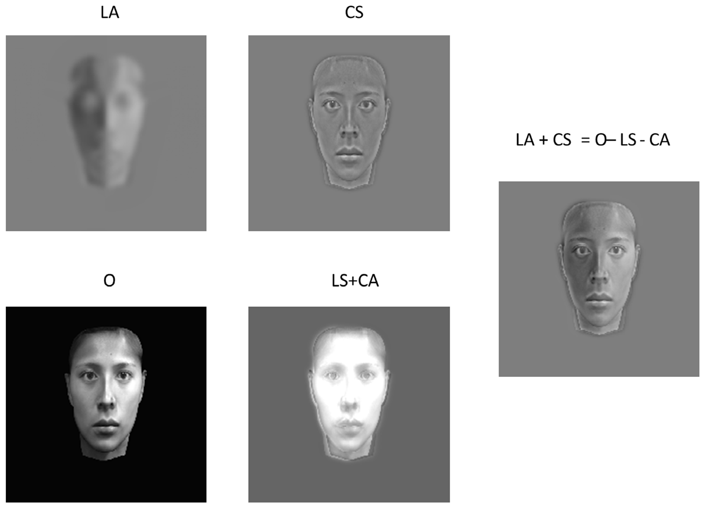
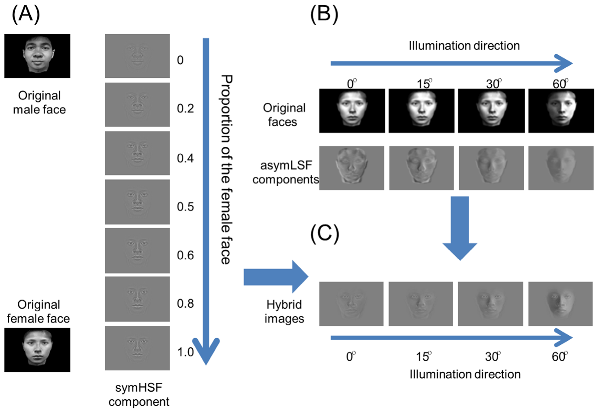
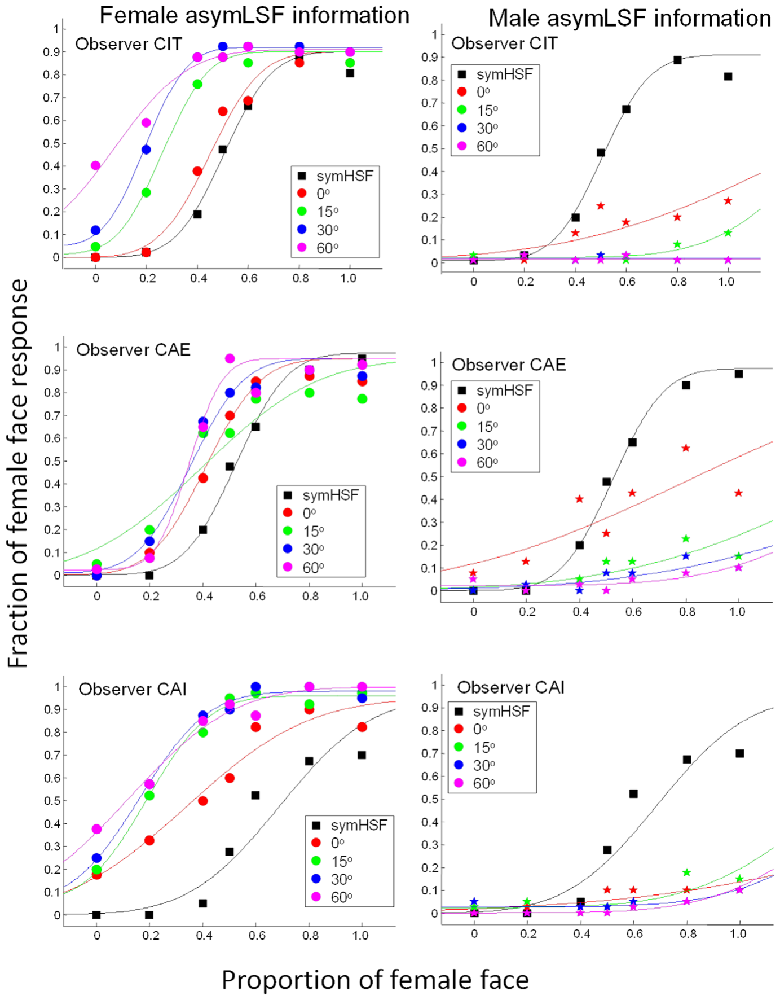
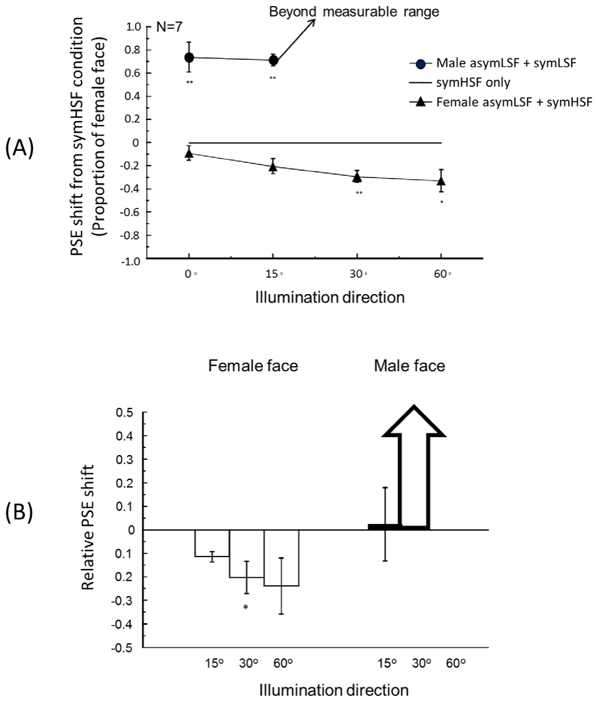
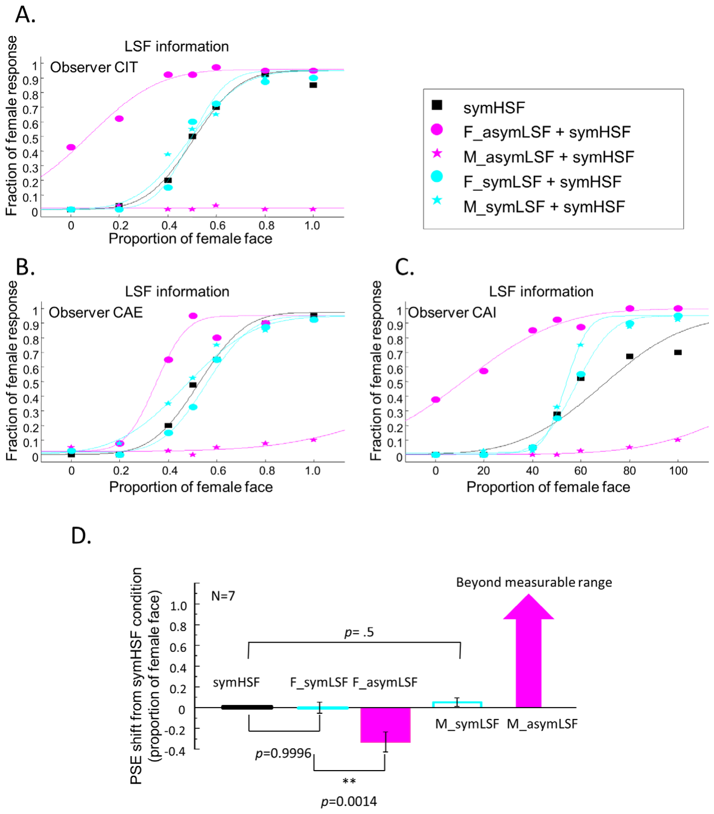
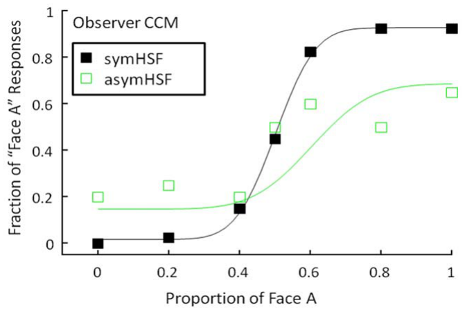
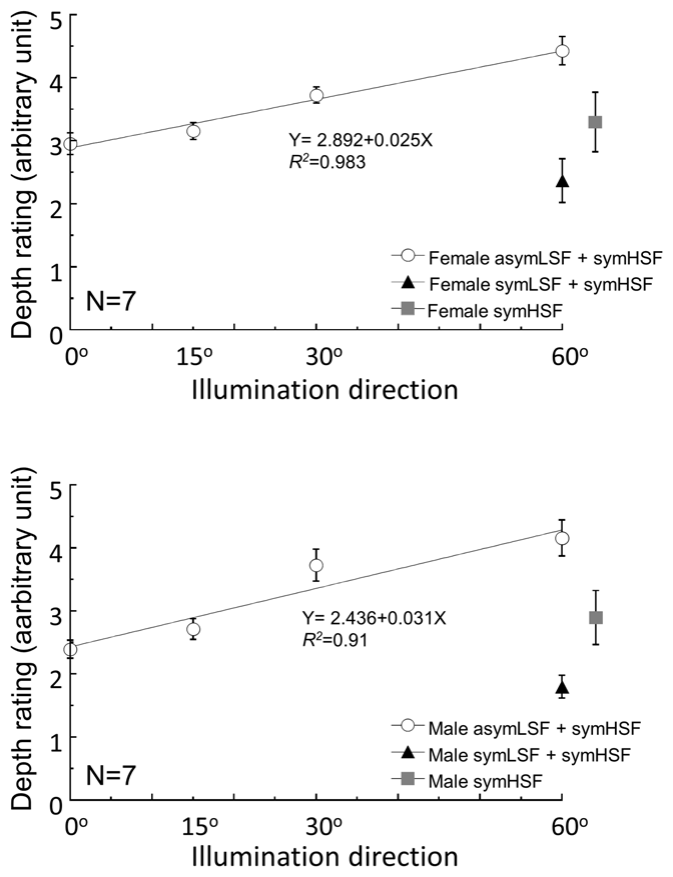
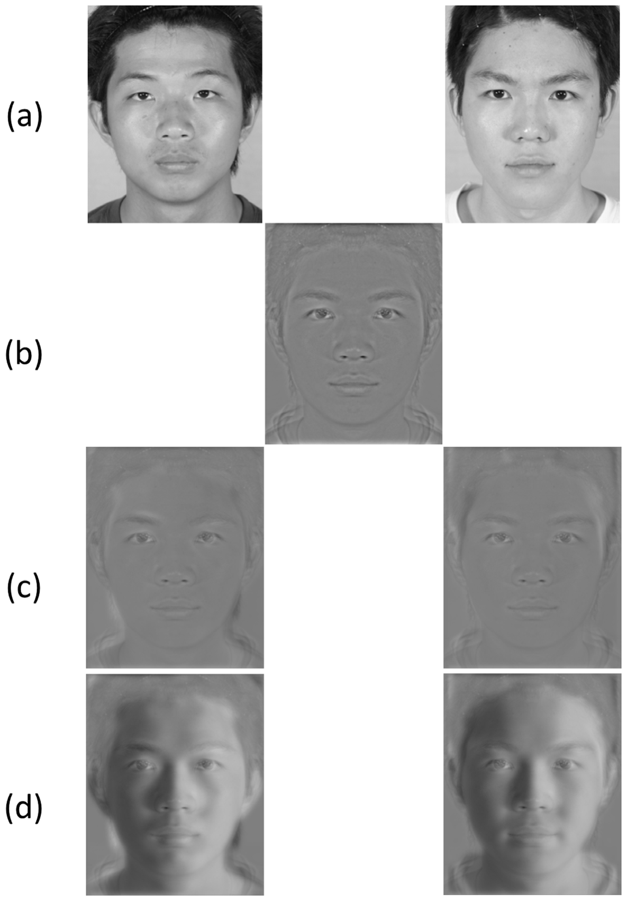
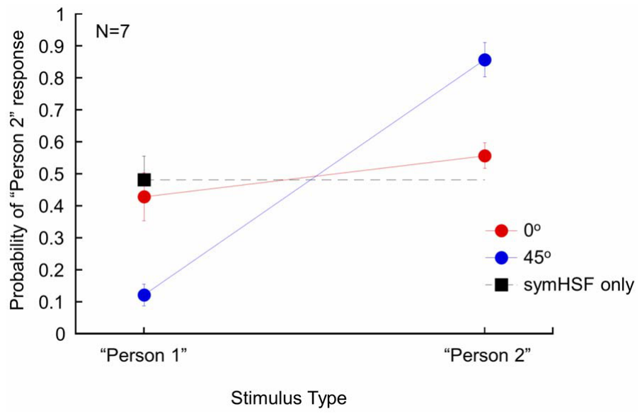
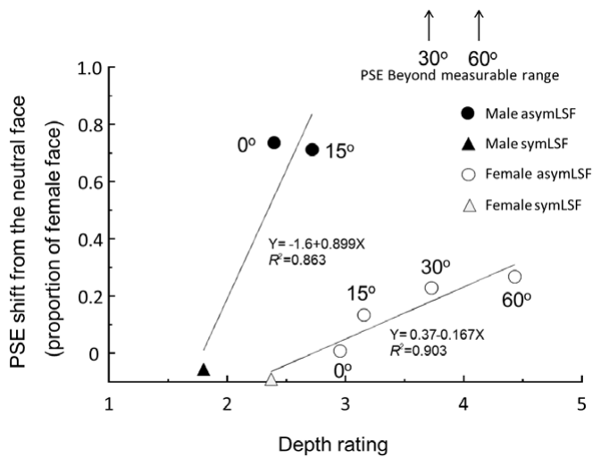

# 비대칭 음영에서 얻는 깊이 구조가 얼굴 변별을 돕는다

> **원문** Chen C-C, Chen C-M, Tyler CW (2013). *Depth Structure from Asymmetric Shading Supports Face Discrimination.* PLoS ONE 8(2): e55865. https://doi.org/10.1371/journal.pone.0055865
>
> **라이선스** 원문 Copyright © 2013 Chen et al. [Creative Commons Attribution License](https://creativecommons.org/licenses/by/4.0/)로 배포되며, 원저자와 출처를 밝히는 조건으로 모든 매체에서 제한 없는 이용·배포·복제를 허용합니다.
>
> **변경 사항** 영어 원문을 한국어로 번역했습니다. 그림은 원문에서 잘라 캡션 앞에 넣었고, 참고문헌 목록은 생략했습니다(본문의 [숫자]는 원문 참고문헌 번호). 원문 PDF에서 깨진 기호(도 단위, ×, ±, 음수 부호, 수식)는 문맥에 맞게 복원했습니다. 원저자가 검토한 번역이 아닙니다.

**용어 대응** — 음영(shading): 빛이 곡면에 닿는 각도에 따라 생기는 점진적 밝기 변화 · 음영으로부터의 형태(shape from shading) · 반사율/알베도(albedo): 표면 고유의 색·반사 성질 · 조도(illuminance) · 공간 주파수(spatial frequency): 낮을수록 굵고 흐린 명암, 높을수록 세밀한 윤곽 · symHSF/asymHSF: 대칭/비대칭 고주파 성분 · symLSF/asymLSF: 대칭/비대칭 저주파 성분 · 하이브리드 얼굴(hybrid face): 서로 다른 성분을 합성한 얼굴 · 주관적 등가점(PSE, point of subjective equality): 응답이 50%가 되는 자극 수준 · 심리측정 함수(psychometric function)

---

## 초록

조명 방향이 관찰자의 얼굴 변별 능력에 주는 효과를 조사하기 위해, 우리는 스캔한 3D 얼굴 모델에서 조명 방향을 조작했다. 정면 얼굴 이미지의 표면 반사율 성분과 조명 성분을 분리하기 위해, 저주파와 고주파 대역 모두에서 얼굴의 대칭 성분과 비대칭 성분을 분리할 수 있는 대칭 알고리즘을 도입한다. 이 접근을 바탕으로, 대칭·비대칭 공간 주파수 내용을 서로 다르게 조합한 하이브리드 얼굴 자극을 만들었다. 이 이미지로 얻은 변별 결과는, 비대칭 조명 정보는 얼굴 지각을 음영 성분의 구조 쪽으로 치우치게 했지만 대칭 조명 정보는 효과가 있더라도 거의 없었음을 보여 주었다. 지각된 깊이를 측정한 결과, 이 속성은 비대칭 저주파 성분에 따라 체계적으로 증가했지만 대칭 저주파 성분에 따라서는 그렇지 않았다. 종합하면 이 결과는 (1) 비대칭 3D 음영 정보가 지각된 얼굴 정보와 얼굴 구조의 지각된 깊이 모두에 극적으로 영향을 주며, (2) 이 두 효과 모두 조명 방향이 옆으로 옮겨 갈수록 커진다는 것을 시사한다. 따라서 우리의 결과는 얼굴 처리에 강한 3D 성분이 있다는 가설을 뒷받침한다.

**연구비** NSC(대만) 96-2413-H-002-006-MY3(CCC), AFOSR(미국) 09-NL-072(CWT), 대만 교육부 AIM for Top University Excellent Research Project 102R892101. 연구비 제공자는 연구 설계, 자료 수집과 분석, 출판 결정, 원고 준비에 아무 역할도 하지 않았다. **이해 상충** 저자들은 이해 상충이 없다고 밝혔다.

## 서론

시각계는 한 눈으로 볼 때에도(또는 2D 사진을 볼 때에도) 2D 망막 이미지로부터 물체의 3D 표상을 지각할 수 있게 해 준다. 이 3D 표상에 유용한 단서 중 하나는 음영, 즉 조명된 표면의 휘도가 점진적으로 변하는 것이다[1]. 표면의 한 점에서 눈에 도달하는 휘도는 표면에 닿는 빛의 세기와 입사각에 함께 의존한다. 따라서 균일한 조명 아래에서 음영은 조명 방향에 대한 국소 표면 기울기의 정보를 주며, 그러므로 표면 위 각 점의 상대적 깊이 해석을 제약하는 데 쓰일 수 있다[1], [2]. Ramachandran[3], [4]은 Gregory[7]가 논의한 Brewster[5], [6]의 관찰을 활용해, 인간 시각계가 음영 정보에서 형태를 추출할 때 두 가지 가정을 쓴다는 것을 더 보였다. 하나는 장면 전체를 비추는 광원이 하나라는 것이고, 다른 하나는 빛이 위에서 비춘다는 것이다(더 정확히는 약간 왼쪽 위에서 비추는 방향; [8], [9]). 이 두 제약으로 시각계는 음영으로부터의 형태 문제를 풀 수 있는데, 위에서 아래로 밝음에서 어둠으로 가는 휘도 기울기는 볼록한 표면을, 어둠에서 밝음으로 가는 기울기는 오목한 표면을 암시한다. 이런 효과는 흔히 '분화구 착시'로 시연되는데, 이미지를 뒤집으면 표면 지각이 볼록에서 오목으로, 또는 그 반대로 바뀔 수 있다[5], [10].

Brewster식 음영으로부터의 형태 원리에는 한계가 있다. '오목한 얼굴 착시'[11]에서 보듯, 오목한 얼굴은 조명이 위에서 오든 아래에서 오든 볼록하게 지각된다. 이 오목한 얼굴 착시에 대한 한 가지 해석은, 얼굴은 형태를 알고 있는 익숙한 물체이므로 3D 형태를 풀 때 음영 정보에 거의 비중을 두지 않는다는 것이다. 그렇다면 얼굴 지각은 음영에 비교적 둔감해진다. 그러나 이 해석은 아래에서 조명한 얼굴을 위에서 조명한 얼굴보다 알아보거나 맞추기가 더 어렵다는 것을 보인 여러 연구[12–15]와 모순된다. 즉 얼굴에서 조명 방향이 바뀌는 것은 음영으로부터 지각되는 형태에는 거의 효과가 없지만 얼굴 인식에는 효과가 있다. 또한 사진 음화처럼 얼굴 이미지의 휘도 분포를 대비 반전하면 얼굴 인식이 손상된다는 것도 보여졌다[13], [16–18]. 그러나 우리가 아는 한, 관찰자가 오목한 얼굴이나 아래에서 조명한 얼굴에서 정상적인 위 조명 얼굴과 같은 깊이를 지각하는지에 대한 신뢰할 만한 측정은 없다. 어쩌면 그런 부자연스럽게 조명된 얼굴의 정보 중 일부만 시각계가 복원할 수 있고, 복원된 정보는 오목한 얼굴을 볼록하게 지각하기에는 충분하지만 관찰자가 아래 조명 얼굴의 형태를 위 조명 얼굴만큼 잘 알아보기에는 충분하지 않을 수 있다.

그래서 우리는 여러 조명 방향에 걸쳐 음영이 얼굴 지각에 주는 효과를 조사했다. Brewster식 위 조명 제약에서 생길 수 있는 '부자연스러움' 요인의 방해를 피하기 위해, 모든 수평 광원 위치가 생태학적으로 똑같이 그럴듯하다는 사실을 이용해 광원 위치를 얼굴 정면에서 옆으로 수평 이동시켰다.

우리 눈에 도달하는 빛은 3D 공간에서 조명과 반사율 분포의 곱이므로, 조명 정보와 얼굴 정보를 분리하려면 일반적으로 복잡한 계산이 필요하다[19–21]. 그러나 정면 얼굴 이미지라는 중요한 경우에는 얼굴이 대칭이라는 사실[22–25]을 이용해 계산의 복잡도를 줄일 수 있다[21]. 따라서 이 연구에서는 정면 얼굴 이미지에 집중했다. 조명 정보와 얼굴 정보는, 얼굴이 대칭이고[22–25] 대략 람베르트 반사 특성을 가지며 확산 환경광에 더해 단일 광원으로 조명된다는 가정에 기반한 알고리즘으로 분리했다(방법 참조). 이런 조건에서 얼굴 정보는 두 종류로 나눌 수 있다. 얼굴 표면의 고유한 색과 반사 특성에서 오는 정보, 즉 '표면 알베도'와, 3D 얼굴 형태에 관한 표면 조도에서 오는 정보로, 후자는 입사 조명과 입사각의 코사인의 곱이다. 즉 이미지에서 한 점 (x, y)의 순 휘도 S′(x, y)는 이 두 성분의 곱으로 쓸 수 있다.

$$S'(x,y) = C'(x,y)\cdot L'(x,y) \qquad (1)$$

여기서 C′(x, y)는 위치 (x, y)의 표면 반사율, 즉 알베도를 나타내고 L′(x, y)는 표면 조도다[1],[2],[21]. 프라임 기호는 이 변수들의 절대 수준을 나타내며, 아래에서 프라임 없이 도입하는 대응 대비량과 구별하기 위한 것이다. (간단히 하기 위해 이후에서는 정의역 변수 (x, y)를 생략한다.)

표면 조도 성분 L′는 얼굴 표면의 법선 벡터와 조명 방향의 내적이다[1]. 표면 반사율 C′가 균일하면 L′를 반사 지도라고 부르며, 식 1은 Horn[1],[2]이 논의한 고전적 음영으로부터의 형태 문제에서 흔히 쓰는 양방향 반사 분포 함수로 환원된다. 따라서 얼굴 이미지에서 L′는 얼굴 표면의 깊이 정보를 담고 있다.

반사율 성분과 조명 성분 모두 0보다 작은 값을 가질 수 없으므로, 이 두 성분을 평균 주위의 대비 변동으로(최댓값 1로 척도화하여) 다시 쓸 수 있다.

$$S \propto (1+C)\cdot(1+L) = 1 + C + L + CL \qquad (2)$$

여기서 C는 이미지 정의역 (x, y)에 걸친 얼굴 고유 색, 즉 반사율의 대비이고, L은 조명 성분에서 오는 이미지의 휘도 대비다. C = (C′ − Cm)/Cm, L = (L′ − Lm)/Lm이며, Cm과 Lm은 각각 반사율 성분과 조명 성분의 평균이다.

사람 피부가 반사율이 조명 각도에 비례한다는 람베르트 특성에 가까운 한(광택 하이라이트를 제외하면), 특정 관찰 각도에서 표면 위 어느 점의 반사율도 그 각도에서의 완전 정반사율보다 훨씬 작다. 따라서 식 2의 L은 조명 방향이 표면의 법선 벡터와 일치할 때에만 최댓값에 가깝다. 따라서 전형적인 머리 형태를 고려하면, L은 정면 조명 방향의 고립된 점들에서만 최댓값에 가깝다. 또한 얼굴 대부분은 비슷한 색의 피부로 덮여 있으므로, 표면 반사율 C′는 비슷하게 행동하며 얼굴 대부분에서 1보다 훨씬 작아야 한다. 눈썹이나 눈 세부처럼 피부와 색이 다른 얼굴 부위에서는 이런 단순화가 실패할 수 있다고 주장할 수도 있다. 그러나 우리는 데이터베이스[26]의 얼굴 76개에서 이런 세부의 크기를 계산했고, 이 특징들을 합쳐도 얼굴 면적의 약 3%만 차지한다는 것을 발견했다. 따라서 하이라이트가 없는 얼굴 모델에서는 식 2의 상호작용 항에 있는 C와 L의 곱을 우리 자극에 대해 무시할 수 있는 것으로 다룰 수 있다. 따라서 1차 근사로,

$$S - 1 \approx C + L \qquad (3)$$

일반적으로 어떤 함수든 대칭(S) 성분과 비대칭(A) 성분으로 분해할 수 있다. 이 분해를 식 3의 항들에 적용하면 각 항은 다음과 같이 분해된다.

$$L = L_S + L_A \qquad (4a)$$

$$C = C_S \qquad (4b)$$

여기서 조명 성분에 대해 LS(x, y) = LS(−x, y), LA(x, y) = −LA(−x, y)이고, 반사율 성분에 대해 CS(x, y) = CS(−x, y)이다. 식 (4b)에서 CA 성분을 생략한 것은, 본 연구에서 사용한 대칭 시점에서는 비대칭 반사율 성분을 무시할 수 있기 때문이다(즉 CA ≈ 0). 따라서 대칭으로 본 얼굴에서 표면 반사율을 조명 성분에서 효과적으로 분리하는 데 필요한 것은, 남은 대칭 조명 성분 LS를 반사율 성분 전체인 CS와 구별하는 것뿐이다. 우리는 a) CS는 주로 고주파 에너지를, LS는 주로 저주파 에너지를 담고 있고, b) 각각의 나머지 주파수 대역(즉 저주파 CS와 고주파 LS)은 얼굴 재구성과 거의 관련이 없다고 가정한다. 이 근거는, 얼굴이 주로 균일한 반사율과 형태의 매끄러운 변화를 가진 피부(적어도 젊은 얼굴에서는)를 배경으로 날카로운 윤곽을 가진 특징들로 주로 이루어진다는 관찰에 기반한다. 따라서 공간 주파수별 필터로 두 대칭 성분을 효과적으로 분리할 수 있다. 중요한 점은, 이 접근이 특징(알베도) 성분에 눈에 띄는 영향을 주지 않고 얼굴의 비대칭 음영 성분을 통해 지각된 깊이를 바꿀 수단을 제공한다는 것이다.

(역자 주: 원문 PDF에서는 아래첨자가 본문과 같은 크기로 표기되어 LA, CS처럼 보인다. 이하 본문에서는 원문처럼 LA, CS, LS, CA로 적는다. LA, CS 등과 뜻이 같다.)

그림 1은 우리의 방법을 보여 준다. LA는 원래 얼굴 이미지 O의 비대칭 조명 정보를 나타내는 비대칭 저주파 성분이고, CS는 반사율 성분을 나타내는 대칭 고주파 성분이다. 하이브리드 얼굴 LA+CS는 LA와 CS의 합이며 지각적으로 원래 얼굴과 거의 같다. 이 시연은 남은 비대칭 고주파 성분과 대칭 저주파 성분의 조합(LS+CA)이 얼굴 지각에서 거의 역할을 하지 않는다는 것을 보여 준다. 따라서 원래 얼굴 이미지에서 그것들을 빼도 우리의 지각은 거의 영향을 받지 않는다.

현재 연구에서 우리는 비대칭 저주파 성분의 관점에서 본 조명 변화가 하이브리드 얼굴에 대한 a) 얼굴 변별과 b) 깊이 판단에 어떻게 영향을 주는지 조사했다. 특정 공간 주파수 범위의 상대적 기여를 연구하기 위해 하이브리드 그림 패러다임[27], [28]을 사용했다. 우리의 경우 하이브리드 얼굴은 CS와 LA, 또는 CS와 LS의 조합이다(식 1–3). 구체적으로, 남자 얼굴의 대칭 고주파 성분과 여자 얼굴의 대칭 고주파 성분을 서로 다른 가중치로 모핑해 두 얼굴의 정보를 모두 담은 고주파 성분 세트를 만들었다(그림 2a). 그런 다음 여러 조명 방향의 저주파 성분(그림 2b)을 더해, 다양한 성별 혼합과 조명 방향의 하이브리드 얼굴(그림 2c)을 만들었다. 대조군으로 대칭 저주파 내용의 예도 포함했다.

실험의 목표는 이 하이브리드 얼굴들에 대한 얼굴 변별 수행을 측정하는 것이었다. 조명 방향이 얼굴에서 3D 형태 정보를 복원하는 데 영향을 준다면, 조명 조건 간 차이가 하이브리드 얼굴의 얼굴 변별과 깊이 판단 모두에 영향을 줄 것으로 예상해야 한다. 또한 그런 조명 효과가 얼굴 이미지의 비대칭 저주파 성분을 통해 영향을 발휘하고 대칭 성분의 기여는 거의 없어야 한다는 제안을 검증하기 위해 대조군을 포함했다.

## 방법

### 윤리 선언

이 연구는 국립타이완대학병원 연구윤리심의위원회의 승인을 받았다. 각 관찰자에게서 서면 동의를 받았다. 인간 참가자의 이용은 헬싱키 선언에 표명된 원칙과 현지 규정을 따른다.

### 장치

자극은 ATI Radeon 9800PRO 그래픽 카드를 단 HP D325MT 컴퓨터로 제어하는 ViewSonic VA902 17인치 LCD 모니터에 제시했으며, 시간 재생률 60 Hz(비월 주사 아님), 공간 해상도 1280(가로) × 1024(세로)로 작동했다. (역자 주: 원문 PDF의 "VA902 170"은 17인치 표기가 깨진 것으로 보인다.) 관찰 거리는 127.5 cm였고, 이 거리에서 각 픽셀은 약 0.01°(가로) × 0.01°(세로)에 해당했다. 완전히 선형화된 휘도 출력을 제공하기 위해 LightMouse 광도계[29]로 모니터의 감마 함수를 1% 정밀도로 보정했고, 이 정보로 선형 8비트 색 참조표를 계산했다. 결과 참조표의 정확도는 International Light RPS-380 분광복사계로 확인했다. 실험 제어 소프트웨어는 Psychophysics Toolbox[30],[31]와 함께 MATLAB(MathWorks Inc, 1993)으로 작성했다. 디스플레이의 평균 휘도는 15 cd/m²였고 색도는 CIE 1931 xy 좌표로 (0.33, 0.33)이었다.

### 자극

얼굴 이미지(그림 2)는 Lin과 동료들[32],[33]이 개발한 3D 레이저 스캔 얼굴 한 쌍으로 만들었으며, 무표정한 여자 얼굴 하나와 남자 얼굴 하나의 3D 얼굴 모델로 이루어져 있다.

> **그림 1. 이미지에서 표면 반사율(CS)을 대칭·비대칭 조명 성분(LS, LA)에서 분리하는 시연.** 음영으로부터 형태를 얻는 과정을 통해, LA는 2D 이미지 위에서 얼굴에 대한 3D 정보를 제공했다. CS만 담은 얼굴은 매우 평평해 보인다. LA와 CS를 합치면, 많은 정보(LS+CA)를 버렸는데도 하이브리드 이미지(LA+CS)가 원본(O)과 비슷하다는 것을 쉽게 알 수 있다. 원본 이미지(O)는 Lin 등(2002, 2005)으로 만들었다.

(각 성별에서 우리의 음영 조작에 필요한 3D 모델 형식으로 구할 수 있는 얼굴은 하나뿐이었다.) 정면 얼굴 이미지는 3ds Max 2009(Autodesk, Inc., 2009)를 써서 질감을 입힌 3D 모델에서 렌더링했다. 필요한 조명 방향을 구성하는 데 Blinn–Phong 음영 모델[34]을 썼다. 먼저 모델 주위에 확산 광원 네 개를 두어 고른 환경광을 만들고 그림자 영역이 너무 어두워지지 않게 했다. 점광원은 머리 중심을 기준으로 얼굴의 수평 자오선 위 0°, 15°, 30°, 60°에 지정했다(조명 방향 0°는 광원이 얼굴 바로 앞에 있다는 뜻이다). 점광원과 환경광의 세기 비는 7.5로 설정했다.

또한 아래에서 설명하는 하이브리드 얼굴 생성을 위한 순수 대칭 고주파 자극을 만드는 데에는 환경광 조명 아래의 3D 얼굴 모델을 썼다. 모든 이미지는 256단계 회색조 이미지였다.

식 3a와 3b에서 전개했듯이, 대칭으로 본 얼굴 이미지는 이론적으로 세 부분으로 분해할 수 있다. 비대칭·대칭 조명 성분 LA와 LS, 그리고 대칭 반사율 성분 CS다. (역자 주: 원문의 "식 3a, 3b"는 위의 식 4a, 4b를 가리키는 것으로 보인다. 아래의 "식 3a", "식 3b"도 같다.) 이 분해는 실제로 다음 단계로 이루어졌다. 먼저 얼굴 이미지를 주파수 영역으로 푸리에 변환하고, 변환된 이미지의 실수부와 허수부를 각각 대칭 성분과 비대칭 성분을 정의하는 것으로 취했다. 대칭 성분과 비대칭 성분 모두에 a) 저역 통과(N(0, σ)) 가우스 함수와 b) 고역 통과(1 − N(0, σ)) 가우스 함수를 곱해 각각 저주파와 고주파 정보를 추출했으며, 차단 주파수 σ는 얼굴 폭당 12 사이클로 설정했다. 이어서 역푸리에 변환으로 얼굴 이미지를 네 성분으로 분리했다. 대칭 저주파(symLSF, 식 3a의 LS에 대응), 대칭 고주파(symHSF, 식 3b의 CS에 대응), 비대칭 저주파(asymLSF, 식 3a의 LA에 대응), 비대칭 고주파(asymHSF) 성분이다. 모든 이미지의 모든 성분은 이후 처리 전에 같은 RMS 대비를 갖도록 정규화했다.

그림 1에서 보였듯이, asymHSF 정보는 3D 얼굴 지각에 거의 영향을 주지 않는다. 따라서 이 성분은 본 실험에 쓰지 않았다. 비교적 평평해 보이는 symHSF 이미지는 얼굴 특징의 세밀한 경계 정보와, 그에 따라 눈, 코, 입, 속눈썹 등의 정확한 2D 형태를 전달한다. 반면 LSF 얼굴 이미지는 강한 '조각 같은' 깊이 인상을 주며, 거친 규모의 3D 얼굴 배치와 조명 정보를 나타낸다.

> **그림 2. 저주파와 고주파 혼성화의 예.** A, 두 얼굴 사이에서 고주파의 대칭 성분(symHSF)을 모핑하고 저주파 정보는 그대로 두어 일련의 중간 얼굴 예를 만들었다. 이 성분은 여자 얼굴의 비율이 0(완전히 남자 얼굴)에서 1(완전히 여자 얼굴)까지인 일곱 수준이었다. B, 원래 얼굴을 저역 통과 필터링해 거친 규모의 음영 정보를 보존한 뒤 얻은, 여자 얼굴의 저주파(asymLSF) 성분의 예로, 네 조명 방향 0°, 15°, 30°, 60°에 대해 계산했다. C, 하이브리드 얼굴 자극은 한 조명 방향의 asymLSF 여자 얼굴(또는 남자 얼굴, 그림에는 없음)을 모핑된 얼굴에 결합한 것이다. 여기서는 0.5 여자 symHSF 성분에 네 조명 방향의 여자 asymLSF 성분을 결합한 예를 보이며, 조명 각도가 커질수록 지각된 깊이가 강해지는 것을 볼 수 있다. 60° 조명 각도의 결과 하이브리드 얼굴은 대부분의 관찰자가 여자로 분류했다. 이미지는 Lin 등(2002, 2005)의 3D 모델로 렌더링했다. 모델들은 자신의 사진 게재에 서면으로 동의했다.

우리가 쓴 하이브리드 얼굴 자극은 a) 환경광 조명 조건에서 만든 얼굴 이미지로 구성한 symHSF만의 이미지와, b) 점광원 조명 조건에서 만든 얼굴 이미지의 symLSF 또는 asymLSF 성분의 조합이었다. 남자와 여자 symHSF 얼굴 사이의 이미지 모핑을 만드는 데 FantaMorph 4.0(Abrosoft, 2009)을 썼다. 여자 얼굴의 비율이 0(완전히 남자 얼굴)에서 1(완전히 여자 얼굴) 사이에서 변하는 일곱 개의 모핑된 symHSF 이미지가 있었다. 그림 2A는 이 symHSF 이미지 모핑의 예를 보여 준다.

asymLSF 성분은 네 수평 조명 각도(0°, 15°, 30°, 60°)에서 렌더링한 얼굴로 만들었다. 네 조명 각도에서 렌더링한 얼굴과 그 asymLSF 성분은 그림 2B에 제시되어 있다. 좌우 비대칭 조명 변화에 불변인 symLSF 성분이 얼굴 변별에 거의 효과가 없음을 확인하기 위해, 60° 조명 아래 얼굴의 이 symLSF 성분도 대조군으로 포함했다.

마지막으로 하이브리드 얼굴(그림 2C)은 특정 남녀 모핑 수준의 중립 symHSF 성분과, 한 조명 조건의 asymLSF 또는 높은 조명 각도의 (대조) symLSF 성분으로 이루어졌다. LSF 성분은 100% 남자 얼굴 또는 100% 여자 얼굴에서 가져왔다. 실험에 쓴 하이브리드 얼굴 이미지는 모두 56개(asymLSF 조명 방향 4 × 얼굴 2(남자와 여자) × symHSF 모핑 수준 7)였다. 또한 추가 대조를 위해 symLSF와 symHSF 하이브리드 이미지 14개(얼굴 2(남자와 여자) × symHSF 모핑 수준 7)와 서로 다른 모핑 수준의 symHSF만의 이미지 7개도 썼다. 따라서 연구에는 모두 77개의 얼굴 이미지가 쓰였다. 마지막으로 구성한 하이브리드 이미지는 2D 4제곱 가우스 함수 exp(−x⁴/σx⁴ − y⁴/σy⁴)로 창을 씌웠으며, 여기서 σx = 1.2°와 σy = 1.3°는 각각 x, y 방향의 공간 상수다. 4제곱 가우스는 공간 상수 1단위 안의 정보는 거의 모두 유지하면서, 좁지만 매끄러운 전이로 이 범위 밖의 정보는 대부분 제거한다는 좋은 특징이 있다. 따라서 얼굴의 귀에서 귀까지 폭이 3.0°로 설정되었으므로, 이 필터링은 모든 얼굴 특징은 유지하면서 머리카락, 귀, 얼굴 외곽선 같은 무관한 외부 단서는 제거했다.

### 절차

**얼굴 변별.** 각 검사 이미지에 대한 '여자' 판단의 비율을 측정하기 위해 항상 자극법을 썼다. 각 시행에서 관찰자에게 77개 얼굴 이미지 중 하나를 500 ms 동안 제시했다. 이미지 제시 순서는 무작위로 했다. 제시 후 관찰자에게 평균 휘도의 빈 화면을 보여 주고, 자극이 남자 얼굴과 여자 얼굴 중 어느 쪽에 더 비슷하게 지각되었는지 키를 눌러 표시하게 했다. 다음 시행은 관찰자가 응답하고 1초 뒤에 시작했다. 관찰자에게 수행에 대한 피드백은 주지 않았다.

각 심리측정 함수는 조명 조건은 같고 남녀 모핑 수준이 다른 이미지에 대한 '여자 얼굴' 판단의 비율로 이루어졌다. 얼굴 이미지당 40회 시행이 있었다. 따라서 모핑 수준이 일곱 개이므로 심리측정 함수당 280회 시행이 있었다. 본 실험에서는 asymLSF+symHSF 8개(0°, 15°, 30°, 60°의 조명 4개 × 개별 얼굴 2개)와 symHSF만의 조건 하나가 주어져, 이 설계로 관찰자마다 모두 11개의 심리측정 함수가 생성되었다. (역자 주: 원문 그대로 옮겼다. 8 + 1 = 9이므로 "11개"와 맞지 않는다. 원문에 설명이 없다.)

또한 symLSF 성분의 효과를 평가하기 위해, 한 대조 실험은 추가 심리측정 함수 두 개(60° 조명 조건의 남자·여자 asymLSF)를 제공해 본 실험의 해당 asymLSF+symHSF 심리측정 함수와 비교했다. (역자 주: 원문은 "asymLSF"라고 적었지만, 표 1과 결과로 보아 대조 실험에 추가된 것은 symLSF 조건으로 보인다.) asymHSF 성분의 효과를 평가하기 위해, 또 다른 실험은 asymHSF만의 자극으로 심리측정 함수를 제공해 본 실험의 symHSF만의 조건과 비교했다. 모든 검사 조건은 표 1에 나열했다.

**깊이 판단.** 두 번째 실험에서 관찰자들에게 얼굴 이미지의 지각된 깊이를, 고정된 기준 이미지인 음영 있는 구의 깊이에 대해 상대적으로 판단하게 했다. 깊이 판단에 쓴 얼굴 이미지는 얼굴 변별에 쓴 것 중 모핑 수준 0 또는 1.0의 이미지였다. 기준 구는 3ds Max 2009 소프트웨어 패키지(Autodesk, Inc., 2009)로 만들었으며, 구의 지름은 얼굴 이미지의 폭과 같고 조명 방향은 대칭(0°)이었다.

각 시행에서 관찰자에게 얼굴 이미지 중 하나를 기준 구와 함께 1초 동안 제시했다. 얼굴과 구는 3′ 간격을 두고 나란히 제시했다. (역자 주: 원문 PDF에는 "39 gap"으로 깨져 있다. 다른 곳에서 "u"가 도(°)로 깨진 것과 같은 방식으로 보면 "3′(분)"으로 읽히나 확실하지 않다.) 얼굴과 구의 위치(주시점의 왼쪽 또는 오른쪽)는 무작위로 정했다. 관찰자는 5점 리커트 척도(1 – 평평함, 5 – 매우 깊음)로 얼굴의 상대적 깊이를 평가하는 키 중 하나를 눌러야 했으며, 기준 구는 이 척도에서 깊이 3으로 여긴다는 기준이 주어졌다.

### 참가자

시력이 정상이거나 교정 시력이 정상인 관찰자 7명이 이 연구에 참여했고 시간에 대해 금전 보상을 받았다. 모두 이 연구의 목적을 몰랐고 자극으로 쓴 얼굴의 인물들을 알지 못했다. 모든 관찰자는 국립타이완대학 캠퍼스에서 모집한 대만인이었다. 따라서 타인종 효과[35], [36]는 개입하지 않았을 것이다. 실험 전에 각 관찰자에게서 사전 동의를 받았다.

### 자료 분석

각 LSF 조건에서 여자 얼굴 응답의 비율을 symHSF 성분의 모핑 수준에 대해 그렸다. 심리측정 함수는 누적 가우스 함수 a + (1 − a − b) · Φ(x; μ, σ)로 적합했으며, 여기서 μ는 가우스의 위치 모수(평균)로 주관적 등가점(PSE)을 지정하고, σ는 심리측정 함수의 기울기를 결정하며, a와 b는 각각 심리측정 함수의 하한과 상한을 정의한다. 서로 다른 조건의 PSE 차이의 유의성은 양측 대응 t 검정으로 평가했으며, Bonferroni 교정 p < 0.05를 유의성 기준으로 삼았다.

**표 1. 실험에 쓴 자극.**

| 조건 | 설명 |
|---|---|
| **본 실험** | |
| SymHSF만 | 대칭 고주파 성분. 기준선 조건 |
| AsymLSF+SymHSF | symHSF와, 0°, 15°, 30° 또는 60° 조명의 비대칭 저주파 성분의 합 |
| **대조 실험 1: 대칭 저주파 성분의 효과** | |
| SymLSF+SymHSF | 60° 조명 이미지의 모든 대칭 성분 |
| AsymLSF+SymHSF | 본 실험의, symHSF와 60° 조명의 비대칭 저주파 성분의 합 |
| SymHSF만 | 본 실험의 기준선 조건 |
| **대조 실험 2: 비대칭 고주파 성분의 효과** | |
| AsymHSF만 | 비대칭 고주파 성분 |
| SymHSF만 | 본 실험의 기준선 조건 |

## 결과

### asymLSF 정보는 하이브리드 얼굴의 지각된 얼굴 정보를 어떻게 바꾸었나

그림 3은 대표적인 관찰자 세 명의 여자 얼굴 판단 비율을 대칭 고주파(symHSF) 성분의 모핑 수준의 함수로 보여 주며, 비대칭 저주파(asymLSF)를 가진 하이브리드 얼굴에 대해 0°, 15°, 30°, 60° 조명 방향별로 따로 그렸다. 왼쪽 열은 여자 얼굴의 asymLSF 성분으로 측정한 심리측정 함수를, 오른쪽 열은 남자 얼굴의 것을 보여 준다. symHSF만의 조건에 대한 심리측정 함수(검은 사각형과 곡선)는 비교를 위해 해당 관찰자의 패널에 그렸다.

symHSF만의 조건에서 심리측정 함수는 S자 모양을 보인다. 여자 응답의 비율은 이미지 속 여자 성분의 비율과 함께 단조 증가했다. 중립 symHSF는 약 50%의 '여자' 응답을 낳았다. 따라서 symHSF만의 조건에서는 어느 한 성별로 응답이 치우치는 경향이 있더라도 거의 없다.

여자 얼굴의 asymLSF 성분을 symHSF 성분에 더하면 심리측정 곡선이 왼쪽으로 이동했다. 변화량은 대체로 조명 방향과 함께 커졌다. 관찰자들은 symHSF에 그 얼굴 정보가 아주 적은 비율만 담겨 있어도 하이브리드 얼굴을 여자 얼굴 쪽으로 보았다. 반대로 남자 얼굴의 asymLSF 성분을 더하면 심리측정 함수가 극적으로 오른쪽으로 이동했다. 이 오른쪽 이동은 30°와 60° 조명 방향에서 특히 두드러졌는데, 이 경우 관찰자들은 모핑 수준과 관계없이 항상 남자 얼굴을 보았다. 따라서 남자 얼굴의 비대칭 저주파 정보가 여자 얼굴의 것보다 더 강한 효과를 냈다. 이 치우침은 두 얼굴 사이의 성별 정보 차이 때문일 수 있는데, Bruce 등[37],[38]이 얼굴 인식과 변별 과제에서 비슷한 남성 우위 효과를 보였기 때문이다.

asymLSF의 효과를 정량화하고 관찰자 일곱 명 모두의 결과를 요약하기 위해, 각 관찰자의 각 심리측정 함수에 대해 PSE(여자 응답 50%에 해당하는 여성성의 비율)를 구했다. 그림 4(A)는 symHSF만의 조건에 대한 평균 PSE를 보여 준다. 양의 값은 심리측정 곡선의 오른쪽 이동, 즉 symHSF만의 조건에 비해 남자 얼굴 응답이 더 많은 쪽으로의 치우침을 뜻하고, 음의 값은 왼쪽 이동, 즉 여자 얼굴 응답이 더 많은 쪽으로의 치우침을 뜻한다. 그림 4에 제시한 p 값은 각 조명 조건의 PSE를 symHSF만의 조건과 비교한 양측 대응 t 검정이다. 오차 막대는 관찰자 간 ±1 평균의 표준오차(SEM)를 보여 준다. 0° 조명 방향의 여자 얼굴 asymLSF를 제외한 모든 asymLSF 효과가 유의했다. 또한 PSE 이동은 조명 방향과 함께 커졌다(그림 4B). 남자 얼굴의 경우, 복잡한 3D 구조 얼굴의 잔여 음영 정보만으로도 asymLSF 효과가 유의했지만, 30°와 60° 조건의 asymLSF 이동은 변별을 매우 효과적으로 강화해 PSE가 측정 가능 범위를 벗어났다. 따라서 더 극단적인 조명 각도는 관찰자가 asymLSF 성분의 성별 쪽으로 응답을 치우치게 하는 것을 더 쉽게 만들었다.

> **그림 3. asymLSF가 얼굴 변별에 주는 효과.** 각 행은 목적을 모르는 관찰자 세 명 중 한 명의 심리측정 함수를 보여 준다. '여자 얼굴' 응답의 비율을 합성 이미지 속 여자 얼굴의 비율의 함수로 그렸다. 검은 심리측정 함수는 비교를 위해 그린 symHSF만의 조건이다. 빨강, 초록, 파랑, 자홍 심리측정 함수는 범례에 표시한 서로 다른 조명 방향을 나타낸다. 여자 얼굴 asymLSF 조건(왼쪽 열)에서는 조명 각도가 커짐에 따라 심리측정 함수가 점차 왼쪽으로 이동했다. 반대로 남자 얼굴 asymLSF 조건(오른쪽 열)에서는 심리측정 함수가 극적으로 오른쪽으로 이동했다.

> **그림 4. PSE 이동.** (A) symHSF만의 조건으로부터의 PSE 이동에 대한 asymLSF의 효과를 관찰자에 걸쳐 평균한 것. (B) 0° 조명 방향으로부터의 상대 PSE 이동. 오차 막대는 표준오차 하나를 나타낸다. Bonferroni 교정 후 양측 대응 t 검정에서 p < .05와 0.01의 통계적 유의 차이를 각각 별표 하나와 둘로 표시했다. 남자 얼굴 30°와 60° 조명 방향의 평균 PSE 이동은 너무 커서 측정 가능 범위를 벗어났으며, 화살표로 표시했다.

(역자 주: 그림 4A의 범례는 원문 그림에 "Male asymLSF + symLSF"로 적혀 있으나, 본문으로 보아 남자 asymLSF + symHSF를 뜻하는 것으로 보인다. 그림 4B의 세로축 눈금 중 0 아래의 "0.1", "0.2"도 원문 그림 그대로이며 음수로 읽어야 한다.)

### 하이브리드 이미지의 지각된 얼굴 정보는 대칭 LSF 정보에 불변이다

또한 얼굴 자극의 지각이 저주파 대칭 성분(symLSF)에 의해 asymLSF 성분처럼 영향을 받을 수 있는지 조사했다. 그림 5의 A–C 패널은 대표적 관찰자 세 명이 symLSF와 symHSF 정보의 완전 대칭 조합으로 이루어진 얼굴 하이브리드를 판단한 결과(청록색 기호와 곡선)를 보여 준다. 같은 60° 조명 조건의 asymLSF 조건 심리측정 함수(자홍색 기호와 곡선)와 symHSF만의 조건(검은 기호와 곡선)은 비교를 위해 여기에 다시 그렸다. 별 기호는 남자 얼굴 LSF 성분에 대한 판단을, 원은 여자 얼굴 LSF 성분에 대한 판단을 나타낸다.

그림 3과 달리, symLSF 정보는 100% 남자 얼굴이나 100% 여자 얼굴에서 가져왔는데도 심리측정 함수에 유의한 효과를 내지 않았다. 그림 5D는 관찰자 일곱 명의 PSE를 요약한다. symHSF만의 조건에 비해 symLSF 정보를 더해도 유의한 치우침이 생기지 않았다(여자 얼굴 조건 t(6) = −0.00045, p > .99, 남자 얼굴 조건 t(6) = −1, p = .5). 반면 asymLSF 조건과 symLSF 조건의 차이는 매우 유의했다(여자 얼굴 조건 t(6) = 5.603, p = .0014, 남자 얼굴 조건에서 둘의 차이는 명백히 유의했지만 측정 가능 범위를 벗어났다). 즉 asymLSF 성분을 더하면 관찰자의 응답이 치우쳤지만 symLSF 성분을 더하면 그런 효과가 없었다.

60° 조명에서 symLSF의 효과를 검사하는 것이 이상적이지 않을 수 있다고 주장할 수도 있다. 결국 공정한 비교를 하기에는 symLSF의 세기가 너무 약할 수 있다는 것이다. 그러나 우리는 각 성분의 대비를 정규화했으므로(방법 참조), symLSF와 asymLSF 성분의 세기는 같아야 한다. 더 나아가 정규화하지 않더라도, 60° 조명의 symLSF는 0° 조명의 세기의 절반을 유지해야 한다. 따라서 symLSF에 있을 수 있는 형태 정보는 온전히 남아 있어야 하며, 따라서 평가를 왜곡하지 않을 것이다.

> **그림 5. asymLSF와 symLSF 정보가 얼굴 변별에 주는 효과의 비교.** A-C, 목적을 모르는 관찰자 세 명의 심리측정 함수. '여자 얼굴' 응답의 비율을 여자 얼굴 비율의 함수로 그렸다. 검은 곡선: 해당 관찰자의 symHSF만의 조건. 청록 곡선: 여자·남자 조건의 symLSF+symHSF. 자홍 곡선: asymLSF+symHSF 얼굴. symLSF 성분은 얼굴 변별에 거의 영향을 주지 않았으며, 이는 심리측정 곡선이 유의하게 이동하지 않은 것으로 나타난다. D, symHSF만의 조건에 대한 평균 PSE 이동. 그 밖의 규칙은 그림 3과 같다.

추가 대조로 HSF 성분에 대해서도 같은 비교를 했다. 그림 6은 대표적 관찰자 한 명의 asymHSF와 symHSF 심리측정 함수를 보여 준다. 대칭 HSF 심리측정 함수(검은 채운 사각형)는 그림 3과 5의 것과 같은 행동을 보였다. 여자 얼굴 응답의 비율이 음영 이미지 속 여자 얼굴의 비율과 함께 증가해, 여자 얼굴 비율 0.3에서는 사실상 모두 '남자 얼굴' 응답이었고 0.7에서는 사실상 모두 '여자 얼굴' 응답이었다.

반면 고주파 범위에서 비대칭 HSF 조건(초록 빈 사각형)은 기울기가 훨씬 완만한 심리측정 함수를 낳았다. 여자 얼굴 내용이 없는 이미지에도 '여자 얼굴' 응답이 상당한 비율로 있었고, 그 반대도 마찬가지였다. 여자 얼굴 수준에 따른 이 약한 변화는 asymHSF 성분이 symHSF 성분보다 지각된 얼굴을 덜 치우치게 했음을 시사한다.

> **그림 6. asymHSF와 symHSF가 얼굴 변별에 주는 효과의 비교.** '여자 얼굴' 응답의 비율을 음영 이미지 속 여자 얼굴 비율의 함수로 그렸다. 검은 곡선과 채운 사각형: 대칭 HSF 조건. 초록 곡선과 빈 사각형: 비대칭 HSF 조건. 그 밖의 규칙은 그림 3과 같다.

(역자 주: 그림 6 이미지의 축 이름은 캡션과 달리 "Face A" 응답의 비율과 "Face A"의 비율로 적혀 있다. 원문 그대로 두었다.)

### 깊이 판단

그림 7은 네 조명 방향의 asymLSF+symHSF 얼굴(빈 원)에 대한 깊이 평가를 보여 준다. symLSF+symHSF 얼굴(채운 삼각형)과 symHSF만의 얼굴(채운 사각형)에 대한 깊이 평가는 비교를 위해 그렸다. symHSF 성분은 1.0(여자 얼굴, 패널 A) 또는 0.0(남자 얼굴, 패널 B)으로 설정했다. 기준 구의 깊이 값은 3으로 설정했다. asymLSF+symHSF 얼굴의 지각된 깊이는 조명의 수평 방향에 따라 기준선 수준에서 증가했다. 이 증가는 선형 회귀선으로 잘 기술된다. 선형 회귀는 매우 유의했으며(p < 0.001), R²는 여자와 남자 asymLSF+symHSF 하이브리드 얼굴에서 각각 0.983과 0.91이었다. 기울기 모수는 0보다 유의하게 컸다(여자 얼굴 t(2) = 10.67, p = 0.0086, 남자 얼굴 t(2) = 4.49, p = 0.046). 이 결과는 깊이 판단의 변화가 서로 다른 조명 방향에 따른 PSE 이동과 일관된다는 것을 보여 준다. 즉 조명 방향이 옆으로 옮겨 갈수록 asymLSF는 얼굴 지각뿐 아니라 얼굴의 지각된 깊이에도 더 큰 효과를 냈다. 반대로 symHSF만의 얼굴의 지각된 깊이는 0° asymLSF+symHSF와 거의 같았고(여자 얼굴 조건 t(6) = 0.86, p = 0.42, 남자 얼굴 조건 t(6) = 0.91, p = 0.39), symLSF+symHSF의 깊이는 asymLSF+symHSF 얼굴과 거의 같거나 더 낮았다. 따라서 우리가 원래 식 3에서 가정했듯이, symHSF 정보는 유의한 깊이 정보를 담고 있지 않았다.

> **그림 7. 깊이 판단.** 하이브리드 얼굴의 깊이 평가 값: (네 조명 방향의) asymLSF와 symHSF의 결합, (60°의) symLSF와 symHSF의 결합, 그리고 여자(A)와 남자(B) symHSF. 기준 구의 깊이 값은 3으로 설정했다. 최소제곱 분석을 써서 얻은, 두 얼굴의 asymLSF 조건 선형 회귀선은 조명 방향에 비례해 양의 증가를 보인다.

### 결과의 일반성

마지막으로, 우리의 해석은 우리의 특정 자극 세트의 이미지에 대한 관찰자의 수행에 기반한다는 점을 밝혀 둔다. 판단은 얼굴 자극의 지각된 성별, 구조적 정체성, 또는 둘 다에 의해 이루어졌을 수 있다. 따라서 확장된 자극 세트에 걸쳐 관찰자의 응답을 지각된 성별이나 지각된 정체성이라는 단일 변수로만 제한할 때의 효과는 본 실험의 결과로부터 추론할 수 없다.

이 문제를 푸는 한 가지 방법은 여러 사람의 얼굴 이미지로 실험을 반복하는 것이다. 그러나 이 글을 쓰는 시점에 실제 사람 얼굴의 3D 모델링 기술은 아직 미숙하고 비싸기 때문에, 3D 머리 모델을 더 구하는 것은 우리에게 비현실적이다. 대신 우리는 최근 공개된 이미지 데이터베이스[39]에서 0도와 45도 조명의 얼굴 이미지를 추가로 구할 수 있었다. 이 데이터베이스에서 남자 이미지 두 쌍(그림 8a)을 골라 본 실험과 같은 방법으로 처리했다. 50–50 모핑 이미지에서 symHSF 성분을 추출하고(그림 8b), 두 사람 각각의 0° 또는 45° 조명 asymLSF 성분과 결합했다. 자극은 그림 8(b)와 (c)에 제시되어 있다. 그림 8에서 보듯이, 두 사람의 0° 조명 asymLSF 성분으로 재구성한 두 이미지는 꽤 비슷해 보인다. 그러나 45° asymLSF 성분을 쓴 이미지는 분명히 서로 다른 두 사람의 이미지다. 우리는 이것들을 관찰자 일곱 명에게 검사했다. 관찰자의 과제는 어느 사람으로 지각했는지 키를 눌러 표시하는 것이었다. 실험 절차의 그 밖의 세부는 본 실험과 같았다.

> **그림 8. 음영 효과는 같은 성별의 얼굴에서도 유지된다.** (a) 두 남자 얼굴의 원본 이미지는 Shyi 등(2011)이 준비한 공개 데이터베이스에서 가져왔다. (b) 두 얼굴의 symHSF 성분을 50–50으로 모핑한 것. (c) (b)와 0° 조명 이미지의 asymLSF 성분의 결합. 재구성된 이 두 이미지는 매우 비슷해 보인다. (d) (b)와 45° 조명 이미지의 asymLSF 성분의 결합. 이 두 이미지는 분명히 서로 다른 두 사람의 것이다. 모델들은 자신의 사진 게재에 서면으로 동의했다.

그림 9는 결과를 보여 준다. 관찰자들은 symHSF만의 자극의 정체성에 대해 판단을 내리지 못했다('2번 사람' 응답 48%, 검은 사각형과 점선). 이는 50–50 모핑 얼굴에서 나온 것이므로 놀랍지 않다. 0° 조명의 asymLSF(빨간 원)는 거의 도움이 되지 않았는데, 1번 사람과 2번 사람의 asymLSF 성분을 더했을 때 '2번 사람' 응답이 각각 0.43(t(6) = −0.94, p = 0.38)과 0.56(t(6) = 0.20, p = 0.20)으로 우연 수준과 유의하게 다르지 않았다. (역자 주: 두 번째 괄호의 t와 p 값은 원문 그대로다.) 반면 관찰자들은 45° 조명의 asymLSF 성분을 가진 두 얼굴(파란 원)의 차이를 구별하는 데 거의 문제가 없었다. '2번 사람' 응답의 확률은 1번 사람 asymLSF에서 12%(t(6) = −11.05, p < 0.001), 2번 사람 asymLSF에서 86%(t(6) = 6.62, p < 0.001)였다. 따라서 최적이 아닌 자극으로도 본 실험과 같은 효과를 얻는다. 따라서 얼굴 변별에 대한 이 음영 효과는 꽤 견고하다. 또한 그림 8에서처럼, 이 음영 효과는 두 남자의 얼굴 이미지에서도 유지된다. 즉 이 결과는 이것이 단지 성별 변별이 아니라 얼굴 정체성 변별의 효과라는 것을 함축한다.

> **그림 9. 두 남자 얼굴 변별에 대한 asymLSF의 효과.** '2번 사람' 응답의 비율을 asymLSF 성분의 출처에 대해 그렸다. 검은 사각형과 점선은 비교를 위해 그린 symHSF만의 조건이다. 빨간 원과 파란 원은 범례에 표시한 0°와 45° 조명 방향을 나타낸다.

## 논의

우리의 결과는 비대칭 조명 정보(asymLSF)가 하이브리드 얼굴에 대한 관찰자의 지각을 크게 치우치게 하여 얼굴 지각에 심대한 효과를 준다는 것을 보여, 식 1–3의 분석적 가설에 부합했다. 즉 여자(남자) 얼굴의 asymLSF 성분은 관찰자가 하이브리드 얼굴을 여자(남자)로 지각할 가능성을 높였다. 또한 asymLSF 성분의 효과는 조명 방향과 함께 커졌다. 그러나 대칭 조명(symLSF) 성분에는 그런 효과가 없었다. 게다가 우리의 원래 가설대로, asymLSF 성분은 하이브리드 얼굴의 지각된 깊이에 조명 방향이 옆으로 이동한 정도에 비례해 커지는 상응 효과를 냈지만, symHSF 성분은 지각된 깊이에 거의 효과가 없었다.

### 조명 효과

표면 방향과 조명 광원 사이의 국소적 상호작용은 물체에 음영 기울기를 만든다. 따라서 음영 패턴은 조명 방향의 변화에 영향을 받아야 한다. 음영은 3D 형태에 관해 불완전한 정보를 제공하므로[2], 우리 결과가 시사하듯이 다른 조명 방향은 음영 정보를 통해 피질의 얼굴 표상에 변화를 가져올 수 있다[40].

위에서 언급한, 위 조명 얼굴과 아래 조명 얼굴의 차등 효과를 조사한 연구들[12–15], [41]에 더해, 방위각 조명 각도를 바꾸면 얼굴 인식 기억이 손상된다는 것도 보여졌다[14], [40–42]. 즉 학습 단계와 검사 단계의 조명이 다르면 얼굴을 알아보기 더 어렵다. 종합하면 이 연구들은 조명 방향이 얼굴 지각에서 중요한 역할을 한다는 생각을 뒷받침한다. 그 밖에 광원 위치가 지각된 깊이에 주는 효과는 얼굴이 아닌 물체에 대해서도 조사되었다. 구면의 지각된 곡률은 광원의 기울기가 커질수록 증가한다[43].

우리의 결과는 이 이전 연구들과 일치한다. 우리는 얼굴의 음영 정보를 바꾸도록 조명 방향을 조작하면 얼굴의 깊이 지각과 얼굴 변별 수행이 모두 치우친다는 것을 보였다. 그림 10은 그림 3의 PSE 이동이 지각된 깊이의 치우침과 높은 상관이 있음을 보여 준다(피어슨 상관계수, 여자 얼굴 조건 r = 0.90, 남자 얼굴 조건 r = 0.86). 얼굴 모델의 물리적 깊이는 그대로인데, 조명 방향을 옆으로 옮겨 유효한 음영 정보를 늘리면, 더 큰 지각된 깊이 평가가 함축하듯이 관찰자가 평평한 화면에 제시된 얼굴에서 깊이를 더 잘 지각하는 데 도움이 된다. 이 결과는 깊이 지각을 늘리면 얼굴의 깊이 구조를 해석하는 능력이 개선되고, 결과적으로 그 얼굴의 성별에 대한 미세한 단서를 변별하는 능력이 향상된다는 우리의 가설을 뒷받침한다. 데이터는 또한 그 따름정리, 즉 조명 방향이 충분한 깊이 정보를 복원할 적절한 음영 정보를 제공하지 않으면 관찰자가 얼굴을 정확히 지각하기가 더 어렵다는 것도 보여 준다.

### 공간 주파수 효과

얼굴 인식에서 거친 규모의 얼굴 정보가 중요하다는 상당한 증거가 있다. Harmon과 Julesz[44]가 시연한 '링컨 착시'의 선구적 연구는, 표집과 양자화 절차로 도입된 고주파 차폐 때문에 알아볼 수 없게 된 픽셀화된 초상에서 저역 통과 필터로 고주파 성분을 제거하면 인식이 개선된다는 것을 보였다. 더 나아가 그들은 얼굴 인식에 저주파 정보가 고주파 정보보다 더 결정적이라고 제안했다. Harmon과 Julesz는 얼굴 폭당 2.5 사이클 정도로 낮은 공간 주파수도 얼굴 식별에 충분하다고 제안했다. 이후 여러 연구는 얼굴 인식이 얼굴 폭당 8에서 16 사이클의 중간 공간 주파수에서 최적이라는 것을 보였다[45–51]. 이 결과는 저주파에서 중간 주파수를 제거하는 것이 고주파를 제거하는 것보다 얼굴 인식에 더 해롭다는 것을 나타냈다. 얼굴당 12 사이클 너머의 비대칭 정보가 얼굴 지각에서 거의 역할을 하지 않는다는 우리의 발견은, 저주파와 중간 주파수의 중요성에 관한 이 발견들과 대체로 일치한다.

중간 공간 주파수 정보가 얼굴 인식에 결정적이라는 데는 대체로 동의하지만, 이 정보가 처리되는 지각 기제는 이전에 조사된 적이 없다. 따라서 앞서 말한 보고들과 달리, 우리는 얼굴 지각에서 순수한 공간 주파수 범위 효과를 조사하는 데서 더 나아가, 얼굴의 3D 구조 지각에서 그 역할을 고려했다. 우리 연구의 구체적 새로움은, 우리 실험에서 쓴 방위각 조명 방향에서 음영 정보, 그리고 그에 따라 비대칭 저주파가 담는 3D 구조가 얼굴 지각에 결정적이라는 것을 밝힌 데 있다. 이 생각은 (1) 비대칭 저주파 정보가 지각된 얼굴 정보와 지각된 깊이 모두에 극적으로 영향을 주고, (2) 이 효과가 조명 방향이 옆으로 옮겨 갈수록 커지며, (3) 대칭 저주파 정보를 더하는 것은 얼굴 변별에 거의 효과가 없었다는, 즉 얼굴 지각에 대한 비대칭 효과를 휘도 대비 자체에 돌릴 수 없음을 함축하는 우리의 결과로 뒷받침된다. 따라서 데이터는 얼굴 지각에서 저주파 정보의 결정적 역할이 음영으로부터의 형태에서 얻는 깊이 구조 정보 때문이라는 우리의 가설과 일치한다.

> **그림 10. 얼굴 변별 수행은 지각된 깊이와 높은 상관이 있다.** 깊이 평가 값과 평균 PSE 이동의 피어슨 상관계수는 여자 얼굴 조건에서 r = 0.90, 남자 얼굴 조건에서 r = 0.86이었다. 남자 얼굴 30°와 60° 조명 조건의 평균 PSE 이동은 측정 가능 범위를 벗어났으며, 화살표로 표시했다.

## 결론

이 연구는 얼굴 이미지에서 비대칭 저주파 정보로부터 얻는 지각된 깊이의 역할을 검증하도록 설계되었다. 지각된 깊이와 관련한 얼굴 지각을 하이브리드 이미지 패러다임과 여러 조명 방향에서 구성한 얼굴 이미지로 측정했다. 비대칭 저주파 정보가 얼굴 지각에 주는 강한 영향은, 그것이 하이브리드 얼굴에 대한 관찰자의 지각을 바꿀 수 있다는 점으로 드러난다. 또한 이 효과는 조명 방향의 각도와 함께 커졌다.

반면 대칭(정면 조명) 저주파 정보는 얼굴 지각에 영향이 있더라도 거의 없었다. 이 효과의 기제가 조명 성분이 불러일으키는 지각된 깊이의 변화에 있다는 가설을 평가하면서, 우리는 조명 방향이 옆으로 옮겨 갈수록 비대칭 저주파 정보의 정도에 따라 얼굴의 지각된 깊이가 더 뚜렷해진다는 것을 발견했다. 종합하면 이 결과는, 조명 방향이 옆으로 옮겨 가면 얼굴에 음영 영역이 더 많이 생기고, 이것이 음영으로부터의 형태의 지각된 깊이를 늘려 결국 관찰자의 얼굴 지각 능력을 바꾼다는 생각과 일치한다.

## 저자 기여

실험 착안과 설계: CCC CWT. 실험 수행: CMC. 자료 분석: CCC CMC. 논문 작성: CMC CCC CWT.
