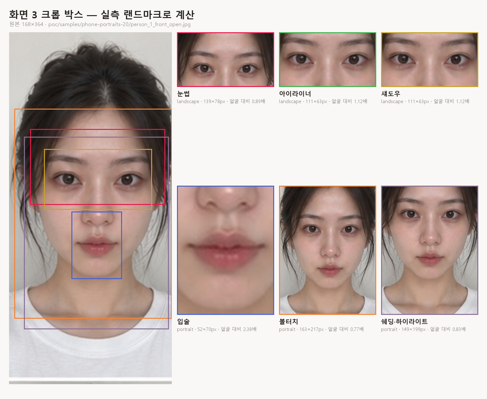
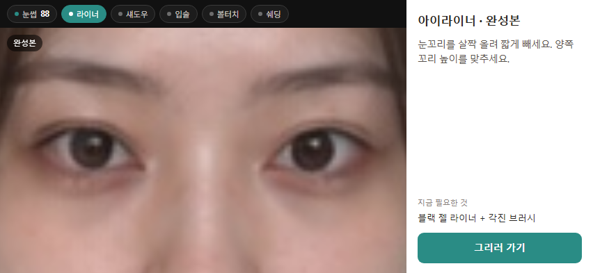
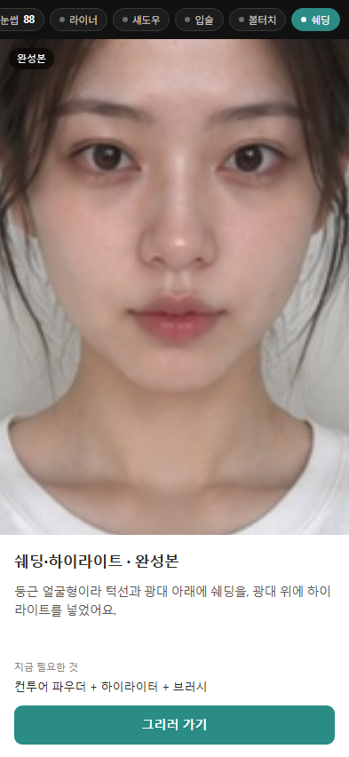

# 화면 3 부위 완성본

크롭 박스 계산(`crop.js`)과 레이아웃(`index.html`)이 들어 있다.

완성본 이미지에서 **"이 부위를 어디까지 잘라 보여줄 것인가"**를 정하는 순수 함수다.
좌표는 전부 랜드마크 기준이라 해상도·화면 방향과 무관하다.

범위·설계 배경은 `docs/screen3-tech-v6.md`, 화면 정의는 `impl-screen1-5-definition-v6.md` 3-2b.



## 실행

```
cd poc/screen3
node tests.mjs        # 자동 검증 29개 (브라우저·카메라·서버 없이 돈다)
python preview.py     # 실제 사진에 박스를 그려 preview.png 생성

cd .. && python -m http.server 8000
#   → http://localhost:8000/screen3/          레이아웃 데모
#   → .../screen3/?part=lip                   부위 지정
#   → .../screen3/?part=liner&bare=1          폰만 (스크린샷용)
```

## 레이아웃

폰 논리 크기 그대로 그린다 — **가로 852×393, 세로 393×852** (iPhone 15 기준).
화면을 줄여 어림잡지 않아야 카드 폭·칩 개수 같은 것이 실제로 맞는지 알 수 있다.

| | |
|---|---|
|  |  |
| 눈썹·아이라이너·섀도우 | 입술·볼터치·쉐딩·하이라이트 |

```
가로                                   세로
┌──────────────┬────────┐            ┌──────────────┐
│ 진행 칩       │        │            │ 진행 칩       │
├──────────────┤  카드   │            ├──────────────┤
│              │        │            │              │
│   완성본      │ 근거    │            │   완성본      │
│   (부위 줌)   │ 필요한것 │            │   (부위 줌)   │
│              │ [버튼]  │            ├──────────────┤
└──────────────┴────────┘            │ 카드          │
  1fr          268px                 └──────────────┘
                                       44 / 1fr / 250px
```

**표시 영역의 실제 종횡비를 `crop.js`에 그대로 넘긴다.** 가정값을 쓰지 않으므로
레이아웃을 바꾸면 크롭도 저절로 따라온다.

화면 아래 정보 줄에 크롭 크기·확대율·원본 확대 배수가 실시간으로 나온다.
`docs/screen3-tech-v6.md` 3장의 해상도 문제를 눈으로 확인할 수 있다.

## 쓰는 법

```js
import { cropSpec, allCropSpecs, upscaleFactor } from './crop.js';

const spec = cropSpec(landmarks, 'liner', {
  imageW: 1080, imageH: 1920,   // 완성본 원본 크기 (넘기면 박스를 이미지 안으로 넣는다)
  aspect: 16 / 9,               // 표시 영역 종횡비 (안 넘기면 부위별 기본값)
  margin: 0.15,                 // 부위 대비 여백 (안 넘기면 부위별 기본값)
});

spec.box          // { x, y, w, h } — 원본에서 잘라낼 영역
spec.orientation  // 'landscape' | 'portrait'
spec.zoom         // 얼굴 너비 ÷ 박스 너비
spec.clamped      // 이미지보다 커서 줄였는지
upscaleFactor(spec, 1840)   // 표시 폭에 채울 때 몇 배 확대되는지 (화질 판단용)
```

`allCropSpecs(landmarks, opts)`로 6부위를 한 번에 받을 수 있다. 진행 칩으로 이동할 때 미리 계산해 두면 된다.

## 규칙

| 부위 | 방향 | 반드시 포함 | 기본 여백 |
|---|---|---|---|
| 눈썹 | 가로 | 눈썹 10점 + **양쪽 눈 바깥 끝** | 15% |
| 아이라이너 | 가로 | 양쪽 눈 테두리 + **양쪽 눈 바깥 끝** | 15% |
| 섀도우 | 가로 | 위와 같음 | 15% |
| 입술 | 세로 | 입술 바깥 20점 | 15% |
| 볼터치 | 세로 | 좌우 볼 자리 (`poc/synth`와 같은 규칙) | 18% |
| 쉐딩·하이라이트 | 세로 | 광대 최대 폭 ~ 턱 끝 | 10% |

계산 순서는 **부위 범위 → 여백 → 종횡비 맞춤 → 이미지 안으로 클램프**다.
종횡비를 맞출 때는 **늘리기만 하고 절대 줄이지 않는다.** 줄이면 부위가 잘려 나간다.

## 실측 결과 (샘플 1번, 168×364)

```
부위        방향        박스         얼굴대비   부위가 박스에서 차지하는 비율
brow       landscape   139x78       0.89배     가로 77% · 세로 33%
liner      landscape   111x63       1.12배     가로 77% · 세로 19%
shadow     landscape   111x63       1.12배     가로 77% · 세로 19%
lip        portrait    52x70        2.38배     가로 77% · 세로 27%
cheek      portrait    163x217      0.77배     가로 74% · 세로 11%
contour    portrait    149x199      0.83배     가로 83% · 세로 45%
```

## 알게 된 것

### 1. 브리프의 "2~3배 확대"는 입술에서만 가능하다

**좌우를 같이 담아야 하는 부위는 얼굴 너비만큼을 화면에 넣어야 해서 확대할 여지가 없다.**

| 부위 | 담아야 하는 폭 | 가능한 최대 확대 |
|---|---|---|
| 눈썹·아이라이너·섀도우 | 양쪽 눈 = 얼굴 너비의 **0.69배** | 약 1.1배 |
| 볼터치 | 좌우 볼 = **0.96배** | 약 1.0배 |
| 쉐딩·하이라이트 | 광대~턱 = **1.0배** | 약 1.0배 |
| **입술** | 입술 = **0.32배** | **2~3배** ✅ |

사용자가 실제로 느끼는 확대는 `zoom`이 아니라 **크롭을 화면에 꽉 채우는 것**(`upscaleFactor`)에서 온다.
스펙의 "2~3배"를 모든 부위에 적용할 수 없다는 점은 화면 브리프 검토 때 확인이 필요하다.

### 2. 종횡비가 박스 크기를 지배한다

부위는 대부분 **가로로 넓고 납작**하다(입술 40×19, 볼 120×25). 종횡비를 맞추려면 위아래로 늘려야 하고,
그래서 부위가 박스의 세로 11~45%밖에 차지하지 않는다. **볼터치가 11%로 가장 심하다.**

늘어난 만큼 다른 부위가 같이 보이는데, 완성본 화면에서는 오히려 맥락이 되어 나쁘지 않다.
다만 **실제 레이아웃의 종횡비를 `opts.aspect`로 넘겨야** 의도한 그림이 나온다.
지금 기본값(가로 16:9, 세로 3:4)은 가정값이다.

### 3. 확대율은 종횡비와 무관하다

`fitAspect`가 가로로 넓은 부위에서는 **높이만 늘리기** 때문에, 종횡비를 바꿔도 박스 **너비**는 그대로다.
확대율은 전적으로 **여백**이 정한다. (검증 D7)

### 4. 세로에서 레이아웃이 깨지는 버그 두 개

- **진행 칩 6개가 393px를 넘겨** 마지막 칩이 화면 밖으로 나갔다.
  칩 이름을 줄이고(`아이라이너`→`라이너`, `쉐딩·하이라이트`→`쉐딩`),
  지금 부위 칩을 항상 보이게 `scrollIntoView`로 끌어온다.
- **`justify-content: center`와 가로 넘침이 겹쳐** 폰이 오른쪽으로 54px 밀리고 카드 문장이 잘렸다.
  그리드 아이템에 `min-width: 0`을 주고, 스크린샷 모드에서는 중앙 정렬을 끈다.
  화면 폭이 폰 폭과 정확히 같을 때만 나타나서 처음엔 문장이 잘린 줄 모르고 지나칠 뻔했다.

`.rotate`에 `display: flex`를 줘서 `hidden` 속성이 먹지 않던 것도 같이 고쳤다
(`[hidden] { display: none !important }`).

### 5. 이름이 틀린 함수가 버그를 만들었다

처음에 `faceWidth`를 "눈 바깥 끝 사이 거리"로 구현해 놓고 얼굴 너비라고 불렀다.
실제 얼굴 너비의 **0.69배**라 확대율이 전부 1.45배씩 작게 나왔다.
지금은 `faceWidth`(광대 최대 폭)와 `eyeSpan`(눈 사이)을 나눠 두었고, 검증 D6이 둘이 다른 값임을 확인한다.

## 파일

| 파일 | 내용 |
|---|---|
| `index.html` / `app.js` / `style.css` | 레이아웃 데모. 가로/세로, 진행 칩, 카드, 방향 안내 |
| `screenshots/` | 폰 크기 그대로 캡처 |
| `crop.js` | 순수 함수. 랜드마크 인덱스, 부위 범위, 여백·종횡비·클램프, `cropSpec` |
| `tests.mjs` | Node 검증 29개 (A 기본 5, B 잘림 5, C 종횡비 4, D 여백·확대 8, E 경계 4, F 대칭·중심 3) |
| `fixture-landmarks.json` | 검증용 실측 랜드마크 478점 (샘플 1번 사진) |
| `preview.py` | 실제 사진에 박스를 그려 눈으로 확인 (Pillow + node) |

`crop.js`는 DOM을 쓰지 않으므로 브라우저·Node 어디서든 돈다.

## 다음

- [x] ~~완성본 화면 레이아웃 (가로/세로 2종)~~
- [x] ~~진행 칩 6개 + 상태 표시~~ — 겉모습만. 상태는 더미이고 세션 연결은 아직
- [x] ~~방향 안내 (가로↔세로)~~ — 지금은 체크박스로 강제. 실제 기기 방향 감지는 아직
- [ ] 진행 칩을 실제 세션 상태에 연결 (미시작·진행 중·완료·확인만·건너뜀 + 최신 점수)
- [ ] 기기 방향 감지 → 안내 자동 표시
- [ ] 실제 레이아웃 종횡비 확정 → `DEFAULT_ASPECT` 교체
- [ ] 근거 한 줄 · 지금 필요한 것 (더미 데이터로)
- [ ] 3-c 규칙 테두리 — 얼굴형 규칙 5종이 나온 뒤
- [ ] `fullRender` 연결 — 서버가 나온 뒤. 무엇을 원본으로 쓸지는 `docs/screen3-tech-v6.md` 3장
