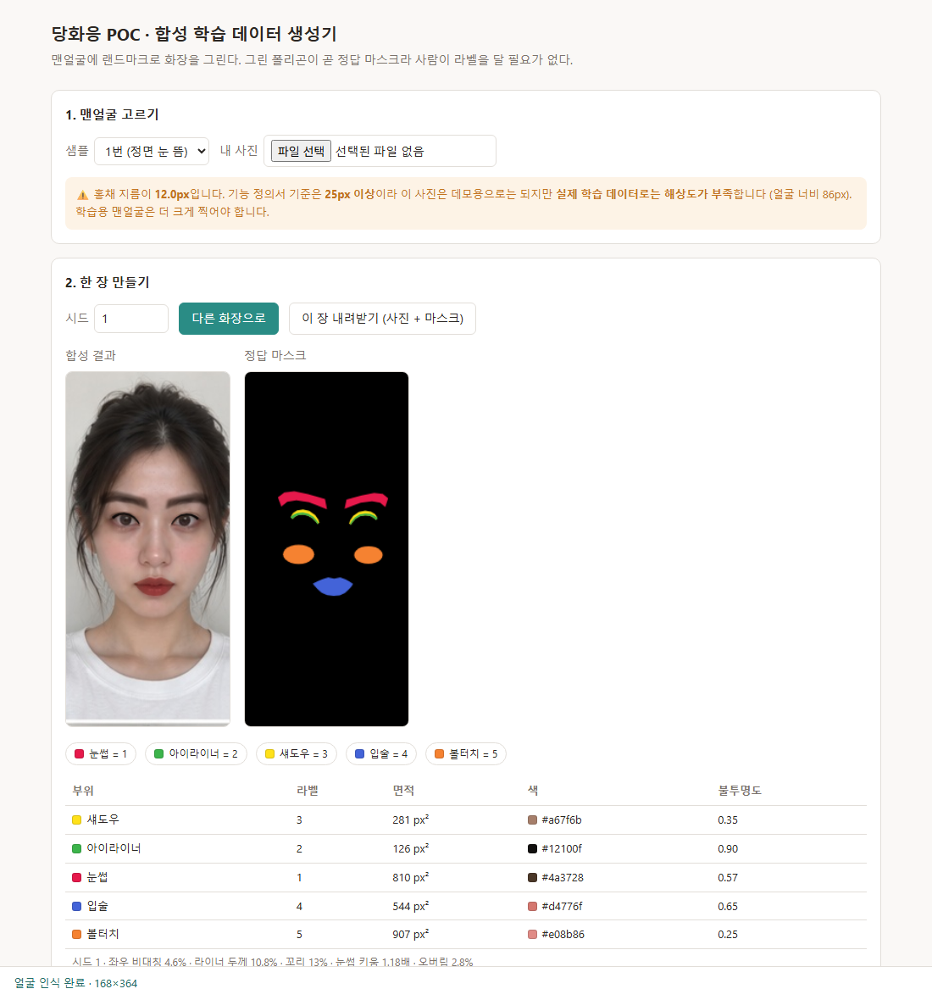
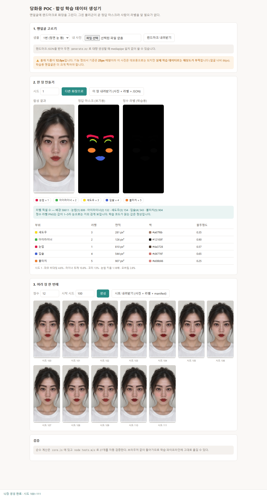
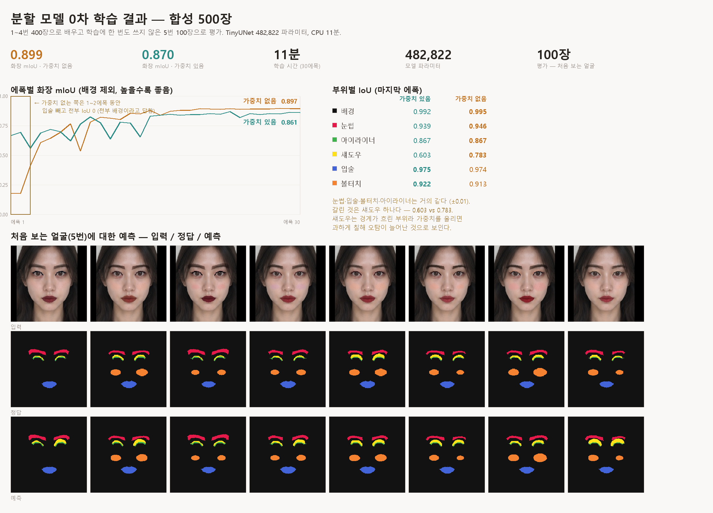

# 합성 학습 데이터 생성기 POC

맨얼굴 사진에 랜드마크로 화장을 그린다. **그린 폴리곤이 곧 정답 마스크**라 사람이 라벨을 달 필요가 없다.

`tech-stack-v6.md` 8-4의 대체안을 실제로 해 본 것이다. 분할 모델(F-08) 학습 데이터를
FFHQ-Makeup(CC-BY-NC-SA) 대신 **자체 합성 100%**로 만들 수 있는지 확인하는 게 목적이다.

| | |
|---|---|
|  |  |

## 실행

**브라우저 데모** — 눈으로 확인하고 파라미터를 감 잡는 용도

```
cd poc && python -m http.server 8000
#   → http://localhost:8000/synth/
#   → http://localhost:8000/synth/?batch=12   여러 장 생성까지 자동
```

랜드마크 검출만 MediaPipe를 CDN에서 받으므로 인터넷이 필요하다. 계산은 전부 오프라인.

**대량 생성** — 실제 학습 데이터를 뽑는 용도

```
cd poc/synth

# 1) 브라우저에서 "랜드마크 내려받기"로 JSON을 받아 쓴다 (mediapipe 불필요)
python generate.py --photo ../samples/phone-portraits-20/person_1_front_open.jpg \
                   --landmarks landmarks.json --n 100 --out out/

# 2) mediapipe가 깔려 있으면 사진만 주면 된다 (pip install mediapipe)
python generate.py --photo ../samples/phone-portraits-20/person_1_front_open.jpg --n 100 --out out/
```

2번은 첫 실행 때 랜드마크 모델(`face_landmarker.task`, 3.6MB)을 한 번 내려받는다.
브라우저가 CDN에서 받는 것과 같은 파일이다. `.gitignore`에 넣어 두었다.

**검증**

```
cd poc/synth
node tests.mjs        # 자동 검증 27개 (브라우저 불필요)
python parity.py      # core.py가 core.js와 같은 결과를 내는지 시드 50개 대조
python parity.py 500  # 더 촘촘히
```

## 무엇을 만드나

부위 5개를 맨얼굴 랜드마크(468점)에서 절차적으로 그린다.

| 부위 | 라벨 | 방법 | 변형 파라미터 |
|---|---|---|---|
| 눈썹 | 1 | 자연 눈썹 테두리를 중심에서 키우고 꼬리를 든다 | 키움 배율, 꼬리 높이, 색, 농도 |
| 아이라이너 | 2 | 윗속눈썹 선을 바깥으로 밀고 꼬리를 붙인다 | 두께, 꼬리 길이·각도, 색, 농도 |
| 섀도우 | 3 | 속눈썹 선 위 눈꺼풀 띠 (가운데가 높은 둥근 모양) | 높이, 색, 농도, 유무 |
| 입술 | 4 | 바깥 테두리를 중심에서 키우거나 줄인다 | 오버립/인립, 색, 농도 |
| 볼터치 | 5 | 눈 아래-입꼬리 중간에서 바깥으로 민 타원 | 반지름, 색, 농도, 유무 |

색 후보는 부위별로 눈썹 8 · 아이라이너 7 · 섀도우 12 · 입술 13 · 볼터치 8 = **48개**,
조합하면 **69,888가지**다. 각 색에는 `COLOR_FAMILY`로 색 계열 이름(레드·코랄·MLBB 등)이 붙어 있고,
manifest에 같이 기록된다. **룩 템플릿 10개의 색 계열이 정해지면 이 팔레트를 그것으로 교체한다** — 지금은 임시값이다.

파라미터는 전부 **눈 너비·얼굴 너비에 대한 비율**이라 해상도·얼굴 크기와 무관하다.
**좌우 비대칭(±18%)**을 일부러 넣는다. 초보자 화장을 흉내내는 동시에, 채점기의 좌우 차이 판정(F-09)을 학습시키는 데 쓴다.

## 출력

| | 내용 |
|---|---|
| `photo_XXXX.png` | 합성 사진. 어두운 색(눈썹·라이너·입술)은 곱하기, 섀도우·볼터치는 그냥 얹기. 부위마다 번짐이 다르다 |
| `label_XXXX.png` | **정수 라벨 마스크.** 픽셀값이 곧 클래스 번호 (배경 0, 부위 1~5). 눈으로는 거의 검게 보이지만 학습 코드가 읽는 값은 정상 |
| `manifest.json` | 시드·파라미터·부위 면적·라벨 픽셀 수 |

**라벨에 중간값이 섞이지 않게 하는 것이 핵심이다.** 경계에 3.7 같은 값이 생기면 학습이 깨진다.
Pillow의 `polygon`은 안티앨리어싱이 없어 그대로 정수가 나오고, 브라우저 쪽은 부위마다 흰색으로 따로 찍어
알파 128로 잘라 같은 결과를 만든다. 두 경로 모두 라벨 픽셀 수의 합이 이미지 넓이와 정확히 일치한다.

시드를 고정하면 같은 결과가 나온다. 학습 데이터를 다시 만들 때 재현이 된다.

## 파일

| 파일 | 내용 |
|---|---|
| `core.js` | 순수 함수. 랜드마크 인덱스, 시드 난수, `randomParams`, 부위별 폴리곤, `buildSample`, 면적 |
| `core.py` | 위의 파이썬 이식본. **`parity.py`가 둘이 같은 결과를 내는지 검증한다** |
| `fixture.mjs` / `fixture.py` | 검증용 가짜 대칭 얼굴. 두 언어가 같은 값을 만든다 |
| `tests.mjs` | Node 검증 27개 (A 폴리곤 5, B 재현성 4, C 범위 2, D 단조성 6, E 대칭 4, F 구성 6) |
| `parity.mjs` / `parity.py` | JS↔Python 대조 검증. 파라미터·부위 순서·면적·폴리곤 점 개수·양 끝점 좌표 |
| `generate.py` | 대량 생성 CLI (Pillow만 필요). `--crop face`로 얼굴만 잘라 정사각 출력 |
| `train.py` | 분할 모델 0차 학습 (PyTorch). 클래스 가중치 + 부위별 IoU 평가 |
| `index.html` / `app.js` / `style.css` | 브라우저 UI. 랜드마크 검출과 렌더링만 담당 |
| `screenshots/` | 헤드리스 크롬 캡처 |

`core.js`/`core.py` 모두 DOM·이미지 라이브러리를 쓰지 않으므로 학습 파이프라인에 그대로 넣을 수 있다.

## 알게 된 것

1. **검증이 버그를 잡았다.** 회전 부호가 좌우 같아서 **왼쪽 눈 꼬리가 아래로 뻗고 있었다.** 대칭 얼굴에서 좌우 면적을 비교하는 테스트(E1)가 2.66% 차이로 걸러냈다. 눈으로는 알아채기 어려웠다.
2. **볼터치 위치는 눈-입 중간이 아니다.** 반으로 나누면 코 옆에 붙어 다크서클처럼 보인다. 얼굴 중심 반대쪽으로 얼굴 너비의 12%를 밀어야 광대 위에 온다 (F6).
3. **샘플 20장은 해상도가 부족하다.** `poc/samples/phone-portraits-20/`은 (#88 전) 168×364라 홍채 지름이 **12px**인데, 기능 정의서 기준은 **25px 이상**이다. 데모는 되지만 학습 데이터로는 못 쓴다. 브라우저·CLI 모두 이 경고를 띄운다.
 → **#88 에서 업스케일본(1080×1440)으로 바꿔 한 벌로 합쳤다.**
4. **한글 윈도우 콘솔은 CP949라 일부 문자에서 죽는다.** `generate.py`가 em dash 하나 때문에 `UnicodeEncodeError`로 멈췄다. 두 스크립트 모두 stdout을 UTF-8로 고정해 두었다.
5. **mediapipe 1.0에서 옛 `solutions` API가 사라졌다.** `mp.solutions.face_mesh`는 이제 없고 Tasks API(`mediapipe.tasks.python.vision.FaceLandmarker`)를 써야 한다. 브라우저가 쓰는 `tasks-vision`과 같은 API·같은 모델이라 오히려 두 경로가 맞춰졌다.
6. **브라우저와 파이썬의 랜드마크가 완전히 같지는 않다.** 아래 참조.

## 브라우저 경로 vs 파이썬 경로

같은 사진·같은 시드로 양쪽을 돌려 비교한 결과다 (샘플 1번).

| | 값 |
|---|---|
| 랜드마크 478점 평균 거리차 | **0.21 px** (중앙값 0.17, 최대 0.70) |
| 부위 면적 차이 | **1.0 ~ 3.0%** (입술이 가장 큼) |

**원인은 우리 코드가 아니다.** `core.py`와 `core.js`는 같은 랜드마크를 주면 시드 500개에서 소수점까지 똑같다(`parity.py`).
차이는 전부 검출기에서 온다 — 브라우저는 GPU(float16), 파이썬은 CPU(XNNPACK)로 같은 모델을 돌리므로 연산 정밀도가 다르다.

**학습에는 문제없다.** 1~3%는 우리가 일부러 넣는 좌우 비대칭(±18%)보다 훨씬 작다.
다만 **두 경로를 섞어 만든 데이터는 픽셀 단위로 동일하지 않다.** 재현이 중요한 실험은 한쪽 경로로 통일할 것.

## 500장 뽑아 본 결과

샘플 5명 × 100장을 실제로 만들어 전수 검증했다 (시드 0~499, **10초**).

| | |
|---|---|
| 라벨 이상값 | **0장** — 500장 전부 픽셀값이 0~5뿐 |
| 픽셀 합 불일치 | **0장** |
| 실제로 나온 색 조합 | **498가지** (500장 중 중복 2장) |
| 파라미터 실측 범위 | 라이너 두께 5.0~13.0% · 꼬리 0.1~29.9% · 좌우 비대칭 −17.9~+18.0% |

**클래스 불균형이 심하다.** `--crop face`로 얼굴만 잘라도 배경 94.69%까지밖에 안 줄어든다.
학습에서 클래스 가중치와 IoU 평가로 잡는다 — 자세한 건 `docs/synth-training-v6.md` 5장.

원본 기준 분포: 배경 96.16%, 눈썹 1.07%, 볼터치 1.09%, 입술 0.96%, 섀도우 0.49%, **아이라이너 0.24%**.
아이라이너가 배경보다 400배 드물어, 그냥 학습하면 모델이 전부 배경이라고 답하고도 96점을 받는다.
**얼굴 영역으로 크롭해 학습하거나 클래스 가중치·Focal Loss가 필요하다.** 1주차 검증 7에서 같이 정할 것.

## 0차 학습 결과



1~4번 400장으로 배우고 **학습에 한 번도 쓰지 않은 5번 100장**으로 평가했다 (CPU 11분, 30에폭).

| | 최고 화장 mIoU |
|---|---|
| 가중치 없음 | **0.899** |
| 가중치 있음 | 0.870 |

부위별(가중치 없음): 눈썹 0.946 · 아이라이너 0.867 · 섀도우 0.783 · 입술 0.974 · 볼터치 0.913.

**클래스 가중치는 예상과 달리 손해였다.** 다만 가중치 없는 쪽은 1~2에폭 동안 입술 빼고 전부 IoU 0이었다
— 5-2에서 걱정한 "전부 배경이라고 답하기"가 실제로 일어났고, IoU로 봤기에 그걸 발견했다.
자세한 것은 `docs/synth-training-v6.md` 8장.

⚠️ **0.9라는 숫자를 곧이곧대로 믿으면 안 된다.** 평가에 쓴 정답도 우리 생성기가 그린 것이라,
모델은 "실제 화장"이 아니라 "우리 규칙이 그리는 모양"을 배웠다. 실제 사진 평가가 따로 필요하다.

## 다음

- [ ] **학습용 맨얼굴 확보** — 홍채 25px 이상. 팀원 촬영이 1순위 (라이선스·초상권이 깨끗하다)
- [ ] 조명·그림자 변형 추가 (지금은 화장만 바뀌고 조명은 고정)
- [ ] 실제 사진 200장 라벨링 (평가 전용) — 합성→실제 일반화 조기 판단
- [x] ~~합성 100장 → 분할 모델 0차 학습 (1주차 실기기 검증 7)~~ — `train.py`, 설명은 `docs/synth-training-v6.md`
- [x] ~~마스크를 정수 라벨 PNG로 내보내기~~
- [x] ~~`core.js`를 Python으로 이식해 대량 생성~~
